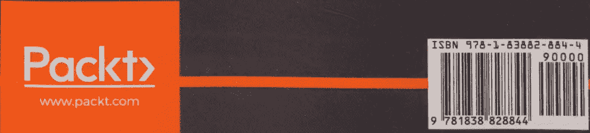

# 索引

关于

本书中使用的所有主要关键字均按字母顺序收录在本节中。每个关键字都附有它们出现的页码。

# A

abstract：80, 345-346, 350
accessor：13
accessors：11, 35
ackermann：227
activity：24, 39, 44-45, 52-53, 80, 88, 133, 139-140, 152-154, 166-167, 184, 189-190, 192, 207-209, 236, 238-239, 266-267, 270, 290-291, 304, 307-311, 322, 324-325, 335, 337-340, 342-344, 385, 388-389, 403-404, 406-408, 412, 444, 446-447, 468, 470-472
address：3, 7, 11, 43, 46, 118, 139-140
adjacency：90-91, 94, 98, 280, 330-332, 334, 344-345, 455, 457, 462
algorithm：12, 20, 34, 51, 85, 88, 94, 109, 127, 133, 139-140, 143-148, 152-153, 155-157, 159, 161-162, 164, 167-168, 170, 172-173, 176, 178, 180, 189, 193, 195-196, 198, 203, 210-214, 216-217, 219-220, 225, 227, 229, 232-233, 235-236, 240, 243-245, 249, 252, 257-259, 263, 267-271, 273, 277, 279-283, 287-291, 293-298, 300-301, 304, 311-312, 314, 316-320, 323, 329-330, 332-334, 344-345, 350, 361, 364, 366, 370, 373, 377, 386, 389, 398, 404-405, 423-424, 426, 428, 431, 434, 438-439, 441, 443, 448-451, 455, 457, 460-462, 464, 467

algorithms：2, 51, 98, 102, 133, 143-145, 154-156, 160, 166-168, 176, 178, 193, 195, 197, 210, 240, 243-246, 265-266, 270, 280, 293-294, 311, 345-346, 349, 413, 415, 418, 422, 424, 447-448, 451, 460, 470, 473
allocate：20, 23, 46, 235
allocated：3-4, 20
allocation：7, 19, 23-24
allocator：23-24, 40, 48
allocators：23, 48
allotted：355, 444
allowance：441
all-pairs：322, 451, 460
amortized：118
appending：113, 359, 379
applicable：145, 197, 240, 244, 294
applicants：322
approaches：101, 108, 145, 195, 197, 344, 346, 350, 356, 360, 372, 377-378, 385, 392, 403, 415-416
arbitrary：79, 162, 167, 235, 258, 297
archetypal：413
argument：7-8, 21, 182, 298, 381, 456
arguments：17, 22, 315, 317-318, 330-332, 361, 398, 462
arithmetic：10, 31
array-like：12, 24
arrays：3-4, 6-9, 11, 18-19, 24, 31, 46, 57, 88, 127, 146, 151, 155-156, 158-159, 162, 165, 167, 317, 344, 350, 369, 373-374, 378, 426

ascending：76
assign：89, 228, 236, 259, 267, 463
assigned：11, 232-233, 236, 238, 252, 267-269, 277, 355, 418
assignment：11, 48, 56, 416, 442
associated：178, 210, 244, 270, 280, 328, 335-336, 425, 447, 460
asymptotic：4, 166, 176, 296, 330
automata：245
automate：322
average：20, 23, 48, 51, 113, 197-199, 323, 373
aviation：90

# B

backtrack：304
backward：24, 31, 40, 43-44, 53, 56
balanced：71, 76, 78-79, 336
banknotes：357-358
benchmark：130, 148, 345
benchmarks：52, 148, 151
bilateral：89
billion：103
billions：102, 139
binary：29-30, 59, 63, 66-69, 71, 77, 79, 145-155, 280, 290, 393, 418, 422
biomedical：88

176, 227-228, 255, 265, 280, 296, 326, 330, 353, 355, 357, 360, 378, 394, 400, 416, 418, 420-422, 434, 461, 471-472
compute：134, 166, 199-200, 391, 422
computer：80, 144-145, 155, 245, 266, 349
computers：52, 80, 156, 178, 422
computing：155, 198, 351, 354-355
conquer：68, 140, 143, 145, 154-155, 176, 178, 193, 244, 358
conquering：178
console：16, 164
constant：3, 19, 31-32, 42-43, 176, 297, 312, 314, 361, 364, 455, 462
container：10, 12, 16-17, 20, 31, 33-34, 39-40, 43, 45-46, 48-51, 53, 85, 98, 102-104, 127-129, 131, 139-140, 152, 164, 179-180, 182, 258, 331
containers：1, 10, 16, 23-24, 31, 43, 45-46, 48-49, 51, 53, 87, 89, 127-128, 130-131, 133, 140, 160
contiguous：2-4, 6, 24, 31, 46, 52, 391
copy-paste：345
corrupt：23
corruption：7
cpu-level：145
c-style：3, 7-9, 11-12, 18-19, 24, 33
cuckoo：116-118, 125-126, 134
custom：1, 19, 23-24, 30,
33-34, 39, 131, 400
customer：23, 40, 48, 146, 356
cycles：120, 155, 216, 225, 270, 293, 300-301, 316, 323, 453, 461, 464
cyclic：56, 58, 89
D
database：102, 126, 139
databases：56, 145, 155
dataset：2, 33, 88, 112-113, 328
datasets：88, 178
datasource：187
datatype：152, 155, 223
datatypes：160
deallocate：5, 7, 23, 25
debugger：151
debugging：151, 470
decreasing：156, 166, 204-205, 236-237, 416
default：7, 9, 14, 23, 29-30, 37, 39, 48-49, 51, 53, 92, 95, 127, 131, 325, 374
define：29, 33, 113, 131, 144, 250, 297-298, 328, 330, 332-333, 356, 360-361, 363-364, 366, 369-370, 373, 377, 381, 396, 398, 422, 426-427, 452, 455-458, 463
defined：11-12, 22, 26, 80-81, 127, 133, 153, 155, 187, 201, 222, 244, 270, 280, 297, 305, 323, 327, 335, 365, 375, 390, 408, 441, 452, 457
delete：4, 13, 24, 26, 35, 41, 48, 67, 69-70, 74-75, 84, 120
deleted：5, 43, 69-70, 84, 291
deletion：10, 24-26, 40-43, 46-48, 51, 69, 71, 74, 78, 81-82, 103, 108, 113, 120, 124, 128, 225
deques：48, 84
descending：29
design：2, 39, 140, 143, 145, 178, 189, 193, 195-197, 210, 240, 244
designated：210, 468
designing：2, 53, 131, 193, 235, 322, 335, 385, 444, 468
destructor：13
device：149, 181-182, 200, 205
devices：335
dfs-based：329
dictionary：102, 104, 108, 126, 374
digital：356
digits：214, 420
dijkstra：193, 196, 240, 243, 280-281, 283, 287-291, 293-296, 300, 311, 314, 316-317, 319, 350, 448, 451, 461
dimension：98, 378, 381, 403-404, 427, 439, 441, 461
dimensions：94, 356, 379, 382, 404, 416, 427, 439, 447, 453
directed：89, 244-245, 280, 290, 293, 322, 325-327, 456
discard：108, 147, 211-212
disjoint：214, 220, 222, 227
divide：68, 140, 143, 145, 154-155, 160, 168, 176,

## F

- 274, 276–277, 286, 291, 298–299, 315–319, 330–334, 352–353, 361–363, 365, 369–371, 374–376, 381–382, 396, 398–401, 426–427, 442, 455–458, 462
- 函数：9–13, 16, 18–26, 30–31, 33, 35–36, 38–43, 45, 47–50, 52, 71, 80, 93, 97, 103, 106–108, 111, 113, 118–119, 127–128, 131, 133–134, 136–140, 149, 152, 160, 175–176, 178–180, 187, 198, 345, 369

## G

- 生成器：205, 207–208, 322–323
- 泛型：3, 9, 21, 29, 101, 127, 199
- 遗传：102
- 故障：390
- Google：178, 189, 196, 245, 280
- 图形化：59, 334
- 绘图：346
- 图：55–56, 58, 89, 98, 193, 214, 227, 243–245, 266–267, 280, 291, 293–296, 311, 322–327, 344, 346, 350, 413, 416, 447, 461, 464
- 贪心地：202, 209, 270, 294
- 贪心：193, 195–197, 201, 208, 210–213, 229, 233–236, 240, 244, 270, 280, 295–296, 304, 311, 350, 422, 451

## H

- Hadoop：179, 184, 188
- 硬件：187
- 和声：408
- 哈希的：373
- 哈希：98, 102–103, 116–118, 125–127, 133–134, 140, 373–374
- 堆化：51
- 启发式方法：235
- 层次结构：57, 59, 63, 79–80
- 高端：468
- 哈夫曼：56, 381, 385–386, 390, 398, 426, 442, 445, 455–458, 462, 469

## I

- 递增：10, 20, 31, 323, 368–369, 396, 399
- 递增（复数）：375
- 索引的：46, 353, 362, 468
- 索引（复数）：114, 155, 189, 288
- 索引：189, 355
- 内联：203, 222–223, 230, 249, 259, 274, 277, 284
- 中序：64, 74, 76
- 输入：144, 322, 325, 337, 363, 385, 392, 411
- 插入：4, 19–22, 24–25, 39–44, 46–48, 61, 67–68, 73, 75–78, 82, 84, 86–88, 103–106, 108–109, 111, 114–118, 120–123, 126–127, 129–131, 133–134, 138–139, 150, 181–182, 200, 211, 233, 253, 262, 278, 288, 302, 313, 376
- 整数：71, 103–104, 184, 297, 305, 315, 317–318, 330–333, 357, 361, 375
- 整数（复数）：11, 41, 67, 103–104, 108, 126–127, 139, 146–147, 153, 155–156, 255, 324, 357, 361, 369, 373, 385–386, 398, 422, 426, 445, 455, 457, 469
- 面试：322–323
- 无效：43–44, 301, 323–324, 336, 364, 374
- 使无效：43
- 不变量：51, 82–84
- 不变量（复数）：82–84
- 迭代：4, 10, 13, 127, 146, 154, 191, 298–299, 301, 318, 329, 331, 362, 379–380, 382, 420, 427, 448, 457
- 迭代器：10, 13, 20–22, 24–25, 29, 31, 33, 35–36, 39–40, 43, 119–120, 163–164, 171–172
- 迭代器（复数）：9–10, 26, 29, 31–33, 40, 43, 47, 51, 85, 127, 152, 163–164, 171–172, 191
- 行程：385

## J

- JavaScript：145

## K

- 键类型：191
- 键值：108, 131, 178
- 背包：195, 197, 201–207, 240, 415, 422–426, 428–429

## P

- 播放列表：24, 39
- 指针：4–5, 11, 24, 40, 42, 69, 81, 214
- 指针（复数）：11, 25, 31, 42–43, 46, 82, 215, 288, 297, 315, 345, 396
- 后序：64
- 预计算：436
- 预定义：176, 178
- 前缀：63, 402–403, 406, 408
- 前缀（复数）：403, 406, 408
- 前序：63–64
- 素数：184
- 伪代码：20, 368, 399, 425, 429, 449
- 谜题：229, 420
- 谜题（复数）：228

## Q

- 二次：116
- 四分之一：356–357
- 快速排序：143, 145, 155, 160–162, 164, 166–167, 171, 193

## R

- 随机：25, 31, 43–44, 46–48, 148–150, 157, 162, 170, 180–182, 190, 198, 200, 203, 205–208, 322–323
- 随机化：322
- 现实生活：1, 19, 59, 88, 210
- 现实世界：55–56, 58, 98, 195, 197, 201–202, 243, 345
- 矩形：3
- 递推：176, 351, 389, 396, 413, 432, 452
- 递归中：365
- 递归：65, 118, 120, 122, 162, 166, 176, 352, 354–355, 365, 396, 399
- 递归的：59, 63, 72, 120, 158, 162, 329, 351–353, 355, 365, 369, 378–379, 419, 449, 453, 460
- 红黑：79
- 归约：9, 22, 71, 78, 160, 178–180, 182–184, 186–188, 190–191, 198, 335–336, 344, 353, 385, 434
- 再哈希：118, 127, 131
- 再哈希（名词）：113, 117, 121, 124, 127, 131
- 关系型：11
- 代码仓库：390
- 必要条件：354
- 反转：10, 24, 30, 42–43, 133, 205, 288, 319, 456
- 重新加权：319
- 重新加权后的：314
- 重新加权（动词）：311
- 重写：371
- 有根的：69, 71
- 运行时：19, 166, 176, 186, 188, 190–191
- 运行时（复数）：145

## S

- 可扩展的：2, 184, 188
- 调度：52, 197–198, 207–209, 240
- 搜索：60, 66–69, 71, 77, 98, 102–103, 109, 113–114, 116, 139, 145–155, 172, 189, 240, 245–247, 249, 253–256, 258, 262, 264–265, 267, 278, 287, 291, 293–294, 346, 397, 425, 452, 457
- 搜索（复数）：150, 189, 288
- 搜索中：67–68, 78, 98, 102, 116, 131, 244, 256, 295, 390, 418
- 安全性：61–66
- 语义：48–49, 51
- 分隔符：14
- 序列：39, 144, 146–147, 154, 185–186, 312–313, 350–355, 378–379, 386, 389, 391, 395–396
- 序列化的：223
- 服务器：188
- 设置：113, 136, 214, 280, 318, 402
- 已确定：273, 280, 283
- 确定中：272, 278, 282, 287
- 浅：11
- 最短：168, 193, 196, 200, 240, 243, 245, 265, 280–281, 283, 287–291, 293–296, 298–301, 311–314, 317, 319, 321–323, 344, 350, 413, 415, 448–452, 455–456, 458–464
- 洗牌：44–45
- 骨架：190
- 偏斜的：77–78, 300
- 偏斜度：78
- 天际线：145
- 软件：144, 178, 188, 193, 196, 280, 322, 346, 385, 390
- 求解器：229
- 已排序的：29, 31, 76, 88, 146–147, 153, 156, 158–161, 165–167, 175, 236
- 排序：85, 155–156, 161, 165, 167

## U

- 未访问的：258, 267, 272, 282, 295, 299, 303, 317, 329–330, 333
- 未加权的：89, 244

## V

- 疫苗：152–154
- 向量：6, 10, 17–25, 29, 31–33, 43, 45–53, 79, 82, 85, 91–92, 94–96, 98, 104, 108–109, 118–119, 127, 130, 136–137, 146, 148–149, 152–153, 157–159, 161–168, 170–175, 180–182, 198–200, 203–204, 206, 209, 220, 224–226, 229, 231–234, 238, 249, 251–253, 259, 261–263, 273, 275–278, 283, 285–287, 296–298, 302, 314–320, 330–335, 345, 353, 355, 361–363, 369–372, 375–376, 381–384, 389, 398, 426–427, 433–437, 441–442, 455–458, 462–464
- 向量（复数）：20, 22, 24, 31, 43, 47–48, 57, 84, 88, 127, 150, 157–158, 164, 166–168, 170, 330–331, 333, 361, 373, 378, 455, 457
- 村庄：210–211
- 已访问的：63, 120, 247–249, 253–254, 258, 262, 264–265, 267, 269–270, 277–278, 287–288, 295, 301, 317–318, 329, 331–333, 335
- 访问中：5, 64, 66, 246, 248, 256–258, 272, 282
- 投票：28

## W

- 仓库：444–445
- 权重：90, 92, 201–207, 210, 212–213, 218, 222–223, 226, 230, 238, 244, 249–250, 259–260, 270, 272, 274, 278, 280, 282, 284, 287, 290, 293, 295–298, 300–303, 313–316, 318, 320, 322–323, 424–431, 438–443, 448–450, 452–453, 455–458, 461–464
- 加权的：89–90, 245, 291, 294, 322, 344, 415, 422
- 批发：444
- 词数统计：189–190
- 包装器：7, 9, 24, 29, 33, 39–40, 48–49, 72
- 包装器（复数）：128

## Y

- YouTube：267

## Z

- 从零开始：469
- 之字形：269

## C++ 数据结构与算法设计原则

C++ 是一种成熟的多范式编程语言，使您能够编写对硬件具有高度控制能力的高级代码。如今，软件基础设施的很大一部分——包括数据库、浏览器、多媒体框架和 GUI 工具包——都是用 C++ 编写的。

本课程首先介绍 C++ 数据结构，以及如何使用链表、数组、栈和队列来存储数据。在后续章节中，课程将讲解基本算法设计范式，例如用于解决各种计算问题的贪心法和分治法。最后，你将学习动态规划这一高级技术，为课程中讨论的多种算法开发优化实现。

学完本课程后，你将掌握如何用高效且可扩展的 C++14 代码实现标准数据结构和算法。

### 你将学到：

- 使用哈希表、字典和集合构建应用程序
- 探索现代硬件如何影响程序的实际运行时性能
- 将堆排序和归并排序等常见算法应用于字符串数据类型
- 使用 C++ 模板元编程编写代码库
- 使用布隆过滤器实现 URL 缩短服务
- 使用恰当的现代 C++ 惯用法，例如用 `std::array` 代替 C 风格数组

