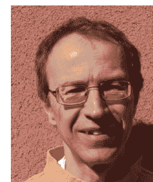
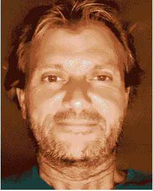

## 关于作者

**Radek Vystavěl** 从小就开始了编程，并一直坚持至今，同时也乐于与他人分享。他既在大学担任过编程教师，也私下做过程序员。由于许多学生没有任何编程基础，他很难为他们找到合适的教材，于是开始编写编程书籍。多年来，他对初学者的教学之道积累了独到的见解。

## 关于技术审校者

**Carsten Thomsen** 主要是一名后端开发人员，但也处理一些前端工作。他撰写并审校了多本书籍，并制作了众多 Microsoft 学习课程，内容都与软件开发相关。他以自由职业者/承包商的身份在欧洲多国工作，使用的工具有 Azure、Visual Studio、Azure DevOps 和 GitHub 等。作为一名出色的故障排除者，他擅长提出正确的问题，包括那些不太合乎逻辑的问题，并按从最合乎逻辑到最不合乎逻辑的方式逐一排查。他还喜欢从事架构、研究、分析、开发、测试和缺陷修复等工作。

Carsten 是一位非常善于沟通的人，具备出色的指导能力和团队领导能力，以及研究新资料和展示新资料的能力。

## 致谢

特别感谢我的女儿 Amálie，她协助我准备手稿。在我的指导下，她录入了大部分内容并制作了许多图表。

感谢整个 Apress 团队，包括技术审校者，他们的专业知识和奋斗精神使本书得以按时高质量完成。另外，由于编辑们的工作，本书的质量大有提升，他们善意地润色了我的英文。
