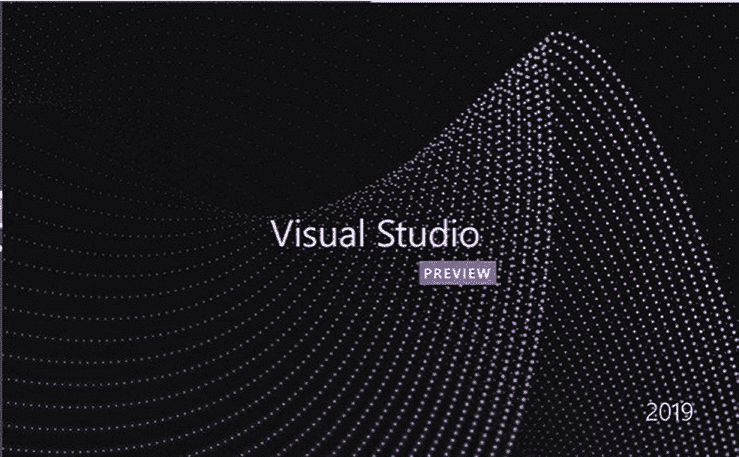
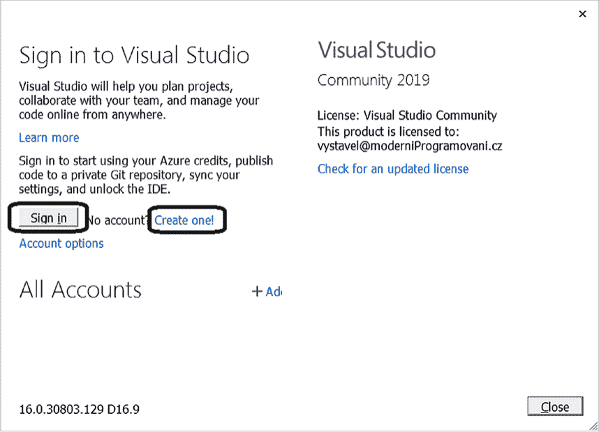

## 第1章

## 准备工作

亲爱的读者，欢迎你开启学习编程的旅程！计算机、平板电脑、手机以及许多其他电子设备都是可编程的，它们会完全按照人类程序员告诉它们的去做。

编程是一个完全基于逻辑的世界。在这方面，它在人类活动中相当独特。如果你喜欢逻辑——例如，你喜欢解谜，或者你习惯于寻找周围有意义秩序——那么你会爱上编程。

### C# 语言

在本书中，你将创建一些真正的程序，为此你需要学习一种编程语言，它正是向计算机发出指令的工具。编程语言提供了计算机与人类之间的交互。它们足够严谨，以至于绝对愚笨的计算机也能理解；同时它们又足够人性化，程序员可以使用它们编写代码。

随着时间的推移，人们已经创造了许多编程语言，如今也有许多语言在使用。每种语言都有其优点和缺点。

在本书中，我选择了 C# 编程语言，它是我在职业开发和教学中的首选语言。C# 已有大约 20 年的历史，这意味着其创造者在开发它时可以避免旧语言中已知的缺陷。此外，它现在是一门经过时间考验的语言，不会被新潮流轻易取代。

C# 实际上是微软的旗舰语言。它非常通用——你可以用它编写各种各样的程序，从传统的控制台和桌面应用程序，到网站和服务，再到移动开发，既可用于商业也可用于娱乐。它最初诞生于 Windows，近年来已迅速扩展到其他平台——如 Linux、Mac、Android 和 iOS。

希望你使用它时感到愉快，并在未来的职业/业余生活中发现它的许多用途！

### 本书适合哪些读者

本书主要面向那些没有编程知识或编程知识有限的人。要从本书中获得最大收益，你应该熟练操作计算机——能够安装程序，知道文件或文件夹是什么，等等。

然而，由于本书对所涉及主题的深入覆盖，如果你是一名中级程序员，或者已经掌握了另一种编程语言并且想开始学习 C#，你也会从本书中受益。你只会比完全的初学者更快地读完这本书。

### 本书与其他书的不同之处

我根据自己 15 年来向不同群体（学生、教师、业余爱好者等）教授编程的经验写了这本书。对他们中的许多人来说，这是他们第一次接触这门学科。我在教学中仔细观察他们，多年来积累了大量关于人们如何学习、什么对他们来说容易、什么需要更多关注的信息。

在本书中，你将受益于这些知识。本书与同类书籍的不同主要体现在以下几个方面：

- 讲解的节奏——也就是进入新主题的速度——适中而缓慢，这样你就不会在刚开始后不久就迷失方向。专家作者常犯的一个错误是将初学者内容视为琐碎小事。事实上，对他们来说这确实琐碎。但对读者并非如此。我做了相当大的努力来避免这一点，并在那些内行人认为简单的事情上花费足够的时间。

- 我相信，为了让你成功掌握所有新概念，你需要看到它们在略有不同的情境中被反复使用，这就是你在本书中会看到的内容。示例的编写方式让你通过小步骤循序渐进，巩固你已知的内容，并始终添加一点新的信息或视角。

- 大量的示例使我能够在保持初学者水平的同时深入主题。许多入门书籍通过一两个教学示例展示一个新概念后便继续往下讲。这里不是这样。所选示例源于真实的编程实践。它们常常代表我在开发现实软件时所遇到的各种情况的核心。我将核心主题提炼到基础层次进行覆盖。

- 我用捷克语写过几本编程书籍，发现许多读者更喜欢代码示例而不是解释性文字。这可能反映了我们这个信息过载的时代。因此，我采用简洁、以任务为导向的方式撰写本书。你会发现这里话最少，行动最多。尽情享受吧！

### 如何使用本书

在我开始告诉你如何准备电脑之前，这里有一些关于如何使用本书以获得最大效用的建议：

- 本书包含许多练习。这些不是用来练习你已学内容的练习。这些任务构成了本书的主要指导。这意味着你在阅读任务内容后，不应该尝试自己去*解决*它们。你应该做的是阅读任务内容，查看说明性截图，然后立即学习其解决方案。

- 你不应该只是*阅读*解决方案。强烈建议你在电脑上输入这些方案并让它们运行起来。如果你亲自尝试所有内容，这些练习会对你的理解产生更大的影响。

- 如果你无法让某个练习运行起来，你始终可以查阅随附的源代码，地址是 [https://github.com/apress/csharp-programming-for-absolute-beginners](https://github.com/apress/csharp-programming-for-absolute-beginners)。此外，你还可以访问我的网站 [http://modernizprogramovani.cz/en/](http://modernizprogramovani.cz/en/)。

## Visual Studio

对于 C# 来说，排名第一的开发环境是 Visual Studio。截至撰写本文时，最新正式版为 2019 版，并且提供一个名为 Community 的免费版 [见图 1-1]。一分钟后，你将学习如何安装它。在整本书中，我将使用 2021 年 1 月可用的 Visual Studio 版本，其中包含计划在下一个正式版中推出的功能预览、.NET 5 平台和 C# 9.0 语言等。

**Figure 1-1.** *Visual Studio Community*

### Windows 版本

Visual Studio 需要 Windows 操作系统。如果你对 *Visual Studio system requirements* 进行网络搜索，你会找到受支持的 Windows 版本 [见图 1-2]。

### Visual Studio 2019 系统要求

以下产品支持以下最低系统要求：

| Supported Operating Systems | Visual Studio 2019 will install and run on the following operating systems (64 bit recommended; ARM is not supported): |
|---|---|
|  | • Windows 10 version 1703 or higher: Home, Professional, Education, and Enterprise (LTSC and S are not supported) • Windows Server 2019: Standard and Datacenter • Windows Server 2016: Standard and Datacenter • Windows 8.1 (with Update 2919355): Core, Professional, and Enterprise • Windows Server 2012 R2 (with Update 2919355): Essentials, Standard, Datacenter • Windows 7 SP1 (with latest Windows Updates): Home Premium, Professional, Enterprise, Ultimate |

**Figure 1-2.** *Windows versions supported*

正如你所见，你不需要拥有最新最好的 Windows 版本。截至 2021 年 1 月，你甚至可以安装 Windows 7 Service Pack 1。此外，为了配合本书学习，你甚至不需要最新的 Visual Studio 版本。书中几乎所有的示例在旧版本上也能完美运行。

### 非 Windows 操作系统

如果你电脑上没有 Windows 操作系统，你会很高兴听到 Visual Studio Code 开发环境的消息。这是一款免费的多平台 IDE，也可在 Linux 或 Mac 上运行，让你可以在这些系统上用 C# 编程。

在本书记载的示例中，我将使用安装在 Windows 上的 Visual Studio Community。我建议你也这样做。如果你做不到，请使用 Visual Studio Code，并注意有些地方可能与书中看到的有一些不同。

**Figure 1-4.** *Registering your copy of Visual Studio*

如果你在 Visual Studio 首次启动时跳过此步骤，你可以稍后通过选择 Help ➤ Register Product in Visual Studio 来注册。

### 更新和反馈

信息技术变化迅速。你阅读本书时某些内容可能有所不同。如果出现重要的 Visual Studio 变更，你可以查看我的网站 [http://moderniProgramovani.cz/en/](http://moderniProgramovani.cz/en/) 获取更新信息。

此外，我欢迎任何关于本书的反馈——你对改进的建议、学习时的感受、使用本书教学的经验等。我的电子邮件地址是 vystavel@moderniProgramovani.cz。谢谢！

### 总结

在本书记载中，你将学习编程，特别是 C# 编程语言。你将通过许多实践练习学习 C# 编程，这些练习将引导你进入越来越复杂的主题。为了能够跟随练习，你需要按以下方式准备电脑：

- 你需要一台装有 Windows 操作系统的电脑 [至少 Windows 7 Service Pack 1]。
- 你需要安装合适的开发环境。在本书中，我将使用免费的 Visual Studio Community。
