## CHAPTER 2: Your First Program

现在你的电脑已经准备就绪，让我们开始编程吧！在本章中，你将在 C# 语言中创建你的第一个程序，并学习为此需要执行的所有步骤。

### Seeing It in Action

在本章中，你将创建一个向用户显示消息 “I am starting to program in C#.” 的程序 [见图 2-1]。

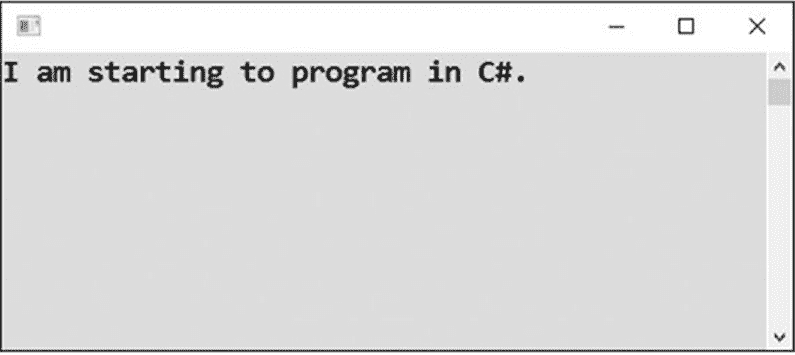

*Figure 2-1.* Your first program

### Creating the Project

你通过创建新项目来开始每个新程序，现在就让我们这样做。

### Launching Visual Studio

启动 Visual Studio。应出现类似图 2-2 的启动屏幕。

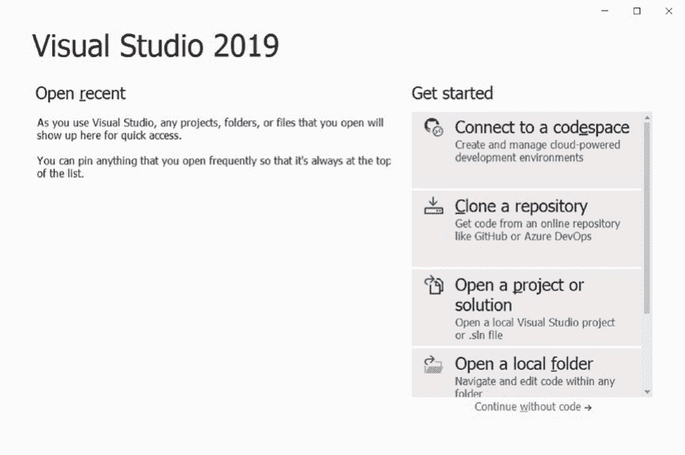

*Figure 2-2.* Visual Studio Start screen

向下拖动滚动条并选择 “Create a new project” 操作 [见图 2-3]。

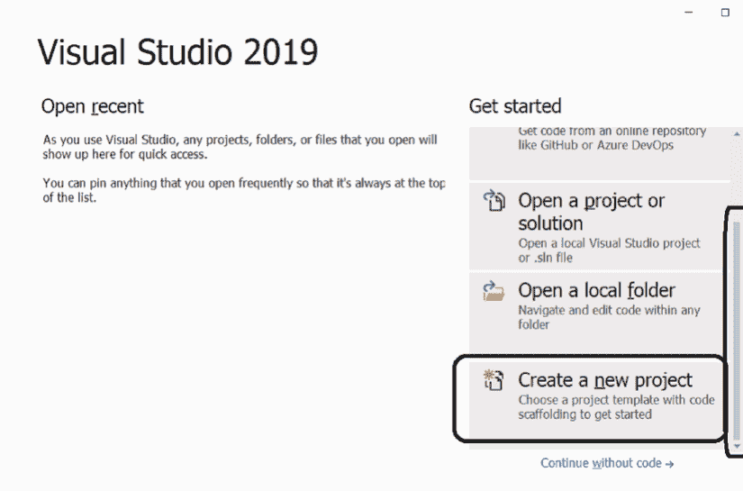

*Figure 2-3.* Choosing for a new project

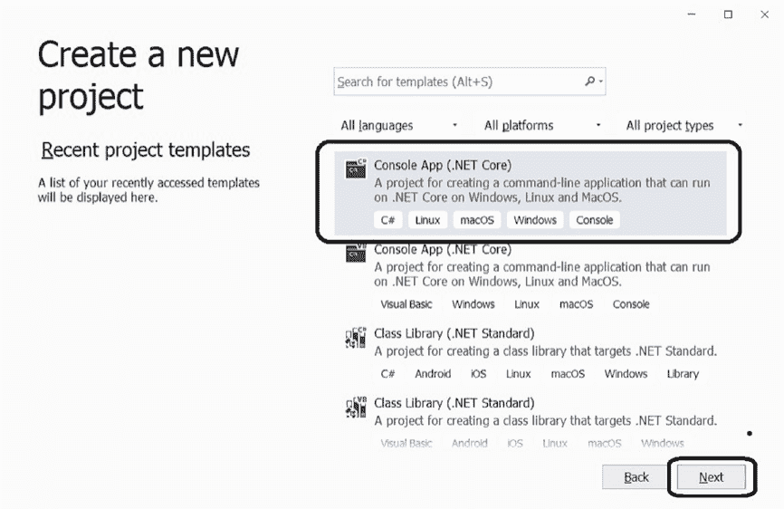

*Figure 2-4.* Selecting a project template

### Creating New Project

出现的对话框 [见图 2-4] 要求你选择新的项目模板。选择 Console App C# 模板并按下 Next 按钮。

在下一个对话框 [见图 2-5] 中，输入 “My first program” 作为新项目名称并按下 Create 按钮。

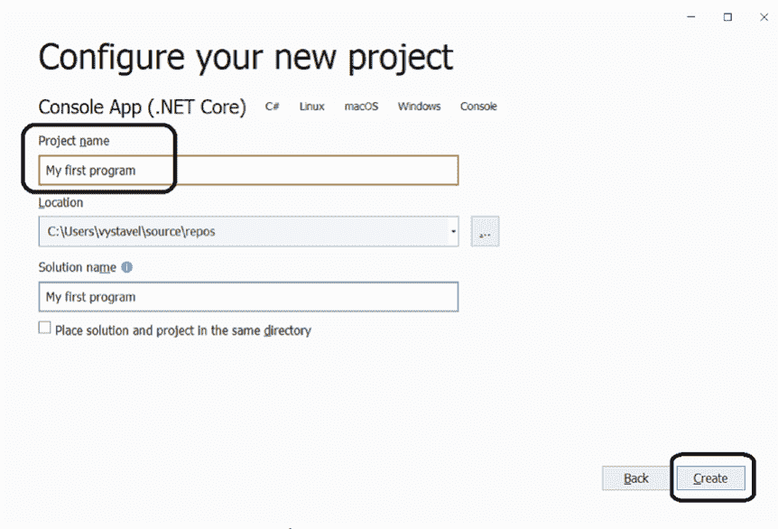

Figure 2-5. Entering a name for your new project

### Writing the Program Code

最重要的一步是编写程序代码，继续阅读。

### The Look of the Development Environment

创建项目后，Visual Studio 的外观如图所示 2-6。

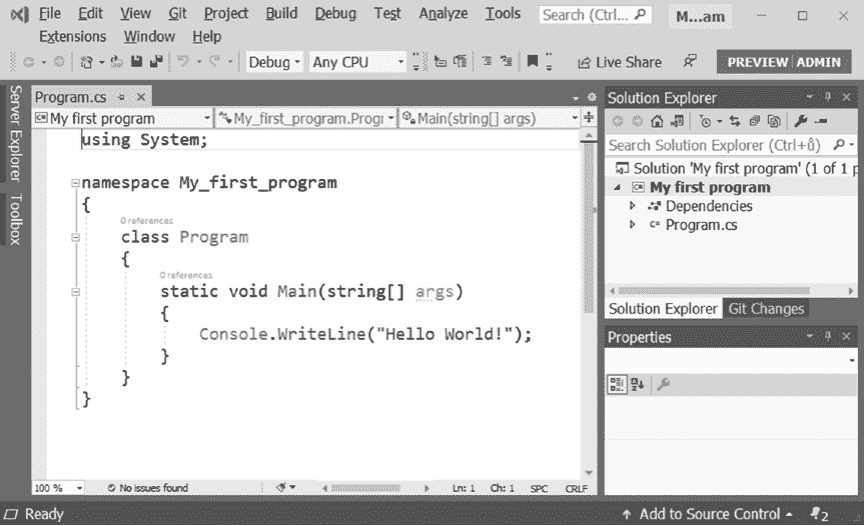

**Figure 2-6.** *The look of Visual Studio*

开发环境窗口的主要部分被 *源代码编辑器* 占据。在其中，Program.cs 文件已打开，正如标签标题所建议的那样。Program.cs 是你的新控制台项目的主要文件。如你所见，它已经包含了一些源代码。

你可能会想知道这段代码从何而来。你还没有写过一行代码！答案是，当你选择 Console App 模板时，Visual Studio 生成了代码。正如你在创建项目时所看到的，Visual Studio 包含许多不同的模板；这些模板是不同类型程序的现成项目骨架。

你可以看到代码中包含了一些奇怪的词，如 `using`、`namespace`、`class` 等等。我现在不会解释这些，因为你目前不需要详细理解它们。但 Visual Studio 需要这些行，所以就让它们保持原样。你需要知道的是在哪里编写自己的语句，这就是我接下来要解释的。

```csharp
// Output of text to the user
Console.WriteLine("I am starting to program in C#.");

// Waiting for Enter
Console.ReadLine();
```

Visual Studio 现在看起来像图 2-8。

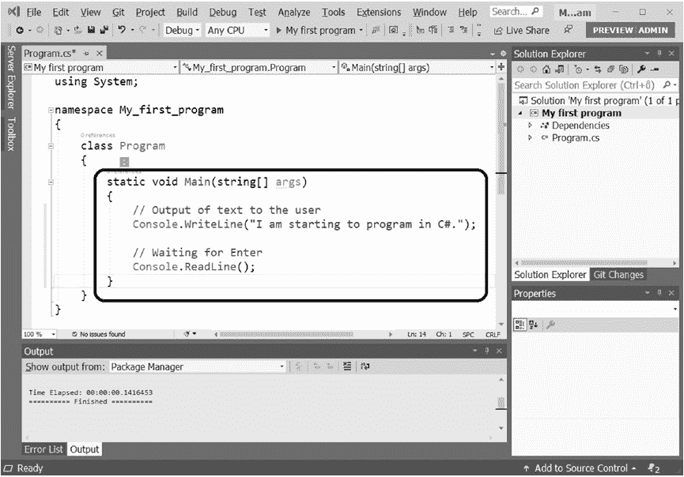

**Figure 2-8.** *Entering your first code statements*

请仔细检查你是否在与我相同的位置输入了这些语句。再次强调，它们必须在大括号之间。并且要小心大括号。不要意外删除任何一个。

Program.cs 的源代码现在看起来像这样：

```
using System;

namespace My_first_program
{
    class Program
    {
        static void Main(string[] args)
        {
            // Output of text to the user
            Console.WriteLine("I am starting to program in C#.");

            // Waiting for Enter
            Console.ReadLine();
        }
    }
}
```

### Understanding Your First Statements

这些语句的作用是什么？

- Console.WriteLine 输出 [写入] 一行内容给用户。
- Console.ReadLine 通常读取用户通过键盘输入的一行文本。在本例中，其目的是让你的程序在完成后等待用户按下 Enter。换句话说，你不希望程序窗口立即消失。
- 从两个斜杠 [//] 开始直到对应行末的所有内容都会被忽略。此文本包含你的备注/注释。Visual Studio 会将其显示为绿色。


## 第2章　你的第一个程序

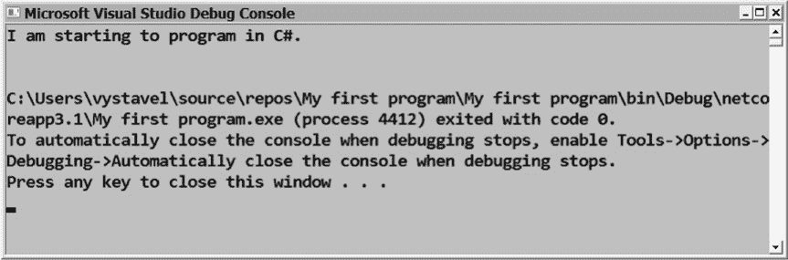

**图 2-11.** *防止窗口消失的附加措施*

由于 `Console.ReadLine()` 在 Visual Studio 之外运行时也能防止窗口消失，我将在所有程序中都包含这条语句。如果你愿意，可以按照图 2-11 消息中的说明禁用 Visual Studio 的新措施。

在 Visual Studio 中，选择“工具 ➤ 选项”菜单。在对话框中，单击“调试”组，然后勾选“调试停止时自动关闭控制台”选项，并按“确定”确认（见图 2-12）。

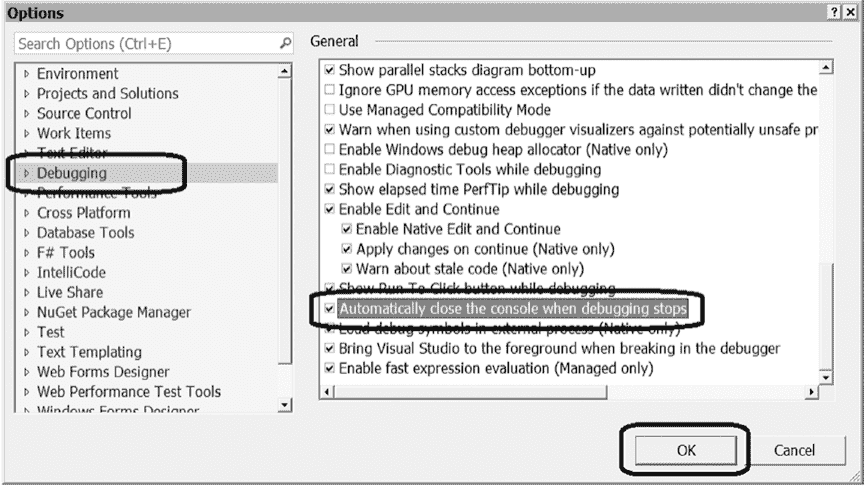

**图 2-12.** *禁用新措施*

### 注意

在计算机的默认设置下，你的程序将以白字黑底显示，如图 2-10 所示。不过，为了更好的可读性，我将在后续所有截图中使用黑字浅底显示（见图 2-11）。

### 更改文本大小

你认为输出的文本太小了吗？是否需要放大程序使用的字体？

如果是，请单击已启动程序的“黑屏”左上角的标题栏图标，并选择“默认值”（见图 2-13）。

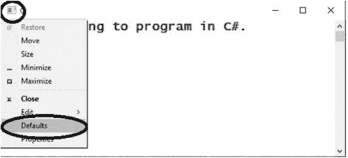

***图 2-13.*** *选择默认设置*

然后点击“字体”选项卡，根据你的偏好更改字体，并通过单击“确定”按钮确认更改（见图 2-14）。

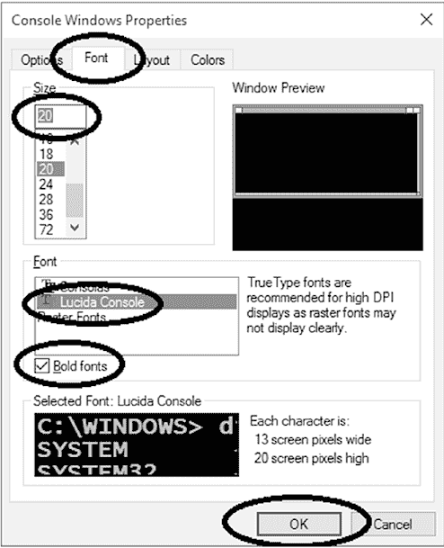

*图 2-14.*  *更改字体*

下次程序启动时，将使用新字体。

### 处理错误

如果你没有完全按照我展示的方式编写语句，或者写错了位置，程序生成将以错误结束并失败。

我们来试试！删除带有 `Console.WriteLine` 语句的行末分号。

当你尝试启动程序（按 F5 键）时，尝试会以错误对话框结束（见图 2-15）。

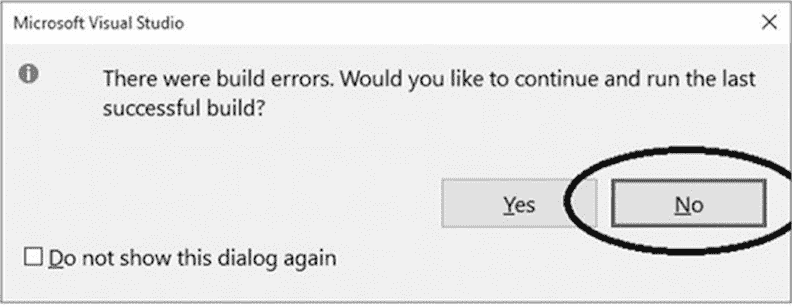

*图 2-15.*  出现错误

在此对话框中，**始终单击“否”**；你不会希望运行程序的某个旧版本（如果存在的话）。

单击“否”后，底部会出现“错误列表”窗格（见图 2-16）。

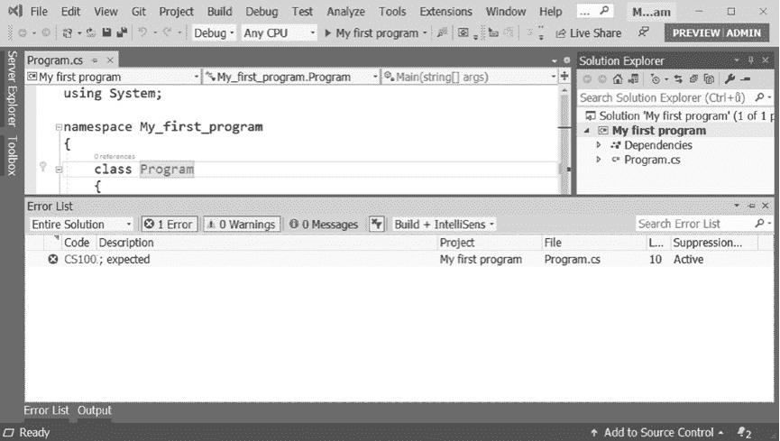

*图 2-16.* 错误列表

把删除的分号放回去，一切就恢复正常了。将来，找出你做错的地方可能会更困难，尤其是在你编程生涯的起步阶段。没关系——我的观点是，只有犯过所有可能犯的错误，你才能成为某个领域的专家。

### 完成你的工作

你刚刚经历了程序开发的所有基本步骤。在以后的每个项目中，你都将按照同样的流程进行。

现在你需要学习如何结束工作，以及之后如何恢复工作。前者很简单；你可以通过从菜单中选择“文件 ► 关闭解决方案”或关闭整个 Visual Studio 程序来完成此项目的工作。

### 恢复你的工作

当你想稍后回到你的项目时，可以通过以下方式之一在 Visual Studio 中重新打开它：

- *通过“开始页面”：* 这是在 Visual Studio 启动后立即出现的页面，其中包含指向你最近项目的链接（见图 2-17）。只需单击正确的项目即可。

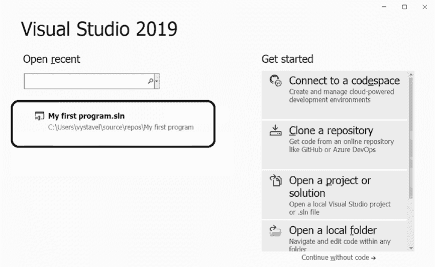

**图 2-17.** *使用“开始页面”*

- *通过“打开项目”对话框：* 从 Visual Studio 菜单中选择“文件 ▶ 打开 ▶ 项目/解决方案”。出现“打开项目”对话框，你应在其中找到你的项目（见图 2-18）。具体来说，查找扩展名为 `.sln` 的文件。如果你看不到文件扩展名，请在 Windows 文件资源管理器中开启其显示（在“查看”选项卡上选中“文件扩展名”复选框），如图 2-19 所示。

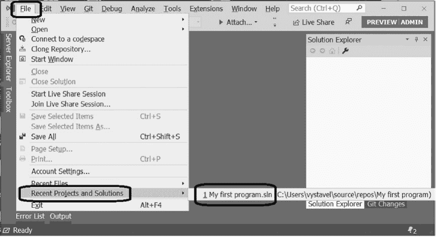

*图 2-20.* 从“文件”菜单打开你的项目

### 转移你的工作

你可能还想知道如何将项目从计算机转移到其他地方，以便以后在不同的计算机上继续处理。答案很简单。如果你使用的是闪存驱动器、OneDrive 或类似工具，只需转移项目的整个文件夹即可。

### 使用解决方案资源管理器

在将项目转移到另一台计算机时，有一个你应该熟悉的重要问题。有时，项目打开时没有源代码编辑器（见图 2-21）。

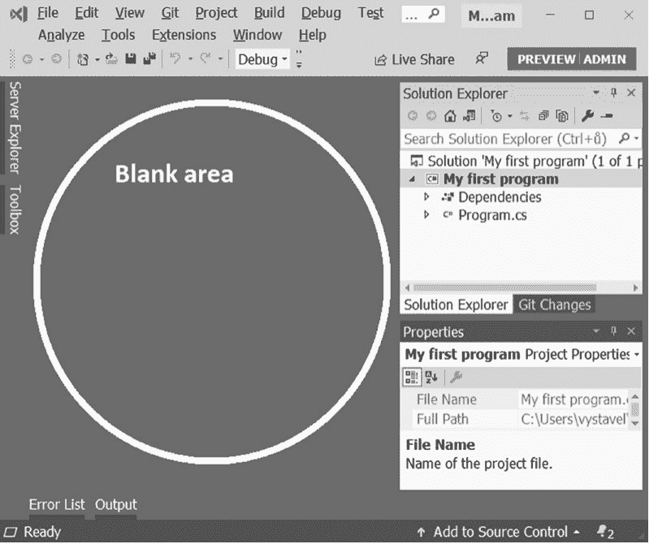

**图 2-21.** *在没有源代码编辑器的情况下打开项目*

在这种情况下你该怎么办？有一个名为“解决方案资源管理器”的窗格（子窗口），通常位于 Visual Studio 窗口的右侧。只需双击你的源代码文件 `Program.cs` 即可（见图 2-22）。

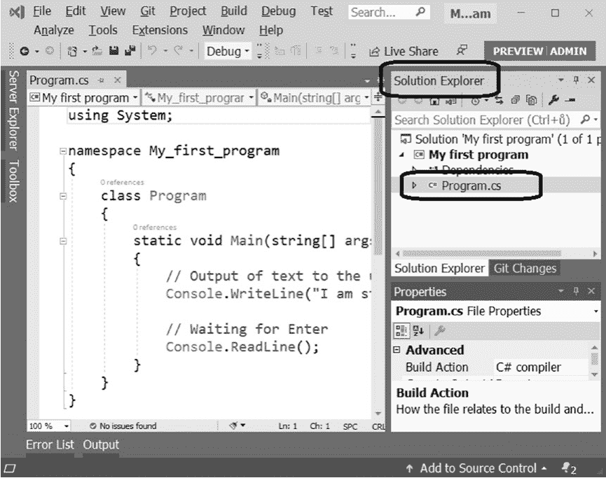

**图 2-22.** *通过解决方案资源管理器打开源代码*

连“解决方案资源管理器”也消失了吗？没问题！你可以随时通过菜单选择“视图 ▶ 解决方案资源管理器”来显示它（见图 2-23）。

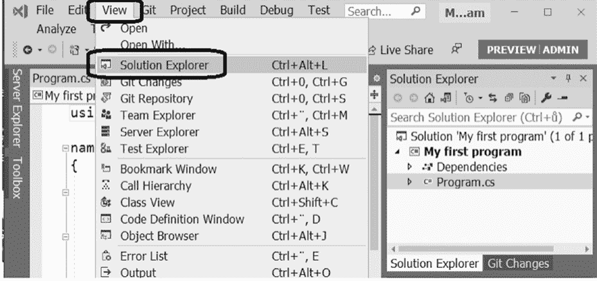

图 2-23. 打开解决方案资源管理器

### 小结

在本章中，你制作了第一个程序，并开始学习如何使用 Visual Studio 开发环境。你经历了程序开发的所有步骤，基本上如下：

- 创建项目
- 编辑源代码
- 保存源代码
- 启动程序
- 检测并清除可能的错误
- 将你的项目转移到你的另一台计算机上，以便在其他地方处理

### 解决方案

在 Visual Studio 中，创建一个名为“Numeric Output”的新项目。代码与你之前在第二章编写的程序类似，如下所示：

```
static void Main(string[] args)
{
    // Output of a number to the user
    Console.WriteLine(37);

    // Waiting for Enter
    Console.ReadLine();
}
```

> **注意**  在本例以及本书后续所有示例中，我只向你展示 `Main` 一词所在行之后的代码块。这是你掌控的代码块；换句话说，这是你修改的代码块。`Program.cs` 源代码的其余部分应保持原样，就像你在上一章的第一个程序中留下它时一样。

为了确保你理解我的意思，完整的源代码如下所示：

```
using System;

namespace Numeric_output
{
    class Program
    {
        static void Main(string[] args)
        {
            // Output of a number to the user
            Console.WriteLine(37);

            // Waiting for Enter
            Console.ReadLine();
        }
    }
}
```

但同样，这是你最后一次看到完整的源代码。每次展示示例时，没有必要重复 Visual Studio 生成的代码，因为你永远不会更改它。如果你有任何疑问，可以查阅本书附带的完整示例项目。

输入代码后，使用 F5 键启动程序。要终止程序，请按 Enter。

### 讨论

与文本不同，数字不需要用引号括起来。

当然，你可以用引号将“37”括起来，但数字 37 和文本“37”之间有着本质区别——你可以用数字进行计算。这就是为什么你现在要学习如何正确处理数字。

### 进行简单计算

下一个任务是进行一个简单的计算。

### 任务

你将向用户显示 1 加 1 的结果（见图 3-2）。

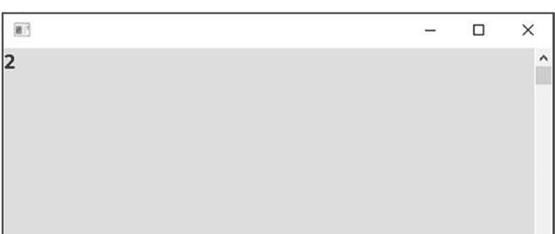

图 3-2. 1 加 1


