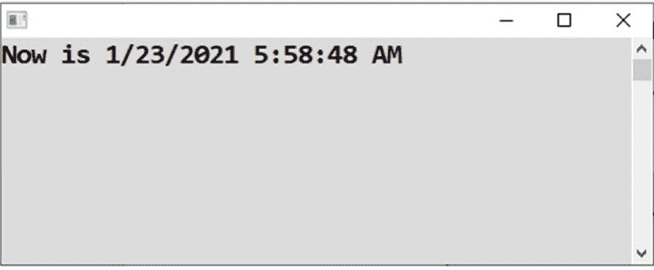
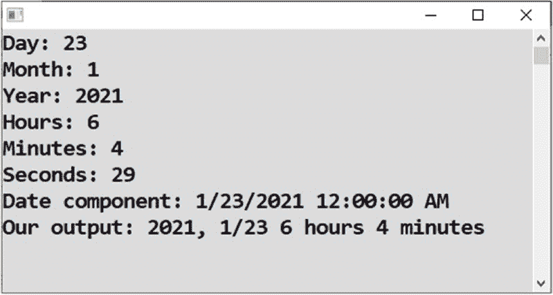
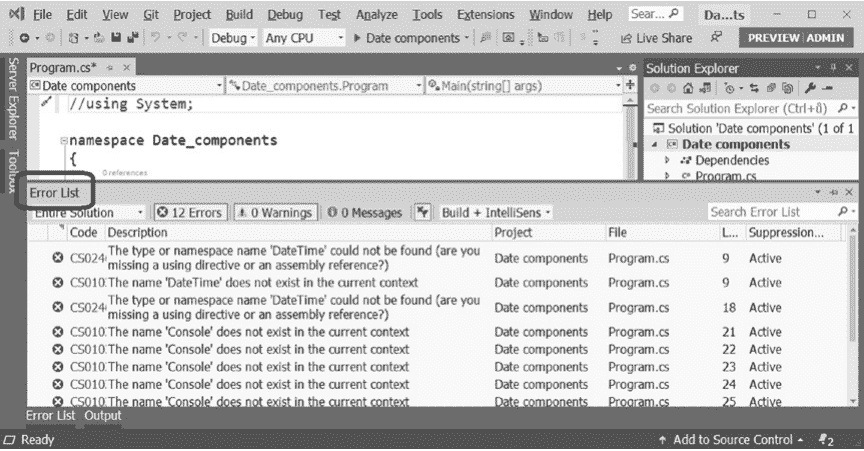
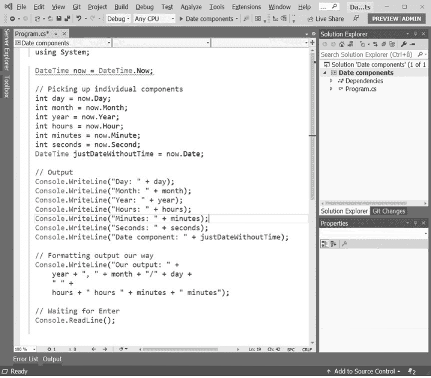

## 第5章 使用对象

`string`、`int`、`double`和`bool`类型的变量总是包含一个单一值——文本、一个数字或一个“是/否”值。然而，这些“原子”值可以组合成聚合体，称为*对象*。一个对象可以包含多个值，这些值被称为其*组成部分*或*成员*。这种组合甚至可以更进一步，例如，一个对象内部可以包含多个其他对象。在本章中，你将学习有关对象的知识。

### 现在几点？

你将遇到的第一个对象是DateTime对象，它包含某个时间点（如日、月、年、小时、分钟、秒等）的各种组成部分。

### 任务

你将编写一个向用户显示当前日期和时间的程序（见图5-1）。



*图5-1.* 显示当前日期和时间

在此任务中，你将了解DateTime类型的对象。

### 解决方案

代码如下：

```csharp
static void Main(string[] args)
{
    // Variable of DateTime type, at first empty
    DateTime now;

    // Storing of current date and time into our variable
    now = DateTime.Now;

    // Output
    Console.WriteLine("Now is " + now);

    // Waiting for Enter
    Console.ReadLine();
}
```

### 今天是几号？

让我们进一步探索DateTime对象。

### 任务

假设你只对今天的日期感兴趣，而不包含时间部分（见图5-2）。

### 处理日期组成部分

你可能想知道对象的*组成部分*在哪里。让我们来看看DateTime对象的组成部分。如果在DateTime类型的变量后附加一个点，Visual Studio的IntelliSense会显示所有可用的组成部分。

### 任务

你将学习DateTime对象的各个组成部分。

### 解决方案

代码如下：

```csharp
static void Main(string[] args)
{
    // Current date and time (using single statement)
    DateTime now = DateTime.Now;

    // Picking up individual components
    int day = now.Day;
    int month = now.Month;
    int year = now.Year;
    int hours = now.Hour;
    int minutes = now.Minute;
    int seconds = now.Second;
    DateTime justDateWithoutTime = now.Date;

    // Output
    Console.WriteLine("Day: " + day);
    Console.WriteLine("Month: " + month);
    Console.WriteLine("Year: " + year);
    Console.WriteLine("Hours: " + hours);
    Console.WriteLine("Minutes: " + minutes);
    Console.WriteLine("Seconds: " + seconds);
    Console.WriteLine("Date component: " + justDateWithoutTime);

    // Formatting output our way
    Console.WriteLine("Our output: " +
        year + ", " + month + "/" + day +
        " " +
        hours + " hours " + minutes + " minutes");

    // Waiting for Enter
    Console.ReadLine();
}
```

图5-3显示了DateTime对象的组成部分。



*图5-3.* DateTime对象的组成部分

### 使用命名空间

好了，既然你已经遇到了第一个对象，我应该向你介绍一些关于命名空间的知识。

### 重要的using

保持上一个项目处于打开状态，在Program.cs源代码中用两个斜杠注释掉第一行（`using System;`）（见图5-4）。你也可以直接删除该行。但是，为了恢复原始版本，更便捷的方式是注释掉该行。

提醒一下，在出现的错误对话框中，始终点击“否”。出现的“错误列表”窗格会显示大量错误——突然Visual Studio“不认识”DateTime或Console了（见图5-6）。



*图5-6.* 错误列表窗格

using行相当重要，不是吗？我接下来将解释原因。

### 命名空间

C#中几乎所有内容都属于某个层次更高的单元。在这种情况下，DateTime和Console都属于System *命名空间*。如果你想使用它们，必须在源代码顶部使用using行声明相应的命名空间。否则，Visual Studio无法识别它们。

为什么会有命名空间这样的东西？你为什么要用到它们？嗯，对象的名称并不是无限的，所以你需要指定你正在使用的是哪一个。例如，你不一定非要使用微软的DateTime类；你可以自己编写DateTime，或者从另一个程序员那里购买一个很棒的DateTime。这就是为什么你需要一种区分它们的方法。这个方法就是通过*命名空间*。

```csharp
int year = now.Year;
int hours = now.Hour;
int minutes = now.Minute;
int seconds = now.Second;
System.DateTime justDateWithoutTime = now.Date;

// Output
System.Console.WriteLine("Day: " + day);
System.Console.WriteLine("Month: " + month);
System.Console.WriteLine("Year: " + year);
System.Console.WriteLine("Hours: " + hours);
System.Console.WriteLine("Minutes: " + minutes);
System.Console.WriteLine("Seconds: " + seconds);
System.Console.WriteLine("Date component: " +
justDateWithoutTime);

// Formatting output our way
System.Console.WriteLine("Our output: " +
    year + ", " + month + "/" + day +
    " " +
    hours + " hours " + minutes + " minutes");

// Waiting for Enter
System.Console.ReadLine();
}
}
}
```

使用using是不是更好？

### C# 9.0极简程序

既然我们正在尝试Main方法之外的内容，现在是时候了解一下C# 9.0的一项创新了，它允许你省略“样板代码”，即命名空间、类以及Main方法所在行（当然，还包括相应的大括号）。

回到本章前面的“处理日期组成部分”，并在Visual Studio中再次打开相应的项目。

删除除了using行之外的所有非我们编写的代码。具体来说，你应该删除以namespace、class和Main开头的三行，以及三个左大括号和三个右大括号。你的Visual Studio代码编辑器将看起来如图5-7所示。



*图5-7.* 省略“样板代码”

按F5键运行程序。起初，这可能看起来删除所有这些行并不是一个好主意（见图5-8）。

```csharp
Console.WriteLine("64-bit system: " + Environment.Is64BitOperatingSystem);
Console.WriteLine("User name: " + Environment.UserName);

// Waiting for Enter
Console.ReadLine();
}
```

与之前的程序不同，这里我没有将对象的组成部分提取到变量中。我直接使用了它们，以便你能看到使用它们的另一种可能方式。

## 小结

在本章中，你了解了对象，它本质上是多个组成部分的集合体。与`int`或`string`这样的“原子”（单值）类型相反，对象通常包含多个值。

具体来说，你遇到了以下内容：

-   DateTime对象，可用于获取当前日期或时间
-   Environment对象，可用于获取关于程序“环境”的信息，如计算机名称或用户名

你还学习了以下内容：

-   对象可以存储在适当类型的变量中。
-   可以通过所谓的点表示法访问对象的组成部分。你写出对象变量的名称并附加一个点，然后借助Visual Studio IntelliSense，就会弹出一个可用组成部分的列表。
-   每种对象类型都属于某个命名空间。简单来说，命名空间可以看作是相似对象类型的容器。
-   一个重要的命名空间是System命名空间，它包含基本的对象类型，如DateTime或Console。


## 第5章 使用对象

- 你通过源代码开头的 using 行来表示你要使用特定的命名空间。
- 如果不包含相应的 using 行，则必须完整限定类型的名称。这意味着你需要将命名空间名称和点放在类型名称之前。
- C# 9.0 允许你省略所谓的“样板”代码，即由项目模板生成而非你手写的代码。
