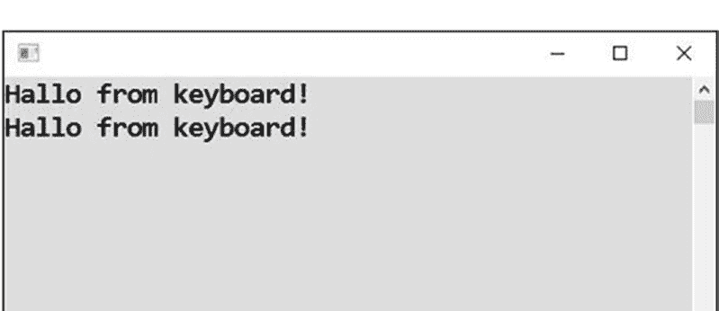
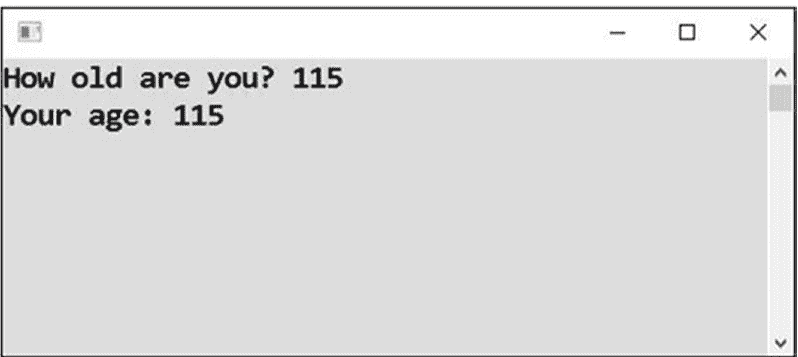
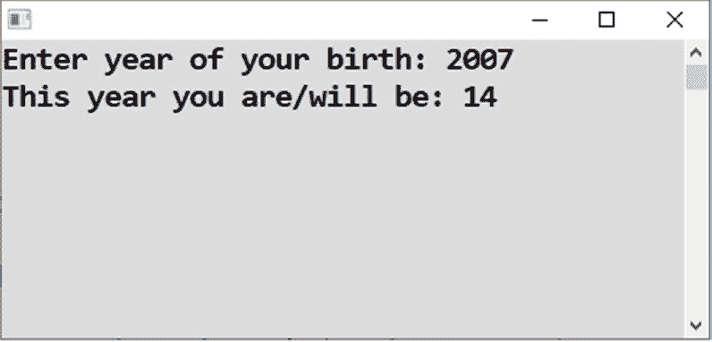
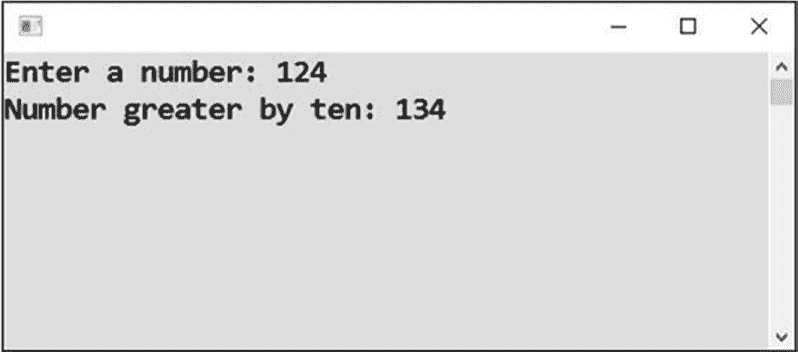
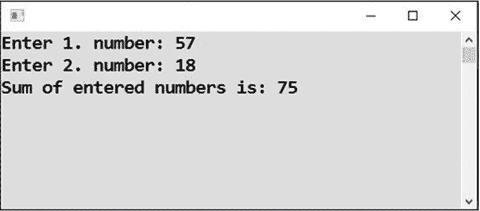
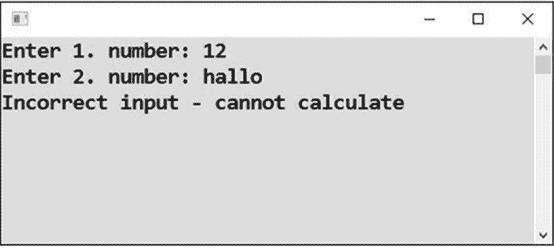

## 第 8 章：输入

到目前为止，你的所有程序都在处理数据（数字、文本等），这些数据要么直接固定在源代码中，要么来自操作系统（日期、随机数等）。通常，程序会从用户那里获取数据，而这正是你将在本章中学习的内容。

### 文本输入

你将从一个最简单的案例开始学习输入。

### 任务

你将编写一个程序，接受用户输入的一行文本，并立即将输入的文本重复输出（见图 8-1）。



图 8-1. 完成的程序

### 解决方案

代码如下：

```csharp
static void Main(string[] args)
{
    // Hinting user what we want from her
    Console.Write("Enter a sentence (and press Enter): ");

    // Reading line of text
    string input = Console.ReadLine();

    // Repeating to the output
    Console.WriteLine("You have entered: " + input);

    // Waiting for Enter
    Console.ReadLine();
}
```

### 讨论

Console.Write 不会将光标移到下一行，这与 Console.WriteLine 相反，后者是你到目前为止一直在使用的。

### 数字输入

在之前的练习中，你处理的是用户输入的文本信息。现在你将转向同样重要的数字。

### 任务

你将编写一个程序，从用户那里获取一个数字，将其存储在一个数字变量中，最后将其重复显示给用户（见图 8-3）。



图 8-3. 从屏幕读取数字

### 解决方案

Console.ReadLine 始终读取文本，即使其含义是数字。如果你想保存一个真正的数字（即 int 类型的值），你必须使用 Convert.ToInt32 调用来生成它。

```csharp
static void Main(string[] args)
{
    // Prompting the user
    Console.Write("How old are you? ");

    // Reading line of text
    string input = Console.ReadLine();

    // CONVERTING TO NUMBER (of entered text)
    int enteredNumber = Convert.ToInt32(input);

    // Output of entered number
    Console.WriteLine("Your age: " + enteredNumber);

    // Waiting for Enter
    Console.ReadLine();
}
```

### 讨论

严格来说，你实际上还不需要一个真正的数字，因为你还没有对这些数字进行任何计算。不过，这将在下一个练习中改变。在这里，你是在以最简单的形式探索数字输入。

### 使用输入的数字进行计算

你现在将对用户输入的值进行第一次计算。

### 任务

你将编写一个程序，接受用户输入的出生年份，然后计算他们的年龄（见图 8-4）。



图 8-4. 计算年龄

### 解决方案

解决方案如下：

```csharp
static void Main(string[] args)
{
    // Prompting the user
    Console.Write("Enter year of your birth: ");

    // Reading line of text
    string input = Console.ReadLine();

    // CONVERTING TO NUMBER (of entered text)
    int yearOfBirth = Convert.ToInt32(input);

    // Finding this year
    DateTime today = DateTime.Today;
    int thisYear = today.Year;

    // Calculating age
    int age = thisYear - yearOfBirth;

    // Outputting the result
    Console.WriteLine("This year you are/will be: " + age);

    // Waiting for Enter
    Console.ReadLine();
}
```

### 加上十

让我们继续进行计算。

### 任务

你将编写一个程序，从用户那里接受一个数字。然后，它显示一个比输入的数字大十的数字（见图 8-5）。



### 解决方案

代码如下：

```csharp
static void Main(string[] args)
{
    // Number input
    Console.Write("Enter a number: ");
    string input = Console.ReadLine();
    int number = Convert.ToInt32(input);

    // Calculating
    int result = number + 10;

    // Displaying the result
    Console.WriteLine("Number greater by ten: " + result);

    // Waiting for Enter
    Console.ReadLine();
}
```

### 加法

现在你将更进一步，使用用户输入的两个数字进行计算。

### 任务

你将编写一个程序，对用户输入的两个数字求和（见图 8-6）。



### 解决方案

代码如下：

```csharp
static void Main(string[] args)
{
    // Input of 1. number
    Console.Write("Enter 1. number: ");
    string input1 = Console.ReadLine();
    int number1 = Convert.ToInt32(input1);

    // Input of 2. number
    Console.Write("Enter 2. number: ");
    string input2 = Console.ReadLine();
    int number2 = Convert.ToInt32(input2);

    // Calculating
    int result = number1 + number2;

    // Result output
    Console.WriteLine("Sum of entered numbers is: " + result);

    // Waiting for Enter
    Console.ReadLine();
}
```

### 错误的输入

在之前的数字程序中，如果用户输入了数字以外的内容，程序会以*运行时错误*终止。然而，生产环境中的程序不应该这样表现。现在你将学习如何处理运行时错误。

### 任务

在本练习中，你将修改之前的程序，使其能正确处理用户的非数字输入（见图 8-7）。



图 8-7. 为错误提供反馈

### 解决方案

保持你的上一个项目处于打开状态，如果你已经关闭了它，就重新打开。接下来，你将编辑项目的 Program.cs 源代码；具体来说，你将在适当的位置插入一个 try-catch 结构。
