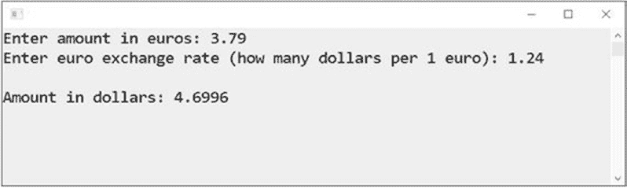
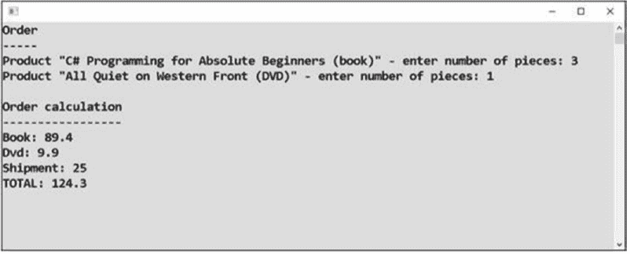
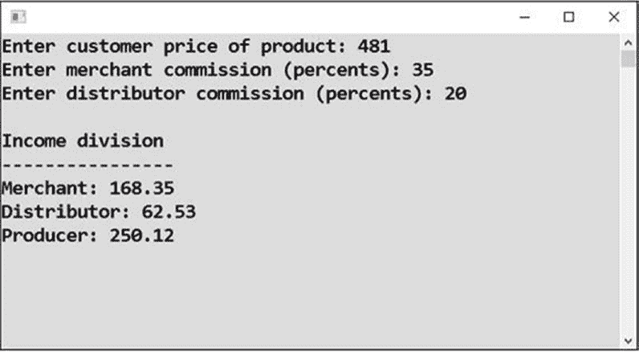
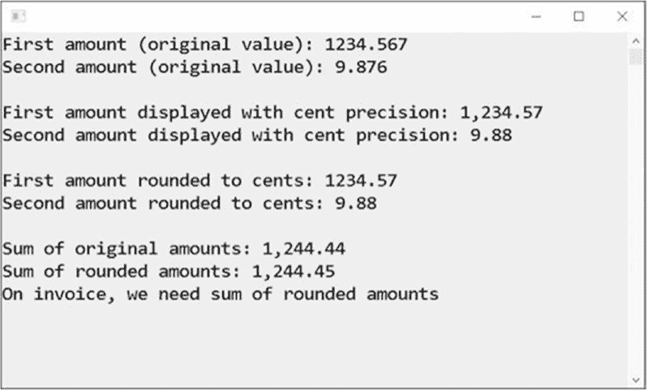
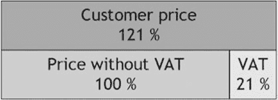

## 第 10 章 经济计算

在本章中，你将学习如何计算货币金额。这很简单，但你需要运用一些常识。

### 货币转换

进行简单的经济计算通常意味着进行货币转换，你将在本节中尝试这一点。

#### 任务

在接收欧元金额和欧元汇率后，你将把该金额转换为美元（见图 10-1）。



*图 10-1. 转换为美元*

#### 解决方案

代码如下：

```csharp
static void Main(string[] args)
{
    // Inputs
    Console.Write("Enter amount in euros: ");
    string inputEuros = Console.ReadLine();
    double amountEuros = Convert.ToDouble(inputEuros);

    Console.Write("Enter euro exchange rate (how many dollars per 1 euro): ");
    string inputExchangeRate = Console.ReadLine();
    double euroExchangeRate = Convert.ToDouble(inputExchangeRate);

    // Calculation
    double amountDollars = amountEuros * euroExchangeRate;

    // Output
    Console.WriteLine();
    Console.WriteLine("Amount in dollars: " + amountDollars);

    // Waiting for Enter
    Console.ReadLine();
}
```

### 总价

在本练习中，你将计算订单的总价格。

#### 任务

假设你的某个客户购买了若干件商品，其中一些商品可能购买了多件。你需要计算包含运费的总额。为简单起见，在此程序中，两个产品的价格和数量以及运费将直接固定在源代码中（见图 10-2）。



*图 10-2. 计算总费用*

#### 解决方案

代码如下：

```csharp
static void Main(string[] args)
{
    // Fixed values
    const double bookPrice = 29.8;
    const double dvdPrice = 9.9;
    const double shipmentPrice = 25;

    // Inputs
    Console.WriteLine("Order");
    Console.WriteLine("-----");

    Console.Write("Product \"C# Programming for Absolute Beginners (book)\" - enter number of pieces: ");
    string inputBookPieces = Console.ReadLine();
    int bookPieces = Convert.ToInt32(inputBookPieces);

    Console.Write("Product \"All Quiet on the Western Front (DVD)\" - enter number of pieces: ");
    string inputDvdPieces = Console.ReadLine();
    int dvdPieces = Convert.ToInt32(inputDvdPieces);

    // Calculations
    double totalForBook = bookPrice * bookPieces;
    double totalForDvd = dvdPrice * dvdPieces;
    double totalForOrder = totalForBook + totalForDvd + shipmentPrice;

    // Outputs
    Console.WriteLine();
    Console.WriteLine("Order calculation");
    Console.WriteLine("----------------");
    Console.WriteLine("Book: " + totalForBook);
    Console.WriteLine("DVD: " + totalForDvd);
    Console.WriteLine("Shipment: " + shipmentPrice);
    Console.WriteLine("TOTAL: " + totalForOrder);

    // Waiting for Enter
    Console.ReadLine();
}
```

#### 讨论

在固定的“变量”前加上 **const** 表示它们是*常量*，即在程序运行过程中不会改变的值。Visual Studio 不允许你为这些“变量”赋新值。

就我个人而言，我并不经常使用 const。我只是想让你见识一下，以防你在工作过程中遇到它。

### 佣金

在资本主义中，最重要的不是创造、生产或种植什么。最重要的是销售！而销售商品的人通常会获得佣金，因此你必须学会如何计算佣金。

#### 任务

你将编写一个程序，接收产品的价格，然后计算商家、分销商和生产商的佣金百分比。根据这些数据，它还会计算三方的收入分配（见图 10-3）。



*图 10-3. 计算佣金*

#### 解决方案

代码如下：

```csharp
static void Main(string[] args)
{
    // Inputs
    Console.Write("Enter customer price of product: ");
    string inputPrice = Console.ReadLine();
    double customerPrice = Convert.ToDouble(inputPrice);

    Console.Write("Enter merchant commission (percents): ");
    string inputMerchantPercents = Console.ReadLine();
    int merchantPercents = Convert.ToInt32(inputMerchantPercents);

    Console.Write("Enter distributor commission (percents): ");
    string inputDistributorPercents = Console.ReadLine();
    int distributorPercents = Convert.ToInt32(inputDistributorPercents);

    // Calculations
    double coefficient1 = 1 - merchantPercents / 100.0;
    double coefficient2 = 1 - distributorPercents / 100.0;
    double wholesalePrice = customerPrice * coefficient1;
    double priceAfterCommissionSubtraction = wholesalePrice * coefficient2;
    double merchantIncome = customerPrice - wholesalePrice;
    double distributorIncome = wholesalePrice -
priceAfterCommissionSubtraction;
    double producerIncome = priceAfterCommissionSubtraction;

    // Outputs
    Console.WriteLine();
    Console.WriteLine("Income division");
    Console.WriteLine("----------------");
    Console.WriteLine("Merchant: " + merchantIncome);
    Console.WriteLine("Distributor: " + distributorIncome);
    Console.WriteLine("Producer: " + producerIncome);

    // Waiting for Enter
    Console.ReadLine();
}
```

#### 讨论

有时候，佣金百分比可能是小数。在这个例子中，我选择了整数，因为我想通过一个实际示例向你展示如何正确地进行整数除法。如你所知，要执行“正常”除法，你需要至少一个数字——无论位于斜杠前还是斜杠后——必须是 double 类型。这就是你使用 100.0 的原因。

如果你改用 100，结果会令人惊讶（见图 10-4）。

### 舍入



*图 10-5. 舍入程序*

#### 解决方案

代码如下：

```csharp
static void Main(string[] args)
{
    // For simplicity, inputs are fixed in program
    // Some amounts, e.g. after commission calculations, cent fractions are
    // possible
    double amount1 = 1234.567;
    double amount2 = 9.876;

    // Displaying inputs (original values)
    Console.WriteLine("First amount (original value): " + amount1);
    Console.WriteLine("Second amount (original value): " + amount2);
    Console.WriteLine();

    // Rounding just for output
    Console.WriteLine("First amount displayed with cent precision: " +
    amount1.ToString("N2"));
}
```


pays. 重要的是，百分比是根据不含增值税的价格计算的，而不是根据客户价格（参见图 10-9）！



*图 10-9. 理解增值税的工作原理*

如果增值税税率为例如 21%，你需要将客户价格除以 1.21 才能得到不含增值税的价格。对于税率的一般值，你通过将适当的分数加到 1 上来计算除数。

## 解决方案

以下是代码：

```csharp
static void Main(string[] args)
{
    // Inputs
    Console.Write("Enter customer price of a product: ");
    string inputPrice = Console.ReadLine();
    double customerPrice = Convert.ToDouble(inputPrice);

    Console.Write("Enter VAT rate in %: ");
    string inputVatRate = Console.ReadLine();
    double vatRate = Convert.ToDouble(inputVatRate);

    // Calculations
    double divisor = 1 + vatRate / 100.0;
    double calculatedPriceWithoutVat = customerPrice / divisor;
    double priceWithoutVat = Math.Round(calculatedPriceWithoutVat, 2);
    double vat = customerPrice - priceWithoutVat;

    // Outputs
    Console.WriteLine();
    Console.WriteLine("Price without VAT: " + priceWithoutVat.ToString("N2"));
    Console.WriteLine("VAT: " + vat.ToString("N2"));

    // Waiting for Enter
    Console.ReadLine();
}
```

## 总结

在本章中，你练习了对来自经济世界的各种实际示例进行计算。这些计算中最重要的始终是首先理解现实世界的问题。为了理解如何在没有程序的情况下得到结果，请先使用铅笔、纸和计算器。适当的结构化程序也很常见，将整个计算分成小块，并为变量使用描述性的名称。

其中，你学习了如何进行四舍五入。具体来说，你研究了几个内置的数学函数：

- 你知道如何使用 `Math.Round` 进行最常见的四舍五入，即四舍五入到最接近的整数。你可以在方法调用的第二个参数中指定所需的十进制位数。
- 你知道如何使用 `Math.Floor` 始终向下舍入，即舍入到小于或等于被舍入数的最大整数。
- 你知道如何使用 `Math.Ceiling` 始终向上舍入，即舍入到大于或等于被舍入数的最小整数。

你还学习了一种将数字四舍五入到百位的技巧，包括在四舍五入前除以 100，四舍五入后乘以相同的数。
