## 第 11 章：日期计算

在上一章中，你练习了经济世界的计算。你也经常需要进行日期计算。例如，你需要设置发票到期日期。或者你想计算发票逾期多少天。或者，你可能需要知道特定时期如月份或季度的第一天和最后一天。在本章中，你将学习如何进行日期计算。

### 日期输入

首先，你将学习如何从用户读取日期。我也会向你展示一些简单的日期算术。

#### 任务

在此任务中，你将基于用户输入获取一个 DateTime 对象。之后，你将计算下一天和前一天（参见图 11-1）。

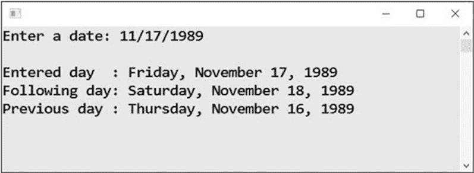

*图 11-1. 计算下一天和前一天*

#### 解决方案

要点是使用 Convert.ToDateTime 方法。如果用户输入不存在的日（例如非闰年的 2 月 29 日），该方法会引发运行时错误，你可以使用 try-catch 结构来处理。

```csharp
static void Main(string[] args)
{
    try
    {
        // Text input of date
        Console.Write("Enter date: ");
        string input = Console.ReadLine();

        // Conversion to DateTime object
        DateTime enteredDate = Convert.ToDateTime(input);

        // Some calculations
        DateTime followingDay = enteredDate.AddDays(1);
        DateTime previousDay = enteredDate.AddDays(-1);

        // Outputs
        Console.WriteLine();
        Console.WriteLine("Entered day  : " + enteredDate.ToLongDateString());
        Console.WriteLine("Following day: " + followingDay.ToLongDateString());
        Console.WriteLine("Previous day : " + previousDay.ToLongDateString());
    }
    catch (Exception)
    {
        // Treating incorrect input
        Console.WriteLine("Incorrect input");
    }

    // Waiting for Enter
    Console.ReadLine();
}
```

#### 讨论

你也可以使用两个参数而不是一个参数调用 Convert.ToDateTime 方法。第二个参数是语言设置，即你已知的 CultureInfo 对象。这与其他转换方法类似。

### 单个月份

现在你将练习使用 DateTime 组件并通过构造函数调用创建此对象。

#### 任务

用户输入一个日期。此程序显示该日期所在月份的第一天和最后一天（参见图 11-2）。

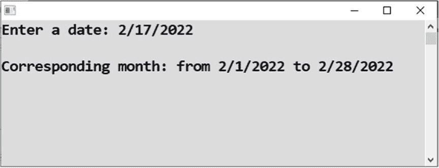

*图 11-2. 计算月份的第一天和最后一天*

#### 解决方案

以下是代码：

```csharp
static void Main(string[] args)
{
    // Date input
    Console.Write("Enter a date: ");
    string input = Console.ReadLine();
    DateTime enteredDate = Convert.ToDateTime(input);

    // Calculations
    int enteredYear = enteredDate.Year;
    int enteredMonth = enteredDate.Month;

    DateTime firstDayOfMonth = new DateTime(enteredYear, enteredMonth, 1);
    DateTime lastDayOfMonth = firstDayOfMonth.AddMonths(1).AddDays(-1);

    // Outputs
    Console.WriteLine();
    Console.WriteLine("Corresponding month: " +
        "from " + firstDayOfMonth.ToShortDateString() +
        " to " + lastDayOfMonth.ToShortDateString());

    // Waiting for Enter
    Console.ReadLine();
}
```

#### 讨论

请注意以下几点：

- 根据之前的练习，你使用 `Convert.ToDateTime` 方法调用从用户获取 `DateTime` 对象。
- 你开始从输入的日期中提取月份和年份数字。为此你使用 `Month` 和 `Year` 属性。
- 使用这些数字，你可以轻松组装月份的第一天，因为其日号始终为一。
- 月份的最后一天就不那么容易了，因为月份长度不同。诀窍是加一个月然后减一天！
- 请注意，我没有在任何地方存储 `AddMonths` 的结果。我直接在其上调用 `AddDays`。这称为 *方法链*。
- 为了简单起见，我在这里没有处理输入错误的情况。

### 季度

继续日期主题，我将向你展示一些有趣的技巧，有时你必须使用这些技巧才能得到正确的结果。

#### 任务

对于输入的日，此程序将显示该日所属的年份季度的开始、结束和编号（从一到四）（参见图 11-3 和 11-4）。

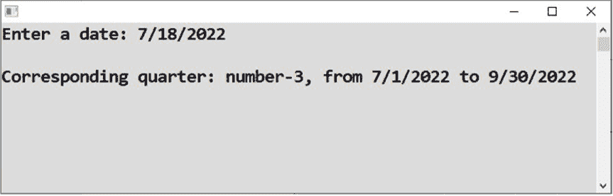

*图 11-3. 显示对应的季度*

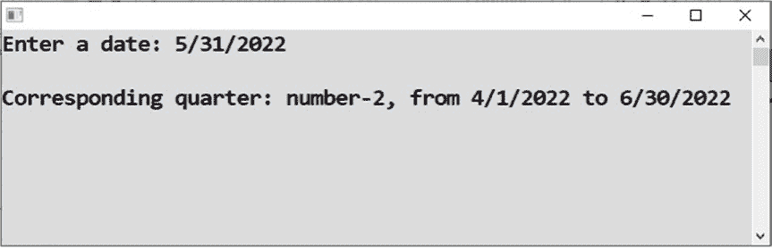

*图 11-4. 显示对应的季度，另一个示例*

#### 分析

此任务的关键是确定季度的编号。从中可以得出季度的第一个月。

#### 季度的编号

你需要将月份编号转换为季度的编号，如下所示：

- 月份 1、2 或 3 = 1
- 月份 4、5 或 6 = 2
- 月份 7、8 或 9 = 3
- 月份 10、11 或 12 = 4

这是一个使用整数除法的绝佳案例。你可以看到你首先需要将月份编号加二，然后进行整数除以三：

```csharp
int numberOfQuarter = (enteredMonth + 2) / 3;
```

#### 季度第一个月的编号

如果已经有季度的编号，你可以这样得到季度的第一个月：

- 1（1 月）对应第一季度
- 4（4 月）对应第二季度
- 7（7 月）对应第三季度
- 10（10 月）对应第四季度

你可能会意识到季度的编号必须乘以三。为了得到正确的结果，你随后需要减去二：

```csharp
int monthOfQuarterStart = 3 * numberOfQuarter - 2;
```

#### 第一天和最后一天

有了第一个月，你就可以按照与上一练习类似的步骤进行。要得到第一天，你使用 DateTime 构造函数并将日号设为一。要得到最后一天，你加三个月然后减一天。


### 解决方案

以下是代码：

```csharp
static void Main(string[] args)
{
    // Date input
    Console.Write("Enter a date: ");
    string input = Console.ReadLine();
    DateTime enteredDate = Convert.ToDateTime(input);

    // Calculations
    int enteredYear = enteredDate.Year;
    int enteredMonth = enteredDate.Month;

    int numberOfQuarter = (enteredMonth + 2) / 3;
    int monthOfQuarterStart = 3 * numberOfQuarter - 2;
    DateTime firstDayOfQuarter = new DateTime(enteredYear,
    monthOfQuarterStart, 1);
    DateTime lastDayOfQuarter = firstDayOfQuarter.AddMonths(3).AddDays(-1);

    // Outputs
    Console.WriteLine();
    Console.WriteLine("Corresponding quarter: " +
        "number-" + numberOfQuarter +
        ", from " + firstDayOfQuarter.ToShortDateString() +
        " to " + lastDayOfQuarter.ToShortDateString());

    // Waiting for Enter
    Console.ReadLine();
}
```

## 日期差

你经常需要计算两个特定日期之间的时间跨度，换句话说，即输入日期之间经过了多少天或多少年。这就是你现在要学习的内容。

### 任务

用户输入自己的出生日期。程序显示出这个世界为拥有他们而感到高兴的天数（见图 11-5）。

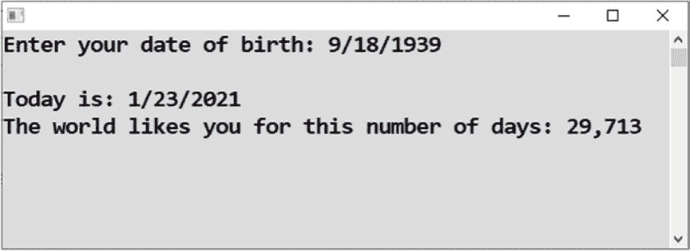

*图 11-5.* 计算存活了多少天

### 解决方案

如你所见，你需要从今天的日期中减去出生日期。当你相减日期时，结果是一个 `TimeSpan` 对象。有了这个对象，你可以使用它的众多属性之一。在本练习中，你将使用 `Days` 属性。

以下是代码：

```csharp
static void Main(string[] args)
{
    // Input
    Console.Write("Enter your date of birth: ");
    string input = Console.ReadLine();
    DateTime dateOfBirth = Convert.ToDateTime(input);

    // Today
    DateTime today = DateTime.Today;

    // Date difference
    TimeSpan difference = today - dateOfBirth;
    int numberOfDays = difference.Days;

    // Output
    Console.WriteLine();
    Console.WriteLine("Today is: " + today.ToShortDateString());
    Console.WriteLine("The world likes you for this number of days: " +
    numberOfDays.ToString("N0"));

    // Waiting for Enter
    Console.ReadLine();
}
```

## 时区与 UTC

如果你想存储某个事件发生的时间（例如记录订单、问题等），你可能会对夏令时感到意外。或者，更重要的是，假设你正在创建一个将在全球运行的程序。你将不得不处理不同的时区。

为了处理这些情况，了解如何操作协调世界时（UTC）是很有用的。UTC 是零度经线处的时间，不受食品添加剂的影响……抱歉，我的意思是它不受夏令时的影响。UTC 简单来说就是与时区无关。

同时，熟悉 `DateTimeOffset` 对象也是不错的，它除了包含日期和时间外，还包含时区信息。

### 任务

在本练习中，我将向你展示如何使用 UTC 以及 `DateTimeOffset` 对象中包含的时区。你将创建一个处理当前时间的程序（见图 11-6）。

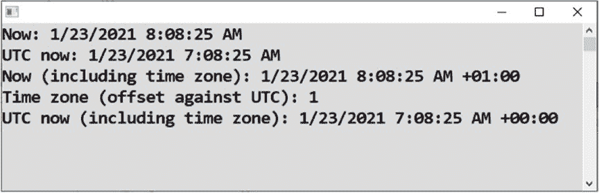

**图 11-6.** *DateTimeOffset 对象*

### 解决方案

以下是代码：

```csharp
static void Main(string[] args)
{
    // Current time serves as input
    DateTime now = DateTime.Now;
    DateTime utcNow = DateTime.UtcNow;
    DateTimeOffset completeInstant = DateTimeOffset.Now;
    DateTimeOffset utcCompleteInstant = DateTimeOffset.UtcNow;

    // Outputs
    Console.WriteLine("Now: " + now);
    Console.WriteLine("UTC now: " + utcNow);
    Console.WriteLine("Now (including time zone): " + completeInstant);
    Console.WriteLine("Time zone (offset against UTC): " + completeInstant.Offset.TotalHours);
    Console.WriteLine("UTC now (including time zone): " + utcCompleteInstant);

    // Waiting for Enter
    Console.ReadLine();
}
```

请注意，有些变量是 `DateTime` 类型，而另一些则是 `DateTimeOffset` 类型。

## 小结

在本章中，你已经相当深入地学习了如何进行日期计算。

你首先使用 `Convert.ToDateTime` 方法从用户那里获取一个日期，然后通过调用 `DateTime` 的构造函数（`new DateTime...`）从指定的年、月、日获取一个日期。

在计算过程中，你恰当地使用了 `DateTime` 对象的各个属性，如 `Day`、`Month` 或 `Year`，以及它的方法，如 `AddDays`。此外，为了计算季度号，你巧妙地利用了整数除法。

进一步地，你熟悉了如何计算任意两个给定日期之间的差值以及如何处理结果。具体来说，你使用了 `TimeSpan` 对象。

最后，我们讨论了 UTC 和时区，以帮助程序跨越多个时区运行，并正确处理夏令时导致的时间跳变。具体来说，你了解了 `DateTimeOffset` 对象。

```csharp
Console.WriteLine("Unsigned whole numbers");
Console.WriteLine("----------------------");
Console.WriteLine("byte:   " + byte.MinValue + " to " + byte.MaxValue);
Console.WriteLine("ushort: " + ushort.MinValue + " to " + ushort.MaxValue);
Console.WriteLine("uint:   " + uint.MinValue + " to " + uint.MaxValue);
Console.WriteLine("ulong:  " + ulong.MinValue + " to " + ulong.MaxValue);
Console.WriteLine();
Console.WriteLine("Basic decimal numbers");
Console.WriteLine("---------------------");
Console.WriteLine("float:  " + float.MinValue + " to " + float.MaxValue);
Console.WriteLine("double: " + double.MinValue + " to " + double.MaxValue);
Console.WriteLine();

Console.WriteLine("Exact decimal numbers");
Console.WriteLine("---------------------");
Console.WriteLine("decimal: " + decimal.MinValue + " to " + decimal.MaxValue);

// Waiting for Enter
Console.ReadLine();
}
```

### 注意

为了显示这些范围，我使用了所有数值数据类型的 `MinValue` 和 `MaxValue` 属性。

### 讨论

以下各节讨论这个程序。

### 无符号数

程序打印的结果表明，某些数据类型不允许存储负数！然而，这些*无符号数*很少使用，但 `byte` 类型除外。当从文件、数据库或 Web 服务读取二进制数据时，你会用到 `byte` 类型。

## 内存占用

如果你了解一些关于位和字节的知识，你可能会想到，类型范围不同是因为相应类型可用的内存空间不同。这正是原因所在，你将在本小节中了解更多。

### 任务

在本小节中，你将编写一个程序，告诉你每种类型使用多少字节的内存（见图 12-2）。

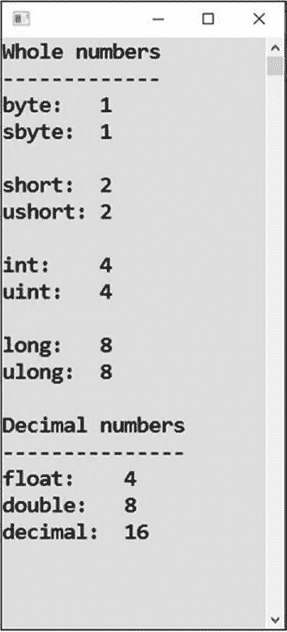

*图 12-2.* 显示每种类型使用的字节数

### 解决方案

以下是代码：

```csharp
static void Main(string[] args)
{
    // Outputs
    Console.WriteLine("Whole numbers");
    Console.WriteLine("-------------");
    Console.WriteLine("byte:    " + sizeof(byte));
    Console.WriteLine("sbyte:   " + sizeof(sbyte));
    Console.WriteLine();
    Console.WriteLine("short:   " + sizeof(short));
    Console.WriteLine("ushort:  " + sizeof(ushort));
    Console.WriteLine();
    Console.WriteLine("int:     " + sizeof(int));
    Console.WriteLine("uint:    " + sizeof(uint));
    Console.WriteLine();
    Console.WriteLine("long:    " + sizeof(long));
    Console.WriteLine("ulong:   " + sizeof(ulong));
    Console.WriteLine();
    Console.WriteLine("Decimal numbers");
    Console.WriteLine("---------------");
    Console.WriteLine("float:   " + sizeof(float));
    Console.WriteLine("double:  " + sizeof(double));
    Console.WriteLine("decimal: " + sizeof(decimal));
    Console.WriteLine();

    // Waiting for Enter
    Console.ReadLine();
}
```

### 联系

将当前程序和之前程序的结果联系起来是可能的。例如，让我们讨论重要的 `int` 类型。它使用 4 字节，即 32 位内存。这意味着可能的值有 2 的 32 次方个，超过四十亿。`int` 是一种有符号


类型，因此你有20亿个正数和20亿个负数。其无符号对应类型 `uint` 则将所有约40亿个值都用于正数（当然，还有零）。

## 讨论

你可能会对各种数值数据类型感到困惑。为了帮助你理解，这里总结了每种类型的使用时机：

- `int`：用于本质上为整数的常规值（例如对某物的计数）。
- `double`：用于可能是小数的常规值（例如测量值）或需要做数学运算的值。金额大多数情况下也可以用。
- `byte`：用于处理二进制数据。
- `long`：用于较大的整数值，例如文件大小、支付标识（例如可能需要十位数字），或常规（整数）值的乘法结果。
- `decimal`：常用于金额。

其他类型则不常用。

## 溢出

当程序计算出无法“适合”相应类型范围的值时，就会发生所谓的 *溢出*。程序的行为可能非常奇怪，如图12-3所示。

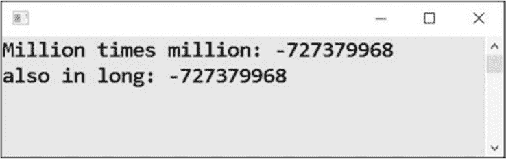

**图 12-3.** *溢出*

溢出尤其容易在乘法运算时发生，因为乘法通常会产生较大的数字。

## 任务

在本节中，你将编写一个程序，尝试计算一百万乘以一百万。

## 解决方案

代码如下：

```csharp
static void Main(string[] args)
{
    // Multiplying million by million
    int million = 1000000;
    int result = million * million;
    long resultInLong = million * million;

    // Outputs
    Console.WriteLine("Million times million: " + result);
    Console.WriteLine("also in long: " + resultInLong);

    // Waiting for Enter
    Console.ReadLine();
}
```

## 解决方案

新项目的源代码如下：

```csharp
static void Main(string[] args)
{
    // 0. Preparation
    int million = 1000000;

    // 1. Crash at least, we do not
    //    definitely want a nonsense
    Console.WriteLine("1. calculation");
    try
    {
        long result = million * million;
        Console.WriteLine("Million times million:" + result);
    }
    catch (Exception)
    {
        Console.WriteLine("I cannot calculate this.");
    }

    // 2. Correct calculation of a big value
    Console.WriteLine("2. calculation");
    long millionInLong = million;
    long correctResult = millionInLong * millionInLong;
    Console.WriteLine("Million times million: " + correctResult.ToString("N0"));

    // 3. Alternative calculation of a big value
    Console.WriteLine("3. calculation");
    long correctResultAlternatively = (long)million * (long)million;
    Console.WriteLine("Million times million: " + correctResultAlternatively.ToString("N0"));

    // Waiting for Enter
    Console.ReadLine();
}
```

## 注意

然而，这段代码并不能解决所有问题。当你立即启动程序时，第一次计算仍然会是错误的。人们有时把 try-catch 当作万灵丹，但它绝对不是。你需要其他手段，如下文所讨论的。

## Visual Studio 中的设置

你需要在 Visual Studio 中设置你的项目，使其将溢出从程序中报告出来，而不是将其掩盖。

在 Visual Studio 菜单中，选择“项目”，然后选择“<项目名> 属性”（见图12-4）。

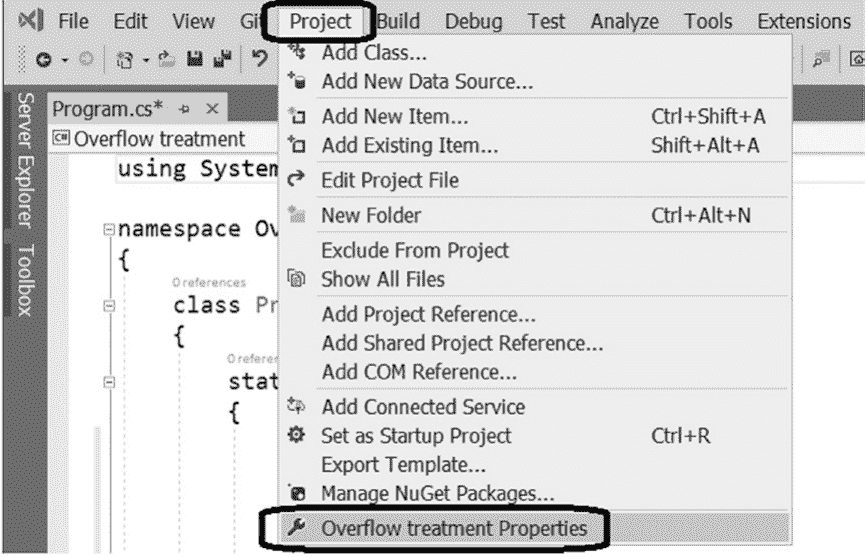

**图 12-4.** 打开属性

接下来选择“生成”选项卡，垂直（也许还要水平）滚动，以便能看到“高级”按钮（它确实很隐蔽！），然后点击该按钮（见图12-5）。

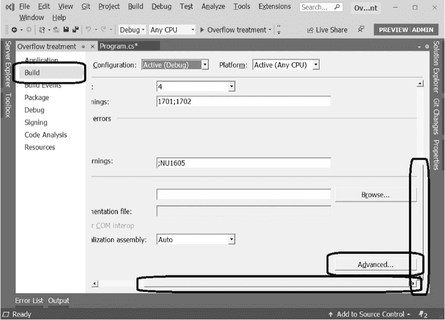

**图 12-5.** *生成选项卡*

在出现的对话框中，选中“检查算术溢出/下溢”复选框，然后点击“确定”按钮确认（见图12-6）。

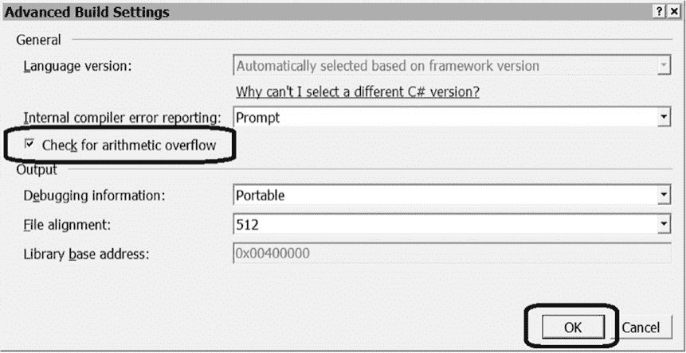

**图 12-6.** *“检查算术溢出/下溢”复选框*

你的项目现在终于可以运行了。

## 结果

现在程序按预期运行，如图12-7所示。

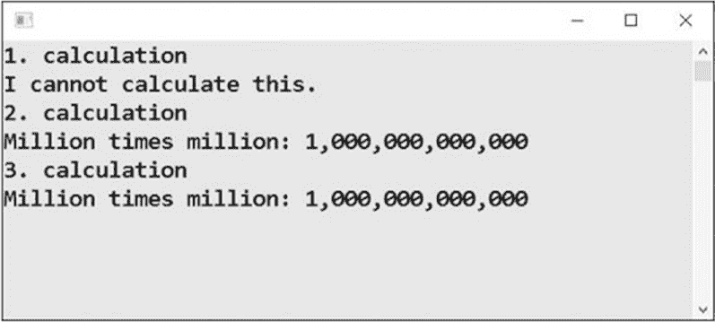

**图 12-7.** *一百万乘以一百万*

## 第一种替代方案

第一次计算正确地报告了问题。省略 try-catch 构造会引发运行时错误，但至少它不会显示错误的结果。

## 其他替代方案

正确的计算在计算开始*之前*将 million 转换为 `long` 类型。
执行此转换有两种方式：

- 将 million 赋值给类型为 `long` 的变量
- 使用 `(long)million` 进行显式*类型转换*

如果你不需要精确的整数运算，你也可以使用 `double` 类型进行计算。除非你处理某些非常特殊的数学问题，否则 `double` 不太可能溢出。

## 小结

在本章中，你学习了高级数值计算。你认识了 C# 中可用的所有数值数据类型。这些类型的区别在于它们是否允许整数或小数，也在于取值范围的不同。用于小数的类型在存储数字的精度上也各不相同。

在初学者层面，了解 `int` 和 `double` 就足够了；你完全可以只使用它们。当你更有经验时，可能还会使用以下类型：

- `long` 类型用于较大的整数，例如文件大小、十位数字的支付编号，或中等大小数字的乘法结果
- `decimal` 类型用于处理货币
- `byte` 类型用于处理二进制数据

你还研究了溢出问题。当计算出的值太大，无法放入特定数据类型的取值范围时，就会产生无意义的结果。Visual Studio 的默认行为是像往常一样继续运行。然而，现在你知道如何修改设置，以至少引发运行时错误，因为继续使用错误的结果才是糟糕的选择。

最好的替代方案是选择取值范围合适的数据类型，从而完全避免溢出。但请记住，仅仅更改用于存储结果的变量的类型可能还不够。例如，int 乘以 int 永远是 int，其最大值约为 20 亿，无论你将结果存储在哪里。在计算之前将数字转换为 `long` 类型可能是合适的。
