### 第 14 章：基本工具

你已经完成了本书的两个部分。在接下来的两个部分中，你将学习更复杂的主题，例如处理条件和循环。为了让你正确理解这些主题，在本章中我将介绍一些在编程中对你非常有帮助的工具。

### IntelliSense

你知道我将介绍的第一个工具：Visual Studio IntelliSense。每当你开始输入任何内容时，Visual Studio 会立即为你提供完成文本的选项。当你选择其中一个选项时，开发环境会在工具提示中向你显示有关该选项的进一步详细信息——该选项的作用、它需要什么参数等等。

我在本章介绍 IntelliSense 是因为它经常被初学者程序员低估。我建议你习惯于使用 IntelliSense 完成你输入的几乎每个单词。你将节省自己大量拼写错误。

### 探索可能性

使用 IntelliSense 也是探索每个当代计算平台提供的所有可能性的方式。

在过去，你必须在手册或书籍中研究可能性。其中一些足够全面，可以涵盖程序员几乎所有的问题。然而，今天的可能性如此之多，即使是 1000 页的书也无法全部展示。

你仍然需要书籍（绝对是这本！）来提供可靠和系统的指导，以便你理解原则，但你可能希望探索其中未提及的进一步可能性。IntelliSense 是一个可以向你展示其中许多可能性的工具。


图 14-2. 输入数据类型和一个点

你是否在寻找可以对日期执行的操作？输入 DateTime 变量，然后输入一个点（见图 14-3）。

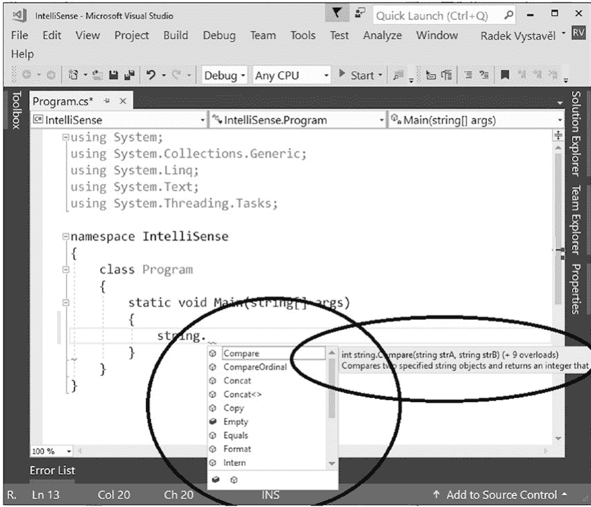

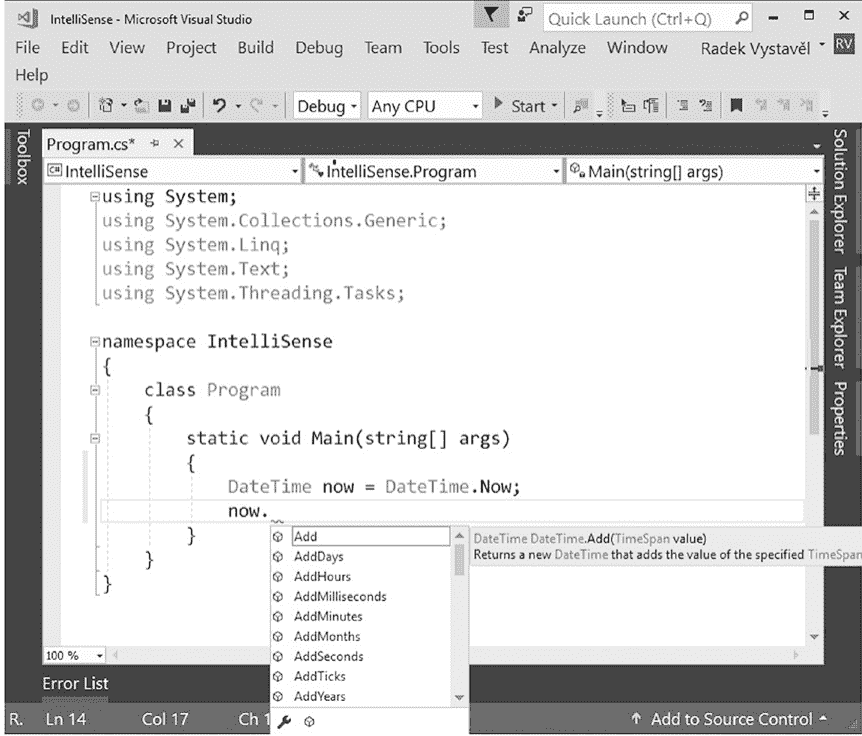

图 14-3. 输入 DateTime 和一个点

与文本一样，你可以输入 DateTime 和一个点，然后获得一些关于哪些操作可能有用的提示（见图 14-4）。

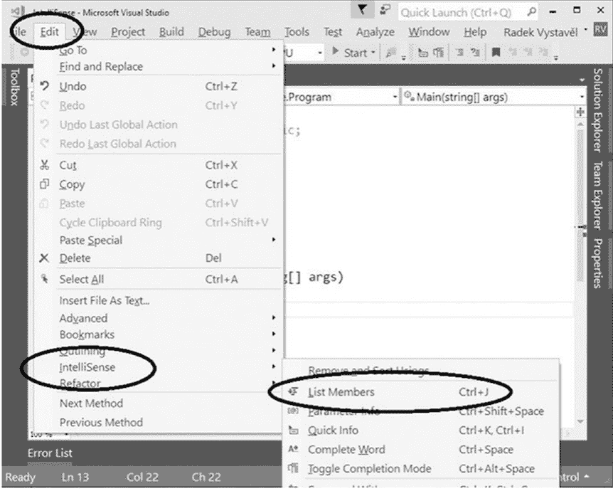

图 14-5. 列表成员的快捷方式

## 文档

IntelliSense 可以给你许多提示。它还可以显示你搜索的功能的基本用法。但是，能找到所有详细信息的地方是在线文档。

### docs.microsoft.com

http://docs.microsoft.com 是开始查找有关 C# 和其他 Microsoft 技术任何内容的最佳地点（见图 14-6）。在页面上，点击“Documentation”，然后直接转到“C#”。

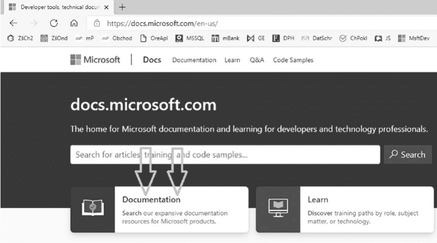

*图 14-6. Microsoft 文档*

### 搜索

你可以使用所提供的链接来使用文档站点。然而，更常见的是搜索特定内容。例如，在搜索字段中输入 **Console 类**，然后按 Enter 键（见图 14-7）。

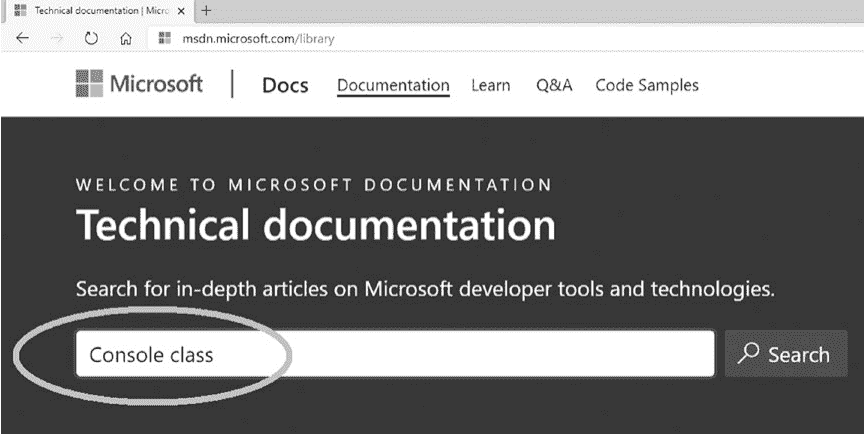

*图 14-7.* 搜索“Console class”

你感兴趣的链接通常是最先返回的那一个（见图 14-8）。

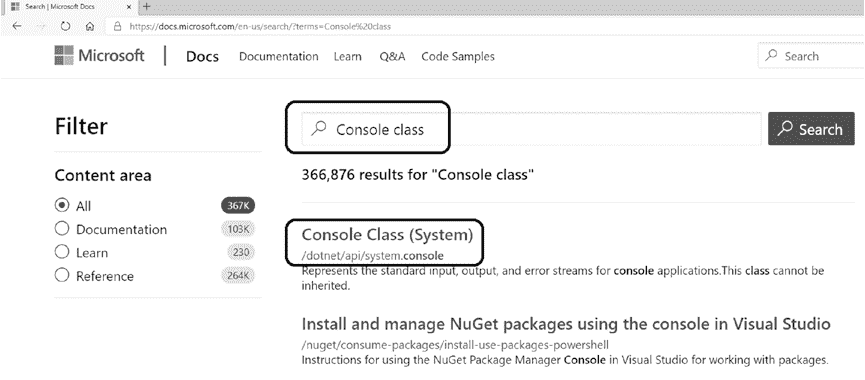

*图 14-8.* 查看“Console class”的文档

### 特定类页面

点击正确的链接后，你会找到关于某个特定类的所有内容，例如本例中的 Console。

当我初步了解某个还不熟悉的类时，我通常会查找“Common Operations”和“Remarks”部分，这些部分涵盖了类使用的基本信息和进一步细节的入口点（见图 14-9 和 14-10）。

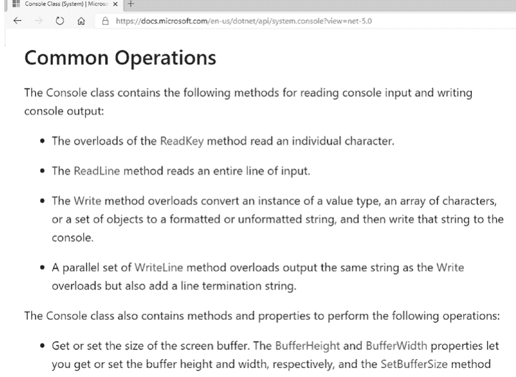

### 常见操作

Console 类包含以下用于读取控制台输入和写入控制台输出的方法：

- ReadKey 方法的重载读取单个字符。
- ReadLine 方法读取整行输入。
- Write 方法的重载将值类型的实例、字符数组或一组对象转换为格式化或未格式化的字符串，然后将该字符串写入控制台。
- 一组并行的 WriteLine 方法重载输出与 Write 重载相同的字符串，但还会附加一个行终止字符串。

Console 类还包含用于执行以下操作的方法和属性：

- 获取或设置屏幕缓冲区的大小。BufferHeight 和 BufferWidth 属性分别让你获取或设置缓冲区的高度和宽度，而 SetBufferSize 方法让你在一个方法调用中设置缓冲区大小。

图 14-9. 在“常见操作”部分获取介绍性信息

### 备注

控制台是一个操作系统窗口，用户通过计算机键盘输入文本，并从计算机终端读取文本输出，从而与操作系统或基于文本的控制台应用程序交互。例如，在 Windows 操作系统中，控制台被称为命令提示符窗口，接受 MS-DOS 命令。Console 类为从控制台读取字符和向控制台写入字符的应用程序提供基本支持。

有关使用 Console 类进行开发的信息，请参阅以下部分：

- 控制台 I/O 流
- 屏幕缓冲区和控制台窗口
- 控制台的 Unicode 支持
- 常见操作
- .NET Core 备注

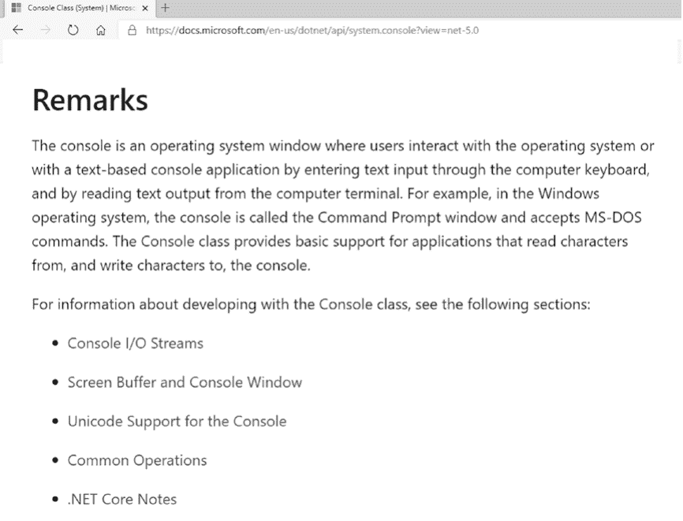

### 常见搜索

作为文档这一节的总结，请注意你也可以在 Microsoft 文档站点之外进行搜索。只需使用你喜欢的 Web 浏览器进行搜索。

然而，与文档站点搜索相反，常见搜索会更频繁地显示不相关的结果。为了弥补这一点，你可以使用编程语言名称来细化查询，例如在你喜欢的 Web 浏览器的搜索字段中输入 **Console 类 C#**。

## 调试工具

除了 IntelliSense 和文档之外，还有其他一些工具对你有所帮助。具体来说，你可以使用调试工具，可以说是能够“窥视”计算机内部。你可以用它们来查看计算机如何执行单条命令、内存中存储了哪些值，等等。

这些是你现在要学习的工具。最初，它们是为了方便程序调试而开发的，换句话说，是为了查找和消除错误。然而，它们作为说明性工具，可能更有助于你理解各种编程结构。

### 项目

最好在实践中尝试所有工具，因此请打开第 8 章中 Visual Studio 中的“处理错误输入”项目。该程序将两个数字相加，并使用 try-catch 处理可能的输入错误。

### 单步执行代码

计算机运行速度如此之快，以它的千兆赫兹速度，人眼不可能跟上。因此，*单步执行*代码常常很有帮助，它迫使计算机按照你的命令一次执行一条语句。

转到你打开的“处理错误输入”项目，使用 F10 键而不是通常的 F5 键启动它。当然，选择“调试 ➤ 单步跳过”菜单也会执行相同的操作（见图 14-11）。

### 断点

我已经介绍了当你经过感兴趣的点之后不想单步执行代码时该怎么办。还有另一种情况。假设在到达感兴趣的位置之前，你不想进行任何单步执行。在这种情况下，你可以使用断点。

单击希望计算机停止的语句，然后按 F9（或者右键单击并选择“断点 ➤ 插入断点”）。已放置断点的事实会以深红色背景和行首的深红色圆点来表示（见图 14-12）。

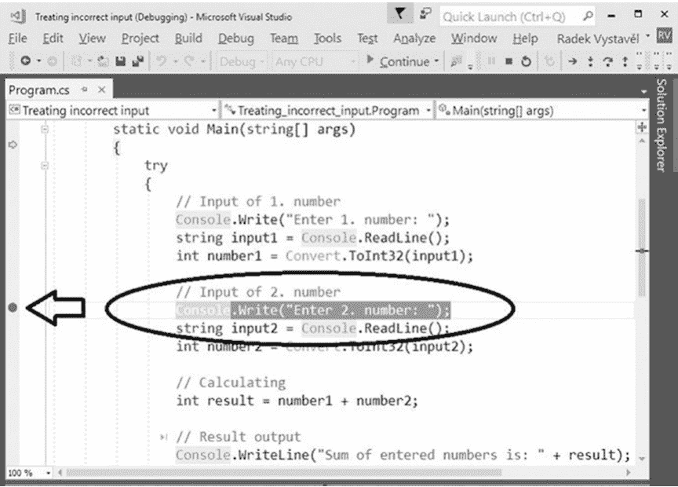

图 14-12. 插入的断点

### 使用断点

如果你的程序仍在运行（来自之前的练习），请使用 Shift+F5 组合键终止它。现在用常规方式启动程序，即使用 F5 键。程序将正常运行，并在到达断点时停止。Visual Studio 会弹到程序窗口的前面。

之后，你可以单步执行代码，或者只是查看某些内容，然后使用 F5 键继续运行程序，直到程序结束，或者遇到下一个断点。

### 移除断点

要移除不再需要的断点，请在特定行上再次按 F9，或者右键单击并从上下文菜单中选择“断点 ➤ 删除断点”。

### 内存检查

每当你的程序被挂起时（由于断点、单步执行等原因），你都可以检查程序可用的内存，并查看各个变量的值。

为了方便内存检查，Visual Studio 会在其窗口底部显示“自动”、“局部变量”和“监视”窗格。如果这些窗格不存在，你可以通过“调试 ➤ 窗口”菜单显示它们。

“自动”和“局部变量”窗格会自动选择要显示的变量，而“监视”窗格则根据你想看的内容手动填充。你可以在窗格中输入特定变量的名称，也可以右键单击代码中的变量并从上下文菜单中选择“添加监视”（见图 14-13）。


## 它是什么？

到目前为止，你总是需要编写一个包含多个语句的程序，然后运行它才能看到实际效果。交互模式允许你输入单条 C# 语句并立即运行。通过这种方式，你可以更快地探索某些 C# 特性。

## 如何启动它？

你可以通过选择“视图 ➤ 其他窗口 ➤ C# 交互”来启动交互模式（见图 14-15）。你甚至不需要创建或打开项目。

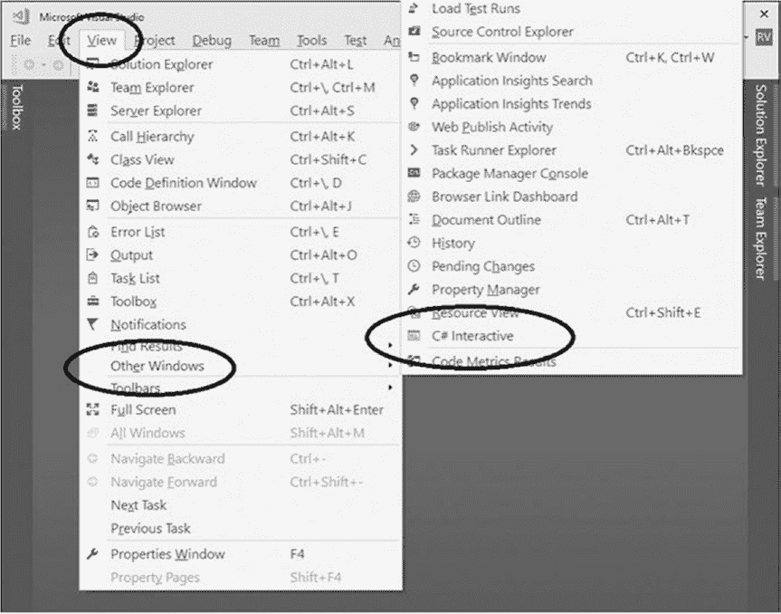

*图 14-15.* 切换到交互模式

图 14-16 显示了一个交互式会话示例——我声明了一个数值变量，将其增加 10，并显示其值。

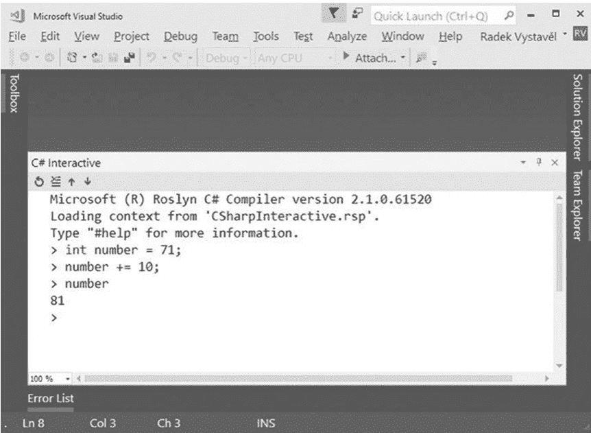

图 14-16. 交互式会话示例

## 注释

请注意以下事项：

- 如果需要输入多行语句，可以用 Shift+Enter 换行，而不是直接按 Enter。
- 使用 `#help` 可以显示有关如何使用交互模式的简明信息。

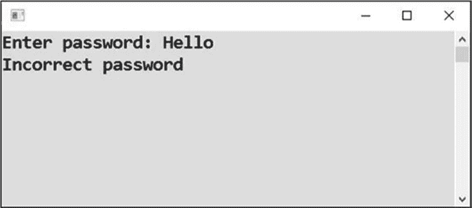

**图 15-1.** 密码错误

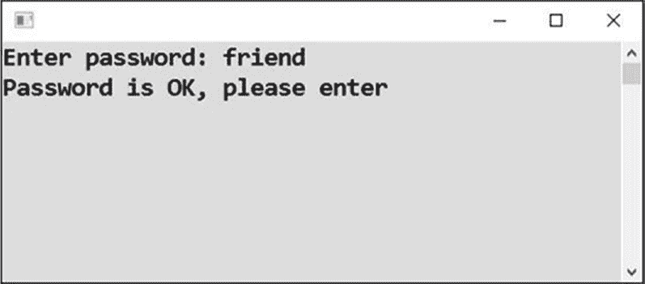

**图 15-2.** 密码正确

## 分析

让我们更详细地看一下这个程序。

### 程序

在这个程序中，当两个密码（输入的密码和存储的密码）一致时执行某种操作，当它们不一致时执行另一种操作。在这种情况下，你要么允许用户进入，要么拒绝用户，并显示相应的消息（见图 15-3）。

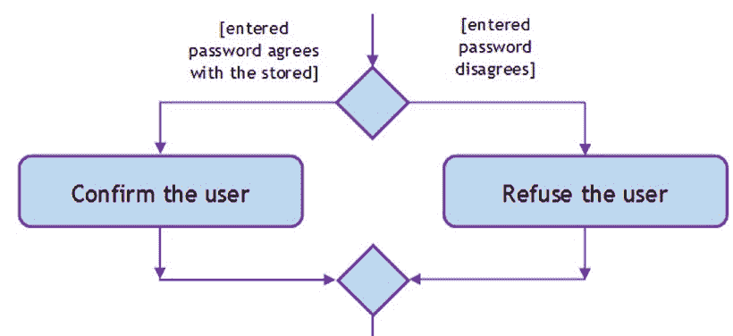

图 15-3. 程序流程

### 程序分支

一般来说，程序分支意味着根据条件是否成立而走不同的路径（见图 15-4）。

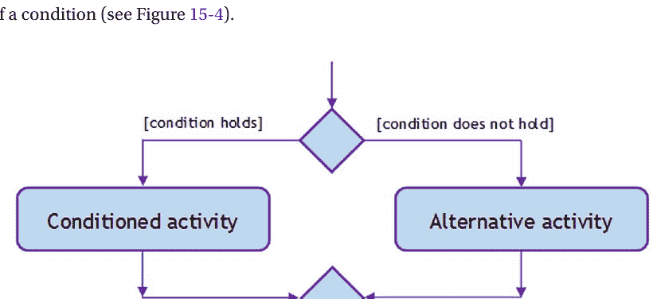

图 15-4. 分支

### 语法

对于分支，C# 使用如下所示的 if-else 结构：

```csharp
if (condition)
{
    Statements to perform when the condition holds
}
else
{
    Statements to perform otherwise
}
```

### 解决方案

代码如下：

```csharp
static void Main(string[] args)
{
    // Input
    Console.Write("Enter password: ");
    string enteredPassword = Console.ReadLine();

    // Password check
    if (enteredPassword == "friend")
    {
        Console.WriteLine("Password is OK, please enter");
    }
    else
    {
        Console.WriteLine("Incorrect password");
    }

    // Waiting for Enter
    Console.ReadLine();
}
```

### 讨论

为了构造条件，我使用了相等性测试，它由两个等号组成。如果比较的值相同，测试结果为 true，条件被视为成立，执行 if 分支中的语句。如果比较的值不同，测试结果为 false，条件被视为不成立，执行 else 分支中的语句。

### 测试

现在你可以检查程序的执行情况了！除了正常运行程序外，你还可以像上一章学到的那样逐行执行代码。

## 反向条件

为了让你更熟悉条件，从不同角度来认识它们是很有帮助的。继续以密码问题为例，让我们换一种方式来思考。

### 任务

现在的任务是用另一种方式解决前面的练习，即使用反向条件。换句话说，你将测试不相等而不是相等。

### 解决方案

代码如下：

```csharp
static void Main(string[] args)
{
    // Correct password
    string correctPassword = "friend";

    // Input
    Console.Write("Enter password: ");
    string enteredPassword = Console.ReadLine();

    // Password check
    if (enteredPassword != correctPassword)
    {
        Console.WriteLine("Incorrect password");
    }
    else
    {
        Console.WriteLine("Password is OK, please enter");
    }

    // Waiting for Enter
    Console.ReadLine();
}
```

### 讨论

在这个练习中，我使用了不相等性测试，它由一个感叹号后跟一个等号组成。当比较的值**不相同**时，测试返回 true。

## 长度检查

两段文本只能比较是相同还是不同，而两个数字还可以比较哪个更大（或更小）。让我们来看一看。

### 任务

在本节中，你将学习在程序中进行数字比较，该程序会判断输入的文本是否最多为四个字符（见图 15-5 和图 15-6）。

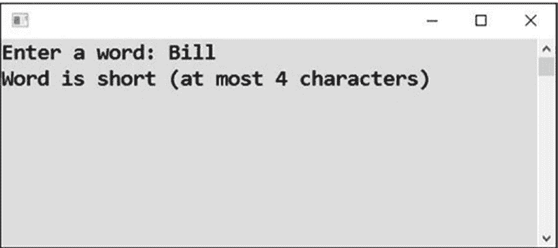

图 15-5. 短文本

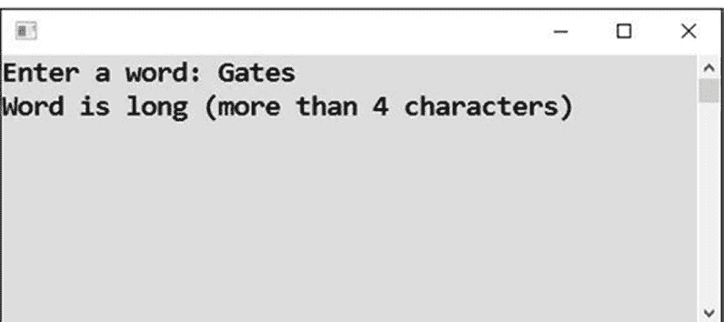

图 15-6. 长文本

### 解决方案

想必你应该先确定输入文本的字符数，然后将其与数字四进行比较。你在第 7 章中学习了如何确定文本的字符数——即使用其 `Length` 属性（那个程序是“文本作为对象”）。无论如何，如果你不记得该属性的名称，可以在文本变量末尾添加一个点，然后浏览 IntelliSense 中的选项，看看哪些可能是合适的，正如上一章所介绍的那样。

代码如下：

```csharp
static void Main(string[] args)
{
    // Input
    Console.Write("Enter a word: ");
    string word = Console.ReadLine();

    // Determining length
    int wordLength = word.Length;

    // Checking length
    if (wordLength <= 4)
    {
        Console.WriteLine("Word is short (at most 4 characters)");
    }
    else
    {
        Console.WriteLine("Word is long (more than 4 characters)");
    }

    // Waiting for Enter
    Console.ReadLine();
}
```

### 注释

在这个解决方案中，我使用了小于或等于运算符，它看起来像这样：`<=`。

## 正数

在本节中，你将获得更多关于数字比较的练习。

### 任务

你将编写一个程序，判断用户输入的数字是否为正数（见图 15-7 和图 15-8）。

### 解决方案

```csharp
// Evaluation
if (number > 0)
{
    Console.WriteLine("The number is positive");
}
else
{
    Console.WriteLine("The number is NOT positive");
}

// Waiting for Enter
Console.ReadLine();
```

### 讨论

我使用了大于运算符来将输入的数字与零进行比较。
你认为当用户输入零时程序会做什么？它会检查条件 `0 > 0`，并发现该条件不成立。因此，它会显示该数字不是正数。这就是为什么消息措辞相当不寻常（“……不是正数”），如图 15-9 所示。我没有使用“……是负数”。

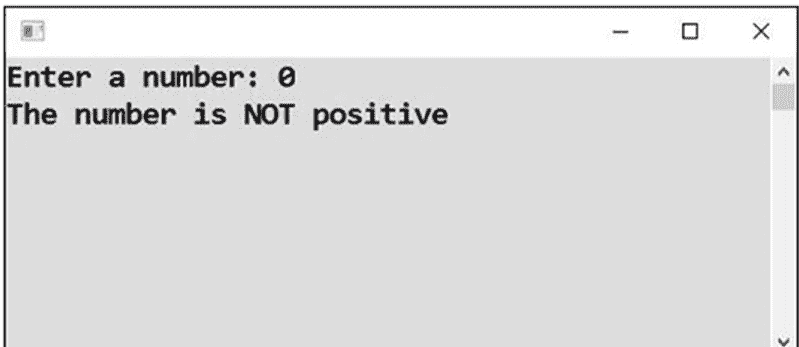

图 15-9. 零时的结果

## 奇数和偶数

让我们继续看另一个数字比较。

### 任务

你现在的任务是编写一个程序，判断用户输入的数字是奇数还是偶数（见图 15-10 和图 15-11）。


**图 15-10.** 判断偶数

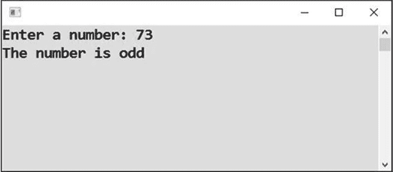

**图 15-11.** 判断奇数

### 解决方案

解决方案的核心是确定输入数字除以二的余数。如果余数为零，则该数字是偶数。如果存在余数，则该数字是奇数。

代码如下：

```csharp
static void Main(string[] args)
{
    // Input
    Console.Write("Enter a number: ");
    string input = Console.ReadLine();
    int number = Convert.ToInt32(input);

    // Remainder calculation
    int remainderAfterDivisionByTwo = number % 2;

    // Evaluation
    if (remainderAfterDivisionByTwo == 0)
    {
        Console.WriteLine("The number is even");
    }
    else
    {
        Console.WriteLine("The number is odd");
    }

    // Waiting for Enter
    Console.ReadLine();
}
```

## 不区分大小写

你已经知道，可以对两段文本进行比较，看它们是否相等或不相等。这种比较是区分大小写的。换句话说，`hobbit` 和 `Hobbit` 被认为是不同的单词。然而，你经常需要进行不区分大小写的比较，我现在就来向你展示如何操作。


