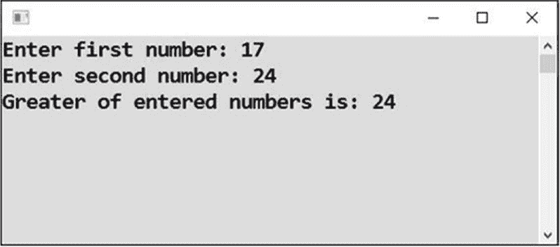

## 第15章：条件语句入门

### 任务

你将再次解决之前的练习，但这次不使用大括号。

### 解决方案

代码如下：

```csharp
static void Main(string[] args)
{
    // Inputs
    Console.Write("Enter a name: ");
    string name1 = Console.ReadLine();

    Console.Write("Enter another name: ");
    string name2 = Console.ReadLine();

    // Converting to small letters
    string name1inSmall = name1.ToLower();
    string name2inSmall = name2.ToLower();

    // Evaluating
    // BRANCHES NOT DELIMITED BY BRACES (CURLY BRACKETS)
    if (name1inSmall == name2inSmall)
        Console.WriteLine("You have entered the same names");
    else
        Console.WriteLine("You have entered different names");

    // Waiting for Enter
    Console.ReadLine();
}
```

### 两个数字中的较大值

程序员的一项常见任务是找出两个数字中哪一个更大（同样地，也可找出哪一个更小）。

### 任务

你现在的任务是编写一个程序，询问用户两个数字，然后说明这两个数字中哪个更大（见图15-14）。



**图15-14.** *判断哪个数字更大*

### 解决方案

代码如下：

```csharp
static void Main(string[] args)
{
    // Inputs
    Console.Write("Enter first number: ");
    string input1 = Console.ReadLine();
    int number1 = Convert.ToInt32(input1);

    Console.Write("Enter second number: ");
    string input2 = Console.ReadLine();
    int number2 = Convert.ToInt32(input2);

    // Evaluating
    int greater = number1;
    if (number2 > greater)
    {
        greater = number2;
    }

    // Output
    Console.WriteLine("Greater of entered numbers is: " + greater);

    // Waiting for Enter
    Console.ReadLine();
}
```

### 使用内置函数

在本书中，我经常从不同角度向你展示内容。我坚信这能加深你的理解。对于当前“找出两个数中较大值”的问题，我将向你展示第三种解决方法。事实上，这项任务非常常见，因此 C# 提供了一个方便的内置函数。

### 任务

你将使用内置函数`Math.Max`来解决之前的练习。

### 解决方案

代码如下：

```csharp
static void Main(string[] args)
{
    // Inputs
    Console.Write("Enter first number: ");
    string input1 = Console.ReadLine();
    int number1 = Convert.ToInt32(input1);

    Console.Write("Enter second number: ");
    string input2 = Console.ReadLine();
    int number2 = Convert.ToInt32(input2);

    // Evaluating
    int greater = Math.Max(number1, number2);

    // Output
    Console.WriteLine("Greater of entered numbers is: " + greater);

    // Waiting for Enter
    Console.ReadLine();
}
```

### 小结

在本章中，你开始学习程序语句的条件执行，这意味着一条或多条语句是否执行可以由某个测试来决定。你看到了以下测试示例：

- 使用`==`运算符测试两段文本或两个数字是否相等
- 使用`!=`运算符测试两段文本或两个数字是否不相等
- 使用`>`（或`<`）运算符测试一个数字是否大于（或小于）另一个数字

最后一个测试还可以使用`>=`（或`<=`）运算符扩展为“大于或等于”（或“小于或等于”）。

为了在代码中使用条件执行，你学习了if-else结构。它由一个条件和两个分支组成。如果条件被判定为真（满足），则执行if分支中的语句；如果条件被判定为假（不满足），则执行else分支中的语句。

你了解到，如果某个分支只包含一条语句，C#语法允许你省略包围该分支的大括号，但我不建议你这样做，因为人们在之后将分支扩展为多条语句时，常常会忘记补上大括号。

更重要的是，你了解到else分支可以根据需要省略。这意味着没有备选操作——当条件不满足时，什么都不做。

作为额外收获，你了解了实用的内置函数Math.Max。（你大概能猜到还有一个类似的函数叫Math.Min。）
