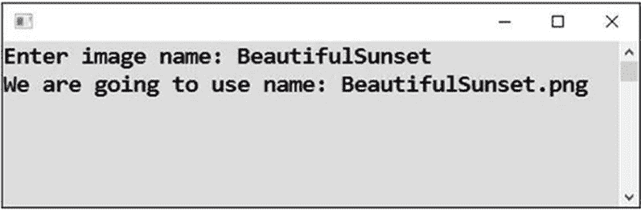
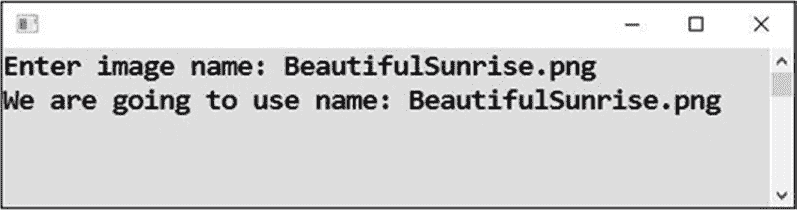
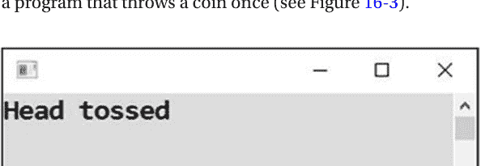
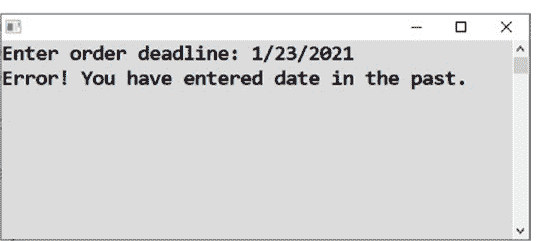
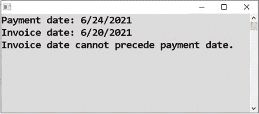
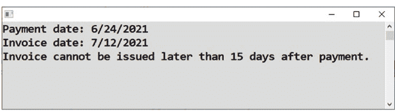
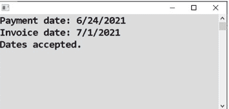

## 第16章：实用条件语句

在上一章中，你学习了程序语句的条件执行。在本章中，你将加深对这一主题的理解。我将向你展示如何在几个简单的任务中使用条件和分支，这些任务在你未来的编程生涯中迟早会遇到。

### 追加扩展名

有时，你想向用户询问文件名，但你不知道用户输入时是否带扩展名。

### 任务

你将编写一个程序，为输入的文件名追加.png扩展名，除非该扩展名已经是输入的一部分（见图16-1和图16-2）。



**图16-1.** *追加.png扩展名*



**图16-2.** *不追加.png扩展名*

### 解决方案

代码如下：

```csharp
static void Main(string[] args)
{
    // Input
    Console.Write("Enter image name: ");
    string fileName = Console.ReadLine();

    // Appending extension (ONLY IN CASE OF NEED)
    if (!fileName.ToLower().EndsWith(".png"))
    {
        fileName += ".png";
    }

    // Output
    Console.WriteLine("We are going to use name: " + fileName);

    // Waiting for Enter
    Console.ReadLine();
}
```

### 讨论

让我们稍微讨论一下这个程序。

### 链式调用

请注意ToLower和EndsWith方法的*链式调用*。小写转换的输出并没有存储到任何变量中，而是作为链中下一个方法（即EndsWith）的输入。

### 正面与反面

我们再做一些与条件相关的练习。

### 任务

你将编写一个程序，抛一次硬币（见图16-3）。



**图16-3.** *抛硬币*

### 解决方案

解决方案的核心是生成一个随机数——0或1——然后将其转换为正面或反面。

代码如下：

```csharp
static void Main(string[] args)
{
    // Random number generator
    Random randomNumbers = new Random();

    // Random number 0/1 and its transformation
    int randomNumber = randomNumbers.Next(0, 1 + 1);

    if (randomNumber == 0)
    {
        Console.WriteLine("Head tossed");
    }
    else
    {
        Console.WriteLine("Tail tossed");
    }

    // Waiting for Enter
    Console.ReadLine();
}
```

### 讨论

我只想提醒你，Next方法要求随机数范围的上限在指定时已经加1。这就是为什么你在前面的程序中写了1+1。当然，你也可以直接写2，但1+1在我看来更符合逻辑：将1作为上限，再加上（有点奇怪的）必需的1。

### 截止日期检查

俗话说：“永远不要相信用户。”这意味着作为程序员，你在生产软件中必须始终检查用户输入的数据。

你通常需要检查用户数据，并不是因为恶意使用，因为99.9%的用户都没有滥用你软件的意图。用户只是会犯错。这就是为什么你应该检查他们的输入并提示他们更正。

所以，现在你将学习如何实现一些输入检查。

### 任务

你将编写一个程序，提示用户输入订单截止日期，如果用户输入的日期是过去的日期，则显示警告（见图16-4）。




*图 16-4.* 检查日期。

## 解决方案

代码如下：

```csharp
static void Main(string[] args)
{
    // Input
    Console.Write("Enter order deadline: ");
    string input = Console.ReadLine();
    DateTime enteredDeadline = Convert.ToDateTime(input);

    // Checking entered value
    DateTime today = DateTime.Today;
    if (enteredDeadline < today)
    {
        Console.WriteLine("Error! You have entered date in the past.");
    }
    else
    {
        Console.WriteLine("Deadline accepted.");
    }

    // Waiting for Enter
    Console.ReadLine();
}
```

## 讨论

请注意以下几点：

- 要将文本形式输入的日期转换为 `DateTime` 对象，需要使用 `Convert.ToDateTime` 方法调用。
- 如果输入了不存在的日期，转换会失败。你可以使用 `try-catch` 来处理这种情况。
- 与数字转换类似，`Convert.ToDateTime` 可以接受第二个参数，用于指定转换所用的语言。

## 发票日期检查

我们再做一个检查用户输入数据的练习。

### 任务

我国增值税法规要求，发票开具日期不能早于付款日期，同时也不能晚于付款日期后 15 天。

当前任务是执行这两项检查（见图 16-5、16-6 和 16-7）。



*图 16-5.* 日期过早



*图 16-6.* 日期过晚



*图 16-7.* 日期均被接受

### 解决方案

解决方案如下：

```csharp
static void Main(string[] args)
{
    // Inputs
    Console.Write("Payment date: ");
    string inputPayment = Console.ReadLine();
    DateTime paymentDate = Convert.ToDateTime(inputPayment);

    Console.Write("Invoice date: ");
    string inputInvoice = Console.ReadLine();
    DateTime invoiceDate = Convert.ToDateTime(inputInvoice);

    // Checking
    bool ok = true;
    if (invoiceDate < paymentDate)
    {
        Console.WriteLine("Invoice date cannot precede payment date.");
        ok = false;
    }
    if (invoiceDate > paymentDate.AddDays(15))
    {
        Console.WriteLine("Invoice cannot be issued later than 15 days\nafter payment.");
        ok = false;
    }
    if (ok)
    {
        Console.WriteLine("Dates accepted.");
    }

    // Waiting for Enter
    Console.ReadLine();
}
```

### 讨论

在这个解决方案中，你使用了一个名为 `ok` 的辅助变量。该变量用于监视一切是否正常。起初，你将其设置为 `true`。如果执行的任何检查失败，你就将该值切换为 `false`。如果两次检查后该变量仍为 `true`，则说明一切正常，并向用户显示确认消息。

## 西班牙语星期几

现在你将学习如何将代码的执行分支到多个路径。

### 任务

你将编写一个程序，对于用户输入的日期，显示该日期的西班牙语星期几（lunes、martes、miércoles 等）（见图 16-8）。

### 解决方案

```csharp
if (dayOfWeek == DayOfWeek.Friday)
    spanish = "Viernes";
if (dayOfWeek == DayOfWeek.Saturday)
    spanish = "Sábado";
if (dayOfWeek == DayOfWeek.Sunday)
    spanish = "Domingo";

// Output
Console.WriteLine(spanish);
if (enteredDate == new DateTime(1945, 5, 8))
    Console.WriteLine("The happiest day of the 20th century.");

// Waiting for Enter
Console.ReadLine();
}
```

### 讨论

请注意以下几点：

- 你省略了各个 `if` 分支周围的花括号。这样做是可以的，因为每个分支中都只有一条语句。我通常不会这样做，但在这种有许多简单 `if` 的情况下，在我看来这样会让代码更整洁。
- 一周中的各天是 `DayOfWeek` 枚举的成员。当你输入两个等号后按空格键时，Visual Studio 会立即为你提供该枚举（见图 16-9）。使用 Visual Studio 提供的内容！

```csharp
string input = Console.ReadLine();
DateTime enteredDate = Convert.ToDateTime(input);

// Finding day of week (in enumeration)
DayOfWeek dayOfWeek = enteredDate.DayOfWeek;

// Spanish texts
string spanish = "";
switch (dayOfWeek)
{
    case DayOfWeek.Monday:
        spanish = "Lunes";
        break;
    case DayOfWeek.Tuesday:
        spanish = "Martes";
        break;
    case DayOfWeek.Wednesday:
        spanish = "Miércoles";
        break;
    case DayOfWeek.Thursday:
        spanish = "Jueves";
        break;
    case DayOfWeek.Friday:
        spanish = "Viernes";
        break;
    case DayOfWeek.Saturday:
        spanish = "Sábado";
        break;
    case DayOfWeek.Sunday:
        spanish = "Domingo";
        break;
}

// Output
Console.WriteLine(spanish);
if (enteredDate == new DateTime(1945, 5, 8))
    Console.WriteLine("The happiest day of the 20th century.");

// Waiting for Enter
Console.ReadLine();
}
```

### 讨论

如果重复的分支总是基于同一个值，你可以使用 `switch` 语句来替代一系列 `if` 语句。在本例中，这个值就是 `dayOfWeek` 变量的值。

关于语法，`switch` 关键字后面（在括号中）跟一个变量（或表达式），其值决定执行将走哪个分支。各个分支以 `case` 关键字开头，后跟控制变量的特定值和一个冒号。你应该用 `break` 关键字终止每个分支。

## 小结

在本章中，你编写了针对各种实际任务进行条件执行的程序。具体来说，你学习了以下内容：

- 输入条件时不使用任何关系运算符，如 `<`、`==` 等。条件只需计算结果为 `bool` 类型。当计算结果为 `true` 时，即视为满足条件。
- 使用 `!` 运算符对条件取反。
- 将随机数转换为另一种数据，例如正反面配对。
- 对用户输入（尤其是日期）进行各种检查。
- 使用一系列 `if` 语句或 `switch` 语句，将程序分支到多个备选执行路径。
