## 第 17 章：复合条件

你现在已经有一些制定条件并使用它们解决实际问题的经验了。对于更复杂的问题，你通常需要将条件组装成两个或更多部分条件。这就是你将在本章中学习的内容。

### 是或否

你对复合条件的第一次使用，将是检查用户输入是否属于允许的备选项之一。

### 任务

你将编写一个程序，检查用户输入的是“yes”还是“no”。所有其他输入都将被视为不正确（见图 17-1 和 17-2）。

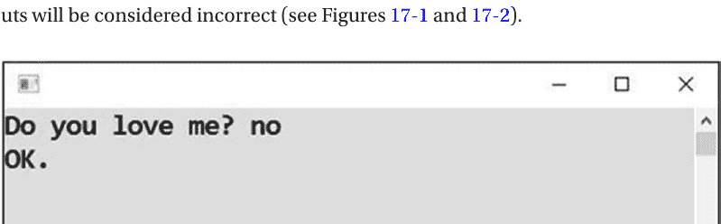

*图 17-1.* 可接受的答案，但令人难过

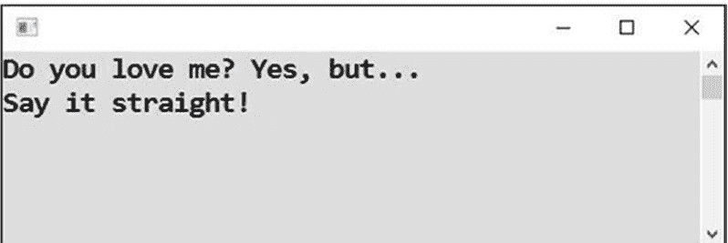

*图 17-2.* 是的！

### 解决方案

代码如下：

```csharp
static void Main(string[] args)
{
    // Input
    Console.Write("Do you love me? ");
    string input = Console.ReadLine();

    // Evaluating
    string inputInSmall = input.ToLower();
    if (inputInSmall == "yes" || inputInSmall == "no")
    {
        Console.WriteLine("OK.");
    }
    else
    {
        Console.WriteLine("Say it straight!");
    }

    // Waiting for Enter
    Console.ReadLine();
}
```

### 讨论

请注意以下几点：

- 为了忽略大小写差异，你将输入转换为小写字母。
- 所用条件是一个复合条件。它由两个部分条件组成，使用条件或运算符连接，该运算符输入为 `||`（两条竖线）。
- 如果**至少一个**部分条件满足，则条件成立（并执行 `if` 分支）。这意味着用户输入了 *yes 或 no*。在这种情况下，这些备选项是互斥的。但是，你也会遇到两个条件可以同时满足的情况。
- 如果第一个和第二个部分条件都不满足，则条件不成立（并执行 `else` 分支）。换句话说，用户输入了 yes 或 no 以外的内容。

### 用户名和密码

现在你将查看应始终同时满足的部分条件。

### 任务

你将编写一个程序，检查用户是否输入了正确的用户名（Orwell）并且同时输入了正确的密码（Catalonia）。用户名不区分大小写，也就是说它可以是小写或大写（见图 17-3 和 17-4）。


## 第17章 复合条件

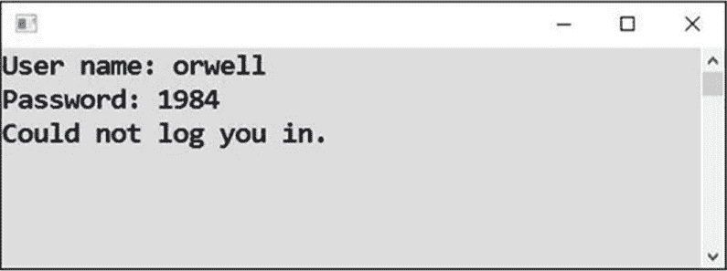

*图17-3.* 用户名正确但密码错误

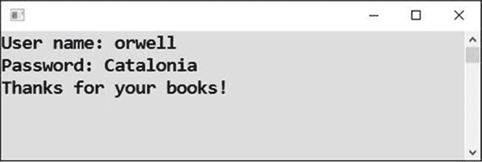

*图17-4.* 用户名和密码均正确

### 解决方案

代码如下：

```csharp
static void Main(string[] args)
{
    // Correct values
    string correctUsername = "Orwell";
    string correctPassword = "Catalonia";

    // Inputs
    Console.Write("User name: ");
    string enteredUserName = Console.ReadLine();
```

### 任务

你将修改上一个任务，允许两个可能的用户登录。他们各自都有自己的密码。

### 解决方案

代码如下：

```csharp
static void Main(string[] args)
{
    // Correct values
    string correctUsername1 = "Orwell";
    string correctPassword1 = "Catalonia";

    string correctUsername2 = "Blair";
    string correctPassword2 = "1984";

    // Inputs
    Console.Write("User name: ");
    string enteredUsername = Console.ReadLine();

    Console.Write("Password: ");
    string enteredPassword = Console.ReadLine();

    // Evaluating
    if (enteredUsername.ToLower() == correctUsername1.ToLower() &&
        enteredPassword == correctPassword1 ||
        enteredUsername.ToLower() == correctUsername2.ToLower() &&
        enteredPassword == correctPassword2)
    {
        Console.WriteLine("Thanks for your books!");
    }
    else
    {
        Console.WriteLine("Could not log you in.");
    }

    // Waiting for Enter
    Console.ReadLine();
}
```

### 讨论

请注意以下几点：

- 你可以将两个条件运算符组合使用：AND 与 OR。
- 完整条件的满足要求用户输入正确的第一个用户名和正确的第一个密码，或者正确的第二个用户名和正确的第二个密码。
- 该条件有意让 AND 运算符比 OR 运算符具有*更高的优先级*（优先顺序）。具体来说，先分别对两个潜在用户进行判断，然后再对部分结果进行 OR 运算。
- 如果你需要不同的求值顺序，只需像数学中那样使用圆括号即可。

### 条件预计算

上一个练习中的复合条件已经相当复杂。要理解它，阅读时必须集中注意力。在类似情况下，预先计算（提前计算）部分条件可能会更好。我现在就来演示这一点。

### 任务

任务与上一个相同，但解决方案会有所不同。

### 解决方案

代码如下：

```csharp
static void Main(string[] args)
{
    // Correct values
    string correctUsername1 = "Orwell";
    string correctPassword1 = "Catalonia";

    string correctUsername2 = "Blair";
    string correctPassword2 = "1984";

    // Inputs
    Console.Write("User name: ");
    string enteredUsername = Console.ReadLine();
    Console.Write("Password: ");
    string enteredPassword = Console.ReadLine();

    // Evaluating
    bool user1ok = enteredUsername.ToLower() == correctUsername1.ToLower() &&
                   enteredPassword == correctPassword1;
    bool user2ok = enteredUsername.ToLower() == correctUsername2.ToLower() &&
                   enteredPassword == correctPassword2;
    if (user1ok || user2ok)
    {
        Console.WriteLine("Thanks for your books!");
    }
    else
    {
        Console.WriteLine("Could not log you in.");
    }

    // Waiting for Enter
    Console.ReadLine();
}
```

### 讨论

请注意以下几点：

- 你逐一检查两个用户。这样主条件就可以写得清晰简洁。
- 部分条件被预先计算到`bool`类型的变量中。当某个条件满足时，相应变量的值会被设为 true。

### 反转“是或否”

你已经在第15章学习了条件的反转。那一章中的条件很简单。现在你将反转一个复合条件，这有点棘手，需要更加小心。

### 任务

你将再次回到本章开头的“是或否”项目。为了练习复合条件，请思考如何反转原始条件，以交换 `if` 和 `else` 分支。

### 解决方案

代码如下：

```csharp
static void Main(string[] args)
{
    // Input
    Console.Write("Do you love me? ");
    string input = Console.ReadLine();

    // Evaluating
    string inputInSmall = input.ToLower();
    if (inputInSmall != "yes" && inputInSmall != "no")
    {
        Console.WriteLine("Say it straight!");
    }
    else
    {
        Console.WriteLine("OK.");
    }

    // Waiting for Enter
    Console.ReadLine();
}
```

### 讨论

请注意以下几点：

- 你现在检查的不是正确的输入，而是错误的输入。
- 当输入既不是 yes 也不是 no 时，它就是错误的。
- 反转条件使 OR 运算符变成了 AND 运算符，也使相等变成了不相等。

### 成绩检查

现在我想让你关注一个常见的问题：检查一个数字是否属于指定的集合或指定的范围。接下来的两个任务都与这有关。

### 任务

用户输入一个学生的成绩。程序随后会检查输入的数字是否在可能的值 1、2、3、4 或 5 的集合中（见图17-5和图17-6）。

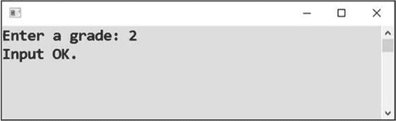

*图17-5.* 在范围内

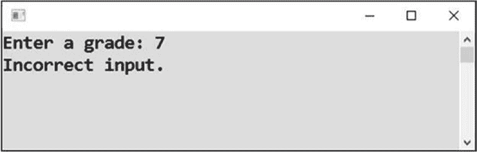

*图17-6.* 不在范围内

### 解决方案

该条件可以逐一列举各个备选值来构造。为简单起见，我不检查可能出现的非数值输入。你可以像往常一样使用 try-catch 自己处理这一点。

代码如下：

```csharp
static void Main(string[] args)
{
    // Input
    Console.Write("Enter a grade: ");
    string input = Console.ReadLine();
    int grade = Convert.ToInt32(input);

    // Evaluating
    if (grade == 1 ||
        grade == 2 ||
        grade == 3 ||
        grade == 4 ||
        grade == 5)
    {
        Console.WriteLine("Input OK.");
    }
    else
    {
        Console.WriteLine("Incorrect input.");
    }

    // Waiting for Enter
    Console.ReadLine();
}
```

### 更好的范围检查

允许的数字（可能的成绩）实际上构成了一到五的范围（一个没有间断的连续范围）。在这种情况下，你可以用一种更好的方式来检查一个数字是否属于特定范围。

### 任务

任务是用范围检查来解决前面的练习。

### 解决方案

当一个数字大于或等于下界，且同时小于或等于上界时，它就属于由下界和上界给出的范围。

代码如下：

```csharp
static void Main(string[] args)
{
    // Input
    Console.Write("Enter a grade: ");
    string input = Console.ReadLine();
    int grade = Convert.ToInt32(input);

    // Evaluating
    if (grade >= 1 && grade <= 5)
    {
        Console.WriteLine("Input OK.");
    }
    else
    {
        Console.WriteLine("Incorrect input.");
    }

    // Waiting for Enter
    Console.ReadLine();
}
```

### 小结

本章向你介绍了复合条件这一主题。你学会了如何使用条件与运算符和条件或运算符，将多个部分条件连接起来，构成 if 语句中的复合条件。

在 C# 中，AND 运算符写作 &&，当两个部分条件都满足时，它的计算结果为 true。另一方面，OR 运算符写作 ||，当至少一个部分条件满足时，它的计算结果为 true。

你还看到了将更多数量部分条件组合成一个条件的情况。在这种情况下，运算符优先级的问题就很重要。在没有括号的情况下，AND 总是在 OR 之前被求值。但请注意，这样的条件可能会变得相当复杂且难以阅读。建议提前分别计算整个条件的各个部分，并将其临时存储在 bool 类型的变量中。


# 第 17 章 复合条件

我还曾试图让你注意复合条件取反的问题，这需要格外小心和专注才能做对。具体来说，你学到了：取反时，AND 会变成 OR（反之亦然），等号会变成不等号（反之亦然）。

最后，我向你展示了如何检查一个数字是属于某个指定集合还是属于某个指定范围。在后一种情况下，你要同时针对范围的下界和上界进行测试。

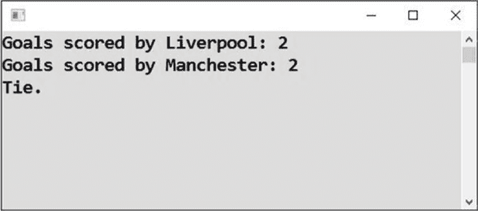

*图 18-2.* 平局

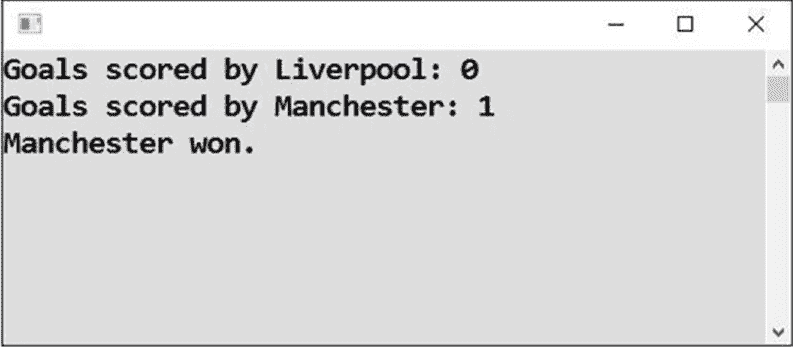

*图 18-3.* 第二支球队获胜

# 分析

你可以连续使用三个条件来解决该任务，每个条件分别考虑一种比赛结果（见图 18-4）。

# 解决方案

代码如下：

```
```csharp
static void Main(string[] args)
{
    // Inputs
    Console.Write("Goals scored by Liverpool: ");
    string inputLiverpool = Console.ReadLine();
    int goalsLiverpool = Convert.ToInt32(inputLiverpool);

    Console.Write("Goals scored by Manchester: ");
    string inputManchester = Console.ReadLine();
    int goalsManchester = Convert.ToInt32(inputManchester);

    // Evaluating
    if (goalsLiverpool > goalsManchester)
    {
        Console.WriteLine("Liverpool won.");
    }

    if (goalsLiverpool == goalsManchester)
    {
        Console.WriteLine("Tie.");
    }

    if (goalsLiverpool < goalsManchester)
    {
        Console.WriteLine("Manchester won.");
    }

    // Waiting for Enter
    Console.ReadLine();
}
```
```

# 足球示例（另一种解法）

为了让你看到另一种思路，我们将用另一种方式来解决前面的练习。之前你连续使用了三个条件；这一次，你将第二个条件嵌套到第一个条件中。

# 分析

如图 18-5 所示，程序将首先分支为以下两种备选情况：

+   - 利物浦获胜。
+   - 利物浦未获胜。

“利物浦未获胜”这一分支将进一步细分为：

+   - 平局。
+   - 曼彻斯特获胜。

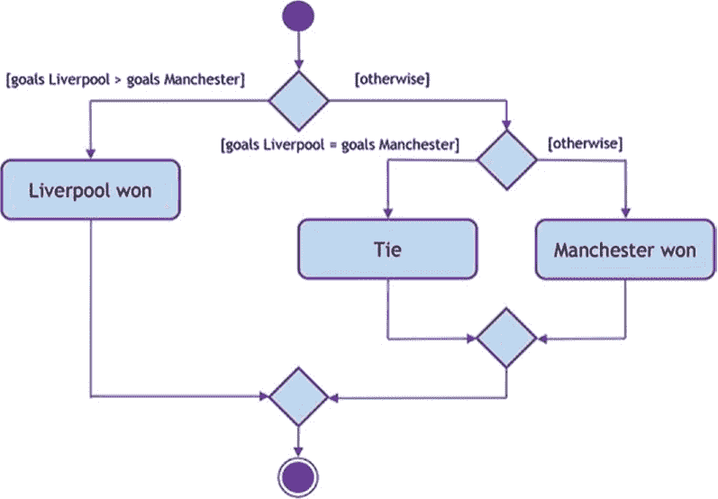

*图 18-5. 程序流程*

# 解决方案

代码如下：

```
```csharp
static void Main(string[] args)
{
    // Inputs
    Console.Write("Goals scored by Liverpool: ");
    string inputLiverpool = Console.ReadLine();
    int goalsLiverpool = Convert.ToInt32(inputLiverpool);

    Console.Write("Goals scored by Manchester: ");
    string inputManchester = Console.ReadLine();
    int goalsManchester = Convert.ToInt32(inputManchester);

    // Evaluating
    if (goalsLiverpool > goalsManchester)
    {
        // Here we know Liverpool won. We can display the result.
        Console.WriteLine("Liverpool won.");
    }
    else
    {
        // Here we know Liverpool did not win. We will decide
        //    between tie and victorious Manchester
        if (goalsLiverpool == goalsManchester)
        {
            Console.WriteLine("Tie.");
        }
        else
        {
            Console.WriteLine("Manchester won.");
        }
    }

    // Waiting for Enter
    Console.ReadLine();
}
```
```

# 三个数中的最小值

下一个示例使用条件执行来比较三个数。

# 任务

你将编写一个程序，从用户输入的三个数中找出最小值（见图 18-6）。

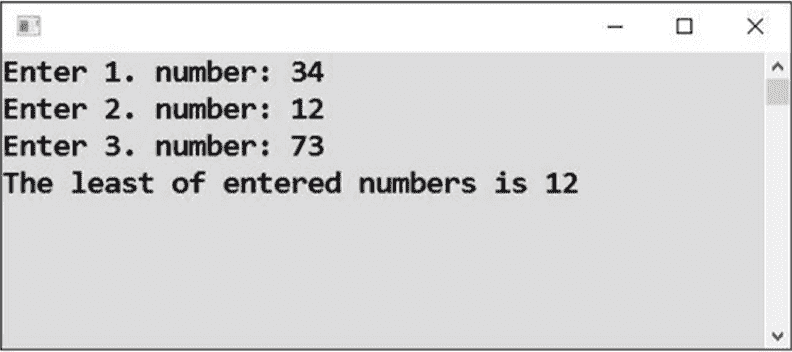

*图 18-6.* 找出最小的数

# 分析

该任务可以通过依次处理所有输入的数来解决。你将使用一个辅助变量来保存到目前为止找到的最小值。

一开始，第一个输入的数成为最小值。第二步，将第二个数与最小值进行比较。如果前者小于后者，则前者成为最小值。最后，对第三个数执行同样的过程。

# 解决方案

代码如下：

```
```csharp
static void Main(string[] args)
{
    // Inputs
    Console.Write("Enter 1. number: ");
    string input1 = Console.ReadLine();
    int number1 = Convert.ToInt32(input1);

    Console.Write("Enter 2. number: ");
    string input2 = Console.ReadLine();
    int number2 = Convert.ToInt32(input2);

    Console.Write("Enter 3. number: ");
    string input3 = Console.ReadLine();
    int number3 = Convert.ToInt32(input3);

    // At the beginning, we set 1st number as minimum
    int minimum = number1;

    // Is not 2nd number less than present minimum?
    if (number2 < minimum)
    {
        minimum = number2;
    }

    // Is not 3rd number less than present minimum?
    if (number3 < minimum)
    {
        minimum = number3;
    }

    // Output
    Console.WriteLine("The least of entered numbers is " + minimum);

    // Waiting for Enter
    Console.ReadLine();
}
```
```

# 线性方程

这个练习会涉及一些数学。

# 任务

你将编写一个程序来求解线性方程，也就是形如 $ax+b=0$ 的方程。

例如，$2x+6=0$ 是一个线性方程，其中 2 是 $a$，6 是 $b$。

显然，解是 -3。当你将 -3 代入 $x$ 时，左边变为 0，也就是说，与右边相等。

用户以系数 $a$ 和 $b$ 的形式输入要求解的方程。程序随后计算并显示其解（见图 18-7）。

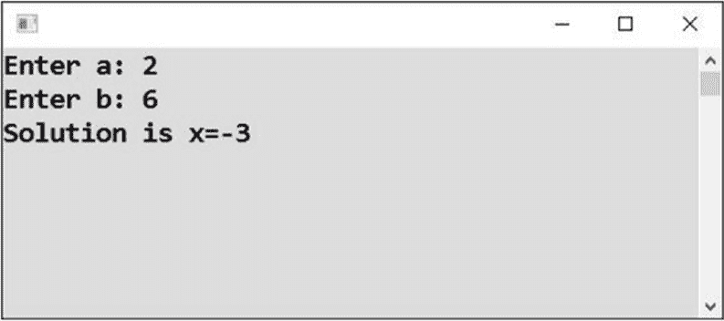

*图 18-7.* 计算并显示其解

# 分析

无论何时你想编写程序，都需要先理解现实世界中的问题。换句话说，你需要知道如何不用计算机就能解决它。

下面是对如何求解线性方程的一个数学回顾：

+   - 如果 *a* 不为零，显然的解是 *-b/a*。
+   - *a* 等于零的情况有点像数学上的奇闻。方程退化成一个奇怪的“没有 *x* 的方程”或者说伪方程 *b = 0*。这样的“方程”
+     - 当 *b* 等于零时有无数个解（无论 *x* 取何值都成立）
+     - 当 *b* 不为零时没有解（没有任何 *x* 能满足该方程）

# 解决方案

代码如下：

```
static void Main(string[] args)
{
    // Inputs
    Console.Write("Enter a: ");
    string inputA = Console.ReadLine();
    double a = Convert.ToDouble(inputA);

    Console.Write("Enter b: ");
    string inputB = Console.ReadLine();
    double b = Convert.ToDouble(inputB);

    // Solving the equation
    if (a != 0)
    {
        // a is non-zero, the equation has "normal" solution
        double solution = -b / a;
        Console.WriteLine("Solution is x=" + solution);
    }
    else
    {
        // a is zero, result depends on b
```

```
if (b == 0)
{
    Console.WriteLine("The equation \"is solved\" by any x");
}
else
{
    Console.WriteLine("The equation does not have a solution");
}
}

// Waiting for Enter
Console.ReadLine();
}
```

# 二次方程

继续数学话题，下一个练习涉及更难一点的二次方程。

# 任务

你将编写一个程序来求解二次方程，也就是形如 $ax^2 + bx + c = 0$ 的方程。例如，$x^2 - x - 2 = 0$ 是一个二次方程，其中 $a$ 是 1，$b$ 是 -1，$c$ 是 -2。该方程有两个解：-1 和 2。代入这两个解中的任何一个都会使左边变为零。

要求解的方程将以系数 $a$、$b$ 和 $c$ 的形式输入。程序计算并显示其解（见图 18-8）。

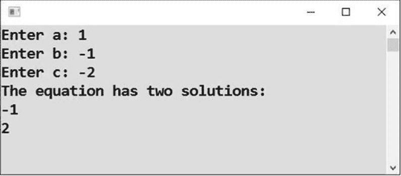

*图 18-8.* 求解二次方程

为简单起见，你不考虑 *a* 等于零的情况，那会将任务转化为前面的一元线性方程。

# 分析

从前，某个聪明人想出了一个求解二次方程的方法。你可能在学校里就学过。首先计算所谓的判别式：

$$D = b^2 - 4ac$$

然后根据判别式的值进行分支。

+   - 当 $D > 0$ 时，方程有两个解，公式如下：
+   
+     $$x_{1,2} = \frac{-b \pm \sqrt{D}}{2a}$$
+   
+   - 当 $D = 0$ 时，同样的公式仍然适用，但两个解重合。
+   
+   - 当 $D < 0$ 时，方程在实数范围内没有解。


## 解决方案

以下是代码：

```csharp
static void Main(string[] args)
{
    // Inputs
    Console.Write("Enter a: ");
    string input = Console.ReadLine();
    double a = Convert.ToDouble(input);

    Console.Write("Enter b: ");
    string inputB = Console.ReadLine();
    double b = Convert.ToDouble(inputB);

    Console.Write("Enter c: ");
    string inputC = Console.ReadLine();
    double c = Convert.ToDouble(inputC);

    // Solving + output
    double d = b * b - 4 * a * c;
    if (d > 0)
    {
        double x1 = (-b - Math.Sqrt(d)) / (2 * a);
        double x2 = (-b + Math.Sqrt(d)) / (2 * a);
        Console.WriteLine("The equation has two solutions:");
        Console.WriteLine(x1);
        Console.WriteLine(x2);
    }
    if (d == 0)
    {
        double x = -b / (2 * a);
        Console.WriteLine("The equation has a single solution: " + x);
    }
    if (d < 0)
    {
        Console.WriteLine("The equation does not have a solution");
    }

    // Waiting for Enter
    Console.ReadLine();
}
```

## 讨论

这个练习最有趣的一点是你在代码中输入公式的方式。注意，分子和分母必须用括号括起来，以确保正确的计算顺序！数学公式中没有括号，因为数学家使用分数。

在计算判别式时，我没有使用括号；我只依赖乘法优先于减法的规则。

## 测试

为了检查程序计算是否正确，你可以编写更多代码作为测试；在将解代入*x*后，左边应该变为零。

## 总结

在本章中，你看到了几个使用多个条件来完成指定任务的示例。

首先，你以两种替代方式解决了足球比赛评估。第一种使用三个简单的`if`语句逐一考虑了各种可能性。第二种使用了一个分支嵌套在另一个分支中。

你进一步连续使用多个条件来找出三个数中最小的一个。为此，你在一个辅助变量中存储了一个“当前最小值”。

随后，你使用内置函数`Math.Min`解决了同样的任务。你已经知道该函数确定两个值中的最小值。在这里，我向你展示了一个有趣的情况，即如何将其用于三个数。

在最后两个任务中，你在数学示例中练习了多个条件，即求解线性和二次方程。最后一个任务让你有机会看到在代码中编写的稍微复杂的计算。
