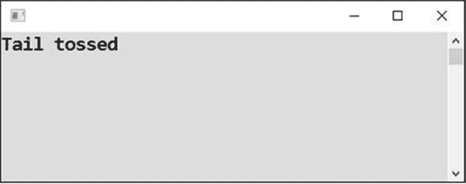
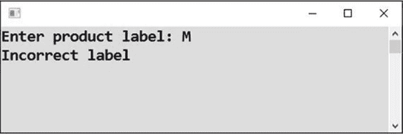

## 第19章 高级条件

本书第三部分以几个可能被视为高级的条件执行任务作为结尾。首先，你将学习条件运算符，然后你将编写一个包含多个复杂条件的程序，最后你将学习一条重要的准则：当你想测试某样东西时，你必须确保它是存在的。

### 条件运算符

在许多情况下，if-else 结构可以被条件运算符替代，该运算符根据条件是否满足而产生两个值之一。如果你熟悉 Excel 的 IF 函数，你会觉得条件运算符似曾相识。

#### 任务

你将使用条件运算符解决之前的“正面和反面”任务（来自第16章）（见图19-1）。



*图19-1.* 使用条件运算符

#### 解决方案

以下是代码：

```csharp
static void Main(string[] args)
{
    // Random number generator
    Random randomNumbers = new Random();

    // Random number 0/1 and its transformation
    int randomNumber = randomNumbers.Next(0, 1 + 1);
    string message = randomNumber == 0 ? "Head tossed" : "Tail tossed";
    Console.WriteLine(message);

    // Waiting for Enter
    Console.ReadLine();
}
```

#### 讨论

条件运算符（?:）的语法如下：

`condition ? yesValue : noValue`

此类表达式的结果如下：

- 如果*条件*成立（满足），则为*yesValue*
- 否则为*noValue*

#### 程序

在这种情况下，条件是对 randomNumber 变量是否等于零的测试。如果为真，则 message 变量被赋值为“正面朝上”文本。否则，被赋值为“反面朝上”文本。

#### 术语

条件运算符也被称为*三元*运算符，因为它是唯一接受三个操作数（它所处理的值）的运算符：一个条件、一个*yesValue*和一个*noValue*。

学生在以下情况获得*优秀*评价：

- 所有成绩的算术平均值不高于1.5。
- 学生没有任何低于2分的成绩。
- 学生没有任何无故缺勤。

如果学生的成绩中至少有一个是5分，则被视为*不及格*。

在所有其他情况下，总结性评价为*良好*。

你现在大概能猜到，这个程序不会那么简单。

### 解决方案

以下是代码：

```csharp
static void Main(string[] args)
{
    // 1. PREPARATIONS
    string errorMessage = "Incorrect input";
    int mathematics, informationTechnology, science, english;
    bool hasUnexcusedAbsences;

    // 2. INPUTS
    try
    {
        Console.WriteLine("Enter grades from individual subjects:");

        Console.Write("Mathematics: ");
        string input = Console.ReadLine();
        mathematics = Convert.ToInt32(input);
        if (mathematics < 1 || mathematics > 5)
        {
            Console.WriteLine(errorMessage);
            return;
        }

        Console.Write("Information technology: ");
        input = Console.ReadLine();
        informationTechnology = Convert.ToInt32(input);
        if (informationTechnology < 1 || informationTechnology > 5)
        {
            Console.WriteLine(errorMessage);
            return;
        }

        Console.Write("Science: ");
        input = Console.ReadLine();
        science = Convert.ToInt32(input);
        if (science < 1 || science > 5)
        {
            Console.WriteLine(errorMessage);
            return;
        }

        Console.Write("English: ");
        input = Console.ReadLine();
        english = Convert.ToInt32(input);
        if (english < 1 || english > 5)
        {
            Console.WriteLine(errorMessage);
            return;
        }

        Console.Write("Any unexcused absences? (yes/no): ");
        input = Console.ReadLine();
        input = input.ToLower(); // not distinguishing upper/lower
        if (input != "yes" && input != "no")
        {
            Console.WriteLine(errorMessage);
            return;
        }
        hasUnexcusedAbsences = input == "yes";
    }
    catch (Exception)
    {
        Console.WriteLine(errorMessage);
        return;
    }

    // 3. EVALUATION
    // You need arithmetic average of all the grades
    double average = (mathematics + informationTechnology + science +
    english) / 4.0;
    string message;
    // Testing all conditions for excellence
    if (average < 1.5001 &&
        mathematics <= 2 && informationTechnology <= 2 &&
        science <= 2 && english <= 2 &&
        !hasUnexcusedAbsences)
    {
        message = "Excellent";
    }
    else
    {
        // Here you know the result is not excellent, so testing the other
        // two possibilities
        if (mathematics == 5 || informationTechnology == 5 ||
            science == 5 || english == 5)
        {
            message = "Failed";
        }
        else
        {
            message = "Good";
        }
    }

    // 4. OUTPUT
    Console.WriteLine("Summary evaluation: " + message);

    // Waiting for Enter
    Console.ReadLine();
}
```

### 讨论

以下部分将解释该程序。

#### 成绩输入

在本练习中，你需要认真进行输入数据检查。try-catch 包裹了整个输入部分。你还需要检查成绩是否属于1到5的范围。

注意，成绩小于1或大于5表示错误。你使用了`||`运算符（“至少一个”）。

#### 程序终止

错误的输入会立即终止程序。你在这里使用 return 语句，该语句通常用于终止子程序。然而，当在 Main 内部使用时，它直接终止整个程序。

#### 是/否输入

为了输入学生是否有无故缺勤，用户输入 yes 或 no。与 yes 和 no 都不相同的输入表示错误。我使用了`&&`运算符（“同时”）。

在检查之前，你将输入转换为小写，这样用户使用大写字母时就无关紧要了。

有趣的是包含单等号和双等号（单等号用于赋值，双等号用于比较）的那一行：

```csharp
hasUnexcusedAbsences = input == "yes";
```


`==` 运算符的“工作”根据相等是否成立产生 true 或 false 值。结果值随后被赋给 bool 类型的 hasUnexcusedAbsences 变量。

## 当心整数除法！

计算成绩平均值时，你要用总和除以 4.0，而不是除以 4。你不希望计算机把斜杠视为整数除法运算符。这就是为什么你要避免 int 除以 int。

如果你只输入 4，那么 1、2、2、2 这种成绩情况会被误判为“优秀”，因为平均值会被计算为精确的 1，而不是正确的 1.75！

## 小数运算

为什么你要像下面这样输入平均值的检查？

```
average < 1.5001
```

为什么你不使用下面这种写法？

```
average <= 1.5
```

因为小数运算不一定是精确的。有时，计算机可能会计算出类似 1.50000000001 的值，而不是正确的 1.5。这就是为什么在测试中使用一个稍大一点的数。

## 第二个字符测试

许多程序崩溃，是因为程序员在访问某个对象之前忘了测试它是否存在。这项任务将是你首次接触这个常见问题。

### 任务

我将向你展示如何测试输入文本的第二个字符。假设产品标签的第二位必须始终是大写 X（见图 19-3 和图 19-4）。



**图 19-5.** *不正确的标签，未崩溃*

## 解决方案

这是代码：

```
static void Main(string[] args)
{
    // Input
    Console.Write("Enter product label: ");
    string label = Console.ReadLine();

    // Evaluating
    if (label.Length >= 2 && label.Substring(1, 1) == "X")
    {
        Console.WriteLine("Label is OK");
    }
    else
    {
        Console.WriteLine("Incorrect label");
    }

    // Waiting for Enter
    Console.ReadLine();
}
```

## 讨论

以下各节将解释该程序。

### 获取字符

你使用 `Substring` 方法来访问第二个字符，该方法通常从给定文本中提取特定部分（*子字符串*）。此方法需要两个参数：

- *所需子字符串第一个字符的位置：* 位置编号从零开始，所以第二个字符的位置是 1。
- *所需子字符串的字符数：* 在这种情况下，你只需要一个字符，因此第二个参数也是 1。

### 存在性测试

测试给定字符是否等于某值有一个隐藏的陷阱：第二个字符可能根本不存在。当用户输入零个或一个字符时，就会发生这种情况。

在这种情况下，调用 `Substring(1,1)` 会导致运行时错误。

这意味着你必须首先测试文本长度是否至少为两个字符。只有通过这个测试，你才能访问第二个字符。

代码中有一个复合条件，如下所示：

```
if (label.Length >= 2 && label.Substring(1, 1) == "X")
```

它的工作原理依赖于 `&&` 运算符的*短路求值*。如果 AND 连接中的第一个部分条件不成立，那么第二个部分条件根本不会被求值，因为它没有用处。即使它成立，也不会改变整体结果，因为 AND 运算符要求两个部分同时成立。

在这种情况下，当标签长度小于 2 时，本来会失败的 `Substring` 调用会被跳过，程序不会崩溃！

请注意，对于 `||` 运算符也可以作出类似的说明。

### 一个实验

尝试省略第一个部分条件（长度检查）。然后以用户身份输入单个字符。程序将以运行时错误终止。这样你就会看到第一个条件确实很重要。

## 小结

在本章中，你学习了几个高级条件的示例。

你从所谓的条件运算符（`?:`）入手，它也被称为三元运算符，因为它处理三个值。根据指定条件（问号之前的第一个值）是否满足，该运算符的“工作”结果要么是 *yesValue*（第二个值，位于问号和冒号之间），要么是 *noValue*（第三个值，位于冒号之后）。条件运算符是某些 if-else 情况的合适简写替代方式。

总结评估中的中间任务是对你学到的关于条件执行的所有内容的一种回顾。在那里，你遇到了各种测试、许多复合条件，以及使用 `!` 运算符进行取反。

最后一项任务，即测试某段文本的第二个字符，向你展示了在探究第二个字符是什么之前，测试它是否确实存在的重要性。在那里，你使用了条件的短路求值。如果复合条件的结果在第一个部分条件求值后就已经能够确定，那么第二个部分条件就会被完全跳过。
