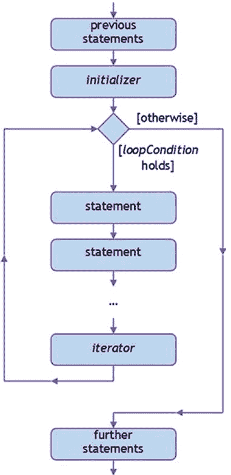
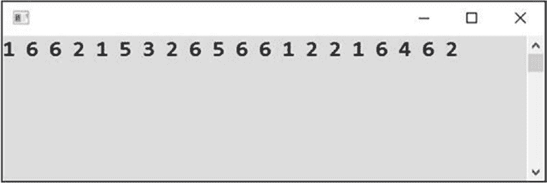

## 最初的循环

你将进入本书最困难的章节。循环是一种强大的工具，所有程序员都需要它，如同呼吸空气一样不可或缺。理解循环并不容易，因此你将经历许多与循环相关的练习。

### 重复同一段文本

循环是一种工具，用来高效地实现同一或（更常见的）类似活动的重复。为了让你能够恰当地体会循环，某些任务你将解决两次：第一次不用循环，第二次使用循环。你将从重复同一活动开始，之后继续使用循环来重复类似活动。

### 任务

你将编写一个程序，连续显示“I will start learning tomorrow.”十次（见图 20-1）。

### 使用循环的解决方案

稍微想一想前面的练习。你能想象有人可能想让你更改显示的句子吗？你能想象将它重复一百次而不是十次吗？你能想象重复次数由用户输入吗？

要解决这些问题，你需要一个新工具：循环。

### 解决方案

这是代码：

```
static void Main(string[] args)
{
    // Output
    for (int count = 0; count < 10; count++)
    {
        Console.WriteLine("I will start learning tomorrow.");
    }

    // Waiting for Enter
    Console.ReadLine();
}
```

### for 循环的工作原理

你使用 for 结构来表示重复。它的通用语法如下：

```
for (initializer; loopCondition; iterator)
{
    statement;
    statement;
    statement;
    ...
}
```

for 循环的工作原理如下：

- `initializer` 在进入循环前执行一次。
- `loopCondition` 在每轮循环之前被求值。如果它成立，计算机进入循环并执行循环体内的语句。
- 迭代器语句在每轮循环完成后执行。之后，重新求值 `loopCondition`。

图 20-2 显示了程序流程。



*图 20-2.*  程序流程

### 循环

在这种情况下，所需的重复次数是通过对目前已执行的循环轮数进行计数来实现的。为此，你使用 count 变量。

在开始（初始化器）时，变量被设置为零。每完成一轮循环（迭代器）后，变量增加一。只要（循环条件）输出中的行数尚未达到十，循环体（显示一行文本）就会重复。一旦 count 变量变为十，条件（count < 10，也就是 10 < 10）将不再成立，循环将终止，计算机将继续执行循环之后的语句。

### 自行探索

你应该花时间探索循环的内部机制，以彻底理解它们。使用你已经知道的调试工具：单步执行并检查 count 变量。

### 提示

Visual Studio 可以帮助你写出无差错的 for 循环。只需输入 for，按两次 Tab 键，然后编辑生成的循环头即可。

### 选择重复次数

for 循环让你能够处理在事先（编写代码时）不知道重复次数的情况。

### 任务

你将修改前面的练习，让用户指定句子重复的次数（见图 20-3）。


```csharp
// Waiting for Enter
Console.ReadLine();
}
```

## 讨论

请注意以下几点：

- 与之前的任务相比，你将固定的重复次数替换为用户输入的变量值。
- 仔细选择存储所需总重复次数的变量名；这里是 `howManyTimes`。具体来说，你应该将其与存储当前重复次数的计数变量区分开。

## 反复掷骰子

你将看到另一个重复相同活动的示例。

## 任务

你将编写一个程序，掷骰子20次（见图20-4）。



*图20-4.* 掷骰子20次

```csharp
Console.WriteLine("7. To learn");
Console.WriteLine("8. To learn");
Console.WriteLine("9. To learn");
Console.WriteLine("10. To learn");

// Waiting for Enter
Console.ReadLine();
}
```

## 使用循环的解决方案

循环可以高效地解决这类问题。实际上，你会发现更多时候需要使用循环来重复类似的活动，而不是完全相同的活动。

```csharp
static void Main(string[] args)
{
    // Output
    Console.WriteLine("My main to-do list:");

    for (int taskNumber = 1; taskNumber <= 10; taskNumber++)
    {
        Console.WriteLine(taskNumber.ToString() + ". To learn");
    }

    // Waiting for Enter
    Console.ReadLine();
}
```

## 讨论

以下各节讨论该程序。

## 控制变量

解决方案的核心是在循环体内使用循环控制变量的值。在该程序中，你将变量命名为 taskNumber，并使用其值进行输出。这样，你就能在第一次循环时显示1，第二次循环时显示2，以此类推。你可以使用调试工具自行检查这种情况。

## 循环从1开始

上一个练习（反复掷骰子）中，循环控制变量从0运行到19。与此相反，这次从1开始比从0开始更方便。这种改变也导致了循环条件的变化。你使用了“小于或等于”测试，而不是“小于”测试。

## 小结

本章向你介绍了循环的主题，循环是一种强大的编程工具，允许你指定重复相同或更常见的类似活动。

对于循环，C# 提供了几种编程结构；你在本章中学习了最基本的 for 循环。在代码中，for 循环由一个控制循环的头部和一个由花括号括起来的、包含要重复语句的循环体组成。头部本身由三个用分号分隔的部分组成：

-   *初始化器*是在循环开始“转动”之前执行一次的语句。
-   *循环条件*是在每次循环之前评估的条件。如果条件满足（即计算结果为 true），则执行循环体的另一轮语句。如果条件不满足（即计算结果为 false），则循环终止，程序执行继续到循环之后的语句。
-   *迭代器*是在每次循环之后执行的语句。

为了更深入地理解 for 循环的工作原理，一定要使用调试工具，如单步执行和内存检查。

for 循环通常由一个变量控制，该变量多少类似于循环轮次的计数器。这个变量称为*控制变量*。在最后一个任务中，你学习了如何在循环体内使用控制变量的值。
