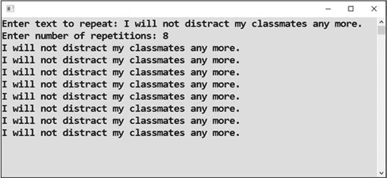
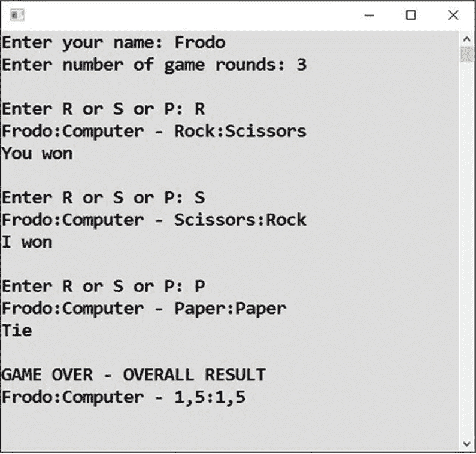

## 第21章 改进循环

正如你所了解的，循环功能强大，但也并非微不足道。这就是为什么本书剩余的所有章节都致力于更好地理解循环。让我们继续做一些更难的练习。

### 选择文本

首先，你将回到上一章中关于文本重复的练习并对其进行改进。

### 任务

在“选择重复次数”一节中，用户可以改变给定句子的重复次数。现在，你将允许用户改变句子本身（见图21-1）。



*图21-1.* 改变句子

### 解决方案

代码如下：

```csharp
static void Main(string[] args)
{
    // Inputs
    Console.Write("Enter text to repeat: ");
    string textToRepeat = Console.ReadLine();

    Console.Write("Enter number of repetitions: ");
    string input = Console.ReadLine();
    int howManyTimes = Convert.ToInt32(input);

    // Output
    for (int count = 0; count < howManyTimes; count++)
    {
        Console.WriteLine(textToRepeat);
    }

    // Waiting for Enter
    Console.ReadLine();
}
```

### 交替循环

很多时候，你需要重复几个活动。你做完第一件事，然后做第二件事，然后再做第一件事，依此类推。在代码中查看这样的任务很有趣。我将向你展示三种解决这个问题的方法。

### 任务

你将编写一个程序，在待办事项列表中交替执行两项任务（见图21-2）。

### 备注

请注意以下几点：

-   条件不必写成 `learning == true`。learning 变量已经是 bool 类型，这意味着你可以直接将其用作条件。当它为 true 时，条件成立。
-   你需要在进入循环之前设置变量的初始值。初始值在循环的第一次迭代中使用。在本例中，你将其设置为 true。
-   使用取反运算符（`!`）在 true 和 false 之间切换。

### 第三种解决方案

第三种解决方法是循环五次而不是十次，并在循环的每一次迭代中同时执行“奇数活动”和“偶数活动”。

代码如下：

```csharp
static void Main(string[] args)
{
    // Preparations
    Console.WriteLine("My main to-do list:");
    int taskNumber = 1;

    for (int coupleCount = 0; coupleCount < 5; coupleCount++)
    {
        // Couple output and adjusting task number
        Console.WriteLine(taskNumber.ToString() + ". Learning");
        taskNumber++;
        Console.WriteLine(taskNumber.ToString() + ". Dating");
        taskNumber++;
    }

    // Waiting for Enter
    Console.ReadLine();
}
```

### 石头剪刀布

在下一个练习中，你将看到循环体中有许多语句的 for 循环。循环将代表游戏的各个回合。

### 任务

你将编写一个程序，与用户进行指定回合数的石头剪刀布游戏（见图21-3）。



*图21-3.* 游戏

计分方式类似于国际象棋：胜利得一分，平局得半分。

```csharp
// Game evaluation
Console.WriteLine("GAME OVER - OVERALL RESULT");
Console.WriteLine(playerName + ":Computer - " +
    playerPoints.ToString() + ":" + computerPoints.ToString());

// Waiting for Enter
Console.ReadLine();
}
```

### 讨论

请注意以下几点：

-   电脑使用随机数进行“选择”：1代表石头，2代表剪刀，3代表布。
-   为了简化，当用户输入的不是R、S或P时，将其视为“布”。
-   用户输入不区分大小写。
-   在多个地方，使用两个嵌套的条件（三元）运算符而不是两个嵌套的 if-else 来解决三分支问题。请注意，第一个条件运算符的值是如何用另一个用括号括起来的三元运算符来指定的。
-   如果你不喜欢条件（三元）运算符，那就不要使用它。它只是特殊 if-else 情况的一种简写。我个人非常喜欢它，所以经常使用。

### 小结

在本章中，你继续学习了循环。第一个练习基本上是对上一章所学内容的回顾。你修改了之前的一个任务。


接下来，你接触了几种解决交替循环的方法，也就是重复相似成对活动的循环。具体而言，你学习了以下解决方案：

- 根据控制变量是奇数还是偶数来交替输出
- 切换一个布尔变量，用于指示你是否需要第一个输出
- 在循环的一轮中执行成对的两个活动

最后一个示例（石头剪刀布游戏）实际上并不是以循环为核心的。循环只是用来重复游戏回合的手段。一个游戏回合就是一个真实的、更复杂过程的示例，你可以用本书目前所学的知识来实现这个过程。
