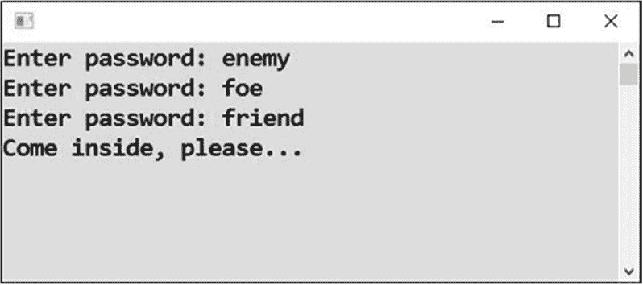
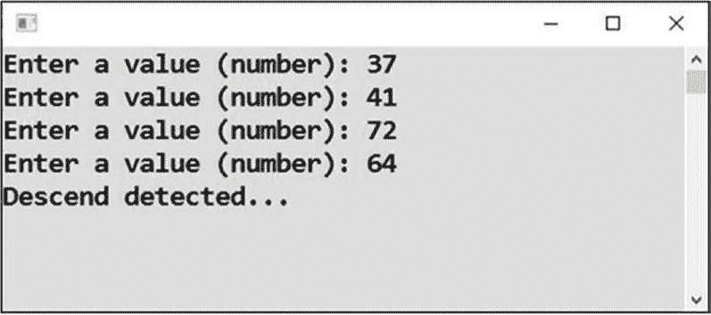
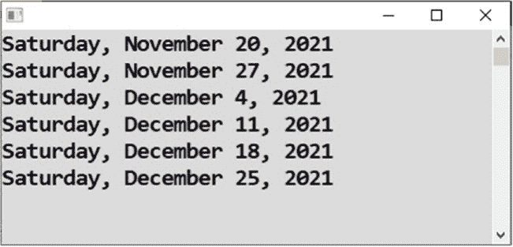
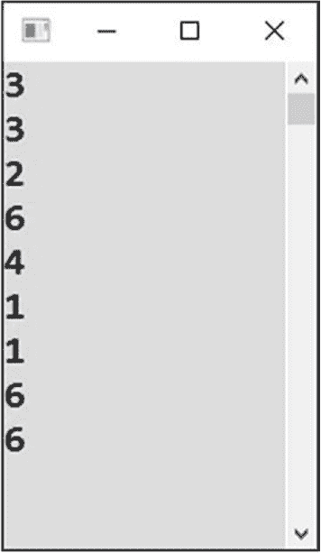

## 第 23 章 未知的重复次数

到目前为止，你所解决的所有循环中，你都知道迭代次数。但有时在编写程序时你并不知道这个次数，因为次数要由用户输入。不过，在所有情况下，当循环开始运行时，它将要迭代多少次就已经确定了。

有时，循环开始执行时，重复次数仍是未知的。你经常会遇到这样一个问题：循环应该继续还是终止。

### 输入密码

第一个任务与登录有关。你无法预先知道用户需要尝试多少次。

#### 任务

你将反复要求用户输入密码，直到用户输入正确的密码为止（见图23-1）。正确的密码是 *friend*。



*图 23-1. 反复询问*

#### 解决方案

代码如下：

```csharp
static void Main(string[] args)
{
    string correctPassword = "friend";

    bool ok; // the variable must be declared outside of the loop!
    do
    {
        // Input
        Console.Write("Enter password: ");
        string enteredPassword = Console.ReadLine();

        // Evaluating
        ok = enteredPassword == correctPassword;
    } while (!ok); // loop repeats when the condition holds

    Console.WriteLine("Come inside, please...");

    // Waiting for Enter
    Console.ReadLine();
}
```


## 第 23 章 重复次数未知

### do-while 构造

要编写这种循环，可以使用 `do-while` 构造。

计算机在遇到 `do` 后进入循环体，执行其中的语句，然后询问“再来一次？”。如果 `while` 后面的条件成立，计算机就会回到循环的开头，也就是 `do` 后面。如此反复。

当 `while` 后面的条件被判断为不成立（`false`）时，循环终止。

### 本例的场景

在本例中，程序会在每次输入后对输入的密码进行评估，评估结果存储在一个名为 `ok` 的 bool 类型变量中。

你希望在输入密码不正确时继续循环，因此在 `while` 条件中使用了取反运算符（感叹号）。

### 循环外部的变量

C# 要求循环条件中使用的所有变量都必须在循环外部声明。如果在循环内部声明，则在指定条件时这些变量不可见。

### 提示

Visual Studio 可以帮助你编写 do-while 循环。只需输入 `do`，然后按两次 Tab 键。

### 等待数值下降

假设计算机在观察某个大多数时间都在增长的数值，而你的任务是检测到它（可能很少出现的）变小（下降）的时刻。

在处理存储在文件或数据库中的大量数据时，你通常会遇到这类问题。不过，这里你将在用户输入的数据上解决它。

### 任务

你将编写一个程序，反复要求用户输入（见图 23-2）。每当用户输入的数字小于前一个数字时，程序就会通知用户并终止。



*图 23-2. 当数字变小时终止*

### 解法

解法的核心是记住前一个值，而不仅仅是当前输入的值。

代码如下：

```csharp
static void Main(string[] args)
{
    // Preparations
    int previous = int.MinValue;
    bool ok;

    // Repeating until descend
    do
    {
        // Input
        Console.Write("Enter a value (number): ");
        string input = Console.ReadLine();
        int value = Convert.ToInt32(input);

        // Evaluating
        ok = value >= previous; // ok = still not descending

        // Storing for the next round of the loop
        previous = value;
    } while (ok);

    // Message to the user
    Console.WriteLine("Descend detected...");

    // Waiting for Enter
    Console.ReadLine();
}
```

### 讨论

第一个值有些特殊，因为它没有前驱值。你可以用一个很小的数来模拟这个前驱值，从而绕开这个问题。C# 提供了 `int.MinValue`，它是 `int` 类型可以存储的最小值，大约是负二十亿。

### 每周一次直到年末

我们继续下一个练习，这个练习与日期有关。

### 任务

任务是从今天开始，以一周为步长，显示日期，直到年末为止（见图 23-3）。



*图 23-3. 每次一周，遍历整年*

### 解法

代码如下：

```csharp
static void Main(string[] args)
{
    // Today
    DateTime today = DateTime.Today;
    int thisYear = today.Year;

    // Repeating
    DateTime date = today;
    do
    {
        // Output
        Console.WriteLine(date.ToLongDateString());

        // Preparing next output (a week later)
        date = date.AddDays(7);
    } while (date.Year == thisYear);

    // Waiting for Enter
    Console.ReadLine();
}
```

### 任务

在这个程序中，你将反复掷骰子，直到连续两次掷出 6 为止（见图 23-7）。



### 解法

除了当前掷出的数字，你还需要跟踪前一次掷出的数字。这与“等待数值下降”一节中的程序类似。

如果当前数字和前一个数字都是 6，程序就终止。

同样，第一个值比较特殊，因为它没有前驱值。因此，`previous` 变量初始化为 0，这是一个永远不会出现在骰子上的值。

代码如下：

```csharp
static void Main(string[] args)
{
    // Random number generator
    Random randomNumbers = new Random();

    // Preparations
    int previous = 0;
    bool ending;

    // Throwing until two sixes in a row
    do
    {
        // Actually throwing
        int thrown = randomNumbers.Next(1, 6 + 1);
        Console.WriteLine(thrown);

        // Evaluating
        ending = thrown == 6 && previous == 6;

        // Preparing for next round of the loop
        previous = thrown;
    } while (!ending);

    // Waiting for Enter
    Console.ReadLine();
}
```

### 小结

在本章中，你学习了在循环开始时重复次数未知的循环。在 C# 中，这种循环适合使用 `do-while` 构造编写。它的功能是先执行循环体中的语句，然后询问“再来一次？”。你评估条件，如果条件成立，就再执行一轮循环。

你还看到，要在 `do-while` 循环的条件中使用某个变量，该变量必须在循环外部声明。

使用 `do-while` 循环时，一个常见错误是条件的表述不正确。你必须小心，将其写成：如果希望继续循环，条件就应评估为 `true`。

在本章的若干任务中，你需要用到上一轮循环中的某个值。为此，你使用了一个特殊变量来存储该值。当然，循环的第一轮需要特殊处理。
