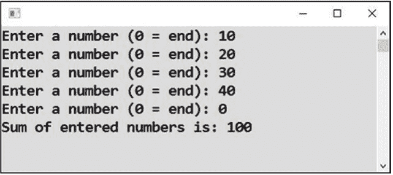
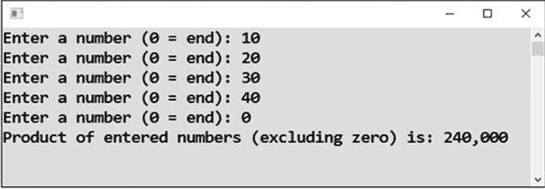
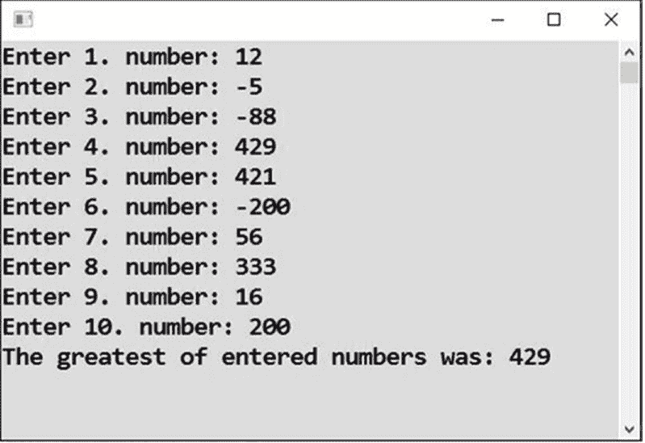
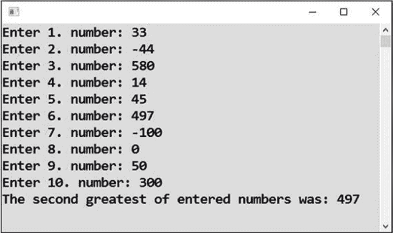
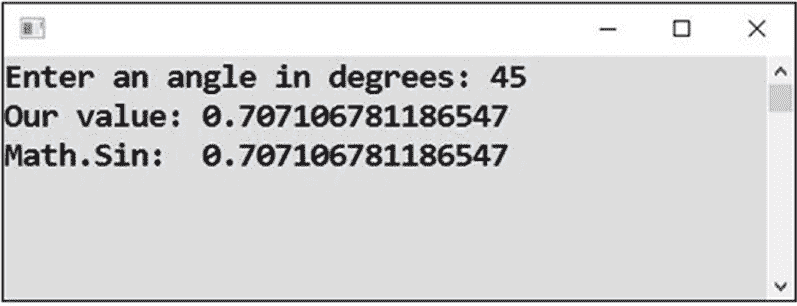

## 第 24 章 累加中间结果

在本章中，你将学习使用循环处理大量数据的重要情形。你经常会使用循环遍历大量数据，以累加（聚合）某个中间结果，这个中间结果会在循环结束后成为最终结果。

### 输入数字的总和

这类任务中的一个典型问题是对大量值求和。

### 任务

假设用户正在输入数字，最后一个数字是 0。换句话说，用户通过输入 0 来表示输入结束。程序随后显示所有输入数字的总和（见图 24-1）。



*图 24-1. 累加所有数字直到输入 0*

### 解法

解法的核心是累加中间结果。你必须把它保存在一个变量中，并把每个输入的数字都加到该变量中。一旦用户结束输入，该变量就会包含所有输入值的总和。

代码如下：

```csharp
static void Main(string[] args)
{
    // Preparations
    int sum = 0;
    int number;

    // Entering numbers until zero
    do
    {
        // Input
        Console.Write("Enter a number (0 = end): ");
        string input = Console.ReadLine();
        number = Convert.ToInt32(input);

        // Adding to intermediate sum
        sum += number;
    } while (number != 0);

    // Output
    Console.WriteLine("Sum of entered numbers is: " + sum.ToString());

    // Waiting for Enter
    Console.ReadLine();
}
```

### 输入数字的乘积

如果把输入的数字相乘而不是相加，会怎样？你觉得任务一样吗？其实并不完全一样。

### 任务

在这个程序中，用户输入数字，最后一个数字是 0（见图 24-2）。程序随后显示所有输入数字的乘积，显然要排除最后的 0，因为如果不排除，乘积就会变成 0。



*图 24-2. 将所有数字相乘*

### 解法

代码如下：

```csharp
static void Main(string[] args)
{
    // Preparations
    double product = 1;
    int number;

    // Entering numbers until zero
    do
    {
        // Input
        Console.Write("Enter a number (0 = end): ");
        string input = Console.ReadLine();
        number = Convert.ToInt32(input);

        // Accumulating in intermediate product (but not the last zero!)
        if (number != 0)
```


```csharp
{
    product *= number;
}
} while (number != 0);

// Output
Console.WriteLine("Product of entered numbers (excluding zero) is: " +
product.ToString("N0"));

// Waiting for Enter
Console.ReadLine();
}
```

## Discussion

注意以下几点：

- product 变量的初始值设为 1 而非 0，这与你计算和时使用的初始值不同。
- 在更新 product 时，需要注意不要包含最后的零。
- 你将 product 变量声明为 `double` 类型以防止结果溢出。当你进行乘法运算时，很快就会得到很大的数字。

## The Greatest

在处理大量数据时，另一个典型任务是查找极值，也就是最大值或最小值。

### Task

在这个程序中，用户输入十个数。程序随后输出其中最大的那个数（见图 24-3）。



*Figure 24-3.* Outputting the greatest number

### Solution

你将再次累积中间结果。这次它将是迄今为止最大的数。你必须特别注意第一个值；greatest 变量在开始时被设为最小可能值，以确保第一个输入的数字总是更大。

由于你期望输入恰好十个值，这里使用 `for` 循环会更方便。

代码如下：

```csharp
static void Main(string[] args)
{
    // Preparation
    int greatest = int.MinValue;

    // Input of ten numbers
    for (int order = 1; order <= 10; order++)
```

## The Second Greatest



*Figure 24-4. Displaying the second greatest number*

### Solution

你需要记住并持续更新两个最大的数。仅记住第二大数是不够的。

这种情况类似于滑雪比赛，选手们一个接一个到达终点。某一时刻，有人是第一名；稍后，其他人可能会把第一名挤到第二名。可能在更晚的时候，那名滑雪者甚至会失去第二名，只是因为有人比他们更好，甚至比新的领跑者更好。

代码如下：

```csharp
static void Main(string[] args)
{
    // Preparation
    int greatest = int.MinValue;
    int secondGreatest = int.MinValue;

    // Input of ten numbers
    for (int order = 1; order <= 10; order++)
    {
        // Input
        Console.Write("Enter " + order.ToString() + ". number: ");
        string input = Console.ReadLine();
        int number = Convert.ToInt32(input);

        // Is it greater than the greatest so far?
        if (number > greatest)
        {
            // Moving so far greatest to the second place
            secondGreatest = greatest;

            // Entered number becomes the greatest so far
            greatest = number;
        }
        else
        {
            // We did not beat the greatest, will we beat the second
            // greatest at least?
            if (number > secondGreatest)
            {
                secondGreatest = number;
            }
        }
    }

    // Output
    Console.WriteLine("The second greatest of entered numbers was: " +
    secondGreatest.ToString());

    // Waiting for Enter
    Console.ReadLine();
}
```

```csharp
string inReversedOrder = "";
bool terminating;

// Repeating until blank input
do
{
    // Input
    Console.Write("Enter person: ");
    string person = Console.ReadLine();

    // Processing input
    terminating = person.Trim() == "";
    if (!terminating)
    {
        inSameOrder = inSameOrder + person + ", ";
        inReversedOrder = person + ", " + inReversedOrder;
    }
} while (!terminating);

// Removing trailing comma and space
if (inSameOrder.EndsWith(", "))
{
    int numberOfCharacters = inSameOrder.Length;
    inSameOrder = inSameOrder.Remove(numberOfCharacters - 2);
}
if (inReversedOrder.EndsWith(", "))
{
    int numberOfCharacters = inReversedOrder.Length;
    inReversedOrder = inReversedOrder.Remove(numberOfCharacters - 2);
}

// Output
Console.WriteLine("Entered persons: " + inSameOrder);
Console.WriteLine("In reversed order: " + inReversedOrder);

// Waiting for Enter
Console.ReadLine();
}
```

## Discussion

注意以下几点：

- 你使用 `Trim` 方法来去掉输入文本可能存在的首尾空格，以便允许使用任何空白输入（包括多个空格）来终止。
- 最后，你必须去掉两个累积文本末尾的最后两个字符。在执行此操作之前，你会测试这两个字符（逗号和空格）是否真的出现在文本末尾。如果用户立即通过输入空白行终止程序，这些字符将不存在。
- 要测试文本是否以某内容结尾，你使用 `EndsWith` 方法。

## Summary

循环最频繁的用途之一是处理大量数据，无论是数字、文本还是整个对象。在循环体中，你处理单个数据，而循环确保所有数据都能得到处理。

你通过求和、求积和查找极值的示例练习了处理大量数据。

最困难的练习是查找第二大数，这需要仔细思考可能出现的各种情况，具体取决于数据。

最后一个任务向你展示了处理文本的几种方法：`Trim`、`EndsWith` 和 `Remove`。

### Solution

代码如下：

```csharp
static void Main(string[] args)
{
    // Today's date
    DateTime today = DateTime.Today;

    // Moving day after day until hit on Friday
    DateTime date = today;
    while (date.DayOfWeek != DayOfWeek.Friday)
    {
        date = date.AddDays(1);
    }

    // Calculating remaining days
    TimeSpan dateDifference = date - today;
    int daysRemaining = dateDifference.Days;

    // Outputs
    Console.WriteLine("Nearest Friday: " + date.ToShortDateString());
    Console.WriteLine("Remaining days: " + daysRemaining.ToString());
    if (daysRemaining == 0)
    {
        Console.WriteLine("Thanks God!");
    }

    // Waiting for Enter
    Console.ReadLine();
}
```

顺便提醒你，$2^{10} = 2\times2\times2\times2\times2\times2\times2\times2\times2\times2 = 1024$，这就是 2 在最终乘积中重复 10 次的数字。

### Solution

该任务可通过对 $x$ 进行重复乘法来解决。这意味着你使用已经学过的中间结果累积方法。

原则上，该解决方案与第 24 章“Product of the Entered Numbers”部分中的解决方案非常接近：

```csharp
static void Main(string[] args)
{
    // Inputs
    Console.Write("Enter x (number to be raised): ");
    string inputX = Console.ReadLine();
    double x = Convert.ToDouble(inputX);

    Console.Write("Enter n (power): ");
    string inputN = Console.ReadLine();
    int n = Convert.ToInt32(inputN);

    // Calculating
    double result = 1;
    for (int count = 0; count < n; count++)
    {
        result *= x;
    }

    // Output
    Console.WriteLine("x^n=" + result.ToString());

    // Waiting for Enter
    Console.ReadLine();
}
```

## Sine

继续数学话题，你知道计算机实际上是如何执行计算的，例如正弦函数吗？如果你对数学感兴趣，你可能会对此感兴趣。

要执行此任务，你可以使用所谓的泰勒展开。一些聪明的人发现，正弦函数在给定点 *x* 的值（x 为弧度角）可以计算为无穷级数的和：

$$\sin x = x - \frac{x^3}{3!} + \frac{x^5}{5!} - \frac{x^7}{7!} + \cdots$$

### Task

现在的任务是编写一个程序来计算该级数的和，并将结果与现成的 `Math.Sin` 方法的值进行比较（见图 25-3）。



*Figure 25-3.* Calculating sine

如果你对如何计算正弦函数的值不感兴趣，就把这个任务当作一个挑战来编写一个更复杂的循环。

### Analysis

首先，你必须分析计算。


