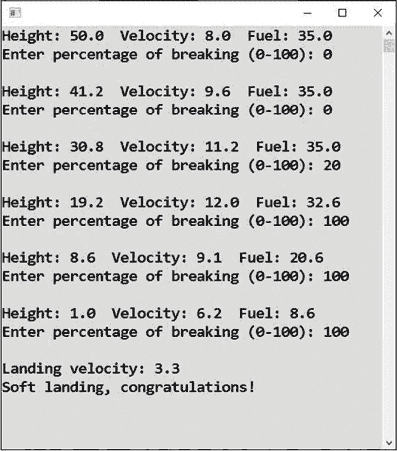

## 第25章 高级循环

### 无穷级数

要求和的级数是无穷的，但你可能想知道，怎样才能将无穷多个数相加。

当然，你做不到这一点。诀窍在于，你实际上不需要对级数的无穷多项求和。到一定时候，各项变得非常小，以至于它们的贡献位于小数点后很远的位置。

出于实际原因，你只需要一定的精度，比如 15 位小数；double 类型本来也无法容纳更多位数。因此，只要级数项大于 1e-15，你就继续计算总和。

### 级数的项

所有级数项彼此相似：分子是奇次幂，分母是奇阶乘，并且符号交替变化。

提醒一下，7! = 1 × 2 × 3 × ... × 7。换句话说，阶乘是从 1 到给定数字的所有数的乘积。

### 阶乘

计算阶乘的方式可以类似本章前面计算幂的方式，即在循环中逐步乘以所有数。

不过，你可以用更巧妙的方式。你不需要从头计算每个阶乘；你总能通过前一个已算出的阶乘更快地得到它。

例如，7! = 7 × 6 × 5!。7 的阶乘可以由 5 的阶乘乘以“缺失的数字”6 和 7 得到。

### 幂

类似的技巧也可以用来计算级数每一项的“幂部分”。幂不必从头计算；下一个幂就是前一个幂乘以 x 的平方。

例如，x⁷ = x⁵ × x²。

### 解决方案

解决方案如下：

```csharp
static void Main(string[] args)
{
    // Input
    Console.Write("Enter an angle in degrees: ");
    string input = Console.ReadLine();
    double angle = Convert.ToInt32(input);

    // Converting to radians
    double x = Math.PI / 180 * angle;

    // Preparations
    double member;
    double sum = 0;
    double tinyValue = 1e-15;

    double sign = 1;
    double power = x;
    double factorial = 1;
    double multiplier = 1;

    // Sum of the series
    do
    {
        // Calculating current member of the series
        member = sign * power / factorial;

        // Appending to sum
        sum += member;

        // Preparing next step
        sign *= -1;
        multiplier++;
        factorial *= multiplier;
        multiplier++;
        factorial *= multiplier;
    }
```



*图 25-4.* 登月程序

一旦高度降到零以下，登月舱就已着陆。程序会通知用户着陆速度，并根据下表进行评估：

| 着陆速度 | 评估 |
|---|---|
| 小于 4 m/s | 软着陆 |
| 4–8 m/s | 硬着陆 |
| 大于 8 m/s | † |

如果在着陆结束前燃料已耗尽，程序将开始忽略输入的制动值，并将制动力设为零。

### 物理模型

程序将基于这里讨论的现实模型。
下面是初始值：

- $h = 50$ (m)
- $v = 8$ (m/s)
- $m_F = 35$ (kg)

在代表着陆机动每一秒的每个步骤中，被跟踪物理量的值将根据以下关系变化（$\Delta$ 表示相应量的变化，这是物理中的惯例）：

$\Delta h = -v - a/2$

$\Delta v = a$

$\Delta m_F = -F / 3000$

其中

- 制动力为 $F = 360 \times \textit{制动百分比}$。
- 朝向月面的加速度为 $a = 1.62 - F / 8000$。

### 解决方案

代码如下：

```csharp
static void Main(string[] args)
{
    // Initial values
    double h = 50, v = 8, mF = 35;

    // Preparation
    bool malfunction = false;

    // Repeating individual landing steps
    while (h >= 0)
    {
        // Displaying current values
        string height  = "Height: " + h.ToString("N1");
        string velocity = "Velocity: " + v.ToString("N1");
        string fuel     = "Fuel: " + mF.ToString("N1");
        Console.WriteLine(height + "  " + velocity + "  " + fuel);

        // Input
        Console.Write("Enter percentage of braking (0-100): ");
        string input = Console.ReadLine();
        double percents = 0;
        try
        {
            percents = Convert.ToDouble(input);
            if (percents < 0 || percents > 100)
            {
                malfunction = true;
            }
        }
        catch (Exception)
        {
            malfunction = true;
        }

        if (malfunction)
        {
            percents = 0;
            Console.WriteLine("CONTROL MALFUNCTION!");
        }

        // Fuel check
        if (mF <= 0)
        {
            percents = 0;
            Console.WriteLine("NO FUEL!");
        }

        // Calculating new values
        double F = 360 * percents;
        double a = 1.62 - F / 8000;
        h -= v + a / 2;
        v += a;
        mF -= F / 3000;
        if (mF <= 0)
        {
            mF = 0;
        }

        // Output of an empty line
        Console.WriteLine();

    } // End of a single landing step

    // Output
    Console.WriteLine("Landing velocity: " + v.ToString("N1"));
    string evaluation = v < 4 ?
        "Soft landing, congratulations!" :
        (v <= 8 ? "Hard landing." : "Houston, crew is lost...");
    Console.WriteLine(evaluation);

    // Waiting for Enter
    Console.ReadLine();
}
```

### 骰子

我之前已经提到过，这本书中有大量模拟掷骰子的练习，因为我小时候玩过很多棋盘游戏。这些游戏不只是从商店买来的。我那时自己发明了很多游戏，其中大部分是模拟体育赛事。短跑、长跑、跳跃、自行车赛、足球等等都有不同的规则。这可能是成为程序员的一种良好准备。

### 正弦任务

我承认本章的正弦任务明显高于初学者的水平。我把它包含进来，是为了让你一窥你在编程奇妙国度中的可能未来。

对我而言，这个任务还有个人渊源。上学时，我曾好奇计算器如何计算正弦值。我曾以为函数值以表格形式（“硬编码”）存储在计算器中，并进一步插值。直到后来我才发现了另一种方式，也就是你看到的方式。

### 登月

登月任务的一个简化版本实际上是我第一次接触编程。不，我没有编写它；我反而是它的计算机。

我年幼时，读过一本杂志的特刊，它向像我这样的年轻人讲解编程。那期特刊附带了一个纸质计算机。那是一张带有窗口的纸，窗口代表变量。在这些窗口里，你可以拉动纸带，并在纸带上写下变量的值。要给变量赋新值吗？你只需拉动纸带遮住旧值，然后用铅笔在同一条纸带上写下新值。

我使用电子计算器完成所有计算。我执行程序的语句，而我就是计算机的 CPU，以惊人的 0.5 Hz 速度运行（是的，这里故意省略了 G），吃一块巧克力棒就能提速到 0.6 Hz。

那是在 1982 年的捷克斯洛伐克，我可能让那个登月舱着陆了好几百次，后来还在可编程计算器上用我自己的软件来做这件事。也许我是当时最有经验的宇航员。无论如何，那是一条通往编程的、极具激励性的道路。

### 结语与祝愿

为了保持宇宙主题，我希望我能够把你送入你自己的编程轨道。有时我讲得有点深入，所以也许你以后会重新做练习，并多次通读本书。这是为你宇宙空间站补充物资的一种方式。

祝你在未来的编程中获得许多快乐和成功！
