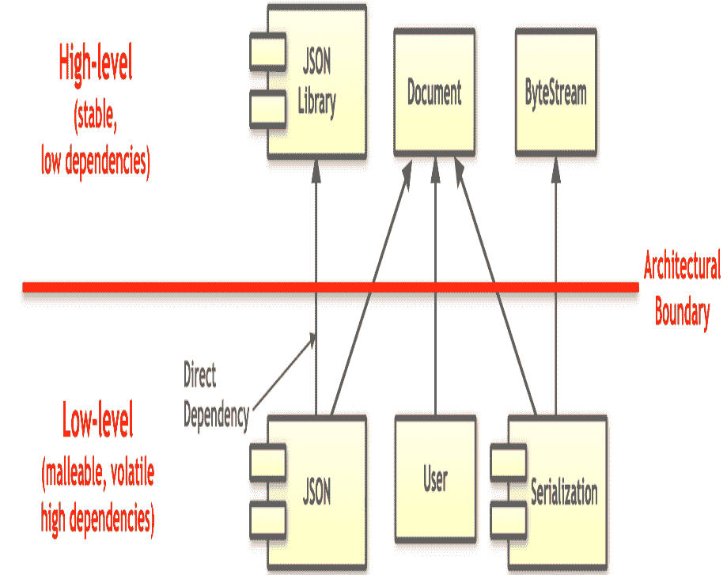
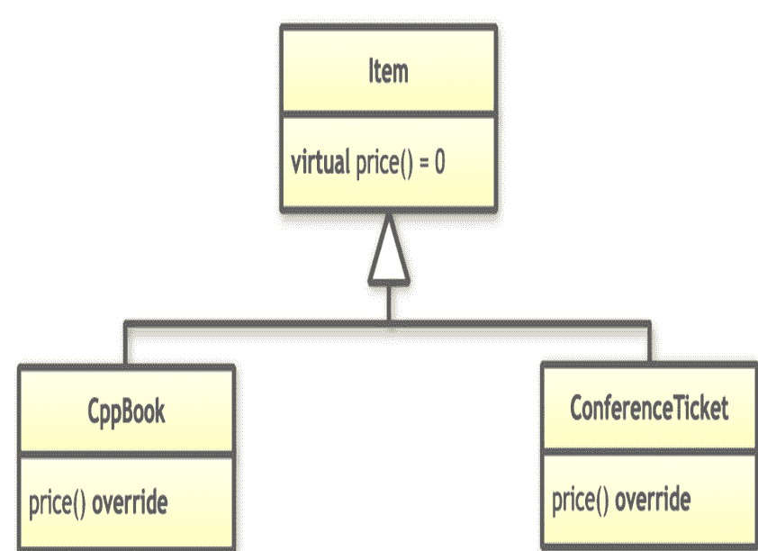
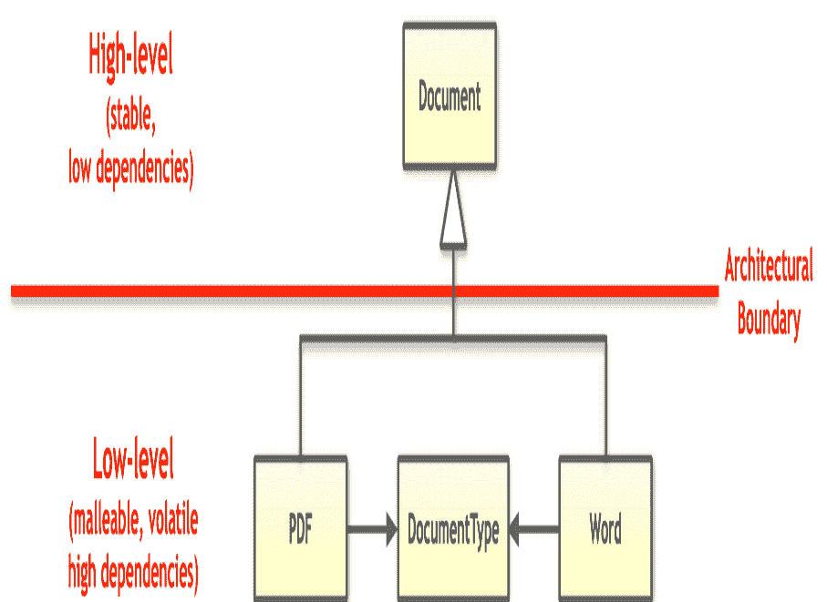
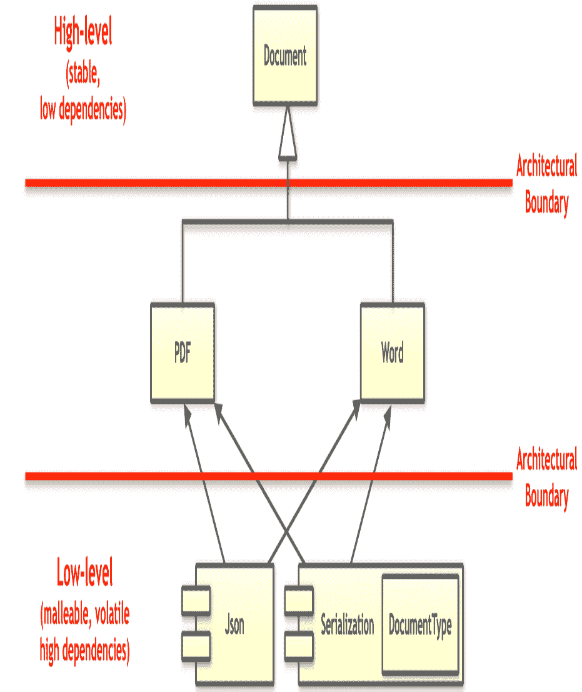

# C++ 软件设计（第七版 早期发布）


## 前言

## 致早期发布读者的一则说明

使用早期发布电子书，您可以在作者撰写时获得书籍的最早形式——作者原始且未经编辑的内容，以便您在这些标题正式发布之前就能利用这些技术。

如果您对如何改进本书的内容和/或示例有任何意见，或如果您发现本章中缺少材料，请联系编辑 sevans@oreilly.com。

在您手中拿着的正是多年前我希望拥有的 C++ 书籍。不是作为我第一本的书，不，而是作为一本进阶书籍，在我已经消化了语言机制并能够超越 C++ 语法思考之后。是的，这本书肯定会帮助我更好地理解可维护软件的基本方面，我相信它也会帮助到您。

## 我为何撰写本书

当我真正深入研究该语言时（那是在第一个 C++ 标准发布几年后），我读了几乎所有能找到的 C++ 书籍。但尽管其中许多书籍都很棒，并且确实为我目前作为 C++ 培训师和顾问的职业生涯铺平了道路，它们过于专注于细节、实现细节，而与可维护软件的大局相去甚远。

当时，真正关注大局的书籍非常少，这些书籍涉及大型软件系统的开发。其中包括 John Lakos 的《Large Scale C++ Software Design》¹（关于依赖管理的重量级但字面意义上的沉重介绍）和所谓的四人组书籍（即关于软件设计模式的经典著作）。² 不幸的是，多年来这种情况并没有真正改变：大多数书籍，以及演讲、博客等，主要关注语言机制和特性、细节和具体内容。很少有，而且在我看来太少了，新发布的内容关注可维护软件、可更改性、可扩展性和可测试性。如果它们尝试这样做，不幸的是很快就会回到常见的习惯，即解释语言机制并演示特性。

这就是我撰写本书的原因。一本与大多数其他书籍不同，不花费时间在语言机制或众多特性上，而是主要关注软件总体上的可更改性、可扩展性和可测试性的书籍。一本不声称使用新的 C++ 标准或特性会使软件好坏有别，而是清楚地表明决定性的因素是依赖的管理，是我们代码中的依赖决定了它好坏的书籍。正因如此，它在 C++ 世界中确实是一种罕见的书籍，因为它关注的是大局：软件设计。

## 本书内容

## 软件设计

在我看来，良好的软件设计是每个成功软件项目的精髓。然而，尽管它发挥着根本性的作用，关于该主题的文献却如此之少，关于该做什么以及如何正确做事的建议也很少。为什么？因为它很难。非常难。可能是我们编写软件时必须面对的最困难的方面。因为没有单一的“正确”解决方案，也没有可以传给软件开发人员世代的“黄金”建议。它总是取决于具体情况。

尽管存在这一局限，我仍会就如何设计良好、高质量的软件提供建议。我将提供设计原则、设计指南和设计模式，帮助您更好地理解如何管理依赖关系，以及如何将您的软件转变为可以工作数十年的东西。如前所述，没有“黄金”建议，因此本书不提供任何终极或完美的解决方案。相反，我试图展示良好软件最根本的方面、最重要细节、不同设计的差异以及利弊。我还将制定内在的设计目标，并演示如何使用现代 C++ 实现这些目标。

## 现代 C++

十多年来，我们一直在庆祝现代 C++ 的到来，赞扬语言的众多新特性和扩展，并由此造成了现代 C++ 将帮助我们解决所有软件相关问题的印象。本书并非如此。本书并不声称向代码扔几个智能指针就会使代码“现代”或自动产生良好的设计。此外，本书也不会把现代 C++ 展示为新特性的集合。相反，它将展示语言的哲学是如何演变的，以及随之而来我们今天实现 C++ 解决方案的方式。

但当然我们也会看到代码。很多代码。当然本书会使用更新 C++ 标准（包括 C++20）的特性。然而，它也会努力强调设计独立于实现细节和所使用的特性。新特性并不会改变什么是良好设计或不良设计的规则，它们只是改变了我们实现良好设计的方式。它们使实现良好设计变得更容易。因此，本书展示并讨论实现细节，但（希望）不会迷失其中，始终保持对大局的关注，即软件设计和设计模式。

## 设计模式

一旦你开始提及设计模式，你就会无意中唤起对面向对象编程和继承层次结构的期望。是的，本书将展示许多设计模式的面向对象起源。然而，它将强烈强调并非只有一种方法可以很好地使用设计模式。我将演示设计模式的实现如何演变和多样化，利用多种不同的范式，包括面向对象编程、泛型编程，但也包括函数式编程。本书承认现实，即没有一种真正的范式，也不声称只有一种单一的方法、一种对所有问题都适用的解决方案。相反，它试图展示现代 C++ 的真实面貌：结合所有范式的机会，将它们编织成坚固而持久的网，创造经得起数十年考验的软件设计。

我希望本书能成为 C++ 文献中缺失的一块。我希望它能帮助您，就像它本可以帮助我一样。我希望它能提供您一直在寻找的一些答案，并为您提供一些您所缺少的关键见解。我也希望本书能让您保持一定的娱乐性和阅读的动力。最重要的是，我希望本书能向您展示软件设计的重要性以及设计模式所扮演的角色。因为，正如您将看到的，设计模式无处不在！


### 本书适合谁

本书对每一位 C++ 开发者都有价值。尤其是，适合每一位对可维护软件的常见问题以及这些问题的通用解决方案感兴趣的 C++ 开发者（我假设这确实是*每一位* C++ 开发者）。然而，本书并不是 C++ 入门书。事实上，本书中的大多数指导原则都需要一定的软件开发经验，特别是 C++ 经验。例如，我假设你对继承层次结构的语言机制有扎实的掌握，并且对模板有一定的经验。因此我可以在必要且合适时随时使用相应的特性。有时，我甚至会使用一些 C++20 特性（尤其是 C++20 概念）。然而，由于重点在于软件设计，我很少会详细解释某个特性，因此如果某个特性你不熟悉，请查阅你喜欢的 C++ 语言参考资料。只有偶尔我会添加一些提醒，主要是关于常见的 C++ 惯用法（例如 Rule of 5）。

### 本书的结构

本书按章节组织，每一章都包含一组若干指导原则。这些指导原则中的每一个都聚焦于可维护软件的一个关键方面或一个特定的设计模式。因此这些指导原则代表了主要的收获，我希望它们能为你带来最大价值。它们写成可以从头到尾阅读的形式，但由于它们只是松散耦合，你也可以从最吸引你注意的指导原则开始。尽管如此，它们并非独立。因此每个指导原则都包含对其他指导原则的必要交叉引用，以向你展示一切都是相互关联的。

### 本书使用的约定

本书使用了以下排版约定：

*Italic*

表示新术语、URL、电子邮件地址、文件名和文件扩展名。

*Constant width*

用于程序列表，以及在段落中引用程序元素，如变量或函数名、数据库、数据类型、环境变量、语句和关键字。

*Constant width bold*

显示用户应逐字输入的命令或其他文本。

*Constant width italic*

显示应由用户提供的值或由上下文确定的值替换的文本。

TIP
此元素表示提示或建议。

NOTE
此元素表示一般说明。

WARNING
此元素表示警告或注意。

### 使用代码示例

如果你对代码示例有技术问题或使用问题，请发送电子邮件至 bookquestions@oreilly.com。

本书旨在帮助你完成工作。一般来说，如果本书提供了示例代码，你可以在你的程序和文档中使用它。除非你复制了代码的很大一部分，否则无需联系我们征求许可。例如，编写一个使用本书中多个代码片段的程序不需要许可。出售或分发 O’Reilly 书籍中的示例需要许可。引用本书并引用示例代码来回答问题不需要许可。将大量示例代码纳入你的产品文档中需要许可。

我们感谢，但通常不需要署名。署名通常包括标题、作者、出版商和 ISBN。例如：“Book Title by Some Author (O’Reilly). Copyright 2012 Some Copyright Holder, 978-0-596-xxxx-x。”

如果你认为你对代码示例的使用超出了合理使用范围或上述许可，请随时联系我们 permissions@oreilly.com。

### O’Reilly Online Learning

NOTE
40 多年来，O’Reilly Media 一直为公司提供技术和商业培训、知识和见解，帮助公司取得成功。

我们独特的专家和创新者网络通过书籍、文章和我们的在线学习平台分享他们的知识和专业知识。
O’Reilly 的在线学习平台为你提供按需访问实时培训课程、深入学习路径、交互式编码环境，以及来自 O’Reilly 和 200 多家其他出版商的庞大文本和视频收藏。欲了解更多信息，请访问 http://oreilly.com。

### 如何联系我们

请将有关本书的评论和问题发送给出版商：

O’Reilly Media, Inc.

1005 Gravenstein Highway North

Sebastopol, CA 95472

800-998-9938（美国或加拿大境内）

707-829-0515（国际或本地）

707-829-0104（传真）

我们为本书设有网页，在那里我们列出勘误、示例和任何额外信息。你可以在 https://www.oreilly.com/library/view/c-software-design/9781098113155 访问此页面。

发送电子邮件至 bookquestions@oreilly.com 对本书发表评论或提出技术问题。

有关我们书籍和课程的新闻和信息，请访问 http://oreilly.com。

在 Facebook 上找到我们：http://facebook.com/oreilly。

在 Twitter 上关注我们：http://twitter.com/oreillymedia。

在 YouTube 上观看我们：http://youtube.com/oreillymedia。

### 致谢

像这样的书从来都不是一个人的成就。相反，我必须特别感谢许多在不同方面帮助我使本书成为现实的人。首先，我要向我的妻子 Steffi 表示最深的感谢，她通读了整本书，尽管她甚至不懂 C++。并且她照顾我们的两个孩子，让我有足够平静的时间把所有这些信息写成文字（我仍然不确定这两件事哪一个牺牲更大）。

特别感谢我的审阅者 Daniela Engert、Patrice Roy、Stefan Weller、Mark Summerfield 和 Jacob Bandes-Storch，他们投入宝贵时间不断挑战我的解释和示例，使本书变得更好。

还要特别感谢 Arthur O’Dwyer、Eduardo Madrid 和 Julian Schmidt 对类型擦除设计模式的意见和反馈，以及 Johannes Gutekunst 关于软件架构和文档的讨论。

此外，我想感谢我的两位冷读读者 Matthias Dörfel 和 Vittorio Romeo，他们帮助抓住了许多最后一刻的错误（确实如此）。

最后但绝对不[content]

### 本书适合谁

本书对每一位 C++ 开发者都有价值。尤其是，适合每一位对可维护软件的常见问题以及这些问题的通用解决方案感兴趣的 C++ 开发者（我假设这确实是*每一位* C++ 开发者）。然而，本书并不是 C++ 入门书。事实上，本书中的大多数指导原则都需要一定的软件开发经验，特别是 C++ 经验。例如，我假设你对继承层次结构的语言机制有扎实的掌握，并且对模板有一定的经验。因此我可以在必要且合适时随时使用相应的特性。有时，我甚至会使用一些 C++20 特性（尤其是 C++20 概念）。然而，由于重点在于软件设计，我很少会详细解释某个特性，因此如果某个特性你不熟悉，请查阅你喜欢的 C++ 语言参考资料。只有偶尔我会添加一些提醒，主要是关于常见的 C++ 惯用法（例如 Rule of 5）。

### 本书的结构

本书按章节组织，每一章都包含一组若干指导原则。这些指导原则中的每一个都聚焦于可维护软件的一个关键方面或一个特定的设计模式。因此这些指导原则代表了主要的收获，我希望它们能为你带来最大价值。它们写成可以从头到尾阅读的形式，但由于它们只是松散耦合，你也可以从最吸引你注意的指导原则开始。尽管如此，它们并非独立。因此每个指导原则都包含对其他指导原则的必要交叉引用，以向你展示一切都是相互关联的。

### 本书使用的约定

本书使用了以下排版约定：

*Italic*

表示新术语、URL、电子邮件地址、文件名和文件扩展名。

*Constant width*

用于程序列表，以及在段落中引用程序元素，如变量或函数名、数据库、数据类型、环境变量、语句和关键字。

*Constant width bold*

显示用户应逐字输入的命令或其他文本。

*Constant width italic*

显示应由用户提供的值或由上下文确定的值替换的文本。

TIP
此元素表示提示或建议。

NOTE
此元素表示一般说明。

WARNING
此元素表示警告或注意。

### 使用代码示例

如果你对代码示例有技术问题或使用问题，请发送电子邮件至 bookquestions@oreilly.com。

本书旨在帮助你完成工作。一般来说，如果本书提供了示例代码，你可以在你的程序和文档中使用它。除非你复制了代码的很大一部分，否则无需联系我们征求许可。例如，编写一个使用本书中多个代码片段的程序不需要许可。出售或分发 O’Reilly 书籍中的示例需要许可。引用本书并引用示例代码来回答问题不需要许可。将大量示例代码纳入你的产品文档中需要许可。

我们感谢，但通常不需要署名。署名通常包括标题、作者、出版商和 ISBN。例如：“Book Title by Some Author (O’Reilly). Copyright 2012 Some Copyright Holder, 978-0-596-xxxx-x。”

如果你认为你对代码示例的使用超出了合理使用范围或上述许可，请随时联系我们 permissions@oreilly.com。

### O’Reilly Online Learning

NOTE
40 多年来，O’Reilly Media 一直为公司提供技术和商业培训、知识和见解，帮助公司取得成功。

我们独特的专家和创新者网络通过书籍、文章和我们的在线学习平台分享他们的知识和专业知识。
O’Reilly 的在线学习平台为你提供按需访问实时培训课程、深入学习路径、交互式编码环境，以及来自 O’Reilly 和 200 多家其他出版商的庞大文本和视频收藏。欲了解更多信息，请访问 http://oreilly.com。

### 如何联系我们

请将有关本书的评论和问题发送给出版商：

O’Reilly Media, Inc.

1005 Gravenstein Highway North

Sebastopol, CA 95472

800-998-9938（美国或加拿大境内）

707-829-0515（国际或本地）

707-829-0104（传真）

我们为本书设有网页，在那里我们列出勘误、示例和任何额外信息。你可以在 https://www.oreilly.com/library/view/c-software-design/9781098113155 访问此页面。

发送电子邮件至 bookquestions@oreilly.com 对本书发表评论或提出技术问题。

有关我们书籍和课程的新闻和信息，请访问 http://oreilly.com。

在 Facebook 上找到我们：http://facebook.com/oreilly。

在 Twitter 上关注我们：http://twitter.com/oreillymedia。

在 YouTube 上观看我们：http://youtube.com/oreillymedia。

### 致谢

像这样的书从来都不是一个人的成就。相反，我必须特别感谢许多在不同方面帮助我使本书成为现实的人。首先，我要向我的妻子 Steffi 表示最深的感谢，她通读了整本书，尽管她甚至不懂 C++。并且她照顾我们的两个孩子，让我有足够平静的时间把所有这些信息写成文字（我仍然不确定这两件事哪一个牺牲更大）。

特别感谢我的审阅者 Daniela Engert、Patrice Roy、Stefan Weller、Mark Summerfield 和 Jacob Bandes-Storch，他们投入宝贵时间不断挑战我的解释和示例，使本书变得更好。

还要特别感谢 Arthur O’Dwyer、Eduardo Madrid 和 Julian Schmidt 对类型擦除设计模式的意见和反馈，以及 Johannes Gutekunst 关于软件架构和文档的讨论。

此外，我想感谢我的两位冷读读者 Matthias Dörfel 和 Vittorio Romeo，他们帮助抓住了许多最后一刻的错误（确实如此）。

最后但绝对不 least，特别感谢我的编辑 Shira Evans，她花费了许多小时提供宝贵建议，使本书更一致、更易读。

- 1. John Lakos: “Large-Scale C++ Software Design”, Addison-Wesley, Jul. 1996, ISBN: 978-0201633627.
- 2. Erich Gamma, Richard Helm, Ralph E. Johnson, John Vlissides: “Design Patterns, Elements of Reusable Object-Oriented Software”, Prentice Hall, Oct. 1994, ISBN: 978-0201633610.

### 第 1 章. 软件设计的艺术

#### 早期发布读者说明

使用 Early Release 电子书，你可以在这些技术正式发布之前就获得书籍的早期版本——作者在写作时的原始未编辑内容，以便你能尽早利用这些技术。

这将是最终书籍的第 1 章。请注意 GitHub 仓库将在稍后激活。

如果你对如何改进本书的内容和/或示例有任何意见，或者如果本章中缺少材料，请联系编辑 sevans@oreilly.com。

什么是软件设计？为什么你应该关心它？在本章中，我将为本书关于软件设计的内容奠定基础。我将解释软件设计一般是什么，帮助你理解它对项目成功至关重要，为什么它是你应该做对的唯一事情。但你也会看到软件设计很复杂。非常复杂。事实上，它是软件开发中最复杂的部分。因此我还会解释几个软件设计原则，这些原则将帮助你保持正确的方向。

在“指导原则 1：理解软件设计的重要性”中，我将聚焦于大局，并向你解释软件是预期会发生变化的。因此软件应该能够应对变化。然而说起来容易做起来难，因为现实中耦合和依赖使我们作为开发者的生活变得更加困难。这个问题由软件设计来解决。我将把软件设计介绍为艺术


管理依赖关系和抽象，因此是软件工程中必不可少的一部分。

在“准则 2：为变化而设计”中，我将明确讨论耦合和依赖关系，并帮助你理解如何为变化而设计以及如何使软件更具适应性。为此，我将介绍 *单一职责原则 (SRP)* 和 *不要重复自己 (DRY)* 原则，这两者都有助于你实现这一目标。

在“准则 3：分离接口以避免人为耦合”中，我将扩展关于耦合的讨论，并特别针对通过接口产生的耦合。我还将介绍 *接口隔离原则 (ISP)*，作为减少接口引起的人为耦合的一种手段。

在“准则 4：为可测试性而设计”中，我将关注因人为耦合而产生可测试性问题。特别是，我将提出如何测试私有成员函数的问题，并证明唯一的真正解决方案是严格应用关注点分离。

在“准则 5：为扩展而设计”中，我将讨论一种重要的变化类型：扩展。就像代码应该易于更改一样，它也应该易于扩展。我将给你一个实现这一目标的思路，并展示 *开放封闭原则 (OCP)* 的价值。

### 准则 1：理解软件设计的重要性

如果我问你“对你来说哪些代码属性最重要？”，你会在思考后可能说：“可读性。可测试性。可维护性。可扩展性。可重用性。可扩展性。” 我完全同意。但现在，如果我问你如何实现这些目标，你很可能会开始列出一些 C++ 特性：RAII。算法。Lambda。模块……

### 特性不是软件设计

是的，C++ 提供了很多特性。很多！印刷版 C++ 标准近 2000 页中大约有一半用于解释语言机制和特性。¹ 而自 C++11 发布以来，明确的承诺是还会有更多：每三年，C++ 标准化委员会都会为我们带来一个新的 C++ 标准，其中包含额外的、全新的特性。考虑到这一点，在 C++ 社区中非常强调特性及语言机制也就不足为奇了。大多数书籍、演讲和博客都专注于特性、新库和语言细节。²

几乎感觉 C++ 编程中最重要的事情就是特性，并且对 C++ 项目的成功至关重要。但说实话，它们并不是。无论是对所有特性的了解，还是对 C++ 标准的选用，都不是项目成功的决定因素。不，你不应该期望特性能拯救你的项目。相反：一个项目即使使用较旧的 C++ 标准，即使只使用可用的特性中的一部分，也可能非常成功。撇开软件开发的人为因素不谈，对项目成败问题而言更重要的是软件的整体结构。正是结构最终决定了可维护性：更改代码、扩展代码以及测试代码有多容易？如果没有轻松更改代码、添加新功能并通过测试对其正确性充满信心的能力，一个项目就走到了生命周期的尽头。结构也决定了项目可扩展性：项目在自身重量下崩溃前能变得多大？有多少人在实现项目的愿景时可以同时工作而不互相踩脚？

整体结构就是项目的设计。设计在项目成功中的核心作用远超任何特性。优秀的软件主要不是关于对任何特性的恰当使用；而是关于坚实的架构和设计。良好的软件设计可以容忍一些糟糕的实现决策，但糟糕的软件设计无法靠特性（新旧皆可）和对特性的英雄式使用来拯救。

### 软件设计：管理依赖关系和抽象的艺术

为什么软件设计对项目质量如此重要？好吧，假设一切现在都完美运行，只要你的软件中没有任何变化，也不需要添加任何东西，你就没问题。然而，这种状态可能不会持续很久。可以合理预期某些东西会发生变化。毕竟，这就是软件开发中唯一不变的东西：变化。变化是我们所有问题（也是我们大多数解决方案）的驱动力。这就是为什么软件被称为 *软件*：因为与硬件相比它是柔软的、可塑的。是的，*软件* 被期望能够轻松适应不断变化的需求。但正如你可能知道的，现实中这种期望可能并不总是成立。

为了说明这一点，让我们想象你从问题跟踪系统中选择了一个团队评估预期工作量为 2 的问题。不管在你的项目中 2 代表什么，它听起来肯定不是大任务，所以你有信心这会很快完成。怀着善意，你首先花了一些时间了解期望是什么，然后你开始在某个实体 A 中进行更改。由于测试的即时反馈（你很幸运有测试！）你很快就被提醒你也必须处理实体 B 中的问题。这令人惊讶！你根本没料到 B 会涉及其中。尽管如此，你还是继续修改 B。然而，再次出乎意料，夜间构建显示这导致 C 和 D 停止工作。在继续之前，你现在更深入地调查问题，发现问题的根源遍布代码库的大部分。最初看起来微不足道的小任务已经演变成一项庞大且可能有风险的代码修改。³ 你对快速解决问题的信心消失了。你本周剩下的计划也一样。

也许这个故事听起来对你很熟悉。也许你还能贡献几个你自己的战争故事。的确，大多数开发人员都有类似的经历。而这些经历的麻烦来源通常相同。通常问题可以归结为一个词：

依赖关系。正如 Kent Beck 在他的测试驱动开发书籍中所述：⁴

> *Dependency is the key problem in software development at all scales.*
> —Kent Beck

依赖关系是每个软件开发人员存在的祸根。“但当然会有依赖关系”，你会争辩。“总会有依赖关系。不同代码片段如何协同工作？” 当然你是对的。不同的代码片段需要协同工作，这种交互总会产生某种耦合。然而，虽然存在必要的、不可避免的依赖关系，但也存在人为的依赖关系。这些是我们因为缺乏对底层问题的理解、因为对大局没有清晰的认识或只是因为没有足够注意而意外引入的依赖关系。毋庸置疑，这些人为依赖关系会造成伤害。它们使理解我们的软件变得更困难。它们使更改软件变得更困难。它们使添加新功能变得更困难，也使编写测试变得更困难。因此，软件开发人员的主要任务，如果不是 *唯一* 的主要任务，就是将人为依赖关系降到最低。

这种依赖关系的最小化是软件架构和设计的目标。用 Robert C. Martin 的话来说：⁵

> *The goal of software architecture is to minimize the human resources required to build and maintain the required system.*
> —Robert C. Martin

架构和设计是减少任何项目工作量的工具。它们通过处理依赖关系并通过抽象降低复杂性来减少工作量：

*软件设计是管理软件组件之间相互依赖的艺术。它旨在最小化人为（技术）依赖关系，并引入必要的抽象和折中。*


是的，软件设计是一门艺术。它不是一门科学，也没有一套简单明了的答案。设计的大局往往难以把握，我们会被软件实体之间复杂的相互依赖所淹没。但我们正试图处理这种复杂性，并通过引入合适的抽象来降低它。这样，我们就能把细节程度保持在合理的水平上。然而，团队中个别开发者对架构和设计的想法往往不同。这意味着我们可能无法实现自己对设计的设想，而被迫做出妥协以便继续推进。

### TIP

术语 *abstraction* 在不同的上下文中使用。它用于将功能和数据项组织成数据类型和函数。但它也用于描述对通用行为的建模以及对一组需求和期望的表示。在这本关于软件设计的书中，我将主要使用该术语指后者（特别是参见第 2 章）。

请注意，上述引文中 *architecture* 和 *design* 这两个词可以互换，因为它们非常相似且目标相同。但它们并不相同。相似之处，但也存在差异，如果你查看软件开发的三个层级就会变得清晰。

#### The Three Levels of Software Development

*Software Architecture* 和 *Software Design* 只是软件开发三个层级中的两个。它们由 *Implementation Details* 层级补充。图 1-1 给出了这三个层级的概览。

##### Software Architecture

Architectural patterns (Client-Server, Microservices, ...)

##### Software Design

Design patterns (Visitor, Strategy, Observer, External Polymorphism, ...)

##### Idioms

Design patterns (NVI, Pimpl, ...)

Implementation patterns (RAII, Temporary-Swap, ...)

##### Implementation Details

Implementation patterns (std::make_unique(), std::enable_if, ...)

Design Level

Code Level

Figure 1-1. The three levels of software development: Software Architecture, Software Design, and Implementation Details. Idioms can be either design or implementation patterns.

为了让你感受到这三个层级，让我们从一个真实世界的例子开始，了解架构、设计和实现细节之间的关系。想象你扮演的是一个建筑师。不要想象自己坐在舒适的椅子上，面前放着电脑，旁边有一杯热咖啡，而是想象自己身处工地。是的，我说的是建筑物的建筑师。作为这样的建筑师，你将负责房屋的所有重要属性：它与社区的融合、结构完整性、房间布局、管道等。你还会兼顾美观和功能性，例如宽敞的客厅、厨房与餐厅之间便捷的通道等。换句话说，你将负责整体架构，即那些以后难以更改的东西，同时也处理与建筑相关的更小的设计方面。然而，很难区分两者：架构与设计之间的边界是流动的，并没有清晰的分隔。

这些决定就是你责任的终点了。作为建筑师，你不会担心冰箱、电视或其他家具的摆放位置。你也不会处理关于图片和其他装饰品摆放位置的各种精巧细节。换句话说，你不处理细节，你只是确保房屋主人拥有安稳生活的必要基础。

在这种比喻中，配套设施、家具，即“精巧细节”，对应于软件开发最低、最具体的层级，即 Implementation Details。该层级处理解决方案如何实现。你选择必要的（且可用的）C++ 标准或其子集，选择合适的特性、关键字和语言特性，并处理内存获取、异常安全、性能等方面的问题。这也是实现模式的层级，例如 std::make_unique() 作为工厂函数，std::enable_if 作为利用 SFINAE 的常见解决方案等。

在 *Software Design* 中，你开始关注大局。关于可维护性、可变性、可扩展性、可测试性和可扩展性的问题，在这一层级比在 *Implementation Details* 层级更为突出。*Software Design* 主要处理软件实体的交互，在之前的比喻中由房间、门、管道和电缆的布置来表示。在这一层级，你处理组件（类、函数……）的物理和逻辑依赖关系。这是设计模式的层级，例如 *Visitor*、*Strategy* 和 *Decorator*，即定义软件实体之间依赖结构的模式，如第 3 章所述。这些模式通常可在语言之间迁移，帮助你将复杂事物分解为可消化的部分。

*Software Architecture* 是三个层级中最模糊、最难用语言表达的。原因在于，没有一种通用、 universally accepted 的 *Software Architecture* 定义。虽然对架构究竟是什么可能存在许多不同的看法，但有一个方面似乎大家都同意：架构通常包含那些大决策，即未来最难更改的软件方面：

> *Architecture is the decisions that you wish you could get right early in a project, but that you are not necessarily more likely to get them right than any other.*
> 
> —Ralph Johnson

在 *Software Architecture* 中，你使用架构模式，例如 *Client-Server Architecture*、*Microservices* 等。这些模式也处理如何设计系统的问题，使你可以在不影响软件其他部分的情况下更改某一部分。与 *Software Design* 模式类似，它们定义并解决软件实体之间的结构和相互依赖。与设计模式不同的是，它们通常处理关键参与者，即软件的大型实体（例如模块和组件，而不是类和函数）。从这个角度来看，*Software Architecture* 代表了软件方法的整体策略，而 *Software Design* 则是使策略生效的战术。这个图景的问题在于，没有

“大”的定义。特别是随着 *Microservices* 的出现，区分小实体和大实体变得越来越困难。因此，架构通常被描述为项目中专家开发者认为的关键决策。

使架构、设计和细节之间的分离变得稍微困难一点的概念是 *idiom*。一个 *idiom* 是针对反复出现的问题而采用的常用但特定于语言的解决方案。作为一种模式，*idiom* 既可以是 *implementation pattern* 也可以是 *design pattern*。更宽松地说，C++ *idioms* 是 C++ 社区针对设计或实现的最佳实践。在 C++ 中，大多数 *idioms* 都属于实现细节的范畴。例如，有你可能从复制赋值运算符的实现中知道的 *Copy-and-Swap Idiom*，以及 *RAII Idiom*（*Resource Acquisition Is Initialization*；你应该非常熟悉这一点；如果不熟悉，请参阅你第二喜欢的 C++ 书籍）。这些 *idioms* 都没有引入抽象，也没有帮助解耦。但它们对于实现良好的 C++ 代码却是不可或缺的。

“你能具体一点吗？*RAII* 不也提供某种形式的解耦吗？它不解耦资源管理与业务逻辑吗？”，我听见你在问。你是对的，*RAII* 将资源管理与业务逻辑分开。然而，它并非通过解耦，即抽象来实现这一点，而是通过封装来实现。抽象和封装都有助于使复杂系统更易于理解和更改，但抽象解决的是在 *Software Design* 层级出现的问题和难题，而封装解决的是在 *Implementation Details* 层级出现的问题和难题。引用维基百科的话：

> *The advantages of RAII as a resource management technique are that it provides encapsulation, exception safety [...], and locality [...]. Encapsulation is provided because resource management logic is defined once in the class, not at each call site.*
> 
> —Wikipedia


虽然大多数 *idioms* 属于 *Implementation Details* 类别，但也有一些 *idioms* 属于 *Software Design* 类别。两个例子是 *Non-Virtual Interface Idiom (NVI)* 和 *Pimpl Idiom*。这两种分别基于两个经典设计模式，*Template Method* 设计模式和 *Bridge* 设计模式。¹⁵ 因此它们引入了抽象，有助于解耦以及为变化和扩展而设计。

### The Focus on Features

如果软件架构和软件设计如此重要，那么为什么我们在 C++ 社区如此强烈地关注特性？为什么我们要制造一种错觉，认为 C++ 标准、语言机制和特性对项目至关重要？我认为有三个强有力的原因。首先，因为特性众多，有时细节复杂，我们需要花费大量时间讨论如何正确使用它们。我们需要就哪些用法是好的、哪些用法是坏的达成共识。作为社区，我们需要培养对惯用 C++ 的感觉。

第二个原因是我们可能对特性抱有错误的期望。作为一个例子，让我们考虑 C++20 modules。无需深入细节，该特性确实可以被视为自 C++ 诞生以来最大的技术革命。模块也许终于可以终结将头文件包含到源文件中的可疑且繁琐的做法。由于这种潜力，对该特性的期望是巨大的。有些人甚至期望模块能拯救他们的项目，通过修复其结构问题。不幸的是，模块很难满足这些期望：模块不会改善你的代码结构或设计，而只能表示当前的结构和设计。模块不会修复你的设计问题，但它们可能使缺陷变得可见。因此模块根本无法拯救你的项目。所以确实，我们可能对特性寄予了太多或错误的期望。

最后但并非最不重要的，第三个原因是尽管特性数量庞大且复杂，与软件设计的复杂性相比，C++ 特性的复杂性是小的。解释一组特性规则要容易得多，无论它们包含多少特殊情况，都比解释解耦软件实体最佳方式容易得多。虽然通常对所有与特性相关的问题都有一个好的答案，但在软件设计中常见的答案是“视情况而定”。这个答案甚至可能不是缺乏经验的证据，而是认识到使代码更易维护、更易变更、可扩展、可测试和可扩展的最佳方式，很大程度上取决于许多项目特定的因素。解耦众多实体之间复杂的相互作用，可能是人类有史以来最具挑战性的事业之一：¹⁶

> *Design and programming are human activities; forget that and all is lost.*
> —Bjarne Stroustrup

对我来说，这三个原因的结合就是我们如此关注特性的原因。但请：不要误解我。这并不是说特性不重要。相反：特性很重要。是的，有必要讨论特性并学习如何正确使用它们，但，再次强调：它们单独并不能拯救你的项目。

### The Focus on Software Design and Design Principles

虽然特性很重要，虽然当然讨论它们是好的，但软件设计更重要。软件设计是必不可少的。我甚至会说它是我们项目成功的基石。因此，在本书中我将尝试真正专注于软件设计和设计原则，而不是特性。当然我仍会展示良好且最新的 C++ 代码，但我不会强行使用最新最好的语言新增功能。¹⁷ 这意味着，我 *会* 在合理且有益时使用一些新特性，例如 C++20 concepts，但我 *不会* 关注 `noexcept`，或在任何地方使用 `constexpr`。¹⁸ 相反，我将尝试解决软件的困难方面：我将主要关注软件设计、设计决策背后的原理、设计原则、管理依赖关系以及处理抽象。

总而言之，软件设计是编写软件的关键部分。
软件开发人员最好对软件设计有良好的理解，以便能够编写良好、可维护的软件。
因为归根结底，好的软件成本低，坏的软件代价高。

### GUIDELINE 1: UNDERSTAND THE IMPORTANCE OF SOFTWARE DESIGN

- Treat software design as an essential part of writing software;
- Focus less on C++ language details and more on software design;
- Avoid unnecessary coupling and dependencies to make software more adaptable to frequent changes;
- Understand software design as the art of managing dependencies and abstractions;
- Consider the boundary between software design and software architecture as fluent.

### Guideline 2: Design for Change

对良好软件的一个基本期望是其能够轻松变更的能力。这一期望甚至体现在 *software* 这个词中。与 *hardware* 相比，*software* 被期望能够轻松适应不断变化的需求（另见“Guideline 1: Understand the Importance of Software Design”）。然而，从你自己的经验来看，你可能能够说出改变代码往往并不容易。相反，有时看似简单的更改最终会变成长达一周的努力。

### Separation of Concerns

分离关注点是减少人为依赖并简化变更的最佳且经过验证的解决方案之一。其核心思想是拆分、隔离或提取功能片段：¹⁹

> *Systems that are broken up into small, well-named, understandable pieces enable faster work.*
> 
> —Michael Feathers

分离关注点的意图是更好地理解和管理复杂性，从而设计更模块化的软件。这个想法可能与软件本身一样古老，因此被赋予了许多不同的名称。例如，Pragmatic Programmers 将同样的想法称为 *Orthogonality*。²⁰ 他们建议分离软件的正交方面。Tom DeMarco 将其称为 *Cohesion*：²¹

> *Cohesion is a measure of the strength of association of the elements inside a module. A highly cohesive module is a collection of statements and data items that should be treated as a whole because they are so closely related. Any attempt to divide them up would only result in increased coupling and decreased readability.*
> 
> —Tom DeMarco

在 *SOLID* 原则中，这是一套最成熟的设计原则之一，该思想被称为 *Single-Responsibility Principle (SRP)*。²²

> *A class should have only one reason to change.*
> 
> —Robert C. Martin

尽管该概念古老且在许多名称下广为人知，但许多试图解释分离关注点的尝试提出了比回答更多的问题。这对于 *SRP* 尤其如此。该设计原则的名称本身就引发了疑问：什么是责任？什么是 *单一* 责任？澄清 *SRP* 模糊性的常见尝试如下：

> *Everything should do just one thing.*
> 
> —Common Wisdom?

不幸的是，这种解释在模糊性方面很难被超越。就像 *responsibility* 这个词没有承载太多意义一样，*just one thing* 也无助于进一步阐明它。

无论名称如何，其思想始终相同：只将真正属于一起的东西分组，并分离所有不严格属于一起的东西。换句话说：分离因不同原因而变化的事物。通过这样做，你减少了代码不同方面之间的人为耦合，并有助于使你的软件更适应变化。在最佳情况下，你可以在一个地方更改软件的特定方面。

### An Example for Artificial Coupling

让我们通过一个代码示例来阐明分离关注点。我确实有一个很好的例子：我向你介绍抽象的 Document 类：

```
//#include <some_json_library.h> // Potential physical dependency

class Document
{
public:
    // ...
    virtual ~Document() = default;

    virtual void exportToJSON( /*...*/ ) const = 0; ①
    virtual void serialize( ByteStream&, /*...*/ ) const = 0; ②
    // ...
};
```

这听起来像是一个非常有用的所有类型文档的基类，不是吗？首先，有 exportToJSON() 函数（①）。所有派生类都必须实现 exportToJSON() 函数，以便从文档生成 JSON 文件。这将证明非常有用：无需了解特定类型的文档（我们可以想象我们最终会有 PDF 文档、Word 文档等等）我们始终可以导出为 JSON 格式。很棒！其次，有一个 serialize() 函数（②）。该函数让你能够转换


通过 ByteStream 将文档转换为字节。你可以将这些字节存储在某种持久化系统中，例如文件或数据库。当然，我们也可以预期会有许多其他有用的函数可用，从而让我们几乎可以把这个文档用于一切。

然而，我可以看到你脸上的不悦。 不，你看起来并不特别确信这是一种良好的软件设计。这可能是因为你对这个例子只是非常怀疑（它看起来太好以至于不真实）。或者也可能是因为你已通过艰难的方式学到，这种设计最终会导致麻烦。你可能已经体会到，常见的面向对象设计原则——将数据与其操作函数捆绑在一起——很容易导致不幸的耦合。而我同意：尽管这个基类看起来像一个很棒的一体化包，甚至看起来拥有我们可能永远需要的一切，但这种设计很快就会导致麻烦。

这是一种糟糕的设计，因为这种设计有利于引入人为的依赖，这会使后续的更改变得更困难。在这种情况下，有三种人为的依赖。 其中两种由 exportToJSON() 函数引入，一种由 serialize() 函数引入。

首先，exportToJSON() 需要在派生类中实现。是的，没有选择，因为它是一个纯虚函数（用序列 = 0 表示，所谓的纯指定符）。由于派生类很可能不希望承担手动实现 JSON 导出的负担，它们将依赖于外部的第三方 JSON 库：json、rapidjson 或 simdjson。不管你为此目的选择哪个库，由于 exportToJSON() 成员函数，派生文档会突然依赖于该库。而且，很可能所有派生类都会依赖于同一个库；仅出于一致性原因而已。因此派生类并不是真正独立的，它们被人为地耦合到一个特定的设计决策上。²³ 此外，对特定 JSON 库的依赖肯定会限制层次结构的复用性，因为它将不再轻量级。而且切换到另一个库会造成重大更改，因为所有派生类都必须进行适配。²⁴

在最坏的情况下，exportToJSON() 函数可能会引入第二个依赖。exportToJSON() 调用中期望的参数可能会偶然反映所选 JSON 库的一些实现细节。在这种情况下，最终切换到另一个库可能会导致 exportToJSON() 函数的签名发生变化，这随后会在所有调用者中引起更改。因此对所选 JSON 库的依赖可能会偶然比预期更广泛地传播。

第三种依赖由 serialize() 函数引入。由于此函数，派生自 Document 的类依赖于文档序列化的全局决策。我们使用什么格式？我们使用小端还是大端？我们是否必须添加表示字节代表 PDF 文件还是 Word 文件的信息？如果需要（我认为这非常可能），我们如何表示此类文档？通过整数值？例如，我们可以用枚举来实现此目的：25

```
enum class DocumentType
{
    pdf,
    word,
    // ... Potentially many more document types
};
```

这种方法对于序列化来说非常常见。然而，如果这种文档的低级表示在 Document 类的实现中使用，我们就会偶然地耦合所有不同种类的文档：每个派生类都会隐式地知道所有其他类型的 Document。结果是，添加一种新类型的文档会直接影响所有现有文档类型。这将是一个严重的设计缺陷，因为，再次，它会使更改变得更困难。

不幸的是，Document 类促进了许多不同种类的耦合。所以不，Document 类并不是良好类设计的绝佳例子，因为它不容易更改。相反，它很难更改，因此是违反 SRP 的一个绝佳例子：派生自 Document 的类以及 Document 类的用户会因多种原因而更改，因为我们创建了几个正交、无关方面的强耦合。总结一下，派生类和文档用户会在以下情况更改 ...

+   - 如果 exportToJSON() 函数的实现细节因对所用 JSON 库的直接依赖而更改；
+   - 如果 exportToJSON() 函数的签名因底层实现更改而更改；
+   - 如果 ByteStream 类因对该类的直接依赖而更改；
+   - 如果 serialize() 函数的实现细节因对实现细节的直接依赖而更改；
+   - 如果引入了新的文档类型，因为对 DocumentType 枚举的直接依赖。

显然这种设计促进了更多的更改，而且每次更改都会更困难。当然，在一般情况下，还有额外的危险，即正交方面会在文档内部被人为耦合，这将进一步增加更改的复杂性。此外，其中一些更改肯定不会局限于代码库中的单个位置。特别是，对 exportToJSON() 和 serialize() 的实现细节的更改不会仅限于一个类，而可能是所有类型的文档（PDF、Word、...）。因此更改会影响代码库各处的大量位置，这带来了维护风险。

#### 逻辑耦合 vs 物理耦合

耦合不仅限于逻辑耦合，还扩展到物理耦合。图 1-2 可视化了这种耦合。让我们假设在我们架构的低层级有一个 User 类，需要使用位于更高层级的文档。因此它当然直接依赖于 `Document` 类。这是一个必要的依赖，是给定问题的内在依赖。因此我们不应该为此担心。然而，`Document` 对所选 JSON 库的物理依赖，以及对 `ByteStream` 类的直接依赖，导致了 `User` 对 JSON 库和 `ByteStream` 的间接、传递依赖，而它们位于我们架构的最高层级。²⁶ 在最坏的情况下，这意味着对 JSON 库或 `ByteStream` 类的更改会影响 `User`。希望很容易看出这不是有意的，而是人为的依赖：`User` 不应该依赖 JSON 或序列化。

High-level
(stable,
low dependencies)

JSON
Library

ByteStream

Architectural
Boundary

Document

Transitive
dependency

Architectural
Boundary

Low-level
(malleable, volatile
high dependencies)

Direct
Dependency

User

Figure 1-2. The strong transitive, physical coupling between User and orthogonal aspects like JSON and serialization.

“High-level, low-level, now I’m confused.”, you complain. Yes, I know that这两个术语通常会引起一些混淆。所以在继续之前，让我们就高层级和低层级的术语达成一致。这些两个术语的起源与我们在统一建模语言（UML）中绘制图表的方式有关：我们认为稳定的功能出现在顶部，即高层级。变化更频繁、因此被认为是不稳定或可塑的功能出现在底部，即低层级。不幸的是，当我们绘制架构时，我们经常试图展示事物是如何构建起来的，因此最稳定的部分出现在架构的底部。这当然会引起一些混淆。无论事物是如何绘制的，只要记住这些术语：高层级指的是架构中稳定的部分，低层级指的是变化更频繁或更可能变化的方面。

回到问题：SRP 建议我们应该分离关注点，分离那些不真正属于一起的东西，即非内聚的（粘合的）事物。换句话说，它建议我们将因不同原因而变化的事物分离到所谓的变异点中。图 1-3 给出了如果我们将 JSON 和序列化方面隔离为单独关注点时的耦合情况的印象。




图 1-3. 遵循 SRP 消除了用户与 JSON 之间以及序列化之间的人为耦合。

基于这一建议，Document 类被重构如下：

```
class Document
{
public:
    // ...
    virtual ~Document() = default;

    // No more 'exportToJSON()' and 'serialize()' functions.
    // Only the very basic document operations, that do not
    // cause strong coupling, remain.
    // ...
};
```

JSON 和序列化方面根本不是 `Document` 类基本功能的一部分。`Document` 类应仅表示不同类型文档的最基本操作。所有正交方面都应被分离。这将使更改变得容易得多。例如，通过将 JSON 方面隔离到单独的 *变化点* 并放入新的 JSON 组件中，从一个 JSON 库切换到另一个 JSON 库只会影响该一个组件。更改可以在唯一一个地方完成，并且会在与其他所有正交方面的隔离中发生。它也更容易通过多个 JSON 库来支持 JSON 格式。此外，对文档序列化方式的任何更改都只会影响代码中的一个组件：新的 `Serialization` 组件。`Serialization` 也将充当 *变化点*，以实现隔离的、易于更改的功能。那将是最理想的情况。

在你对 `Document` 示例的最初失望之后，我可以看到你又变得更开心了。也许嘴角还带着“我早就知道”的微笑。然而，你仍然不是完全满意：“是的，我同意分离关注点的总体思路。但我该如何构建我的软件来分离关注点？我该怎么做才能让它发挥作用？” 这是一个极好的问题，但答案有很多，我将在接下来的章节中尝试回答。首先也是最重要的一点是识别 *变化点*，即代码中预期会发生变化的某些方面。这些变化点应被提取、隔离并封装，使得不再存在对这些变化的依赖。这最终将有助于使更改更容易。

“但这仍然只是肤浅的建议！”我听见你抱怨。没错。你说得对。不幸的是没有单一的答案，也没有简单的答案。它取决于情况。但我保证在接下来的章节中给出许多关于如何分离关注点的具体答案。毕竟，这是一本关于软件设计的书，即一本关于管理依赖关系的书。作为一个小小的预告，在第 3 章我将介绍一种通用且实用的方法来解决这个问题：设计模式。带着这个总体思路，我将向你展示如何

通过不同的设计模式来分离关注点。例如，*Visitor*、*Strategy* 或 *External Polymorphism* 设计模式就浮现在脑海中。所有这些模式都有不同的优缺点，但它们都具有引入某种抽象以帮助你减少依赖的特性。此外，我承诺将仔细研究如何在现代 C++ 中实现这些设计模式。

> TIP
> 
> 我将在“准则 16：使用访问者扩展操作”中介绍 *Visitor* 设计模式，并在“准则 19：使用策略隔离如何完成工作”中介绍 *Strategy* 设计模式。*External Polymorphism* 设计模式将是“准则 31：使用外部多态实现非侵入式运行时多态”的主题。

### 不要重复自己

可变性还有第二个重要方面。为了解释这一方面，我将介绍另一个示例：一个项目的层次结构。图 1-4 给出了该层次结构的印象。



图 1-4. Item 类层次结构。

在该层次结构之上的是 Item 基类：

```
//---- <Money.h> ----------------

class Money { /*...*/ };

Money operator*( Money money, double factor );
Money operator+( Money lhs, Money rhs );
```

```
//---- <Item.h> ----------------

#include <Money.h>

class Item
{
public:
    virtual ~Item() = default;
```

```
virtual Money price() const = 0;
};
```

Item 基类代表任何具有价格标签的项目的抽象（由 Money 类表示）。通过 price() 函数你可以查询该价格。当然可能存在许多项目，但为了说明目的我们将其限制为 CppBook 和 ConferenceTicket：

```
//---- <CppBook.h> ----------------

#include <Item.h>
#include <string>

class CppBook : public Item
{
public:
    explicit CppBook( std::string title, std::string author, Money price ) ③
        : title_( std::move(title) )
        , author_( std::move(author) )
        , priceWithTax_( price * 1.15 )  // 15% tax rate
    {}

    std::string const& title() const { return title_; } ④
    std::string const& author() const { return author_; } ⑤

    Money price() const override { return priceWithTax_; } ⑥

private:
    std::string title_;
    std::string author_;
    Money priceWithTax_;
};
```

CppBook 类的构造函数期望以字符串形式提供标题和作者以及以 Money 形式的价格（③）。27 除此之外，它仅允许你通过 title()、author() 和 price() 函数访问标题、作者和价格（④、⑤ 和 ⑥）。然而，price() 函数有点特殊：显然书籍需要缴税。因此，必须根据给定的税率调整书籍的原价。在此示例中，我假设一个虚构的 15% 税率。

ConferenceTicket 类是 Item 的第二个示例：

```
//---- <ConferenceTicket.h> ----------------

#include <Item.h>
#include <string>

class ConferenceTicket : public Item
{
public:
    explicit ConferenceTicket( std::string name, Money price )
        : name_( std::move(name) )
        , priceWithTax_( price * 1.15 )  // 15% tax rate
    {}

    std::string const& name() const { return name_; }

    Money price() const override { return priceWithTax_; }

private:
    std::string name_;
    Money priceWithTax_;
};
```

ConferenceTicket 与 CppBook 类非常相似，但在构造函数中仅期望会议名称和价格（7）。当然你可以通过 name() 和 price() 函数分别访问名称和价格。最重要的是，C++ 会议的价格也需要缴税。因此，我们再次按虚构的 15% 税率调整原价。

有了这些功能，我们就可以在 main() 函数中创建一些 Item：

```
#include <CppBook.h>
#include <ConferenceTicket.h>
#include <algorithm>
#include <cstdlib>
#include <memory>
```

```
#include <vector>

int main()
{
    std::vector<std::unique_ptr<Item>> items{};

    items.emplace_back( std::make_unique<CppBook>( "Effective C++", 19.99 ) );
    items.emplace_back( std::make_unique<CppBook>( "C++ Templates", 49.99 ) );
    items.emplace_back( std::make_unique<ConferenceTicket>( "CppCon", 999.0 ) );
    items.emplace_back( std::make_unique<ConferenceTicket>( "Meeting C++", 699.0 ) );
    items.emplace_back( std::make_unique<ConferenceTicket>( "C++ on Sea", 499.0 ) );

    Money const total_price =
        std::accumulate( begin(items), end(items), Money{},
            []( Money accu, auto const& item ){
                return accu + item->price();
            } );

    // ...

    return EXIT_SUCCESS;
}
```

在 main() 中我们创建了一些项目（两本书和三个会议）并计算所有项目的总价。28 总价当然会包含虚构的 15% 税率。

这听起来像是一个良好的设计。我们已分离了特定类型的项目，并且能够独立地更改每个项目的价格计算方式。看起来我们已满足 SRP 并提取和隔离了变化点。当然还有更多项目。更多很多。并且它们都会确保相应的税率得到正确考虑。太好了！现在，虽然这个 Item 层次结构会让我们开心一段时间，但设计不幸存在一个显著缺陷。我们今天可能意识不到，但远处始终潜伏着软件问题的宿敌：变化。


如果由于某种原因税率发生变化会怎样？如果 15% 的税率被下调到 12% 呢？或者上调到 16% 呢？我仍然能听到当初将初始设计提交到代码库时那天的争论：“不，这永远不会发生！”好吧，即使是最意想不到的事情也可能发生。例如，在德国，2021 年下半年税率曾从 19% 下调到 16%。这当然意味着我们必须在代码库中更改税率。我们在哪里应用更改？在当前情况下，更改几乎会影响从 Item 类派生的每个类。更改会在整个代码库中蔓延！

正如 SRP 建议分离变化点一样，我们也应注意不要在代码库中重复信息。正如一切都应只有一个职责（即只有一个变更原因）一样，每种职责在系统中也应只存在一次。这个想法通常被称为不要重复自己，或简称为 DRY 原则。该原则建议我们不要在多处重复某些关键信息，而应设计系统，使我们只需在一个地方进行更改。在最佳情况下，税率应仅在唯一一处表示，以便你能轻松更改。

通常 SRP 和 DRY 原则配合得非常好。遵循 SRP 通常也会导致遵守 DRY，反之亦然。然而有时，如给出的示例中，同时遵循两者需要一些额外步骤。我知道你迫不及待想学习这些额外步骤是什么以及如何解决问题，但在这一点上，让我们仅指出 SRP 和 DRY 的一般思想就足够了。我承诺会重访这个问题并向你展示如何解决它（参见“Guideline 35: Use Decorators to Add Customization Hierarchically”）。

### Avoid Premature Separation of Concerns

到目前为止，我希望已经说服你遵循 SRP 和 DRY 是一个非常合理的想法。你甚至可能已经如此坚定地承诺，以至于计划分离一切，将所有类和函数分离成最微小的功能单元。毕竟，这就是目标，对吧？如果你现在正在这样想，那么请停下来！深呼吸。再深一次。然后请仔细聆听 Katerina Trajchevska 的智慧：29

> *Don't try to achieve SOLID, use SOLID to achieve maintainability.*
> —Katerina Trajchevska

*SRP* 和 *DRY* 都是你实现更好可维护性的工具，是简化变更的工具。它们不是你的目标。虽然两者从长远来看都至关重要，但在没有明确了解将影响你的变更类型的情况下分离实体可能会非常适得其反。
为变更而设计通常有利于某一特定类型的变更，但不幸的是可能会使其他类型的变更变得更困难。这种哲学是众所周知的 *YAGNI 原则*（*You Aren’t Gonna Need It*）的一部分，它警告你不要过度设计（参见“Guideline 5: Design for Extension”）。如果你有一个明确的计划，如果你知道会期望哪种类型的变更，那么就应用 *SRP* 和 *DRY* 使这种变更变得简单。
然而，如果你不知道会期望哪种类型的变更，那么不要猜测，而只需等待。等待直到你对期望的变更类型有清晰的想法，然后重构以使变更尽可能容易。

TIP
请不要忘记，轻松更改事物的一个方面是拥有单元测试，以便确认更改没有破坏预期行为。

总之，变更在 *software* 中是预期的，因此设计以适应变更至关重要。分离关注点并最小化重复，以便你能够在不担心破坏其他正交方面情况下轻松更改事物。

### GUIDELINE 2: DESIGN FOR CHANGE

- Expect change in *Software*;
- Design for easy change and make software more adaptable;
- Avoid combining unrelated, orthogonal aspects to prevent coupling;
- Understand that coupling increases the likelihood for change and makes changes harder;
- Adhere to the *Single-Responsibility Principle (SRP)* to separate concerns;
- Follow the *Don’t Repeat Yourself (DRY)* principle to minimize duplication;
- Avoid premature abstraction if you are not sure about the next change.

### Guideline 3: Separate Interfaces to Avoid Artificial Coupling

让我们重温“Guideline 2: Design for Change”中的 `Document` 示例。我知道，到现在你觉得已经看过足够多的文档了，但相信我，我们还没完。还有一个重要的耦合方面需要解决。这次我们不关注 `Document` 类中的单个函数，而是关注整个接口：

```
class Document
{
public:
    // ...
    virtual ~Document() = default;

    virtual void exportToJSON( /*...*/ ) const = 0;
```

```
virtual void serialize( ByteStream& bs, /*...*/ ) const = 0;
// ...
};
```

#### Segregate Interfaces to Separate Concerns

Document 要求派生类同时处理 JSON 导出和序列化。虽然从文档的角度来看，这似乎是合理的（毕竟，所有文档都应可导出为 JSON 且可序列化），但它不幸导致了另一种耦合。想象以下用户代码：

```
void exportDocument( Document const& doc )
{
    // ...
    doc.exportToJSON( /* pass necessary arguments */ );
    // ...
}
```

exportDocument() 函数只对将给定文档导出为 JSON 感兴趣。换句话说，exportDocument() 函数不关心文档的序列化也不关心 Document 提供的任何其他方面。尽管如此，由于 Document 接口的定义，将许多正交方面耦合在一起，exportDocument() 函数依赖于远不止 JSON 导出。这些依赖都是不必要的依赖，人工依赖：更改其中任何一个，例如 ByteStream 类或 serialize() 函数的签名，都会影响 Document 的所有用户，即使那些不需要序列化的用户。对于任何更改，所有用户，包括 exportDocument() 函数，都需要重新编译、重新测试，在最坏情况下，如果例如交付在单独的库中，还需要重新部署。同样，如果 Document 类被扩展为另一个函数，例如导出到另一种文档类型，也会发生同样的事情。并且问题会变得更大，Document 中耦合的正交功能越多：任何更改都可能带来在代码库中产生连锁反应的风险。这确实令人遗憾：接口应该帮助解耦，而不是引入人工耦合。

这种耦合是由 *Interface Segregation Principle (ISP)* 的违反造成的，它是 *SOLID* 首字母缩写中的 *I*：³⁰

> *Clients should not be forced to depend on methods that they do not use.*
> 
> —Robert C. Martin

*ISP* 建议通过分离接口（即解耦接口）来分离关注点。在我们的案例中应有两个单独的接口来表示 JSON 导出和序列化的两个正交方面：

```
class JSONExportable
{
public:
    // ...
    virtual ~JSONExportable() = default;

    virtual void exportToJSON( /*...*/ ) const = 0;
    // ...
};

class Serializable
{
public:
    // ...
    virtual ~Serializable() = default;

    virtual void serialize( ByteStream& bs, /*...*/ ) const = 0;
    // ...
};

class Document
    : public JSONExportable
  , public Serializable
{
public:
    // ...
};
```

这种分离并不会使 Document 类过时。相反，Document 类仍然代表对所有文档提出的要求。然而，这种关注点的分离现在使你能够将依赖最小化为实际所需的一组函数：

```
void exportDocument( JSONExportable const& exportable )
{
    // ...
    exportable.exportToJSON( /* pass necessary arguments */ );
    // ...
}
```

以这种形式，通过仅依赖于分离的 JSONExportable 接口，exportDocument() 函数不再依赖于序列化功能，因此也不再依赖于 ByteStream 类。因此，接口的分离有助于减少耦合。

“但这不就是关注点的分离吗？”你在问。“这不就是单一职责原则的另一个例子吗？”是的，确实如此。我同意我们本质上识别了两个正交方面，将它们分开，从而将 SRP 应用于 Document 接口。因此，我们可以说 ISP 和 SRP 是相同的。或者至少 ISP 是 SRP 的特例，因为 ISP 专注于接口。

这种态度似乎是社区中的普遍观点，我也同意。然而，我仍然认为谈论 ISP 是有价值的。尽管 ISP 可能只是特例，我认为它是一个重要的特例。不幸的是，将不相关、正交的方面聚合到接口中往往非常诱人。你甚至可能会将单独的方面耦合到接口中。当然我绝不会暗示你是有意这样做的，但无意中、偶然地。我们经常没有足够关注这些细节。当然你会争辩说“我永远不会那样做”。然而，在“Guideline 19: Use Strategy to Isolate How Things are Done”中你将看到一个例子，可能会说服你这有多容易发生。由于之后更改接口可能极其困难，我相信提高对这个接口问题的认识是值得的。出于这个原因，我没有放弃 ISP，而是将其作为 SRP 的一个重要且值得注意的特例包含在内。


### 模板参数要求的最小化

虽然看起来 ISP 仅适用于基类，并且 ISP 大多是通过面向对象编程来介绍的，但最小化接口引入的依赖性的总体思想也可以应用于模板。例如考虑 std::copy() 函数：

```
template< typename InputIt, typename OutputIt >
OutputIt copy( InputIt first, InputIt last, OutputIt d_first );
```

在 C++20 中，我们可以使用概念来表达要求：

```
template< std::input_iterator InputIt, std::output_iterator OutputIt >
OutputIt copy( InputIt first, InputIt last, OutputIt d_first );
```

std::copy() 期望一对输入迭代器作为要复制的范围，以及目标范围的输出迭代器。它明确要求输入迭代器和输出迭代器，因为它不需要任何其他操作。因此它最小化了对传递参数的要求。

假设 std::copy() 要求
std::forward_iterator 而不是 std::input_iterator 和 std::output_iterator：

```
template< std::forward_iterator ForwardIt, std::forward_iterator ForwardIt >
OutputIt copy( ForwardIt first, ForwardIt last, ForwardIt d_first );
```

这不幸会限制 std::copy() 算法的实用性。我们将不再能够从输入流中复制，因为它们通常不提供多遍保证并且不允许我们写入。那将是不幸的。然而，专注于依赖关系，std::copy() 现在将依赖于它不需要的操作和要求。而且传递给 std::copy() 的迭代器将被迫提供额外的操作，因此 std::copy() 会强制它们产生依赖。

这只是一个假设的例子，但它说明了接口中关注点分离的重要性。显然，解决方案是认识到输入和输出能力是独立的方面。因此在分离关注点后，在应用 ISP 之后，依赖性被显著减少。

### 准则 3：分离接口以避免人为耦合

- 注意耦合也会影响接口；
- 遵循接口隔离原则（ISP）以在接口中分离关注点；
- 将 ISP 视为单一职责原则（SRP）的一种特殊情况；
- 理解 ISP 既有助于继承层次结构，也有助于模板。

### 准则 4：为可测试性而设计

如“准则 1：理解软件设计的重要性”中所讨论的那样，软件会发生变化。它预计会发生变化。但每次你在软件中更改某些内容时，你都冒着破坏某些东西的风险。当然不是故意，而是意外地，尽管你尽了最大努力。风险始终存在。然而，作为一名经验丰富的开发者，你不会为此失眠。让风险存在吧，你不在乎。因为你有一样东西可以保护你免于意外破坏东西，一样东西可以将风险降到最低：你的测试。

拥有测试的目的在于能够断言你的软件的所有功能在不断变化的情况下仍然有效。因此显然，测试是你的保护层，你的救生衣。测试至关重要！然而，首先，你必须编写测试。而为了编写测试，为了建立这一保护层，你的软件需要是可测试的，这意味着你的软件必须以一种可以添加测试的方式编写，在最佳情况下甚至是*容易*添加测试的方式。这就引出了本准则的核心：软件应该为可测试性而设计。

#### 如何测试私有成员函数

“当然我有测试”，你争辩道，“每个人都应该有测试。这不是常识吗？”我完全同意。我相信你的代码库配备了合理的测试套件。³¹ 但令人惊讶的是，尽管每个人都同意测试的必要性，并非每一段软件都是带着这种意识编写的。³² 事实上，很多代码难以测试。有时这只是因为代码没有设计成可测试的。为了给你一个概念，我有一个挑战给你。请看下面的 `Widget` 类。`Widget` 持有 `Blob` 对象的集合，这些对象偶尔需要更新。为此目的，`Widget` 提供了 `updateCollection()` 成员函数，我们现在假设它如此重要，以至于我们需要为其编写测试。这就是我的挑战：你将如何测试 `updateCollection()` 成员函数？

```
class Widget
{
    // ...
    private:
        void updateCollection( /* some arguments needed to update the collection */ );

        std::vector<Blob> blobs_;
        /* Potentially other data members */
};
```

我假设，你立刻看到了真正的挑战：`updateCollection()` 成员函数在类的私有部分声明。这意味着，外部没有直接访问，因此没有直接测试它的方法。所以花几秒钟想想这个问题……

“它是私有的，是的，但这仍然不是什么大挑战。我可以用多种方式做到这一点。”你说。我同意，有多种方法可以尝试。所以请继续。你权衡你的选择，然后想出了你的第一个想法：“嗯，最简单的方法是通过某个内部调用 updateCollection() 函数的公共成员函数来测试该函数。”这听起来像是一个有趣的第一个想法。让我们假设集合需要在向其中添加新的 Blob 时更新。因此调用 addBlob() 成员函数将触发 updateCollection() 函数：

```
class Widget
{
public:
    // ...
    void addBlob( Blob const& blob, /*...*/ )
    {
        // ...
        updateCollection( /*...*/ );
        // ...
    }

private:
    void updateCollection( /* some arguments needed to update the collection */ );

    std::vector<Blob> blobs_;
    /* Potentially other data members */
};
```

虽然这听起来像是一件合理的事情，但如果你可能的话，也应该避免这样做。你所建议的是所谓的白盒测试。白盒测试是一种了解某些函数内部实现细节并基于该知识进行测试的测试。这引入了一种依赖：测试代码对生产代码实现细节的依赖。这个方法的问题在于软件会发生变化。代码会发生变化。细节会发生变化。例如，在未来的某个时间点，addBlob() 函数可能会被重写，使其不再需要更新集合。如果发生这种情况，你的测试将不再执行它被编写时的任务。你可能会在不知不觉中失去你的 updateCollection() 测试。因此，白盒测试会带来风险。正如你应该避免并减少生产代码中的依赖关系（参见“准则 1：理解软件设计的重要性”），你也应该避免测试与生产代码细节之间的依赖关系。

我们真正需要的，是黑盒测试。黑盒测试是一种不做任何关于内部实现细节的假设的测试，只测试预期行为。当然，这种测试在你更改某些内容时也可能中断，但如果某些实现细节发生变化而预期行为没有变化，则不应中断。

“好的，我明白你的观点”，你说。“但你不建议将 updateCollection() 函数设为公开，对吧？”不，请放心，这不是我的建议。当然，有时这可能是一个合理的方法。但在我们的案例中，我怀疑这会是一个明智之举。它感觉 updateCollection() 函数不应该为了好玩而被调用。它感觉它应该只出于一个好理由，在正确的时间被调用，可能为了保持某种不变性。这是我们不应该委托给用户的事情。所以不，我不认为该函数是公共部分的合适候选者。

“好的，确认一下。然后我们就简单地让测试成为 Widget 类的朋友。这样它将拥有完全访问权限并且可以不受阻碍地调用私有成员函数”：

```
class Widget
{
    // ...
    private:
        friend class TestWidget;

        void updateCollection( /* some arguments needed to update the collection */ );


```
std::vector<Blob> blobs_;
/* Potentially other data members */
};
```

是的，我们可以添加一个友元。假设存在 TestWidget 测试夹具，其中包含 Widget 类的所有测试。我们可以让这个测试夹具成为 Widget 类的友元。虽然这听起来像是另一种合理的方案，但我很遗憾又要当坏人了。是的，技术上这会解决问题，但从设计角度来看，我们又引入了一个人为的依赖。通过主动修改生产代码来引入友元声明，生产代码现在知道了测试代码。而测试代码当然应该知道生产代码（这正是测试代码的意义所在），但生产代码不应该知道测试代码。这引入了循环依赖，这当然是不幸且人为的依赖。

“你听起来好像这是世界上最糟糕的事情。真的有这么糟吗？”好吧，有时候这实际上可能是一个合理的解决方案。它绝对是一个简单快捷的解决方案。然而，既然我们现在有时间讨论所有选项，肯定有比添加友元更好的方法。

> NOTE
> 
> 我不想把事情弄得更糟，但在 C++ 中我们没有很多朋友。是的，我知道，这听起来很悲伤很孤独，但我当然指的是关键字 friend：在 C++ 中，friend 不是你的朋友。原因在于友元引入了耦合，主要是人为的耦合，而我们应该避免耦合。当然可以为好朋友破例，那些你离不开的朋友，比如隐藏友元，或友元的惯用用法，比如 Passkey 惯用法。测试更像是社交媒体上的朋友，所以把测试声明为友元听起来不是一个好选择。

“好吧，那我们就从 private 改为 protected 并让测试继承自 Widget 类吧。”你建议道。“这样，测试就可以完全访问 updateCollection() 函数了。”

```
class Widget
{
    // ...
    protected:
    void updateCollection( /* some arguments needed to update the collection */ );

    std::vector<Blob> blobs_;
    /* Potentially other data members */
};

class TestWidget : private Widget
{
    // ...
};
```

好吧，我必须承认技术上，这个方法可行。然而，你建议使用继承来解决这个问题，这告诉我我们肯定需要谈谈继承的含义以及如何正确使用它。引用两位务实程序员的话：33

> 继承很少是答案。
> —Andrew Hunt & David Thomas

由于我们很快就会重点讨论这个主题，让我简单说一下，使用继承仅仅为了获得对非公共成员函数的访问权限，感觉像是滥用继承。我相当确定这不是继承被发明的原因。为了获得对类 protected 部分的访问而使用继承，就像是用火箭筒解决本应非常简单的事情。毕竟，这几乎等同于将函数设为 public，因为任何人都可以轻松获得访问权限。看起来我们真的没有将类设计为易于测试的。

“来吧，我们还能做什么？还是你真的想让我使用预处理器并把所有 private 标签定义为 public？”

```
#define private public
```

```
class Widget
{
    // ...
    private:
        void updateCollection( /* some arguments needed to update the collection */ );

        std::vector<Blob> blobs_;
        /* Potentially other data members */
};
```

好吧，让我们深呼吸一下，平静下来。虽然这种最后的方法看起来可能很有趣，但你应该意识到我们现在已经超出了合理论证的范围。34 如果我们认真考虑使用预处理器来 hack 进入 Widget 类的 private 部分，那么一切都完了。

### 真正的解决方案：分离关注点

“好吧，聪明先生，那我该如何测试私有成员函数呢？你已经否决了所有选项。”不，不是所有选项。我们还没有讨论我在“准则 2：为变化而设计”中强调的一种设计方法：关注点分离。我的做法是将私有成员函数从类中提取出来，使其成为代码库中的独立实体。在这种情况下，我更喜欢的解决方案是将成员函数提取为自由函数：

```
void updateCollection( std::vector<Blob>& blobs
                    , /* some arguments needed to update the collection */ );

class Widget
{
    // ...
    private:
        std::vector<Blob> blobs_;
        /* Potentially other data members */
};
```

对之前成员函数的所有调用都可以用对自由 `updateCollection()` 函数的调用来替换，只需将 `blobs_` 作为第一个函数参数添加即可。或者，如果函数附带了一些状态，我们将其以另一个类的形式提取出来。无论哪种方式，我们都设计 resulting 代码使其易于测试，甚至是微不足道的。

```
namespace widgetDetails {

class BlobCollection
{
public:
    void updateCollection( /* some arguments needed to update the collection */ );

private:
    std::vector<Blob> blobs_;
};

} // namespace widgetDetails

class Widget
{
    // ...
private:
    widgetDetails::BlobCollection blobs_;
    /* Other data members */
};
```

“你没在开玩笑吧！”，你开始抱怨，“这难道不是最糟糕的选项吗？我们不是在人为地把本应在一起的两件事分开吗？而且 *单一职责原则 (SRP)* 不是告诉我们应该把属于一起的东西放在一起吗？”好吧，我不这么认为。相反，我坚信只有现在我们才遵守 *SRP*：*SRP* 指出我们应该隔离那些不属于一起的东西，那些因不同原因而变化的东西。
承认，乍一看，`Widget` 和 `updateCollection()` 好像属于一起，毕竟 `blob_` 数据成员需要偶尔更新。然而，`updateCollection()` 函数不可测试这一事实清楚地表明设计还不合适：如果任何需要显式测试的东西都无法测试，就出了问题。为什么要让我们的生活更困难并把要测试的函数隐藏在 Widget 类的 private 部分？由于测试在变化存在时发挥着至关重要的作用，测试只是帮助我们决定哪些东西属于一起的另一种方式。在这种特定情况下，如果 updateCollection() 函数重要到我们想单独测试它，那么显然它与 Widget 的变化原因不同。这表明 Widget 和 updateCollection() 不属于一起。基于 SRP，updateCollection() 函数应该从类中提取出来。

“但这难道不是违背了封装的想法吗？”你在问。“别想把封装一笔带过。我认为封装非常重要！”我同意，它非常重要，从根本上说！然而，封装只是分离关注点的又一个原因。正如 Scott Meyers 在他的书《Effective C++》中所声称的，从类中提取函数是提高封装性的步骤。根据 Scott，你通常应该更喜欢非成员非友元函数而不是成员函数。³⁵ 原因在于，每个成员函数都可以完全访问类的每个成员，甚至私有成员。然而，在提取的形式下，updateCollection() 函数仅限于 Widget 类的公共接口，无法访问私有成员。因此这些私有成员变得更加封装。注意同样的论点也适用于提取 BlobCollection 类：BlobCollection 类无法触及 Widget 类的非公共成员，因此 Widget 也变得更加封装。

通过分离关注点，通过提取这块功能，你现在获得了几个优势：首先，正如刚才讨论的，Widget 类变得更加封装。更少的成员能够访问私有成员。其次，提取的 updateCollection() 函数很容易，甚至是微不足道地可测试。你甚至不需要 Widget，而是可以传递 std::vector<Blob> 作为第一个参数（不是任何成员函数的隐式第一个参数，即 this 指针），或调用公共成员函数。第三，你不必更改任何其他


Widget 类中的一个方面：你只需在需要更新集合时将 blobs_ 成员传递给 updateCollection() 函数即可。没有必要添加任何其他公共 getter。而且，可能最重要的是，你现在可以在隔离的情况下更改该函数，而无需处理 Widget。这表明，你已经减少了依赖关系。虽然在初始设置中 updateCollection() 函数与 Widget 类紧密耦合（是的，this 指针），但我们现在已经切断了这些联系。updateCollection() 函数现在是一个独立的服务，甚至可能被重用。

我可以看到你仍然有疑问。也许你担心这意味着你不应该再有任何成员函数了。不，明确地说：我并没有建议你将每个成员函数都从类中提取出来。我只是建议你更仔细地查看那些需要测试但放在类的私有部分中的函数。此外，你可能会想知道这对于虚函数如何工作，而虚函数不能以自由函数的形式提取。好吧，对此没有快速答案，但这是我们在本书中将以多种不同的方式处理的问题。我的目标始终是减少耦合并提高可测试性，甚至通过分离虚函数来实现。

总之：不要用人为的耦合和人为的边界妨碍你的设计和可测试性。为可测试性而设计。分离关注点。解放你的函数！

### GUIDELINE 4: DESIGN FOR TESTABILITY

- 认识到测试是你防止意外破坏事物的保护层；
- 牢记测试至关重要，可测试性也是如此；
- 为可测试性而分离关注点；
- 认为需要测试的 `private` 成员函数是放置不当的；
- 优先使用非成员非 `friend` 函数而不是成员函数。

### Guideline 5: Design for Extension

关于更改软件的一个重要方面我尚未强调：可扩展性。可扩展性应该是你设计的首要目标之一。因为，坦率地说，如果你不再能够向代码添加新功能，那么你的代码就已经到达了生命的尽头。因此，添加新功能、扩展代码库，是根本性的利益所在。出于这个原因，可扩展性确实应该是你的主要目标之一，也是良好软件设计的驱动因素。

#### The Open-Closed Principle

为扩展而设计不幸的是并不是一件会自然而然落入你怀中的事情，也不是会神奇地出现的。不是的，你在设计软件时必须明确考虑到可扩展性。为了给出第一个例子，我们已经在“Guideline 2: Design for Change”中看到了一种序列化文档的朴素方法。在那种情况下，我们使用了一个 Document 基类，其中包含一个纯虚 serialize() 函数：

```
class Document
{
```

```
public:
    // ...
    virtual ~Document() = default;

    virtual void serialize( ByteStream& bs, /*...*/ ) const = 0;
    // ...
};
```

由于 serialize() 是一个纯虚函数，它需要由所有派生类实现，包括 PDF 类：

```
class PDF : public Document
{
public:
    // ...
    void serialize( ByteStream& bs, /*...*/ ) const override;
    // ...
};
```

到目前为止，一切都很好。有趣的问题是：我们如何实现 serialize() 成员函数？一个要求是，在以后某个时间点，我们能够将字节转换回 PDF 实例（即我们希望将字节反序列化回 PDF）。为此，存储字节所代表的信息至关重要。在“Guideline 2: Design for Change”中，我们通过枚举实现了这一点：

```
enum class DocumentType
{
    pdf,
    word,
    // ... Potentially many more document types
};
```

现在这个枚举可以被所有派生类使用，以便将文档类型放在字节流的开头。这样，在反序列化期间，很容易检测存储的是哪种文档。可惜的是，这个设计选择最终证明是一个不幸的决定。通过这个枚举，我们无意中将各种文档耦合在了一起：通过这个枚举，PDF 类知道关于

Word 格式。当然相应的 Word 类也会知道 PDF 格式。是的，你是对的，它们不知道实现细节，但它们仍然彼此 aware。

这种耦合情况在图 1-5 中有所说明。从架构角度来看，DocumentType 枚举与 PDF 和 Word 类处于同一层级。两种文档类型都使用（因此依赖于）DocumentType 枚举。



Figure 1-5. Artificial coupling of different document types via the DocumentType enumeration.

当我们尝试扩展功能时，这个问题变得明显。除了 PDF 和 Word，我们现在还想支持纯 XML 格式。在最佳情况下，我们唯一需要做的就是添加 XML 类作为派生自 Document 类的类。但是，不幸的是，我们也必须修改 DocumentType 枚举：

```
enum class DocumentType
{
    pdf,
    word,
    xml,    // The new type of document
    // ... Potentially many more document types
};
```

此更改至少会导致所有其他文档类型（PDF、Word、...）重新编译。即使你可能耸耸肩并想“哦，重新编译就好！”，你仍然应该有一种不愉快的感觉，因为这听起来不对：PDF 和 Word 应该完全不知道新的 XML 格式。它们不应该看到或感受到任何东西，甚至不应该重新编译。

这个示例中的问题可以解释为违反了开放封闭原则（OCP）。OCP 是 SOLID 原则中的第二个原则。它建议我们设计软件，使其易于进行必要的扩展：36

> Software artifacts (classes, modules, functions, etc.) should be open for extension, but closed for modification.
> 
> —Bertrand Meyer

OCP 告诉我们，我们应该能够扩展我们的软件（对扩展开放）。然而，扩展应该是容易的，并且在最佳情况下只需添加新代码即可实现。换句话说，我们不应该修改现有代码（对修改封闭）。

理论上，扩展应该是容易的：我们只需要添加新的派生类 XML。仅此新类本身不需要对任何其他代码进行修改。不幸的是，serialize() 函数人为地耦合了不同种类的文档，并要求修改 DocumentType 枚举。这种修改反过来会影响其他类型的 Document，这正是 OCP 建议反对的。

幸运的是，我们已经看到如何为 `Document` 示例实现这一点。在这种情况下，正确的做法是分离关注点（见图 1-6）。



Figure 1-6. Separation of concerns resolves the violation of the OCP.

通过分离关注点，通过将真正属于一起的东西分组，不同种类文档之间的偶然耦合就消失了。所有处理序列化的代码现在都正确地分组在 Serialization 组件内部，该组件在逻辑上可以位于架构的另一层级。Serialization 依赖于所有类型的文档（PDF、Word、XML、...），但没有任何类型的文档依赖于 Serialization。此外，没有任何类型的文档知道其他类型的文档（正如它应有的那样）。

“等等！”，你说，“在序列化的代码中，我们仍然需要枚举，不是吗？否则我如何存储有关存储的字节所代表的信息？”我很高兴你能做出这个观察。是的，在 Serialization 组件内部，我们仍然（很可能）需要类似 DocumentType 枚举的东西。然而，通过分离关注点，我们已经正确解决了这个依赖问题。不同类型的文档不再依赖于 DocumentType 枚举。所有的依赖箭头现在都从低层（Serialization 组件）指向高层（PDF 和 Word）。而这个属性对于一个适当的、良好的架构是决定性的。

“但是添加一种新的文档类型呢？这不需要在 Serialization 组件中进行修改吗？”再次，你绝对正确。尽管如此，这并不是对 OCP 的违反。OCP 建议我们不应该在同一架构层级或更高层级上修改现有代码。然而，你无法控制或阻止对较低层级的修改。Serialization 必须依赖于所有类型的文档，因此必须为每种新的文档类型进行调整。出于这个原因，Serialization 必须位于我们架构的较低层级（依赖层级）。

正如在“Guideline 2: Design for Change”中讨论的那样，这个示例中的解决方案是关注点的分离。因此，看起来真正的解决方案是遵守单一职责原则（SRP）。出于这个原因，有些批评声音不认为 OCP 是一个独立的原则，而是认为它与 SRP 相同。我承认我理解这种推理。非常经常，关注点的分离就已经


导致所需的扩展性。这是我们将在本书中多次经历的事情，特别是当我们谈论设计模式时。因此可以说 *SRP* 和 *OCP* 是相关的甚至是相同的。

另一方面，在这个例子中，我们已经看到关于 *OCP* 的一些具体的、架构上的考虑，而在谈论 *SRP* 时我们并没有考虑到这些。此外，正如我们在“准则 15：为添加类型或操作而设计”中将会经历的那样，我们经常需要对我们想要扩展的内容以及如何扩展做出明确的决定。这一决定可以显著影响我们设计软件的方式。因此 *OCP* 似乎更多地关乎对扩展的意识以及对扩展的有意识决策，而不仅仅是 *SRP*。因此它或许比 *SRP* 的一个事后想法多一点。或者也许只是取决于情况。³⁷

无论如何，这个例子无可争议地证明了扩展性应该在软件设计期间明确考虑，并且希望以特定方式扩展软件是分离关注点的需求的绝佳指示。了解软件将如何被扩展、识别此类 *customization points* 并设计使其能够轻松进行此类扩展是很重要的。

### 编译时扩展性

`Document` 示例可能会给人一种印象，即所有这些设计考虑都适用于运行时多态。绝对不是：同样的考虑、同样的论点也适用于编译时问题。为了说明这一点，我现在借用标准库中的几个例子。当然，你能够扩展标准库是非常重要的。是的，你应该 *使用* 标准库，但你也被鼓励在此基础上构建并添加自己的功能片段。出于这个原因，标准库是为扩展而设计的。但有趣的是，它并不是为此目的使用基类，而是主要建立在函数重载、模板和（类）模板特化之上。

一个通过函数重载进行扩展的绝佳例子是 std::swap() 算法。自 C++11 起 std::swap() 是这样定义的：

```
namespace std {

template< typename T >
void swap( T& a, T& b )
{
    T tmp( std::move(a) );
    a = std::move(b);
    b = std::move(tmp);
}

} // namespace std
```

由于 std::swap() 被定义为函数模板，你可以对任何类型使用它：基本类型如 int 和 double，标准库类型如 std::string，当然还有你自己的类型。然而，可能有一些类型需要特别注意，一些类型不能或不应该通过 std::swap() 进行交换（例如因为它们不能被高效移动），但仍可以通过其他方式高效交换。但仍然，对于值类型而言，它们是可以被交换的，这也由核心准则 C.83 表达：38

> 对于类值类型，考虑提供一个 noexcept swap 函数。
> —核心准则 C.83

在这种情况下，你可以为自己的类型重载 std::swap()：

```
namespace custom {

class CustomType
{
    /* Implementation that requires a special form of swap */
};

void swap( CustomType& a, CustomType& b )
{
    /* Special implementation for swapping two instances of type
```

```
'CustomType' */
}

} // namespace custom
```

如果 swap() 被正确使用，这个自定义函数将对 CustomType 的两个实例执行一种特殊的交换操作：39

```
template< typename T >
void some_function( T& value )
{
    // ...
    T tmp( /*...*/ );

    using std::swap;        // Enable the compiler to consider
    std::swap for the       // subsequent call
    swap( tmp, value );     // Swap the two values; thanks to the
    unqualified call        // and thanks to ADL this would call
    'custom::swap()'
    // ...                    // in case 'T' is 'CustomType'
}
```

显然，std::swap() 被设计为一个 customization point，允许你插入新的、自定义的类型和行为。标准库中的所有算法都是如此。考虑例如 std::find() 和 std::find_if()：

```
template< typename InputIt, typename T >
constexpr InputIt find( InputIt first, InputIt last, T const&
value );
```

```
template< typename InputIt, typename UnaryPredicate >
constexpr InputIt find_if( InputIt first, InputIt last,
UnaryPredicate p );
```

通过模板参数，以及隐含的相应概念，std::find() 和 std::find_if()（就像所有其他算法一样）使你能够使用自己的（迭代器）类型来执行搜索。此外，std::find_if() 允许你自定义元素比较方式的处理。因此这些函数绝对是为扩展和定制而设计的。

最后一种 *customization point* 是模板特化。这种方法例如被 `std::hash` 类模板使用。假设来自 `std::swap()` 示例的 `CustomType`，我们可以显式特化 `std::hash`：

```
template<>
struct std::hash<CustomType>
{
    std::size_t operator()( CustomType const& v ) const noexcept
    {
        return /*...*/;
    }
};
```

`std::hash` 的设计使你能够为任何自定义类型调整 `std::hash` 的行为。最值得注意的是，你不需要修改任何现有代码，提供这个单独的特化就足以适应特殊需求。

几乎整个标准库都是为扩展和定制而设计的。这并不令人惊讶，因为标准库应该代表你架构中的最高层之一。因此标准库不能依赖你代码中的任何东西，但你完全依赖标准库。

### 避免过早为扩展而设计

C++ 标准库实际上确实是为扩展而设计的绝佳例子。希望它能让你感受到扩展性到底有多重要。然而，虽然扩展性很重要，这并不意味着你应该自动地、未经反思地为每一个可能的实现细节都使用基类或模板来保证未来的扩展性。就像你不应该过早地分离关注点一样，你也不应该过早地为扩展而设计。当然，如果你对代码将如何演变有很好的想法，那么请继续并相应地设计它。然而，请记住 *YAGNI* 原则：如果不知道代码将如何演变，那么等待而不是预先设想一个永远不会发生的扩展可能是明智的。也许下一个扩展会给你关于未来扩展的想法，这使你能够重构代码，以便后续扩展更容易。否则你可能会遇到这样的问题：偏爱一种扩展会使其他种类的扩展变得更加困难（参见例如“准则 15：为添加类型或操作而设计”）。如果你可能的话，应该避免这种情况。

总之，为扩展而设计是为变化而设计的重要组成部分。因此明确留意预期会被扩展的功能片段，并设计代码使扩展变得容易。

### 准则 5：为扩展而设计

- 偏好使代码易于扩展的设计；
- 遵循 *开放-封闭原则 (OCP)* 使代码对扩展开放，但对修改封闭；
- 通过基类、模板、函数重载或模板特化来设计代码的添加；
- 如果不确定下一次添加是什么，则避免过早抽象。

3 代码修改是否具有风险可能在很大程度上取决于你的测试覆盖率。因此良好的测试覆盖率实际上可以吸收糟糕软件设计可能造成的一些损害。

4 Kent Beck: “Test-Driven Development By Example”，Addison-Wesley，Nov. 2002，ISBN: 978-0321146533。

5 Robert C. Martin: “Clean Architecture”，Addison-Wesley，Sep. 2017，ISBN: 978-0134494166。

6 只是说清楚：计算机科学是一门科学（名字里就有）。软件工程似乎是科学、工艺和艺术的混合形式。而其中一个方面就是软件设计。

7 我用这个比喻并不是想给人建筑师整天在工地上工作的印象。很可能，这样的建筑师花在舒适的椅子和电脑前的时间比你和我更多。但我想你明白我的意思。

8 如果你不了解 SFINAE，不用担心。Substitution Failure Is Not An Error，或简称 SFINAE，是一个基本的模板机制，通常用作 C++20 概念出现之前约束模板的替代品；关于 SFINAE 特别是 std::enable_if 的解释，请参考你最喜欢的 C++ 模板教材。如果没有，一本很好的选择是 C++ 模板圣经：David Vandevoorde, Nicolai Josuttis, Douglas Gregor: “C++ Templates: The Complete Guide”，Addison Wesley，Dec. 2017，ISBN: 978-0321714121。

9 关于物理和逻辑依赖管理的更多信息，请参阅 John Lakos 的“dam”书：John S. Lakos: “Large-Scale C++ Software Development: Process and Architecture”，Addison-Wesley Longman，July 2018，ISBN: 978-0201717068。

10 Martin Fowler，“Who Needs an Architect?”；IEEE Software，Volume 20，Issue 5，Sep. 2003，pp 11-13，DOI。

11 关于微服务的非常好的介绍可以在 Sam Newman 的书“Building Microservices: Designing Fine-Grained Systems (2nd Edition)”中找到，O’Reilly，September 2021，ISBN: 978-1492034025。

12 Mark Richards, Neal Ford: “Fundamentals of Software Architecture: An Engineering Approach”，O’Reilly UK Ltd，February 2020，ISBN: 978-1492043454。

13 术语 implementation pattern 最早在 Kent Beck 的书“Implementation Patterns”，Addison-Wesley，Oct. 2007，ISBN: 978-0321413093 中使用。在本书中，我使用该术语是为了与 design pattern 术语做出明确区分，因为 idiom 术语可能指软件设计层级或实现细节层级的模式。我将一致地使用该术语来指实现细节层级的常用解决方案。

14 在此之后当然是第二喜欢的。如果这是你唯一的书，那么你可以参考经典的“Effective C++ - Third Edition” by Scott Meyers，Addison-Wesley，May 2005，ISBN: 978-0321334879。

15 模板方法模式和桥接设计模式是所谓的四人组（GoF）书中介绍的 23 个经典设计模式中的两个：Erich Gamma, Richard Helm, Ralph E.


Johnson, John Vlissides: “Design Patterns, Elements of Reusable Object-Oriented Software”, Prentice Hall, Oct. 1994, ISBN: 978-0201633610. 我不会在本书中详细介绍 *Template Method*，但你会在各种教科书中找到很好的解释，包括 GoF 书本身。我将在“Guideline 28: Build Bridges to Remove Physical Dependencies”中解释 *Bridge* 设计模式。

16 Bjarne Stroustrup, “The C++ Programming Language - Third Edition”, Addison-Wesley, Feb. 2000, ISBN: 978-0201700732.

17 感谢 John Lakos，他在书中提出了类似的观点并使用了 C++98：《Large-Scale C++ Software Development: Process and Architecture》，Addison-Wesley Longman，July 2018，ISBN: 978-0201717068。

18 是的，Ben 和 Jason，你们读对了，我不会 `constexpr` ALL the things。Ben Deane 和 Jason Turner，“constexpr ALL the things”，CppCon 2017，YouTube。

19 Michael Feathers: “Working Effectively with Legacy Code”，Addison-Wesley，14th Edition，Jan. 2013，ISBN: 978-0131177055。

20 David Thomas & Andrew Hunt: “The Pragmatic Programmer - Your Journey to Mastery, 20th Anniversary Edition”，Addison Wesley，2019，ISBN: 978-0135957059。

21 Tom DeMarco, “Structured Analysis and System Specification”，Prentice Hall，May 1979，ISBN: 978-0138543808。

22 关于 *SOLID* 原则的第一本书是 Robert C. Martin 的“Agile Software Development. Principles, Patterns, and Practices”，Prentice Hall，Oct. 2002，ISBN: 978-0135974445。更新且便宜得多的替代品是 Robert C. Martin 的“Clean Architecture”，Addison-Wesley，Sep. 2017，ISBN: 978-0134494166。

23 不要忘记，那个外部库所做的设计决策可能会影响你自己的设计，这显然会增加耦合。

24 这包括其他人可能编写的类，即你无法控制的类。而且不，其他人不会对更改感到高兴。因此更改可能 *really* 困难。

25 枚举似乎是一个明显的选择，但当然还有其他选项。最终我们需要一组商定的值来表示字节表示中的不同文档格式。

26 我应该明确指出，`Document` 对所选 JSON 库存在 *potential* 物理依赖。如果 `<Document.h>` 头文件包含了来自所选 JSON 库的任何头文件（如上面代码片段所示），例如因为 `exportToJSON()` 函数期望基于该库的一些参数，那么就存在对该库的明确依赖。然而，如果接口能够正确地从这些细节中抽象出来，并且 `<Document.h>` 头文件不包含 JSON 库中的任何内容，则可以避免物理依赖。因此取决于依赖关系能否被（并且是否被）很好地抽象。

27 你可能对为此构造函数显式使用 `explicit` 关键字感到好奇。那么你可能也知道 Core Guideline C.46 建议默认对单参数构造函数使用 `explicit`。这是一个非常好且强烈推荐的建议，因为它可以防止非预期的、可能不期望的转换。虽然价值不大，但我认为同样的建议对于所有其他构造函数也是合理的，除了拷贝和移动构造函数，它们不执行转换。至少不会有坏处。

28 如你所知，我挑选了名字是我经常参加的三个会议：CppCon、Meeting C++ 和 C++ on Sea。当然还有更多 C++ 会议。举几个例子：有 ACCU、Core C++、pacific++、C++ North、emBO++、CPPP，以及更多 C++ 会议。会议是保持 C++ 知识更新的绝佳且有趣的方式。务必查看 isocpp.org 以了解即将举行的会议。

29 Katerina Trajchevska，“Becoming a better developer by using the SOLID design principles”；Laracon EU 会议，30-31 Aug. 2018；YouTube。

30 Robert C. Martin 的“Agile Software Development. Principles, Patterns, and Practices”，Prentice Hall，Oct. 2002，ISBN: 978-0135974445。

31 如果你还没有测试套件，那么你还有工作要做。说真的。开始的一个非常连贯的参考是 Ben Saks 关于单元测试的 CppCon 演讲：Ben Saks，“Back to Basics: Unit Tests”，CppCon 2020，YouTube。第二个非常好的参考是 Jeff Langr 的书，它可以帮助你理解整个测试和特别是测试驱动开发的话题：“Modern C++ Programming with Test-Driven Development”，O’Reilly，Oct. 2013，ISBN: 978-1937785482。

32 我知道，“大家都同意” unfortunately 远非现实。如果你需要证明测试的严肃性尚未达到每个项目和每个开发者的程度，请查看 OpenFOAM 问题跟踪器中的此问题。

33 David Thomas & Andrew Hunt: “The Pragmatic Programmer - Your Journey to Mastery, 20th Anniversary Edition”，Addison Wesley，2019，ISBN: 978-0135957059。

34 我们甚至可能进入了可怕的未定义行为领域。

35 你可以在 Scott Meyers 的“Effective C++, Third Edition: 55 Specific Ways to Improve Your Programs and Design”，Addison-Wesley，May 2005，ISBN: 978-0321334879 的第 23 条中找到这一令人信服的论点。

36 Bertrand Meyer: “Object-Oriented Software Construction 2nd Edition”，Prentice Hall，Nov. 1998，ISBN: 978-0136291558。

37 答案“视情况而定！”当然会让 OCP 的最强批评者也满意。

38 C++ Core Guidelines 是社区为收集和同意编写良好 C++ 代码的一套准则而做的共同努力。它们最好代表了什么是惯用 C++ 的常识。你可以在 isocpp.github.io/CppCoreGuidelines 找到这些准则。

39 缩写 ADL 指 Argument Dependent Lookup。参见 CppReference 或我的 CppCon 2020 演讲以了解介绍。
