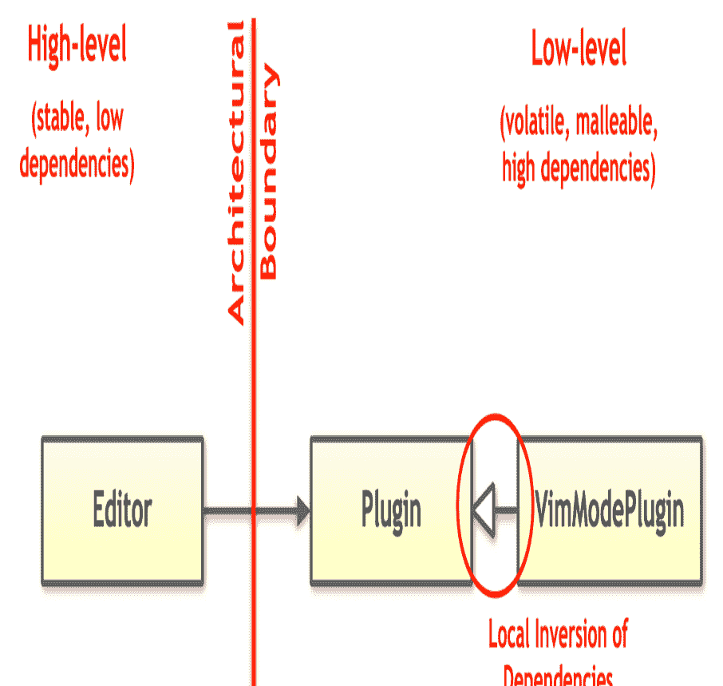

## Chapter 2. The Art of Building Abstractions

### A NOTE FOR EARLY RELEASE READERS

With Early Release ebooks, you get books in their earliest form—the author’s raw and unedited content as they write—so you can take advantage of these technologies long before the official release of these titles.

This will be the 2nd chapter of the final book. Please note that the GitHub repo will be made active later on.

If you have comments about how we might improve the content and/or examples in this book, or if you notice missing material within this chapter, please reach out to the editor at sevans@oreilly.com.

抽象在软件设计和软件架构中发挥着至关重要的作用。换句话说，良好的抽象是管理复杂性的关键。没有它们，良好的设计和适当的架构就难以想象。尽管如此，构建良好的抽象并很好地使用它们却出奇地困难。事实证明，构建和使用抽象包含很多细微之处，因此更像是一门艺术而不是一门科学。本章将详细讨论抽象的含义和构建它们的艺术。

在“Guideline 6: Adhere to the Expected Behavior of Abstractions”中，我们将讨论抽象的目的。我们还将讨论抽象代表一组需求和期望，以及为什么遵守抽象的预期行为如此重要。在此背景下，我将介绍另一个设计原则，即 Liskov 替换原则（LSP）。

在“Guideline 7: Understand the Similarities between Base Classes and Concepts”中，我们将比较两种最常用的抽象：基类和概念。你将理解，从语义角度来看，这两种方法非常相似，因为两者都能够表达预期行为。

在“Guideline 8: Understand the Semantic Requirements of Overload Sets”中，我将扩展关于语义需求的讨论并谈论第三种抽象：函数重载。你将理解，所有属于重载集的函数也都有预期行为，因此也必须遵守 LSP。

在“Guideline 9: Pay Attention to the Ownership of Abstractions”中，我将关注抽象的架构意义。我将解释什么是架构，以及我们对架构的高层和低层有什么期望。我还将向你展示，从架构角度来看，仅引入抽象来解决依赖关系是不够的。为了说明这一点，我将介绍依赖倒置原则（DIP），这是一条关于如何通过抽象构建架构的重要建议。

在“Guideline 10: Consider Creating an Architectural Document”中，我们将坐下来讨论架构文档的好处。希望这段小对话能激励你在之前没有考虑过的情况下创建一份。

### Guideline 6: Adhere to the Expected Behavior of Abstractions

解耦软件的一个关键方面，也是软件设计的一个关键方面，就是引入抽象。因此你会期望这是一件相对直接、容易做的事情。不幸的是，正如事实证明的那样，构建抽象是困难的。

为了说明我的意思，让我们看一个例子。我为此目的选择了经典的例子。你很有可能已经知道这个例子。如果是这样，请不要翻白眼，但请随意


to skip the example. However, if you are not familiar with the example, then this may serve as an eye opener.

### An Example for Violating Expectations

Let us start with a Rectangle base class:

```
class Rectangle
{
public:
    // ...
    virtual ~Rectangle() = default;  ①

    int getWidth() const;  ③
    int getHeight() const;

    virtual void setWidth(int);  ④
    virtual void setHeight(int);

    virtual int getArea() const;  ⑤
    // ...

private:
    int width;  ②
    int height;
};
```

First of all, this class is designed as a base class, since it provides a virtual destructor ①. Semantically that means that a Rectangle represents an abstraction for different kinds of rectangle. And technically that means that you can properly destroy an object of derived type via a pointer to Rectangle.

Second, the Rectangle class comes with two data members: width and height ②. That is to be expected, since a rectangle has two side lengths, which are represented by width and height. The getWidth() and getHeight() member functions can be used to query the two side lengths ③, and via the setWidth() and setHeight() member functions we can set the width and height ④. It is important to note that I can set these two independently, i.e. I can set the width without having to modify the height.

Finally, there is a getArea() member function (5). getArea() computes the area of the rectangle, which is of course implemented by returning the product of width and height.

Of course there may be more functionality, but the given members are the ones that are important for this example. As it is, this seems to be a pretty nice Rectangle class. Obviously we are off to a good start. But, of course there is more. For instance, there is the Square class:

```
class Square : public Rectangle  6
{
public:
    // ...
    void setWidth(int) override;  7
    void setHeight(int) override;  8

    int getArea() const override;  9
    // ...
};
```

The Square class publicly inherits from the Rectangle class (6). And that seems pretty reasonable: from a mathematical perspective a square appears to be a special kind of rectangle.¹

A Square is special, in the sense that it only has one side length. But the Rectangle base class comes with two: width and height. For that reason, we have to make sure that the invariants of the Square are always preserved. In this given implementation with two data members and two getter functions, we have to make sure that both data members always have the same value. Therefore we override the setWidth() member function to set both width and height (7). Additionally, we also override the setHeight() member function, to set both width and height (8).

Once we have done that, a Square will always have equal side lengths and the getArea() function will always return the correct area of a Square (9). Nice!

Let us put these these two classes to good use. For instance, we could think about a function that transforms different kinds of rectangles:

```
void transform( Rectangle& rectangle )
{
    rectangle.setWidth( 7 );
    rectangle.setHeight( 4 );
    assert( rectangle.getArea() == 28 );
    // ...
}
```

The transform() function takes any kind of Rectangle by means of a reference to non-const (10). That is reasonable, because we want to change the given rectangle. A first possible way to change the rectangle is to set the width via the setWidth() member function to 7 (11). Then we could change the height of the rectangle to 4 via the setHeight() member function (12).

At this point, I would argue that you have an implicit assumption. I am pretty certain that you assume that the area of the rectangle is 28, because of course, 7 times 4 is 28. That is an assumption which we can test via an assertion (13).

The only thing missing is to actually call the transform() function. That is what we do in the main() function:

```
int main()
{
    Square s{};
    s.setWidth( 6 );
    transform( s );
    return EXIT_SUCCESS;
}
```

In the `main()` function, we create a special kind of rectangle: a `Square` (Ⓡ).² This square is passed to the `transform()` function, which of course works, since a reference to a `Square` can be implicitly converted to a reference to a `Rectangle` (Ⓡ).

If I were to ask you “What happens?”, I am pretty sure that you would answer: “The `assert()` fails!”. Yes, indeed, the `assert()` will fail. The expression passed to the `assert()` will evaluate to `false` and `assert()` will crash the process by means of a `SIGKILL` signal. Well, that is certainly unfortunate. So let us do a postmortem analysis: why does the `assert()` fail? Our expectation in the `transform()` function is that we can change the width and height of a rectangle independently. This expectation is explicitly expressed by means of the two function calls to `setWidth()` and `setHeight()`. However, unexpectedly, this special kind of rectangle does not allow that: in order to preserve its own invariants, the `Square` class must always make sure that both side lengths are equal. Thus the `Square` class has to violate this expectation. This violation of the expectation in an abstraction is a violation of the *Liskov Substitution Principle (LSP)*.

### The Liskov Substitution Principle

The *Liskov Substitution Principle (LSP)* is the third of the *SOLID* principles and concerned with *behavioral subtyping*, i.e. with the expected behavior of an abstraction. This design principle is named after Barbara Liskov, who initially introduced it in 1988, and clarified it together with Jeannette Wing in 1994:³

> *Subtype Requirement: Let φ(x) be a property provable about objects x of type T. Then φ(y) should be true for objects y of type S where S is a subtype of T.*
> 
> —Barbara Liskov and Jeannette Wing

This principle formulates what we commonly call an *IS-A* relationship. This relationship, i.e. the expectations in an abstraction, *must* be adhered to in a subtype. That includes the following properties:

- Preconditions cannot be strengthened in a subtype: a subtype cannot expect more in a function than what the super type expresses. That would violate the expectations in the abstraction.

```
struct X
{
    virtual ~X() = default;

    // Precondition: the function accepts all 'i' greater than 0
    virtual void f( int i ) const
    {
        assert( i > 0 );
        // ...
    }
};

struct Y : public X
{
    // Precondition: the function accepts all 'i' greater than 10.
    // This would strengthen the precondition; numbers between 1
    and 10
    // would no longer be allowed. This is a LSP violation!
    void f( int i ) const override
    {
        assert( i > 10 );
        // ...
    }
};
```

- Postconditions cannot be weakened in a subtype: a subtype cannot promise less when leaving a function than the super type promises. Again, that would violate the expectations in the abstraction.

```
struct X
{
    virtual ~X() = default;

    // Postcondition: the function will only return values larger than 0
    virtual int f() const
    {
        int i;
        // ...
        assert( i > 0 );
        return i;
    }
};

struct Y : public X
{
    // Postcondition: the function may return any value.
    // This would weaken the postcondition; negative numbers and 0 would
    // be allowed. This is a LSP violation!
    int f( int i ) const override
    {
        int i;
        // ...
        return i;
    }
};
```

- Function return types in a subtype must be covariant: member functions of the subtype can return a type that is itself a subtype of the return type of the according member function in the super type. This property has direct language support in the C++ language. However, the subtype cannot return any super type of the return type of the according function in the super type.

```
struct Base { /*...some virtual functions, including destructor...*/ };
struct Derived : public Base { /*...*/ };
```

```
struct X
{
    virtual ~X() = default;
    virtual Base* f();
};
```

```
struct Y : public X
{
    Derived* f() override;  // Covariant return type
};
```


+   - 子类型中的函数参数必须是逆变的：在成员函数中，子类型可以接受超类型中对应成员函数的函数参数的超类型。此属性在 C++ 语言中没有直接的语言支持。

```
struct Base { /*...some virtual functions, including destructor...*/ };
struct Derived : public Base { /*...*/ };
```

```
struct X
{
    virtual ~X() = default;
    virtual void f( Derived* );
};
```

```
struct Y : public X
{
    void f( Base* ) override;  // Contravariant function parameter; Not
                        // supported in C++. Therefore the
                        // function
                        // does not override, but fails to
                        // compile.
};
```

+   - 超类型的不变式必须在子类型中保持：关于超类型状态的任何期望必须在所有成员函数的调用之前和之后始终有效，包括子类型的成员函数。

```
struct X
{
    explicit X( int v = 1 )
        : value_(v)
    {
        if( v < 1 || v > 10 ) throw std::invalid_argument( /*...*/ );
    }

    virtual ~X() = default;

    int get() const { return value_; }
```

```
protected:
    int value_;  // Invariant: must be within the range [1..10]
};

struct Y : public X
{
public:
    Y()
        : X()
    {
        value_ = 11;  // Broken invariant: After the constructor,
'value_'               // is out of expected range. One good reason
to                     // properly encapsulate invariants and to
follow                 // Core Guideline C.133: Avoid protected
data.                  
    }
};
```

在我们的示例中，Rectangle 中的期望是我们可以独立地改变两个边长，或者更正式地说，在调用 setHeight() 之后 getWidth() 的结果不会改变。这一期望对于任何类型的矩形都是直观的。然而，Square 类本身引入了不变式，即所有边必须始终相等，否则 Square 就无法正确表达我们对正方形的想法。但通过保护其自身的不变式，Square 不幸地违反了基类中的期望。因此，Square 类没有满足 Rectangle 类中的期望，并且此示例中的层次结构没有表达 IS-A 关系。因此，Square 不能在所有期望 Rectangle 的地方使用。

“‘但正方形不是矩形吗？’你会问。‘这不是正确表达了几何关系吗？’”⁴ 是的，正方形和矩形之间可能存在几何关系，但在该示例中继承关系是被破坏的。此示例表明，数学上的 IS-A 关系确实不同于 LSP IS-A 关系。虽然在几何中正方形始终是矩形，但在计算机科学中这真的取决于实际的接口以及由此产生的期望。只要存在两个独立的 `setWidth()` 和 `setHeight()` 函数，`Square` 就会始终违反期望。“我明白了”，你说。“没有人会声称在几何上，改变其宽度后正方形仍然是正方形，对吧？” 没错。

该示例还表明，继承不是自然或直观的特性，而是一个困难的特性。正如开头所述，构建抽象是困难的。每当你使用继承时，你 *必须* 确保基类中的所有期望都得到满足，并且派生类型按预期行为。

### 对里氏替换原则的批评

有些人认为，*LSP* 如上所述，实际上并不是 Barbara Liskov 在 1987 年 OOPSLA 会议论文“Data Abstraction and Hierarchy”中描述的内容，并且子类型化的概念是有缺陷的。而这确实是正确的：我们通常不会用派生对象替换基对象，而是将派生对象用作基对象。然而，对 Liskov 论述的这种字面且严格的解释对于我们日常构建的抽象类型没有任何作用。在 1994 年的论文“A behavioral notion of subtyping”中，Barbara Liskov 和 Jeannette Wing 提出了 *behavioral subtyping* 的术语，这就是今天对 *LSP* 的普遍理解。⁵

另一些人认为，由于 *LSP* 可能被违反，基类不具备抽象的目的。理由是，使用代码也会依赖于派生类型的（误）行为。遗憾的是，这一论点把世界颠倒了。基类 *确实* 代表抽象，因为调用代码只能并且应该完全且排他地依赖于该抽象的 *预期* 行为。正是因为这种依赖，*LSP* 违反才成为编程错误。遗憾的是，有时人们会通过引入特殊变通方法来修复 *LSP* 违反：

```
class Base { /*...*/ };
class Derived : public Base { /*...*/ };
```

```
class Special : public Base { /*...*/ };
// ... Potentially more derived classes

void f( Base const& b )
{
    if( dynamic_cast<Special const*>( &b ) )
    {
        // ... do something "special", knowing that 'Special'
behaves differently
    }
    else
    {
        // ... do the expected thing
    }
}
```

这种变通方法确实会引入对派生类型行为的依赖。而且是非常不幸的依赖！这始终应被视为 LSP 违反且是非常糟糕的做法。⁶ 它不能作为反对基类抽象属性的一般论据。

### 对良好且有意义抽象的需求

为了正确解耦软件实体，至关重要的是我们能够信赖我们的抽象。如果没有有意义的抽象，我们作为代码的人类阅读者完全理解的抽象，我们就无法编写健壮可靠的软件。因此，遵守 LSP 对于软件设计目的至关重要。然而，这其中一个重要部分也是对抽象期望的清晰且无歧义的传达。在最好的情况下，这通过软件本身实现（自文档化代码），但这也需要对抽象进行适当的文档记录。作为一个很好的例子，我推荐 C++ 标准中迭代器概念的文档，它清晰地列出了预期行为，包括前置和后置条件。

### GUIDELINE 6: ADHERE TO THE EXPECTED BEHAVIOR OF ABSTRACTIONS

+   - 理解抽象代表一组需求和期望；
+   - 遵循 *Liskov Substitution Principle (LSP)* 以遵守抽象的预期行为；
+   - 确保派生类遵守其基类的预期行为；
+   - 传达抽象的期望。

### Guideline 7: Understand the Similarities between Base Classes and Concepts

在“Guideline 6: Adhere to the Expected Behavior of Abstractions”中，我可能给人留下 *Liskov Substitution Principle (LSP)* 只与继承层次结构和基类有关的感觉。为了确保这种印象不会留下，请允许我明确指出 *LSP* *不限于* 动态（运行时）多态性和继承层次结构。相反，我们同样可以把 *LSP* 应用于静态（编译时）多态性和模板化代码。

为了说明这一点，让我问你一个问题：以下两个代码片段有什么区别？

//==== Code Snippet 1 ====

class Document
{
public:
    // ...
    virtual ~Document() = default;

virtual void exportToJSON( /*...*/ ) const = 0;
virtual void serialize( ByteStream&, /*...*/ ) const = 0;
// ...
};

void useDocument( Document const& doc )
{
    // ...
    doc.exportToJSON( /*...*/ );
    // ...
}
```

//==== Code Snippet 2 ====

```
template< typename T >
concept Document =
    requires( T t, ByteStream b ) {
        t.exportToJSON( /*...*/ );
        t.serialize( b, /*...*/ );
    };

template< Document T >
void useDocument( T const& doc )
{
    // ...
    doc.exportToJSON( /*...*/ );
    // ...
}
```

我很确定你的第一个答案是第一个代码片段使用动态多态的解决方案，第二个显示静态多态。好，很棒！还有什么？好吧，是的，当然，语法也不同。好吧，我明白了，我应该把我的问题问得更精确一些：这两种解决方案在语义上有什么不同？

嗯，如果你想一想，你可能会发现从语义角度来看这两种解决方案非常相似。在第一个代码片段中，useDocument() 函数只与派生自 Document 基类的类一起工作。因此我们可以说该函数只与遵守 Document 抽象期望的类一起工作。在第二个代码片段中，useDocument() 函数只与实现 Document 概念的类一起工作。换句话说，


function only works with classes adhering to the expectations of the Document abstraction.

如果你现在有一种似曾相识的感觉，那么我选择的措辞 hopefully 击中了要害。是的，在这两个代码片段中，useDocument() 函数仅适用于遵循 Document 抽象期望的类。因此，尽管第一个代码片段基于运行时抽象，而第二个函数代表编译时抽象，从语义角度来看，这两个函数非常相似。

基类和概念都代表一组需求（语法需求，但也包括语义需求）。因此，两者都代表了预期行为的形式化描述，从而成为向调用代码表达和传达期望的手段。因此，概念可以被视为等价物，基类的静态对应物。从这个角度来看，将 LSP 应用于模板代码也完全合理。

“我不买账”，你抱怨道。“我听说 C++20 概念无法表达语义！”7 嗯，对此我只能回答一个确定的“是”和“否”。是的，C++20 概念无法完全表达语义，这一点是正确的。但另一方面，概念仍然表达了预期行为。例如，考虑 std::copy() 算法的 C++20 形式：8

```
template< typename InputIt, typename OutputIt >
constexpr OutputIt copy( InputIt first, InputIt last, OutputIt d_first )
{
    while( first != last ) {
        *d_first++ = *first++;
    }
    return d_first;
}
```

std::copy() 算法期望三个参数。前两个参数代表需要复制的元素范围（输入 *range*）。第三个参数代表我们需要复制到的第一个元素（*output range*）。一个普遍的期望是，*output range* 足够大，以便将 *input range* 中的所有元素复制到其中。

但通过迭代器类型的名称隐式表达了更多期望：`InputIt` 和 `OutputIt`。`InputIt` 代表一种 *input iterator* 类型。C++ 标准规定了此类迭代器类型的所有期望，例如 (不)相等比较的可用性，使用前缀和后缀递增遍历范围的能力（即 `operator++()` 和 `operator++(int)`）以及使用解引用运算符访问元素的能力（即 `operator*()`）。另一方面，`OutputIt` 代表一种 *output iterator* 类型。这里，C++ 标准也明确规定了所有期望的操作。

`InputIt` 和 `OutputIt` 可能不是 C++20 概念，但它们仍然代表相同的思想：这些命名的模板参数不仅仅让你了解需要哪种类型的类型，而且它们表达了预期行为。例如，我们期望对 `first` 的后续递增最终会产生 `last`。如果任何给定的具体迭代器类型不以这种方式表现，`std::copy()` 就不会按预期工作。这将是对预期行为的违反，因此是对 *LSP*⁹ 的违反。因此 `InputIt` 和 `OutputIt` 都代表 *LSP* 抽象。

请注意，由于概念代表 *LSP* 抽象，即一组需求和期望，它们同样受 *接口隔离原则 (ISP)* 约束（参见“准则 3：分离接口以避免人为耦合”）。正如你应该在基类（即“接口”类）的需求定义中分离关注点一样，你在定义概念时也应该分离关注点。标准库迭代器正是通过相互构建来实现这一点，从而允许选择所需的需求级别：

```
template< typename I >
concept input_or_output_iterator =
    /* ... */;

template< typename I >
concept input_iterator =
    std::input_or_output_iterator<I> &&
    /* ... */;

template< typename I >
concept forward_iterator =
    std::input_iterator<I> &&
    /* ... */;
```

由于命名模板参数和 C++20 概念服务于相同的目的，并且两者都代表 LSP 抽象，因此从现在开始，在所有后续准则中，我将使用术语 concept 来指代两者。因此，我用术语 concept 指代任何表示一组需求的方式（在大多数情况下针对模板参数，但有时甚至更一般）。如果我想特别指代其中之一，我会明确说明。

总之，任何形式的抽象（动态和静态）都代表一组需求以及由此产生的预期行为。这些期望需要由具体实现来满足。因此，LSP 清楚地代表了所有类型 IS-A 关系的本质指导。

### GUIDELINE 7: UNDERSTAND THE SIMILARITIES BETWEEN BASE CLASSES AND CONCEPTS

- 将 Liskov 替换原则 (LSP) 应用于动态和静态多态；
- 将概念（C++20 特性和 C++20 之前的命名模板参数）视为基类的静态等价物；
- 使用模板时遵守概念的预期行为；
- 传达概念的期望（特别是针对 C++20 之前的命名模板参数）。

### Guideline 8: Understand the Semantic Requirements of Overload Sets

在“准则 6：遵守抽象的预期行为”中，我向你介绍了 Liskov 替换原则 (LSP)，并希望做出了有力的论证：每个抽象都代表一组语义需求！换句话说，抽象表达了预期行为，需要得到满足。否则你（很可能）会遇到问题。在“准则 7：理解基类和概念之间的相似性”中，我将 LSP 讨论扩展到概念，并因此证明，LSP 可以并且应该应用于静态抽象。

但故事还没有结束。正如之前所说：每个抽象都代表一组需求。我们尚未考虑的还有一种抽象类型，一种不幸经常被忽视，尽管其功能强大，因此我们在讨论中不应忘记它：函数重载。“函数重载？你是指一个类可以有多个同名函数这一事实吗？”是的，绝对如此。你可能已经体验到这确实是一个非常强大的功能。例如，考虑 std::vector 内部的 begin() 成员函数的两个重载：取决于你拥有的是 const 还是非 const vector，对应的重载会被选中。甚至无需你察觉。非常强大！但说实话，这并不是真正的抽象。虽然重载成员函数很方便且有帮助，但我脑海中想到的是一种不同类型的函数重载，一种真正代表抽象形式的类型：自由函数。

#### The Power of Free Functions: A Compile-Time Abstraction Mechanism

除了概念之外，通过自由函数实现的函数重载代表了第二种编译时抽象：基于给定的某些类型，编译器从一组同名函数中确定调用哪个函数。这就是我们所说的重载集。这是一种极其多才多艺且功能强大的抽象机制，具有许多、许多优秀的设计特性。首先，你可以向任何类型添加自由函数：你可以向 int 添加，向 std::string 添加，以及向任何其他类型添加。非侵入式。试着用成员函数做到这一点，你会发现这根本行不通。添加成员函数是侵入性的。你无法向不能拥有成员函数或你无法修改的类型添加任何内容。因此，自由函数完全符合开放封闭原则 (OCP) 的精神：你可以通过简单地添加代码来扩展功能，而无需修改已有的代码。

这为你提供了显著的设计优势。例如，考虑以下代码示例：

```
template< typename Range >
void traverseRange( Range const& range )
{
    for( auto pos=range.begin(); pos!=range.end(); ++pos ) {
        // ...
    }
}
```

traverseRange() 函数对给定的范围执行传统的、基于迭代器的循环。为了获取迭代器，它在 range 上调用 begin() 和 end() 成员函数。虽然此代码适用于大量容器类型，但它不适用于内置数组：

```
#include <cstdlib>

int main()
{
    int array[6] = { 4, 8, 15, 16, 23, 42 };

    traverseRange( array );  // Compilation error!

    return EXIT_SUCCESS;
}
```


这段代码无法编译，因为编译器会抱怨给定的数组类型缺少 begin() 和 end() 成员函数。“这难道不是我们应该避免使用内置数组而改用 std::array 的原因吗？”我完全同意：你应该优先使用 std::array。这在 Core Guideline SL.con.1 中也有非常好的解释：

> 优先使用 STL array 或 vector 而不是 C 数组。
> 
> —Core Guideline SL.con.1

然而，虽然这是良好的实践，让我们不要忽视 traverseRange() 函数的设计问题：traverseRange() 通过依赖 begin() 和 end() 成员函数而限制了自身。因此它对 Range 类型人为地要求支持成员 begin() 和成员 end() 函数，从而限制了其自身的适用性。不过有一个简单的解决方案，一个让该函数适用范围更广的简单方法：基于自由 begin() 和 end() 函数的重载集合：¹⁰

```
template< typename Range >
void traverseRange( Range const& range )
{
    using std::begin;  // using declarations for the purpose of calling
    using std::end;    // 'begin()' and 'end()' unqualified to enable ADL

    for( auto pos=begin(range); pos!=end(range); ++pos ) {
        // ...
    }
}
```

这个函数仍然在做与之前相同的事情，但在这种形式下，并不会因人为要求而限制自身。事实上，没有任何限制：任何类型都可以拥有自由的 begin() 和 end() 函数，或者如果缺少的话，也可以非侵入式地为其配备。因此这个函数适用于任何类型的 Range，并且如果某个类型不满足要求，也无需修改或重载。它适用范围更广。它是真正通用的。¹¹

自由函数还有更多优势。正如在“Guideline 4: Design for Testability”中已讨论的那样，自由函数是一种非常优雅的技术，用于分离关注点，即实现 *单一职责原则 (SRP)*。通过在类外部实现一个操作，你会自动减少该类对该操作的依赖。从技术上讲，这立刻变得清晰，因为与成员函数不同，自由函数没有隐式的第一个参数，即 `this` 指针。与此同时，这使得函数成为一个独立的、隔离的服务，也可以被许多其他类使用。因此你促进了重用并减少了重复。这非常、非常好地契合了 *不要重复自己 (DRY)* 原则的思想。

这种美妙之处在 Alexander Stepanov 的杰作、标准模板库 (STL) 中得到了精彩的体现。¹² STL 哲学的一部分是松散地耦合不同的功能部分，并通过以自由函数形式分离关注点来促进重用。这就是为什么在 STL 中容器和算法是两个独立的概念的原因：在概念上，容器不知道算法，算法也不知道容器。它们之间的抽象通过迭代器实现，这让你能够以看似无穷的方式将它们组合起来。这是一个真正了不起的设计。或者用 Scott Meyers 的话来说：

> *从来没有人质疑过，[标准模板] 库代表了高效且可扩展设计的突破。*
> 
> —Scott Meyers

“那 `std::string` 呢？`std::string` 带有几十个成员函数，包括许多算法。”你提出了一个很好的观点，但更像是反例。今天社区普遍认为，`std::string` 的设计并不理想。它的设计促进了耦合、重复和增长：在每一次新的 C++ 标准中，都有一些新的附加成员函数。而增长意味着修改，随后带来意外改变的风险。这是在你的设计中你想要避免的风险。然而，话说回来，std::string 并不是原始 STL 的一部分。因此它并不是与 STL 容器（std::vector、std::list、std::set、...）一起设计的，而是在之后才适配到 STL 设计的。这就解释了为什么它与其他 STL 容器不同，并且不能完全共享它们美丽的设计目标。

### 自由函数的难题：对行为的期望

显然，自由函数非常强大，并且对泛型编程至关重要。它们在 STL 的设计以及整个 C++ 标准库的设计中发挥着至关重要的作用，后者建立在这种抽象机制的强大能力之上。¹³ 然而，所有这些能力只有在重载函数集合遵循一套规则和某些期望时才能发挥作用。只有在它遵循 LSP 时才能发挥作用。

例如，假设你编写了自己的 Widget 类型，并想为其提供自定义的 swap() 操作：

```
//---- <Widget.h> ----------------

struct Widget
{
    int i;
    int j;
};

void swap( Widget& w1, Widget& w2 )
{
    using std::swap;
    swap( w1.i, w2.i );
}
```

你的 Widget 只需要作为 int 值的简单包装器，称为 i 和 j。你提供相应的 swap() 函数作为伴随的自由函数。而且你实现 swap() 时只交换 i 值，不交换 j 值。进一步假设，你的 Widget 类型被某位其他开发者使用，也许是你的好同事。某天，这位同事调用了 swap() 函数：

```
#include <Widget.h>
#include <cstdlib>

int main()
{
    Widget w1{ 1, 11 };
    Widget w2{ 2, 22 };

    swap( w1, w2 );

    // Widget w1 contains (2,11)
    // Widget w2 contains (1,22)

    return EXIT_SUCCESS;
}
```

你能想象你同事在 swap() 操作后发现 w1 的内容不是 (2,22)，而是 (2,11) 时的惊讶吗？只有部分对象被交换会有多出乎意料？你能想象你在调试一个小时后你的同事会有多沮丧吗？如果这不是你的好同事会发生什么呢？

很明显，swap() 的实现没有满足 swap() 函数的期望。很明显，任何人都会期望对象的整个可观察状态都被交换。很明显，存在行为上的期望。因此，如果你加入一个重载集合，你就会立即且不可避免地受制于满足该重载集合的预期行为。换句话说，你必须遵守 LSP。

“我明白问题了，我懂了。我保证遵守 LSP”，你说。这很棒，这是一个可敬的意图。问题是，可能并不总是完全清楚预期的行为是什么，特别是对于散布在大代码库中的重载集合。你可能不知道所有期望和所有细节。因此有时，即使你意识到这个问题并加以注意，你仍可能做不到“正确”的事情。这就是社区中一些人担心的：能够无限制地向重载集合中添加可能 *违反 LSP* 的功能。¹⁴ 而且正如之前所说，这很容易做到。任何人，在任何地方，都可以添加自由函数。

正如 always，每种方法、每个解决方案都有其优点，但也有其缺点。一方面，利用重载集合的强大功能是极其有益的，但另一方面，正确地做到这一点可能非常困难。这两种情况也体现在 Core Guideline C.162 和 Core Guideline C.163 中：

> *重载大致等价的操作。*
> —Core Guideline C.162

> *仅对大致等价的操作进行重载。*
> —Core Guideline C.163

而 C.162 表达了为语义等价的函数使用相同名称的优点，C.163 则表达了为语义不同的函数使用相同名称的问题。每个 C++ 开发者都应该意识到这两个准则之间的张力。此外，为了遵守预期行为，每个 C++ 开发者都最好了解现有的重载集合（`std::swap()`、`std::begin(), std::cbegin(), std::end(), std::cend()`、`std::data(), std::size()` 等）并了解常见的命名约定。例如，名称 `find()` 只能用于执行元素范围线性搜索的函数。对于执行二分搜索的任何函数，名称 `find()` 会产生错误的期望，并且不会传达范围需要排序的前提条件。而且当然，名称 `begin()` 和 `end()` 应该始终满足返回一对可用于遍历范围的迭代器的期望。它们不应启动或结束某种过程。这种任务更适合由 `start()` 和 `stop()` 函数来执行。¹⁵

“好吧，我同意所有这些观点”，你说。“然而，我主要使用的是虚函数，而且由于这些函数无法以”


自由函数，我真的不能把所有关于重载集的建议都用在上面，对吗？"这可能会让你感到惊讶，但这条建议仍然适用于你。因为最终目标是减少依赖，而虚拟函数可能会导致相当大的耦合，因此其中一个目标也会是“解放”它们。事实上，在后续的许多准则中，尤其是在“准则 19：使用策略来隔离事物是如何完成的”和“准则 31：对非侵入式运行时多态使用外部多态”中，我将讲述如何提取和分离虚拟函数，例如以自由函数的形式，但不限于此。

总之：函数重载是一种强大的编译时抽象机制，你不应该低估它。特别是，泛型编程大量利用了这种能力。然而，不要太轻视这种能力：请记住，就像基类和概念一样，重载集代表了一组语义要求，因此受 Liskov 替换原则的约束。重载集的预期行为必须得到遵守，否则事情将无法正常工作。

### 准则 8：理解重载集的语义要求

- 要意识到函数重载是一种编译时抽象机制；
- 记住重载集中函数的行为存在预期；
- 注意现有的名称和约定。

### 准则 9：注意抽象的所有权

正如“准则 2：为变化而设计”中所说，变化是软件开发中唯一不变的东西。意味着你的软件应该为变化做好准备。应对变化的基本要素之一是引入抽象（另见“准则 6：遵守抽象的预期行为”）。抽象有助于减少依赖，从而使在隔离状态下更改细节变得更容易。然而，引入抽象不仅仅是添加基类或模板。

#### 依赖倒置原则

对抽象的需求也由 Robert Martin 表达：16

> 最灵活的系统是那些源代码依赖仅指向抽象，而非具体实现 的系统。
> 
> —Robert C. Martin

这段智慧通常被称为依赖倒置原则（DIP），它是 SOLID 原则中的第五条。简单来说，它建议为了依赖关系，你不应该依赖具体类型或实现细节，而应该依赖抽象。注意，这个说法并没有提到继承层次结构，而只是提到了抽象的一般概念。

让我们来看一下图 2-1 所示的情况。17 想象你正在为自动取款机（ATM）实现逻辑。ATM 机器提供几种操作：你可以取款、存款和转账。由于所有这些操作都涉及真实货币，它们要么完全完成，要么在任何错误情况下被中止并且所有更改都应回滚。这种行为（要么 100% 成功，要么完全回滚）是我们通常所说的事务。因此我们可以引入一个名为 Transaction 的抽象。所有抽象（即 Deposit、Withdrawal 和 Transfer）都继承自 Transaction 类（由 UML 继承箭头表示）。

高层
（稳定，依赖少）

Transaction
virtual execute() = 0

Deposit
execute() override

Withdrawal
execute() override

Transfer
execute() override

架构边界

低层
（易变，可塑，依赖多）

UI
requestDepositAmount()
requestWithdrawalAmount()
requestTransferAmount()
informInsufficientFunds()

图 2-1. 若干事务与用户界面（UI）之间初始的强依赖关系。

所有事务都需要银行客户通过用户界面输入的输入数据。此用户界面由 UI 类提供，该类提供许多不同的函数来查询输入的数据：
`requestDepositAmount()`、`requestWithdrawalAmount()`、`requestTransferAmount()`、`informInsufficientFunds()`，以及可能更多的函数。所有三个抽象在需要信息时都会直接调用这些函数。这种关系通过小实心箭头表示，表示抽象依赖于 UI 类。

虽然这种设置可能在一段时间内有效，但你训练有素的眼睛可能已经发现了一个潜在问题：如果有东西发生变化会怎样？例如，如果系统添加了新的事务会怎样？

假设我们需要为 VIP 客户添加一个 `SpeedTransfer` 事务。这可能需要我们更改并扩展 UI 类，增加几个新函数（例如 `requestSpeedTransferAmount()` 和 `requestVIPNumber()`）。反过来，这也会影响所有其他事务，因为它们直接依赖于 UI 类。在最好的情况下，这些事务只需要重新编译和重新测试（尽管这仍然需要时间！），在最坏的情况下，如果它们以单独的共享库形式交付，可能需要重新部署。

所有这些额外工作背后的根本原因是架构被破坏。所有事务通过对 UI 类的具体依赖而间接依赖于彼此。而这从架构角度来看是一个非常不幸的情况：事务类位于我们架构的高层，而 UI 类位于低层。因此在这个例子中，高层依赖于低层。而这就是错误的：在一个适当的架构中，这种依赖关系应该被倒置。¹⁸

所有事务由于依赖于 UI 类而间接相互依赖。此外，我们架构的高层依赖于低层。这确实是一个非常不幸的情况，我们应该妥善解决。“但这很简单！”，你说。“我们只要引入一个抽象就行了！”这正是 Robert Martin 在他的陈述中所表达的：我们需要引入一个抽象，以便不依赖于 UI 类中的具体实现。然而，单个抽象并不能解决问题。三种事务仍然会间接耦合。不，在图 2-2 所示的情况下，我们需要三个抽象：每个事务一个。¹⁹

高层
（稳定，依赖少）

Transaction
virtual execute() = 0

Deposit
execute() override

Withdrawal
execute() override

Transfer
execute() override

架构边界

DepositUI
virtual requestDepositAmount() = 0

WithdrawalUI
virtual requestWithdrawalAmount() = 0
virtual informInsufficientFunds() = 0

TransferUI
virtual requestTransferAmount() = 0
virtual informInsufficientFunds() = 0

低层
（易变，可塑，依赖多）

UI
requestDepositAmount() override
requestWithdrawalAmount() override
requestTransferAmount() override
informInsufficientFunds() override

图 2-2. 若干事务与用户界面（UI）之间松弛的依赖关系。

通过引入 DepositUI、WithdrawalUI 和 TransferUI 类，我们打破了三个事务之间的依赖关系。三个事务不再依赖于具体的 UI 类，而只依赖于一个轻量级抽象，该抽象仅表示相关事务真正需要的操作。如果我们现在引入 SpeedTransfer 事务，我们也会引入 SpeedTransferUI 抽象，因此其他事务不会受到 UI 类中更改的影响。

“哦，是的，我明白了！这样我们就实现了三个设计原则！”你听起来很印象深刻。“我们引入了一个抽象来切断对用户界面实现细节的依赖。这一定是 DIP。而且我们遵循了 ISP，从而移除了不同事务之间的依赖。作为奖励，我们还很好地将真正属于一起的东西分组在一起。这就是 SRP，对吧？太棒了！让我们庆祝吧！”

等等，等等，等等……在你现在去开瓶最好的香槟来庆祝解决这个依赖问题之前，让我们更仔细地看看这个问题。是的，你是对的，我们通过将 UI 类的关注点分离来遵循 ISP。通过将其细分为三个客户端特定的接口，我们解决了三个事务之间的依赖情况。这确实是 ISP。非常好！

不幸的是我们还没有解决架构问题，所以不，我们还没有遵循 DIP（还）。但我理解这种误解：看起来我们确实已经倒置了依赖关系。图 2-3 显示我们确实引入了依赖倒置：我们不再依赖具体的 UI 类，而是依赖抽象。


##### 高层
（稳定，依赖少）

Transaction
virtual execute() = 0

Deposit
execute() override

Withdrawal
execute() override

Transfer
execute() override

##### 架构边界

DepositUI
virtual requestDepositAmount() = 0

WithdrawalUI
virtual requestWithdrawalAmount() = 0
virtual informInsufficientFunds() = 0

TransferUI
virtual requestTransferAmount() = 0
virtual informInsufficientFunds() = 0

##### 低层
（易变，可塑，依赖多）

UI
requestDepositAmount() override
requestWithdrawalAmount() override
requestTransferAmount() override
informInsufficientFunds() override

局部依赖倒置

图 2-3. 通过引入三个抽象用户界面类实现的局部依赖倒置。

然而，我们引入的只是一个*局部*的依赖倒置。是的，只是局部倒置，而不是全局倒置。从架构角度来看，我们仍然存在从高层（我们的事务类）到低层（我们的用户界面功能）的依赖。因此，不，仅引入抽象是不够的。考虑*在哪里*引入抽象也很重要。罗伯特·马丁用以下两点表达了这一点：²⁰

+   1. *高层模块不应依赖低层模块。两者都应依赖于抽象。*
+   2. *抽象不应依赖于细节。细节应依赖于抽象。*

> —Robert C. Martin

第一点清楚地表达了架构的一个基本属性：高层，即我们软件的稳定部分，不应依赖于低层，即实现细节。该依赖关系应被倒置，意味着低层应依赖于高层。幸运的是，第二点给了我们实现这一点的思路：我们将三个抽象分配给高层。图 2-4 说明了当我们将抽象视为高层的一部分时依赖关系的情况。

##### 高层
（稳定，依赖少）

Transaction
virtual execute() = 0

Deposit
execute() override

Withdrawal
execute() override

Transfer
execute() override

DepositUI
virtual requestDepositAmount() = 0

WithdrawalUI
virtual requestWithdrawalAmount() = 0
virtual informInsufficientFunds() = 0

TransferUI
virtual requestTransferAmount() = 0
virtual informInsufficientFunds() = 0

架构边界

##### 低层
（易变，可塑，依赖多）

UI
requestDepositAmount() override
requestWithdrawalAmount() override
requestTransferAmount() override
informInsufficientFunds() override

图 2-4. 通过将三个抽象分配给高层实现的依赖倒置。

通过将抽象分配给高层，通过使高层成为抽象的所有者，我们真正遵循了依赖倒置原则：所有箭头现在都从低层指向高层。现在我们才拥有一个合适的架构。

“等等！”你看起来有点困惑。“就这样？我们只需要进行架构边界的思维转换？”嗯，这可能不仅仅是思维转换。这可能导致将用户界面接口类的相应头文件从一个模块移动到另一个模块，并完全重新排列相应的包含。它不仅仅是思维转换，而是所有权的重新分配。

“但现在我们不再将属于一起的东西分组了，”你争辩道。“用户界面功能现在分散在两个层级中。这不是违反单一职责原则吗？”不，不是。相反，只有在将抽象分配给高层后，我们才正确遵循了 SRP。属于一起的不是 UI 类，而是事务类和相应的 UI 抽象应该被分组在一起。只有这样我们才能将依赖关系引导到正确的方向，只有这样我们才有架构。因此，为了实现适当的依赖倒置，抽象必须由高层拥有。

#### 插件架构中的依赖倒置

也许如果我们考虑图 2-5 所示的情况，这一事实会更有意义。想象一下你创建了下一代文本编辑器。这个新文本编辑器的核心由左侧的 Editor 类表示。为了确保这个文本编辑器会成功，你希望粉丝社区能够参与开发。因此，你成功的一个关键因素是社区能够以插件的形式添加新功能。然而，初始设置从架构角度来看相当有缺陷，很难让你的粉丝社区满意：Editor 直接依赖于具体的 VimModePlugin 类。由于 Editor 类是架构高层的一部分，你应该将其视为自己的领域，`VimModePlugin` 是架构低层的一部分，这是你粉丝社区的领域。由于 `Editor` 直接依赖于 `VimModePlugin`，并且这本质上意味着你的社区可以随意定义他们的接口，你就必须为每个新插件更改编辑器。尽管你非常热爱自己的作品，但你只能投入有限的时间来适应不同种类的插件。不幸的是，你的粉丝社区很快会失望并转向另一个文本编辑器。

##### 高层
（稳定，依赖少）

##### 低层
（易变，可塑，依赖多）

架构
边界

Editor

VimModePlugin

图 2-5. 破损的插件架构：高层 Editor 类依赖于低层 VimModePlugin 类。

当然不应该发生这种情况。在给定的 Editor 示例中，让 Editor 类依赖于所有具体插件显然不是一个好主意。相反，你应该寻求一个抽象，例如以 Plugin 基类的形式。Plugin 类现在代表了所有类型插件的抽象。然而，在架构的低层引入抽象是没有意义的（见图 2-6）。你的 Editor 仍然会依赖于你粉丝社区的随意性。



图 2-6. 破损的插件架构：高层 Editor 类依赖于低层 Plugin 类。

这种错误的依赖关系在查看源代码时也变得明显：

```
//---- <thirdparty/Plugin.h> ----------------
```
```
class Plugin { /*...*/ };  // 定义插件的要求

//---- <thirdparty/VimModePlugin.h> ----------------

#include <thirdparty/Plugin.h>

class VimModePlugin : public Plugin { /*...*/ };

//---- <yourcode/Editor.h> ----------------

#include <thirdparty/Plugin.h>  // 错误的依赖方向！

class Editor { /*...*/ };
```

构建一个适当的插件架构的唯一方法是把抽象分配给高层。这意味着抽象*必须*属于*你*，而不是你的粉丝社区。图 2-7 表明这解决了架构依赖关系并使你的 Editor 类摆脱了对插件的依赖。这解决了*DIP*，因为依赖关系被正确倒置，也解决了*SRP*，因为抽象属于高层。

##### 高层
（稳定，依赖少）

架构
边界

##### 低层
（易变，可塑，依赖多）

Editor

Plugin

VimModePlugin

全局依赖倒置

图 2-7. 正确的插件架构：低层 VimModePlugin 类依赖于高层 Plugin 类。

查看源代码可知，依赖关系的方向已被修正：VimModePlugin 依赖于你的代码，而不是相反：

```
//---- <yourcode/Plugin.h> ----------------
```
```
class Plugin { /*...*/ };  // 定义插件的要求

//---- <yourcode/Editor.h> ----------------
#include <yourcode/Plugin.h>

class Editor { /*...*/ };

//---- <thirdparty/VimModePlugin.h> ----------------
#include <yourcode/Plugin.h>  // 正确的依赖方向

class VimModePlugin : public Plugin { /*...*/ };
```

再次，为了获得适当的依赖倒置，抽象必须由高层拥有。在这种情况下，Plugin 类代表了所有插件必须满足的一组要求（参见“准则 6：遵守抽象的预期行为”）。Editor 定义并因此拥有这些要求。它不依赖于它。相反，不同的插件依赖于这些要求。这就是依赖倒置。因此 DIP 不仅仅是关于引入抽象，也关于该抽象的所有权。

#### 通过模板实现依赖倒置

到目前为止，我可能给你留下了依赖倒置原则只与继承层次结构和基类有关的感觉。然而，依赖倒置也是通过模板实现的。在这种情况下，所有权的问题会自动解决。作为示例，让我们考虑 std::copy_if() 算法：

```
template< typename InputIt, typename OutputIt, typename UnaryPredicate >
OutputIt copy_if( InputIt first, InputIt last, OutputIt d_first, UnaryPredicate pred );
```


这个 `copy_if()` 算法也遵循 *DIP*。依赖倒置是通过概念 `InputIt`、`OutputIt` 和 `UnaryPredicate` 实现的。这三个概念代表了对传递的迭代器和谓词的要求，需要由调用代码来满足。通过概念来指定这些要求，即通过拥有这些概念，`std::copy_if()` 使其他代码依赖于自身，而自身不依赖于其他代码。这种依赖结构在图 2-8 中有所体现：容器和谓词都依赖于相应算法表达的要求。因此如果我们考虑标准库内部的架构，那么 `std::copy_if()` 是架构的高层部分，容器和谓词（即函数对象、lambda 等）是架构的低层部分。

Algorithms

High-level
(stable,
low dependencies)

Architectural Boundary

Low-level
(malleable, volatile
high dependencies)

Iterator Concepts

Predicate Concepts

Containers

Predicates

Figure 2-8. Dependency structure of the STL algorithms.

### Dependency Inversion via Overload Sets

继承层次结构和概念并不是倒置依赖的唯一手段。任何形式的抽象都能够做到这一点。因此，超载集合也能让你遵循 DIP 并不令人意外。正如你在“准则 8：理解超载集合的语义要求”中所见，超载集合代表一种抽象，因而是一组语义要求和期望。与基类和概念相比，遗憾的是并没有代码明确描述这些要求。但如果这些要求由架构中的更高层拥有，你就可以实现依赖倒置。例如，考虑以下 Widget 类模板：

//---- <Widget.h> ----------------

#include <utility>

template< typename T >
struct Widget
{
    T value;
};

template< typename T >
void swap( Widget<T>& lhs, Widget<T>& rhs )
{
    using std::swap;
    swap( lhs.value, rhs.value );
}
```

Widget 拥有一个未知类型 T 的数据成员。尽管 T 未知，但仍可以通过构建在 swap() 函数的语义期望之上来实现 Widget 的自定义 swap() 函数。只要 T 的 swap() 函数遵循 swap() 的所有期望，从而遵循里氏替换原则 (LSP)，该实现就有效：21

```
#include <Widget.h>
#include <assert>
#include <cstdlib>
#include <string>

int main()
{
    Widget<std::string> w1{ "Hello" };
    Widget<std::string> w2{ "World" };

    swap( w1, w2 );

    assert( w1.value == "World" );
    assert( w2.value == "Hello" );

    return EXIT_SUCCESS;
}
```

因此，Widget swap() 函数本身遵循期望并从而加入超载集合，类似于派生类所做的那样。swap() 超载集合的依赖结构如图 2-9 所示：由于超载集合的要求，即期望，是架构高层的一部分，并且任何 swap() 的实现都依赖于这些期望，因此依赖关系从低层指向高层。依赖关系因此被正确倒置。

std::swap()

High-level
(stable,
low dependencies)

Architectural
Boundary

Low-level
(malleable, volatile
high dependencies)

Widget swap()

Figure 2-9. Dependency structure of the swap () overload set.

### Dependency Inversion Principle vs. Single-Responsibility Principle

正如我们所见，DIP 是通过正确分配所有权并正确分组真正属于一起的事物来实现的。从这个角度来看，将 DIP 视为 SRP 的另一个特例（类似于 ISP）似乎是合理的。然而，希望你能看到 DIP 不止于此。与 SRP 不同，DIP 非常关注架构的观点，我认为它是构建适当全局依赖结构的重要建议。

总之，为了构建具有适当依赖结构的适当架构，关注抽象的所有权至关重要。由于抽象代表对实现的要求，它们应属于高层，以便将所有依赖引导向高层。

### GUIDELINE 9: PAY ATTENTION TO THE OWNERSHIP OF ABSTRACTIONS

- 请记住，在适当的架构中，低层实现细节依赖于高层抽象；
- 遵循依赖倒置原则 (DIP) 并将抽象分配给架构的高层；
- 确保抽象由高层拥有，而不是由低层拥有。

### Guideline 10: Consider Creating an Architectural Document

让我们聊聊你的架构。让我从一个非常简单的问题开始：你有架构文档吗？任何总结你架构主要要点和基本决策的计划或描述，并展示高层、低层以及它们之间的依赖关系？如果你的回答是肯定的，那么你可以跳过本准则继续下一条。如果你的回答是否定的，那么让我问几个后续问题：你有持续集成 (CI) 环境吗？你使用自动化测试吗？你应用静态代码分析工具吗？全部是？好，还有希望……剩下的唯一问题是：为什么你没有架构文档？

“哦，来吧，别把蚊子说成大象。缺少架构文档并不是世界末日！毕竟我们是敏捷的，我们可以快速改变事物！”……想象一下我完全空白的表情，随后是一声长叹。老实说，我担心这会是你的解释。这不幸的是我听到的太多的说法。可能存在误解：能够快速改变事物的能力并不是敏捷方法论的重点。可悲的是，我也必须告诉你，你的回答毫无意义。你完全可以回答“毕竟我们喜欢巧克力！”或“毕竟我们在脖子上戴胡萝卜！”为了解释我的意思，我应该快速总结敏捷方法论的要点，然后随后解释你为什么应该投资于架构文档。

期望敏捷方法有助于快速改变事物的想法相当普遍。然而，正如最近几年的一些作者所阐明的，敏捷方法论的主要，也是可能唯一的要点是获得快速反馈。²² 在敏捷方法中，整个软件开发过程都围绕它构建：由于业务实践（例如规划、小型发布和验收测试）而获得快速反馈，由于团队实践（例如集体所有权、持续集成 (CI) 和站会）而获得快速反馈，以及由于技术实践（例如测试驱动开发、重构和结对编程）而获得快速反馈。然而，与普遍的看法相反，快速反馈并不意味着你可以快速轻松地改变你的软件。虽然当然关键是快速知道需要做些什么，但能够快速改变软件的能力是你仅通过良好的软件设计和架构获得的能力。这两者为你节省了改变事物的赫拉克勒斯式的努力，而不是快速反馈，它只告诉你有些东西坏了。

“好，你是对的，我明白你的观点，关注良好的软件设计和架构很重要。但架构文档的意义是什么？”我很高兴我们达成一致。那是一个绝佳的问题。我认为我们在取得进展。为了解释架构文档的目的，让我给出架构的另一个定义：²³

> 在大多数成功的软件项目中，参与该项目的专家开发人员对系统设计有共同的理解。这种共同的理解被称为‘架构。’
> 
> —Ralph Johnson

Ralph Johnson 将架构描述为对代码库的共同理解，整体愿景。让我们假设没有架构文档，没有任何总结全局图景、代码库全局愿景的东西。让我们也假设你自己相信对代码库的架构有非常清晰的想法。那么这里还有一个问题：你的团队有多少开发人员？你确定所有这些开发人员都熟悉你脑中的架构吗？你确定他们都共享相同的愿景吗？你确定他们都在帮助你朝同一个方向前进吗？

如果你的回答是肯定的，那么你可能还没有明白这一点。相当确定每个开发人员都有不同的经验和略有不同的术语。也很确定每个开发人员对代码的看法不同，因此对当前架构有略有不同的想法。而对现状的这种略有不同的看法可能会导致对未来的略有不同的愿景。虽然这在短期内可能不会立即显现，但从长远来看，出现意外、误解、误读的可能性很大。


这正是架构文档的意义所在：一个统一的文档，将思想、愿景和关键决策集中于一处，有助于维护和传达架构的现状，并避免任何误解。

该文档还具有保存思想、愿景和决策的目的。想象一下，你的首席软件架构师之一，你的代码库架构背后的大脑之一，离开了组织。如果没有根本决策的文档，这种人力损失也会导致关于代码库的重要信息丢失。作为后果，你将在架构愿景的一致性上失去信心，更重要的是，你将失去对架构决策进行适应或更改的信心。没有任何新员工能够取代这种知识和经验，也没有人能够从代码中提取所有这些信息。因此代码变得更加僵化，更加“遗留”。这会促进重写代码库大块部分的决定，而结果值得怀疑，因为新代码最初缺乏旧代码的大量智慧。²⁴ 因此，如果没有架构文档，你的长期成功将岌岌可危。

这种架构文档具有价值，如果我们看看在建筑工地上架构被多么认真对待，就会变得显而易见。建筑甚至在没有计划的情况下都不会开始。一个大家都同意的计划。或者让我们想象一下如果没有计划会发生什么：“嘿，我说车库应该在房子左边！”“但是我把它建在房子左边了。”“是的，但是我指的是我的左边，不是你的左边！”

这正是通过投入时间制作架构文档可以避免的那种问题。“是的，是的，你是对的”，你开始承认，“但是这样的文档工作量太大了。而且所有这些信息都在代码中。它会随着代码一起适应，而文档会过时得太快！”好吧，如果你做得正确的话就不会。架构文档不应该很快过时，因为它主要应该反映你代码库的大局。它不应该包含那些确实可能经常变化的小细节，而应该是整体结构、关键参与者之间的连接以及主要的技术决策。

这些都是不期望改变的东西（尽管我们都同意，“不期望改变”并不意味着它们不会改变；毕竟，*软件*是期望改变的）。而且没错，你是对的，这些细节当然也是代码的一部分。毕竟，代码包含所有细节，因此可以说代表了终极真理。然而，如果信息不易获取，如果它被隐藏在视线之外，需要考古般的努力才能提取出来，那是没用的。

我也意识到，在开始时，创建架构文档的努力听起来像是一项大量工作。巨大的工作量。我能做的全部就是鼓励你以某种方式开始。最初，你不必用其全部辉煌来记录你的架构，但也许可以从最基本的结构决策开始。一些工具已经可以使用这些信息来比较你假设的架构状态和其实际状态。²⁵ 随着时间的推移，越来越多的架构信息被添加、记录，甚至可能由工具进行测试，这将导致整个团队更广泛地获得、建立起智慧。

“但是我如何保持这份文档的更新？”你问。当然你必须维护这份文档，整合新决策，更新旧决策等。然而，由于这份文档只应包含关于那些不经常变化的方面的信息，就没有必要不断触碰和重构这份文档。安排高级开发人员每隔一到两周进行一次简短会议来讨论架构是否以及如何演进就足够了。因此很难想象这份文档会成为开发过程中的瓶颈。就这一点而言，请将这份文档视为银行保险箱：当你需要时拥有过去积累的所有决策并将信息安全保存是无价的，但你不会每天都打开它。

总之，拥有架构文档的好处远远超过风险和付出。架构文档应被视为任何项目的必备部分，也是维护和沟通工作的不可分割的一部分。它应被认为与 CI 环境或自动化测试同等重要。

### GUIDELINE 10: CONSIDER CREATING AN ARCHITECTURAL DOCUMENT

- Understand that an architectural document serves the purpose of maintaining and communicating the current state of the architecture;
- Use tools to support and help you test the current state of your architecture against the expected state.

1 In one of my training classes several years ago, I was gently reminded that from a mathematical perspective a square is not a rectangle, but a rhombus. My knees are still shaking when I think about that lecture. Therefore I specifically say “appears to be” instead of “is” to denote the naive impression that unaware people like me might have had.

2 Not mathematically, but in this implementation.

3 The LSP was first introduced by Barbara Liskov in the paper “Data Abstraction and Hierarchy” in 1988 (DOI). In 1994, it was reformulated in the paper “A behavioral notion of subtyping” by Barbara Liskov and Jeannette Wing (DOI). For her work, Barbara Liskov received the Turing Award in 2008.

4 In case you have a strong opinion about a square being a rhombus, please forgive me!

5 Barbara H. Liskov, Jeannette M. Wing: “A behavioral notion of subtyping”, ACM Transactions on Programming Languages and Systems, Volume 16, Issue 6, Nov. 1994, DOI.

6 And yet, in a sufficiently large code base, there is a good chance that you’ll find at least one example of this kind of malpractice. In my experience it often is the result of too little time to rethink and adapt the abstraction.

7 This in indeed a very often discussed topic. You will find one very good summary of this in foonathan’s blog.

8 In C++20, std::copy() is finally constexpr, but does not yet use the std::input_iterator and std::output_iterator concepts. It is still based on the formal description of input and output iterators; see LegacyInputIterator and LegacyOutputIterator.

9 And no, it would not be a compile time error, unfortunately.

10 The free begin() and end() functions are an example for the Adapter design pattern; see “Guideline 24: Use Adapters to Standardize Interfaces” for more details.

11 That is the reason, why range-based for loops build on the free begin() and end() functions.

12 Alexander Stepanov, Meng Lee, “The Standard Template Library”, Oct. 1995.

13 Free functions are indeed a seriously valuable design tool. To give one example for this, allow me to tell a short war story. You might know Martin Fowler’s book “Refactoring” (Addison Wesley, ISBN: 978-0134757599), which may be considered one of the classics for professional software development. The first edition of the book was published in 2012 and provided programming examples in Java. The second edition of the book was released in 2018, but interestingly rewritten with JavaScript. One of the reasons for that choice was that fact that any language having a C-like syntax was considered easier to digest for a majority of readers. However, another important reason was the fact that JavaScript, unlike Java, provides free functions, which Martin Fowler considers a very important tool for decoupling and separating concerns. Without this feature, you would be limited in your flexibility to achieve the refactoring goal.

14 A great discussion of this can be found in Episode 83 of Cpp.Chat, where Jon Kalb, Phil Nash, and Dave Abrahams discuss the lessons learned from C++ and how they were applied in the development of the Swift programming language.

15 As Kate Gregory would say, “Naming is Hard: Let’s Do Better”. This is the title of her highly recommended talk from CppCon 2019 (YouTube).

16 Robert C. Martin, “Clean Architecture”, Addison-Wesley, Sep. 2017, ISBN: 978-0134494166.

17 This example is taken from Robert Martins book “Agile Software Development. Principles, Patterns, and Practices”, Prentice Hall, Oct. 2002, ISBN: 978-0135974445.” Robert Martin used this example to explain the Interface Segregation Principle (ISP) and for that reason did not go into detail about the question of ownership of abstractions. I will try to fill this gap.

18 If you argue that the Transaction base class could be on an even higher level, you are correct. You have earned yourself a bonus point! But for the remainder of the example we will not need this extra level and therefore I will ignore it.

19 In case you are wondering about the two informInsufficientFunds() function: Yes, it is possible to implement both virtual functions, i.e. the one from the WithdrawalUI and the one from the TransferUI, by means of a single implementation in the UI class. Of course this only works well, as long as these two functions represent the same expectations and thus can be implemented as one. However, if they represent different expectations, then you are facing a Siamese Twin Problem (see Item 26 in Herb Sutter’s “More Exceptional C++: 40 New Engineering Puzzles, Programming Problems, and Solutions”, Addison Wesley, Dec. 2001, ISBN: 978-0201704341). For our example, let us assume that we can deal with these two virtual functions the easy way.

20 Robert C. Martin, “Clean Architecture”, Addison-Wesley, Sep. 2017, ISBN: 978-0134494166.

21 I know what you are thinking. However, it was just a matter of time until you encounter a “Hello World” example.


22 例如，罗伯特·C·马丁（Robert C. Martin），敏捷宣言的签署者之一，在他的书《Clean Agile: Back to Basics》中提出了这一点，Pearson，2019年10月，ISBN：978-0135781869。伯特兰·梅耶（Bertrand Meyer）提供了另一个很好的总结，“Agile!: The Good, the Hype and the Ugly”，Springer，2014年4月，ISBN：978-3319051543。最后，你还可以参考詹姆斯·肖尔（James Shore）的书：《The Art of Agile Development - 2nd Edition》，O’Reilly，2021年11月，ISBN：978-1492080695。关于敏捷术语误用的一个很好的演讲是 Dave Thomas 在 GOTO 2015 上的“Agile is Dead”演讲（YouTube）。

23 Martin Fowler，“Who Needs an Architect?”；IEEE Software，第20卷，第5期，2003年9月，第11-13页，DOI。

24 Joel Spolsky，你可能认识他是 Joel on Software 博客的作者，也是 Stack Overflow 的创始人之一，他将重写大量代码的决定称为“……任何公司都能犯的最糟糕的战略错误。”（参见 joelonsoftware.com）

25 一个可能的工具是 Axivion Suite。你首先定义模块之间的架构边界，工具可以用它来检查架构依赖关系是否得到维护。另一个具有此类功能的工具是 Sparx Systems Enterprise Architect。
