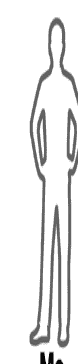
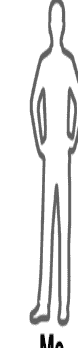
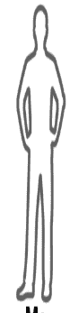
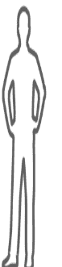
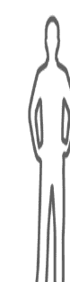
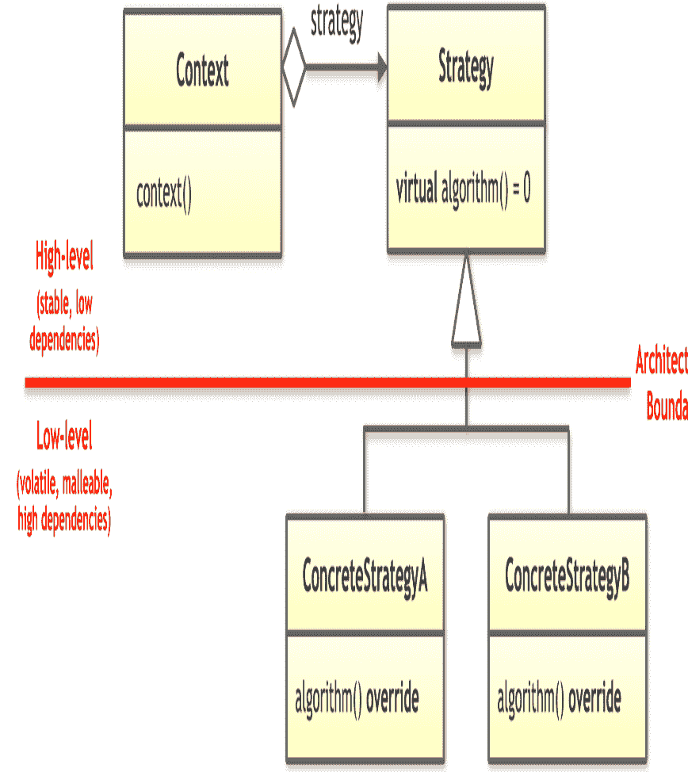
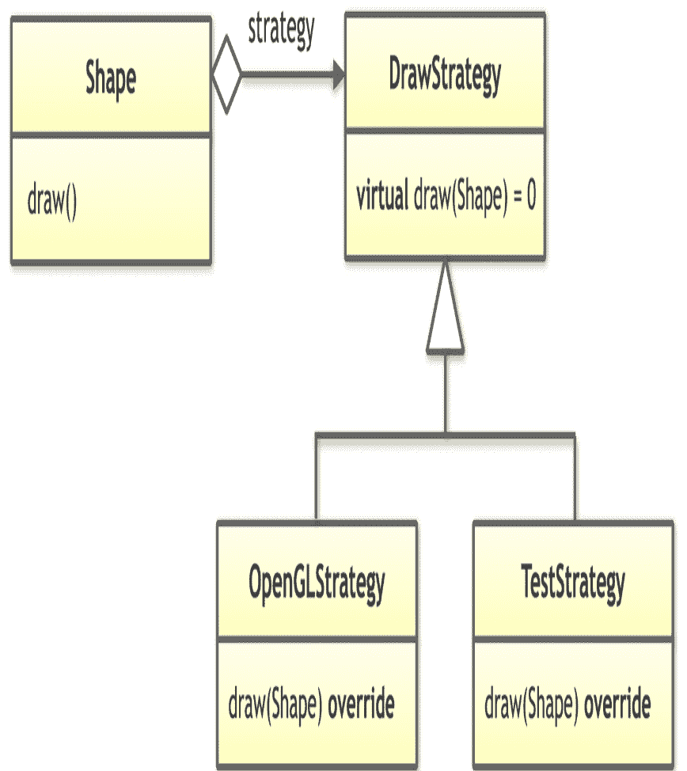

## Chapter 3. The Purpose of Design Patterns

### A NOTE FOR EARLY RELEASE READERS

With Early Release ebooks, you get books in their earliest form—the author’s raw and unedited content as they write—so you can take advantage of these technologies long before the official release of these titles.

This will be the 3rd chapter of the final book. Please note that the GitHub repo will be made active later on.

If you have comments about how we might improve the content and/or examples in this book, or if you notice missing material within this chapter, please reach out to the editor at sevans@oreilly.com.

Visitor, Strategy, Decorator. This is all names of design pattern that we will deal with in the upcoming chapters. However, before taking a detailed look at each of these design patterns, I should give you an idea about the general purpose of a design pattern. Thus in this chapter we will first take a look at the fundamental properties of design patterns, why you would want to know about them and use them.

In “Guideline 1: Understand the Importance of Software Design” I have already used the term design pattern and explained on which level of software development you use them. However, I did not yet explain in detail what a design pattern is. That will be the topic of “Guideline 11: Understand the Purpose of Design Patterns”: You will understand that a design pattern has a name that expresses an intent, introduces an abstraction that helps to decouple software entities, and has been proven over the years.

In “Guideline 12: Beware of Design Pattern Misconceptions”, I will focus on several misconceptions about design patterns and explain what a design pattern is not. I will try to convince you that design patterns are not about implementation details and do not represent language-specific solutions to common problems. I will also do my best to show you that they are not limited to object-oriented programming nor limited to dynamic polymorphism.

In “Guideline 13: Design Patterns are Everywhere”, I will demonstrate that it is hard to avoid design patterns. They are everywhere! You will realize that in particular the C++ standard library is full of design patterns and makes good use of their strengths.

In “Guideline 14: Use a Design Pattern’s Name to Communicate Intent”, I will make the point that part of the strength of a design pattern is the ability to communicate intent by using their name. Thus I will show you how much more information and meaning you can add to your code by using the name of a design pattern.

### Guideline 11: Understand the Purpose of Design Patterns

There is a good chance that you have heard about design patterns before and a fairly good chance that you used some of them in your programming career. Design patterns are nothing new: they have been around at least since the Gang of Four (GoF) released their book on design patterns in 1994.¹ And while there are always critics, their special value has been acknowledged throughout the software industry. Yet, despite their long existence and importance, despite all the knowledge and accumulated wisdom, there are many misconceptions about design patterns, in particular in the C++ community.

In order to use design patterns productively, as a first step you need to understand what design patterns are. A design pattern …

- … has a name;
- ... carries an intent;
- ... introduces an abstraction;
- ... has been proven.

#### A Design Pattern Has a Name

In order to use design patterns productively, as a first step you need to understand what design patterns are. First of all, a design pattern has a **name**. While this sounds very obvious and necessary, it is indeed a fundamental property of a design pattern. Let us assume that the two of us are working the same project together and we are tasked to find a solution to a problem. Imagine I told you “I would use a *Visitor* for that”.² Not only would this tell you what I understand to be the real problem, it would also give you a precise idea about the kind of solution I am proposing.

The name of a design pattern allows us to communicate on a very high level and to exchange a lot of information with very few words.



Me: "I would use a Visitor for that".

Me

You: "I don't know. I thought of using a Strategy."


You



Me: "Yes, you may have a point there. But since we'll have to extend operations fairly often, we probably should consider a Decorator as well."

Me

By just using the names Visitor, Strategy and Decorator we have discussed the evolution of the code base, and described how we expect things to change and to be extended in years to come.³ Without these names, we would have a much harder time expressing our ideas.



> "I think we should create a system that allows us to extend the operations without the need to modify existing types again and again."

Me

> "I don't know. Rather than new operations. I would expect new types to be added frequently. So I prefer a solution that allows me to add types easily. But in order to reduce coupling to the implementation details, which is to be expected, I would suggest a way to extract implementation details from existing types by introducing a variation point."



You



> "Yes, you may have a point there. But since we'll have to extend operations fairly often, we probably should consider designing the system in such a way that we can build on and reuse a given implementation easily."

Me

Do you see the difference? Do you feel the difference? Without names, we have to talk about a lot more details explicitly. Obviously this kind of precise communication is only possible if we share the same understanding

of design patterns. That is why it is so important to know about design patterns and to talk about them.

#### A Design Pattern Carries an Intent

By using the name of a design pattern you can express your intent concisely and limit possible misunderstandings. This leads to the second property of a design pattern: an **intent**. The *name* of a design pattern conveys its *intent*. If you use the name of a design pattern, you implicitly state what you consider to be the problem and what you see as a solution.

Hopefully you realized that in our little conversation above we were not talking about any kind of implementation. We did not talk about implementation details, any features, or any particular C++ standard. We did not even talk about any particular programming language. And please do not assume that by giving you the name of a design pattern I have implicitly told you how to implement the solution. That is not what a design pattern is about. On the contrary: the name should tell you about the structure that I propose, about how I plan to manage dependencies and about how I expect the system to evolve. That is the intent.

In fact, many design patterns have a similar structure. In the GoF book, many of the design patterns look very much alike, which, of course, raises a lot of confusion and questions. For instance, structurally there appears to be almost no difference between the *Strategy*, the *Command*, and the *Bridge* design patterns.⁴ However, their intent is very different and you would therefore use them to solve different problems. As you will see in various examples in the following chapters, there are almost always many different implementations you can choose from.

#### A Design Pattern Introduces an Abstraction

A design pattern always provides some way to **reduce dependencies** by introducing some kind of **abstraction**. This means that a design pattern is always concerned with managing the interaction between software entities and decoupling pieces of your software.


例如，考虑 *Strategy* 设计模式，它是 GoF 设计模式之一，如图 3-1 所示。无需过多细节，*Strategy* 设计模式以 `Strategy` 基类的形式引入了一种抽象。该基类将 `Strategy` 的使用者（在架构高层中的 `Context` 类）与具体策略的实现细节（在架构低层中的 `ConcreteStrategyA` 和 `ConcreteStrategyB`）解耦。因此，*Strategy* 满足了设计模式的属性。⁵



图 3-1. GoF Strategy 设计模式。

一个类似的例子是 Factory Method 设计模式（又一个 GoF 设计模式；参见图 3-2）。Factory Method 的意图是解耦特定产品的创建。为此，它以 `Product` 和 `Creator` 基类的形式引入了两个

抽象，架构上位于高层。实现细节，由 `ConcreteProduct` 和 `ConcreteCreator` 类给出，位于架构的低层。通过这种架构结构，*Factory Method* 也符合设计模式的定义：它有一个名称，解耦的意图，并且引入了抽象。

Creator

virtual factoryMethod() = 0

product = factoryMethod();

Product

High-level
(stable, low
dependencies)

Architectural
Boundary

Low-level
(volatile, malleable,
high dependencies)

ConcreteProduct

ConcreteCreator

virtual factoryMethod()

return new ConcreteProduct();

图 3-2. GoF Factory Method 设计模式。

你应该注意，设计模式引入的抽象不一定是通过基类引入的。正如我在以下各节和章节中将向你展示的那样，这种抽象可以通过许多不同的方式引入，例如通过模板，或简单地通过函数重载。同样，设计模式并不意味着任何特定的实现。

作为一个反例，让我们考虑 std::make_unique() 函数：

```
namespace std {

template< typename T, typename... Args >
unique_ptr<T> make_unique( Args&&... args );

} // namespace std
```

在 C++ 社区中，我们经常将 std::make_unique() 函数称为工厂函数。需要注意的是，虽然工厂函数这个术语给人一种 std::make_unique() 是 Factory Method 设计模式的一个例子的印象，但这种印象是错误的。设计模式通过引入抽象来帮助你解耦，从而允许你自定义和延迟实现细节。特别是，Factory Method 设计模式的意图是为对象实例化引入一个定制点。std::make_unique() 并没有提供这样的定制点：如果使用 std::make_unique()，你就知道你会得到一个指向你所请求类型的 std::unique_ptr，并且实例将通过 new 创建：

```
// This will create a 'Widget' by means of calling 'new'
auto ptr = std::make_unique<Widget>( /* some Widget arguments */ );
```

由于 std::make_unique() 没有提供任何自定义该行为的方法，它就无法帮助减少实体之间的耦合，因此它不能服务于设计模式的目的。⁶ 尽管如此，

`std::make_unique()` 是一种针对特定问题的反复出现的解决方案。换句话说，它是一种模式。然而，它不是 *design pattern*，而是 *implementation pattern*。它是一种将实现细节封装起来的流行解决方案（在本例中是生成 `Widget` 的实例），但它并没有抽象出你得到的是什么以及它将如何被创建。因此它属于 *Implementation Details* 层级，但不属于 *Software Design* 层级（参见图 1-1）。

引入抽象是将软件实体彼此解耦并为变更和扩展而设计的关键。`std::make_unique()` 函数模板中没有抽象，因此你也没有办法扩展其功能（你甚至无法正确重载或特化）。相比之下，*Factory Method* 设计模式 *确实* 提供了对 *创建什么* 以及 *如何创建*（包括实例化前后的操作）的抽象。由于这种抽象，你将能够在以后编写新的工厂，而无需更改现有代码。因此，设计模式帮助你解耦并扩展你的软件，而 `std::make_unique()` 只是一种 *implementation pattern*。

### A Design Pattern Has Been Proven

最后但并非最不重要的一点是，设计模式已经 **经过多年的验证**。四人帮并没有收集所有可能的解决方案，而是只收集了在不同的代码库中被普遍使用来解决相同问题的解决方案（尽管实现可能不同）。因此，一个解决方案必须多次证明其价值后才会成为模式。

总结一下：设计模式是一种经过验证的、命名的解决方案，表达了非常具体的意图。它引入某种抽象，有助于解耦软件实体，从而帮助管理软件实体之间的交互。正如我们应该使用 *Design* 这个术语来表示管理依赖关系和解耦的艺术（参见“Guideline 1: Understand the Importance of Software Design”），我们也应该准确、有目的地使用 *Design Pattern* 这个术语。所以请记住：

### GUIDELINE 11: UNDERSTAND THE PURPOSE OF DESIGN PATTERNS

- - 理解设计模式是经过验证的、命名的解决方案，其意图是解耦；
- - 认识到设计模式引入某种抽象；
- - 记住设计模式针对的是软件设计，即帮助管理依赖关系；
- - 注意设计模式与实现模式之间的区别。

### Guideline 12: Beware of Design Pattern Misconceptions

上一节重点解释了设计模式的目的：名称、意图和某种形式的抽象以解耦软件实体。然而，正如理解设计模式是什么很重要一样，理解设计模式不是什么也很重要。不幸的是，关于设计模式存在几种常见的误解：有些人 ...

- - ... 将设计模式视为目标，并将其视为实现良好软件质量的保证。
- - ... 认为设计模式基于特定的实现，因此是语言特定的惯用法。
- - ... 说设计模式仅限于面向对象编程和动态多态。
- - ... 认为设计模式过时甚至已过时。

这些误解不足为奇，因为我们很少谈论设计，而是专注于功能和语言机制（参见“Guideline 1: Understand the Importance of Software Design”）。因此，我将在本节中驳斥前三种误解，并在下一节中处理第四种误解。

### Design Patterns are not a Goal

一些开发者热爱设计模式。他们痴迷于此，以至于试图用设计模式解决所有问题，无论是否合理。当然，这种思维方式可能会增加代码的复杂性，降低可理解性，因此可能适得其反。因此，设计模式的过度使用可能会导致其他开发者沮丧，对设计模式的整体声誉不佳，甚至拒绝模式的一般思想。

明确地说：设计模式 *不是* 目标。它们是实现目标的手段。它们可能是解决方案的一部分。但它们不是目标。正如 Venkat Subramaniam 会说的那样：如果你在早上起床时想“今天我将使用什么设计模式？”，那么这就是你错过了设计模式目的的明显迹象。⁷ 使用尽可能多的设计模式没有奖励，没有奖牌。设计模式的使用不应创建复杂性，而恰恰相反，应减少复杂性。代码应该变得更简单、更易理解、更容易更改和维护，只是因为设计模式应该有助于解决依赖关系并创建更好的结构。因此，如果使用设计模式导致复杂性更高并为其他开发者带来问题，显然这不是正确的解决方案。

为了明确：我并不是告诉你不要使用设计模式。我只是告诉你不要过度使用它们，就像我会告诉你不要过度使用任何其他工具一样。这始终取决于问题。例如，锤子是一个很棒的工具，只要你的问题是钉子。一旦你的问题变成螺丝，锤子就变得有些笨拙了。⁸ 为了正确使用设计模式，为了知道何时使用它们


何时*不*使用它们，了解它们至关重要，要牢牢掌握它们，理解其意图和结构特性，并明智地应用它们。

### 设计模式并非关于实现细节

关于设计模式最常见的误解之一是，它们基于特定的实现。这包括认为设计模式或多或少是特定语言的惯用法。这种误解很容易理解，因为许多设计模式，尤其是 GoF 模式，通常在面向对象的环境中呈现，并通过面向对象的示例来解释。在这种上下文中，很容易将特定的实现细节误认为是特定模式，并假设两者是相同的。

幸运的是，很容易证明设计模式*不*是关于实现细节、任何特定语言特性或任何 C++ 标准。让我们来看一下同一设计模式的不同实现。是的，我们将从经典的面向对象版本的该设计模式开始。

再次考虑以下场景：我们想要绘制给定的形状。⁹ 代码片段通过圆来演示这一点，但当然也可以是其他任何形状，比如正方形或三角形。为了绘制的目的，`Circle` 类提供了 `draw()` 成员函数：

```
class Circle
{
  public:
    void draw( /*...*/ );  // Implemented in terms of some
    graphics library
    // ...
};
```

现在显而易见的是，你需要实现 `draw()` 函数。未经进一步思考，你可能会通过常用的图形库来实现它，例如 OpenGL、Metal、Vulcan 或任何其他图形库。然而，如果 `Circle` 类

本身提供 `draw()` 功能的实现，那将是一个巨大的设计缺陷：通过直接实现 `draw()` 函数，你会引入与所选图形库的强耦合。这会带来一些缺点：

- 对于 `Circle` 的每一种可能的应用，你始终需要图形库可用，即使你可能对图形不感兴趣，而只是将其作为几何原语使用；
- 对图形库的任何更改都可能影响 `Circle` 类，导致必要的修改、重新测试、重新部署等；
- 将来切换到另一个库意味着一切都不是顺利过渡。

这些问题都有一个共同的根源：在 `Circle` 类中直接实现 `draw()` 函数违反了 *单一职责原则*（参见“准则 2：为变化而设计”）。该类不再因单一原因而改变，并且会强烈依赖于该设计决策。

解决此问题的经典面向对象方案是提取如何绘制圆的决策，并通过基类引入对其的抽象。引入这种 *变化点* 是 *Strategy* 设计模式的效果（参见图 3-3）。¹⁰



图 3-3. 将 Strategy 设计模式应用于绘制圆。

Strategy 设计模式的意图是定义一组算法，对每个算法进行封装，从而使它们可以互换。Strategy 使算法能够独立于使用它的客户端而变化。通过引入 DrawStrategy 基类，可以轻松地改变给定 Circle 的

draw() 实现。这也使每个人，不仅是你，能够在不修改现有代码的情况下实现新的绘制行为，并从外部将其注入到 Circle 中。这就是我们通常所说的依赖注入：

```
#include <Circle.h>
#include <OpenGLStrategy.h>
#include <cstdlib>
#include <utility>

int main()
{
    // ...

    // Creating the desired drawing strategy for a circle.
    auto strategy = std::make_unique<OpenGLStrategy>( /* OpenGL-specific arguments */ );

    // Injecting the strategy into the circle; the circle does not have to know
    // about the specific kind of strategy, but can with blissful ignorance use
    // it via the 'DrawStrategy' abstraction.
    Circle circle( 4.2, std::move(strategy) );
    circle.draw( /*...*/ );

    // ...

    return EXIT_SUCCESS;
}
```

这种方法极大地提高了相对于不同绘制行为的灵活性：它将对特定库和其他实现细节的所有依赖都提取出来，从而使代码更易于更改和扩展。例如，现在很容易实现用于测试目的的特殊实现（即 TestStrategy）。这表明改进的灵活性对设计的测试性有非常积极的影响。

Strategy 设计模式是经典的 GoF 设计模式之一。因此，它通常被称为面向对象的设计模式，并且通常

被认为需要一个基类。然而，*Strategy* 的意图并不局限于面向对象编程。就像可以使用基类进行抽象一样，也很容易依赖于模板参数：

```
template< typename DrawStrategy >
class Circle
{
public:
    void draw( /*...*/ );
};
```

以这种形式，如何绘制圆的决策是在编译时做出的：而不是编写一个基类 `DrawStrategy` 并在运行时传递一个指向 `DrawStrategy` 的指针，绘制的实现细节是通过 `DrawStrategy` 模板参数提供的。注意，虽然模板参数允许你从外部注入实现细节，但 `Circle` 仍然不依赖于任何实现细节。因此你仍然将 `Circle` 类与所使用的图形库解耦。与运行时方法相比，不过，每当 `DrawStrategy` 更改时，你都必须重新编译。

虽然模板化解决方案从根本上改变了示例的属性（即没有基类和没有虚函数，没有运行时决策，没有单一的 `Circle` 类，而为每个具体的 `DrawStrategy` 有一个 `Circle` 类型，...），但它仍然完美地实现了 *Strategy* 设计模式的意图。因此这证明了设计模式不受特定实现或特定抽象形式限制。

### 设计模式既不局限于面向对象编程也不局限于动态多态

让我们考虑 *Strategy* 设计模式的另一个用例：来自 `<numeric>` 头文件的标准库 `accumulate()` 函数模板：

```
std::vector<int> v{ 1, 2, 3, 4, 5 };
auto const sum =
    std::accumulate( begin(v), end(v), int{0} );
```

默认情况下，std::accumulate() 将给定范围内的所有元素相加。第三个参数指定和的初始值。由于 std::accumulate() 使用该参数的类型作为返回类型，参数的类型被明确表示为 int{0} 而不是仅仅 0，以防止细微的误解。然而，对元素求和只是冰山一角：如果需要，你可以通过为 std::accumulate() 提供第四个参数来指定如何累积元素。例如，你可以使用 <functional> 头文件中的 std::plus 或 std::multiplies：

```
std::vector<int> v{ 1, 2, 3, 4, 5 };
auto const sum =
    std::accumulate( begin(v), end(v), int{0}, std::plus<>{} );
auto const product =
    std::accumulate( begin(v), end(v), int{1}, std::multiplies<>{}
);
```

通过第四个参数，std::accumulate() 可用于任何种类的归约操作，因此第四个参数代表归约操作的实现。如此，它使我们能够通过从外部注入归约应如何工作的细节来改变实现。std::accumulate() 因此不依赖于单一、特定的实现，但可以由任何人根据特定目的进行定制。这代表了 Strategy 设计模式的意图。¹¹

std::accumulate() 汲取其力量于 Strategy 设计模式的通用形式。如果没有改变这种行为的能力，它只会在非常有限的用例中有用。由于 Strategy 设计模式，可能的使用数量是无穷的。¹²

std::accumulate() 的示例表明，设计模式，即使是经典的 GoF 模式，也并非绑定于一种特定实现


并且**不限于面向对象编程**。很明显，这些模式中的许多模式的意图对于函数式或泛型编程等其他范式也很有用。¹³因此你可以看到，设计模式**也不限于动态多态**。相反：设计模式对于静态多态同样适用，因此可以与 C++ 模板结合使用。

为了进一步强调这一点并向你展示 *Strategy* 设计模式的另一个示例，请考虑 `std::vector` 和 `std::set` 类模板的声明：

```
namespace std {

template< class T
    , class Allocator = std::allocator<T> >
class vector;

template< class Key
    , class Compare = std::less<Key>
    , class Allocator = std::allocator<Key> >
class set;

} // namespace std
```

标准库中的所有容器（`std::array` 除外）都提供了指定自定义分配器的机会。对于 `std::vector` 来说它是第二个模板参数，对于 `std::set` 来说它是第三个参数。容器发出的所有内存请求都通过给定的分配器处理。

通过公开分配器的模板参数，标准库容器使你能够从外部自定义内存分配。它们使你能够定义一组算法（在我们上面的例子中，是内存获取的算法），对每个算法进行封装，并因此使它们可以互换。因此你能够独立于使用它的客户端（在这种情况下是容器）来改变该算法。¹⁴

读完该描述后，你应该再次认出 *Strategy* 设计模式。在此示例中，*Strategy* 再次基于静态多态并通过模板参数实现。很明显，*Strategy* 不限于动态多态。

虽然很明显设计模式总体上不限于面向对象编程或动态多态，但我仍应明确指出，确实存在一些设计模式，其意图是针对缓解面向对象编程中的常见问题（例如 *Visitor* 和 *Prototype* 设计模式）。¹⁵当然也有一些设计模式专注于函数式编程或泛型编程（例如 *CRTP* 和 *Expression Templates*）。¹⁶虽然大多数设计模式并非以范式为中心，其意图可以在多种实现中使用，但有些则更具针对性。

在接下来的章节中，你将看到两类示例。你将看到意图非常通用的设计模式，因而具有普遍的实用性。此外，你还会看到一些更具范式特异性的设计模式，由于这一点，它们在目标领域之外将无法发挥作用。尽管如此，它们都具有设计模式的主要特征：一个名称、一个意图和某种形式的抽象。

总之：设计模式既不限于面向对象编程，也不限于动态多态。更具体地说，设计模式并不是关于特定的实现，也不是语言特定的惯用法。相反，它们完全专注于以特定方式解耦软件实体的意图。

### GUIDELINE 12: BEWARE OF DESIGN PATTERN MISCONCEPTIONS

- 将设计模式视为解决设计问题的工具，而不是目标；
- 要意识到设计模式不限于面向对象编程；
- 牢记设计模式不限于动态多态；
- 理解设计模式不是语言特定的惯用法。

### Guideline 13: Design Patterns are Everywhere

上一节已证明设计模式既不限于面向对象编程也不限于动态多态，它们不是语言特定的惯用法，也不是关于特定的实现。尽管存在这些常见的误解，并且我们不再将 C++ 视为纯粹的面向对象编程语言，一些人甚至声称设计模式已经过时或已淘汰。¹⁷

我想象你现在看起来有点怀疑。“过时？这不是有点夸张吗？”你在问。好吧，很不幸不是。为了讲一个小故事，在 2021 年初我有幸在一个德国 C++ 用户组进行了一场关于设计模式的虚拟演讲。我的主要目标是解释设计模式是什么以及它们今天仍然被广泛使用。在演讲期间我感觉很好，在帮助人们看到设计模式的所有好处的使命上充满活力，我当然尽力让每个人都看到了解设计模式所带来的知识之光。尽管如此，在演讲在 YouTube 上发布几天后，一位用户评论道：“真的？2021 年的设计模式？”

我非常希望你现在会摇头表示难以置信。是的，我也无法相信，尤其是在展示了 C++ 标准库中有数百个设计模式示例之后。不，设计模式既不过时也不已淘汰。事实再也离不开真相了。为了证明设计模式仍然非常活跃且相关，让我们考虑 C++ 标准库中更新的分配器设施。看一下以下代码示例，它使用了来自 std::pmr（多态内存资源）命名空间的分配器：

```
#include <array>
#include <cstddef>
#include <cstdlib>
#include <memory_resource>
#include <string>
#include <vector>

int main()
{
    std::array<std::byte,1000> raw;  // Note: not initialized! ①

    std::pmr::monotonic_buffer_resource
        buffer{ raw.data(), raw.size(),
    std::pmr::null_memory_resource() };  ②

    std::pmr::vector<std::pmr::string> strings{ &buffer };  ③

    strings.emplace_back( "String longer than what SSO can handle" );
    strings.emplace_back( "Another long string that goes beyond SSO" );
    strings.emplace_back( "A third long string that cannot be handled by SSO" );

    // ...

    return EXIT_SUCCESS;
}
```

此示例演示了如何使用 `std::pmr::monotonic_buffer_resource` 作为分配器，将所有内存分配重定向到预定义的字节缓冲区。最初我们以 `std::array` 的形式创建一个 1000 字节的缓冲区 ①。此缓冲区通过传递指向第一个元素的指针（通过 `raw.data()`）和缓冲区的大小（通过 `raw.size()`）作为内存源提供给 `std::pmr::monotonic_buffer_resource` ②。

`monotonic_buffer_resource` 的第三个参数代表一个备份分配器，当 `monotonic_buffer_resource` 内存耗尽时使用。由于我们在此情况下不需要额外内存，我们使用 `std::pmr::null_memory_resource()` 函数，它为我们提供了一个指向始终无法分配的标准分配器的指针。这意味着你可以多么礼貌地请求，但 `std::pmr::null_memory_resource()` 返回的分配器在你请求内存时总是会抛出异常。

创建的缓冲区作为分配器传递给 `strings` 向量，现在它将从初始字节缓冲区获取所有内存 ③。此外，由于向量将分配器转发给其元素，即使我们通过 `emplace_back()` 函数添加的三个字符串都太长而无法依赖 *Small String Optimization (SSO)*，它们也会从字节缓冲区获取所有内存。因此整个示例中不会使用动态内存，所有内存都将取自字节数组。¹⁸

乍一看，这个示例似乎不需要任何设计模式即可工作。然而，此示例中使用的分配器功能使用了至少四种不同的设计模式：*Template Method* 设计模式、*Decorator* 设计模式、*Adapter* 设计模式，以及（再次）*Strategy* 设计模式。

如果你把 *Singleton* 模式也算在内的话，甚至有五种设计模式：`null_memory_resource()` 函数 ② 是以 *Singleton* 模式实现的：¹⁹ 它返回指向具有静态存储期的


object，即用于保证该分配器的实例最多只有一个。

pmr 命名空间中的所有 C++ 分配器，包括 `null_memory_resource()` 返回的分配器和 `monotonic_buffer_resource`，都派生自 `std::pmr::memory_resource` 基类。如果查看 `memory_resource` 类的定义，第一种设计模式就会显现出来：

```
namespace std::pmr {

class memory_resource
{
public:
    // ... a virtual destructor, some constructors and assignment operators

    [[nodiscard]] void* allocate(size_t bytes, size_t alignment);
    void deallocate(void* p, size_t bytes, size_t alignment);
    bool is_equal(memory_resource const& other) const noexcept;

private:
    virtual void* do_allocate(size_t bytes, size_t alignment) = 0;
    virtual void do_deallocate(void* p, size_t bytes, size_t alignment) = 0;
    virtual bool do_is_equal(memory_resource const& other) const noexcept = 0;
};

} // namespace std::pmr
```

你可能会注意到，类公共部分中的三个函数在类的私有部分有对应的虚函数。公共的 `allocate()`、`deallocate()` 和 `is_equal()` 函数代表了该类的面向用户接口，而 `do_allocate()`、`do_deallocate()` 和 `do_is_equal()` 函数则代表了派生类的接口。这种关注点分离是 Non-Virtual Interface (NVI) 惯用法的示例，而它本身是 Template Method 设计模式的一个示例。²⁰

我们隐式使用的第二种设计模式是 *Decorator* 设计模式。²¹ *Decorator* 帮助你构建分配器的分层结构，并通过另一个分配器包装和扩展一个分配器的功能。这个想法在这行代码中变得更清晰：

```
std::pmr::monotonic_buffer_resource
    buffer{ raw.data(), raw.size(),
std::pmr::null_memory_resource() };
```

通过将 `null_memory_resource()` 函数返回的分配器传递给 `monotonic_buffer_resource`，我们装饰了它的功能。每当我们通过 `allocate()` 函数向 `monotonic_buffer_resource` 请求内存时，它可能会将调用转发给其备份分配器。这样，我们可以实现许多不同种类的分配器，这些分配器又可以轻松组装成具有不同分配策略层的完整内存子系统。这种组合和重用功能片段的能力正是 *Decorator* 设计模式的优势。

你可能已经注意到，在示例代码中我们使用了 `std::pmr::vector` 和 `std::pmr::string`。我假设你记得 `std::string` 只是 `std::basic_string<char>` 的类型别名。知道这一点后，你可能不会感到惊讶，pmr 命名空间中的这两种类型也只是类型别名：

```
namespace std::pmr {

template< class CharT, class Traits = std::char_traits<CharT> >
using basic_string =
    std::basic_string< CharT, Traits,
                        std::pmr::polymorphic_allocator<CharT> >;

template <class T>
using vector =
    std::vector< T, std::pmr::polymorphic_allocator<T> >;

} // namespace std::pmr
```

这些类型别名仍然引用常规的 `std::vector` 和 `std::basic_string` 类，但不再暴露分配器的模板参数。相反，它们采用 `std::pmr::polymorphic_allocator` 作为分配器。这个 `polymorphic_allocator` 是 Adapter 设计模式的一个示例。22 Adapter 的意图是帮助你将两个不匹配的接口粘合在一起。在这种情况下，`polymorphic_allocator` 有助于在经典 C++ 分配器所需的经典、静态接口与 `std::pmr::memory_resource` 所需的新、动态分配器接口之间进行传输。

我们在示例中使用的第四种也是最后一种设计模式再次是 Strategy 设计模式。通过为分配器公开一个模板参数，标准库容器如 `std::vector` 和 `std::string` 使你能够从外部自定义内存分配。这是一种静态形式的 Strategy 设计模式，其意图与自定义算法相同（另见“Guideline 12: Beware of Design Pattern Misconceptions”）。

这个示例令人印象深刻地证明，设计模式远非过时。仔细检查，我们会在任何地方看到它们：任何形式的抽象以及任何试图解耦软件实体并引入灵活性和可扩展性的尝试，很可能都基于某种设计模式。因此，了解不同的设计模式并理解其意图，以便识别它们并在必要和适当时应用它们，绝对是有帮助的。因此，请记住：

### GUIDELINE 13: DESIGN PATTERNS ARE EVERYWHERE

- Understand that any kind of abstraction and any attempt to decouple likely represents a known design pattern;
- Learn about the different design patterns and understand their intent to decouple;
- Apply design patterns based on their intent whenever necessary.

### Guideline 14: Use a Design Pattern’s Name to Communicate Intent

在最后两个章节中，你已经了解了设计模式是什么、它不是什么，以及设计模式无处不在。你还了解到每个设计模式都有一个名称，该名称表达了清晰、简洁且无歧义的意图。因此名称承载着意义。²³ 通过使用设计模式的名称，你可以表达问题是什么，你为解决该问题选择了什么解决方案，以及代码预期如何演进。

例如，考虑标准库的 `accumulate()` 函数：

```
template< class InputIt, class T, class BinaryOperation >
constexpr T accumulate( InputIt first, InputIt last, T init,
    BinaryOperation op );
```

第三个模板参数命名为 `BinaryOperation`。虽然这传达了传递的可调用对象需要接受两个参数的事实，但名称并未传达该参数的意图。为了更清晰地表达意图，考虑将其命名为 `BinaryReductionStrategy`：

```
template< class InputIt, class T, class BinaryReductionStrategy >
constexpr T accumulate( InputIt first, InputIt last, T init,
```

```
BinaryReductionStrategy op );
```

*Reduction* 一词和 *Strategy* 名称对每个 C++ 程序员都具有意义。因此你现在更清晰地捕获并表达了你的意图：该参数允许 *dependency injection* 一个二元操作，从而让你指定归约操作的工作方式。因此该参数解决了定制问题。尽管如此，正如你在第 5 章中将看到的那样，*Strategy* 设计模式传达了对该操作的某些期望。你只能指定归约操作的工作方式，不能重新定义 `accumulate()` 的行为。如果这就是你想要表达的，你应该使用 *Command* 设计模式的名称：²⁴

```
template< class InputIt, class UnaryCommand >
constexpr UnaryCommand
    for_each( InputIt first, InputIt last, UnaryCommand f );
```

`std::for_each()` 算法允许你将任何一元操作应用于元素范围。为了表达这一意图，第二个模板参数可以命名为 `UnaryCommand`，这无歧义地表达了对该操作几乎没有期望。

标准库中的另一个示例展示了设计模式的名称能为一段代码带来多少价值：

```
#include <cstdlib>
#include <iostream>
#include <string>
#include <variant>

struct Print
{
    void operator() (int i) const {
        std::cout << "int: " << i << '\n';
    }
    void operator() (double d) const {
        std::cout << "double: " << d << '\n';
    }
    void operator() (std::string const& s) const {
```

```
    std::cout << "string: " << s << '\n';
}
};

int main()
{
    std::variant<int,double,std::string> v{};  ①

    v = "C++ Variant example";  ②

    std::visit(Print{}, v);  ③

    return EXIT_SUCCESS;
}
```

在 `main()` 函数中，我们为三种备选类型 `int`、`double` 和 `std::string` 创建了一个 `std::variant` ①。在下一行我们分配一个 C 风格字符串字面量，它将被转换为 variant 内部的 `std::string` ②。然后我们通过 `std::visit()` 函数和 `Print` 函数对象打印 variant 的内容 ③。

注意 `std::visit()` 函数的名称。该名称直接引用 Visitor 设计模式，因此清晰地表达了其意图：你能够将任何操作应用于 variant 实例中包含的封闭类型集。25 另外，你可以非侵入式地扩展操作集。

你可以看到，使用设计模式的名称比使用任意名称携带更多信息。尽管如此，这并不意味着命名很容易。26 名称应首先帮助在特定上下文中理解代码。如果设计模式的名称有助于这一点，那么请考虑包含设计模式名称以表达你的意图。


### GUIDELINE 14: 使用设计模式的名称来传达意图

+   - 使用设计模式的名称来传达解决方案的意图；
+   - 使用设计模式的名称来提高可读性。

1 Gang of Four，或简称为 GoF，是对四位作者 Erich Gamma、Richard Helm、Ralph E. Johnson 和 John Vlissides 及其关于设计模式的书籍“Design Patterns, Elements of Reusable Object-Oriented Software”，Prentice Hall，1994 年 10 月，ISBN: 978-0201633610 的常用引用。GoF 书籍在数十年后仍然是设计模式的参考资料。在本书的其余部分，我将提及 GoF 书籍、GoF 模式，或具有特征性的面向对象的 GoF 风格。

2 如果你还不了解 Visitor 设计模式，不用担心。我将在第 4 章介绍该模式。

3 Strategy 设计模式将在第 5 章详细解释，Decorator 设计模式在第 9 章。

4 我只提及将在后续章节中解释的设计模式（参见第 5 章中的 Strategy 和 Command 设计模式，以及“Guideline 28: Build Bridges to Remove Physical Dependencies”中的 Bridge 设计模式）。还有一些设计模式具有相同的结构。

5 如果你对 Strategy 设计模式不熟悉，请放心，第 5 章将提供更多信息，包括多个代码示例。

6 这可能是一个有争议的例子。由于我了解 C++ 社区，我知道你可能有不同的看法。然而，我坚持我的观点：由于其定义，std::make_unique() 无法解耦软件实体，因此在软件设计层面不起作用。它只是一个实现细节（但是一个有价值且有用的细节）。

7 Venkat Subramaniam 和 Andrew Hunt: “Practices of an Agile Developer”，The Pragmatic Programmers, LLC，2017 年 7 月，ISBN: 978-0974514086。

8 好吧，它能工作，在某种“工作”的定义下。

9 我知道你在想什么：“你不能是认真的！外面有那么多有趣的例子，但你却选了书中最老旧、最无聊的例子！”。好吧，我承认，这可能不是最令人兴奋的例子选择。但，仍然，我有使用这个例子的两个好理由。首先，这个场景如此为人所知，以至于我可以假设没有人会难以理解它。这意味着每个人都应该能够跟上我关于

软件设计的论点。其次：让我们同意在计算机科学中以形状或另外动物示例开始已经成为一种传统。而当然我不想让传统主义者失望。

10 第 5 章将提供 *Strategy* 设计模式的完整和彻底的介绍。

11 你可能会（正确地）观察到，即使没有第四个参数，你也可以通过为给定类型提供自定义加法运算符（即 `operator+()`）来改变累加的工作方式。然而，这只具有有限的用途。虽然你可以为用户定义的类型提供自定义加法运算符，但你不能为基本类型（例如示例中的 `int`）提供自定义加法运算符。此外，为除加法操作（或与之相关的操作，如字符串的连接）之外的任何东西定义 `operator+()` 都是非常可疑的。因此依赖加法运算符在技术上和语义上都是有限制的。

12 在他的 CppCon 2016 演讲“std::accumulate: Exploring an Algorithmic Empire”中，Ben Deane 令人印象深刻地展示了 `std::accumulate()` 得益于该第四参数是多么强大（YouTube）。

13 有关 STL 算法及其函数式编程传承的更多信息，请参阅 Ivan Cukic 的优秀介绍“Functional Programming in C++”，Manning，2018 年，ISBN: 978-1617293818。

14 这种形式的 *Strategy* 设计模式的另一个常用名称是 *Policy-Based Design*；参见“Guideline 19: Use Strategy to Isolate How Things are Done”

15 我将在第 4 章解释 *Visitor* 设计模式，并在“Guideline 30: Apply Prototype for Abstract Copy Operations”中介绍 *Prototype* 设计模式。

16 同样，我将你引向 Ivan Cukic 的“Functional Programming in C++”介绍。*CRTP* 设计模式将是“Guideline 26: Use CRTP to Introduce Static Type Categories”的主题。而有关 *Expression Templates*，一种基于模板的模式的信息，请参阅 C++ 模板参考：David Vandevoorde, Nicolai Josuttis, Douglas Gregor: “C++ Templates: The Complete Guide”，Addison Wesley，2017 年 12 月，ISBN: 978-0321714121。

17 我认为 C++ 自 1989 年首次将模板实现添加到语言中以来就一直是多范式编程语言。模板对语言的影响随着 1994 年将标准模板库（STL）的一部分添加到标准库而变得清晰。至少从那时起，C++ 就提供了面向对象、函数式以及泛型能力。

18 *Small String Optimization (SSO)* 是小型字符串的常见优化。不是通过提供的分配器在堆上分配动态内存，字符串会将少量字符直接存储在字符串的栈部分。由于字符串通常在栈上占用 24 到 32 字节（这不是 C++ 标准要求，而是 `std::string` 常见实现的特性），超过 32 字节的任何内容都需要堆分配。这就是三个给定字符串的情况。

19 *Singleton* 是原始 23 个 GoF 设计模式之一。但我将在“Guideline 37: Treat Singleton as an Implementation Pattern, Not a Design Pattern”中尽力说服你 *Singleton* 并不是真正的设计模式，而是一个实现细节。出于这个原因，我将把 *Singleton* 称为不是设计模式，而是简单地称为实现模式。

20 不幸的是，我不会在本書中涵蓋 *Template Method* 设计模式。这不是因为它不重要，而是仅仅由于可用页数不足。请参阅 GoF 书籍以获取更多细节。

21 我将在第 9 章给出 *Decorator* 设计模式的完整介绍。

22 *Adapter* 设计模式将在“Guideline 24: Use Adapters to Standardize Interfaces”中作为主题。

23 好的名称总是承载意义。这就是为什么它们如此根本重要。

24 我将在第 5 章与 *Strategy* 设计模式一起解释 *Command* 设计模式。

25 *Visitor* 设计模式，包括使用 `std::variant` 的现代实现，将是我们第 4 章的重点。

26 命名是困难的，正如 Kate Gregory 在她在 CppCon 2019 强烈推荐的演讲“Naming is Hard: Let’s Do Better”（YouTube）中所恰当地指出的那样。
