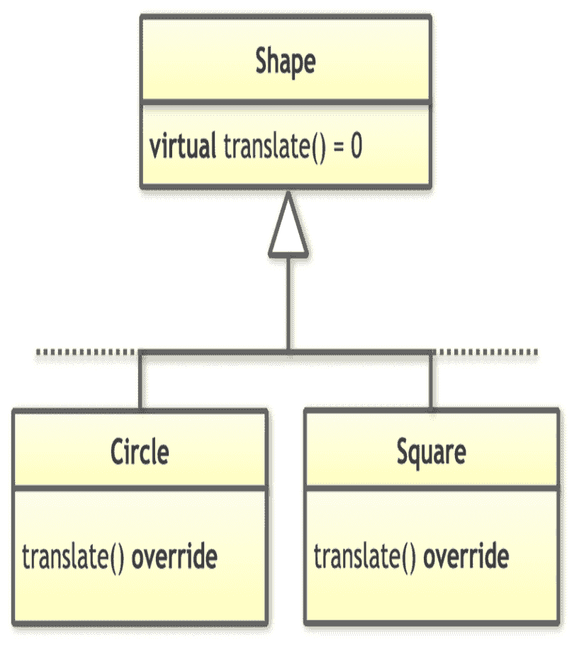
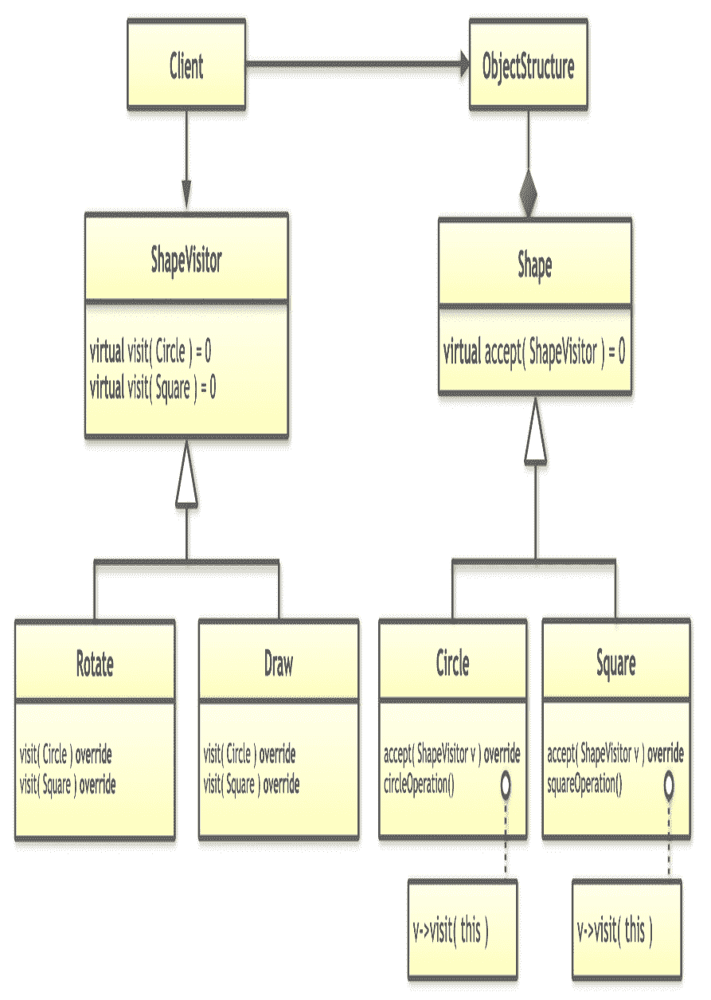
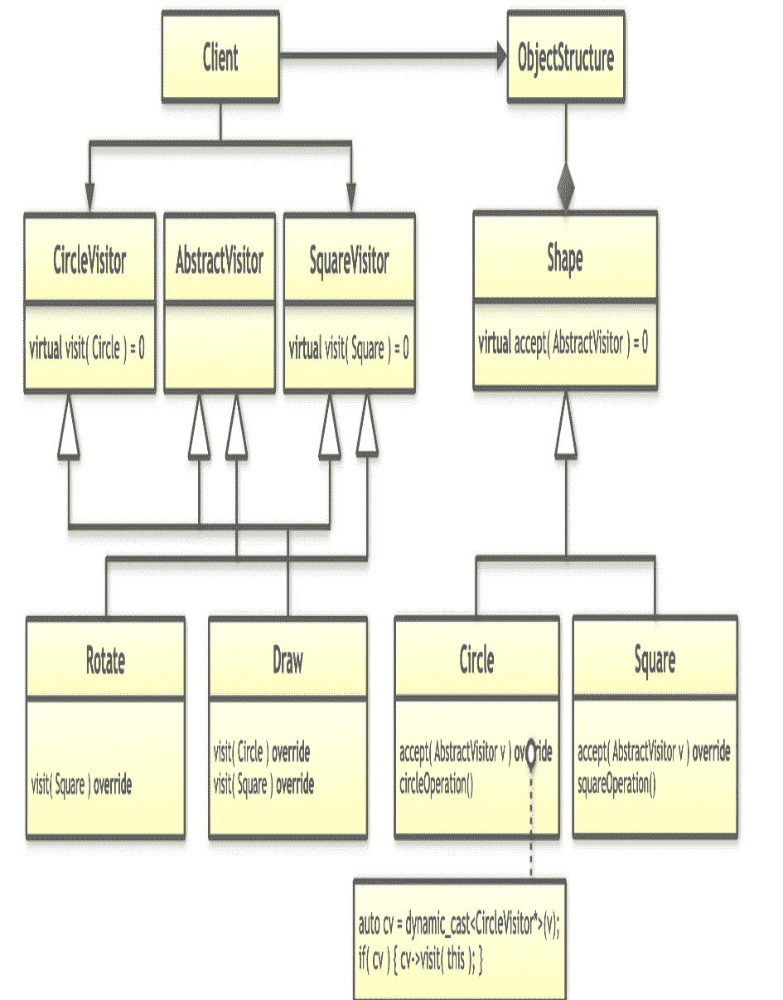

## Chapter 4. The Visitor Design Pattern

### A NOTE FOR EARLY RELEASE READERS

使用 Early Release 电子书，你可以在这些技术正式发布之前很久就获得书籍的早期形式——作者在写作时的原始和未编辑内容。

这将是最终书籍的第 4 章。请注意 GitHub 仓库将在稍后激活。

如果你对如何改进本书的内容和/或示例有任何评论，或者如果你注意到本章中缺少材料，请联系编辑 sevans@oreilly.com。

本章的全部内容都集中在 *Visitor* 设计模式上。如果你已经听说过 *Visitor* 设计模式甚至在自己的设计中使用过它，你可能会想知道为什么我选择 *Visitor* 作为第一个详细解释的设计模式。是的，*Visitor* 绝对不是最光鲜的设计模式。然而，它将成为一个很好的例子来展示你在实现设计模式时拥有的许多选择，以及这些实现可以有多么不同。它也将成为宣传现代 C++ 优势的有效例子。

在“Guideline 15: Design for the Addition of Types or Operations”中，我们首先必须讨论你在动态多态的领域中行走时需要做出的基本设计决策：专注于类型或操作。在该准则中，我们还将讨论编程范式的内在优势和弱点。


在“准则 16：使用访问者扩展操作”中，我将向你介绍 *Visitor* 设计模式。我将解释其意图是扩展操作而非类型，并展示经典 *Visitor* 模式的优点和不足。

在“准则 17：考虑使用 std::variant 实现访问者”中，你将结识 *Visitor* 设计模式的现代实现。我将向你介绍 `std::variant` 并解释该特定实现的诸多优点。

在“准则 18：注意非循环访问者的性能”中，我将向你介绍 *Acyclic Visitor*。乍一看，这种方法似乎解决了 *Visitor* 模式的一些根本问题，但在仔细检查后，我们会发现运行时开销可能会使该实现不合格。

### 准则 15：为类型的添加或操作的添加而设计

对你来说，术语 *Dynamic Polymorphism* 可能听起来像是大量的自由。它可能听起来像你还是孩子时的感觉：无限的可能性，没有限制！好吧，自那以后你已经长大并面对了现实：你不可能拥有一切，总是有选择要做。不幸的是，*Dynamic Polymorphism* 也是如此。尽管它听起来像是完全的自由，但存在一个限制性的选择：你是要扩展类型还是操作？

为了说明我的意思，让我们回到第 3 章的场景：我们想要绘制给定的形状。¹ 我们坚持使用动态多态，并为我们的初始尝试使用老式的过程式编程来实现这个问题。

#### 一个过程式解决方案

第一个头文件 `Point.h` 提供了相当简单的 `Point` 类。这主要用于使代码完整，但也给了我们一个想法，即我们正在处理 2D 形状：

```
//---- <Point.h> ---------------------

struct Point
{
    double x;
    double y;
};
```

第二个概念头文件 Shape.h 证明更有趣：

```
//---- <Shape.h> ---------------------

enum ShapeType ①
{
    circle,
    square
};

class Shape ②
{
protected:
    explicit Shape( ShapeType type )
        : type_( type ) ⑤
    {}

public:
    virtual ~Shape() = default; ③

    ShapeType getType() const { return type_; } ⑥

private:
    ShapeType type_; ④
};
```

首先，我们引入枚举 ShapeType，目前列出了两个枚举值 circle 和 square（①）。显然，我们最初只处理圆和正方形。其次，我们引入类 Shape（②）。鉴于受保护的构造函数和虚析构函数（③），你可以预见 Shape 应该作为基类工作。但这并不是 Shape 的令人惊讶之处：Shape 有一个类型为 ShapeType 的数据成员 ④。该数据成员通过构造函数初始化 ⑤，并且可以通过 getType() 成员函数查询 ⑥。显然一个 Shape 以 ShapeType 枚举的形式存储其类型。

使用 Shape 基类的一个例子是 Circle 类：

```
//---- <Circle.h> ----------------

#include <Point.h>
#include <Shape.h>

class Circle : public Shape ⑦
{
public:
    explicit Circle( double radius )
        : Shape( circle ) ⑧
        , radius_( radius )
    {
        /* Checking that the given radius is valid */
    }

    double radius() const { return radius_; }
    Point center() const { return center_; }

private:
    double radius_;
    Point center_{};
};
```

Circle 公共继承自 Shape ⑦，因此出于这个原因，并且由于 Shape 缺少默认构造函数，需要初始化基类 ⑧。由于它是一个圆，它使用 circle 枚举值作为基类构造函数的参数。

如前所述，我们想要绘制形状。因此我们为圆引入 draw() 函数。由于我们不想过于紧密地耦合到绘制的任何实现细节，draw() 函数在概念头文件 DrawCircle.h 中声明，并在相应的源文件中定义：

```
//---- <DrawCircle.h> ----------------
class Circle;
void draw( Circle const& );

//---- <DrawCircle.cpp> ----------------
#include <DrawCircle.h>
#include <Circle.h>
#include /* some graphics library */
void draw( Circle const& c )
{
    // ... Implementing the logic for drawing a circle
}
```

当然不仅仅只有圆。如 square 枚举值所示，还有一个 Square 类：

```
//---- <Square.h> ----------------
#include <Point.h>
#include <Shape.h>
class Square : public Shape ⑨
{
public:
    explicit Square( double side )
        : Shape( square ) ⑩
        , side_( side )
    {
        /* Checking that the given side length is valid */
    }
    double side () const { return side_; }
    Point center() const { return center_; }
private:
    double side_;
    Point center_{};  // Or any corner, if you prefer
};
```

```
//---- <DrawSquare.h> -------------------

class Square;

void draw( Square const& );

//---- <DrawSquare.cpp> -------------------

#include <DrawSquare.h>
#include <Square.h>
#include /* some graphics library */

void draw( Square const& s )
{
    // ... Implementing the logic for drawing a square
}
```

Square 类看起来与 Circle 类非常相似（9）。主要区别在于 Square 通过 square 枚举值初始化其基类（10）。

有了圆和正方形，我们现在想要绘制一个不同形状的整个向量。为此我们引入 drawAllShapes() 函数：

```
//---- <DrawAllShapes.h> -------------------

#include <memory>
#include <vector>
class Shape;

void drawAllShapes( std::vector<std::unique_ptr<Shape>> const&
shapes );  11
```

```
//---- <DrawAllShapes.cpp> -------------------

#include <DrawAllShapes.h>
#include <Circle.h>
#include <Square.h>

void drawAllShapes( std::vector<std::unique_ptr<Shape>> const&
shapes )
{
    for( auto const& shape : shapes )
    {
        switch( shape->getType() )
        {
            case circle:
                draw( static_cast<Circle const&>( *shape ) );
                break;
            case square:
                draw( static_cast<Square const&>( *shape ) );
                break;
        }
    }
}
```

drawAllShapes() 接受一个以 std::unique_ptr<Shape> 形式表示的形状向量（1）。指向基类的指针对于保存不同种类的具体形状是必要的，而 std::unique_ptr 特别用于通过 RAII 惯用法自动管理形状。在函数内部，我们开始遍历向量以绘制每个形状。不幸的是，在这一点上我们拥有的只是 Shape 指针。因此我们必须通过 getType() 函数有礼貌地询问每个形状（2）：你是什么种类的形状？如果形状回复 circle，我们知道我们必须将其作为 Circle 绘制并执行相应的 static_cast。如果形状回复 square，我们将其作为 Square 绘制。

我能感觉到你对这个解决方案并不特别满意。但在谈论不足之处之前，让我们考虑一下 main() 函数：

```
//---- <Main.cpp> ----------------

#include <Circle.h>
#include <Square.h>
#include <DrawAllShapes.h>
#include <memory>
#include <vector>

int main()
{
    using Shapes = std::vector<std::unique_ptr<Shape>>;

    // Creating some shapes
    Shapes shapes;
    shapes.emplace_back( std::make_unique<Circle>( 2.3 ) );
    shapes.emplace_back( std::make_unique<Square>( 1.2 ) );
    shapes.emplace_back( std::make_unique<Circle>( 4.1 ) );

    // Drawing all shapes
    drawAllShapes( shapes );

    return EXIT_SUCCESS;
}
```

它有效！使用这个 main() 函数，代码可以编译并绘制三个形状（两个圆和一个正方形）。这不是很棒吗？是的，但它不会阻止你大发牢骚：多么原始的解决方案！不仅 switch 是区分不同种类形状的糟糕选择，它甚至没有默认情况！谁会有这种疯狂的想法用无作用域枚举来编码形状的类型？² 你正怀疑地看着我的方向……

好吧，我能理解你的反应。但让我们更详细地分析一下问题。让我猜猜：你记得“准则 5：为扩展而设计”。现在你想象要添加第三种形状你需要做什么。首先，你必须扩展枚举。例如，我们必须添加新的枚举值 triangle(⑥)：

```
enum ShapeType
{
    circle,
    square,
    triangle ⑮
};
```

请注意，这一添加不仅会对 drawAllShapes() 函数中的 switch 语句产生影响（它现在是真正不完整的），而且会对派生自 Shape 的所有类（即 Circle 和 Square）产生影响。这些类依赖于枚举，因为它们依赖于 Shape 基类并且也直接使用枚举。因此


changing the enumeration would result in a recompilation of all your source files.

That should strike you as a serious issue. And it is indeed. The heart of the problem is the direct dependency of all shape classes and functions on the enumeration. Any change to the enumeration results in a rippling effect and that requires the dependent files to be recompiled. Obviously, this directly violates the Open-Closed Principle (see “Guideline 5: Design for Extension”). This does not seem right: adding a Triangle should not result in a recompilation of the Circle and Square classes.

There is more, though. In addition to actually writing a Triangle class (something that I leave to your imagination), you have to update the switch statement to handle triangles as well (⚠):

```
void drawAllShapes( std::vector<std::unique_ptr<Shape>> const&
shapes )
{
    for( auto const& shape : shapes )
    {
        switch( shape->getType() )
        {
            case circle:
                draw( static_cast<Circle const&>( *shape ) );
                break;
            case square:
                draw( static_cast<Square const&>( *shape ) );
                break;
            case triangle:  ⚠
                draw( static_cast<Triangle const&>( *shape ) );
                break;
        }
    }
}
```

I can imagine your outcry: copy-and-paste! Duplication! Yes, in this situation it is very likely that a developer will use copy-and-paste to implement the new logic. It is just so convenient since the new case is so similar to the previous two cases. And indeed, this is an indication that the design could be improved. However, I see a far more serious flaw: I would

assume, that in a larger code base, this is not the only switch statement. On the contrary, there will be others, that need to be updated as well. How many are there? A dozen? Fifty? Over a hundred? And how do you find all of these? Ok, so you argue that the compiler would help you with this task. Perhaps with the switches, yes, but what if there are also if-else-if cascades? And then, after this update marathon, when you think you are done, how do you guarantee that you have truly updated all necessary sections? ...

Yes, I can understand your reaction and why you prefer not to have this kind of code: this explicit handling of types is a maintenance nightmare. To quote Scott Meyers:³

> This kind of type-based programming has a long history in C, and one of the things we know about it is that it yields programs that are essentially unmaintainable.

—Scott Meyers

### An Object-Oriented Solution

So let me ask: what would you have done? How would you have implemented the drawing of shapes? Well, I can imagine you would have used an object-oriented approach. That means you would scratch the enumeration and add a pure virtual draw() function to the Shape base class. This way, Shape does not have to remember its type anymore:

```
//---- <Shape.h> ----------------

class Shape
{
public:
    Shape() = default;

    virtual ~Shape() = default;

    virtual void draw() const = 0;
};
```

Given this base class, derived classes now would only have to implement the draw() member function (®):

```
//---- <Circle.h> ----------------

#include <Point.h>
#include <Shape.h>

class Circle : public Shape
{
public:
    explicit Circle( double radius )
        : radius_( radius )
    {
        /* Checking that the given radius is valid */
    }

    double radius() const { return radius_; }
    Point center() const { return center_; }

    void draw() const override;  ®

private:
    double radius_;
    Point center_{};
};

//---- <Circle.cpp> ----------------

#include <Circle.h>
#include /* some graphics library */

void Circle::draw() const
{
    // ... Implementing the logic for drawing a circle
}

//---- <Square.h> ----------------

#include <Point.h>
#include <Shape.h>

class Square : public Shape
```

```
{ public:
    explicit Square( double side )
        : side_( side )
    {
        /* Checking that the given side length is valid */
    }

    double side () const { return side_; }
    Point center() const { return center_; }

    void draw() const override;

private:
    double side_;
    Point center_{};
};
```

```
//---- <Square.cpp> ----------------

#include <Square.h>
#include /* some graphics library */

void Square::draw() const
{
    // ... Implementing the logic for drawing a square
}
```

Once the virtual draw() function is in place and implemented by all derived classes, it can be used to refactor the drawAllShapes() function.

```
//---- <DrawAllShapes.h> ----------------

#include <memory>
#include <vector>
class Shape;

void drawAllShapes( std::vector< std::unique_ptr<Shape> > const&
shapes );
```

```
//---- <DrawAllShapes.cpp> ----------------
```

```
#include <DrawAllShapes.h>
#include <Shape.h>

void drawAllShapes( std::vector< std::unique_ptr<Shape> > const&
shapes )
{
    for( auto const& shape : shapes )
    {
        shape->draw();
    }
}
```

I can see you relax and start smiling again. This is so much nicer, so much cleaner. While I understand that you prefer this solution and that you would like to stay in this comfort zone a little while longer, I unfortunately have to point out a flaw. Yes, this solution might also come with a disadvantage.

As indicated in the introduction to this section, with an object-oriented approach we are now able to add new types very easily. All we have to do is to write a new derived class. We do not have to modify or recompile any existing code (with the exception of the main() function). That perfectly fulfills the Open-Closed Principle (OCP). However, did you notice that we are not able to easily add operations anymore? For instance, let us assume that I am in need of a serialize() function to convert a Shape into bytes. How can I add this without modifying existing code? How can anyone easily add this operation without having to touch the Shape base class?

Unfortunately that is not possible anymore. We are now dealing with a closed set of operations, which means that we violate the OCP in relation to addition operations. In order to add a virtual function, the base class needs to be modified and all derived classes (i.e. circles, squares, etc.) need to implement the new function, even though the function might never be called. In summary, the object-oriented solution fulfills the OCP with respect to adding types, but violates it in relation to operations.

Although I know that you thought we have left the procedural solution behind for good, let us take a second look. In the procedural approach, adding a new operation was actually very simple. New operations could be

added in the form of free functions or separate classes for instance. It was not necessary to modify the `Shape` base class or any of the derived classes. Thus in the procedural solution, we have fulfilled the *OCP* with respect to adding operations. But as we have seen, the procedural solution violates the *OCP* in relation to adding types. Thus it appears to be an inversion of the object-oriented solution, which is the other way round.

### Be Aware of the Design Choice in Dynamic Polymorphism

The take-away of this example is that there is a design choice when using dynamic polymorphism: either you can add types easily by fixing the number of operations, or you can add operations easily by fixing the number of types. Thus the *OCP* has two dimensions: when designing software, you have to make a conscious decision about which kind of extension you expect.

The strength of object-oriented programming is the easy addition of new types, but its weakness is that the addition of operations becomes much more difficult. The strength of procedural programming is the easy addition of operations, but adding types is a real pain. It depends on your project: in case you expect new types will be added frequently, rather than operations, you should strive for an OOP solution, which treats operations as a *closed set* and types as an *open set*. In case you expect operations will be added, you should strive for a procedural solution, which treats types as a *closed set* and operations as an *open set*. If you make the right choice, you will economize your time and the time of your colleagues and extensions will feel naturally and easy.⁴


### 表 4-1. 不同编程范式的优缺点

| 编程范式 | 优势 | 劣势 |
|---|---|---|
| 程序式编程 | 添加操作 | 添加（多态）类型 |
| 面向对象编程 | 添加（多态）类型 | 添加操作 |

请注意这些优势：基于对代码库演进的预期，选择合适的设计方法以便于扩展。不要忽视劣势，也不要让自己陷入不幸的维护地狱。

我假设到目前为止，你在想是否可能拥有两个*开放集合*。据我所知，这并非不可能，但通常不切实际。例如，在“准则 18：谨防访问者模式的性能”中，我将向你展示性能可能会显著下降。

由于你可能喜欢基于模板的编程和类似的编译时努力，我还应明确指出，静态多态并不具有相同的限制。虽然在动态多态中，设计轴之一（类型和操作）需要固定，但在静态多态中，这两方面的信息在编译时都可用。因此，如果你做得正确，两方面都可以轻松扩展。⁵

### 准则 15：为类型的添加或操作的添加而设计

- 了解不同编程范式的优缺点；
- 利用范式的优势，但避免其劣势；
- 理解动态多态中添加类型或操作之间的选择；
- 当你主要想要添加类型时，优先采用面向对象的解决方案；
- 当你主要想要添加操作时，优先采用程序式/函数式解决方案。

### 准则 16：使用访问者以扩展操作

在上一节你看到了面向对象编程（OOP）的优势是添加类型，而其劣势是添加操作。但当然 OOP 对此劣势有一个答案：*Visitor* 设计模式。

*Visitor* 设计模式是由四人帮（GoF）描述的经典设计模式之一。其重点在于让你能够频繁地添加操作而不是类型。让我通过之前的玩具示例——绘制形状——来解释 *Visitor* 设计模式。

在图 4-1 中你可以看到 `Shape` 层次结构。`Shape` 类再次是若干具体形状的基类。在此示例中，只有两个类 `Circle` 和 `Square`，但当然可以有更多形状。此外，你可以想象 `Triangle`、`Rectangle` 或 `Ellipse` 类。



图 4-1. 形状层次结构的 UML 表示，包含两个派生类（Circle 和 Square）。

#### 分析设计问题

假设你确定已经拥有了你所需要的所有形状。那就是说，你认为形状的集合是一个封闭集合。你所缺少的，是额外的操作。例如，你

缺少一个旋转形状的操作。此外，你希望序列化形状，即将形状的实例转换为字节。当然你也想绘制形状。此外你希望任何人都能添加新操作。因此你期望操作集合是开放的。⁶

每新增一个操作，现在就需要你在基类中插入一个新的虚函数。不幸的是，这在不同方面都可能很麻烦。最明显的是，并非每个人都能向 Shape 基类添加虚函数。例如，我就不能简单地去更改你的代码。因此这种方法无法满足“每个人都能添加操作”的期望。虽然你可能已经将其视为最终的负面结论，但让我们仍然更详细地分析虚函数的问题。

如果你决定使用纯虚函数，你就必须在每个派生类中实现该函数。对于你自己的派生类型，你可以将其视为只是多一点额外工作。但你也可能给其他从 Shape 基类继承创建了形状的人造成额外工作。⁷ 而这正是可以预期的，因为这是 OOP 的优势：任何人都可以轻松添加新类型。由于这是可以预期的，这可能是一个不使用纯虚函数的原因。

作为替代方案，你可以引入一个普通的虚函数，即带默认实现的虚函数。虽然 rotate() 函数的默认行为听起来像是一个非常合理的想法，但 serialize() 函数的默认实现听起来就完全不那么容易了。我承认我自己也需要仔细思考如何实现这样的函数。你现在可能会建议默认情况下抛出异常。然而，这本质上意味着派生类必须再次实现缺失的行为，它只不过是伪装的纯虚函数。或者是对里氏替换原则（LSP）的明显违反（参见“准则 6：遵守抽象的预期行为”）。

无论如何，向 Shape 基类添加新操作都是困难的，甚至根本不可能。根本原因是添加虚函数违反了开放封闭原则（OCP）。如果你真的需要频繁添加新操作，那么你应该设计成使操作的扩展变得容易。而这正是 *Visitor* 设计模式试图实现的目标。

#### Visitor 设计模式详解

> **THE *VISITOR* DESIGN PATTERN**
> 
> Intent: “Represent an operation to be performed on the elements of an object structure. *Visitor* lets you define a new operation without changing the classes of the elements on which it operates.” (GoF)

除了 `Shape` 层次结构，我们现在在图 4-2 左侧引入了 `ShapeVisitor` 层次结构。`ShapeVisitor` 基类代表了形状操作的抽象。因此，你可以认为 `ShapeOperation` 可能是该类的更好名称。然而，应用“准则 14：使用设计模式的名称来传达意图”是有益的。*Visitor* 这个名称将帮助他人理解设计。



图 4-2. Visitor 设计模式的 UML 表示。

ShapeVisitor 基类为 Shape 层次结构中的每个具体形状提供一个纯虚 visit() 函数：

```
class ShapeVisitor
{
public:
virtual ~ShapeVisitor() = default;

virtual void visit( Circle const&, /*...*/ ) const = 0; ①
virtual void visit( Square const&, /*...*/ ) const = 0; ②
// Possibly more visit() functions, one for each concrete shape
};
```

在此示例中，有一个 visit() 函数用于 Circle（①）和一个用于 Square（②）。当然可能有更多 visit() 函数，例如一个用于 Triangle，一个用于 Rectangle，一个用于 Ellipse，前提是这些也是从 Shape 基类派生的类。

有了 ShapeVisitor 基类，你现在可以轻松添加新操作。你要做的只是添加一个新派生类。例如，为了启用旋转形状，你可以引入 Rotate 类并实现所有 visit() 函数。为了启用绘制形状，你所要做的就是引入一个 Draw 类：

```
class Draw : public ShapeVisitor
{
public:
void visit( Circle const& c, /*...*/ ) const override;
void visit( Square const& s, /*...*/ ) const override;
// Possibly more visit() functions, one for each concrete shape
};
```

你还可以考虑为每个需要支持的图形库引入多个 Draw 类。你可以轻松做到这一点，因为你

不需要修改任何*现有代码*。只需通过添加*新代码*来扩展 `ShapeVisitor` 层次结构即可。因此该设计在添加操作方面满足了 *OCP*。

为了完全理解 *Visitor* 的软件设计特性，重要的是要理解为什么 *Visitor* 设计模式能够满足 *OCP*。最初的问题是，每个新操作都需要对 `Shape` 基类进行更改。*Visitor* 将操作的添加识别为*变化点*。通过提取这个*变化点*，即将其作为单独的类，你遵循了*单一职责原则*（*SRP*）：`Shape` 不必为每个新操作而更改。这避免了对 `Shape` 层次结构的频繁修改，并使新操作的轻松添加成为可能。*SRP* 因此成为 *OCP* 的使能者。

为了能够在形状上使用访问者（即从 `ShapeVisitor` 基类派生的类），你现在必须向 `Shape` 层次结构添加最后一个函数：`accept()` 函数（③）：⁸

```
class Shape
{
  public:
    virtual ~Shape() = default;
    virtual void accept( ShapeVisitor const& v ) = 0;  ③
    // ...
};
```

`accept()` 函数作为纯虚函数引入到基类中，因此必须在每个派生类中实现（④ 和 ⑤）：

```
class Circle : public Shape
{
  public:
    explicit Circle( double radius )
      : radius_( radius )
    {
      /* Checking that the given radius is valid */
    }
```


```cpp
void accept( ShapeVisitor const& v ) override { v.visit( *this ); } ④

double radius() const { return radius_; }

private:
    double radius_;
};
```

```cpp
class Square : public Shape
{
public:
    explicit Square( double side )
        : side_( side )
    {
        /* Checking that the given side length is valid */
    }

    void accept( ShapeVisitor const& v ) override { v.visit( *this ); } ⑤

    double side() const { return side_; }

private:
    double side_;
};
```

`accept()` 的实现很简单：它只需要根据具体 `Shape` 的类型在给定的 visitor 上调用相应的 `visit()` 函数即可。这是通过将 `this` 指针作为参数传递给 `visit()` 实现的。因此 `accept()` 的实现在每个派生类中都相同，但由于 `this` 指针的类型不同，会触发给定 visitor 中 `visit()` 函数的不同重载。因此 `Shape` 基类无法提供默认实现。

现在可以在需要执行操作的地方使用这个 `accept()` 函数。例如，`drawAllShapes()` 函数使用 `accept()` 来绘制给定形状向量中的所有形状。

```cpp
void drawAllShapes( std::vector<std::unique_ptr<Shape>> const&
shapes )
{
    for( auto const& shape : shapes )
    {
        shape->accept( Draw{} );
    }
}
```

在添加了 `accept()` 函数后，你现在可以轻松地为 `Shape` 层次结构扩展操作。你现在已经为一组开放的操作进行了设计。太棒了！然而，并没有银弹，也没有总是适用的设计。每个设计都有优点，但也有缺点。所以在你开始庆祝之前，我应该告诉你访问者设计模式的不足之处，以便给你完整的图景。

### 分析访问者设计模式的不足之处

访问者设计模式不幸地远非完美。考虑到访问者是对面向对象固有弱点的变通，而非建立在面向对象优势之上，这应该是意料之中的。第一个缺点是实现灵活性低。如果考虑 `Translate` visitor 的实现就会很明显。`Translate` visitor 需要通过给定的偏移量移动每个形状的中心点。为此，`Translate` 需要为每个具体 `Shape` 实现一个 `visit()` 函数。尤其是对于 `Translate`，你可以想象这些 `visit()` 函数的实现会非常相似，如果不是完全相同的话：将 `Circle` 平移与将 `Square` 平移并没有什么不同。尽管如此，你仍然需要编写所有 `visit()` 函数。当然，你会根据 DRY 原则将这两个 `visit()` 函数中的逻辑提取出来并实现在第三个独立函数中以最小化重复。⁹ 但不幸的是，基类施加的严格要求并没有给你将这些 `visit()` 函数实现为一个的自由。结果是产生了一些样板代码：

```cpp
class Translate : public ShapeVisitor
{
public:
    // 在平移圆和平移正方形之间有什么区别？尽管如此你仍必须实现所有虚函数...
    void visit( Circle const& c, /*...*/ ) const override;
    void visit( Square const& s, /*...*/ ) const override;
    // 可能还有更多 visit() 函数，每个具体形状一个
};
```

类似的实现不灵活性是 `visit()` 函数的返回类型。函数返回什么的决定是在 `ShapeVisitor` 基类中做出的。派生类无法更改它。通常的做法是将结果存储在 visitor 中并稍后访问它。

第二个缺点是，在使用了访问者设计模式后，添加新类型变得困难。之前我们假设你确定已经拥有了所有需要的形状。现在这个假设变成了限制。在 `Shape` 层次结构中添加新形状将要求整个 `ShapeVisitor` 层次结构进行更新：你需要在 `ShapeVisitor` 基类中添加一个新的纯虚函数，并且这个虚函数必须由所有派生类实现。当然这会带来我们之前讨论过的所有缺点。特别是，你会强制其他开发者更新他们的操作。¹⁰ 因此访问者设计模式要求类型集合是封闭的，而作为交换提供操作集合是开放的。

这种限制的根本原因是 `ShapeVisitor` 基类、具体形状（即 `Circle`、`Square` 等）和 `Shape` 基类之间存在循环依赖（见图 4-3）。`ShapeVisitor` 基类依赖于具体形状，因为它为这些形状中的每一个提供一个 `visit()` 函数。具体形状依赖于 `Shape` 基类，因为它们必须满足基类的所有期望和要求。而 `Shape` 基类由于 `accept()` 函数而依赖于 `ShapeVisitor` 基类。由于这种循环依赖，我们现在能够轻松添加新操作（在架构的较低层级，因为依赖倒置），但我们不能再轻松添加类型（因为那必须在架构的高层级进行）。因此我们称经典的 *Visitor* 设计模式为 *Cyclic Visitor*。

```cpp
class Shape
{
public:
    Shape() = default;
    virtual ~Shape() = default;
    virtual void accept( ShapeVisitor& ) = 0;
    // ...
};
```

```cpp
class Square : public Shape
{
public:
    Square( double side );
    // ...
};
```

高层

```cpp
class Circle : public Shape
{
public:
    Circle( double rad );
    // ...
};
```

```cpp
class ShapeVisitor
{
public:
    virtual ~ShapeVisitor() {}
    virtual void visit( const Circle& circle ) const = 0;
    virtual void visit( const Square& square ) const = 0;
};
```

架构边界

依赖倒置

```cpp
class Draw : public ShapeVisitor
{
public:
    void visit( const Circle& circle ) const override;
    void visit( const Square& square ) const override;
};
```

低层

图 4-3. 访问者设计模式的依赖图。

第三个缺点是 visitor 的侵入性。为了向现有层次结构添加 visitor，你需要在该层次结构的基类中添加虚 `accept()`。虽然这通常是可能的，但它仍然存在向现有层次结构添加纯虚函数的通常问题（见“准则 15：为类型的添加或操作的添加而设计”）。如果无法添加 `accept()` 函数，则这种形式的 Visitor 就不是一个选项。如果是这种情况，不用担心：在“准则 17：考虑使用 std::variant 实现 Visitor”中，我们将看到访问者设计模式的另一种非侵入式形式。

第四个、尽管承认更晦涩的缺点是，`accept()` 函数会被派生类继承。如果有人后来添加了另一层派生类（而这个人可能是你），并且忘记重写 `accept()` 函数，visitor 将会被应用于错误的类型。而且不幸的是你不会得到任何警告。这只是添加新类型变得更加困难的又一个证据。一种可能的解决方案是将 `Circle` 和 `Square` 类声明为 `final`，这将限制未来的扩展。

“哇，这些缺点很多。还有更多吗？” 是的，不幸的是还有两个更多。第五个缺点很明显，当我们考虑对于每个操作，我们现在需要调用两个虚函数时。最初，我们不知道操作的类型或形状的类型。第一个虚函数是 `accept()` 函数，它传递一个抽象的 `ShapeVisitor`。`accept()` 函数现在解析形状的具体类型。第二个虚函数是 `visit()` 函数，它传递一个具体的 `Shape` 类型。`visit()` 函数现在解析操作的具体类型。这种所谓的双重分派不幸地不是免费的。相反，从性能角度来看，你应该将访问者设计模式视为相当缓慢的。我将在下一节提供一些性能数据。

在谈论性能时，我还应该提到另外两个对性能有负面影响的方面。首先，我们通常为每


single shape and visitor individually. Consider the following main() function:

```
int main()
{
    using Shapes = std::vector< std::unique_ptr<Shape> >;

    Shapes shapes;

    shapes.emplace_back( std::make_unique<Circle>( 2.3 ) ); ⑥
    shapes.emplace_back( std::make_unique<Square>( 1.2 ) ); ⑦
    shapes.emplace_back( std::make_unique<Circle>( 4.1 ) ); ⑧

    drawAllShapes( shapes );

    // ...

    return EXIT_SUCCESS;
}
```

在该 main() 函数中，所有分配都通过 std::make_unique() 进行（⑥、⑦ 和 ⑧）。这些众多的小分配本身就会消耗运行时间，长期来看还会导致内存碎片。¹¹ 此外，内存可能以不利的、缓存不友好的方式布局。作为分配的后果，我们通常使用指针来处理由此产生的形状和访问者。由此产生的间接引用使得编译器更难执行任何优化，并在性能基准测试中体现出来。然而，坦白说，这并不是 Visitor 特有的问题，而是 OOP 总体上相当常见的两个方面。

访问者设计模式的最后一个缺点是，经验证明这种设计模式相当难以完全理解且难以维护。这是一个相当主观的缺点，但两个层次之间错综复杂的相互作用往往感觉更像是一种负担，而非真正的解决方案。

总而言之，访问者设计模式是 OOP 的解决方案，允许轻松扩展操作而不是类型。这是通过

引入 `ShapeVisitor` 基类的形式抽象来实现的，它使你能够在另一组类型上添加操作。虽然这是 *Visitor* 的独特优势，但不幸的是它伴随着若干缺陷：由于与基类要求的强耦合，导致两个继承层次中的实现灵活性不足、性能相当糟糕，以及 *Visitor* 的固有复杂性，使其成为一种相当不受欢迎的设计模式。

如果你现在对是否使用经典的 *Visitor* 感到犹豫，请花时间阅读下一节。在那里我将向你展示另一种实现 *Visitor* 的方法，一种更可能令你满意的解决方案。

### GUIDELINE 16: USE *VISITORS* TO EXTEND OPERATIONS

- 请记住，在现有继承层次中添加新操作是困难的；
- 采用 *Visitor* 设计模式，其目的是实现操作的易于添加；
- 了解 *Visitor* 设计模式的不足之处。

### Guideline 17: Consider std::variant for Implementing Visitors

在“Guideline 16: Use Visitors to Extend Operations”中，我向你介绍了 *Visitor* 设计模式。我可以想象你并没有立刻爱上它：虽然 *Visitor* 确实具有一些独特属性，但它也是一个相当复杂的设计模式，具有较强的内部耦合和性能缺陷。 不，绝对谈不上爱！不过别担心，经典形式并不是你实现 *Visitor* 设计模式的唯一方式。在本节中，我想向你介绍另一种实现 Visitor 的方法。我确信这种方法会更合你心意。

#### Introduction to std::variant

在本章开头，我们谈到了不同范式（OOP 与过程式编程）的优缺点。特别是，我们谈到过程式编程在为现有类型集添加新操作方面特别出色。那么，与其在 OOP 中寻找变通方法，不如利用过程式编程的优势？ 不用担心，当然我并不是建议回到我们最初的解决方案。那种方法太容易出错了。相反，我说的是 std::variant：

```
#include <cstdlib>
#include <iostream>
#include <string>
#include <variant>

struct Print ①
{
    void operator()( int value ) const
    { std::cout << "int: " << value << '\n'; }
    void operator()( double value ) const
    { std::cout << "double: " << value << '\n'; }
    void operator()( std::string const& value ) const
    { std::cout << "string: " << value << '\n'; }
};

int main()
{
    // Creates a default variant that contains an 'int'
    // initialized to 0
    std::variant<int,double,std::string> v{};  ①

    v = 42;         // Assigns the 'int' 42 to the variant  ②
    v = 3.14;       // Assigns the 'double' 3.14 to the variant  ③
    v = 2.71F;      // Assigns a 'float', which is promoted to
    'double'  ④
    v = "Bjarne";  // Assigns the string literal 'Bjarne' to the
    variant  ⑤
```

```
v = 43;        // Assigns the 'int' 43 to the variant ⑥

int const i = std::get<int>(v);  // Direct access to the value ⑦

int* const pi = std::get_if<int>(&v);  // Direct access to the value ⑧

std::visit( Print{}, v );  // Applying the Print visitor ⑨

return EXIT_SUCCESS;
}
```

由于你可能还没有体验过 C++17 std::variant 的介绍，请允许我简要介绍一下：variant 表示若干备选中的一个。代码示例中 main() 函数开头的 variant 可以包含 int、double 或 std::string ①。请注意我说的是或：variant 只能包含这三种备选中的一种。它永远不会同时包含多个，并且在通常情况下也不应包含空值。因此我们称 variant 为和类型：可能的状态集合是备选可能状态的和。

默认的 variant 也不是空的。它被初始化为第一个备选的默认值。在示例中，这意味着默认 variant 包含值为 0 的整数。更改 variant 的值很简单：你可以直接赋值。例如，我们可以赋值为 42，这意味着 variant 现在存储值为 42 的整数 ②。如果随后赋值为 double 3.14，则 variant 将存储值为 3.14 的 double ③。如果你想赋值的类型不是可能备选之一，则适用常规转换规则。例如，如果你想赋一个 float，根据常规转换规则它将被提升为 double ④。

为了存储备选，variant 提供了足够容纳最大备选的内部缓冲区。在我们的例子中，最大的备选是 std::string，通常大小为 24 或 32 字节（取决于标准库的实现）。因此

当你赋字符串字面量 "Bjarne" 时，variant 首先清理之前的值（没什么可做的，只是一个 double），然后，由于它是唯一可行的备选，在其内部缓冲区中就地构造一个 std::string ⑤。当你改变主意并赋整数 43 ⑥ 时，variant 会通过其析构函数正确销毁 std::string 并重用内部缓冲区用于整数。奇妙，不是吗？variant 是类型安全的并且始终正确初始化。我们还能要求什么呢？

好吧，当然你想对 variant 内部的值做些什么。如果我们只是存储值，那将毫无用处。不幸的是你不能简单地将 variant 赋给任何其他值，例如 int，来取回你的值。 不，访问值稍微复杂一些。访问存储值有几种方式，最直接的方法是 std::get() ⑦。使用 std::get() 你可以查询特定类型的值。如果 variant 包含该类型的值，它会返回对其的引用。如果不包含，它会抛出 std::bad_variant_exception。这似乎是一个相当粗鲁的回应，鉴于你礼貌地询问过。但我们可能应该庆幸 variant 没有假装持有某个值，而实际上并不持有。至少它是诚实的。还有一种更友好的方式，即 std::get_if() ⑧。与 std::get() 相比，std::get_if() 不返回引用，而是返回指针。因此，如果你请求的类型当前不在 std::variant 中，它不会抛出异常，而是返回一个 nullptr。然而，还有第三种方式，一种对我们目的特别有趣的方式：std::visit ⑨。std::visit 允许你对存储的值执行任何操作。更精确地说：它允许你传递一个自定义访问者，对封闭类型集的存储值执行任何操作。听起来熟悉吗？

我们作为第一个参数传递的 Print 访问者 ⑩ 必须为每种可能的备选提供函数调用运算符（即 operator()）。在本例中，这通过提供三个 operator() 实现：一个用于 int，一个用于 double，一个用于 std::string。 它特别


值得注意的是 Print 不必继承自任何基类，并且它没有任何虚函数。因此，与任何需求之间没有强耦合。如果我们愿意，还可以将 int 和 double 的函数调用运算符合并为一个，因为 int 可以转换为 double：

```
struct Print
{
    void operator() ( double value ) const
    { std::cout << "int or double: " << value << '\n'; }
    void operator() ( std::string const& value ) const
    { std::cout << "string: " << value << '\n'; }
};
```

关于我们应该偏好哪种版本的问题，目前对我们来说并不是特别重要，你会注意到我们拥有大量的实现灵活性。耦合非常松散，仅基于这样一种约定：对于每一种备选方案都需要有一个 operator()，而不管其具体形式如何。我们不再有 Visitor 基类，它迫使我们以非常特定的方式做事。我们也没有备选方案的基类：我们自由地使用 int 和 double 等基本类型，以及 std::string 等任意类类型。或许最重要的是：任何人都可以轻松地添加新的操作。无需修改现有代码。有了这一点，我们可以认为这是一种过程式解决方案，只是比最初基于枚举的方案优雅得多，后者使用基类来保存判别器。

### 将形状的绘制重构为基于值的非侵入式解决方案

凭借这些特性，std::variant 非常适合我们的绘图示例。让我们通过 std::variant 重新实现形状的绘制。首先，我们重构 Circle 和 Square 类：

//---- <Circle.h> ----------------

#include <Point.h>

class Circle
{
public:
    explicit Circle( double radius )
        : radius_( radius )
    {
        /* Checking that the given radius is valid */
    }

    double radius() const { return radius_; }
    Point center() const { return center_; }

private:
    double radius_;
    Point center_{};
};

//---- <Square.h> ----------------

#include <Point.h>

class Square
{
public:
    explicit Square( double side )
        : side_( side )
    {
        /* Checking that the given side length is valid */
    }

    double side () const { return side_; }
    Point center() const { return center_; }

private:
    double side_;
    Point center_{};
};
```

Circle 和 Square 都得到了显著简化：不再有 Shape 基类，也不再需要实现任何虚函数——特别是 accept() 函数。因此这种 Visitor 方法是非侵入式的：这种形式的 Visitor 可以轻松地添加到现有类型中！并且不需要为即将到来的操作准备这些类。我们可以完全专注于将这两个类实现为它们本来的样子：几何原语。

重构中最美妙的部分，然而是 std::variant 的实际使用：

//---- <Shape.h> ----------------

#include <variant.h>
#include <Circle.h>
#include <Square.h>

using Shape = std::variant<Circle,Square>;

//---- <Shapes.h> ----------------

#include <vector>
#include <Shape.h>

using Shapes = std::vector<Shape>;
```

由于我们的封闭类型集合是一组形状，variant 现在将包含 Circle 或 Square。而对代表形状的类型集合的抽象，有什么好名字呢？嗯……Shape。取而代之的是一个从实际形状类型中抽象出来的基类，std::variant 现在承担了这一任务。如果你第一次看到这一点，你可能完全惊呆了。但等等，还有更多：这也意味着我们可以现在抛弃 std::unique_ptr 了。还记得吗：我们使用（智能）指针的唯一原因是为了能够在同一个 vector 中存储不同种类的形状。但现在 std::variant 让我们能够做到同样的事情，我们就可以简单地在一个 vector 中存储 variant 对象。

有了这一功能，我们就能在形状上编写自定义操作。我们仍然对绘制形状感兴趣。为此我们现在实现 Draw visitor：

//---- <Draw.h> ----------------

#include <Shape.h>
#include /* some graphics library */

struct Draw
{
    void operator() ( Circle const& c ) const
    { /* ... Implementing the logic for drawing a circle ... */
    }
    void operator() ( Square const& s ) const
    { /* ... Implementing the logic for drawing a square ... */
    }
};
```

再次，我们遵循为每一种备选方案实现一个 operator() 的期望：一个用于 Circle，一个用于 Square。但这次，我们有选择。没有必要实现任何基类，因此也没有必要重写任何虚函数。因此没有必要为每一种备选方案实现恰好一个 operator()。虽然在这个例子中拥有两个函数感觉合理，但我们有选项将两个 operator() 合并为一个函数。我们对操作的返回类型也有选择。我们可以本地决定应该返回什么，而不会有一个基类独立于特定操作做出全局决策。实现灵活性。松耦合。令人惊叹！

最后一块拼图是 drawAllShapes() 函数：

//---- <DrawAllShapes.h> ----------------

#include <Shapes.h>

void drawAllShapes( Shapes const& shapes );

//---- <DrawAllShapes.cpp> ----------------

#include <DrawAllShapes.h>

void drawAllShapes( Shapes const& shapes )
{
```
for( auto const& shape : shapes )
{
    std::visit( Draw{}, shape );
}
}
```

drawAllShapes() 函数被重构以使用 std::visit()。在这个函数中，我们现在将 Draw visitor 应用于存储在 vector 中的所有 variant。

std::visit() 的工作是为你执行必要的类型分发。如果给定的 std::variant 包含一个 Circle，它会调用 Draw::operator() 用于圆。否则它会调用 Draw::operator() 用于正方形。如果你愿意，你可以通过 std::get_if() 手动实现相同的分发：

```
void drawAllShapes( Shapes const& shapes )
{
    for( auto const& shape : shapes )
    {
        if( Circle* circle = std::get_if<Circle>(&shape) ) {
            // ... Drawing a circle
        }
        else if( Square* square = std::get_if<Square>(&shape) ) {
            // ... Drawing a square
        }
    }
}
```

我知道你在想什么：“胡说！我为什么要那样做？那样会造成和基于枚举的解决方案一样的维护噩梦。”我完全同意你的观点：从软件设计角度来看，这将是一个糟糕的主意。尽管如此，我必须承认在本书的语境下很难承认，有时可能有一个很好的理由去那样做：性能。我知道，现在我引起了你的兴趣，但既然我们也快要谈论性能了，允许我将这个讨论推迟几段。我会回来谈的，我保证！

在所有这些细节就位后，我们终于可以重构 main() 函数了。但工作量并不大：我们不再通过 std::make_unique() 创建圆和正方形，而是直接创建圆和正方形并将它们添加到 vector 中。这得益于 variant 的非显式构造函数，它允许对任一备选方案进行隐式转换：

//---- <Main.cpp> ----------------

#include <Circle.h>
#include <Square.h>
#include <Shapes.h>
#include <DrawAllShapes.h>

int main()
{
    Shapes shapes;

    shapes.emplace_back( Circle{ 2.3 } );
    shapes.emplace_back( Square{ 1.2 } );
    shapes.emplace_back( Circle{ 4.1 } );

    drawAllShapes( shapes );

    return EXIT_SUCCESS;
}
```

这种基于值的解决方案的最终结果令人惊叹：没有任何基类。没有虚函数。没有指针。没有手动内存分配。事情尽可能地直接，并且几乎没有样板代码。此外，尽管代码看起来与之前的解决方案非常不同，但架构属性是相同的：每个人都能添加新的操作，而无需修改现有代码（参见图 4-4）。因此我们仍然在添加操作方面满足开放封闭原则（OCP）。


```
class Circle
{
public:
  Circle( double rad );

  // ...
};
```

```
class Square
{
public:
  Square( double side );

  // ...
};
```

High-level

Architectural Boundary

```
using Shape = std::variant<Circle, Square>;
```

Automatic inversion of dependencies

Architectural Boundary

```
class Draw
{
public:
  void operator()( const Circle& circle ) const;
  void operator()( const Square& square ) const;
};
```

Low-level

Figure 4-4. Dependency graph for the std::variant solution.

As already mentioned, this *Visitor* approach is non-intrusive. From an architectural point of view, this gives you another, significant advantage compared to the classic *Visitor*. If you compare the dependency graph of the classic *Visitor* (see Figure 4-3) to the dependency graph of the `std::variant` solution (see Figure 4-4), you will see that in the dependency graph for the `std::variant` solution has a second architectural boundary. This means that there is no cyclic dependency between `std::variant` and its alternatives. I should repeat that to emphasize its significance: There is *no* cyclic dependency between `std::variant` and its alternatives! What may look like a little detail, is actually a huge architectural advantage. HUGE! As an example, you could create an abstraction based on `std::variant` on the fly:

```
//---- <Shape.h> ----------------

#include <variant.h>
#include <Circle.h>
#include <Square.h>

using Shape = std::variant<Circle,Square>;  10
```

```
//---- <SomeHeader.h> ---------------

#include <Circle.h>
#include <Ellipse.h>
#include <variant>

using RoundShapes = std::variant<Circle,Ellipse>;  10
```

```
//---- <SomeOtherHeader.h> -------------

#include <Square.h>
#include <Rectangle.h>
#include <variant>

using AngularShapes = std::variant<Square,Rectangle>;  10
```

In addition to the Shape abstraction we have already created (§), you can create a std::variant for all round shapes (§), and you can create a std::variant for all angular shapes (§), both possibly far away from the Shape abstraction. You can easily do this, because there is no need to derive from multiple Visitor base classes. On the contrary: the shape classes would be unaffected. Thus the fact that the std::variant solution is non-intrusive, is of the highest architectural value!

### Performance Benchmarks

I know how you feel right now. Yes, that is what love at first sight feels like. But, believe it or not, there is more. There is one topic that we have not discussed yet, a topic that is dear to every C++ developer, and that topic is, of course, performance. While this is not really a book about performance, it is still worth mentioning that you do not have to worry about the performance of std::variant. I can already promise you that it is fast.

Before I show you the benchmark results, however, allow me a couple of comments about the benchmarks. Performance, sigh. Unfortunately performance is always a difficult topic. There is always someone who complains about performance. For that reason I would gladly just skip this topic entirely. But then there are other people who complain about the missing performance numbers. Sigh. Well, as it appears that there will always be some complaints, and since the results are just too good to miss, I will show you a couple of benchmark results. But, there are two conditions: first, you will not consider them to be quantitive values that represent the absolute truth, but only qualitative values that point in the right direction. And second, you will not launch a protest in front of my house because I did not use your favorite compiler, or compilation flag, or IDE. Promise?

You: nodding and vowing to not complain about trivial things!

Ok, great, then Table 4-2 gives you the benchmark results:

### Table 4-2. Benchmark results for different Visitor implementations

|  | GCC 11.1 | Clang 11.1 |
|---|---|---|
| Classic Visitor design pattern | 1.6161s | 1.8015s |
| Object-oriented solution | 1.5205s | 1.1480s |
| Enum solution | 1.2179s | 1.1200s |
| `std::variant` (with `std::visit()`) | 1.1992s | 1.2279s |
| `std::variant` (with `std::get_if()`) | 1.0252s | 0.6998s |

To make sense of these numbers, I should give you a little more background. In order to make the scenario a little more realistic, I do not only use circles and squares, but also rectangles and ellipses. Then I am running 25,000 operations on 10,000 randomly created shapes. Instead of drawing these shapes, I am updating the center point by random vectors.¹² The reason for that is, that this translate operation is very cheap and allows me to better show the intrinsic overhead of all these solutions (such as indirections and the overhead of virtual function calls). An expensive operation, such as potentially `draw()`, would obscure these details and might give the impression that all approaches are pretty similar. I use both GCC 11.1 and Clang 11.1, and for both compilers I am only adding the `-O3` and `-DNDEBUG` compilation flags. And the platform I am using is macOS Big Sur (version 11.4) on an 8-Core Intel Core i7 with 3.8 Ghz, 64 GB of main memory.

The most obvious take-away from the benchmark results is, that the variant solution is far more efficient than the classic *Visitor* solution. This should not come as a surprise: due to the double dispatch, the classic *Visitor* implementation contains a lot of indirection and therefore is also hard to optimize. Also, the memory layout of the shape objects is perfect: in comparison to all other solution, including the enum-based solution, all shapes are stored contiguously in memory, which is the most cache-friendly layout you could choose. The second take-away is that `std::variant` is indeed pretty efficient, if not surprisingly efficient. However, it is surprising that efficiency heavily depends on whether we use `std::get_if()` or `std::visit()` (I promised to get back to this). Both GCC and Clang produce much slower code when using `std::visit()`. I assume that

std::visit() is not perfectly implemented and optimized at that point. But, as I said before, performance is always difficult and I do not try to venture any deeper into this mystery.¹³

Most importantly, the beauty of std::variant is not messed up by bad performance numbers. On the contrary: the performance results help to intensify your new-found relationship with std::variant.

### Analyzing the Shortcomings of the std::variant Solution

While I do not want to endanger this relationship, I consider it to be my duty to also point out a couple of disadvantages that you will have to deal with if you use the solution based on std::variant.

First, I should again point out the obvious: as a solution similar to the Visitor design pattern and based on procedural programming, std::variant is also focused on providing an open set of operations. The downside is, that this means you will have to deal with a closed set of types. Adding new types will cause problems very similar to the problems we experienced with the enum-based solution in “Guideline 15: Design for the Addition of Types or Operations”. First of all, you would have to update the variant itself, which might trigger a recompilation of all code using the variant type (remember updating the enum?). Also, you would have to update all operations and add potentially missing operator() for the new alternative(s). The good thing about that is, that the compiler would complain if one of these operators is missing. The bad thing is, that the compiler will not do so by producing a nice, legible error message, but something that is a little closer to the mother of all template-related error messages. Altogether it really feels pretty much like our previous experience with the enum-based solution.

A second potential problem that you should keep in mind is, that you should avoid putting types of very different sizes inside a variant. If at least one of the alternatives is much bigger than all others, you might waste a lot of space when storing many of the small alternatives. As a consequence,


这会负面地影响性能。解决该问题的办法是不要直接存储大型备选方案，而是通过指针、通过 *Proxy* 对象或使用 *Bridge* 设计模式来存储它们。¹⁴ 当然，这会引入间接层，而间接层也会消耗性能。将不同大小的值存储在内部与此相比是否在性能上存在劣势，需要你自行进行基准测试。

最后但同样重要的是，你应该始终意识到变体可能会泄露大量信息。虽然它代表了一种运行时抽象，但所包含的类型仍然清晰可见。这可能会在变体上产生物理依赖，即当修改其中一种备选类型时，你可能需要重新编译所有依赖代码。解决方案再次是存储指针或 *Proxy* 对象，这将隐藏实现细节。不幸的是，这也会对性能产生影响，因为性能提升很大程度上来自编译器了解细节并据此进行优化。因此，性能与封装之间始终存在权衡。

尽管存在这些不足，总的来说，`std::variant` 证明是面向对象 *Visitor* 设计模式的绝佳替代品。它极大地简化了代码，去除了几乎所有样板代码并封装了丑陋且维护成本高昂的部分，并且性能更优。此外，`std::variant` 证明是另一个很好的例子，说明设计模式关乎意图，而非实现细节。

### GUIDELINE 17: CONSIDER STD::VARIANT FOR IMPLEMENTING VISITORS

- 了解经典 *Visitor* 与 `std::variant` 之间的架构相似性；
- 意识到 `std::variant` 相对于面向对象 *Visitor* 解决方案的优势；
- 利用 `std::variant` 的非侵入性特性即时创建抽象；
- 牢记 `std::variant` 的不足，并在不合适时避免使用。

### Guideline 18: Beware the Performance of Acyclic Visitors

正如你在“Guideline 15: Design for the Addition of Types or Operations”中所看到的，使用动态多态时你必须做出选择：你可以支持开放的 *types* 集合或开放的 *operations* 集合。你不能两者兼得。好吧，我特别说过，据我所知，同时拥有两者并非不可能，但通常不切实际。为了演示，请允许我向你介绍 *Visitor* 设计模式的又一种变体：*Acyclic Visitor*。
15

在“Guideline 16: Use Visitors to Extend Operations”中你已经看到，*Visitor* 设计模式的关键参与者之间存在循环依赖：`Visitor` 基类依赖于形状的具体类型（`Circle`、`Square` 等），形状的具体类型依赖于 `Shape` 基类，而 `Shape` 基类又依赖于 `Visitor` 基类。由于这种循环依赖，将所有这些关键参与者锁定在架构的同一层级，因此很难向 *Visitor* 添加新类型。*Acyclic Visitor* 的想法就是打破这种依赖。

图 4-5 显示了 *Acyclic Visitor* 的 UML 图。与 GoF *Visitor* 相比，图片右侧只有细微差别，而左侧则存在一些根本性变化。最重要的是，`Visitor` 基类被拆分为多个基类：`AbstractVisitor` 基类，以及针对每种具体形状类型的基类（在此示例中为 `CircleVisitor` 和 `SquareVisitor`）。所有访问者都必须继承自 `AbstractVisitor` 基类，但现在可以选择继承自形状特定的访问者基类。如果某个操作想要支持圆，它就继承自 `CircleVisitor` 基类并实现针对 `Circle` 的 `visit()` 函数。如果它不想支持圆，则只需不继承自 `CircleVisitor`。



图 4-5. Acyclic Visitor 的 UML 表示。

以下代码片段展示了 Visitor 基类的可能实现：

```
//---- <AbstractVisitor.h> ----------------

class AbstractVisitor ①
{
public:
    virtual ~AbstractVisitor() = default;
};
```

```
//---- <Visitor.h> ----------------

template< typename T >
class Visitor ②
{
protected:
    ~Visitor() = default;

public:
    virtual void visit( T const& ) const = 0;
};
```

`AbstractVisitor` 基类只是一个带有虚析构函数的空基类（①）。不需要其他函数。正如你将看到的，`AbstractVisitor` 仅作为识别访问者的通用标记，并不需要提供任何操作本身。在 C++ 中，我们倾向于以类模板的形式实现形状特定的访问者基类（②）。`Visitor` 类模板以特定形状类型作为参数，并为该特定形状引入纯虚 `visit()`。

在我们的 `Draw` 访问者的实现中，我们现在将继承自三个基类：`AbstractVisitor`、 `Visitor<Circle>` 和 `Visitor<Square>`，因为我们希望同时支持 `Circle` 和 `Square`：

```
class Draw : public AbstractVisitor
    , public Visitor<Circle>
    , public Visitor<Square>
{
public:
    void visit( Circle const& c ) const override
        { /* ... Implementing the logic for drawing a circle ... */
    }
    void visit( Square const& s ) const override
        { /* ... Implementing the logic for drawing a square ... */
    }
};
```

这种实现方式打破了循环依赖。正如图 4-6 所演示的，架构的高层级不再依赖于具体形状类型。形状（`Circle` 和 `Square`）和操作现在都位于架构边界的低层级。这意味着我们现在可以同时添加类型和操作。

```
class Shape
{
public:
    Shape() = default;
    virtual ~Shape() = default;
    virtual void accept( AbstractVisitor& ) = 0;
    // ...
};
```

```
class AbstractVisitor
{
public:
    virtual ~AbstractVisitor() = default;
};
```

```
template< typename T >
class Visitor
{
public:
    virtual ~Visitor() = default;
    virtual void visit( const T& ) const = 0;
};
```

```
class Circle : public Shape
{
public:
    Circle( double rad );
    // ...
};
```

```
class Square : public Shape
{
public:
    Square( double side );
    // ...
};
```

```
class Draw : public AbstractVisitor
    , public Visitor<Circle>
    , public Visitor<Square>
{
public:
    void draw( const Circle& circle ) const override;
    void draw( const Square& square ) const override;
};
```

High-level

Architectural Boundary

Low-level

图 4-6. Acyclic Visitor 的依赖图。

此时，你正用一种非常怀疑，几乎是责备的眼神看着我。我不是说过两者兼得是不可能的吗？显然这是可能的，对吧？好吧，再次强调，我并没有声称这是不可能的。我只是说这可能不切实际。现在你已经看到了 *Acyclic Visitor* 的优势，让我向你展示这种方法的缺点。

首先，让我们看一下 `Circle` 中 `accept()` 函数的实现：

```
//---- <Circle.h> ----------------

class Circle : public Shape
{
public:
    explicit Circle( double radius )
        : radius_( radius )
    {
        /* Checking that the given radius is valid */
    }

    void accept( AbstractVisitor const& v ) override { ③
        if( auto const* cv = dynamic_cast<Visitor<Circle> const*> (&v) ) { ④
            cv->visit( *this ); ⑤
        }
    }

    double radius() const { return radius_; }
    Point center() const { return center_; }

private:
    double radius_;
    Point center_{};
};
```

你可能已经注意到 `Shape` 层次结构中的一个小改动，即虚 `accept()` 函数现在接受一个 `AbstractVisitor` ③。你还记得 `AbstractVisitor` 本身不实现任何操作。因此，而不是调用


AbstractVisitor，Circle 会判断给定的 visitor 是否支持圆形。它通过执行向 Visitor<Circle> 的 dynamic_cast 来实现 ④。请注意，它执行的是指针转换，这意味着 dynamic_cast 要么返回一个指向 Visitor<Circle> 的有效指针，要么返回一个 nullptr。如果它返回一个指向 Visitor<Circle> 的有效指针，它就会调用相应的 visit() 函数 ⑤。

虽然这种方法肯定有效，并且是打破 Visitor 设计模式循环依赖的一部分，但 dynamic_cast 总是让人感觉不舒服。dynamic_cast 总是应该感觉有点可疑，因为如果使用不当，它会破坏架构。当我们从架构的高层向架构的低层进行转换时就会发生这种情况。¹⁶ 在我们的案例中，使用它实际上是可以的，因为使用发生在我们架构的低层。因此，我们不会通过将低层的知识插入高层来破坏架构。

真正的缺陷在于运行时的开销。当你对无环 Visitor 运行与“Guideline 17: Consider std::variant for Implementing Visitors”中相同的基准测试时，你会发现其运行时间几乎比循环 Visitor 的运行时间高出一个数量级（参见表 4-3）。原因在于 dynamic_cast 很慢。非常慢。对于此应用来说尤其慢。我们在这里做的是交叉转换。我们不是简单地向下转换为某个派生类，而是转换到继承层次结构中的另一个分支。这种交叉转换，后跟一次虚函数调用，比简单的向下转换要昂贵得多。

### 表 4-3. 不同 Visitor 实现的性能结果

| GCC 11.1 | Clang 11.1 |
|---|---|
| Acyclic Visitor | 14.3423s | 7.3445s |
| Cyclic Visitor | 1.6161s | 1.8015s |
| Object-oriented solution | 1.5205s | 1.1480s |
| Enum solution | 1.2179s | 1.1200s |
| std::variant (with std::visit()) | 1.1992s | 1.2279s |
| std::variant (with std::get()) | 1.0252s | 0.6998s |

从架构上讲，无环 Visitor 是一个非常有趣的替代方案，但从实用角度来看，这些性能结果可能会使其不合格。这并不意味着你不应该使用它，但至少要意识到糟糕的性能可能是选择其他解决方案的非常有力的论据。

### GUIDELINE 18: BEWARE THE PERFORMANCE OF ACYCLIC VISITORS

- Understand the architectural advantages of an Acyclic Visitor;
- Be aware of the significant performance disadvantages of that solution.

1 我知道你在翻白眼！“哦，又是那个无聊的例子！”但，请考虑跳过了第 3 章的读者。他们现在很高兴可以在不阅读关于该场景的冗长解释的情况下阅读本节。明白了吗？

2 自 C++11 起，我们可以使用作用域枚举，有时也因其语法 enum class 而被称为类枚举。这例如可以帮助编译器更好地警告不完整的 switch 语句。如果你发现了这个不完美之处，你就获得了一个加分点！

3 Scott Meyers，“More Effective C++”，Item 31，Addison Wesley，1995 年 12 月，ISBN：978-0201633719。

4 请注意，数学上的开集和闭集概念是完全不同的东西。

5 作为静态多态设计的一个例子，请考虑 *Standard Template Library (STL)* 中的算法。你可以轻松添加新的操作，即算法，也可以轻松添加可以被复制、排序等的新类型。

6 做出预测总是很难，尤其是涉及未来的预测。但我们通常对代码库的演变有相当好的了解。如果你在事情如何发展方面没有任何想法，你应该等待第一次更改或扩展，从中学习并做出更明智的决定。这种哲学是广为人知的 *YAGNI* 原则（*You Aren’t Gonna Need It*）的一部分，它警告你不要过度设计；另请参阅“Guideline 2: Design for Change”。

7 我不会对此感到高兴，也许甚至会非常不高兴，但我可能不会生气。但你的其他同事呢？在最坏的情况下，你可能会被排除在下一次团队烧烤之外。

8 `accept()` 是 GoF 书中使用的名称。因此在 *Visitor* 设计模式的上下文中它是传统名称。当然你可以自由使用其他名称，例如 `apply()`。但在重命名之前，请考虑“Guideline 14: Use a Design Pattern’s Name to Communicate Intent”中的建议。

9 真的建议将逻辑提取到单个函数中。原因在于变更：如果以后必须更新实现，你不希望多次执行更改。这就是 *DRY (Don’t Repeat Yourself)* 原则的想法。所以请记住“Guideline 2: Design for Change”。

10 考虑风险：这可能会让你终身被排除在团队烧烤之外！

11 当你使用 `std::make_unique()`，它封装了对 `new` 的调用，而不是某些特殊用途的分配方案时，内存碎片化更有可能发生。

12 我确实在使用随机向量，通过 `std::mt19937` 和 `std::uniform_real_distribution` 创建，但只有在向自己证明性能对 GCC-11.1 没有变化、对 Clang-11.1 只有轻微变化之后才使用。显然，创建随机数本身并不特别昂贵（至少在我机器上如此）。既然你承诺将这些视为定性结果，我们应该没问题。

13 还有其他开源的 `variant` 替代实现。Boost 库提供了两种实现，Abseil 提供了 variant 实现，并且值得一看 Michael Park 的实现。

14 *Proxy* 模式是 GoF 设计模式中的另一个模式，由于篇幅有限，我很遗憾本书中没有涵盖。我将详细介绍 *Bridge* 设计模式；参见“Guideline 28: Build Bridges to Remove Physical Dependencies”。

15 有关该模式发明者对 *Acyclic Visitor* 模式的更多信息，请参阅 Robert C. Martin：“Agile Software Development - Principles, Patterns, and Practices”，Pearson，2002，ISBN：978-0135974445。

16 请参阅“Guideline 9: Pay Attention to the Ownership of Abstractions”以了解 high-level 和 low-level 术语的定义。
