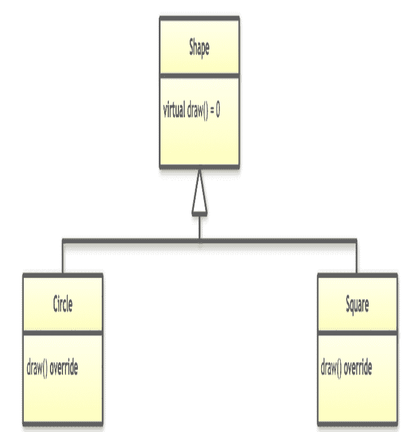
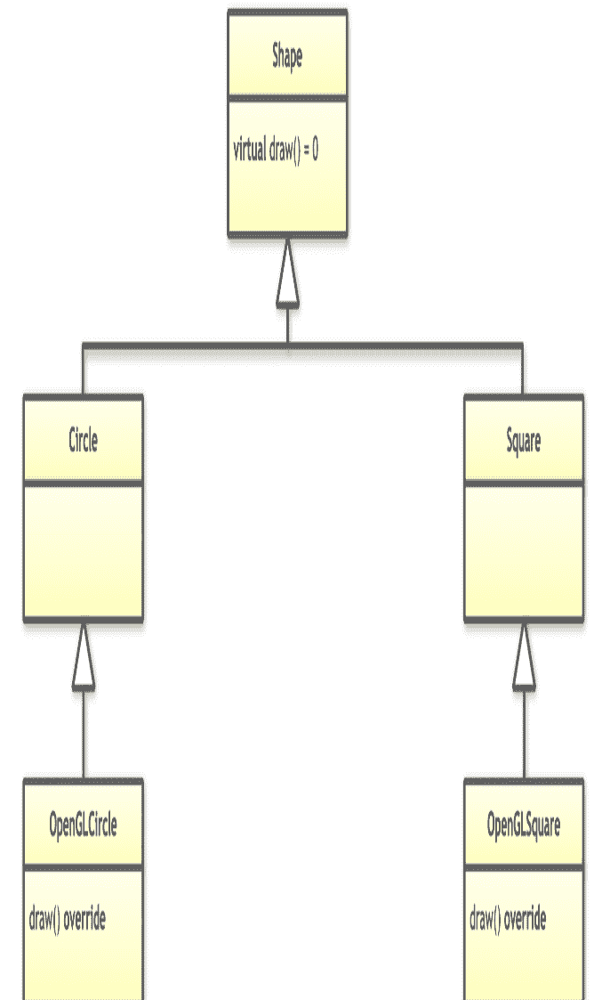
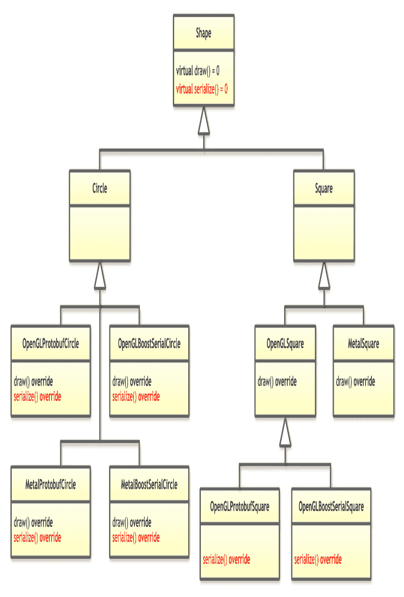
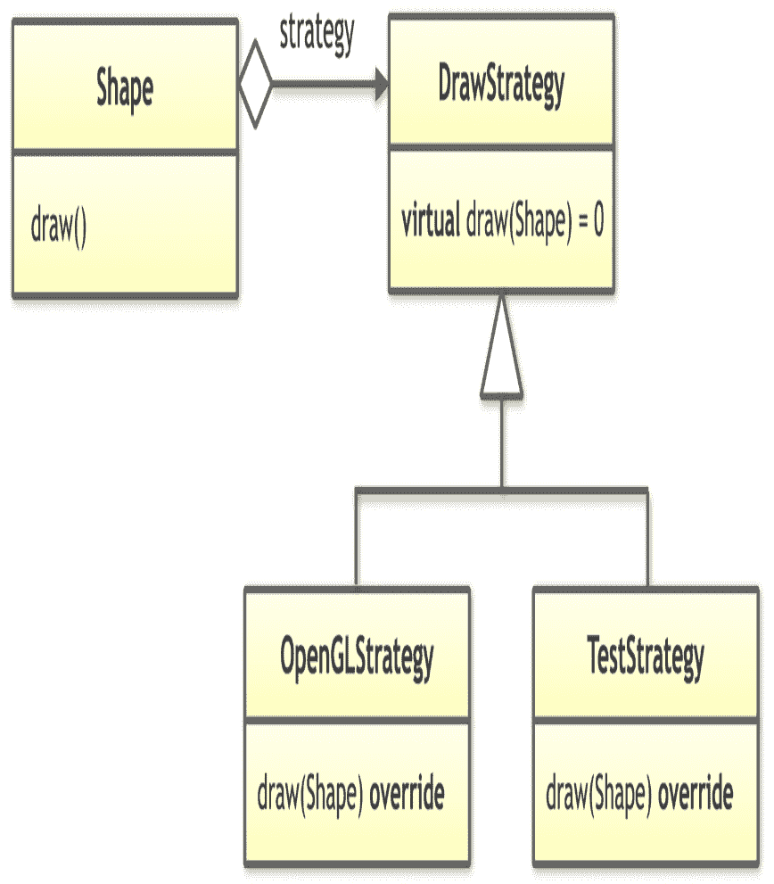
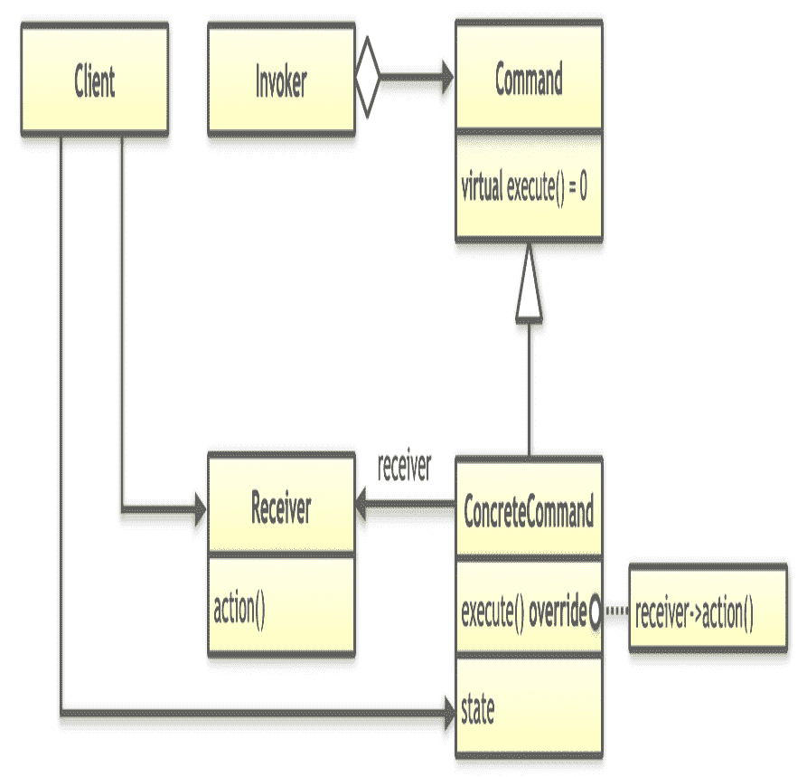

## 第 5 章. 策略和命令设计模式

### 早期发布读者的说明

使用 Early Release 电子书，你可以在这些技术正式发布之前很久就获得书籍的最初形式——作者在写作时的原始未编辑内容。

这将是最终书籍的第 5 章。请注意 GitHub 仓库将在稍后激活。

如果你对如何改进本书的内容和/或示例有任何评论，或者如果你注意到本章中缺少材料，请联系编辑 sevans@oreilly.com。

本章专门介绍两种最常用的设计模式：*Strategy* 设计模式和 *Command* 设计模式。确实是最常用的：C++ 标准库本身就多次使用它们数十次，你本人很可能也多次使用过它们。因此，这两者可以被视为每个开发人员的基本工具。

在“Guideline 19: Use Strategy to Isolate How Things are Done”中，我将向你介绍 *Strategy* 设计模式。我将演示为什么这是最有用和最重要的设计模式之一，以及为什么你在许多情况下会发现它很有用。

在“Guideline 20: Favor Composition Over Inheritance”中，我们将看看继承以及为什么这么多人抱怨它。你会看到它本身并不坏，但像其他一切一样，它也有其优点和局限性。最重要的是，我将解释，许多人


经典设计模式的力量并非源自继承，而是源自组合。

在“准则 21：使用命令隔离做什么”中，我将介绍 *Command* 设计模式。我将向你展示如何富有成效地使用该设计模式，并给出 *Command* 和 *Strategy* 的比较思路。

在“准则 22：优先使用值语义而非引用语义”中，我们将踏入 *reference semantics* 的领域。然而，我们会发现这个领域并不特别友好和宜居，并且会让我们担心代码的质量。因此我们将重新定居到 *value semantics* 的领域，它将以许多对代码库的好处来欢迎我们。

在“准则 23：优先对 Strategy 和 Command 进行基于值的实现”中，我们将重新审视 *Strategy* 和 *Command* 模式。我将演示，我们如何应用在 *value semantics* 领域获得的见解，并基于
`std::function` 实现这两种设计模式。

### Guideline 19: Use Strategy to Isolate How Things are Done

让我们想象一下，你和你的团队即将实现一个全新的 2D 绘图工具。其中之一，它需要处理简单的几何原语，例如圆、方形等，需要被绘制（见图 5-1）。



图 5-1. 初始的 Shape 继承层级。

一些类已经实现，例如 Shape 基类、Circle 和 Square 类：

//---- <Shape.h> ----------------

class Shape
{
public:
    virtual ~Shape() = default;

    virtual void draw( /*some arguments*/ ) const = 0;  ①
};
//---- <Circle.h> ----------------

#include <Point.h>
#include <Shape.h>

class Circle : public Shape
{
public:
    explicit Circle( double radius )
        : radius_( radius )
    {
        /* Checking that the given radius is valid */
    }

    double radius() const { return radius_; }
    Point center() const { return center_; }

    void draw( /*some arguments*/ ) const override;

private:
    double radius_;
    Point center_{};
};

//---- <Circle.cpp> ----------------

#include <Circle.h>
#include /* some graphics library */

void Circle::draw( /*some arguments*/ ) const
{
    // ... Implementing the logic for drawing a circle
}

//---- <Square.h> ----------------

#include <Point.h>
#include <Shape.h>

class Square : public Shape
{
public:
    explicit Square( double side )
        : side_( side )
```
/* Checking that the given side length is valid */
}

double side () const { return side_; }
Point center() const { return center_; }

void draw( /*some arguments*/ ) const override;  ③

private:
    double side_;
    Point center_ {};
};
```

```
//---- <Square.cpp> -------------

#include <Square.h>
#include /* some graphics library */

void Square::draw( /*some arguments*/ ) const
{
    // ... Implementing the logic for drawing a square
}
```

最重要的一点是 Shape 基类的纯虚 draw() 成员函数 ①。在你休假期间，你的团队成员之一已经通过 OpenGL 为 Circle 和 Square 类实现了这个 draw() 成员函数 ② 和 ③。这意味着该工具已经能够绘制圆和方形，整个团队都同意 resulting graphics 看起来相当不错。每个人都很开心！

### Analyzing the Design Issues

每个人，除了你之外。休假归来后，你当然立刻意识到已实现方案违反了单一职责原则（SRP）。¹ 如此一来，Shape 层级并不是为变化而设计的：首先，改变形状的绘制方式并不容易。在当前实现中只有一种固定的绘制形状的方式，并且无法以非侵入方式更改这些细节。由于你已经预测到该工具将需要支持多个图形库，这绝对是个问题。² 其次，如果你最终执行更改，则需要在多个不相关的地点更改行为。

但还有更多：由于绘制功能是在 `Circle` 和 `Square` 内部实现的，`Circle` 和 `Square` 类依赖于 `draw()` 的实现细节，意味着它们依赖于 OpenGL。尽管圆和方形本质上应只是一些简单的几何原语，这两个类现在却承担了在它们被使用的任何地方都必须使用 OpenGL 的负担。

当你向同事指出这一点时，他们起初有点目瞪口呆。也有点恼火，因为他们没有料到你会指出他们优美方案中的任何缺陷。然而，你有一种非常好的解释问题的方式，因此最终，他们同意你的观点并开始思考更好的解决方案。

他们很快就想出了一个更好的方法。在几天后的下一次团队会议上，他们提出了新想法：继承层级中的另一层（见图 5-2）。



图 5-2. 扩展的 Shape 继承层级。

为了演示这个想法，他们甚至已经实现了 OpenGLCircle 和 OpenGLSquare 类：

//---- <Circle.h> ----------------

#include <Shape.h>

class Circle : public Shape
{
public:
    // ... No implementation of the draw() member function anymore
};

//---- <OpenGLCircle.h> ----------------

#include <Circle.h>

class OpenGLCircle : public Circle
{
public:
    explicit OpenGLCircle( double radius )
        : Circle( radius )
    {}

    void draw( /*some arguments*/ ) const override;
};

//---- <OpenGLCircle.cpp> ----------------

#include <OpenGLCircle.h>
#include /* OpenGL graphics library headers */

void OpenGLCircle::draw( /*some arguments*/ ) const
{
    // ... Implementing the logic for drawing a circle by means of OpenGL
}

//---- <Square.h> ----------------

#include <Shape.h>

class Square : public Shape
```
{
  public:
    // ... No implementation of the draw() member function anymore
};
```

```
//---- <OpenGLSquare.h> ----------------
```
```
#include <Square.h>

class OpenGLSquare : public Square
{
  public:
    explicit OpenGLSquare( double side )
      : Square( side )
    {}

    void draw( /*some arguments*/ ) const override;
};
```

```
//---- <OpenGLSquare.cpp> ----------------
```
```
#include <OpenGLSquare.h>
#include /* OpenGL graphics library headers */

void OpenGLSquare::draw( /*some arguments*/ ) const
{
  // ... Implementing the logic for drawing a square by means of OpenGL
}
```

继承！当然！通过简单地从 Circle 和 Square 派生并将 draw() 函数的实现向下移动到层级中，很容易以不同方式实现绘制。例如，可以有 MetalCircle 和 VulkanCircle，假设需要支持 Metal 和 Vulkan 库。突然间改变变得容易了，对吧？

虽然你的同事们仍然为他们的新方案感到非常自豪，但你已经意识到这种方法不会长期有效。并且很容易证明其不足之处：你所要做的就是考虑另一个需求，例如 serialize() 成员函数：

```
class Shape
{
    public:
        virtual ~Shape() = default;

        virtual void draw(/*some arguments*/ ) const = 0;
        virtual void serialize(/*some arguments*/ ) const = 0;
};
```

serialize() 成员函数（4） 应该将形状转换为字节序列，可以存储在文件或数据库中。从那里，可以反序列化字节序列以重建完全相同的形状。就像 draw() 成员函数一样，serialize() 成员函数也可以以各种不同的方式实现。例如，你可以选用 protobuf 或 Boost.serialization 库。

使用将实现细节向下移动到继承层级的相同策略，这将迅速导致一个相当复杂且相当人为的层级（见图 5-3）。考虑类名：OpenGLProtobufCircle、MetalBoostSerialSquare、... 荒谬，对吧？我们应该如何构建它：我们是否应该在层级中再添加一层（见 Square 分支）？这种方法会迅速导致一个深且复杂的层级。还是我们应该将层级 flatten 出来（像 Circle 分支那样）？实现细节的重用又如何？例如，如何在 OpenGLProtobufCircle 和 OpenGLBoostSerialCircle 类之间重用 OpenGL 代码？




Figure 5-3. Adding the serialize() member function results in a deep and complex inheritance hierarchy.

### The Strategy Design Pattern Explained

你意识到，你的同事们只是太沉迷于继承，而拯救危机的重任就落在了你身上。他们似乎需要有人来向他们展示如何为这种变化进行适当的设计，并为问题提供一个合适的解决方案。正如两位务实的程序员所说：³

> Inheritance is rarely the answer.
> —Andrew Hunt & David Thomas

问题仍然是 SRP 的违反。由于你必须计划如何改变不同形状的绘制方式，你应该将绘制方面识别为一个变化点。有了这一认识，正确的做法是为变化而设计，遵循 SRP，从而提取变化点。这就是策略设计模式的意图，它是经典的 GoF 设计模式之一：

THE STRATEGY DESIGN PATTERN
Intent: “Define a family of algorithms, encapsulate each one, and make them interchangeable. Strategy lets the algorithm vary independently from clients that use it.” (GoF)

不是在派生类中实现虚的 draw() 函数，你引入另一个类专门用于绘制形状。在经典的面向对象（OO）形式的策略设计模式中，这是通过引入 DrawStrategy 基类来实现的（见图 5-4）。



Figure 5-4. The UML representation of the Strategy design pattern.

绘制方面的隔离现在使我们能够在无需修改形状类的情况下更改绘制的实现。这实现了 SRP 的思想。你现在也能够在不修改任何其他代码的情况下引入 draw() 的新实现。这

实现了 *Open-Closed Principle (OCP)*。再次，在这种 OO 环境下，*SRP* 是 *OCP* 的使能者。

下面的代码片段展示了 `DrawStrategy` 基类的一个朴素实现：⁴

```
//---- <DrawStrategy.h> ----------------

class Circle;
class Square;

class DrawStrategy
{
public:
    virtual ~DrawStrategy() = default;

    virtual void draw( Circle const& circle, /*some arguments*/ )
const = 0; ⑤
    virtual void draw( Square const& square, /*some arguments*/ )
const = 0; ⑥
};
```

`DrawStrategy` 类带有一个虚析构函数和两个纯虚 `draw()` 函数，一个用于圆 ⑤，一个用于正方形 ⑥。为了使这个基类能够编译，你需要前向声明 `Circle` 和 `Square` 类。

由于 *Strategy* 设计模式，`Shape` 基类不会发生变化。它仍然代表所有形状的抽象，因此提供了一个纯虚 `draw()` 成员函数。*Strategy* 旨在提取实现细节，因此只影响派生类：⁵

```
//---- <Shape.h> ----------------

class Shape
{
public:
    virtual ~Shape() = default;

    virtual void draw( /*some arguments*/ ) const = 0;
    // ... Potentially other functions, e.g. a 'serialize()'
member function
};
```

虽然 Shape 基类由于 Strategy 而没有变化，但 Circle 和 Square 类受到了影响：

```
//---- <Circle.h> ----------------

#include <Shape.h>
#include <DrawStrategy.h>
#include <memory>
#include <utility>

class Circle : public Shape
{
public:
    explicit Circle( double radius, std::unique_ptr<DrawStrategy> drawer )
        : radius_( radius )
        , drawer_( std::move(drawer) )
    {
        /* Checking that the given radius is valid and that
           the given std::unique_ptr instance is not nullptr */
    }

    void draw( /*some arguments*/ ) const override
    {
        drawer_->draw( *this, /*some arguments*/ );
    }

    double radius() const { return radius_; }

private:
    double radius_;
    std::unique_ptr<DrawStrategy> drawer_;
};
```

```
//---- <Square.h> ----------------

#include <Shape.h>
#include <DrawStrategy.h>
#include <memory>
#include <utility>
```

```
class Square : public Shape
{
  public:
    explicit Square( double side, std::unique_ptr<DrawStrategy>
    drawer ) ⑦
      : side_( side )
      , drawer_( std::move(drawer) ) ⑧
    {
      /* Checking that the given side length is valid and that
         the given std::unique_ptr instance is not nullptr */
    }

    void draw( /*some arguments*/ ) const override
    {
      drawer_->draw( *this, /*some arguments*/ );  ⑩
    }

    double side() const { return side_; }

  private:
    double side_;
    std::unique_ptr<DrawStrategy> drawer_;  ⑨
};
```

Circle 和 Square 现在都期望在它们的构造函数中传入一个指向 DrawStrategy 的 unique_ptr ⑦。这使我们能够从外部配置绘制行为，这通常被称为依赖注入。unique_ptr 被移动 ⑧ 到一个相同类型的新数据成员中 ⑨。此外，还可以提供相应的 setter 函数，这将允许你在稍后更改绘制行为。draw() 成员函数现在不必自己实现绘制，而只需调用给定 DrawStrategy 的 draw() 函数 ⑩。⁶

### Analyzing the Shortcomings of the Naive Solution

太棒了！有了这个实现，你现在能够在本地、独立地更改形状绘制的行为，并使每个人都能实现新的绘制行为。然而，就目前而言，我们的 Strategy 实现存在一个严重的设计缺陷。为了分析这个缺陷，让我们假设你必须添加一种新的形状，

也许是一个三角形。这应该很容易，因为，正如我们在“Guideline 15: Design for the Addition of Types or Operations”中讨论的那样，面向对象编程（OOP）的优势在于添加新类型。

当你开始引入这个 Triangle 时，你意识到添加新形状并不像预期的那样容易。首先，你需要编写新的类。这是可以预料的，而且完全不是问题。但随后你必须更新 DrawStrategy 基类，以便也能够绘制三角形。这反过来会对圆和正方形产生不利影响：Circle 和 Square 类都需要重新编译、重新测试，并可能重新部署。更一般地说，所有形状都会受到这种影响。而这应该让你觉得有问题。为什么在添加 Triangle 类时，圆和正方形必须重新编译？

技术上的原因是，通过 DrawStrategy 基类，所有形状在隐式地彼此知晓。添加新形状因此会影响所有其他形状。根本的设计原因是违反了接口隔离原则（ISP）（见“Guideline 3: Separate Interfaces to Avoid Artificial Coupling”）。通过定义单一的 DrawStrategy 基类，你人为地将圆、正方形和三角形耦合在一起。由于这种耦合，你使添加新类型变得更加困难，从而限制了 OOP 的优势。相比之下，你创建的情况与我们谈论形状绘制的过程式解决方案非常相似（见“Guideline 15: Design for the Addition of Types or Operations”）。

“我们是不是无意中重新实现了 Visitor 设计模式？”你在想。我明白你的观点：DrawStrategy 看起来确实非常像一个 Visitor。但不幸的是，它并没有实现 Visitor 的意图，因为你无法轻松地添加其他操作。为了做到这一点，你需要在 Shape 层次结构中侵入性地添加一个虚成员函数。“而且它也不是 Strategy，因为我们不能添加类型，对吗？”是的，正确。你看，从设计角度来看，这就是最糟糕的情况。

为了正确实现策略设计模式，你必须分别提取每个形状的实现细节。这意味着你必须为每种形状引入一个 DrawStrategy 类：

```
//---- <DrawCircleStrategy.h> ----------------

class Circle;

class DrawCircleStrategy
{
public:
    virtual ~DrawCircleStrategy() = default;

    virtual void draw( Circle const& circle, /*some arguments*/ )
const = 0;
};

//---- <Circle.h> ----------------

#include <Shape.h>
#include <DrawCircleStrategy.h>
#include <memory>
#include <utility>

class Circle : public Shape
{
public:
    explicit Circle( double radius,
std::unique_ptr<DrawCircleStrategy> drawer )
        : radius_( radius )
        , drawer_( std::move(drawer) )
    {
        /* Checking that the given radius is valid and that
           the given 'std::unique_ptr' is not a nullptr */
    }

    void draw( /*some arguments*/ ) const override
    {
        drawer_->draw( *this, /*some arguments*/ );
    }

    double radius() const { return radius_; }

private:


```
double radius_;
std::unique_ptr<DrawCircleStrategy> drawer_;
};

//---- <DrawSquareStrategy.h> ----------------

class Square;

class DrawSquareStrategy
{
public:
    virtual ~DrawSquareStrategy() = default;

    virtual void draw( Square const& square, /*some arguments*/ )
const = 0;
};

//---- <Square.h> ----------------

#include <Shape.h>
#include <DrawSquareStrategy.h>
#include <memory>
#include <utility>

class Square : public Shape
{
public:
    explicit Square( double side,
std::unique_ptr<DrawSquareStrategy> drawer )
        : side_( side )
        , drawer_( std::move(drawer) )
    {
        /* Checking that the given side length is valid and that
           the given 'std::unique_ptr' is not a nullptr */
    }

    void draw( /*some arguments*/ ) const override
    {
        drawer_->draw( *this, /*some arguments*/ );
    }

    double side() const { return side_; }

private:
    double side_;
    std::unique_ptr<DrawSquareStrategy> drawer_;
};
```

对于 Circle 类，你必须引入 DrawCircleStrategy 基类（①），对于 Square 类则是 DrawSquareStrategy（②）基类。而随着 Triangle 类的加入，你也必须添加一个 DrawTriangleStrategy 基类。只有这样，你才能正确地分离关注点，同时仍然允许每个人添加新的类型和新的绘图实现。

有了此功能后，你可以轻松实现用于绘制圆、正方形以及最终三角形的新的 Strategy 类。作为示例，考虑 OpenGLCircleStrategy，它实现了 DrawCircleStrategy 接口：

```
//---- <OpenGLCircleStrategy.h> -------------

#include <Circle.h>
#include <DrawCircleStrategy.h>
#include /* OpenGL graphics library */

class OpenGLCircleStrategy : public DrawCircleStrategy
{
public:
    explicit OpenGLCircleStrategy( /* Drawing related arguments */
    );

    void draw( Circle const& circle, /*...*/ ) const override;

private:
    /* Drawing related data members, e.g. colors, textures, ... */
};
```

在图 5-5 中你可以看到 Circle 类的依赖图。请注意 Circle 和 DrawCircleStrategy 类处于同一架构层级。更值得注意的是它们之间存在循环依赖：Circle 依赖于 DrawCircleStrategy，但 DrawCircleStrategy 也依赖于 Circle。但不用担心：虽然乍一看这可能像是个问题，但它并不是。它是一种必要的关联，表明 `Circle` 真正拥有 `DrawCircleStrategy`，并且由此创建了在“准则 9：关注抽象的所有权”中讨论的期望的依赖倒置。

```
class Shape
{
public:
    Shape() = default;
    virtual ~Shape() = default;
    virtual void draw() const = 0;
    // ...
};
```

高层

架构边界

```
class Circle : public Shape
{
public:
    Circle( double rad
        , std::unique_ptr<DrawCircleStrategy> strategy );
    void draw() const override;
    // ...
};
```

```
class Circle;

class DrawCircleStrategy
{
public:
    virtual ~DrawCircleStrategy() = default;
    virtual void draw( Circle const& circle ) const = 0;
};
```

依赖倒置

架构边界

```
class OpenGLCircleStrategy : public DrawCircleStrategy
{
public:
    void draw( Circle const& circle ) const override;
};
```

低层

图 5-5. Strategy 设计模式的依赖图。

> “是否可以通过类模板来实现不同的 draw Strategy 类？我想象的东西类似于用于 Acyclic Visitor 的 Visitor 类“⁷

```
//---- <DrawStrategy.h> ----------------

template< typename T >
class DrawStrategy
{
public:
    virtual ~DrawStrategy() = default;
    virtual void draw( T const& ) const = 0;
};
```

这是一个很棒的想法，也是你应该做的事情。通过这个类模板，你可以将 DrawStrategy 提升到更高的架构层级，重用代码并遵循 DRY 原则（参见图 5-6）。
此外，如果我们从一开始就采用这种方法，就不会落入人为耦合不同形状类型的陷阱。
是的，我真的很喜欢这个！

```
class Shape
{
public:
Shape() = default;
virtual ~Shape() = default;
virtual void draw() const = 0;
// ...
};
```

```
template< typename T >
class DrawStrategy
{
public:
virtual ~DrawStrategy() = default;
virtual void draw( T const& ) const = 0;
};
```

高层

架构边界

```
class Circle : public Shape
{
public:
Circle( double rad
, std::unique_ptr<DrawCircleStrategy> strategy );

void draw() const override;
// ...
};
```

架构边界

依赖倒置

低层

```
class OpenGLCircleStrategy : public DrawStrategy<Circle>
{
public:
void draw( Circle const& circle ) const override;
};
```

图 5-6. Strategy 设计模式更新后的依赖图。

尽管如此，虽然这是我们实现此类 Strategy 类的方式，但你不应期望这会减少基类的数量（它仍然相同，只是生成的方式不同），或为你节省大量工作。DrawStrategy 的实现，例如 OpenGLCircleStrategy 类，代表了大部分工作，并且几乎不会改变：

```
//---- <OpenGLCircleStrategy.h> ----------------

#include <Circle.h>
#include <DrawStrategy.h>
#include /* OpenGL graphics library */

class OpenGLCircleStrategy : public DrawStrategy<Circle>
{
    // ...
};
```

假设 OpenGLSquareStrategy 有类似的实现，我们现在可以把所有东西放在一起并再次绘制形状，但这次通过 Strategy 设计模式正确解耦：

```
#include <Circle.h>
#include <Square.h>
#include <OpenGLCircleStrategy.h>
#include <OpenGLSquareStrategy.h>
#include <memory>
#include <vector>

int main()
{
    using Shapes = std::vector<std::unique_ptr<Shape>>;

    Shapes shapes{};

    // Creating some shapes, each one
    //   equipped with the according OpenGL drawing strategy
    shapes.emplace_back(
        std::make_unique<Circle>(
            2.3, std::make_unique<OpenGLCircleStrategy>
(/*...red...*/ ) );
    shapes.emplace_back(
        std::make_unique<Square>(
            1.2, std::make_unique<OpenGLSquareStrategy>
        (/*...green...*/ ) );
    shapes.emplace_back(
        std::make_unique<Circle>(
            4.1, std::make_unique<OpenGLCircleStrategy>
        (/*...blue...*/ ) );

    // Drawing all shapes
    for( auto const& shape : shapes )
    {
        shape->draw( /*some arguments*/ );
    }

    return EXIT_SUCCESS;
}
```

### Visitor 与 Strategy 的比较

既然你已经了解了 *Visitor* 和 *Strategy* 设计模式，你可能会想知道两者之间的区别。毕竟实现看起来相当相似。但虽然实现上有相似之处，但两种设计模式的属性却非常不同。在 *Visitor* 设计模式的情况下，我们将 *通用* 操作的添加识别为 *变化点*。因此我们为操作创建了一个抽象，这反过来允许每个人添加操作。不幸的副作用是，不再容易添加新的形状类型。

在 *Strategy* 设计模式的情况下，我们将 *单个* 函数的实现细节识别为 *变化点*。在引入这些实现细节的抽象后，我们仍然能够轻松添加新的形状类型，但我们无法轻松添加新的操作。那是因为添加操作仍然需要你侵入性地添加一个虚成员函数。因此 *Strategy* 设计模式的意图与 *Visitor* 设计模式的意图正好相反。

将两种设计模式结合起来以获得两种想法的优点似乎很有前景，使其易于添加类型和


operations). 不幸的是这行不通：无论你先应用哪一种设计模式，它都会固定住两个自由轴中的一个。⁸ 因此，你只需记住这两种设计模式的优缺点，并根据你对代码库演进的预期来应用它们。

### 分析策略设计模式的不足

我已经向你展示了 *Strategy* 设计模式的优势：它通过为该细节引入抽象，从而减少对特定实现细节的依赖。然而，软件设计中没有银弹，每种设计都伴随着一些缺点。*Strategy* 设计模式也不例外，考虑潜在的缺点也很重要。

首先，虽然某个操作的实现细节已被提取并隔离，但该操作本身仍然是具体类型的一部分。这一事实证明了上述限制，即我们仍然无法轻松地添加操作。*Strategy* 与 *Visitor* 相比，保留了 OOP 的优势，并使你能够轻松添加新类型。

其次，及早识别此类变化点是值得的。否则就需要进行大规模重构。当然这并不意味着你应该预先用 *Strategy* 实现所有内容，以防重构。这很快就会导致过度设计。但在第一次出现实现细节可能发生变化的迹象，或希望有多种实现时，你应该迅速实施必要的修改。最好的，但当然有点空洞的建议是保持尽可能简单（*KISS* 原则；Keep It Simple, Stupid）。

第三，如果你通过基类实现 *Strategy*，性能肯定会因额外的运行时间接而受到影响。性能也会受到许多手动分配（`std::make_unique()` 调用）的影响，导致内存碎片化，以及由于大量指针而产生的各种间接。这是可以预期的，然而实现的灵活性和每个人都可以添加新实现的可能性可能超过了这种性能损失。当然这取决于具体情况，你需要逐案决定。如果你通过模板实现 *Strategy*（见下文关于 *Policy-Based Design* 的讨论），这种缺点就无关紧要了。

最后但同样重要的是，*Strategy* 设计模式的主要缺点是单个 *Strategy* 只能处理单个操作或一组小而内聚的函数。否则你又会违反 *SRP*。这意味着如果需要提取多个操作的实现细节，就必须有多个 *Strategy* 基类和多个数据成员，可以通过 *dependency injection* 设置。例如考虑存在额外的 `serialize()` 成员函数的情况：

```
//---- <DrawCircleStrategy.h> ----------------

class Circle;

class DrawCircleStrategy
{
public:
    virtual ~DrawCircleStrategy() = default;

    virtual void draw( Circle const& circle, /*some arguments*/ )
const = 0;
};

//---- <SerializeCircleStrategy.h> ----------------

class Circle;

class SerializeCircleStrategy
{
public:
    virtual ~SerializeCircleStrategy() = default;

    virtual void serialize( Circle const& circle, /*some arguments*/ ) const = 0;
};
```

```
//---- <Circle.h> ----------------

#include <Shape.h>
#include <DrawCircleStrategy.h>
#include <SerializeCircleStrategy.h>
#include <memory>
#include <utility>

class Circle : public Shape
{
public:
    explicit Circle( double radius
                    , std::unique_ptr<DrawCircleStrategy> drawer
                    , std::unique_ptr<SerializeCircleStrategy> serializer
                    /* potentially more strategy-related arguments */ )
        : radius_( radius )
        , drawer_( std::move(drawer) )
        , serializer_( std::move(serializer) )
        // ...
    {
        /* Checking that the given radius is valid and that
           the given std::unique_ptrs are not nullptrs */
    }

    void draw( /*some arguments*/ ) const override
    {
        drawer_->draw( *this, /*some arguments*/ );
    }

    void serialize( /*some arguments*/ ) const override
    {
        serializer_->serialize( *this, /*some arguments*/ );
    }

    double radius() const { return radius_; }

private:
    double radius_;
    std::unique_ptr<DrawCircleStrategy> drawer_;
    std::unique_ptr<SerializeCircleStrategy> serializer_;
    // ... Potentially more strategy-related data members
};
```

虽然这会导致基类的大量不幸的增殖以及由于多个指针而导致实例变大，但它也引发了如何设计类以便能够方便地分配多种不同策略的问题。因此 *Strategy* 设计模式似乎在你需要隔离少量实现细节的情况下最强。如果遇到需要提取许多操作细节的情况，可能最好考虑其他方法（例如参见第 8 章中的 *Type Erasure* 或第 9 章中的 *Decorator* 设计模式）。

### 基于策略的 Policy-Based Design

正如前几章已演示的那样，*Strategy* 设计模式并不局限于动态多态。相反，*Strategy* 的意图完全可以通过模板以静态多态的方式实现。例如，考虑标准库中的以下两个算法：

```
namespace std {

template< typename ForwardIt, typename UnaryPredicate >
constexpr ForwardIt
    partition( ForwardIt first, ForwardIt last, UnaryPredicate p );

template< typename RandomIt, typename Compare >
constexpr void
    sort( RandomIt first, RandomIt last, Compare comp );

} // namespace std
```

`std::partition()` 和 `std::sort()` 算法都使用了 *Strategy* 设计模式。`std::partition()` 的 `UnaryPredicate` 参数和 `std::sort()` 的 `Compare` 参数代表了一种从外部注入部分行为的手段。更具体地说，这两个参数允许你指定元素如何排序。因此这两个算法都提取了它们行为的特定部分，并以概念的形式为其提供抽象（参见“Guideline 7: Understand the Similarities between Base Classes and Concepts”）。这与 OO 形式的 Strategy 不同，不会带来任何运行时性能损失。

类似的方法也可以在 std::unique_ptr 类模板中看到：

```
namespace std {

template< typename T, typename Deleter = std::default_delete<T> >
⑧
class unique_ptr;

template< typename T, typename Deleter > ⑩
class unique_ptr<T[], Deleter>;

} // namespace std
```

对于基本模板（⑧）及其对数组的特化（⑩），都可以指定显式的 Deleter 作为第二个模板参数。通过此参数，你可以决定是否希望通过 delete、通过 free() 或任何其他释放函数来释放资源。甚至可以“滥用” std::unique_ptr 来执行完全不同种类的清理。

这种灵活性也是 *Strategy* 设计模式的证据。模板参数允许你将一些清理行为注入到类中。这种形式的 Strategy 也称为 Policy-Based Design，基于 Andrei Alexandrescu 于 2001 年提出的设想。⁹ 想法是相同的：提取并隔离类模板的特定行为，以提高可变性、可扩展性、可测试性和可重用性。因此 Policy-Based Design 可以被视为 *Strategy* 设计模式的静态多态形式。显然，这种设计效果非常好，正如标准库中这种想法的许多应用所证明的那样。

你也可以将 Policy-Based Design 应用于绘制形状的示例。考虑以下 Circle 类的实现：


//---- <Circle.h> --------------------

#include <Shape.h>
#include <DrawCircleStrategy.h>
#include <memory>
#include <utility>

template< typename DrawCircleStrategy >
class Circle : public Shape
{
public:
    explicit Circle( double radius, DrawCircleStrategy drawer )
        : radius_( radius )
        , drawer_( std::move(drawer) )
    {
        /* Checking that the given radius is valid */
    }

    void draw( /*some arguments*/ ) const override
    {
        drawer_( *this, /*some arguments*/ );
    }

    double radius() const { return radius_; }

private:
    double radius_;
    DrawCircleStrategy drawer_;  // Could possibly be omitted, if
the given
                            // strategy is presumed to be
stateless.
};

与其在构造函数中传递指向 DrawCircleStrategy 基类的 std::unique_ptr，你也可以通过模板参数来指定 Strategy：最大的优势将是由于指针间接寻址减少而带来的性能提升：与其通过 std::unique_ptr 调用，你可以直接调用由 DrawCircleStrategy 提供的具体实现。另一方面，你将失去在运行时调整特定 Circle 实例的绘制 Strategy 的灵活性。此外，你也不会再有一个单一的 Circle 类。你将为每种绘制策略都有一个 Circle 的实例化。最后但同样重要的是，你应该记住类模板通常完全位于头文件中。因此你可能会失去将实现细节隐藏在源文件中的机会。正如 always 所说，没有完美的解决方案，“正确”解决方案的选择取决于实际的上下文。

总而言之，*Strategy* 设计模式是设计模式目录中最通用的示例之一。你会在许多情况下发现它很有用，无论是在动态多态的领域，还是在静态多态的领域。然而，它并不是解决每个问题的终极方案，请注意其潜在的缺点。

### GUIDELINE 10: USE *STRATEGY* TO ISOLATE HOW THINGS ARE DONE

- Understand that inheritance is rarely the answer;
- Apply the *Strategy* design pattern with the intent to extract the implementation details of a cohesive set of functions;
- Implement one *Strategy* for each operation to avoid artificial coupling;
- Consider *Policy-Based Design* as the compile time form of the *Strategy* design pattern.

#### Guideline 20: Favor Composition Over Inheritance

在 90 年代和 2000 年代初期面向对象编程（OOP）热情空前高涨之后，今天的 OOP 正处于守势。反对 OOP 并强调其缺点的声音越来越多，也越来越响亮。这不仅限于 C++ 社区，也存在于其他编程语言的社区中。虽然 OOP 整体确实存在一些局限性，让我们聚焦于一个似乎引发最多争议的特性：继承。正如 Sean Parent 所说：

> *Inheritance is the base class of evil.*
> 
> —Sean Parent

虽然继承被宣传为一种非常自然、直观的建模现实世界关系的方式，但事实证明它比承诺的要难用得多。你在我们讨论“Guideline 6: Adhere to the Expected Behavior of Abstractions”中的 *Liskov Substitution Principle (LSP)* 时，已经见过使用继承时的微妙失败。但继承还有其他方面经常被误解。

首先，继承总是被描述为简化可重用性。这似乎很直观，因为看起来如果你只是从另一个类继承，就能轻松重用代码。不幸的是，那并不是继承带给你的那种重用。继承不是关于在基类中重用代码，而是关于被使用基类的其他代码多态地重用。例如，假设一个稍微扩展的 `Shape` 基类，以下函数适用于所有种类的形状，因此可以被 `Shape` 基类的所有实现重用：

```
class Shape
{
public:
    virtual ~Shape() = default;

    virtual void translate( /*some arguments*/ ) = 0;
    virtual void rotate( /*some arguments*/ ) = 0;

    virtual void draw( /*some arguments*/ ) const = 0;
    virtual void serialize( /*some arguments*/ ) const = 0;

    // ... Potentially other member functions ...
};

void rotateAroundPoint( Shape& shape );
void mergeShapes( Shape& s1, Shape& s2 );
void writeToFile( Shape const& shape );
```

```
void sendViaRPC( Shape const& shape );
// ...
```

这四个函数都建立在 Shape 抽象之上。所有这些函数仅与所有种类形状的公共接口耦合，而与任何特定形状无关。这意味着所有种类的形状都可以围绕点旋转、合并、写入文件并通过 RPC 发送。每种形状都“重用”了此功能。

正是通过抽象表达功能的能力，才创造了重用代码的机会。而这种功能预计会产生大量的代码，与基类包含的少量代码相比。真正的可重用性因此是由类型的多态使用创建的，而不是由多态类型创建的。

其次，据说继承有助于解耦软件实体。虽然这绝对是正确的（回想一下在“Guideline 9: Pay Attention to the Ownership of Abstractions”中关于依赖倒置原则（DIP）的讨论），但通常没有解释，继承本身也会产生耦合。你之前已经见过这种证据。在实现 Visitor 设计模式时，你已经体验到继承会强加某些实现细节给你。在经典的 visitor 中，你必须实现 Visitor 基类的纯虚函数，即使这对你的应用程序并不理想。此外，你对函数参数或返回类型的选择也不多。这些都是固定的。

你在讨论 Strategy 设计模式的开始时也体验过这种耦合。在这种情况下，继承强制了结构性耦合，导致了更深的继承层次，造成了类的命名存疑，并削弱了重用。

到目前为止，你可能会觉得我试图完全否定继承。好吧，坦白说，我只是想让它看起来有点糟糕，但仅限于必要的程度。明确地说：继承并不坏，使用它也没有错。相反：继承是一个非常强大的特性，如果使用得当，你可以用它做令人难以置信的事情。然而，当然你还记得彼得·帕克原则：

> *With great power comes great responsibility.*
> 
> —Peter Parker, aka Spider-Man

问题在于“如果使用得当”这一部分。事实证明继承很难正确使用（肯定比我们被引导相信的要难得多，见我上面的论证），因此被无意中误用。它也被过度使用，因为许多开发人员习惯于将其用于各种问题。这种过度使用似乎是许多问题的根源，正如 Michael Feathers 所指出的：

> [Programming by difference] fell out of favor in the 1990s when many people in the OO community noticed that inheritance can be rather problematic if it is overused.
> 
> —Michael Feathers

在许多情况下，继承既不是正确的方法也不是正确的工具。相反，大多数时候，更可取的是使用组合。你不应该对这一发现感到惊讶，因为你已经见过它是正确的。组合是 OO 形式的 *Strategy* 设计模式之所以工作得如此好的原因，而不是继承。它是引入抽象和聚合相应数据成员使得 *Strategy* 设计模式如此强大，而不是基于继承的不同策略的实现。事实上，你会发现许多设计模式都牢牢基于组合，而不是继承（例如“Guideline 19: Use Strategy to Isolate How Things are Done”中的 *Strategy* 设计模式，“Guideline 25: Apply Observers as an Abstract Notification Mechanism”中的 *Observer* 设计模式，“Guideline 24: Use Adapters to Standardize Interfaces”中的 *Adapter* 设计模式，“Guideline 35: Use Decorators to Add Customization Hierarchically”中的 *Decorator* 设计模式，或“Guideline 28: Build Bridges to Remove Physical Dependencies”中的 *Bridge* 设计模式）。所有这些都通过继承实现扩展，但本身是通过组合实现的。


> *委派给服务：Has-A 胜过 Is-A。*
> —Andrew Hunt & David Thomas

这是一个适用于许多设计模式的通用经验教训。我建议你牢记这一见解，因为它在理解本书剩余部分中你将看到的设计模式时非常有用，同时也能提高你实现的质量。

### GUIDELINE 20: FAVOR COMPOSITION OVER INHERITANCE

- 认识到继承经常被过度使用，有时甚至被误用；
- 记住继承会产生紧密耦合；
- 认识到许多设计模式是由组合而非继承实现的。

### Guideline 21: Use Commands to Isolate What Things are Done

在开始本准则之前，让我们做一个实验：打开你喜欢的邮件客户端，给我写一封邮件。添加以下内容：“我爱你的书！它让我彻夜难眠，让我忘却所有烦恼。” 好，很好。现在点击发送。干得好！给我一秒钟检查我的邮件…… 没有，还没到…… 还是没有…… 让我们再试一次：点击重新发送…… 没有任何反应。嗯，我猜某个服务器必须宕机了。或者我的所有 *Commands* 都失败了：`WriteCommand`、`SendCommand`、`ResendCommand`…… 真是不幸。但尽管这个实验失败了，你现在对另一个 GoF 设计模式已经有了相当好的概念：*Command* 设计模式。

### The Command Design Pattern Explained

### THE COMMAND DESIGN PATTERN

Intent: “Encapsulate a request as an object, thereby letting you parameterize clients with different requests, queue or log requests, and support undoable operations.” (GoF)

*Command* 设计模式关注对工作包的抽象和隔离，这些工作包（最常见）只执行一次且（通常）立即执行。为此，它承认不同种类的工作包作为 *variation point* 的存在，并引入相应的抽象，从而允许轻松实现新的工作包种类。图 5-7 显示了从 GoF 书中摘取的原始 UML 形式：



图 5-7. Command 设计模式的 UML 表示。

在此基于 OO 的形式中，Command 模式引入了以 Command 基类形式存在的抽象。这使得任何人都可以实现新的 ConcreteCommand。 该 ConcreteCommand 可以做任何事情，甚至可以在某种 Receiver 上执行操作。 命令的效果是通过特定类型的 Invoker 通过抽象基类触发的。

作为 Command 设计模式的具体示例，让我们考虑以下计算器的实现。第一个代码片段显示了 CalculatorCommand 基类的实现，它代表对给定整数的数学操作的抽象：

```
//---- <CalculatorCommand.h> ----------------

class CalculatorCommand
{
public:
    virtual ~CalculatorCommand() = default;

    virtual int execute( int i ) const = 0;  ①
    virtual int undo( int i ) const = 0;  ②
};
```

CalculatorCommand 类期望派生类实现纯虚 execute() 函数（①）和纯虚 undo() 函数（②）。对 undo() 的期望是，它实现必要的操作以逆转 execute() 函数的效果。

Add 和 Subtract 类都代表计算器的可能命令，因此实现了 CalculatorCommand 基类：

```
//---- <Add.h> ----------------

#include <CalculatorCommand.h>

class Add : public CalculatorCommand
{
public:
    explicit Add( int operand ) : operand_(operand) {}

    int execute( int i ) const override  ③
    {
        return i + operand_;
    }
    int undo( int i ) const override  ④
    {
        return i - operand_;
    }
}
```

```
private:
    int operand_{};
};
```

```
//---- <Subtract.h> ----------------

#include <CalculatorCommand.h>

class Subtract : public CalculatorCommand
{
public:
    explicit Subtract( int operand ) : operand_(operand) {}

    int execute( int i ) const override  ⑤
    {
        return i - operand_;
    }
    int undo( int i ) const override  ⑥
    {
        return i + operand_;
    }

private:
    int operand_{};
};
```

Add 通过加法操作实现 execute() 函数（③）并通过减法操作实现 undo() 函数（④）。Subtract 实现其逆操作（⑤ 和 ⑥）。

得益于 CalculatorCommand 层次结构，Calculator 类本身可以保持相当简单：

```
//---- <Calculator.h> ----------------

#include <CalculatorCommand.h>
#include <stack>

class Calculator
{
public:
    void compute( std::unique_ptr<CalculatorCommand> command );  ⑦

void undoLast(); ⑧

int result() const;
void clear();

private:
    using CommandStack =
std::stack<std::unique_ptr<CalculatorCommand>>;

    int current_{}; ⑨
    CommandStack stack_; ⑩
};

//---- <Calculator.cpp> ----------------

#include <Calculator.h>

void Calculator::compute( std::unique_ptr<CalculatorCommand>
command ) ⑦
{
    current_ = command->execute( current_ );
    stack_.push( std::move(command) );
}

void Calculator::undoLast() ⑧
{
    if( stack_.empty() ) return;

    auto command = std::move(stack_.top());
    stack_.pop();

    current_ = command->undo(current_);
}

int Calculator::result() const
{
    return current_;
}

void Calculator::clear()
{
    current_ = 0;
    CommandStack{}.swap( stack_ ); // Clearing the stack
}
```

我们只需要用于计算活动的两个函数 compute()（⑦）和 undoLast()（⑧）。compute() 函数接收一个 CalculatorCommand 实例，立即执行它以更新当前值，（⑨），并将其存储在栈上（⑩）。undoLast() 函数通过从栈中弹出它并调用 undo() 来撤销最后执行的命令。

main() 函数将所有部分组合在一起：

```
//---- <Main.cpp> ----------------

#include <Calculator.h>
#include <Add.h>
#include <Subtract.h>
#include <cstdlib>

int main()
{
    Calculator calculator{};    ⑪

    auto op1 = std::make_unique<Add>( 3 );    ⑫
    auto op2 = std::make_unique<Add>( 7 );    ⑬
    auto op3 = std::make_unique<Subtract>( 4 );    ⑭
    auto op4 = std::make_unique<Subtract>( 2 );    ⑮

    calculator.compute( std::move(op1) );  // Computes 0 + 3,
    stores and returns 3
    calculator.compute( std::move(op2) );  // Computes 3 + 7,
    stores and returns 10
    calculator.compute( std::move(op3) );  // Computes 10 - 4,
    stores and returns 6
    calculator.compute( std::move(op4) );  // Computes 6 - 2,
    stores and returns 4

    calculator.undoLast();  // Reverts the last operation,
                            // stores and returns 6

    int const res = calculator.result();  // Get the final result:
    6

    // ...

    return EXIT_SUCCESS;
}
```

我们首先创建一个 `calculator`（①）和一系列操作（⊕、⊖ ⊖ 和 ⊗），然后依次应用它们。之后我们通过 `undo()` 操作撤销 operation3，然后查询最终结果。

该设计非常优雅地遵循了 SOLID 原则。¹⁶ 它遵守 *单一职责原则 (SRP)*，因为 *variation point* 已经通过 *Command* 设计模式提取出来。结果是，`compute()` 和 `undo()` 不必是虚函数。*SRP* 也充当了 *开放封闭原则 (OCP)* 的使能者，它允许我们在无需修改任何现有代码的情况下添加新操作。最后但同样重要的是，如果 `Command` 基类的所有权被正确分配给高层，那么该设计也遵守 *依赖倒置原则 (DIP)*（参见图 5-8）。

#### High-level

```
class Calculator
{
public:
// ...
void compute( std::unique_ptr<CalculatorCommand> );
void undoLast();
// ...
};
```

```
class CalculatorCommand
{
public:
virtual ~CalculatorCommand() = default;

virtual int execute( int i ) const = 0;
virtual int undo( int i ) const = 0;
};
```

Architectural Boundary

```
class Addition
: public CalculatorCommand
{
public:
// ...
int execute( int i ) const override;
int undo( int i ) const override;
// ...
};
```

```
class Subtraction
: public CalculatorCommand
{
public:
// ...
int execute( int i ) const override;
int undo( int i ) const override;
// ...
};
```

#### Low-level

图 5-8. Command 设计模式的依赖图。


There is a second example for the Command design pattern, which belongs into the category of classic examples: a thread pool. The purpose of a thread pool is to maintain multiple threads waiting for tasks to be executed in parallel. This idea is implemented by the following ThreadPool class: it provides a couple of member functions to offload certain tasks to a specific number of available threads:¹⁷

```
class Command ⑰
{ /* Abstract interface to perform and undo any kind of action. */ };

class ThreadPool
{
public:
    explicit ThreadPool( size_t numThreads );

    inline bool    isEmpty() const;
    inline size_t  size()    const;
    inline size_t  active()  const;
    inline size_t  ready()   const;

    void schedule( std::unique_ptr<Command> command );  ⑯

    void wait();

    // ...
};
```

Most importantly, the ThreadPool allows you to schedule a task via the schedule() function (⑯). This can be any task: The ThreadPool is not at all concerned about what kind of work its threads will have to perform. By means of the Command base class it is completely decoupled from the actual kind of task you schedule (⑰).

By simply deriving from Command you can formulate arbitrary tasks:

```
class FormattingCommand : public Command  ⑱
{ /* Implementation of formatting a disk */ };

class PrintCommand : public Command  ⑲
```
```
{ /* Implementation of performing a printer job */ }

int main()
{
    // Creating a thread pool with initially two working threads
    ThreadPool threadpool( 2 );

    // Scheduling two concurrent tasks
    threadpool.schedule(
        std::make_unique<FormattingCommand>( /*some arguments*/ )
    );
    threadpool.schedule(
        std::make_unique<PrintCommand>( /*some arguments*/ ) );

    // Waiting for the thread pool to complete both commands
    threadpool.wait();

    return EXIT_SUCCESS;
}
```

One possible example for such a task is a FormattingCommand (⑩). This task would get the necessary information to trigger the formatting of a disk via the operating system. Alternatively you can imagine a PrintCommand, which receives all data to trigger a printer job (⑪).

Also in this ThreadPool example you recognize the effect of the Command design pattern: the different kinds of tasks are identified as a variation point, extracted (which again follows the SRP), which enables you to implement different kinds of tasks without the need to modify existing code (adherence to the OCP).

Of course there are also some examples from the Standard Library. For instance, you will see the Command design pattern in action in the std::for_each() (⑳) algorithm:

```
namespace std {

template< typename InputIt, typename UnaryFunction >
constexpr UnaryFunction
    for_each( InputIt first, InputIt last, UnaryFunction f );

} // namespace std
```

By means of the third argument, you are able to specify *what* task the algorithm is supposed to perform on all of the given elements. This can be any action, ranging from manipulating the elements to printing them, and it can be specified by something as simple as a function pointer to something as powerful as a lambda:

```
#include <algorithm>
#include <cstdlib>

void multBy10( int& i )
{
    i *= 10;
}

int main()
{
    std::vector<int> v{ 1, 2, 3, 4, 5 };

    // Multiplying all integers with 10
    std::for_each( begin(v), end(v), multBy10 );

    // Printing all integers
    std::for_each( begin(v), end(v), []( int& i ){
        std::cout << i << '\n';
    });

    return EXIT_SUCCESS;
}
```

### The Command Design Pattern Versus the Strategy Design Pattern

“Wait a second!”, I can hear you cry out. “Didn’t you just explain that the algorithms of the Standard Library are implemented by means of the *Strategy* design pattern? Isn’t this a complete contradiction of the previous statement?” Yes, you are correct. Just a few pages back, I did explain that the `std::partition()` and `std::sort()` algorithms are implemented by means of the *Strategy* design pattern. And therefore I admit that it appears as if I am now contradicting myself. However, I did not claim that *all* the algorithms are based on *Strategy*. So let me explain.

From a structural point of view, the *Strategy* and *Command* design patterns are identical: whether you are using dynamic or static polymorphism, from an implementation point of view there is no difference between *Strategy* and *Command*.$^{18}$ The difference lies entirely in the intent of the two design patterns. Whereas the *Strategy* design pattern specified *how* something should be done, the *Command* design pattern specifies *what* should be done. Consider for instance the `std::partition()` and `std::for_each()` algorithms:

```
namespace std {

template< typename ForwardIt, typename UnaryPredicate >
constexpr ForwardIt
partition( ForwardIt first, ForwardIt last, UnaryPredicate p );  21

template< typename InputIt, typename UnaryFunction >
constexpr UnaryFunction
for_each( InputIt first, InputIt last, UnaryFunction f );  22

} // namespace std
```

Whereas you can only control *how* to select elements in the `std::partition()` algorithm (21), the `std::for_each()` algorithm gives you control over *what* operation is applied to each element in the given range (22). And whereas in the shapes example you could only specify *how* to draw a certain kind of shape, in the `ThreadPool` example you are completely in charge to decide *what* operation is scheduled.$^{19}$

There are two other indicators which of the two design patterns you have applied. First, if you have an object and configure this object by means of an action (i.e. you perform *dependency injection*) then you are (most likely) using the *Strategy* design pattern. If you do not use the action to configure an object, but if instead the action is performed directly, then you are (most likely) using the *Command* design pattern. In our `Calculator` example, we did not pass an action to configure the `Calculator`, but instead the

action which was evaluated immediately. Therefore we built on the Command pattern.

Alternatively, we could also implement Calculator by means of Strategy:

```
//---- <CalculatorStrategy.h> ----------------

class CalculatorStrategy
{
public:
    virtual ~CalculatorStrategy() = default;

    virtual int compute( int i ) const = 0;
};
```
//---- <Calculator.h> ----------------

#include <CalculatorStrategy.h>

class Calculator
{
public:
    void set( std::unique_ptr<CalculatorStrategy> operation );
    void compute( int value );

    // ...

private:
    int current_{};
    std::unique_ptr<CalculatorStrategy> operation_;  // Requires a default!
};
```
//---- <Calculator.cpp> ----------------

#include <Calculator.h>

void set( std::unique_ptr<CalculatorStrategy> operation )
{
    operation_ = std::move(operation);
}
```
```
void Calculator::compute( int value )
{
    current_ = operation_.compute( value );
}
```

In this implementation of a Calculator, the Strategy is injected by means of a set() function (23). The compute() function would use the injected Strategy to perform a computation (24). Note, however, that this approach would make it more difficult to implement a reasonable undo mechanism.

The second indicator, to see whether you are using Command or Strategy, is the existence of an undo() operation. If your action provides an undo() operation to roll back what is has done and encapsulates everything that is needed to perform the undo(), then you are - most likely - dealing with the Command design pattern. If your action does not provide an undo() operation, because it is focused on how something is done or because it lacks the information to roll back the operation, then you are - most likely - dealing with the Strategy design pattern. However, I should explicitly point out that the lack of an undo() operation is not conclusive evidence for Strategy. It could still be an implementation of Command, if the intent is to specify what should be done. For instance, the std::for_each() algorithm still expects a Command, despite the fact that there is no need for an undo() operation. The undo() operation should be considered an optional feature of the Command design pattern and not as a defining one. In my opinion, undo() is not a strength of the Command design pattern, but a pure necessity: if an action has complete freedom to do whatever it desires, then only this action alone will be able to roll the operation back (of course assuming that you do not want to store a complete copy of everything for every call to a Command).

I admit there is no clear separation between these two patterns and that there is a gray area in-between these two. However, there is no point in arguing about whether something is a Command or a Strategy and loose a couple of friends in the process. More important than agreeing on which one of the two you are using exactly, is to exploit their ability to extract


实现细节并分离关注点。这两种设计模式都能帮助你隔离变更和扩展，从而帮助你遵循 *SRP* 和 *OCP*。归根结底，这种能力可能是 C++ 标准库中存在如此多这两种设计模式示例的原因。

### 分析命令设计模式的不足

*Command* 设计模式的优点与 *Strategy* 设计模式的优点相似：*Command* 通过引入某种形式的抽象（例如基类或概念）来帮助你从具体任务的实现细节中解耦。这种抽象允许你轻松添加新任务。因此 *Command* 同时满足 *SRP* 和 *OCP*。

然而，*Command* 设计模式也有其缺点。与 *Strategy* 设计模式相比，缺点列表相当短。唯一的真正缺点是由于额外的间接性而带来的运行时性能开销，如果你通过基类实现 *Command*（即经典的 GoF 风格）。同样，是否增加的灵活性超过了运行时性能的损失，由你决定。

总之，就像 *Strategy* 设计模式一样，*Command* 设计模式是设计模式目录中最基本和最有用的模式之一。你将在许多不同的情况下遇到 *Command* 的实现，既有静态也有动态。因此，理解 *Command* 的意图、优点和缺点将多次证明是有用的。

### 准则 21：使用命令来隔离做什么

- 以抽象和封装（可能可撤销的）操作为目的应用 *Command* 设计模式；
- 注意 *Command* 与 *Strategy* 设计模式之间的界限是流动的；
- 将 *Command* 用于动态和静态应用。

### 准则 22：优先使用值语义而非引用语义

在“准则 19：使用策略来隔离如何做事”和“准则 21：使用命令来隔离做什么事”中，我分别向你介绍了 *Strategy* 和 *Command* 设计模式。在这两种情况下，示例都牢牢建立在经典的 GoF 风格之上：它们通过继承层次结构使用动态多态性。以这种经典的面向对象风格，缺乏现代感，我想象到现在，你的紧张已经让你与美甲师发生了冲突。你可能会想：“难道没有另一种、更好的实现 *Strategy* 和 *Command* 的方法吗？一种更‘现代’的方法？” 是的，请放心，有。并且这种方法对于我们通常所说的“现代 C++”的哲学来说如此重要，以至于它绝对值得单独一个章节来解释其优点。我相当确定你的美甲师会理解这次小插曲的原因。

### GoF 风格的不足：引用语义

Gang of Four（GoF）收集的设计模式并在他们的书中介绍，被引入为面向对象（OO）设计模式。

他们书中描述的 23 种设计模式几乎全部使用至少一个继承层次结构，因此牢牢扎根于 OO 编程领域。模板，这个明显的第二选择，在 GoF 书中没有发挥任何作用。这种纯 OO 风格就是我所指的 GoF 风格。从今天的角度来看，这种风格可能看起来是 C++ 中一种老旧、过时的做法，但当然我们需要记住，这本书是在 1994 年 10 月发布的。那时，模板可能已经是语言的一部分（至少它们在《注释参考手册 (ARM)》中被正式描述），但我们还没有模板相关的惯用法，而且 C++ 仍然通常被视为一种面向对象编程语言。因此，使用 C++ 的常见方式主要是使用继承。

今天我们已经意识到，GoF 风格带来了许多缺点。其中最重要、也是最常提及的问题之一是性能：²¹

- 虚函数增加了运行时开销并降低了编译器优化的机会；
- 许多小型多态对象的分配会花费额外的运行时、碎片化内存并导致次优的缓存使用；以及
- 数据的排列方式通常与数据访问方案相悖。²²

性能确实不是 GoF 风格的强项。在不全面讨论 GoF 风格的所有可能不足的情况下，让我们转而关注我认为特别有趣的另一个缺点：GoF 风格落入了我们今天所称的 *引用语义*（有时也称为 *指针语义*）。这种风格之所以得名，是因为它主要使用指针和引用。为了演示 *引用语义* 这个术语的含义以及为什么它通常带有相当负面的含义，让我们看一下使用 C++20 `std::span` 类模板的以下代码示例：

```
#include <cstdlib>
#include <iostream>
#include <span>
#include <vector>

void print( std::span<int> s ) ①
{
    std::cout << " (";
    for( int i : s ) {
        std::cout << ' ' << i;
    }
    std::cout << " )\n";
}

int main()
{
    std::vector<int> v{ 1, 2, 3, 4 };  ②

    std::vector<int> const w{ v };  ③
    std::span<int> const s{ v };  ④

    w[2] = 99;  // Compilation error!  ⑤
    s[2] = 99;  // Works!  ⑥

    // Prints ( 1 2 99 4 );
    print( s );  ⑦

    v = { 5, 6, 7, 8, 9 };  ⑧
    s[2] = 99;  // Works!  ⑨

    // Prints ?
    print( s );  ⑩

    return EXIT_SUCCESS;
}
```

print() 函数（①）演示了 std::span 的用途。std::span 类模板表示数组的抽象。print() 函数可以用任何类型的数组（内置数组、std::array、std::vector、...）调用，而不会耦合到任何特定类型的数组。在演示的具有动态扩展的 std::span 示例中（即没有表示数组大小的第二个模板参数），std::span 的典型实现包含两个数据成员：一个

指向数组第一个元素的指针，以及数组的大小。因此，std::span 被认为易于复制并且通常按值传递。除此之外，print() 只是遍历 std::span 的元素（在我们的例子中是整数）并通过 std::cout 打印它们。

在 main() 函数中，我们首先创建 std::vector<int> v 并立即用四个整数 1、2、3 和 4 填充它 ②。然后我们创建另一个 std::vector w 作为 v 的副本 ③ 和 std::span s ④。w 和 s 都用 const 限定。紧接着我们尝试修改 w 和 s 在索引 2 处的值。尝试更改 w 会因编译错误而失败：w 被声明为 const，因此无法更改包含的元素 ⑤。尝试更改 s 则完全正常。尽管 s 被声明为 const，但不会有编译错误 ⑥。

原因在于，s 不是 v 的副本，也不代表一个值。相反它代表对 v 的引用。它本质上充当指向 v 第一个元素的指针。因此 const 限定符在语义上与声明指针 const 具有相同的效果：

```
std::span<int> const s{ v };  // s acts as pointer to the first
element of v
int* const ptr{ v.data() };  // Equivalent semantical meaning
```

虽然指针 ptr 不能被更改并且在其生命周期内将始终引用 v 的第一个元素，但引用的整数可以轻松修改。为了防止对整数的赋值，你需要为 int 添加额外的 const 限定符：

```
std::span<int const> const s{ v };  // s represents a const
pointer to a const int
int const* const ptr{ v.data() };  // Equivalent semantical
meaning
```

由于指针和 std::span 的语义等价，std::span 显然属于引用语义的范畴。并且


这伴随着一系列额外的危险，正如 main() 函数的其余部分所演示的那样。下一步我们打印 s 所引用的元素（⑦）。请注意，你也可以直接传递向量 v，因为 std::span 提供了必要的转换构造函数来接受 std::vector。print() 函数将正确地输出以下内容：

```
( 1 2 99 4 )
```

因为我们可以（并且到现在为止，数字 1 到 4 可能开始听起来有点无聊了）我们现在为向量 v 分配一组新的数字（⑧）。坦白说，5、6、7、8 和 9 的选择既不特别有创意也不有趣，但它会起到应有的作用。紧接着，我们再次通过 s 写入第二个索引（⑨），并再次打印 s 所引用的元素（⑩）。当然我们期望输出为 ( 5 6 99 8 9 )，但不幸的是情况并非如此。我们可能会得到以下输出：²³

```
( 1 2 99 4 )
```

也许这完全震惊到你，让你多长出几根白头发。²⁴ 也许你只是感到惊讶。或者你心知肚明地点头微笑：是的，当然，*未定义行为*！当为 std::vector v 分配新值时，我们不仅改变了值，还改变了向量的大小。原本存储四个值，现在它需要存储五个元素。因此，向量（可能）执行了重新分配，从而改变了其第一个元素的地址。不幸的是 std::span s 并没有收到通知，仍然坚定地保留着之前第一个元素的地址。因此，当我们尝试通过 s 写入 v 时，我们并没有写入 v 当前的数组，而是写入了一块已被丢弃的内存，该内存曾经是 v 的内部数组。典型的未定义行为，也是引用语义的经典问题。

“嘿，你是在试图诋毁 std::span 吗？”，你在问。 不，我并不是想暗示 std::span，以及 std::string_view，

不好。 相反，我实际上非常喜欢这两者，因为它们分别提供了非常简单且廉价的抽象，来自各种数组和字符串。 然而，请记住，每种工具都有优点和缺点。 当我使用它们时，我是有意识地使用它们，完全清楚任何非拥有引用类型都需要仔细注意其引用的值的生命周期。 例如，虽然我认为两者都是函数参数的非常有用的工具，但我倾向于不将它们用作数据成员。 生命周期问题的危险性实在太高了。

### Reference Semantics - A Second Example

“好吧，当然我早就知道了。” 你争辩道，“我也不会长时间存储一个 std::span。 然而，我仍然不完全信服引用和指针是个问题。” 好吧，如果第一个例子还不够震撼，我有一个第二个例子。 这次我使用 STL 算法之一，std::remove()。 std::remove() 算法接受三个参数：用于遍历以移除特定值的元素的迭代器范围，以及表示要移除的值的第三个参数。 特别注意，第三个参数是通过引用-to-const 传递的。

```
template< typename ForwardIt, typename T >
constexpr ForwardIt remove( ForwardIt first, ForwardIt last, T const& value );
```

让我们看一下以下代码示例：

```
std::vector<int> vec{ 1, -3, 27, 42, 4, -8, 22, 42, 37, 4, 18, 9 };

auto const pos = std::max_element( begin(vec), end(vec) );

vec.erase( std::remove( begin(vec), end(vec), *pos ), end(vec) );
```

我们从 std::vector v 开始，它用一些随机数字初始化（①）。 现在我们有兴趣移除代表向量中存储的最大值的元素。 在我们的例子中，那就是值 42，它在向量中存储了两次。 执行移除的第一步，是通过 std::max_element() 算法确定最大值。 std::max_element() 返回指向最大值的迭代器。 如果范围中有多个元素等于最大元素，它返回指向第一个此类元素的迭代器（②）。

移除最大值的第二步是调用 std::remove()（③）。 我们通过 begin(vec) 和 end(vec) 传递元素的范围，并通过解引用 pos 迭代器传递最大值。 最后但同样重要的是，我们需要通过调用 erase() 成员函数来完成操作：我们删除 std::remove() 算法返回的位置与向量末尾之间的所有值。 这种操作序列通常被称为 erase-remove 惯用法。

我们期望两个 42 都被从向量中移除，因此我们期望得到以下结果：

```
( 1 -3 27 4 -8 22 37 4 18 9 )
```

不幸的是，这种期望不成立。 相反，向量现在包含以下值：

```
( 1 -3 27 4 -8 22 42 37 18 9 )
```

请注意，向量仍然包含一个 42，但现在却缺少一个 4。 这种不当行为的根本原因再次是引用语义：通过将解引用的迭代器传递给 remove() 算法，我们隐式地说明应移除该位置存储的值。 然而，在移除第一个 42 之后，该位置不再保存值 42，而是保存值 4。 这意味着 remove() 算法现在继续

移除所有值为 4 的元素。 因此，下一个被移除的值不是下一个 42，而是下一个 4 ... 25

“好吧，我明白了！ 但这个问题已经是历史了！ 今天我们不再使用 erase-remove 惯用法了，C++20 最终为我们提供了自由的 std::erase() 函数！”。 好吧，我很想同意这个说法，但不幸的是我只能承认 std::erase() 函数的存在：

```
template< typename T, typename Alloc, typename U >
constexpr typename std::vector<T,Alloc>::size_type
    erase( std::vector<T,Alloc>& c, U const& value );
```

std::erase() 函数也通过引用-to-const 接受其第二个参数，即要移除的值。 因此我刚刚描述的问题仍然存在。 解决这个问题的唯一方法是将最大元素显式确定并传递给 std::remove() 算法（⚠）：

```
std::vector<int> vec{ 1, -3, 27, 42, 4, -8, 22, 42, 37, 4, 18, 9 };

auto const pos = std::max_element( begin(vec), end(vec) );
auto const greatest = *pos;  ⚠

vec.erase( std::remove( begin(vec), end(vec), greatest ),
end(vec) );
```

“你是否在认真建议我们不再使用引用参数了？” 不，绝对不是！ 当然你应该使用引用参数，例如出于性能原因。 然而，我希望能提高一定的意识。 希望你现在理解了这个问题：引用，尤其是指针，让我们的生活变得如此困难。 更难理解代码，因此更容易在代码中引入错误。 而指针尤其会引发更多问题：它是一个有效指针还是 nullptr？ 谁拥有指针背后的资源并管理其生命周期？ 当然今天，生命周期问题不再是多大问题了，因为我们扩展了工具箱，并且拥有智能指针。 正如核心准则 R.3 明确指出的那样：

> *A raw pointer (a T*) is non-owning.*
> 
> —C++ Core Guideline R.3

结合知道智能指针承担了所有权的责任，这在很大程度上清理了指针的语义。 但尽管智能指针当然是一个极其有价值的工具，并且由于充分的理由，被庆祝为“现代 C++”的巨大成就，最终它们只是对 *引用语义* 在我们推理代码能力结构上撕开的漏洞的一种修复。 是的，*引用语义* 使理解代码、推理重要细节变得更困难，因此是我们希望避免的东西。

### The Modern C++ Philosophy: Value Semantics

“等等”，我可以听到你的反对，“我们还有什么选择？ 我们应该怎么做？ 还有如何应对继承层次结构？ 我们在那里无法避免指针，对吧？” 如果你正在思考类似的想法，那么我有一个好消息给你：是的，有更好的解决方案。 一个使你的代码更容易理解、更容易推理并且甚至可能对你的代码性能产生积极影响的解决方案（还记得我们也谈到过 *引用语义* 的负面性能方面）。 解决方案是 *值语义*。

*值语义* 在 C++ 中并不新鲜。 这个想法已经是原始 STL 的一部分。 让我们考虑 STL 容器中最著名的：
`std::vector:`

```
std::vector<int> v1{ 1, 2, 3, 4, 5 };

auto v2{ v1 };

assert( v1 == v2 );
assert( v1.data() != v2.data() );
```


```
v2[2] = 99; ⑱

assert( v1 != v2 ); ⑲

auto const v3{ v1 };  ⑳

v3[2] = 99;  // Compilation error!
```

我们从一个名为 v1 的 std::vector 开始，其中填充了五个整数。在下一行，我们创建了 v1 的一个副本，称为 v2（⑱）。一个真正的副本，有时也称为深拷贝：向量 v2 现在包含它自己的内存块、它自己的整数，并且不引用 v1 中的整数。26 我们可以通过比较这两个向量来断言这一点（它们被证明是相等的；⑰），但第一个元素的地址是不同的（⑰）。并且更改 v2 中的一个元素（见 ⑱），会导致两个向量不再相等（⑲）。是的，两个向量都有自己的数组。它们不共享内容，即它们不会尝试“优化”拷贝操作。你可能听说过这样的技术，例如写时复制技术。是的，你甚至可能知道在 C++11 之前，这曾是 std::string 的常见实现。自 C++11 以来，然而，由于 C++ 标准中规定的要求，std::string 不再允许使用写时复制。原因是这种“优化”在多线程环境中很容易证明是性能下降。因此我们可以确信，拷贝构造会创建真正的副本。

最后但并非最不重要的一点是，我们创建了另一个名为 v3 的副本，并将其声明为 const（⑳）。如果我们现在尝试更改 v3 的值，我们将得到编译错误。这表明，常量向量不仅仅阻止添加和删除元素，而且所有元素也被视为常量。

从语义角度来看，这意味着 std::vector，就像 STL 中的任何容器一样，被视为一个值。是的，一个值，比如 int。如果我们复制一个值，我们不仅仅复制值的一部分，而是复制整个值。如果我们使一个值成为 const，它就不是部分 const 而是完全 const。这就是值语义的原理。

我们已经看到了一些优势：值比指针和引用更容易推理。例如，更改一个值不会对其他值产生影响。更改是局部的，而不是在其他地方发生的。这是编译器在优化工作中大量利用的优势。此外，值也不让我们思考所有权问题。一个值负责自己的内容。值也使得思考线程问题变得（ much ）更容易。这并不意味着问题就不再存在了（你希望如此！），但代码肯定更容易理解。值根本不会给我们留下太多疑问。

“好吧，我明白代码清晰度的观点，”你争辩道，“但性能呢？难道一直处理拷贝操作不是超级昂贵的吗？”好吧，你说得对，拷贝操作可能很昂贵。然而，它们只有在真正发生时才昂贵。在实际代码中，我们通常可以依赖拷贝省略、移动语义，以及……传引用。27 另外，我们已经看到，从性能角度来看，值语义可能会给我们带来性能提升。是的，当然我指的是“准则 17：考虑使用 std::variant 实现访问者”中的 std::variant 示例。在那个示例中，使用 std::variant 类型的值显著提高了我们的性能，因为由于指针的间接引用减少以及更好的内存布局和访问模式。

### 值语义 - 第二个示例

让我们看一个第二个示例。这次我们考虑以下 to_int() 函数。28

```
int to_int( std::string_view );
```

此函数解析给定的字符串（是的，我出于性能目的使用 std::string_view）并将其转换为 int。我们现在最感兴趣的问题是，函数应如何处理错误，或者换句话说，如果字符串无法转换为 int，函数应该做什么。第一个选项是
对于这种情况返回 0。然而，这种方法值得怀疑，因为 0 是 to_int() 函数的有效返回值。我们将无法区分成功与失败。29 另一种可能的方法是抛出异常。虽然异常可能是 C++ 用于信号错误情况的原生工具，但对于这个特定问题，取决于你的个人风格和偏好，这可能对你来说显得过头了。此外，考虑到异常不能在很大一部分 C++ 社区中使用，这种选择可能会限制函数的可使用性。30

第三种可能性是稍微改变签名：

```
bool to_int( std::string_view s, int& );
```

现在函数将可变的 int 的引用作为第二个参数，并返回一个 bool。在成功的情况下，函数返回 true 并设置传递的整数，在失败的情况下函数返回 false 并保持 int 不变。虽然这可能看起来像是一个合理的折中方案，但我认为我们现在已经进一步偏离到引用语义的领域（包括所有潜在的误用）。与此同时，代码的清晰度已经降低：返回结果最自然的方式是通过返回值，但现在结果是通过输出值产生的。这例如阻止我们将结果赋给一个 const 值。因此我会将此评为迄今为止最不理想的方法。

第四种方法是按指针返回：

```
std::unique_ptr<int> to_int( std::string_view );
```

在语义上，这种方法非常有吸引力：在成功的情况下，函数返回指向 int 的有效指针，在失败的情况下它返回一个 nullptr。因此代码清晰度得以提高，因为我们可以清楚地区分这两种情况。然而，我们以动态内存分配的成本获得这一优势，需要通过 std::unique_ptr 处理生命周期管理，并且我们仍然徘徊在
引用语义的领域。那么问题是：我们如何利用语义优势，但坚持值语义？解决方案以 std::optional 的形式出现：31

```
std::optional<int> to_int( std::string_view );
```

std::optional 是一个值类型，表示任何其他值，在我们的例子中是一个 int。因此 std::optional 可以取 int 可以取的所有值。std::optional 的特殊之处在于，它为被包装的值添加了一个额外的状态，该状态表示无值。因此我们的 std::optional 是一个可能存在也可能不存在的 int：

```
#include <charconv>
#include <cstdlib>
#include <optional>
#include <sstream>
#include <string>
#include <string_view>

std::optional<int> to_int( std::string_view sv )
{
    std::optional<int> oi{};
    int i{};

    auto const result = std::from_chars( sv.data(), sv.data() + sv.size(), i );
    if( result.ec != std::errc::invalid_argument ) {
        oi = i;
    }

    return oi;
}

int main()
{
    std::string value = "42";

    if( auto optional_int = to_int( value ) )
    {
        // ... Success: the returned std::optional contains an integer value
    }
    else
```

```
{
    // ... Failure: the returned std::optional does not contain
    a value
    }
}
```

在语义上，这等同于指针方法，但我们不需要支付动态内存分配的成本，也不需要处理生命周期管理。32 这个解决方案在语义上清晰、可理解且高效。

### 优先使用值语义来实现设计模式

“那设计模式呢？”你问。“几乎所有 GoF 模式都基于继承层次结构，因此 *引用语义*。我们应该如何处理这个问题？”这是一个极好的问题。而且它为我们提供了通往下一个准则的完美桥梁。在这里先给出简短的回答：你应该优先通过 *值语义* 解决方案来实现设计模式。是的，认真地说！这些解决方案通常会导致更全面、可维护的代码和（通常）更好的性能。

### 准则 22：优先使用值语义而非引用语义

- 要意识到 *引用语义* 使理解代码变得更困难；
- 优先选择 *值语义* 的语义清晰性。

### 准则 23：优先使用基于值的策略和命令实现


在“Guideline 19: Use Strategy to Isolate How Things are Done”中，我向你介绍了 Strategy 设计模式，而在“Guideline 21: Use Commands to Isolate What Things are Done”中，我向你介绍了 Command 设计模式。我已经证明了这两种设计模式是你日常工具箱中必不可少的解耦工具。然而，在“Guideline 22: Prefer Value Semantics to Reference Semantics”中，我已经给你灌输了使用值语义而不是引用语义更为可取的想法。而这当然会引发一个问题：你如何将这种智慧应用于 Strategy 和 Command 设计模式？好吧，这里有一个可能的值语义解决方案：利用 std::function 的抽象能力。

### Introduction to std::function

如果您尚未听说过 std::function，请允许我向您介绍。std::function 代表了可调用对象的抽象（例如函数指针、函数对象或 lambda）。唯一的要求是可调用对象满足特定的函数类型，该函数类型作为唯一模板参数传递给 std::function。以下代码给出了一个印象：

```
#include <cstdlib>
#include <functional>

void foo( int i )
{
    std::cout << "foo: " << i << '\n';
}

int main()
{
    // Create a default std::function instance. Calling it results
    // in a std::bad_function_call exception
    std::function<void(int)> f{};  ①

    f = []( int i ){  // Assigning a callable to 'f'  ②
        std::cout << "lambda: " << i << '\n';
    }

f(1);  // Calling 'f' with the integer '1' ③

auto g = f;  // Copying 'f' into 'g' ④

f = foo;  // Assigning a different callable to 'f' ⑤

f(2);  // Calling 'f' with the integer '2' ⑥
g(3);  // Calling 'g' with the integer '3' ⑦

return EXIT_SUCCESS;
}
```

在 main() 函数中，我们创建了一个名为 f 的 std::function 实例 ①。模板参数指定了所需的函数类型。在我们的示例中，这是 void(int)。“函数类型…”，你说，“你不是指函数指针类型吗？”好吧，由于这确实是你可能很少见过的事情，请允许我解释一下什么是函数类型，并将其与你可能更常看到的东西进行对比：函数指针。以下示例同时使用了函数类型和函数指针类型：

```
using FunctionType        = double(double);
using FunctionPointerType = double(*) (double);
// Alternatively:
// using FunctionPointerType = FunctionType*;
```

第一行显示了一个函数类型。此类型表示任何接受 double 并返回 double 的函数。std::sin、std::cos、std::log 或 std::sqrt 的相应重载就是此函数类型的示例。第二行显示了一个函数指针类型。请注意括号中的小星号，使其成为指针类型。此类型表示函数类型 FunctionType 的一个函数的地址。因此，函数类型与函数指针类型之间的关系几乎与 int 和指向 int 的指针之间的关系一样：虽然有许多 int 值，但指向 int 的指针存储着恰好一个 int 的地址。

回到 std::function 示例：最初，实例是空的，因此你无法调用它。如果你仍然尝试这样做，std::function 实例会向你抛出一个 std::bad_function_call 异常。最好不要挑衅它。让我们最好分配一些满足函数类型要求的 callable，例如（可能是有状态的）lambda ②。lambda 接受一个 int 且不返回任何内容。相反，它通过描述性输出消息打印它已被调用 ③：

```
lambda: 1
```

好吧，这工作得很好。让我们试试别的：我们现在通过 f 创建另一个 std::function 实例 g ④。然后我们将另一个 callable 分配给 f ⑤。这次，我们分配一个指向函数 foo() 的指针。同样，这个 callable 满足 std::function 实例的要求：它接受一个 int 且不返回任何内容。分配后，你立即使用 int 2 调用 f，这会触发预期的输出 ⑥：

```
foo: 2
```

这可能很容易。然而，下一个函数调用更有趣得多。如果你用整数 3 调用 g ⑦，输出证明 std::function 完全基于值语义：

```
lambda: 3
```

在 g 的初始化期间，实例 f 被复制。而它被复制的方式正是值应该被复制的方式：它不会执行“浅拷贝”，这会导致在随后更改 f 时 g 受到影响，而是执行完整的拷贝（即深拷贝），其中包括 lambda 的拷贝。33 因此更改 f 不会影响 g。这就是值语义的好处：代码简洁直观，你不必担心自己在其他地方意外破坏了某些东西。

此时，std::function 的功能可能感觉有点像魔法：一个 std::function 实例如何能够接受任何类型的 callable，包括像 lambda 这样的东西？它如何存储任何可能的类型，即使这些类型它无法知道，甚至这些类型看似没有任何共同点？不用担心：在第 8 章中，我将为你详细介绍一种称为 *Type Erasure* 的技术，这就是 `std::function` 背后的魔法。

### Refactoring the Drawing of Shapes

`std::function` 提供了我们重构“Guideline 19: Use Strategy to Isolate How Things are Done”中形状绘制示例所需的一切：它代表单个 callable 的抽象，这几乎正是我们需要用来替换 `DrawCircleStrategy` 和 `DrawSquareStrategy` 层次结构的东西，每个层次结构都包含一个虚函数。因此我们依赖于 `std::function` 的抽象能力：

```
//---- <Shape.h> -------------

class Shape
{
public:
    virtual ~Shape() = default;
    virtual void draw( /*some arguments*/ ) const = 0;
};

//---- <Circle.h> -------------

#include <Shape.h>
#include <memory>
#include <functional>
#include <utility>

class Circle : public Shape
{
public:
    using DrawStrategy = std::function<void(Circle const&, /*...*/)>;  8

    explicit Circle( double radius, DrawStrategy drawer )  10
    : radius_( radius )
    , drawer_( std::move(drawer) )  11
    {
        /* Checking that the given radius is valid and that
           the given 'std::function' instance is not empty */
}

void draw( /*some arguments*/ ) const override
{
    drawer_( *this, /*some arguments*/ );
}

double radius() const { return radius_; }

private:
    double radius_;
    DrawStrategy drawer_;  ②
};

//---- <Square.h> ----------------

#include <Shape.h>
#include <memory>
#include <functional>
#include <utility>

class Square : public Shape
{
public:
    using DrawStrategy = std::function<void(Square const&, /*...*/ )>;  ⑨

    explicit Square( double side, DrawStrategy drawer )  ⑩
        : side_( side )
        , drawer_( std::move(drawer) )  ⑪
    {
        /* Checking that the given side length is valid and that
           the given 'std::function' instance is not empty */
    }

    void draw( /*some arguments*/ ) const override
    {
        drawer_( *this, /*some arguments*/ );
    }

    double side() const { return side_; }

private:
    double side_;
    DrawStrategy drawer_;  ⑫
};
```

首先，在 Circle 类中，我们为预期的 std::function 类型添加了一个类型别名 (8)。此 std::function 类型表示任何可以接受一个 Circle，可能还有几个与绘制相关的参数且不返回任何内容的 callable。当然，我们也在 Square 类中添加了相应的类型别名 (9)。在 Circle 和 Square 的构造函数中，我们现在接受一个类型为 std::function 的实例 (10) 作为指向 Strategy 基类的指针（即 DrawCircleStrategy 或 DrawSquareStrategy）的替代。此实例立即被移动 (11) 到数据成员 drawer_ 中，该数据成员也是 DrawStrategy 类型 (12)。

“嘿，为什么你要按值传递 std::function 实例？这不是非常低效吗？我们不应该更喜欢按引用传递常量吗？”简而言之：不，按值传递并不低效，而是在替代方案之间的一种优雅折中。我承认，这可能令人惊讶。由于这绝对是一个值得注意的实现细节，让我们仔细看看。

如果我们使用引用到 const，我们将遇到这样的缺点：右值会被不必要地复制。如果我们传递一个右值，该右值将绑定到（左值）引用到 const 上。然而，当将此引用到 const 传递给数据成员时，它将被复制。这不是我们的意图：自然我们希望它被移动。简单的原因是我们无法从 const 对象移动（即使使用 std::move）。因此，为了有效地处理右值，我们必须为 Circle 和 Square 构造函数提供重载，这些重载将以右值引用（即 DrawStrategy&&）的方式接受 DrawStrategy。为了性能，我们将为 Circle 和 Square 各提供两个构造函数。34

提供两个构造函数（一个用于左值，一个用于右值）的方法确实有效且高效，但我不会说它一定优雅。此外，我们应该免去同事处理它的麻烦。35 因此我们利用 std::function 的实现。std::function 提供了复制构造函数


并且有一个移动构造函数，因此我们知道它可以被高效地移动。当我们按值传递一个 std::function 时，会调用拷贝构造函数或移动构造函数。如果我们传递的是一个左值，则会调用拷贝构造函数，拷贝该左值。然后我们会将该拷贝移动到数据成员中。总共我们会执行一次拷贝和一次移动来初始化 drawer_ 数据成员。如果我们传递的是一个右值，则会调用移动构造函数，移动该右值。随后得到的 argument strategy 会被移动到数据成员 drawer_ 中。总共我们会执行两次移动操作来初始化 drawer_ 数据成员。因此这种形式代表了一个很好的折中：它优雅且效率几乎没有差别。

一旦我们重构了 Circle 和 Square 类，我们就可以以任何我们喜欢的形式实现不同的绘制策略（即以函数、函数对象或 lambda 的形式）。例如，我们可以像下面这样将 OpenGLCircleStrategy 实现为一个函数对象：

//---- <OpenGLCircleStrategy.h> ----------------

#include <Circle.h>

class OpenGLCircleStrategy
{
public:
    explicit OpenGLCircleStrategy( /* Drawing related arguments */
);

    void operator() ( Circle const& circle, /*...*/ ) const;

private:
    /* Drawing related data members, e.g. colors, textures, ... */
};
```

我们唯一需要遵循的约定是，我们需要提供一个调用操作符，它接受一个 Circle，可能还有几个绘制相关的参数，并且不返回任何内容（即满足函数类型 void(Circle const&, /*...*/)）。

假设 OpenGLSquareStrategy 也有类似的实现，我们现在可以创建不同种类的形状，为它们配置期望的绘制行为，最后绘制它们：

```
#include <Circle.h>
#include <Square.h>
#include <OpenGLCircleStrategy.h>
#include <OpenGLSquareStrategy.h>
#include <memory>
#include <vector>

int main()
{
    using Shapes = std::vector<std::unique_ptr<Shape>>;

    Shapes shapes{};

    // Creating some shapes, each one
    //   equipped with the according OpenGL drawing strategy
    shapes.emplace_back(
        std::make_unique<Circle>( 2.3,
        OpenGLCircleStrategy(/*...red...*/ ) );
    shapes.emplace_back(
        std::make_unique<Square>( 1.2,
        OpenGLSquareStrategy(/*...green...*/ ) );
    shapes.emplace_back(
        std::make_unique<Circle>( 4.1,
        OpenGLCircleStrategy(/*...blue...*/ ) );

    // Drawing all shapes
    for( auto const& shape : shapes )
    {
        shape->draw();
    }

    return EXIT_SUCCESS;
}
```

main() 函数与使用经典 Strategy 实现的原始实现非常相似（参见“Guideline 19: Use Strategy to Isolate How Things are Done”）。然而，这种非侵入式的、即无基类的、基于 std::function 的方法进一步降低了耦合。这在该解决方案的依赖图中变得明显（参见图 5-9）：

我们可以以任何我们想要的形式实现绘制功能（作为自由函数、函数对象或 lambda），并且不必遵守基类的要求。而且，通过 `std::function` 我们自动反转了依赖关系（参见“Guideline 9: Pay Attention to the Ownership of Abstractions”）。

```
class Shape
{
public:
    Shape() = default;
    virtual ~Shape() = default;
    virtual void draw() const = 0;
    // ...
};
```

High-level

Architectural Boundary

```
class Circle : public Shape
{
public:
    Circle( double rad
        , std::function<void(Circle const&)> strategy );

    void draw() const override;
    // ...
};
```

Automatic inversion of dependencies

Architectural Boundary

```
class OpenGLCircleStrategy
{
public:
    void operator()(Circle const& circle) const;
};
```

Low-level

Figure 5-9. Dependency graph for the std::function solution.

### Performance Benchmarks

“我喜欢这种灵活性、自由度。这太棒了！但性能如何呢？” 是的，说得像一个真正的 C++ 开发者。当然性能很重要。在展示性能结果之前，让我提醒你一下我们用来获取“Guideline 16: Use Visitors to Extend Operations”中表 4-2 数字的基准场景。对于基准测试，我实现了四种不同种类的形状（圆、方形、椭圆和矩形）。同样，我在 10,000 个随机创建的形状上运行 25,000 次平移操作。我使用 GCC 11.1 和 Clang 11.1 两个编译器，并且对两个编译器都只添加了 -O3 和 -DNDEBUG 编译标志。我使用的平台是 macOS Big Sur（版本 11.4），搭载 8 核 Intel Core i7，3.8 Ghz，64 GB 主内存。

有了这些信息，你就可以准备查看性能结果了。表 5-1 显示了基于 Strategy 的绘制示例实现以及使用 std::function 的对应解决方案的性能数据。

Table 5-1. Performance results for different Strategy implementations

|  | GCC 11.1 | Clang 11.1 |
|---|---|---|
| Object-oriented solution | 1.5205s | 1.1480s |
| std::function | 2.1782s | 1.4884s |
| Manual implementation of std::function | 1.6354s | 1.4465s |
| Classic Strategy | 1.6372s | 1.4046s |

作为参考，第一行显示了“Guideline 15: Design for the Addition of Types or Operations”中面向对象解决方案的性能。如你所见，该解决方案提供了最佳性能。这并不令人意外：由于 Strategy 设计模式无论实际实现如何都会引入额外开销，因此性能预计会下降。

然而，令人意外的是，std::function 实现带来了性能开销（在 GCC 的情况下甚至是显著的）。但等等，在你把这种方法扔进你的心理垃圾桶之前，请考虑第三行。它显示了通过类型擦除技术手动实现的 std::function，我将在第 8 章中解释该技术。这种实现性能更好，事实上与经典的 Strategy 设计模式实现一样好（或对 Clang 来说几乎一样好，见第四行）。这一结果表明，问题不在于值语义，而在于 std::function 的具体实现细节。36 总而言之，基于值语义的方法在性能方面并不比经典方法差，反而如前所述，提升了代码的许多重要方面。

### Analyzing the Shortcomings of the std::function Solution

总体而言，基于 std::function 的 Strategy 设计模式实现提供了诸多好处。首先，你的代码变得更简洁、更易读，因为你不必处理指针及其相关的生命周期管理（例如通过 std::unique_ptr）。而且你也不会遇到通常的引用语义相关问题（参见“Guideline 22: Prefer Value Semantics to Reference Semantics”）。其次，你促进了松耦合。非常松的耦合。在这种情况下，std::function 就像一个编译防火墙，它保护你免受不同 Strategy 实现的实现细节影响，同时为开发者如何实现不同的 Strategy 解决方案提供了巨大的灵活性。

尽管有这些优点，没有一种解决方案是完美无缺的，即使是基于 std::function 的方法也有其缺点。我已经指出了如果你依赖标准实现可能存在的性能劣势。虽然有方法可以最小化这种影响（参见第 8 章），但它仍然是你在代码库中需要考虑的问题。

还有一个与设计相关的问题。std::function 只能替换单个虚函数。如果需要抽象多个虚函数，例如当你想通过 Strategy 设计模式配置多个方面时，或在 Command 设计模式中需要 undo() 函数时，你就必须使用多个 std::function 实例。这不仅会因多个数据成员而增加类的大小，还会带来接口负担，因为如何优雅地处理多个 std::function 实例的传递成为问题。因此，基于 std::function 的方法最适合替换单个或极少数虚函数。尽管如此，这并不意味着你不能对多个虚函数使用基于值的方法：如果遇到这种情况，请考虑通过将用于 std::function 的技术直接应用于你的类型来推广该方法。我将在第 8 章中解释如何做到这一点。

尽管存在这些不足，基于值语义的方法证明了其是 Strategy 设计模式的出色实现。同样适用于


the *Command* design pattern. Therefore, keep the following guideline in mind:

### GUIDELINE 23: PREFER A VALUE-BASED IMPLEMENTATION OF *STRATEGY* AND *COMMAND*

- Consider using `std::function` to implement the *Strategy* or *Command* design pattern;
- Take the performance disadvantages of `std::function` into account;
- Be aware that *Type Erasure* is a generalization of the *value semantics* based approach for *Strategy* and *Command*.

1 see “Guideline 2: Design for Change”.

2 You may correctly argue that there is multiple solutions for this problem: you could have one source file per graphics library, you could rely on the preprocessor by sprinkling a couple of `#ifdef` across the code, or you could implement an abstraction layer around the graphics libraries. The first two options feel like technical workarounds to a flawed design. The latter option, however, is a reasonable, an alternative solution to the one that I will propose. It is a solution based on the *Facade* design pattern, which unfortunately I will not cover in this book.

3 David Thomas & Andrew Hunt: “The Pragmatic Programmer - Your Journey to Mastery, 20th Anniversary Edition”, Addison Wesley, 2019, ISBN: 978-0135957059.

4 Please explicitly note that I said *naive*. Although didactically a little questionable, I will show a common misconception first, before showing a proper implementation. My hope is that this way you will never fall into this common trap.

5 Although this is not a book about implementation details, please allow me to highlight one implementation detail, that I find to be the source of many questions in my training classes. I am certain you have heard about the *Rule of 5* (if not, please see the C++ Core Guidelines). Hence you realize that the declaration of a virtual destructor disables the move operations. Strictly speaking, this is a violation of the *Rule of 5*. However, as the Core Guideline C.21 explains, for base classes this is not considered to be a problem, as long as the base class does not contain any data members.

6 As I have referenced the Core Guideline C.21 before, it is also worth mentioning that both the `Circle` and `Square` classes fulfill the *Rule of 0* (see Core Guideline C.20). By not falling into the habit of adding a destructor, the compiler itself generates all special member functions

for both classes. And yes, worry not, the destructor is still virtual, since the base class destructor is virtual.

7 See “Guideline 18: Beware the Performance of Acyclic Visitors” for the discussion about the Acyclic Visitor design pattern.

8 I should explicitly state, that it does not work in dynamic polymorphism. It does work in static polymorphism, even quite well. Consider for instance templates and function overloading.

9 Andrei Alexandrescu, “Modern C++ Design - Generic Programming and Design Patterns Applied”, Pearson Education, Feb. 2001, ISBN: 978-0201704310.

10 Sean Parent, “Inheritance Is The Base Class Of Evil”, GoingNative 2013, YouTube.

11 According to Sean Parent, there are no polymorphic types, but only polymorphic usage of similar types; see “Better Code: Runtime Polymorphism” from the NDC London conference 2017 (YouTube). My statement supports that opinion.

12 One other example for inheritance creating coupling is discussed in Herb Sutter’s “Exceptional C++: 47 Engineering Puzzles, Programming Problems, and Exception-Safety Solutions”, Pearson Education, Nov. 1999, ISBN: 978-0201615623.

13 Are they really to blame for this habit? Since they have been taught that this is the way to go for decades, who can blame them to think this way?

14 Michael C. Feathers: “Working Effectively with Legacy Code”, Pearson, 2004, ISBN: 978-0131177055.

15 Programming by difference is a rather extreme form of inheritance-based programming, where even small differences are expressed by introducing a new derived class. See Michael’s book for more details.

16 Yes, it follows the SOLID principles, although of course by means of the classic form of the Command design pattern. If you are right now biting your fingernails in frustration or simply wondering if there isn’t a better way, then please be patient. I will demonstrate a much nicer, much more “modern” solution in “Guideline 22: Prefer Value Semantics to Reference Semantics”.

17 The given ThreadPool class is far from being complete and primarily serves as an illustration for the Command design pattern. For a working, professional implementation of a thread pool, please refer to Antony William’s book “C++ Concurrency in Action”, 2nd edition, Manning Publications, February 2019, ISBN: 978-1617294693.

18 This is another example for my statement that design patterns are not about implementation details; see “Guideline 12: Beware of Design Pattern Misconceptions”.

19 For the complete shape example, see “Guideline 19: Use Strategy to Isolate How Things are Done”.

20 Margaret A. Ellis, Bjarne Stroustrup, “The Annotated C++ Reference Manual”, Addison-Wesley, 1990, ISBN: 978-0201514599.

21 To get an overview of C++ performance aspects in general and on performance related issues with inheritance hierarchies in particular, you might consider to refer to Kurt Guntheroth’s book “Optimized C++”, O’Reilly Media, Apr. 2016, ISBN: 978-1491922064.

22 A possible solution for that is to employ techniques from data-oriented design; see Richard Fabian, “Data-oriented design: software engineering for limited resources and short schedules”, Richard Fabian, September 2018, ISBN: 978-1916478701.

23 Mark my choice of words: “we might get the following output”. Indeed, we might get this output, but also something else. It depends, as we have inadvertently entered the realm of undefined behavior. Therefore this output is my best guess, not a guarantee.

24 Now not only your manicurist, but also your hairdresser has work to do…

25 More gray hairs, more work for your hairdresser.

26 I should explicitly point out that the notion of a “deep copy” depends on the type T of elements in the vector: if T performs a deep copy, then so does the std::vector, but if T performs a shallow copy, then semantically std::vector also performs a shallow copy.

27 The best and most complete introduction to move semantics is Nicolai Josuttis’ book on the subject: “C++ Move Semantics - The Complete Guide”, NicoJosuttis, Aug. 2020, ISBN: 978-3967309003.

28 See Patrice Roy’s CppCon 2016 talk “The Exception Situation” for a similar example and discussion (YouTube).

29 Yet this is exactly the approach taken by the std::atoi() function…

30 In his standard proposal P0709, Herb Sutter explains that 52% of C++ developers have no or limited access to exceptions.

31 The experienced C++ developer also knows that C++23 will bless us with a very similar type called std::expected. In a few years, this might be the appropriate way to write the to_int() function.

32 From a functional programming point of view, std::optional represents a monad. You will find much more valuable information on monads and functional programming in general in Ivan Čukić’s book on “Functional Programming in C++”, Manning, Nov. 2018, ISBN: 978-1617293818.

33 In this example, the std::function object performs a deep copy, but generally speaking, std::function copies the contained callable according to its copy semantics (“deep” or “shallow”). std::function has no way of forcing a deep copy.

34 This implementation detail is explained thoroughly by Nicolai Josuttis in this CppCon 2017 talk “The Nightmare of Move Semantics for Trivial Classes” (YouTube).

35 One more example for the KISS principle.

36 A discussion about the reasons for the performance deficiencies of some std::function implementations would go beyond the scope and purpose of this book. Still, please keep this detail in mind for performance critical sections of your code.
