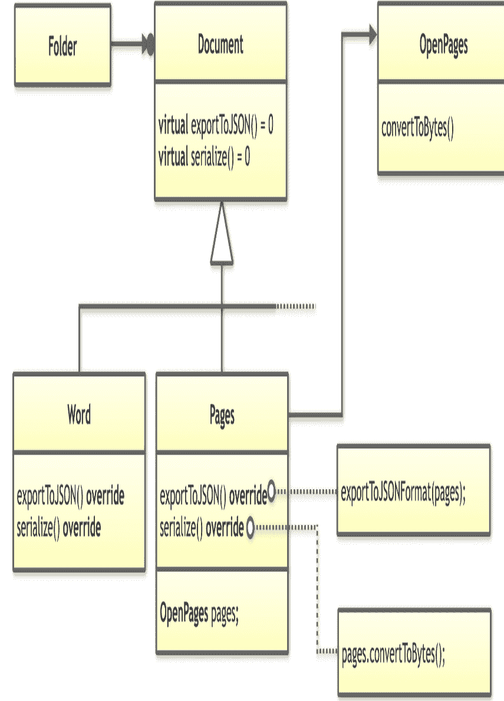

## Chapter 6. The Adapter, Observer and CRTP Design Patterns

### A NOTE FOR EARLY RELEASE READERS

With Early Release ebooks, you get books in their earliest form—the author’s raw and unedited content as they write—so you can take advantage of these technologies long before the official release of these titles.

This will be the 6th chapter of the final book. Please note that the GitHub repo will be made active later on.

If you have comments about how we might improve the content and/or examples in this book, or if you notice missing material within this chapter, please reach out to the editor at sevans@oreilly.com.

In this chapter we turn our attention to three must-know design patterns: the two GoF design patterns *Adapter* and *Observer*, and the *Curiously Recurring Template Pattern (CRTP)* design pattern.

In “Guideline 24: Use Adapters to Standardize Interfaces”, we talk about making incompatible things fit together by adapting interfaces. To achieve this, I will show you the *Adapter* design pattern and its application in both inheritance hierarchies and generic programming. Also, you will get an overview of different kinds of *Adapters*, including object, class, and function *Adapters*.

In “Guideline 25: Apply Observers as an Abstract Notification Mechanism”, we will deal with the question about how to observe state change and how to get notified about it. In this context I will introduce you


到 *Observer* 设计模式，这是最著名且最常用的设计模式之一。我们将讨论经典的、GoF 风格的 *Observer*，同时也会讨论如何在现代 C++ 中实现 *Observers*。

在“Guideline 26: Use CRTP to Introduce Static Type Categories”中，我们将把注意力转向 *CRTP*。我将向你展示如何使用 *CRTP* 在一组相关类型之间定义编译时关系，以及如何正确实现一个 *CRTP* 基类。

在“Guideline 27: Use CRTP for Static Mixin Classes”中，我将继续 *CRTP* 的故事，展示如何使用 *CRTP* 创建编译时混入类。我们还将看到语义继承与技术继承之间的区别，前者用于创建抽象，后者则作为实现细节，仅为技术上的优雅和便利而使用。

### Guideline 24: Use Adapters to Standardize Interfaces

假设你已经实现了“Guideline 3: Separate Interfaces to Avoid Artificial Coupling”中的 `Document` 示例，并且由于你正确遵循了 *ISP*，你对它的工作方式相当满意：

```
class JSONExportable
{
public:
    // ...
    virtual ~JSONExportable() = default;

    virtual void exportToJSON( /*...*/ ) const = 0;
    // ...
};

class Serializable
{
public:
    // ...
    virtual ~Serializable() = default;
```

```
virtual void serialize( ByteStream& bs, /*...*/ ) const = 0;
// ...
};

class Document
: public JSONExportable
, public Serializable
{
public:
// ...
};
```

然而，有一天，你被要求引入 Pages 文档格式。¹ 当然，它与你已有的 Word 文档类似，但不幸的是，你对 Pages 格式的细节相当不熟悉。更糟糕的是，你没有太多时间去熟悉该格式，因为你还有太多其他事情要做。幸运的是，你知道有一个相当不错的、开源的实现可供该格式使用：OpenPages 类：

```
class OpenPages
{
public:
// ...
void convertToBytes( /*...*/ );
};

void exportToJSONFormat( OpenPages const& pages, /*...*/ );
```

好消息是，这个类提供了你所需的大部分功能：它提供了一个 convertToBytes() 成员函数来序列化文档内容，并提供了自由函数 exportToJSONFormat() 将 Pages 文档转换为 JSON 格式。不幸的是，它不符合你的接口预期：你期望的是 serialize() 成员函数，而不是 convertToBytes() 成员函数。而你期望的是 exportToJSON() 成员函数，而不是自由的 exportToJSONFormat() 函数。最终，当然第三方类没有继承你的 `Document` 基类，这意味着你无法轻松地将该类纳入现有层次结构中。然而，这个问题有解决方案：通过 *Adapter* 设计模式可以实现无缝集成。

### The Adapter Design Pattern Explained

*Adapter* 设计模式是另一个经典的 GoF 设计模式：它专注于标准化接口，并在不侵入现有继承层次结构的情况下帮助添加功能：

> **THE ADAPTER DESIGN PATTERN**
> 
> Intent: “Convert the interface of a class into another interface clients expect. Adapter lets classes work together that couldn’t otherwise because of incompatible interfaces.” (GoF)

图 6-1 显示了你的 *Adapter* 场景的 UML 图：你已经有了 `Document` 基类就位（我们暂时忽略 `JSONExportable` 和 `Serializable` 接口），并且已经实现了几种不同的文档（例如通过 `Word` 类）。这个层次结构的新增部分是 `Pages` 类。



Figure 6-1. The UML representation of the Adapter design pattern.

Pages 类充当对第三方 OpenPages 类的包装：

```
class Pages : public Document
{
  public:
    // ...
    void exportToJSON( /*...*/ ) const override
    {
      exportToJSONFormat(pages, /*...*/);  ①
    }

    void serialize( ByteStream& bs, /*...*/ ) const override
    {
      pages.convertToBytes(/*...*/);  ②
    }
    // ...

  private:
    OpenPages pages;  // Example of an object adapter
};
```

Pages 通过将调用转发到相应的 OpenPages 函数来实现 Document 接口：对 exportToJSON() 的调用被转发到自由函数 exportToJSONFormat() ①，而对 serialize() 的调用被转发到 convertToBytes() 成员函数 ②。

通过 Pages 类，你可以轻松地将第三方实现集成到现有层次结构中。非常轻松：你可以在不以任何方式修改它的情况下进行集成。Adapter 设计模式的这种非侵入性是你应该视为其最大优势之一：任何人都可以添加一个 Adapter 来将一个接口适配到另一个现有接口。

在此上下文中，Pages 类充当了对 OpenPages 类实际实现细节的抽象。因此，Adapter 设计模式将接口的关注点与实现细节分离开来。这很好地满足了单一职责原则（SRP），并与开放封闭原则（OCP）的意图相契合（参见“Guideline 2: Design for Change” 和 “Guideline 5: Design for Extension”）。

某种程度上，Pages Adapter 充当了一个间接层，并将一组函数映射到另一组函数。请注意，严格地从一个函数映射到恰好另一个函数并不是必要的。相反，你在如何将期望的函数集映射到可用的函数集上拥有完全的灵活性。因此 Adapter 不一定代表 1 对 1 的关系，也可以支持 1 对 N 的关系。²

### Object Adapters vs. Class Adapters

Pages 类是所谓的 object adapter 的一个例子。这个术语指的是你存储被包装类型的实例。或者，鉴于被包装的类型是继承层次结构的一部分，你也可以存储指向该层次结构基类的指针。这将允许你对属于该层次结构的所有类型使用 object adapter，从而使 object adapter 的灵活性大大提高。

相比之下，还有实现所谓的 class adapter 的选项：

```
class Pages : public Document
            , private OpenPages  // Example of a class adapter  ③
{
public:
    // ...
    void exportToJSON( /*...*/ ) const override
    {
        exportToJSONFormat(*this, /*...*/);
    }

    void serialize( ByteStream& bs, /*...*/ ) const override
    {
        this->convertToBytes(/*...*/);
    }
    // ...
};
```

而不是存储被适配类型的实例，你将从它继承（如果可能为非公开继承），并相应地实现期望的接口 ③。然而，正如在“Guideline 20: Favor Composition Over Inheritance”中所讨论的，优先使用组合构建是更好的选择。通常，*object adapters* 比 *class adapters* 更灵活，因此应该是你的首选。只有在少数情况下你会更喜欢 *class adapter*：

- 如果你必须重写一个虚函数；
- 如果你需要访问 `protected` 成员函数；
- 如果你要求被适配的类型在另一个基类之前构造；
- 如果你需要共享一个共同的虚基类或重写虚基类的构造；
- 如果你能从 *Empty Base Optimization (EBO)* 中获得 *显著* 的优势。³

否则，在大多数情况下，你应该优先选择 *object adapter*。

“我喜欢这个设计模式，它很强大。然而，我刚想起你建议在代码中使用设计模式的名称来传达意图。类不应该叫做 `PagesAdapter` 吗？” 你提出了一个极好的观点。我很高兴你还记得“Guideline 14: Use a Design Pattern’s Name to Communicate Intent”，其中我确实认为模式的名称有助于理解代码。我承认在这种情况下，我对两种命名约定都持开放态度。虽然我确实看到了 `PagesAdapter` 这个名称的优点，因为它立即传达了你基于 *Adapter* 设计模式构建的事实，但我不认为有必要传达这个类代表一个适配器的事实。对我来说，在这种情况下，*Adapter* 更像是一个实现细节：我不需要知道 `Pages` 类没有自行实现所有细节，而是使用 `OpenPages` 类来实现。那是


reason why I said “consider using the name”. You should decide on a case to case basis.

### 标准库中的示例

适配器设计模式的一个有用应用是标准化不同类型容器的接口。让我们假设以下 Stack 基类：

//---- <Stack.h> ----------------

template< typename T >
class Stack
{
public:
    virtual ~Stack() = default;
    virtual T& top() = 0;
    virtual bool empty() const = 0;
    virtual size_t size() const = 0;
    virtual void push( T const& value ) = 0;
    virtual void pop() = 0;
};
```

这个 Stack 类提供了访问栈顶元素、检查栈是否为空、查询栈大小、将元素压入栈以及移除栈顶元素的必要接口。现在这个基类可以用来为各种数据结构实现不同的适配器，例如 std::vector：

//---- <VectorStack.h> ----------------

#include <Stack.h>

template< typename T >
class VectorStack : public Stack<T>
{
public:
    T& top() override { return vec_.back(); }
    bool empty() const override { return vec_.empty(); }
    size_t size() const override { return vec_.size(); }
    void push( T const& value ) override { vec_.push_back(value);
}
    void pop() override { vec_.pop_back(); }
    private:
        std::vector<T> vec_;
};
```

“你真的建议通过抽象基类来实现栈吗？你不担心性能影响吗？每次使用成员函数都要付出一次虚函数调用的代价！”你担心道。不，当然我没有这么建议。显然你是对的，我完全同意你的观点：从 C++ 的角度来看，这种容器感觉很奇怪而且非常低效。出于效率考虑，我们通常通过类模板来实现同样的思想。这是 C++ 标准库采用的方法，以三种 STL 类即容器适配器的形式出现：std::stack、std::queue 和 std::priority_queue：

```
template< typename T
    , typename Container = std::deque<T> >
class stack;
```

```
template< typename T
    , typename Container = std::deque<T> >
class queue;
```

```
template< typename T
    , typename Container = std::vector<T>
    , typename Compare = std::less<typename Container::value_type> >
class priority_queue;
```

这三个类模板的目的是将给定 Container 类型的接口适配到特定用途。例如，std::stack 类模板的目的是将容器的接口适配到栈操作 top()、empty()、size()、push()、emplace()、pop() 和 swap()。默认情况下，你可以使用三种可用的序列容器 std::vector、std::list 和 std::deque。对于任何其他容器类型，你都可以特化 std::stack 类模板。

“这感觉熟悉多了”，你明显松了一口气地说。再次，我完全同意。我也认为标准库的方法对于容器的目的来说是更合适的解决方案。但比较这两种方法仍然很有趣。虽然 Stack 基类和 std::stack 类模板之间存在许多技术差异，但这两种方法的目的和语义却 remarkably 相似：两者都提供了将任何数据结构适配到给定栈接口的能力。而且两者都作为变化点，允许你以非侵入的方式添加新的适配器，而无需修改现有代码。

### 适配器与策略的比较

“这三个 STL 类似乎实现了适配器的意图，但这不是与策略设计模式中配置行为的方式相同吗？这与 std::unique_ptr 及其删除器类似吗？”你问道。是的，你是对的。从结构上看，策略和适配器设计模式非常相似。然而，正如“准则 11：理解设计模式的目的”中所解释的，设计模式的结构可能相似甚至相同，但意图是不同的。在这种情况下，Container 参数不仅仅指定行为的一个方面，而是大部分行为甚至全部行为。类模板仅仅作为给定类型的功能包装器，主要适配接口。因此，适配器的主要关注点是标准化接口并将不兼容的功能集成到现有的一套约定中，而另一方面，策略设计模式的主要关注点是使行为能够从外部进行配置，建立在并提供预期的接口之上。此外，在适配器的情况下，没有必要在任何时候重新配置行为。

### 函数适配器

适配器设计模式的另一个例子是标准库的自由函数 begin() 和 end()。“你认真的吗？”你惊讶地问道。“你声称自由函数是适配器设计模式的例子？这不是类的任务吗？”嗯，不一定。自由 begin() 和 end() 函数的目的是将任何类型的迭代器接口适配到预期的 STL 迭代器接口。因此它将一组可用的函数映射到一组预期的函数，因而服务于与任何其他适配器相同的目的。主要区别在于，与基于继承（运行时多态）或模板（编译时多态）的对象适配器或类适配器不同，begin() 和 end() 汲取其力量于函数重载，这是 C++ 中第二种主要的编译时多态机制。尽管如此，某种形式的抽象仍然在起作用。

> **NOTE**
> 
> 记住所有类型的抽象都代表一组需求，因此必须遵守里氏替换原则（LSP）。这对重载集合也同样适用；请参阅“准则 8：理解重载集合的语义要求”。

考虑以下函数模板：

```
template< typename Range >
void traverseRange( Range const& range )
{
    for( auto&& element : range ) {
        // ...
    }
}
```

在 traverseRange() 函数中，我们通过基于范围的 for 循环迭代给定范围中包含的所有元素。遍历通过迭代器进行，编译器通过自由 begin() 和 end() 函数获取这些迭代器。因此上面的 for 循环等价于以下形式的 for：

```
template< typename Range >
void traverseRange( Range const& range )
{
    {
```

```
using std::begin;
using std::end;

auto first( begin(range) );
auto last ( end(range) );
for( ; first!=last; ++first ) {
    auto&& element = *first;
    // ...
}
}
```

显然基于范围的 for 循环使用起来方便得多。然而，在表面之下，编译器基于自由 begin() 和 end() 函数生成代码。请注意开头的两个 using 声明：它们的目的是为给定 range 类型启用参数依赖查找（ADL）。ADL 是确保调用“正确”的 begin() 和 end() 函数的机制，即使它们是位于用户特定命名空间中的重载。这意味着，你有机会为任何类型重载 begin() 和 end()，并将预期接口映射到不同的、特定用途的函数集。

这种函数适配器在 2004 年由 Matthew Wilson 称为 shim。这种技术的一个有价值的特性是，它完全是非侵入式的：可以为任何类型添加自由函数，甚至是那些你永远无法适配的类型，例如第三方库提供的类型。因此，任何以 shim 形式编写的通用代码，都赋予你将几乎任何类型适配到预期接口的巨大能力。因此，你可以想象，shim 或函数适配器是泛型编程的骨干。

### 分析适配器设计模式的不足

尽管适配器设计模式很有价值，但我应该明确指出该设计模式的一个问题。考虑以下示例，我借鉴自 Eric Freeman 和 Elisabeth Robson：


//---- <Duck.h> ----------------

class Duck
{
public:
    virtual ~Duck() = default;
    virtual void quack() = 0;
    virtual void fly() = 0;
};


//---- <MallardDuck.h> ----------------

#include <Duck.h>

class MallardDuck : public Duck
{
public:
    void quack() override { /*...*/ }
    void fly() override { /*...*/ }
};

我们从抽象的 Duck 类开始，它引入了两个纯虚函数 quack() 和 fly()。的确，这看起来是一个相当预期且自然的 Duck 类接口，并且当然会产生一些期望：鸭子发出非常特征性的声音并且能很好地飞行。这个接口被许多可能的 Duck 类型实现，例如 MallardDuck 类。现在，出于某种原因，我们还必须处理火鸡：

//---- <Turkey.h> ----------------

class Turkey
{
public:
    virtual ~Turkey() = default;
    virtual void gobble() = 0;  // Turkeys don't quack, they gobble!
    virtual void fly() = 0;     // Turkeys can fly (a short distance)
};


//---- <WildTurkey.h> ----------------

class WildTurkey : public Turkey
{
public:
    void gobble() override { /*...*/ }
    void fly() override { /*...*/ }
};

火鸡由抽象的 Turkey 类表示，当然它被许多不同种类的具体火鸡实现，例如 WildTurkey。事情变得更糟的是，出于某种原因，鸭子和火鸡被期望一起使用。⁷ 使其工作的一种可能方式是假装火鸡是鸭子。毕竟，火鸡与鸭子非常相似。好吧，它不会嘎嘎叫，但它可以咕咕叫（典型的火鸡声音），并且它也可以飞行（不是很远，但确实可以飞行）。因此，你可以做的是，通过 TurkeyAdapter 将火鸡适配为鸭子：

//---- <TurkeyAdapter.h> -------------

#include <memory>

class TurkeyAdapter : public Duck
{
public:
    explicit TurkeyAdapter( std::unique_ptr<Turkey> turkey )
        : turkey_{ std::move(turkey) }
    {}

    void quack() override { turkey_->gobble(); }
    void fly() override { turkey_->fly(); }

private:
    std::unique_ptr<Turkey> turkey_;  // This is an example for an object adapter
};

虽然这是对鸭子类型的有趣解释，但这个例子很好地证明了，将外来事物集成到现有层次结构中是多么容易。Turkey 根本就不是 Duck，即使我们希望它成为。 我认为很可能 quack() 和 fly() 函数都违反了 LSP。 这两个函数实际上并没有做我期望它们做的事情（至少我相当确定我想要一只嘎嘎叫的，而不是咕咕叫的生物，并且我想要一只能够像鸭子一样真正飞行的生物）。 当然这取决于具体的上下文，但不可否认的是，适配器设计模式使得将不属于一起的东西组合起来变得非常容易。 因此，在应用此设计模式时，考虑预期的行为并检查 LSP 违规非常重要：

#include <MallardDuck.h>
#include <WildTurkey.h>
#include <TurkeyAdapter.h>
#include <memory>
#include <vector>

using DuckChoir = std::vector<std::unique_ptr<Duck>>;

void give_concert( DuckChoir const& duck_choir )
{
    for( auto const& duck : duck_choir ) {
        duck->quack();
    }
}

int main()
{
    DuckChoir duck_choir{};

    // Let us hire the world's best ducks for the choir
    duck_choir.push_back( std::make_unique<MallardDuck>() );
    duck_choir.push_back( std::make_unique<MallardDuck>() );
    duck_choir.push_back( std::make_unique<MallardDuck>() );

    // Unfortunately we also hire a turkey in disguise
    auto turkey = std::make_unique<WildTurkey>();
    auto turkey_in_disguise = std::make_unique<TurkeyAdapter>(
    std::move(turkey) );
    duck_choir.push_back( std::move(turkey_in_disguise) );

    // The concert is going to be a musical disaster...
    give_concert( duck_choir );

    return EXIT_SUCCESS;
}

总之，*Adapter* 设计模式可以被认为是最有价值的设计模式之一，用于组合不同的功能片段并使它们协同工作。我保证它将在你的日常工作中证明是有价值的工具。 尽管如此，不要在一些英雄式的努力中滥用 *Adapter* 的强大功能来组合苹果和橙子（甚至橙子和葡萄柚：它们相似，但并不相同）。 始终注意 *LSP* 的期望。

### GUIDELINE 24: USE *ADAPTERS* TO STANDARDIZE INTERFACES

- Apply the *Adapter* design pattern with the intent to adapt interfaces, so that otherwise incompatible pieces can work together;
- Be aware that *Adapter* is useful for both dynamic and static polymorphism;
- Distinguish between *object adapters*, *class adapters*, and *function adapters*;
- Understand the differences between the *Adapter* and *Strategy* design pattern;
- Pay attention to *LSP* violations when using the *Adapter* design pattern.

### Guideline 25: Apply Observers as an Abstract Notification Mechanism

很有可能你以前听说过观察者。 “哦，是的当然，我不是听说所谓的社交媒体平台就是用它来对付我们的吗？” 你在问。 好吧，不完全是我想要的，但我相信我们可以称这些平台为观察者。 而且，是的，他们所做的事情也有一种模式，即使它不是设计模式。 但我实际上是在想 GoF 最受欢迎的设计模式之一，*Observer* 设计模式。 即使你还不熟悉这个想法，你很可能已经有过来自现实生活的 helpful observers 的一些经验。 例如，你可能已经注意到在你最喜欢的即时通讯应用中，文本消息的发送者在你阅读新文本消息后会立即收到通知。 这意味着消息显示为“已读”而不是仅仅“已送达”。 这项小服务本质上是现实生活中的 *Observer* 的工作：只要新消息的状态发生变化，发送者就会收到通知，从而有机会对状态变化做出响应。

#### The Observer Design Pattern Explained

在许多软件情况下，在发生某些状态变化时获得反馈是可取的：任务队列中添加了新作业，配置对象中的设置发生了更改，结果已准备好被提取，等等。 但同时，在主题（即发生变化的被观察实体）和其观察者（即基于状态变化而被通知的回调）之间引入显式依赖关系将是极其不可取的。 相反：主题应该对可能存在的许多不同类型的观察者一无所知。 这仅仅是因为任何直接依赖关系都会使软件更难更改和扩展。 主题与其潜在的众多观察者之间的这种解耦是 *Observer* 设计模式的意图：

> **THE *OBSERVER* DESIGN PATTERN**
> 
> Intent: “Define a one-to-many dependency between objects so that when one object changes state, all its dependents are notified and updated automatically.” (GoF)

与所有设计模式一样，*Observer* 设计模式将一个方面识别为 *variation point*（即发生变化或预期发生变化的方面）并以抽象的形式提取它。 因此它有助于解耦软件实体。 在 *Observer* 的情况下，引入新观察者的需要，将一对多依赖扩展的需要，被认为是 *variation point*。 如图 6-2 所示，此 *variation point* 以 `Observer` 基类的形式实现：

Figure 6-2. The UML representation of the Observer design pattern.

Observer 类代表所有可能的观察者实现的抽象。 这些观察者附加到特定的主题，由 ConcreteSubject 类表示。 为了减少观察者与其主题之间的耦合，或者为了通过为不同观察者提供 attach() 和 detach() 的所有通用服务来简单地减少代码重复，可以使用 Subject 抽象。 这个 Subject 还可以 notify() 所有附加的观察者关于状态变化并触发它们相应的 update() 功能。

“引入 Observer 基类不是另一个单一职责原则（SRP）的例子吗？” 你问。 而且是的，你是 100% 正确的：提取 Observer 类，提取一个变化点，就是 SRP 在行动（参见“Guideline 2: Design for Change”）。 再次，SRP 充当开放封闭原则（OCP）的使能器（参见“Guideline 5: Design for Extension”）：通过引入 Observer 抽象，任何人都可以添加新类型的观察者（例如 ConcreteObserver）而无需修改现有代码。 如果你注意 Observer 基类的所有权并确保 Observer 类位于架构的高层，那么你也满足了依赖倒置原则（DIP）。

#### A Classic Observer Implementation

“太好了，我明白了！ 看到这些设计原则再次付诸实践很不错，但我想看一个具体的 Observer 示例。” 我理解。 所以让我们看一个具体的实现。 然而，在我们开始查看代码之前，我应该在开始之前明确说明以下示例的局限性。 你可能已经熟悉 Observer，因此你可能正在寻找有关 Observer 许多棘手实现细节的帮助和更深入的建议：如何处理附加和分离观察者的顺序，如何处理多次附加同一个观察者，以及特别是在并发环境中如何处理观察者。 我应该诚实地提前说明，我无意提供这些问题的答案。 这种讨论就像打开了一个潘多拉魔盒，很快就会把我们吸入实现细节的领域。 不，虽然你


可能会让你失望，我的意图是主要停留在软件设计的层面。⁸

与之前的设计模式一样，我们从 *Observer* 设计模式的经典实现开始。核心元素是 `Observer` 基类：

//---- <Observer.h> ----------------

class Observer
{
public:
    virtual ~Observer() = default;

    virtual void update( /*...*/ ) = 0;  ①
};
```

此类最重要的实现细节是纯虚 `update()` 函数（①），每当观察者被通知到某种状态变化时就会调用它。⁹ 定义 `update()` 函数有三种替代方案，它们提供了合理的实现和设计灵活性。第一种替代方案是通过一个甚至几个 `update()` 函数推送更新后的状态：

```
class Observer
{
public:
    // ...
    virtual void update1( /*arguments representing the updated state*/ ) = 0;
    virtual void update2( /*arguments representing the updated state*/ ) = 0;
    // ...
};
```

这种形式的观察者通常被称为 *push observer*。在此形式中，观察者由主题提供所有必要的信息，因此无需自行从主题中提取信息。这可以显著降低与主题的耦合，并创造出将 Observer 类用于多个主题的机会。此外，还可以选择为每种状态变化使用单独的重载。上面的代码片段中有两个 update() 函数，每个可能的两种状态变化各一个。而且由于总是清楚哪种状态发生了变化，观察者无需“搜索”任何状态变化，这被证明是高效的。

“请原谅”，你开始提问，“但这不是违反了接口隔离原则吗？我们不应该通过将 update() 函数分离到几个基类中来分离关注点吗？” 这是个好问题！显然你正在提防人为的耦合。非常好！而且你是对的：我们可以将具有多个 update() 函数的 Observer 分成更小的 Observer 类：

```
class Observer1
{
public:
    // ...
    virtual void update1( /*arguments representing the updated state*/ ) = 0;
    // ...
};

class Observer2
{
public:
    // ...
    virtual void update2( /*arguments representing the updated state*/ ) = 0;
    // ...
};
```

理论上，这种方法可能有助于减少对特定主题的耦合，并更轻松地将观察者重用于不同的主题。它也可能有所帮助，因为不同的观察者可能对不同的状态变化感兴趣，因此将所有可能的状态变化人为耦合起来可能违反 ISP。当然，这也可能带来效率提升，如果可以避免大量不必要的状态变化通知。

不幸的是，特定主题不太可能区分不同种类的观察者。首先，因为这需要它存储不同种类的指针（这对主题来说处理起来很不方便），其次，因为不同的状态变化可能以某种方式关联。在这种情况下，主题会期望观察者对 *所有* 可能的状态变化感兴趣。从这个角度来看，将几个 `update()` 函数组合到一个基类中是合理的。无论如何，很可能一个具体的观察者必须处理各种状态变化。我知道，处理多个 `update()` 函数可能很麻烦，即使其中只有很小一部分是有趣的。但仍然，请确保你没有通过不遵守某些预期行为（如果有的话）而意外违反 *Liskov Substitution Principle*。

*push observer* 还有几个潜在的缺点。首先，观察者 *总是* 被提供 *所有* 信息，无论它们是否需要。因此这种推送风格仅在观察者大多数时候需要信息时才有效。否则在不必要的通知上会浪费大量精力。其次，推送会产生对传递给观察者的参数数量和种类的依赖。对这些参数的任何更改都需要对派生的观察者类进行大量后续更改。

第二种 `Observer` 替代方案解决了其中一些缺点。可以只将主题的引用传递给观察者：¹⁰

```
class Observer
{
public:
    // ...
    virtual void update( Subject const& subject ) = 0;
    // ...
};
```

由于没有向观察者传递特定信息，从 `Observer` 基类派生的类需要自行从主题中提取新信息。因此，这种形式的观察者通常被称为 *pull observer*。优点是减少了对参数数量和种类的依赖。派生的观察者可以自由查询任何信息，而不仅仅是已更改的状态。另一方面，这种设计在从 `Observer` 派生的类与主题之间创建了强有力的直接依赖。因此主题的任何更改都很容易反映到观察者上。此外，如果可能更改多个细节，观察者可能不得不“搜索”状态变化。这可能被证明是不必要低效的。

如果你只考虑将单个信息片视为变化状态，性能劣势可能不会对你构成限制。尽管如此，请记住软件会发生变化：主题可能会增长，随着它希望通知不同种类的变化。相应地调整观察者将导致大量额外工作。从这个角度来看，*push observer* 似乎是更好的选择。

幸运的是，有第三种替代方案，它消除了许多之前的缺点，因此成为我们的首选方法：除了传递主题的引用外，我们还传递一个标签以提供有关主题的哪个属性已更改的信息：

//---- <Observer.h> ----------------

class Observer
{
public:
    virtual ~Observer() = default;

    virtual void update( Subject const& subject
        , /*Subject-specific type*/ property ) = 0;
};
```

标签可以帮助观察者自行决定某些状态变化是否有趣。它通常由某种主题特定的枚举类型表示，该类型列出了所有可能的状态变化。这不幸地增加了 `Observer` 类与特定主题的耦合。

“我们是否可以通过将 Observer 基类实现为类模板来消除对特定 Subject 的依赖？请看下面的代码片段：”

//---- <Observer.h> ----------------

template< typename Subject, typename StateTag >  ②
class Observer
{
public:
    virtual ~Observer() = default;

    virtual void update( Subject const& subject, StateTag property
) = 0;
};
```

这是一个很好的建议：通过以类模板的形式定义 Observer 类（②），我们可以轻松地将 Observer 提升到更高的架构层面：在这种形式下，该类不依赖于任何特定主题，因此可以被许多希望定义一对多关系的主题重用。然而，你不应该对这种改进期望太多：效果仅限于 Observer 类。具体主题将期望此观察者类的具体实例化，因此具体实现的 Observer 仍将强烈依赖于主题。

为了更好地理解为什么会这样，让我们看一个可能的主题实现。在你关于社交媒体的初始评论之后，我建议我们为人物实现一个 Observer。好吧，这个例子在道德上可能值得怀疑，但它会发挥其作用，所以让我们继续吧。至少我们知道谁要为此负责。

以下 Person 类代表一个被观察的人：

//---- <Person.h> ----------------

#include <Observer.h>
#include <string>


```cpp
#include <set>

class Person
{
public:
    enum StateChange
    {
        forenameChanged,
        surnameChanged,
        addressChanged
    };

    using PersonObserver = Observer<Person,StateChange>; ⑤

    explicit Person( std::string forename, std::string surname )
        : forename_{ std::move(forename) }
        , surname_{ std::move(surname) }
    {}

    bool attach( PersonObserver* observer ); ⑥
    bool detach( PersonObserver* observer ); ⑦

    void notify( StateChange property ); ⑧

    void forename( std::string newForename ); ⑨
    void surname ( std::string newSurname );
    void address ( std::string newAddress );

    std::string const& forename() const { return forename_; }
    std::string const& surname () const { return surname_; }
    std::string const& address () const { return address_; }

private:
    std::string forename_; ③
    std::string surname_;
    std::string address_;

    std::set<PersonObserver*> observers_; ④
};
```

在此示例中，Person 仅仅是三个数据成员 forename_、surname_ 和 address_ 的聚合（③）（我知道，这是一个相当简单的个人表示）。此外，一个人还保存着已注册观察者的 std::set（④）。请注意，观察者是通过指向 PersonObserver 实例的指针进行注册的（⑤）。

这有两个原因很有趣：首先，这展示了模板化 Observer 类的目的：Person 类从类模板实例化了它自己的观察者类型。其次，指针在这种情况下被证明非常有用，因为对象的地址是唯一的。因此，通常使用地址作为观察者的唯一标识符。

“这不应该是 std::unique_ptr 或 std::shared_ptr 吗？”你可能会问。不，不是这种情况。指针仅用作对已注册观察者的句柄，它们不应拥有观察者。因此，任何拥有智能指针在这种情况下都是错误的工具。唯一合理的选择是 std::weak_ptr，它允许你检查悬空指针。然而，std::weak_ptr 并不是 std::set 的键的良好候选（即使使用自定义比较器也不行）。虽然仍然有办法使用 std::weak_ptr，但我将坚持使用原始指针。但请不要担心，这并不意味着我们放弃了现代 C++ 的好处。不，在这种情况下使用原始指针是完全有效的。这也在 C++ 核心准则 F.7 中有所体现：

> 对于一般用途，使用 T* 或 T& 参数而不是智能指针。
> 
> —C++ Core Guideline F.7

每当你对一个人的状态变化感兴趣时，你都可以通过 attach() 成员函数（⑥）注册一个观察者。而每当你不再对通知感兴趣时，你可以通过 detach() 成员函数（⑦）注销一个观察者。这两个函数是观察者设计模式的重要组成部分，因此是该设计模式应用的明确指示：

```cpp
bool Person::attach( PersonObserver* observer )
{
    auto [pos,success] = observers_.insert( observer );
    return success;
}

bool Person::detach( PersonObserver* observer )
{
    return ( observers_.erase( observer ) > 0U );
}
```

你可以完全自由地按照自己的意愿实现 attach() 和 detach() 函数。在此示例中，我们仅允许通过 std::set 将观察者注册一次。如果尝试第二次注册观察者，函数将返回 false。如果尝试注销未注册的观察者，也会发生同样的情况。请注意，不允许多次注册的决定是我为此示例所做的选择。在其他场景中，接受重复注册可能是期望的甚至是必要的。无论如何，被观察者的行为和接口在所有情况下都应该是始终一致的。

观察者设计模式的另一个核心函数是 notify() 成员函数（8）。每当发生某种状态变化时，就会调用此函数来通知所有已注册的观察者有关该变化的信息：

```cpp
void Person::notify( StateChange property )
{
    for( auto iter=begin(observers_); iter!=end(observers_); )
    {
        auto const pos = iter++;
        (*pos)->update(*this,property);
    }
}
```

> “为什么 notify() 函数的实现如此复杂？基于范围的 for 循环难道完全不够吗？”你是对的，我应该解释这里发生了什么。给出的表述确保在迭代期间可以检测到 detach() 操作。例如，如果观察者在 update() 函数调用期间决定自行注销，就会发生这种情况。但我并不声称这种表述是完美的：不幸的是，它无法应对 attach() 操作。并且不要甚至开始询问并发问题！所以这只是观察者实现细节为何如此棘手的一个例子。

notify() 函数在所有三个 setter 函数（9）中被调用。请注意，在所有三个函数中，我们始终传递不同的标签来指示哪个属性已更改。此标签可由继承自 Observer 基类的类用来确定更改的性质：

```cpp
void Person::forename( std::string newForename )
{
    forename_ = std::move(newForename);
    notify( forenameChanged );
}

void Person::surname( std::string newSurname )
{
    surname_ = std::move(newSurname);
    notify( surnameChanged );
}

void Person::address( std::string newAddress )
{
    address_ = std::move(newAddress);
    notify( addressChanged );
}
```

有了这些机制，你现在能够编写新的完全符合 OCP 的观察者。例如，你可以决定实现 NameObserver 和 AddressObserver：

```
//---- <NameObserver.h> ----------------

#include <Observer.h>
#include <Person.h>

class NameObserver : public Observer<Person,Person::StateChange>
{
public:
    void update( Person const& person, Person::StateChange property ) override;
};

//---- <NameObserver.cpp> ----------------

#include <NameObserver.h>

void NameObserver::update( Person const& person,
Person::StateChange property )
{
    if( property == Person::forenameChanged ||
        property == Person::surnameChanged )
    {
        // ... Respond to changed name
    }
}
```

```
//---- <AddressObserver.h> ----------------

#include <Observer.h>
#include <Person.h>

class AddressObserver : public
Observer<Person,Person::StateChange>
{
public:
    void update( Person const& person, Person::StateChange
property ) override;
};
```

```
//---- <AddressObserver.cpp> ----------------

#include <AddressObserver.h>

void AddressObserver::update( Person const& person,
Person::StateChange property )
{
    if( property == Person::addressChanged ) {
        // ... Respond to changed address
    }
}
```

配备了这两个观察者后，你现在能够在人的姓名或地址发生变化时收到通知：

```cpp
#include <AddressObserver.h>
#include <NameObserver.h>
#include <Person.h>
#include <cstdlib>

int main()
{
    NameObserver nameObserver;
    AddressObserver addressObserver;

    Person homer( "Homer" , "Simpson" );
    Person marge( "Marge" , "Simpson" );
    Person monty( "Montgomery", "Burns" );

    // Attaching observers
    homer.attach( &nameObserver );
    marge.attach( &addressObserver );
    monty.attach( &addressObserver );

    // Updating information on Homer Simpson
    homer.forename( "Homer Jay" );  // Adding his middle name

    // Updating information on Marge Simpson
    marge.address( "712 Red Bark Lane, Henderson, Clark County, Nevada 89011" );

    // Updating information on Montgomery Burns
    monty.address( "Springfield Nuclear Power Plant" );

    // Detaching observers
    homer.detach( &nameObserver );

    return EXIT_SUCCESS;
}
```

在这些许多实现细节之后，让我们退一步再次审视更大的图景。图 6-3 显示了此观察者示例的依赖图。由于决定以类模板的形式实现 Observer 类，Observer 类位于我们架构的最高层级。这使你能够为多个目的重用 Observer 类，例如用于 Person 类。Person 类声明了它自己的 Observer<Person, Person::StateChange> 类型，并由此将代码注入到它自己的架构层级中。具体的人观察者，例如 NameObserver 和 AddressObserver，随后可以基于此声明构建。


High-level

```
template< typename Subject, typename StateTag >
class Observer
{
public:
    virtual ~Observer() = default;
    virtual void update( const Subject& subject
        , StateTag property );
    // ...
};
```

Architectural Boundary

```
class Person
{
public:
    enum StateChange { /*...*/ };

    using PersonObserver =
        Observer<Person,StateChange>;
    // ...
    void attach( PersonObserver* observer );
    void detach( PersonObserver* observer );

private:
    // ...
    std::vector<PersonObserver*> observers_;
};
```

```
template<>
class Observer<Person,Person::StateChange>
{
public:
    virtual ~Observer() = default;
    virtual void update( const Person& subject
        , Person::StateChange property );
    // ...
};
```

Instantiated by the Person class and injected into its own architectural level

Architectural Boundary

```
class NameObserver : public Observer<Person>
{
public:
    // ...
    void update( const Person& person
        , Person::StateChange property ) override;
};
```

```
class AddressObserver : public Observer<Person>
{
public:
    // ...
    void update( const Person& person
        , Person::StateChange property ) override;
};
```

Low-level

Figure 6-3. Dependency graph for the Observer design pattern.

### An Observer Implementation Based on Value Semantics

“I understand why you have started with a classic implementation, but since you have made the point about favoring value semantics, how would the observer look like in a value semantics world?” That is an excellent question, since this a very reasonable next step. As explained in “Guideline 22: Prefer Value Semantics to Reference Semantics”, there are a lot of good reasons to avoid the realm of reference semantics. However, we will not entirely stray from the classic implementation: in order to register and deregister observers we will always be in need of some unique identifier for observers and the unique address of an observer is just the easiest and most convenient way to tackle that problem. Therefore we will stick to using a pointer to refer to a registered observer. However, there is an elegant way to avoid the inheritance hierarchy: std::function:

```
//---- <Observer.h> ----------------

#include <functional>

template< typename Subject, typename StateTag >
class Observer
{
public:
    using OnUpdate = std::function<void(Subject const&, StateTag)>;

    // No virtual destructor necessary

    explicit Observer( OnUpdate onUpdate )
        : onUpdate_{ std::move(onUpdate) }
    {
        // Possibly respond on an invalid/empty std::function instance
    }

    // Non-virtual update function
    void update( Subject const& subject, StateTag property )
    {
```

```
onUpdate_( subject, property );
}

private:
    OnUpdate onUpdate_;
```

Instead of implementing the Observer class as a base class, and thus requiring deriving classes to inherit and to implement the update() function in a very specific way, we separate concerns and rather build on composition (see “Guideline 20: Favor Composition Over Inheritance”). The Observer class first provides a type alias called OnUpdate for a std::function type for the expected signature of our update() function ⑪. Via the constructor you are passed an instance of std::function ⑩ and you move it into your data member onUpdate_ ⑧. The job of the update() function is now to forward the call, including the arguments, to onUpdate_ ⑧.

The flexibility gained by means of std::function is easily demonstrated by means of an updated main() function:

```
#include <Observer.h>
#include <Person.h>
#include <cstdlib>

void propertyChanged( Person const& person, Person::StateChange property )
{
    if( property == Person::forenameChanged ||
        property == Person::surnameChanged )
    {
        // ... Respond to changed name
    }
}

int main()
{
    using PersonObserver = Observer<Person,Person::StateChange>;

    PersonObserver nameObserver( propertyChanged );

    PersonObserver addressObserver(
```

```
[/*captured state*/]( Person const& person,
Person::StateChange property ){
    if( property == Person::addressChanged )
    {
        // ... Respond to changed address
    }
} );

Person homer( "Homer"    , "Simpson" );
Person marge( "Marge"    , "Simpson" );
Person monty( "Montgomery", "Burns"   );

// Attaching observers
homer.attach( &nameObserver );
marge.attach( &addressObserver );
monty.attach( &addressObserver );

// ...

return EXIT_SUCCESS;
}
```

Due to choosing a less intrusive approach and thanks to decoupling with std::function, the choice on how to implement the update() function is completely up to the observer’s implementer (stateless, stateful, ...). In case of the nameObserver, we build on the free function propertyChanged(), which itself is strongly decoupled because it is not bound to a class and might be reused on several occasions. The addressObserver on the other hand chooses a lambda instead, which could possibly capture some state. Either way, the only convention that these two have to follow is to fulfill the required signature of the required std::function type.

“Why do we still need the Observer class? Couldn’t we just directly use std::function?” Yes, it most certainly looks that way. From a functionality point of view, the Observer class does not add anything by itself. However, as std::function is a true child of value semantics, we tend to copy or move std::function objects. But this is not desirable in this situtation: especially if you use a stateful observer you do not want a copy of your observer to be called. And although technically possible, it is

not particularly common to pass pointers to std::function around.
Therefore the Observer class may still be of value in form of an Adaptor for std::function (see “Guideline 24: Use Adapters to Standardize Interfaces”).

### Analyzing the Shortcomings of the Observer Design Pattern

“This is not quite the value semantics solution I was expecting, but I still like it!” Well, I’m glad that you feel this way. Indeed, the value semantics advantages in combination with the benefits of the Observer design pattern (i.e. decoupling an event from the action taken for that event and the ability to easily add new kinds of observers) work really, really well. Unfortunately there is no perfect design, and every design also comes with disadvantages.

First, I should explicitly spell out that the demonstrated std::function approach only works well for a pull observer with a single update() function. Since a std::function can only cope with a single callable, any approach that would require multiple update() functions could not be handled by means of a single std::function. Therefore std::function is usually not the way to go for a push observer with multiple update() functions or the potential for a growing number of update() functions (remember, code tends to change!). However, it is possible to generalize the approach of std::function. In case the need arises, the design pattern of choice is Type Erasure (please refer to Chapter 8).

A second (minor) disadvantage is, as you have seen, that there is no pure value based implementation. While we might be able to implement the update() functionality in terms of std::function to gain flexibility, we still use a raw pointer to attach and detach Observers. And that is easy to explain: the advantages of using a pointer as unique identifier are just too good to dismiss. Additionally, in case of a stateful Observer, we do not want to deal with the copy of an entity. Still, this of course requires us to check for nullptr (which takes additional effort) and we always have to

pay for the indirection that the pointer represents.¹¹ I personally would rate this as only a minor point because of the many advantages of this approach.

A far bigger disadvantage are the potential implementation issues with *Observers*: the order of registration and deregistration may matter a lot, in particular if an observer is allowed to register multiple times. Also, in a multi-threaded environment, the thread-safe registration and deregistration of observers and handling of events are a highly non-trivial topic. For instance, an untrusted observer can freeze a server during a callback if it behaves inappropriately, and implementing timeouts for arbitrary computations is *very* non-trivial. However, this topic is far outside the scope of this book.

What is in the scope of this book, however, is the alleged danger that the overuse of observers can quickly and easily lead to a complex network of interconnections. Indeed, if you are not careful, you can accidentally introduce an infinite loop of callbacks! For that reason, developers are sometimes concerned to use *Observers* and afraid that a single notification results in a huge, global response due to these interconnections. While this danger exists of course, a proper design should not be severely affected by this: if you have a proper architecture and if you have properly implemented your observers, then any sequence of notifications should always run along a directed, acyclic graph (DAG) towards the lower levels of your architecture. And that of course is the beauty of good software design.

In summary, with the intent of providing a solution for notification on state change, the *Observer* design pattern proves to be one of the most famous and most commonly used design patterns. Aside from the potentially tricky implementation details, it is definitely one of the design patterns that should be in every developer’s tool box.


### GUIDELINE 25: APPLY OBSERVERS AS AN ABSTRACT NOTIFICATION MECHANISM

- Apply the *Observer* design pattern with the intent to create a one-to-many relationship between a subject and its observers;
- Understand the trade-offs between *push observers* and *pull observers*;
- Utilize the advantages of a value semantics-based *Observer* implementation.

### Guideline 26: Use CRTP to Introduce Static Type Categories

C++ really has a lot to offer. It comes with lots of features, many syntactic curiosities and, in addition, a large number of amazing, utterly unpronounceable and (for the uninitiated) plainly cryptic acronyms: RAII, ADL, CTAD, SFINAE, NTTP, IFNDR, and SIOF. Oh, what fun! One of these cryptic acronyms is *CRTP*, short for the *Curiously Recurring Template Pattern.*¹² If you are now scratching your head because the name does not make any sense to you, do not worry: as so often in C++, the name was chosen pretty randomly, but has stuck and has never been reconsidered or changed afterwards. The pattern was named by James Coplien in the February 1995 issue of the C++ Report, after realizing that, curiously, this pattern was recurring in many different C++ code bases.¹³ And curiously, this pattern, although building on inheritance and (potentially) serving as an abstraction, does not exhibit the usual performance drawbacks of many other, classic design patterns. For that reason, *CRTP* is definitely worth a look, as it may become a valuable, or should I say *curious*, addition to your design pattern toolbox.

#### A Motivation for CRTP

Performance is very important in C++. So important in fact, that in several contexts the performance overhead of using virtual functions is considered outright unacceptable. Therefore, in performance sensitive contexts, such as certain parts of computer games or high-frequency trading, no virtual functions are used. The same is true for high-performance computing (HPC): in HPC, any kind of conditional or indirection, and this includes virtual functions, is banned from the most performance critical parts, such as the innermost loops of compute kernels. Using them would incur too much of a performance overhead.

To give an example for how and why this matters, let us consider the following DynamicVector class template from a linear algebra (LA) library:

```
//---- <DynamicVector.h> ----------------

#include <numeric>
#include <iosfwd>
#include <iterator>
#include <vector>
// ...

template< typename T >
class DynamicVector
{
public:
    using value_type      = T;    ②
    using iterator        = typename std::vector<T>::iterator;
    using const_iterator  = typename std::vector<T>::const_iterator;

    // ... Constructors and special member functions

    size_t size() const;    ③

    T&       operator[]( size_t index );    ④
    T const& operator[]( size_t index ) const;

    iterator      begin();    ⑤
    const_iterator begin() const;
    iterator      end();
    const_iterator end() const;
```

```
// ... Many numeric functions
private:
    std::vector<T> values_;  ①
    // ...
};

template< typename T >
std::ostream& operator<<( std::ostream& os, DynamicVector const<T>& vector )  ⑥
{
    os << "(";
    for( auto const& element : vector ) {
        os << " " << element;
    }
    os << " )";

    return os;
}

template< typename T >
auto l2norm( DynamicVector const<T>& vector )  ⑦
{
    using std::begin, std::end;
    return std::sqrt( std::inner_product( begin(vector), end(vector)
        , begin(vector), T{} ) );
}

// ... Many more
```

Despite the name, DynamicVector does not represent a container, but a numerical vector for the purpose of LA computations. The Dynamic part of the name implies, that it allocates its elements of type T dynamically, in this example in the form of a std::vector ①. For that reason it is suited for large LA problems (definitely in the range of several million elements). Although this class may be loaded with many numerical operations, from an interface point of view you might indeed be tempted to call it a container: it provides the usual nested types (value_type, iterator, and const_iterator) ②, a size() function to query the current number of elements ③, subscript operators to access individual

elements by index (one for non-const and one for const vectors) ④, and begin() and end() functions to iterate over the elements ⑤. Apart from the member functions, it also provides an output operator ⑥ and, to show at least one LA operation, a function to compute the vector’s Euclidean norm (often also called the L2 norm, because it approximates the L2 norm for discrete vectors) ⑦.

The DynamicVector is not the only vector class, though. In our LA library, you will also find the following StaticVector class:

```
//---- <StaticVector.h> ----------------

#include <array>
#include <numeric>
#include <iosfwd>
#include <iterator>
// ...

template< typename T, size_t Size >
class StaticVector
{
public:
    using value_type      = T;    ⑧
    using iterator        = typename std::array<T,Size>::iterator;
    using const_iterator = typename std::array<T,Size>::const_iterator;

    // ... Constructors and special member functions

    size_t size() const;    ⑨

    T&       operator[]( size_t index );    ⑩
    T const& operator[]( size_t index ) const;

    iterator      begin();    ⑪
    const_iterator begin() const;
    iterator      end();
    const_iterator end() const;

    // ... Many numeric functions

private:
    std::array<T,Size> values_;    ⑫
```

```
// ...
};

template< typename T, size_t Size >
std::ostream& operator<<( std::ostream& os, StaticVector<T,Size> const& vector )
{
    os << "(";
    for( auto const& element : vector ) {
        os << " " << element;
    }
    os << " )";

    return os;
}

template< typename T, size_t Size >
auto l2norm( StaticVector<T,Size> const& vector )
{
    using std::begin, std::end;
    return std::sqrt( std::inner_product( begin(vector),
end(vector)
                                    , begin(vector), T{} ) );
}
```

“Isn’t this almost the same as the DynamicVector class?” you are wondering. Yes, these two classes are very similar indeed. The StaticVector class provides the same interface as the DynamicVector, such as the nested types value_type, iterator, and const_iterator (8), the size() member function (9), the subscript operators (10), and the begin() and end() functions (11). It also comes with an output operator (12) and a free l2norm() function (13). However, there is an important, performance-related difference between the two vector classes: as the Static in the name suggests, the StaticVector does not allocate its elements dynamically. Instead, it uses an in-class buffer to store its elements, for instance by means of a std::array (14). Thus in contrast to DynamicVector, the entire functionality of StaticVector is optimized for a small, fixed number of elements, such as 2D or 3D vectors.

“Ok, I understand that this is important for performance, but there still is a lot of code duplication, right?” Again, you are correct. If you take a close look at the associated output operator of the two vector classes, you will find that the implementation of these two functions is identical. This is deeply undesirable: in case anything changes, for instance the way vectors are formatted (and remember: change is the one constant in software development and needs to be expected; see “Guideline 2: Design for Change”), then you would have to make the change in many places, not just one. This is a violation of the Don’t Repeat Yourself (DRY) principle: it is easy to forget or to miss updating one of the many places, thus introducing an inconsistency or even a bug.

“But isn’t this duplication easily resolved by means of a slightly more general function template? For example, I can imagine the following output operator for all kinds of dense vectors:”

```
template< typename DenseVector >
std::ostream& operator<<( std::ostream& os, DenseVector const&
vector )
{
    // ... as before
}
```

Although this seems like an adequate solution, I would not accept this code in a pull request. This function template is indeed more general, but I would definitely not call it “slightly” more general: what you are suggesting is the most general output operator one could possibly write. Yes, the name of the function template may suggest that it is written for only dense vectors (including DynamicVector and StaticVector), but this function template will in fact accept any type: DynamicVector, StaticVector, std::vector, std::string, but also fundamental types such as int and double. It simply fails to specify any requirement or any kind of constraint. For that reason it violates the Core Guideline T.10:¹⁴


*为所有模板参数指定概念。*

—C++ 核心准则 T.10

虽然这个输出运算符对所有稠密向量以及序列容器都有效，但对于不提供预期接口的所有类型，你都会得到编译错误。或者更糟：你可能会微妙地违反隐式要求和期望，从而违反 *里氏替换原则 (LSP)*（参见“准则 6：遵循抽象的预期行为”）。当然你不会有意识地这样做，但很可能会意外地这样做：这个输出运算符与任何类型都是完美匹配的，即使你并不期望它也会被使用。因此，这个函数模板将是输出运算符重载集合中非常不幸的补充。我们完全需要一套新的类型，一个新的类型类别……

> “这不正是基类的用途吗？我们难道不能只制定一个 DenseVector 基类来为所有稠密向量定义预期接口吗？请考虑以下 DenseVector 基类的草图：”

```
template< typename T >  // Type of the elements
class DenseVector
{
public:
    virtual ~DenseVector() = default;

    virtual size_t size() const = 0;

    virtual T&       operator[]( size_t index ) = 0;
    virtual T const& operator[]( size_t index ) const = 0;

    // ...
};

template< typename T >
std::ostream& operator<<( std::ostream& os, DenseVector<T> const&
vector )
{
    // ... as before
}
```

“这应该能工作，对吧？我只是不确定如何声明 begin() 和 end() 函数，因为我不知道如何从不同的迭代器类型中抽象出来，例如 std::vector<T>::iterator 和 std::array<T>::iterator。” 我也有一种感觉这可能是一个问题，我承认我对此也没有快速的解决方案。但有更令人担忧的事情：有了这个基类，我们会把所有成员函数都变成虚成员函数。这将包括 begin() 和 end() 函数，但最重要的是两个下标运算符。后果将是重大的：有了这个基类，每次访问向量的元素时，我们现在都必须调用一个虚函数。每次访问！因此，有了这个基类，我们就可以告别高性能了。

尽管如此，通过基类构建抽象的总体思想是好的。我们只需要以不同的方式去做。这就是我们应该更仔细地查看奇异递归模板模式（CRTP）的地方。

### CRTP 设计模式详解

CRTP 设计模式建立在通过基类创建抽象的常见思想之上。但它不是通过虚函数在基类和派生类之间建立运行时关系，而是创建编译时关系：

> CRTP 设计模式
> 目的：“为一组相关类型定义编译时抽象。”

DenseVector 基类与 DynamicVector 派生类之间的编译时关系是通过将基类升级为类模板来创建的：

```
//---- <DenseVector.h> ----------------

template< typename Derived > 
struct DenseVector
{
```

```
// ...
    size_t size() const { return static_cast<Derived const&>
(*this).size(); } ⑰
    // ...
};
```

```
//---- <DynamicVector.h> ----------------

template< typename T >
class DynamicVector : public DenseVector<DynamicVector<T>> ⑯
{
public:
    // ...
    size_t size() const;  ⑱
    // ...
};
```

CRTP 的奇特之处在于，DenseVector 基类的新模板参数表示关联派生类的类型（⑩）。派生类，例如 DynamicVector，被期望提供自己的类型来实例化基类（⑬）。

“哇，等一下：这真的可能吗？”你会问。是的。为了实例化一个模板，你不需要类型的完整定义。使用不完整类型就足够了。这样的不完整类型在编译器看到 DynamicVector 类声明后就可用了。从本质上讲，这段语法起到了前向声明的作用。因此 DynamicVector 类确实可以使用自身作为 DenseVector 基类的模板参数。

当然你可以随意命名基类的模板参数（例如简单地命名为 T），但正如在“准则 14：使用设计模式的名称来传达意图”中所讨论的那样，使用设计模式的名称或模式常用的名称有助于传达意图。因此你可以将参数命名为 CRTP，这很好地传达了模式，但不幸的是只对内行人有效。其他人都会对这个缩写感到困惑。因此模板参数通常被称为 Derived，这完美地表达了其目的并传达了其意图：它表示派生类的类型。

通过这个模板参数，基类现在知道派生类型的实际类型。虽然它本身仍然代表抽象和所有稠密向量的通用接口，但它现在能够访问并调用派生类型中的具体实现。这例如在 size() 成员函数（⑰）中发生：DenseVector 使用 static_cast 将自身转换为对派生类的引用并在该引用上调用 size() 函数。乍一看可能像是递归函数调用（在 size() 函数内部调用 size() 函数），实际上是调用派生类中的 size() 成员函数（⑱）。

“所以这就是你所说的编译时关系。基类从具体派生类型和实现细节中抽象出来，但仍然确切地知道实现细节在哪里。所以我们真的不需要任何虚函数。” 正确。通过 CRTP，我们现在能够实现一个通用接口并将每个调用转发到派生类，只需执行 static_cast 即可。而且这样做没有任何性能损失。事实上，基类函数很可能会被内联，并且如果 DenseVector 是唯一或第一个基类，static_cast 甚至不会产生一条汇编指令。它只是告诉编译器将对象视为派生类型对象。

为了提供一个干净的 CRTP 基类，我们应该更新一些细节，不过：

```
//---- <DenseVector.h> ----------------

template< typename Derived >
struct DenseVector
{
protected:
    ~DenseVector() = default;    ⑲

public:
    Derived&       derived()      { return static_cast<Derived&>( *this ); }  ⑳
    Derived const& derived() const { return static_cast<Derived
const&> ( *this ); }

    size_t size() const { return derived().size(); }

    // ...
};
```

由于我们希望避免任何虚函数，我们对虚析构函数也不感兴趣。因此我们将析构函数实现为类受保护区域中的非虚函数 ⑩。这完全符合核心准则 C.35：

> 基类析构函数应为 public 且 virtual，或 protected 且 non-virtual。

—核心准则 C.35

请记住，这个析构函数的定义会阻止编译器生成两个移动操作。由于 CRTP 基类通常是一个空基类，没有需要移动的内容，这不是问题，但仍然，请始终牢记规则 5。

我们还应避免在基类的每个成员函数中使用 static_cast。虽然这是正确的，但任何强制转换都应被视为可疑，因此应尽量减少强制转换。¹⁵ 因此，我们添加了两个 derived() 成员函数，它们执行强制转换并且可以在其他成员函数中使用 ⑳。由此产生的代码不仅看起来更干净，遵循了 DRY 原则，而且看起来也远没有那么可疑。

有了 derived() 函数，我们现在可以继续定义下标运算符以及 begin() 和 end() 函数：

```
template< typename Derived >
struct DenseVector
{
    // ...

    ??? operator[]( size_t index )      { return derived()
[index]; }
    ??? operator[]( size_t index ) const { return derived()
```


```
[index]; }
    ??? begin()      { return derived().begin(); }
    ??? begin() const { return derived().begin(); }
    ??? end()        { return derived().end(); }
    ??? end()    const { return derived().end(); }
    // ...
};
```

然而，这些函数并没有像 `size()` 成员函数那样简单明了。特别是，返回类型证明有点更难指定，因为这些类型取决于 `Derived` 类的实现。“嗯，这不应该太难”，你说，“这就是派生类型提供一些嵌套类型的原因，比如 `value_type`、`iterator` 和 `const_iterator`，对吧？” 确实，看起来很直观，只是礼貌地询问即可：

```
template< typename Derived >
struct DenseVector
{
    // ...
    using value_type     = typename Derived::value_type;
    using iterator       = typename Derived::iterator;
    using const_iterator = typename Derived::const_iterator;
    value_type&     operator[]( size_t index )      { return derived()[index]; }
    value_type const& operator[]( size_t index ) const { return derived()[index]; }
    iterator        begin()      { return derived().begin(); }
    const_iterator  begin() const { return derived().begin(); }
    iterator        end()        { return derived().end(); }
    const_iterator  end()    const { return derived().end(); }
    // ...
};
```

我们查询派生类中的 `value_type`、`iterator` 和 `const_iterator` 类型（不要忘记 `typename` 关键字）并使用

这些来指定我们的返回类型（15）。容易，对吧？哦……你可以几乎肯定这并不容易。如果你尝试这样做，Clang 编译器会抱怨一个非常奇怪且令人困惑的错误信息：

```
CRTP.cpp:29:41: error: no type named 'value_type' in
'DynamicVector<int>'
using value_type = typename Derived::value_type;
~~~~~~~~~~~~~~~~~~~~~~~~~~~~^~~~~~~~~~~
```

“`DynamicVector<int>` 中没有 `value_type`……奇怪。” 你的第一个想法是你搞砸了。一定是拼写错误。当然！所以你回到代码并检查拼写。然而，结果是看起来一切都正常。没有拼写错误。你再次检查 `DynamicVector` 类……就在那里，嵌套的 `value_type` 成员。而且一切都是公开的……错误信息完全没有意义……你重新检查一切，再次检查，半小时后你得出结论：“编译器有 bug！”

不，编译器没有 bug。不是 Clang，也不是任何其他编译器。GCC 提供了一个不同的，仍然有点令人困惑，但也许更具启发性的错误信息：16

```
CRTP.cpp:29:10: error: invalid use of incomplete type 'class DynamicVector<int>'
 29 |     using value_type = typename Derived::value_type;
     |         ^~~~~~~~~~~
```

Clang 编译器是正确的：`DynamicVector` 类中没有 `value_type`。还没有！在你查询嵌套类型的时间点，`DynamicVector` 类的定义尚未被看到，`DynamicVector` 仍然是一个不完整类型。这是因为编译器会在 `DynamicVector` 类的定义之前实例化 `DenseVector` 基类。毕竟，语法上基类是在类体之前指定的：

```
template< typename T >
class DynamicVector : public DenseVector<DynamicVector<T>>
```

// ...

因此，你无法使用派生类的嵌套类型作为 CRTP 类的返回类型。事实上，只要派生类是不完整类型，你就不能使用任何东西。“但是为什么我可以调用派生类的成员函数？这不应该导致同样的问题吗？” 幸运的是，这可行（否则 CRTP 模式根本就无法工作）。但它之所以可行，是因为类模板的一个特殊属性：成员函数仅在按需实例化，即在实际调用时。由于实际调用通常只在派生类的定义可用之后才发生，因此缺少定义就不是问题了。在那个时间点，派生类不再是不完整类型。

“好的，我明白了。但我们如何指定下标运算符和 `begin()` 和 `end()` 函数的返回类型呢？” 处理此问题的最方便方法是使用返回类型推导。这是一个使用 `decltype(auto)` 返回类型的完美机会：

```
template< typename Derived >
struct DenseVector
{
    // ...

    decltype(auto) operator[]( size_t index )      { return derived()[index]; }
    decltype(auto) operator[]( size_t index ) const { return derived()[index]; }

    decltype(auto) begin()      { return derived().begin(); }
    decltype(auto) begin() const { return derived().begin(); }
    decltype(auto) end()      { return derived().end(); }
    decltype(auto) end()   const { return derived().end(); }
};
```

“仅仅使用 `auto` 不就够了吗？例如，我们可以这样定义返回类型：”

```
template< typename Derived >
struct DenseVector
```

```
{ // ... Note: this doesn't always work, whereas decltype(auto) always works
    auto& operator[]( size_t index ) { return derived()[index]; }
    auto const& operator[]( size_t index ) const { return derived()[index]; }
    auto begin() { return derived().begin(); }
    auto begin() const { return derived().begin(); }
    auto end() { return derived().end(); }
    auto end() const { return derived().end(); }
};
```

对于这个例子来说是足够的，是的。然而，正如我一直强调的，代码会发生变化。最终，可能还有另一个派生的向量类，它不存储其值并返回对其值的引用，但一个产生值并按值返回的向量类。是的，这很容易想象：例如考虑一个 `ZeroVector` 类，它代表向量的零元素。这样的向量不会存储所有元素，因为这会浪费资源，但很可能被实现为空类，每次访问元素时按值返回零。在这种情况下，`auto&` 返回类型是不正确的。是的，编译器会（希望）警告你这一点。但你可以通过只返回派生类返回的确切内容来完全避免这个问题。而这种返回类型正是由 `decltype(auto)` 返回表示的。

### 分析 CRTP 设计模式的不足之处

“哇，这个 CRTP 设计模式听起来很棒。所以说真的，除了这些比平常更复杂一点的实现细节之外，这不是解决所有与虚函数相关的性能问题的解决方案吗？这不是所有继承相关问题的关键、圣杯吗？” 我能理解这种热情！乍一看 CRTP 确实看起来像是所有种类继承层次结构的终极解决方案。然而，不幸的是那是一种错觉。记住：每个设计模式都带来好处，但不幸的是也带来缺点。而 CRTP 设计模式有几个相当限制性的缺点。

第一个也是最具限制性的缺点是缺乏一个共同的基类。我会重复这一点以强调其后果的严重性：没有共同的基类！有效地，每个派生类都有一个不同的基类。例如，`DynamicVector<T>` 类具有 `DenseVector<DynamicVector<T>>` 基类。相比之下，`StaticVector<T, Size>` 类具有 `DenseVector<StaticVector<T, Size>>` 基类（参见图 6-4）。因此，每当需要一个共同的基类时，一个可以例如用于在集合中存储不同类型的通用抽象，CRTP 设计模式就不是正确的选择。

```
template< typename Derived >
class DenseVector
{
public:
  Derived& derived();
  const Derived& derived() const;
  // ...
};
```

高层

架构
边界

依赖倒置

低层

```
template< typename T >
class DynamicVector
  : public DenseVector< DynamicVector<T> >
{
  // ...
};
```

```
template< typename T, size_t Size >
class StaticVector
  : public DenseVector< StaticVector<T,Size> >
{
  // ...
};
```

图 6-4. CRTP 设计模式的依赖图。


“Oh, wow, I see that this could be a real limitation. But couldn’t we just make the CRTP base class derive from a common base class?” you argue. No, not really, because this would require us to introduce virtual functions again. “Ok, I see. What about simulating a common base class by means of a std::variant?” Yes, that is an option. However, please remember that a std::variant is a representation of the Visitor design pattern (see “Guideline 16: Use Visitors to Extend Operations”). And since a std::variant needs to know about all its potential alternatives, this will limit your freedom to add new types. So, you see, even though you might not like it, CRTP really is not a replacement for every inheritance hierarchy.

The second, also potentially very limiting drawback, is the fact that everything that comes in touch with a CRTP base class, becomes a template itself. That is particularly true for all functions that work with such a base class. Consider for instance the upgraded output operator and the l2norm() function:

```
template< typename Derived >
std::ostream& operator<<( std::ostream& os, DenseVector<Derived>
const& vector );

template< typename Derived >
auto l2norm( DenseVector<Derived> const& vector );
```

These two functions should work with all classes deriving from the DenseVector CRTP class. And of course they should not depend on the concrete types of the derived classes. Therefore these two functions must be function templates: the Derived type must be deduced. While in the context of a linear algebra library this is usually not an issue because almost all functionality is implemented in terms of templates anyway, this may be a big downside in other contexts: it might be highly undesirable to turn lots of code into templates and move the definitions into header files, effectively sacrificing the encapsulation of source files. Yes, this may be a severe drawback indeed!

Third, CRTP is an intrusive design pattern. Deriving classes have to explicitly opt-in by means of inheriting from the CRTP base class. While this may be a non-issue in our own code, you are not able to easily add a base class to foreign code. In such a situation you would have to resort to the Adapter design pattern (see “Guideline 24: Use Adapters to Standardize Interfaces”). Thus CRTP does not provide the flexibility of non-intrusive design patterns (e.g. the Visitor design pattern implemented with std::variant, the Adapter design pattern, ...).

Last but not least, CRTP does not provide runtime polymorphism, but only compile time polymorphism. Therefore the pattern only makes sense if some kind of static type abstraction is required. If not, it is again not a replacement for all inheritance hierarchies.

### The Future of CRTP: A Comparison between CRTP and C++20 Concepts

“I understand, you are right. CRTP is pure compile time polymorphism. However, this makes me wonder: wouldn’t it be possible to build on C++20 concepts instead of CRTP? Consider the following code: we could use a concept to define the requirements for a set of types and restrict functions and operators to only those types that provide the expected interface:”17

```
template< typename T >
concept DenseVector =
    requires ( T t, size_t index ) {
        t.size();
        t[index];
        { t.begin() } -> std::same_as<typename T::iterator>;
        { t.end() } -> std::same_as<typename T::iterator>;
    } &&
    requires ( T const t, size_t index ) {
        t[index];
        { t.begin() } -> std::same_as<typename T::const_iterator>;
        { t.end() } -> std::same_as<typename T::const_iterator>;
    };

template< DenseVector VectorT >
std::ostream& operator<<( std::ostream& os, VectorT const& vector
)
{
```

```
// ... as before
}
```

You are absolutely correct. I agree, this is a very reasonable alternative. Indeed, C++20 concepts are pretty similar to CRTP, but represent an easier, non-intrusive alternative. Especially for the reason of being non-intrusive, if you have access to C++20 concepts and if it is possible to define the static set of types by means of a concept, you should prefer the concept over the CRTP.

Still, I am not entirely happy with this solution. While this formulation of the output operator effectively constrains the function template to only those types that provide the expected interface, it does not completely restrict the function template to our set of dense vector types. It is still possible to pass std::vector and std::string (std::string already has an output operator in the std namespace). Therefore this concept is not specific enough. But if you run into this situation, do not worry: there is a solution using a tag class:

```
struct DenseVectorTag {};

template< typename T >
concept DenseVector =
    // ... Definition of all requirements on a dense vector (as before)
    && std::is_base_of_v<DenseVectorTag,T>;

template< typename T >
class DynamicVector : private DenseVectorTag
{
    // ...
};
```

By inheriting (preferably non-publicly) from the DenseVectorTag class (22), classes like DynamicVector could identify themselves as being part of a certain set of types (23). Function and operator templates could therefore be effectively limited to accept only those types that explicitly opt into the set of types. Unfortunately there is a catch: this approach is no longer non-intrusive. In order to overcome this limitation, we introduce a compile time indirection by means of a customizable type trait class. In other words, we apply the Single Responsibility Principle (SRP) and separate concerns:

```
struct DenseVectorTag {};

template< typename T >
struct IsDenseVector  24
  : public std::is_base_of<DenseVectorTag,T>
{};

template< typename T >
constexpr bool IsDenseVector_v = IsDenseVector<T>::value;  25

template< typename T >
concept DenseVector =
    // ... Definition of all requirements on a dense vector (as before)
    && IsDenseVector_v<T>;  26

template< typename T >
class DynamicVector : private DenseVectorTag  27
{
    // ...
};

template< typename T, size_t Size >
class StaticVector
{
    // ...
};

template< typename T, size_t Size >
struct IsDenseVector< StaticVector<T,Size> >  28
  : public std::true_type
{};
```

The IsDenseVector class template, along with its corresponding variable template, represents the information whether a given type is part of the set of dense vector types (24 and 28). Instead of directly querying a given type, the DenseVector concept would ask indirectly via the IsDenseVector type trait (23). This opens up the opportunity for classes to either intrusively derive from the DenseVectorTag (23) or to non-intrusively specialize the IsDenseVector type trait (23). In this form the concepts approach truly supersedes the classic CRTP approach.

In summary, CRTP is an amazing design pattern to define a compile time relationship between a family of related types. Most interestingly, it resolves all performance issues that you may have with inheritance hierarchies. However, CRTP comes with a couple of potentially limiting drawbacks, such as the lack of a common base class, the quick spreading of template code and the restriction to compile time polymorphism. Additionally, since C++20, consider replacing CRTP by concepts, which provide an easier and non-intrusive alternative. However, if you do not have access to C++20 concepts and if CRTP fits, it will prove immensely valuable to you.

### GUIDELINE 26: USE CRTP TO INTRODUCE STATIC TYPE CATEGORIES

- Apply the CRTP design pattern to define a compile time abstraction for a family of related types;
- Be aware of the limited access from the CRTP base class to the derived class;
- Keep in mind the restrictions of the CRTP design pattern, in particular the lack of a common base class;
- Prefer C++20 concepts to the CRTP design pattern when possible.

### Guideline 27: Use CRTP for Static Mixin Classes

In “Guideline 26: Use CRTP to Introduce Static Type Categories” I have introduced you to the Curiously Recurring Template Pattern (CRTP) design pattern. And I may have given you the impression that CRTP is an old hat, made obsolete by the advent of C++20 concepts. Well, interestingly it is not. At least not entirely. That is, because I have not told you the complete story yet. CRTP may still be of value: just not as a design pattern, but as an implementation pattern. So let us take a detour into the realm of implementation patterns and let me explain.

#### A Strong Type Motivation

Consider the following StrongType class template, which represents a wrapper around a any other type for the purpose of creating a unique, named type:¹⁸

```
//---- <StrongType.h> ----------------

#include <utility>

template< typename T, typename Tag >
struct StrongType
{
public:
    using value_type = T;

    explicit StrongType( T const& value ) : value_( value ) {}

    T&       get()       { return value_; }
    T const& get() const { return value_; }

private:
    T value_;
};
```

This class can for instance be used to define the types Meter, Kilometer, and Surname:¹⁹

```
//---- <Distances.h> ----------------

#include <StrongType.h>
```


template< typename T >
using Meter = StrongType<T,struct MeterTag>;

template< typename T >
using Kilometer = StrongType<T,struct KilometerTag>;

// ...

//---- <Person.h> ----------------

#include <StrongType.h>

using Surname = StrongType<std::string,struct SurnameTag>;

// ...

使用别名模板 Meter 和 Kilometer 使你能够选择例如 long 或 double 来表示距离。然而，尽管这些类型基于基本类型或标准库类型构建，如 Surname 情况中的 std::string，它们代表的是不同的类型（即强类型），具有语义含义，不能（意外地）在诸如加法之类的算术运算中组合：

```
//---- <Main.cpp> ----------------

#include <Distances.h>
#include <cstdlib>

int main()
{
    auto const m1 = Meter<long>{ 120L };
    auto const m2 = Meter<long>{  50L };
    auto const km = Kilometer<long>{ 30L };
    auto const surname1 = Surname{ "Stroustrup" };
    auto const surname2 = Surname{ "Iglberger" };
    // ...

    m1 + km;        // 正确地无法编译！ ①
    surname1 + surname2;  // 也正确地无法编译！ ②
    m1 + m2;        // 不便的是这也无法编译
```

either. ③
    return EXIT_SUCCESS;
}

尽管 Meter 和 Kilometer 都是通过 long 表示的，但 Meter 和 Kilometer 之间不能直接相加 ①。这非常好：它不会留下任何让意外错误潜入的空隙。同样也不能相加两个 Surname，尽管 std::string 本身提供了用于字符串连接的加法运算符 ②。但这也很好：强类型有效地限制了底层类型不期望的操作。不幸的是，这个“特性”也阻止了两个 Meter 实例的相加 ③。然而这个操作是期望的：它是直观的、自然的，而且由于操作的结果仍将是 Meter 类型，因此在物理上是准确的。为了使其工作，我们可以为 Meter 类型实现一个加法运算符。然而，显然，这不会是唯一的加法运算符。我们还需要为所有其他强类型提供，例如 Kilometer、Mile、Foot 等。由于所有这些实现看起来都一样，这将违反不要重复自己（DRY）原则。因此，将 StrongType 类模板扩展为加法运算符似乎是合理的：

```
template< typename T, typename Tag >
StrongType<T,Tag>
operator+( StrongType<T,Tag> const& a, StrongType<T,Tag> const& b )
{
    return StrongType<T,Tag>( a.get() + b.get() );
}
```

由于这个加法运算符的表述方式，不可能将 StrongType 的两个不同实例化相加（例如 Meter 和 Kilometer），但它将允许相加 StrongType 的同一实例化的两个实例。“哦，但我看到一个问题：虽然现在可以相加两个 Meter 或两个 Kilometer，但也可以相加两个 Surname。我们不希望这样！”你是对的：这

将是不期望的。我们真正需要的是对 StrongType 的特定实例化有意地添加操作。这就是 CRTP 发挥作用的地方。

### 使用 CRTP 作为实现模式

我们将不会直接为 StrongType 类模板配备操作，而是通过 mixin 类提供操作：作为“注入”所需操作的基类。这些 mixin 类将以 CRTP 的形式实现。例如 Addable 类模板，它表示加法操作：

```
//---- <Addable.h> ----------------

template< typename Derived >
struct Addable
{
    friend Derived& operator+=( Derived& lhs, Derived const& rhs )
    {
        ④
        lhs.get() += rhs.get();
        return lhs;
    }

    friend Derived operator+( Derived const& lhs, Derived const& rhs ) {
        ⑤
        return Derived{ lhs.get() + rhs.get() };
    }
};
```

模板参数的名称已经说明了一切：Addable 是一个 CRTP 基类。Addable 只提供两个函数，作为隐藏友元实现：一个加法赋值运算符 ④ 和一个加法运算符 ⑤。两个运算符都是为指定的 Derived 类型定义的，并将被注入到周围的命名空间中。20 因此，任何从该 CRTP 基类派生的类都将“继承”两个自由加法运算符：

```
//---- <StrongType.h> ----------------

#include <stdlib>
```

```
#include <utility>

template< typename T, typename Tag >
struct StrongType : private Addable< StrongType<T,Tag> >
{ /* ... */ };

//---- <Distances.h> ----------------

#include <StrongType.h>

template< typename T >
using Meter = StrongType<T,struct MeterTag>;

// ...

//---- <Main.cpp> -------------------

#include <Distances.h>
#include <cstdlib>

int main()
{
    auto const m1 = Meter<long>{ 100 };
    auto const m2 = Meter<long>{ 50 };

    auto const m3 = m1 + m2;  // 编译通过且结果为 150 米
    // ...

    return EXIT_SUCCESS;
}
```

“我理解 mixin 类的目的，但在此形式下，所有 StrongType 的实例化都会继承加法运算符，即使在不需要加法的地方也是如此，对吧？” 是的，确实如此。因此我们还没有完成。我们想要做的是选择性地将 mixin 类添加到需要该操作的那些 StrongType 实例化中。我们选择的解决方案是以可选的模板参数形式提供 mixins。为此，我们通过一组可变参数模板模板参数扩展 StrongType 类模板：²¹

```
//---- <StrongType.h> ----------------

#include <utility>

template< typename T, typename Tag, template<typename> class... Skills >
struct StrongType
  : private Skills< StrongType<T,Tag,Skills...> >...
{ /* ... */ };
```

此扩展使我们能够为每个单独的强类型单独指定所需的技能。例如下面两个额外的技能 Printable 和 Swappable：

```
//---- <Printable.h> ----------------

template< typename Derived >
struct Printable
{
  friend std::ostream& operator<<( std::ostream& os, const Derived& d )
  {
    os << d.get();
    return os;
  }
};
```

```
//---- <Swappable.h> ----------------

template< typename Derived >
struct Swappable
{
  friend void swap( Derived& lhs, Derived& rhs )
  {
    using std::swap;  // 启用 ADL
    swap( lhs.get(), rhs.get() );
  }
};
```

与 Addable 技能一起，我们现在可以组装出配备所需和期望技能的强类型：

```
//---- <Distances.h> ----------------

#include <StrongType.h>

template< typename T >
using Meter =
    StrongType<T,struct MeterTag,Addable,Printable,Swappable>; ⑥

template< typename T >
using Kilometer =
    StrongType<T,struct KilometerTag,Addable,Printable,Swappable>;
⑦

// ...

//---- <Person.h> --------------------

#include <StrongType.h>
#include <string>

using Surname =
    StrongType<std::string,struct SurnameTag,Printable,Swappable>;
⑧

// ...
```

Meter 和 Kilometer 都可以相加、打印和交换（参见 ⑥ 和 ⑦），而 Surname 可打印、可交换，但不可相加（即未接收 Addable mixin，因此未从中派生）（⑧）。

“太好了。我理解了在此上下文中 CRTP mixin 类的目的。但这种 CRTP 示例与之前的示例有何不同？” 非常好的问题。你是对的，实现细节非常相似。但有几个显著的区别：注意 CRTP 基类不提供虚或受保护的析构函数。因此，与之前的示例不同，它不是设计为多态基类。还要注意在此示例中，将 CRTP 基类用作私有基类是足够且更可取的，而不是公有基类（⑨）。

因此在此上下文中，*CRTP* 基类不代表抽象，而只是一个实现细节。因此 *CRTP* 不具备设计模式的属性，也不作为设计模式发挥作用。它仍然是一个模式，无可置疑，但在这种情况下它仅作为实现模式发挥作用。

*CRTP* 示例在实现上的主要区别在于我们使用继承的方式。对于 *CRTP* 设计模式，我们使用继承来实现根据 *LSP* 的抽象：基类代表派生类的需求以及因此可用的和期望的行为。用户代码直接通过指向基类的指针或引用访问操作，这就要求我们提供 `virtual` 或 `protected` 析构函数。以这种方式实现时，*CRTP* 成为软件设计的一个真正元素，即一种设计模式。

相比之下，对于 *CRTP* 实现模式，我们使用继承来实现技术上的优雅和便利。基类成为实现细节，不必被调用代码所知或使用。因此它不需要 `virtual` 或 `protected` 析构函数。以这种方式实现时，*CRTP* 停留在实现细节的层面上，因此是一种实现模式。在这种形式下，*CRTP* 并不会与 C++20 概念竞争。相反：在这种形式下 *CRTP* 无可匹敌，因为它代表了一种提供静态 mixin 功能的独特技术。因此，*CRTP* 至今仍有价值，是每个 C++ 开发者工具箱中的宝贵补充。

总之，*CRTP* 并未过时，但其价值已经改变。在 C++20 中，*CRTP* 被概念取代，因此作为设计模式的地位下降。然而，它作为 mixin 类的实现模式仍然很有价值。


### 准则 27：对静态混入类使用 CRTP

+   - 注意使用 *CRTP* 作为设计模式和实现模式的区别；
+   - 理解 *CRTP* 基类代表抽象时充当设计模式；
+   - 理解 *CRTP* 基类不代表抽象时充当实现模式。

1 Pages 格式是苹果公司相当于微软 Word 格式的格式。

2 如果你是对设计模式的专家，你可能会意识到 1 到 N 的 *Adapter* 与 *Facade* 设计模式有一定相似性。更多细节请参阅 GoF 书籍。

3 在 C++20 中，你可以通过将 `[[no_unique_address]]` 属性应用于数据成员来实现类似效果。如果数据成员为空，它可能本身不占用任何存储空间。

4 在此上下文中，特别有趣的是要注意 `std::stack` 不允许你通过迭代器遍历元素。正如堆栈通常一样，你只能访问最顶部的元素。

5 Matthew Wilson，“Imperfect C++: Practical Solutions for Real-Life Programming”，Addison Wesley，2004 年 10 月，ISBN：978-0321228772

6 Eric Freeman，Elisabeth Robson，“Head First Design Patterns: Building Extensible & Maintainable Object-Oriented Software”，O’Reilly，2020 年 12 月，ISBN：978-1492078005。

7 当然你比尝试在家做这个更明智，但让我们假设这是这些奇怪的，星期一早上管理层决定的其中之一。

8 尽管我不深入 *Observer* 实现细节的丛林，我仍然可以给你一些关于如何实现 *Observers* 的参考。关于许多实现方面的良好概述是 Victor Ciura 的 CppCon 2021 演讲“Spooky Action at a Distance”。关于如何处理 `Observer` 模式并发问题的非常详细的讨论可以在 Tony Van Eerd 的 C++Now 2016 演讲“Thread-safe Observer Pattern - You’re doing it wrong”中找到。

9 如果你熟悉 *Non-Virtual Interface (NVI)* 惯用法或 *Template Method* 设计模式，那么请随意将此虚函数移入类的 `private` 部分，并为其提供公共的非虚包装函数。你可以在 Herb Sutter 的 Guru of the Week 博客或 C++ Users Journal，19(9)，2001 年 9 月的文章“Virtuality”中找到关于 NVI 的更多信息。

10 另外观察者也可以自行记住主体。

11 你也可以选择基于 Guideline Support Library (GSL) 中的 gsl::not_null<T> 构建。

12 如果你想知道那些其他缩写代表什么：RAII：“Resource Acquisition Is Initialization”（据认为这是 C++ 最有价值的想法，但同时也是官方最糟糕的缩写；它字面上没有任何意义），ADL：“Argument Dependent Lookup”，CTAD：“Class Template Argument Deduction”，SFINAE：“Substitution Failure Is Not An Error”，NTTP：“Non-Type Template Parameter”，IFNDR：“Ill-Formed; No Diagnostic Required”，SIOF：“Static Initialization Order Fiasco”。关于（几乎）所有 C++ 缩写的概述，请参阅 Arthur O’Dwyer 的博客。

13 唉，C++ Report——多么辉煌的时代！然而，你可能是那些从未有机会阅读过原始 C++ Report 的可怜人之一。如果是这样，你应该知道它是由 SIGS Publications Group 在 1989 年至 2002 年间出版的双月刊计算机杂志。原始的 C++ Report 如今很难找到，但其许多文章已收录于书籍“C++ Gems: Programming Pearls from the C++ Report”，Cambridge University Press，1998 年，ISBN：978-0135705810。该书包括 James Coplien 的文章“Curiously Recurring Template Patterns”。

14 如果你还不能使用 C++20 概念，std::enable_if 提供了替代的表述；请参阅核心准则 T.48：“如果你的编译器不支持概念，请用 enable_if 模拟它们”以及你偏好的 C++ 模板参考。

15 将任何类型的转换（static_cast、reinterpret_cast、const_cast、dynamic_cast 以及尤其是旧的 C 风格转换）视为成人功能：你对自己的行为承担全部责任，编译器会服从。因此强烈建议减少对转换运算符的调用（另请参阅核心准则 ES.48：“避免转换”）。

16 这是一个很好的例子来证明能够用多个主要编译器（Clang、GCC、MSVC、...）编译你的代码库是多么划算。不同的错误消息可能会帮助你更快地找到问题的来源。只使用一个编译器应被视为一种风险！

17 如果你对 C++20 概念的想法或语法还不熟悉，你可以在 Sándor Dargó 的“ C++ Concepts”中获得快速且无痛的介绍，出版于 Leanpub。

18 这个 StrongType 的实现受到了 Jonathan Boccara 的 Fluent C++ 博客和相关的 NamedType 库的启发。还有更多强类型库可用：另外你也可以使用 Jonathan Müller 的 type_safe 库、Björn Fahller 的 strong_type 库，或 Anthony William 的 strong_typedef 库。

19 唯一的奇怪之处是模板参数列表中直接声明一个标签类。是的，这可行，并且肯定有助于为实例化不同的强类型创建一个唯一的类型。

20 多年前，更具体地说在 90 年代末，这种命名空间注入被称为 Barton-Nackman 技巧，以 John J. Barton 和 Lee R. Nackman 的名字命名。在 1995 年 3 月的 C++ Report 期刊中，他们将命名空间注入用作函数模板当时无法重载的限制的变通方法。令人惊讶的是，今天这种技术作为 *hidden friend idiom* 重新焕发了生机。

21 在 Jonathan Boccara 的博客中，这些可选的可变参数恰当地被称为“skills”。我非常喜欢这一点，所以我采用这种命名约定。
