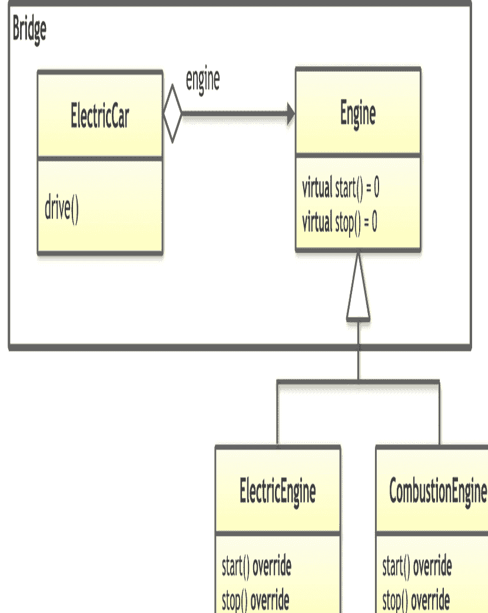
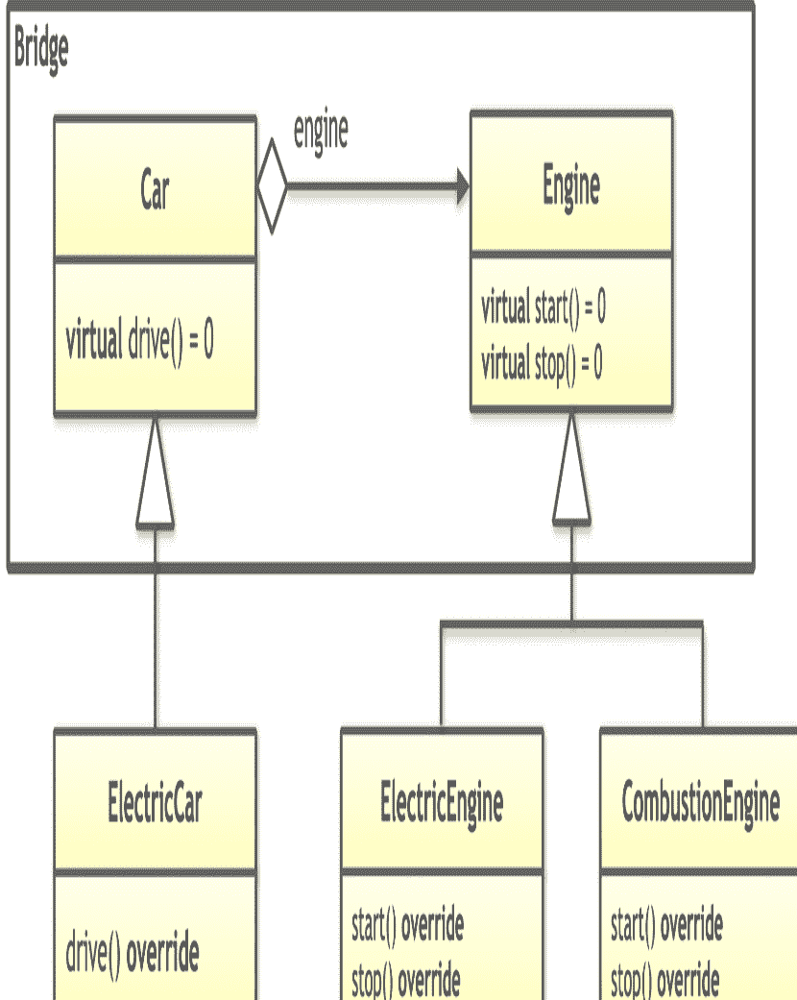
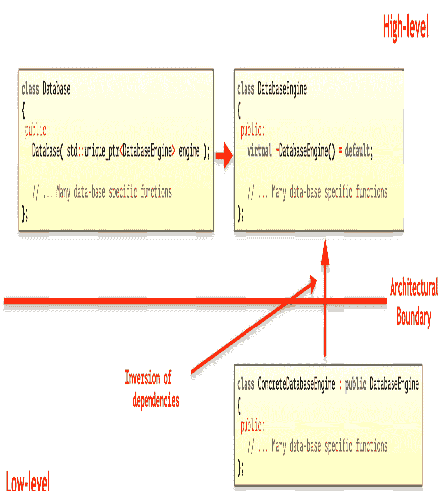
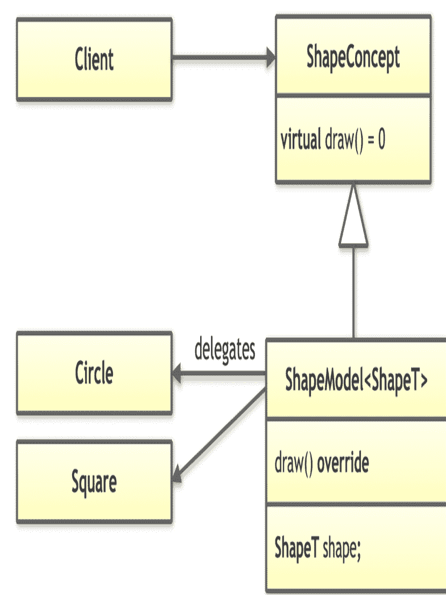

## 第 7 章。桥接、原型和外部多态设计模式

### 给早期发布读者的说明

使用 Early Release 电子书，你可以在这些技术正式发布之前很久就利用它们——作者在写作时提供的原始未编辑内容。

这将是最终书籍的第 7 章。请注意 GitHub 仓库将在稍后激活。

如果你对如何改进本书的内容和/或示例有任何评论，或者如果你注意到本章中缺少材料，请联系编辑 sevans@oreilly.com。

在本章中，我们将重点关注两个经典的 GoF 设计模式：*Bridge* 设计模式和 *Prototype* 设计模式。此外，我们将研究 *External Polymorphism* 设计模式。乍一看，这种选择可能看起来像是设计模式中令人景仰的、几乎随机的选择。然而，我选择这些模式有两个原因：首先，根据我的经验，这三者是设计模式目录中最有用的模式之一。因此你应该对它们的意图、优点和缺点有相当好的了解。其次，同样重要：它们都将在第 8 章中发挥至关重要的作用。

在“准则 28：构建桥梁以消除物理依赖”中，我将向你介绍 *Bridge* 设计模式及其最简单的形式 *Pimpl Idiom*。最重要的是，我将演示如何使用桥梁通过将接口与实现细节解耦来减少物理耦合。

在“准则 29：注意桥梁的性能增益和损失”中，我们将明确查看桥梁的性能影响。为此，我们将对无桥梁实现、基于桥梁的实现以及“部分”桥梁进行基准测试。

在“准则 30：对抽象复制操作应用原型”中，我将向你介绍克隆的艺术。也就是说，我们将谈论复制操作，特别是抽象复制操作。此意图的选择模式将是原型设计模式。

在“准则 31：对非侵入式运行时多态使用外部多态”中，我们继续通过从类中提取函数的实现细节来分离关注点。然而，为了进一步减少依赖，我们将把这种关注点分离提升到全新水平：我们不仅会提取虚函数的实现细节，还会通过外部多态设计模式提取完整的函数本身。

### 准则 28：构建桥梁以消除物理依赖

根据词典，“bridge”一词表达了连接或过渡的时间、地点或手段。如果我问“bridge”对你意味着什么，我相当确定你会有类似的想法。你可能会隐含地想到连接两件事，从而使它们更接近。例如，你可能会想到一条河分隔的城市。桥梁会连接城市的两侧，使它们更接近并为人们节省大量时间。你也可能会想到电子学，其中桥梁连接电路的两个独立部分。音乐中有桥梁，还有更多来自现实世界的例子，桥梁有助于连接事物。是的，直觉上“bridge”一词暗示了亲密性和接近度的增加。因此，自然地，Bridge


设计模式恰恰相反：它帮助你减少物理依赖，促进解耦，即让两个需要协同工作但不应了解彼此太多细节的功能保持距离。

#### 一个激励性的示例

为了说明我的想法，请考虑以下 ElectricCar 类：

//---- <ElectricEngine.h> ----------------

class ElectricEngine
{
public:
    void start();
    void stop();

private:
    // ...
};

//---- <ElectricCar.h> ----------------

#include <ElectricEngine.h>
// ...

class ElectricCar
{
public:
    ElectricCar( /*maybe some engine arguments*/ );

    void drive();
    // ...
private:
    ElectricEngine engine_;  ①

    // ... more car-specific data members (wheels, drivetrain, ...)
};
```

```
//---- <ElectricCar.cpp> ----------------

#include <ElectricCar.h>

ElectricCar::ElectricCar( /*maybe some engine arguments*/ )
  : engine_{ /*engine arguments*/ }
  // ... Initialization of the other data members
{}
```

// ...

如名称所示，ElectricCar 类配备了 ElectricEngine（1）。然而，现实中这样的汽车可能相当有吸引力，但当前实现细节令人担忧：由于 engine_ 数据成员，<ElectricCar.h> 头文件需要包含 <ElectricEngine.h> 头文件。编译器需要看到 ElectricEngine 的类定义，因为否则它将无法确定 ElectricCar 实例的大小。包含 <ElectricEngine.h> 头文件很容易导致传递的物理耦合：每个包含 <ElectricCar.h> 头文件的<|message|>文件都会在物理上依赖于 <ElectricEngine.h> 头文件。因此，只要头文件中的内容发生变化，ElectricCar 类以及可能许多其他类都会受到影响。它们可能需要重新编译、重新测试，在最坏的情况下甚至需要重新部署……唉。

除此之外，这种设计会向所有人暴露所有实现细节。“你是什么意思？类的私有部分隐藏和封装实现细节难道不是重点吗？” 是的，它可能是私有的，但 private 标签仅仅是一个访问标签。它不是可见性标签。因此，你类定义中的所有内容（我确实是说所有内容）对看到 ElectricCar 类定义的人都是可见的。这意味着，你无法在不被任何人注意到的情况下更改该类的实现细节。特别是，如果你需要提供 ABI 稳定性，即你的类的内存表示不得更改，这可能是一个问题。¹

一个稍微好一点的方法是只存储指向 ElectricEngine 的指针（2）：²

```
//---- <ElectricCar.h> ----------------

#include <memory>
// ...
struct ElectricEngine;  // Forward declaration

class ElectricCar
{
public:
    ElectricCar( /*maybe some engine arguments*/ );

    void drive();
    // ...
private:
    std::unique_ptr<ElectricEngine> engine_;  2

    // ... more car-specific data members (wheels, drivetrain,
    ...)
};

//---- <ElectricCar.cpp> ----------------

#include <ElectricCar.h>
#include <ElectricEngine.h>  3

ElectricCar::ElectricCar( /*maybe some engine arguments*/ )
    : engine_{ std::make_unique<ElectricEngine>( /*engine
arguments*/ ) }
    // ... Initialization of the other data members
{}

// ... Other 'ElectricCar' member functions, using the pointer to an
//     'ElectricEngine'.

```

在这种情况下，只需提供 ElectricEngine 类的前向声明就足够了，因为编译器不需要知道类定义就能确定 ElectricCar 实例的大小。此外，物理依赖也消失了，因为

<ElectricEngine.h> 头文件已移至源文件 ③。因此，从依赖关系的角度来看，这个解决方案要好得多。仍然存在的问题是实现细节的可见性。每个人仍然能够看到 ElectricCar 基于 ElectricEngine 构建，因此每个人仍然隐式依赖于这些实现细节。因此，对这些细节的任何更改，例如升级到新的 PowerEngine，都会影响使用 <ElectricCar.h> 头文件的任何类。“这不好，对吧？” 确实不好，因为变化是必然的（参见“准则 2：为变化而设计”）。为了摆脱这种依赖，并在任何时候轻松更改实现细节而不被任何人察觉，我们必须引入抽象。抽象的经典形式是引入抽象类：

//---- <Engine.h> ----------------

class Engine ④
{
public:
    virtual ~Engine() = default;
    virtual void start() = 0;
    virtual void stop() = 0;
    // ... more engine-specific functions

private:
    // ...
};
```

```
//---- <ElectricCar.h> ----------------

#include <Engine.h>
#include <memory>

class ElectricCar
{
public:
    void drive();
    // ...
private:
    std::unique_ptr<Engine> engine_;  ⑤
```

```
// ... more car-specific data members (wheels, drivetrain,
...)
};

//---- <ElectricEngine.h> ----------------

#include <Engine.h>

class ElectricEngine : public Engine
{
public:
    void start() override;
    void stop() override;

private:
    // ...
};

//---- <ElectricCar.cpp> ----------------

#include <ElectricCar.h>
#include <ElectricEngine.h>

ElectricCar::ElectricCar( /*maybe some engine arguments*/ )
    : engine_{ std::make_unique<ElectricEngine>( /*engine arguments*/ ) } ⑤
    // ... Initialization of the other data members
{}

// ... Other 'ElectricCar' member functions, primarily using the
'Engine'
//      abstraction, but potentially also explicitly dealing with
an
//      'ElectricEngine'.
```

有了 Engine 基类 ④，我们就可以使用该抽象来实现我们的 ElectricCar 类 ⑤。没有人需要知道我们使用的引擎的实际类型。也没有人需要知道我们何时升级引擎。通过这种实现，我们只需修改源文件 ⑥，就能随时轻松更改实现细节。因此，通过这种方法，我们真正最小化了对 ElectricEngine 实现的依赖。我们已将对该细节的了解变成了我们自己的秘密实现细节。通过这样做，我们建立了自己的 Bridge。

> NOTE
> 正如引言中所说，违反直觉的是，这个 Bridge 并不是为了让 ElectricCar 和 Engine 类更接近。相反，它是关于分离关注点和松耦合。另一个例子表明命名是困难的。

### Bridge 设计模式详解

Bridge 设计模式是 1994 年引入的经典 GoF 设计模式之一。Bridge 的目的是通过将某些实现细节封装在抽象之后来最小化物理依赖。因此，在 C++ 中，它充当编译防火墙，从而实现轻松更改：

> THE BRIDGE DESIGN PATTERN
> Intent: “Decouple an abstraction from its implementation so that the two can vary independently.” (GoF)

在这种意图表述中，四人帮谈到了“抽象”和“实现”。在我们的示例中，ElectricCar 类代表“抽象”，而 Engine 类代表“实现”（参见图 7-1）。两者都应能够独立变化，即对其中一方的更改不应影响另一方。阻碍轻松更改的是 ElectricCar 类与其引擎之间的物理依赖。因此，想法是将这些依赖提取并隔离：通过以 Engine 抽象的形式隔离它们，通过分离关注点并满足单一职责原则（SRP），你获得了以任何你想要的方式更改、调整或升级引擎的灵活性（参见“准则 2：为变化而设计”）。更改在 `ElectricCar` 类中不再可见。因此，现在可以轻松添加新的引擎类型，而“抽象”不会察觉到。这符合 *开放封闭原则（OCP）* 的思想（参见“准则 5：为扩展而设计”）。




Figure 7-1. The UML representation of the basic Bridge design pattern.

虽然这为我们提供了轻松应用更改的能力，因此实现了 *Bridge* 的思想，但我们还可以再进一步，以进一步解耦并减少重复。假设我们感兴趣的不仅仅是电动汽车，还包括燃油发动机汽车。很自然地，对于我们计划实现的每一种汽车，我们都希望引入与发动机细节相同的解耦，即相同类型的 *Bridge*。因此，为了减少重复并遵循 *Don't Repeat Yourself (DRY)* 原则，我们可以将 *Bridge* 相关的实现细节提取到 `Car` 基类中（见图 7-2）：



Figure 7-2. The UML representation of the full Bridge design pattern.

Car 基类封装了到关联 Engine 的 Bridge：

```
//---- <Car.h> ----------------

#include <Engine.h>
#include <memory>
#include <utility>

class Car
{
protected:
    explicit Car( std::unique_ptr<Engine> engine )  ⑦
        : pimpl_( std::move(engine) )
    {}

public:
    virtual ~Car() = default;
    virtual void drive() = 0;
    // ... more car-specific functions

protected:
    Engine*        getEngine()      { return pimpl_.get(); }  ⑨
    Engine const* getEngine() const { return pimpl_.get(); }

private:
    std::unique_ptr<Engine> pimpl_;  // Pointer-to-implementation
    (pimpl)  ⑧

    // ... more car-specific data members (wheels, drivetrain,
    ...)
};
```

有了 Car 类的加入，“抽象”和“实现”都提供了易于扩展的机会，并且可以独立变化。虽然 Engine 基类仍然代表此 Bridge 关系中的“实现”，但 Car 类现在扮演“抽象”的角色。关于 Car 类值得注意的第一点是受保护的构造函数（⑦）。这一选择确保只有派生类才能指定发动机类型。构造函数接受一个指向 Engine 的 std::unique_ptr 并将其移动到其 pimpl_ 数据成员（⑧）。这个指针数据成员是所有种类 Car 的指针到实现，通常称为 pimpl。这个不透明指针代表了到封装实现细节的 Bridge，因此本质上代表了整个 Bridge 设计模式。基于此原因，在代码中使用名称 pimpl 来表明你的意图是一个好主意（记住“Guideline 14: Use a Design Pattern’s Name to Communicate Intent”）。

请注意，尽管派生类必须使用它，pimpl_ 仍声明在类的私有部分。这一选择由 Core Guideline C.133 驱动：

> Avoid protected data.
> 
> —Core Guideline C.133

事实上，经验表明受保护的数据成员几乎与公共数据成员一样糟糕。因此，为了授予对 pimpl 的访问权限，Car 类改为提供受保护的 getEngine() 成员函数 ⑨。

ElectricCar 类相应地进行了调整：

```
//---- <ElectricCar.h> ----------------

#include <Engine.h>
#include <memory>

class ElectricCar : public Car  ①
{
public:
    explicit ElectricCar( /*maybe some engine arguments*/ );

    void drive() override;
    // ...
};
```

```
//---- <ElectricCar.cpp> ----------------

#include <ElectricCar.h>
#include <ElectricEngine.h>
```

```
ElectricCar::ElectricCar( /*maybe some engine arguments*/ )
    : Car( std::make_unique<ElectricEngine>( /*engine arguments*/
) )
{}

// ...
```

与其自行实现 *Bridge*，`ElectricCar` 类现在继承自 `Car` 基类 ①。这种继承关系引入了通过指定 `Engine` 来初始化 `Car` 基类的需求。此任务在 `ElectricCar` 构造函数中执行 ①。

### The Pimpl Idiom

*Bridge* 设计模式有一个更简单的形式，在 C 和 C++ 中已被非常普遍和成功地使用数十年。要看一个例子，让我们考虑以下 `Person` 类：

```
class Person
{
public:
    // ...
    int year_of_birth() const;
    // ... Many more access functions

private:
    std::string forename_;
    std::string surname_;
    std::string address_;
    std::string city_;
    std::string country_;
    std::string zip_;
    int year_of_birth_;
    // ... Potentially many more data members
};
```

一个人包含大量数据成员：`forename`、`surname`、完整的邮寄地址、`year_of_birth`，以及可能还有更多。而且未来可能需要添加更多数据成员：手机号码、Twitter 账号，或下一个最热门社交媒体的账号信息。换句话说，很合理地认为 Person 类需要随着时间的推移而扩展或更改，可能甚至频繁更改。这会给 Person 的使用者带来很多不便：每当 Person 发生变化时，Person 的使用者都必须重新编译他们的代码。更不用说 ABI 稳定性：Person 实例的大小将会改变！

为了隐藏对 Person 实现细节的所有更改并获得 ABI 稳定性，你可以使用 Bridge 设计模式。在这种特定情况下，然而，并不需要以基类的形式提供抽象：Person 只有一个且唯一一个实现。因此，我们所做的只是引入一个私有、嵌套的类，称为 Impl（⓪）：

```
//---- <Person.h> ----------------

#include <memory>

class Person
{
public:
    // ...

private:
    struct Impl;
    std::unique_ptr<Impl> const pimpl_;
};
```

```
//---- <Person.cpp> ----------------

#include <Person.h>
#include <string>

struct Person::Impl
{
    std::string forename;
    std::string surname;
    std::string address;
    std::string city;
    std::string country;
    std::string zip;
    int year_of_birth;
```

```
// ... Potentially many more data members
};
```

嵌套 Impl 类的唯一任务是封装 Person 的实现细节。因此，Person 类中剩下的唯一数据成员是对 Impl 实例的 std::unique_ptr（⑧）。所有其他数据成员，以及可能的一些非虚辅助函数，都从 Person 类移入 Impl 类。请注意，Impl 类仅在 Person 类中声明，但未定义。相反，它在对应的源文件中定义（⑨）。正因如此，你对细节所做的所有更改，即添加或删除数据成员、更改数据成员的类型等，都对 Person 的使用者隐藏。

这个 Person 的实现使用了 Bridge 设计模式的最简单形式：这种本地的、非多态的 Bridge 形式称为 Pimpl Idiom。它具有 Bridge 模式的所有解耦优势，但尽管其简单，仍然导致 Person 类的实现变得稍微复杂一些：

```
//---- <Person.h> --------------------

// #include <memory>

class Person
{
public:
    // ...
    Person();      ⑮
    ~Person();      ⑯

    Person( Person const& other );      ⑰
    Person& operator=( Person const& other );      ⑱

    Person( Person&& other );      ⑲
    Person& operator=( Person&& other );      ⑳

    int year_of_birth() const;      ㉑
    // ... Many more access functions

private:
    struct Impl;
    std::unique_ptr<Impl> const pimpl_;
};

//---- <Person.cpp> ----------------

//#include <Person.h>
//#include <string>

struct Person::Impl
{
    // ...
};

Person::Person()  ⑮
    : pimpl_{ std::make_unique<Impl>() }
{}

Person::~Person() = default;  ⑯

Person::Person( Person const& other )  ⑰
    : pimpl_{ std::make_unique<Impl>(*other.pimpl_) }
{}

Person& Person::operator=( Person const& other )  ⑱
{
    *pimpl_ = *other.pimpl_;
    return *this;
}

Person::Person( Person&& other )  ⑲
    : pimpl_{ std::make_unique<Impl>(std::move(*other.pimpl_)) }
{}

Person& Person::operator=( Person&& other )  ⑳
{
    *pimpl_ = std::move(*other.pimpl_);
    return *this;
}

int Person::year_of_birth() const  ㉑
{
    return pimpl_->year_of_birth;
}

// ... Many more Person member functions
```


Person 构造函数通过 std::make_unique() ⑮ 初始化 pimpl_ 数据成员。当然，这涉及一次动态内存分配，这意味着动态内存需要再次被清理。“这就是我们使用 std::unique_ptr 的原因”，你说。正确。但也许令人惊讶的是，虽然我们出于该目的使用 std::unique_ptr，但仍然有必要手动处理析构函数 ⑯。“为什么我们非要这么做？std::unique_ptr 的意义不就是我们不需要处理清理吗？”好吧，我们仍然需要。让我解释一下：如果不编写析构函数，编译器会觉得有义务为你生成析构函数。不幸的是，它会在 <Person.h> 头文件中生成析构函数。Person 的析构函数会触发 std::unique_ptr 数据成员的析构函数的实例化，而这反过来又需要 Impl 类的析构函数的定义。然而，Impl 的定义在头文件中不可用。相反，它需要在源文件中定义，否则 Bridge 的目的就被破坏了。因此编译器会发出关于不完整类型 Impl 的错误。幸运的是，你不必放弃 std::unique_ptr 来解决这个问题（事实上，你不应该放弃它）。问题其实很简单就能解决。你所要做的就是将 Person 析构函数的定义移到源文件：你在类定义中声明析构函数，并在源文件中通过 =default 定义它。

由于 std::unique_ptr 不能被复制，你将不得不实现拷贝构造函数以保留 Person 类的拷贝语义 ⑰。拷贝赋值运算符 ⑱ 也是如此。请注意，该运算符的实现基于这样一个假设，即 Person 的每个实例始终都有一个有效的 pimpl_。这一假设解释了移动构造函数的实现：它不是简单地移动 std::unique_ptr，而是通过 std::make_unique() 执行一次可能失败的，即会抛出的动态内存分配。因此，它没有被声明为 noexcept ⑲。³ 这一假设也解释了为什么 pimpl_ 数据成员被声明为 const：一旦初始化，指针将不再被更改，甚至在移动操作中也不会更改，包括移动赋值运算符 (20)。

最后值得注意的一个细节是，year_of_birth() 成员函数的定义位于源文件中 (21)。尽管这个简单的 getter 函数是很好的内联候选，但定义必须移到源文件。原因是头文件中 Impl 是一个不完整类型。这意味着在头文件中，你无法访问任何成员（数据和函数）。这只有在源文件中，或者更一般地说，只要编译器知道 Impl 的定义时才有可能。

### Bridge 与 Strategy 的比较

“我有一个问题”，你说。“我看到 Bridge 和 Strategy 设计模式之间有很强的相似性。我知道你说过设计模式在结构上有时非常相似，唯一的区别是它们的意图。但这两者到底有什么区别？”4 我理解你的问题。这两者之间的相似性确实有点令人困惑。然而，有一件事可以帮助你区分它们：相关数据成员的初始化方式，是判断你使用的是哪一个的强有力指标。

如果一个类不想知道某些实现细节，并且出于这个原因，它提供了通过从外部传入细节来配置行为的机会，例如通过构造函数或 setter 函数，那么你很可能是在处理 Strategy 设计模式。因为灵活配置行为，即减少逻辑依赖，是其主要关注点，Strategy 属于行为型设计模式。例如，在下面的代码片段中，Database 类的构造函数是一个明显的迹象：

```
class DatabaseEngine
{
    public:
        virtual ~DatabaseEngine() = default;
```

```
// ... Many database-specific functions
};

class Database
{
public:
    explicit Database( std::unique_ptr<DatabaseEngine> engine );
    // ... Many database-specific functions

private:
    std::unique_ptr<DatabaseEngine> engine_;
};

// The database is unaware of any implementation details and
// requests them
//   via its constructor from outside -> Strategy design pattern
Database::Database( std::unique_ptr<DatabaseEngine> engine )
    : engine_{ std::move(engine) }
{}
```

`DatabaseEngine` 的实际类型是从外部传入的 (22)，这使得它成为 *Strategy* 设计模式的一个很好的例子。

图 7-3 显示了此示例的依赖图。最重要的是，`Database` 类与 `DatabaseEngine` 抽象处于同一架构级别，从而为其他人提供了实现行为的机会（例如以 `ConcreteDatabaseEngine` 的形式）。由于 `Database` 只依赖于抽象，因此不存在对任何特定实现的依赖。

```
class Database
{
public:
Database( std::unique_ptr<DatabaseEngine> engine );

// ... Many data-base specific functions
};
```

```
class DatabaseEngine
{
public:
virtual ~DatabaseEngine() = default;

// ... Many data-base specific functions
};
```

```
class ConcreteDatabaseEngine : public DatabaseEngine
{
public:
// ... Many data-base specific functions
};
```

High-level

Architectural
Boundary

Inversion of
dependencies

Low-level

Figure 7-3. Dependency graph for the Strategy design pattern.

如果一个类知道实现细节，但主要想减少对这些细节的物理依赖，那么你很可能是在处理 Bridge 设计模式。在这种情况下，类不会提供任何从外部设置指针的机会，即指针更像是一个实现细节，并在内部设置。由于



Bridge 设计模式主要关注对实现细节的物理依赖，而非逻辑依赖，Bridge 属于结构型设计模式。作为示例，请考虑以下代码片段：

```
class Database
{
public:
  explicit Database();
  // ...
private:
  std::unique_ptr<DatabaseEngine> pimpl_;
};

// The database knows about the required implementation details,
but does
//   not want to depend too strongly on it -> Bridge design
pattern
Database::Database()
  : pimpl_{ std::make_unique<ConcreteDatabaseEngine>( /*some arguments*/ ) }  23
{}
```

再次，Bridge 设计模式应用的一个明显迹象是：构造函数不是从外部接受 engine，而是 Database 类的构造函数知道 ConcreteDatabaseEngine 并在内部设置它 (23)。

图 7-4 显示了 Database 示例的 Bridge 实现的依赖图。最值得注意的是，Database 类与 ConcreteDatabaseEngine 类处于同一架构级别，因此不给其他人提供不同实现的任何机会。这表明，与 Strategy 设计模式相反，Bridge 在逻辑上与特定实现耦合，但仅通过 DatabaseEngine 抽象在物理上解耦。

#### High-level

```
class DatabaseEngine
{
public:
    virtual ~DatabaseEngine() = default;

    // ... Many data-base specific functions
};
```

#### Architectural
Boundary

Inversion of dependencies

```
class Database
{
public:
    Database();

    // ... Many data-base specific functions
};
```

```
class ConcreteDatabaseEngine : public DatabaseEngine
{
public:
    // ... Many data-base specific functions
};
```

#### Low-level

Figure 7-4. Dependency graph for the Bridge design pattern.

### 分析 Bridge 设计模式的不足

“我完全可以看到为什么 Bridge 设计模式在社区中如此受欢迎。解耦特性真的很棒！”，你惊呼道。“不过，你一直告诉我每个设计都有利有弊。我猜会有性能损失？”很好，你记得总是有一些缺点。当然这也包括 Bridge 设计模式，尽管它被证明非常有用。是的，你正确地假设其中存在一些性能开销。

五种开销类型中的第一种源于 Bridge 引入了额外的间接：pimpl 指针。由于这个指针，对实现细节的所有访问都会变得更昂贵。然而，这个指针造成的性能损失有多大，是一个我将在“准则 29：注意 Bridge 的性能增益和损失”中单独讨论的问题。这并不是唯一的性能开销来源，还有更多：取决于你是否使用抽象，你可能还必须为虚函数调用开销买单。此外，由于无法内联访问数据成员的最简单函数，你也必须付出更多代价。当然，每当你创建一个以 Bridge 实现的类的新实例时，你还必须为一次额外的动态内存分配买单。⁵ 最后但同样重要的是，你还应考虑到引入 pimpl 指针造成的内存开销。因此，是的，隔离物理依赖和隐藏实现细节并非免费，而是会产生相当大的开销。尽管如此，这不应成为普遍抛弃 Bridge 解决方案的理由：这始终取决于具体情况。例如，如果底层实现执行缓慢、昂贵的任务，例如系统调用，那么这种开销可能根本无法测量。换句话说，是否使用 Bridge 应该逐案决定并以性能基准测试为依据。


此外，你已经看到了实现细节并意识到代码复杂度有所增加。由于代码的简洁性和可读性是一种美德，这应该被视为一个缺点。确实，这只会影响类的内部，而不会影响用户代码。但即便如此，其中一些细节（例如需要在源文件中定义析构函数）可能会让经验不足的开发者感到困惑。

总之，*Bridge* 设计模式是减少物理依赖的最有价值且最常用的解决方案之一。尽管如此，你应该意识到 *Bridge* 带来的开销和复杂性。

### GUIDELINE 28: BUILD *BRIDGES* TO REMOVE PHYSICAL DEPENDENCIES

- 注意数据成员或包含引入的物理依赖；
- 采用 *Bridge* 设计模式的意图是将物理依赖与实现细节隔离开来；
- 优先使用 *pimpl* 数据成员来传达使用 *Bridge* 的意图；
- 了解 *Bridge* 设计模式的优势，但也要了解其弱点；
- 知道减少物理依赖（*Bridge*）与逻辑依赖（*Strategy*）之间的区别。

### Guideline 29: Be Aware of the Performance Gains and Losses of Bridges

在“Guideline 28: Build Bridges to Remove Physical Dependencies”中，我们详细研究了 *Bridge* 设计模式。虽然我想象 *Bridge* 的设计和解耦方面给你留下了积极的印象，但我必须让你意识到使用这种模式可能会带来性能损失。“是的，这让我担心。性能对我很重要，听起来 Bridge 会造成巨大的性能开销。”，你说道。这是一个相当常见的预期。所以既然性能很重要，我确实应该给你一个使用 Bridge 时需要预期多少开销的想法。然而，我也应该演示如何明智地使用 Bridges 甚至提高代码的性能。听起来不可思议？好吧，让我来展示给你看。

#### The Performance Impact of Bridges

如“Guideline 28: Build Bridges to Remove Physical Dependencies”中所讨论的，Bridge 实现的性能受许多因素影响：通过间接访问、虚函数调用、内联、动态内存分配等。由于所有这些因素以及可能的组合数量巨大，无法给出 Bridge 会让你付出多少性能的明确答案。根本没有捷径，没有替代方案可以替代为你自己的代码组装几个基准测试并运行它们以评估明确答案。我想演示的，不过是确实存在通过间接访问的性能损失，但你仍然可以使用 Bridge 来实际提高性能。

那么，让我们开始给你一个关于基准测试的想法。为了形成对指针间接访问有多昂贵的看法，让我们比较以下两种 Person 类的实现：

```
#include <string>

//---- <Person1.h> ----------------

class Person1
{
public:
    // ...
private:
    std::string forename_;
    std::string surname_;
```

```
std::string address_;
std::string city_;
std::string country_;
std::string zip_;
int year_of_birth_;
};
```

Person1 结构体表示一个未使用 Bridge 实现的类型。所有七个数据成员（六个 std::string 和一个 int）都是结构体本身的直接组成部分。总共，假设 64 位机器，使用 Clang 11.1 时一个 Person1 实例的总大小为 152 字节，使用 GCC 11.1 时为 200 字节。⁶

另一方面，Person2 结构体是通过 Pimpl 惯用法实现的：

```
//---- <Person2.h> ----------------

#include <memory>

class Person2
{
public:
    explicit Person2( /*...various person arguments...*/ );
    ~Person2();
    // ...

private:
    struct Impl;
    std::unique_ptr<Impl> pimpl_;
};
```

```
//---- <Person2.cpp> ----------------

#include <Person2.h>
#include <string>

struct Person2::Impl
{
    std::string forename;
    std::string surname;
    std::string address;
    std::string city;
```

```
std::string country;
std::string zip;
int year_of_birth;
};

Person2::Person2( /*...various person arguments...*/ )
  : pimpl{ std::make_unique<Impl>( /*...various person arguments...*/ ) }
{}

Person2::~Person2() = default;
```

所有七个数据成员都已移入嵌套的 Impl 结构体中，因此只能通过 pimpl 指针访问。虽然嵌套 Impl 结构体的总大小与 Person1 的大小相同，但 Person2 结构体的大小仅为 8 字节（同样假设 64 位机器）。

### NOTE

通过 Bridge 设计，你可以减小类型的大小，有时甚至显著减小。这可能非常有价值，例如如果你想将该类型用作 std::variant 中的替代项（参见“Guideline 17: Consider std::variant for Implementing Visitors”）。

那么让我概述一下基准测试：我将创建两个包含 25,000 个人员的 std::vectors，每个 Person 实现各一个。这个元素数量将确保我们的工作超出底层 CPU 内部缓存的大小（即我们将使用 Clang-11.1 时总共 3.2MB，GCC-11.1 时 4.2MB）。所有这些人员都拥有任意的名字和地址，但出生年份也在 1957 年至 2004 年之间（在撰写本文时，这将代表一个组织员工的合理年龄范围）。然后我们将遍历这两个人员向量 5000 次，每次通过 std::min_element() 确定最年长的人员。计算结果由于基准测试的重复性而相当无趣。最晚在 100 次迭代后你就会感到厌倦。唯一重要的是，看到直接访问数据成员（`Person1`）与间接访问（`Person2`）之间的性能差异。表 7-1 显示了归一化到 `Person1` 实现性能的性能结果：

#### Table 7-1. Performance results for different Person implementations

| | GCC 11.1 | Clang 11.1 |
|---|---|---|
| Person1 (No pimpl) | 1.0 | 1.0 |
| Person2 (Complete *Pimpl Idiom*) | 1.1099 | 1.1312 |

很明显，在这个特定基准测试中，*Bridge* 实现带来了相当显著的性能损失：GCC 为 11.0%，Clang 为 13.1%。这听起来很多！然而，不要太认真对待这些数字：显然结果在很大程度上取决于实际的元素数量、实际的数据成员数量和类型、我们运行的系统，以及基准测试中实际执行的计算。如果你改变其中任何一个细节，数字也会改变。因此，这些数字只证明了由于对数据成员的间接访问而存在一些，甚至可能更多的开销。

#### Improving Performance with Partial Bridges

“好吧，但这是一个预期的结果，对吧？我应该从中学习什么？”，你在问。好吧，我承认这个基准测试相当具体，并不能回答所有问题。然而，它确实为我们提供了实际使用 *Bridge* 来提高性能的机会。如果你仔细查看 `Person1` 的实现，你可能会意识到对于给定的基准测试，可实现的性能相当有限：虽然 `Person1` 的总大小为 152 字节（Clang-11.1）或 200 字节（GCC-11.1），但我们只使用了 4 字节，即一个 `int`。这被证明是相当浪费和低效的：由于在基于缓存的架构上，内存总是以缓存行的形式加载，我们从内存中加载的大量数据实际上根本没有被使用。事实上，我们从内存中加载的几乎 *所有* 数据都没有被使用：假设缓存行长度为 64 字节，我们只使用了大约 6% 的加载数据。因此，尽管我们根据所有人员的出生年份确定最年长的人员，这听起来像是一个计算密集型操作，但我们实际上完全受内存限制：机器根本无法足够快地提供数据，整数单元大部分时间处于空闲状态。


这个设置给了我们通过 Bridge 来改进性能的机会。让我们假设，我们能够区分经常使用的数据（例如名字、姓氏和出生年份），以及不经常使用的数据（例如邮政地址）。基于这种区分，我们现在相应地安排数据成员：所有经常使用的数据成员，都直接存储在 Person 类中。所有不经常使用的数据成员，则存储在 Impl 结构体中。这就导致了 Person3 的实现：

```
//---- <Person3.h> ----------------

#include <memory>
#include <string>

class Person3
{
public:
    explicit Person3( /*...various person arguments...*/ );
    ~Person3();
    // ...

private:
    std::string forename_;
    std::string surname_;
    int year_of_birth_;

    struct Impl;
    std::unique_ptr<Impl> pimpl_;
};

//---- <Person3.cpp> ----------------

#include <Person3.h>

struct Person3::Impl
{
    std::string address;
    std::string city;
    std::string country;
    std::string zip;
};

Person3::Person3( /*...various person arguments...*/ )
```
```
: forename_{ /*...*/ }
, surname_{ /*...*/ }
, year_of_birth_{ /*...*/ }
, pimpl_{ std::make_unique<Impl>( /*...address-related arguments...*/ ) }
{}

Person3::~Person3() = default;
```

`Person3` 实例的总大小为 Clang-11.1 的 64 字节（两个 24 字节的 `std::strings`，一个整数，一个指针，以及由于对齐限制的四个填充字节），在 GCC-11.1 上为 80 字节（两个 32 字节的 `std::strings`，一个整数，一个指针，以及一些填充）。因此 `Person3` 实例的大小仅约为 `Person1` 实例的一半。这种大小差异是可以测量的：表 7-2 显示了所有 `Person` 实现的性能结果，包括 `Person3`。同样，结果已归一化到 `Person1` 实现的性能：

表 7-2. 不同 Person 实现的性能结果

| | GCC 10.3 | Clang 12.0 |
|---|---|---|
| Person1 (No pimpl) | 1.0 | 1.0 |
| Person2 (Complete *Pimpl Idiom*) | 1.1099 | 1.1312 |
| Person3 (Partial *Pimpl Idiom*) | 0.8597 | 0.9353 |

与 `Person1` 实现相比，`Person3` 的性能在 GCC-11.1 上提高了 14.0%，在 Clang-11.1 上提高了 6.5%。而且，正如之前所说，这只是因为我们减小了 `Person3` 实现的大小。“哇，这出乎意料。我明白了，*Bridge* 并非对性能必然不利。”你说道。是的，确实如此。当然，这始终取决于具体的设置，但区分经常使用或不经常使用的数据成员，并通过实现“部分”*Bridge* 来减小数据结构的大小，可能对性能产生非常积极的影响。⁷

“性能提升很大，这很棒，但这不是违背了 *Bridge* 的初衷吗？”你问道。确实，你意识到隐藏实现细节与为了性能而“内联”数据成员之间存在二分法。就像往常一样，这取决于具体情况：你必须逐案决定偏好哪方面。你也希望意识到，在两个极端之间存在整整一系列的解决方案：没有必要将 *所有* 数据成员都隐藏在 *Bridge* 后面。最终，由你来为给定问题找到最佳方案。

总之，虽然 *Bridge* 通常很可能会带来性能损失，但在合适的条件下，实现部分 *Bridge* 可能对性能产生非常积极的影响。然而，这只是影响性能的众多方面之一。因此你应该始终检查 *Bridge* 是否会导致性能瓶颈，或者部分 *Bridge* 是否解决了性能问题。确认这一点的最佳方式是通过具有代表性的基准测试，即尽可能基于实际代码和实际数据的基准测试。

### GUIDELINE 29: BE AWARE OF THE PERFORMANCE GAINS AND LOSSES OF BRIDGES

- Keep in mind that *Bridges* can have a negative performance impact;
- Be aware that a partial *Bridge* can have a positive impact on performance when separating frequently used data from infrequently used data;
- Always confirm performance bottlenecks or improvements by means of representative benchmarks, do not rely on your gut feeling.

### Guideline 30: Apply Prototype for Abstract Copy Operations

想象你坐在这家时髦的意大利餐厅里，研究菜单。哦，我的天，他们提供这么多好东西：千层面听起来很棒。但他们提供的披萨选择也令人惊叹。选择实在太难了……然而，你的思绪被服务员走过时打断了，他端着一道看起来很棒的菜。不幸的是，这道菜不是为你准备的，而是为另一桌的人准备的。哦，太香了……在这一刻，你知道自己不再需要考虑想吃什么了：你想要同样的东西，无论它是什么。于是你点餐：“啊，服务员，我要他们点的那份。”

在你的代码中也可能出现同样的问题。用 C++ 术语来说，你向服务员要求的东西就是复制别人的菜。复制对象，即创建实例的精确副本，是 C++ 中一个根本重要的操作。实际上重要到，类默认就配备了拷贝构造函数和拷贝赋值运算符，这两者是所谓的特殊成员函数之一。⁸ 然而，当你要求复制一份菜时，你不幸并不知道那是什么菜。用 C++ 术语来说，你拥有的只是一个指向基类的指针（比如 Dish*）。不幸的是，通过 Dish* 借助拷贝构造函数或拷贝赋值运算符来复制通常是行不通的。尽管如此，你仍然想要一个精确的副本。解决这个问题的方案是另一个经典的 GoF 设计模式：原型设计模式。

#### A Sheep-ish Example: Copying Animals

作为示例，让我们考虑以下 Animal 基类：

```
//---- <Animal.h> ----------------

class Animal
{
public:
    virtual ~Animal() = default;
    virtual void makeSound() const = 0;
    // ... more animal-specific functions
};
```

除了表示 Animal 应该是一个基类的虚析构函数外，该类仅提供了 makeSound() 函数，该函数负责打印可爱的动物叫声。其中一个这样的动物是 Sheep 类：

```
//---- <Sheep.h> ----------------

#include <Animal.h>
#include <string>

class Sheep : public Animal
{
public:
    explicit Sheep( std::string name ) : name_{ std::move(name) }
    {}

    void makeSound() const override;
    // ... more animal-specific functions

private:
```
```
    std::string name_;
};

//---- <Sheep.cpp> ------------------------

#include <Sheep.h>
#include <iostream>

void Sheep::makeSound() const
{
    std::cout << "baa\n";
}
```

在 main() 函数中，我们现在可以创建一个羊并让它发出声音：

```
#include <Sheep.h>
#include <cstdlib>
#include <memory>

int main()
{
    // Creating the one and only Dolly
    std::unique_ptr<Animal> const dolly = std::make_unique<Sheep>(
"Dolly");

    // Triggers Dolly's beastly sound
    dolly->makeSound();

    return EXIT_SUCCESS;
}
```

Dolly 很棒，对吧？而且很可爱！事实上，她太好玩了，我们想要另一个 Dolly。然而，我们拥有的只是指向基类的指针，即 Animal*。我们无法通过 Sheep 拷贝构造函数或拷贝赋值运算符来复制，因为我们在技术上甚至不知道我们处理的是 Sheep。它可能是任何种类的动物（例如狗、猫、羊……）。而且我们不想只复制 Sheep 的 Animal 部分，因为这就是我们所说的切片……

哦，我刚刚意识到这可能是一个解释 *Prototype* 设计模式的特别糟糕的例子。切片动物。这听起来很糟。所以让我们迅速继续。刚才我们说到哪里了：啊，是的，我们想要 Dolly 的一个副本，但我们只有 `Animal*`。这就是 *Prototype* 设计模式发挥作用的地方。

#### The Prototype Design Pattern Explained

*Prototype* 设计模式是 Gang of Four 收集的五种创建型设计模式之一。它专注于提供一种创建抽象实体副本的抽象方式：

> **THE *PROTOTYPE* DESIGN PATTERN**
> 
> Intent: “Specify the kind of objects to create using a prototypical instance, and create new objects by copying this prototype.” (GoF)

图 7-5 显示了从 GoF 书中摘取的原始 UML 形式：


Figure 7-5. The UML representation of the Prototype design pattern.

The *Prototype* design pattern is commonly implemented by means of a virtual `clone()` function in the base class. Consider the updated `Animal` base class:

```
//---- <Animal.h> ----------------

class Animal
{
    public:
        virtual ~Animal() = default;
        virtual void makeSound() const = 0;
        virtual std::unique_ptr<Animal> clone() const = 0;  // Prototype design pattern
};
```

Via this `clone()` function, anyone can ask for an abstract copy of the given (prototype) animal, without having to know about any specific type of animal (`Dog`, `Cat`, or `Sheep`): When the `Animal` base class is properly assigned to the high-level of your architecture, it follows the *Dependency Inversion Principle (DIP)* (see Figure 7-6).

```
class Animal
{
public:
virtual ~Animal() = default;
virtual void makeSound() const = 0;
virtual std::unique_ptr<Animal> clone() const = 0;
};
```

High-level

Architectural Boundary

Inversion of dependencies

```
class Dog : public Animal
{
public:
void makeSound() const override;
std::unique_ptr<Animal> clone() const override;
};
```

```
class Cat : public Animal
{
public:
void makeSound() const override;
std::unique_ptr<Animal> clone() const override;
};
```

```
class Sheep : public Animal
{
public:
void makeSound() const override;
std::unique_ptr<Animal> clone() const override;
};
```

Low-level

Figure 7-6. Dependency graph for the Prototype design pattern.

The clone() function is declared as a pure virtual function, which means that deriving classes are required to implement it. However, deriving classes cannot simply implement the function in any way they want, but are expected to return an exact copy of themselves (any other result would violate the Liskov Substitution Principle (LSP); see “Guideline 6: Adhere to the Expected Behavior of Abstractions”). This copy is commonly created dynamically by means of new, and returned by means of a pointer-to-base. This, of course, results not only in a pointer, but also in the need to explicitly delete the copy again. Since manual cleanup is considered to be very bad practice in Modern C++, the pointer is returned in form of a std::unique_ptr to Animal.⁹

The Sheep class is updated accordingly:

```
//---- <Sheep.h> ----------------

#include <Animal.h>

class Sheep : public Animal
{
public:
    explicit Sheep( std::string name ) : name_{ std::move(name) }
    {}

    void makeSound() const override;
    std::unique_ptr<Animal> clone() const override;  // Prototype
design pattern

private:
    std::string name_;
};

//---- <Sheep.cpp> ----------------

#include <Sheep.h>
#include <iostream>

void Sheep::makeSound() const
{
```

```
std::cout << "baa\n";
}

std::unique_ptr<Animal> Sheep::clone() const
{
    return std::make_unique<Sheep>(*this);  // Copy-construct a sheep
}
```

The Sheep class is now required to implement the clone() function and to return an exact copy of the Sheep: Inside its own clone() function it makes use of the std::make_unique() function and its own copy constructor, which is always assumed to do the right thing, even if the Sheep class changes in the future. This approach helps to avoid unnecessary duplication and thus follows the DRY principle (see “Guideline 2: Design for Change”).

Note that the Sheep class does neither delete nor hide its copy constructor and copy assignment operator. Hence if you have a sheep, you can still copy the sheep by means of the special member functions. That is perfectly ok: the clone() merely adds one more way to create a copy, a way to perform virtual copying.

With the clone() function in place, we are now able to create an exact copy of Dolly. And we can do this so much easier than back in 1996 when they cloned the first Dolly:

```
#include <Sheep.h>
#include <cstdlib>
#include <memory>

int main()
{
    std::unique_ptr<Animal> dolly = std::make_unique<Sheep>(
"Dolly" );
    std::unique_ptr<Animal> dollyClone = dolly->clone();

    dolly->makeSound();      // Triggers the first Dolly's
    beastly sound
    dollyClone->makeSound();  // The clone sounds just like Dolly
```

```
return EXIT_SUCCESS;
}
```

### Comparison between Prototype and std::variant

The Prototype design pattern really is a classic, very OO-centric design pattern and since its publication in 1994, it is the go-to solution for providing virtual copying. Due to that, the function name clone() can almost be considered a keyword for identifying the Prototype design pattern.

Because of the specific use case, there is no “modern” implementation (except perhaps for the slight update to use std::unique_ptr instead of a raw pointer). In comparison to other design patterns, there is also no value semantics based solution: as soon as we have a value, the most natural and intuitive solution would be to build on the two copy operations (i.e. the copy constructor and the copy assignment operator).

“Are you sure that there is no value semantics based solution? Consider the following example using a std::variant”:

```
#include <cstdlib>
#include <variant>

class Dog {};
class Cat {};
class Sheep {};

int main()
{
    std::variant<Dog,Cat,Sheep> animal1{ /* ... */ };

    auto animal2 = animal1;  // Creating a copy of the animal

    return EXIT_SUCCESS;
}
```

“Aren’t we performing an abstract copy operation in this case? And isn’t this copy operation performed by means of the copy constructor? So isn’t this an example for the Prototype design pattern, but without the clone()”

function?” No. Although it sounds like you have a compelling argument, this is not an example for the *Prototype* design pattern. There is a very important difference between our two examples: in your example you have a closed set of types (typical to the *Visitor* design pattern). The `std::variant animal1` contains either a dog, a cat, or a sheep, but nothing else. Therefore it is possible to perform an explicit copy by means of the copy constructor. In my example, I have an open set of types. In other words, I have not the slightest clue what kind of animal I have to copy. It could be a dog, a cat, or a sheep, but it could also be an elephant, a zebra, or a sloth. Anything is possible. Therefore I cannot build on the copy constructor, but can only copy by means of a virtual `clone()` function.

### Analyzing the Shortcomings of the Prototype Design Pattern

Yes, there is no value semantics based solution for the *Prototype* design pattern, but it is a domestic beast of the realm of reference semantics. Hence whenever the need arises to apply the *Prototype* design pattern, we have to live with the few drawbacks that come with it.

Arguably, the first disadvantage is the negative performance impact that comes with the indirection due to pointers. However, since we only require cloning if we have an inheritance hierarchy, it would be unfair to consider this a drawback of *Prototype* itself. It is rather a consequence of the basic setup of the problem. Since it is also hard to imagine another implementation without pointers and without the associated indirections, it seems to be an intrinsic property of the *Prototype* design pattern.

The second potential disadvantage is that, very often, the pattern is implemented by means of dynamic memory. The allocation itself, but also the possibly resulting fragmented memory, cause further performance deficiencies. Dynamic memory is not a requirement, however, and you will see in “Guideline 33: Know about the Optimization Potential of Type Erasure” that in certain contexts, you can also build on in-class memory.

Still, this optimization only applies to a few special situations and hence in most cases, the pattern builds on dynamic memory.

In comparison to the ability to perform an abstract copy operation, the few downsides are easily acceptable. However, as discussed in “Guideline 22: Prefer Value Semantics to Reference Semantics”, our Animal hierarchy would be simpler and more comprehensible if you could replace it with a value semantics approach and therefore avoid having to apply the reference semantics based Prototype design pattern. Still, whenever you encounter the need to create an abstract copy, the Prototype design pattern with an according clone() function is the right choice.

### GUIDELINE 30: APPLY PROTOTYPE FOR ABSTRACT COPY OPERATIONS

- Apply the Prototype design pattern with the intent to create copies of abstract entities;
- Prefer building on the two copy operations for value types;
- Keep in mind the performance drawbacks resulting from pointer indirections and memory allocations.

### Guideline 31: Use External Polymorphism for Non-Intrusive Runtime Polymorphism

In “Guideline 2: Design for Change”, we have seen the enormous benefits of the separation of concerns design principle. In “Guideline 19: Use Strategy to Isolate How Things are Done”, we have used this power to extract the drawing implementation details from a set of shapes by means of the Strategy design pattern. However, although this has significantly reduced dependencies, and, despite the fact that we modernized the solution in “Guideline 23: Prefer a Value-Based Implementation of Strategy and Command” with the help of std::function, some disadvantages


remained. In particular, the shape classes were still forced to deal with the draw() operation, although, for coupling reasons, it is undesirable to deal with the implementation details. Additionally, and most importantly, the Strategy approach proved to be a little impractical for extracting multiple, polymorphic operations. In order to further reduce coupling and to extract polymorphic operations from our shapes, we are now continuing this journey and take the separation of concerns principle to a completely new, potentially unfamiliar level: we are separating the polymorphic behavior as a whole. For that purpose, we will apply the External Polymorphism design pattern.

### The External Polymorphism Design Pattern Explained

Let us return to our example of drawing shapes and to our latest version of our Circle class from “Guideline 23: Prefer a Value-Based Implementation of Strategy and Command”:

```
//---- <Shape.h> ----------------

class Shape
{
public:
    virtual ~Shape() = default;

    virtual void draw( /*some arguments*/ ) const = 0;  ①
};

//---- <Circle.h> ----------------

#include <Shape.h>
#include <memory>
#include <functional>
#include <utility>

class Circle : public Shape
{
public:
    using DrawStrategy = std::function<void(Circle const&, /*...*/)>;  ②
```

```
explicit Circle( double radius, DrawStrategy drawer )
    : radius_( radius )
    , drawer_( std::move(drawer) )
{
    /* Checking that the given radius is valid and that
       the given 'std::function' instance is not empty */
}

void draw( /*some arguments*/ ) const override ③
{
    drawer_( *this, /*some arguments*/ );
}

double radius() const { return radius_; }

private:
    double radius_;
    DrawStrategy drawer_;
};
```

With the *Strategy* design pattern, we have overcome the initial strong coupling to the implementation details of the draw() member function ①). We have also found a value semantics solution based on std::function ②. However, the draw() member function is still part of the public interface of all classes deriving from the Shape base class and all shapes inherit the obligation to implement it ③. Which is a clear imperfection: arguably, the drawing functionality should be a separate, an isolated aspect of shapes, and shapes in general should be oblivious to the fact that they can be drawn.¹⁰ The fact, that we have already extracted the implementation details, considerably strengthens this argument.

“Well, then let’s just extract the draw() member function, right?” you argue. And you are right. Unfortunately, this appears to be a hard thing to do at first sight. I hope you remember “Guideline 15: Design for the Addition of Types or Operations”, where we came to the conclusion that you should prefer an object-oriented solution when you primarily want to add types. From this perspective, it appears as if we are stuck with the virtual draw() function and the Shape base class, which represents the set of available operations of all shapes, i.e. the list of requirements.

There is a solution, though. A pretty astonishing one: we can extract the complete polymorphic behavior by means of the *External Polymorphism* design pattern. The pattern was introduced in a paper by Chris Cleeland, Douglas C. Schmidt and Timothy H. Harrison in 1996.¹¹ Its intent is to enable the polymorphic treatment of non-polymorphic types (i.e. types without a single virtual function):

### THE EXTERNAL POLYMORPHISM DESIGN PATTERN

> Intent: “Allow C++ classes unrelated by inheritance and/or having no virtual methods to be treated polymorphically. These unrelated classes can be treated in a common manner by software that uses them.” (C. Cleeland, D. C. Schmidt, T. H. Harrison)

Figure 7-7 gives a first impression on how the design pattern achieves this goal. One of the first striking details is, that there is no `Shape` base class anymore. In the *External Polymorphism* design pattern the different kinds of shapes (`Circle`, `Square`, ...) are assumed to be plain, non-polymorphic types. Also, the shapes are not expected to know anything about drawing. Instead of requiring the shapes to inherit from a `Shape` base class, the design pattern introduces a separate inheritance hierarchy in the form of the `ShapeConcept` and `ShapeModel` classes. This external hierarchy introduces the polymorphic behavior for the shapes by introducing all the operations and requirements that are expected for shapes.



Figure 7-7. The UML representation of the External Polymorphism design pattern.

In our simple example, the polymorphic behavior only consists of the `draw()` function. However, the set of requirements could, of course, be larger (e.g. `rotate()`, `serialize()`, ...). This set of virtual functions has been moved into the abstract `ShapeConcept` class. Therefore, `ShapeConcept` now takes the place of the previous `Shape` base class. The major difference is, that concrete shapes are not required to know about `ShapeConcept` and, in particular, are not expected to inherit from it. Thus, the shapes are completely decoupled from the set of virtual functions. The only class inheriting from `ShapeConcept` is the `ShapeModel` class template. This class is instantiated for a specific kind of shape (`Circle`, `Square`, ...) and acts as a wrapper for it. However, `ShapeModel` does not implement the logic of the virtual functions itself, but delegates the request to the desired implementation.

“Wow, that’s amazing! I get the point: this external hierarchy extracts the whole set of virtual functions and, by that, entire polymorphic behavior of the shapes.” Yes, exactly. Again, this is an example for separation of concerns and the *Single-Responsibility Principle (SRP)*. In this case, the complete polymorphic behavior is identified as a *variation point* and extracted from the shapes. And again *SRP* acts as an enabler for the *Open-Closed Principle (OCP)*: by means of the `ShapeModel` class template, you are able to easily add any new, non-polymorphic shape type into the `ShapeConcept` hierarchy. This works as long as the new type fulfills all of the required operations.

“I’m really impressed. However, I’m not certain what you mean with fulfilling all of the required operations. Could you please elaborate?” Absolutely! I think the benefits become clear if I show you a concrete code example. So let us refactor the complete drawing of shapes example by means of the *External Polymorphism* design pattern.

### Drawing of Shapes Revisited

Let us start with the `Circle` and `Square` classes:

```
//---- <Circle.h> ----------------

class Circle
{
public:
    explicit Circle( double radius )
        : radius_( radius )
    {
        /* Checking that the given radius is valid */
    }

    double radius() const { return radius_; }
    /* Several more getters and circle-specific utility functions */

private:
    double radius_;
    /* Several more data members */
};

//---- <Square.h> ----------------

class Square
{
public:
    explicit Square( double side )
        : side_( side )
    {
        /* Checking that the given side length is valid */
    }

    double side() const { return side_; }
    /* Several more getters and square-specific utility functions */

private:
    double side_;
    /* Several more data members */
};
```

Both classes have been reduced to basic geometric entities. Both are completely non-polymorphic, i.e. there is no base class anymore and not a single virtual function. Most importantly, however, the two classes are completely oblivious to any kind of operation like drawing, rotating,

serialization, etc. which could introduce an artificial dependency. Instead, all of this functionality is introduced in the ShapeConcept base class and implemented by means of the ShapeModel class template.12

```
//---- <Shape.h> ----------------

#include <functional>
#include <stdexcept>
#include <utility>

class ShapeConcept
{
public:
    virtual ~ShapeConcept() = default;

    virtual void draw() const = 0;  4

    // ... Potentially more polymorphic operations
};

template< typename ShapeT >
class ShapeModel : public ShapeConcept  5
{
public:
    using DrawStrategy = std::function<void(ShapeT const&)>;  7

    explicit ShapeModel( ShapeT shape, DrawStrategy drawer )
        : shape_{ std::move(shape) }
        , drawer_{ std::move(drawer) }
    {
        /* Checking that the given 'std::function' is not empty */
    }

    void draw() const override { drawer_(shape_); }  9

    // ... Potentially more polymorphic operations

private:
    ShapeT shape_;  6
    DrawStrategy drawer_;  8
};
```


ShapeConcept 类引入了一个纯虚的 draw() 成员函数（④）。在我们的示例中，这个唯一的虚函数代表了对形状的全部要求。尽管集合很小，ShapeConcept 类在李斯科替换原则（LSP）的意义上代表了一种经典的抽象（参见“准则 6：遵循抽象的预期行为”）。该抽象在 ShapeModel 类模板（⑤）内部实现。值得注意的是，ShapeModel 的实例化是唯一从 ShapeConcept 继承的类；没有其他类被期望进入这种关系。ShapeModel 类模板将为每种期望的形状类型实例化，即 ShapeT 模板参数是 Circle、Square 等类型的占位符。注意，ShapeModel 存储了相应形状的一个实例（⑥）（组合，而非继承；请记住“准则 20：优先使用组合而非继承”）。因此它充当一个包装器，为特定形状类型增加所需的多态行为（在我们的例子中是 draw() 函数）。

由于 ShapeModel 实现了 ShapeConcept 抽象，它需要为 draw() 函数提供实现。然而，实现 draw 细节并不是 ShapeModel 的责任。相反，它应该将绘制请求转发给实际实现。为此，我们可以再次使用策略设计模式以及 std::function 的抽象能力（⑦）。这种选择很好地解耦了绘制的实现细节以及所有必要的绘制数据（颜色、纹理、透明度……），这些都可以存储在可调用对象内部。因此 ShapeModel 存储了一个 DrawStrategy 的实例（⑧），并在 draw() 函数被触发时使用该策略（⑨）。

策略设计模式的选择和 std::function 的使用并不是你的唯一选择。在 ShapeModel 类模板内部，你可以完全灵活地按需实现绘制。换句话说，在 ShapeModel::draw() 函数中，你定义了对特定形状类型的实际要求。例如，你可以 alternatively 转发到 GeomType 形状的成员函数（不必命名为 draw()！），或者转发到形状的自由函数。你只需要确保不对 ShapeModel 或 ShapeConcept 抽象施加人为的要求。无论哪种方式，用于实例化 ShapeModel 的任何类型都必须满足这些要求才能使代码编译。

### NOTE

从设计角度来看，基于成员函数构建会引入对给定类型的更严格要求，从而引入更强的耦合。而基于自由函数构建则可以让你反转依赖关系，类似于策略设计模式的使用（参见“准则 9：注意抽象的所有权”）。如果你偏好自由函数方法，只需记住“准则 8：理解重载集的语义要求”）。

“ShapeModel 不像是初始 Circle 和 Square 类的某种泛化吗？那些类也持有 std::function 实例？” 是的，这是一个很好的认识。确实，你可以说 ShapeModel 是一种模板化的初始形状类版本。因此它有助于减少引入策略行为所需的样板代码，并根据 DRY 原则改进实现（参见“准则 2：为变化而设计”）。然而，你获得的远不止这些：例如，由于 ShapeModel 本身就是一个类模板，你可以轻松地从当前的运行时策略实现切换到编译时策略实现（即基于策略的设计；参见“准则 19：使用策略来隔离实现方式”）：

```
template< typename ShapeT
, typename DrawStrategy > ①
class ShapeModel : public ShapeConcept
{
public:
    explicit ShapeModel( ShapeT shape, DrawStrategy drawer )
        : shape_{ std::move(shape) }
        , drawer_{ std::move(drawer) }
{}
    void draw() const override { drawer_(shape_); }
private:
    ShapeT shape_;
    DrawStrategy drawer_;
};
```

与其构建在 std::function 上，你可以向 ShapeModel 类模板传递一个额外的模板参数，表示绘制策略（10）。这个模板参数甚至可以有默认值：

```
struct DefaultDrawer
{
    template< typename T >
    void operator() ( T const& obj ) const {
        draw(obj);
    }
};

template< typename ShapeT
        , typename DrawStrategy = DefaultDrawer >
class ShapeModel : public ShapeConcept
{
public:
    explicit ShapeModel( ShapeT shape, DrawStrategy drawer =
DefaultDrawer{} )
        // ... as before
};
```

与直接对 Circle 和 Square 类应用基于策略的设计相比，在这种上下文中编译时方法只带来好处而没有缺点。首先，你获得了性能提升，因为减少了运行时间接开销（std::function 的预期性能劣势）。其次，你不会人为地用一个模板参数来配置绘制行为，从而增强 Circle、Square 以及所有其他形状类。你现在只对增加绘制行为的包装器执行此操作，并且只在一个地方执行（这再次非常好地遵循了 DRY）。第三，你不会通过将普通类变成类模板而强制将额外代码放入头文件中。只有已经是类模板的精简 `ShapeModel` 类需要位于头文件中。因此，你避免了创建额外的依赖。

“哇，这个设计模式越来越好了。这确实是继承和模板的非常有说服力的组合！” 是的，我完全同意。这是对运行时和编译时多态结合的典范：`ShapeConcept` 基类为所有可能的类型提供抽象，而派生的 `ShapeModel` 类模板为特定于形状的代码提供代码生成。最令人印象深刻的是，这种组合带来了依赖关系大幅减少的好处。请看图 7-8，它展示了我们对 *外部多态* 设计模式实现 的依赖图。在我们架构的最高层，有 `ShapeConcept` 和 `ShapeModel` 类，它们共同代表了形状的抽象。`Circle` 和 `Square` 是该抽象的可能实现，但仍然完全独立：没有继承关系，没有组合，什么都没有。只有为特定种类的形状和特定的 `DrawStrategy` 实现实例化 `ShapeModel` 类模板时，才会将所有方面结合起来。然而，具体请注意，所有这些都发生在我们架构的最低层：模板代码在所有依赖项已知并“注入”到架构的正确层级时生成。因此，我们确实拥有一个正确的架构：所有依赖连接都指向更高层级，并几乎自动遵循 *依赖倒置原则（DIP）*。

```
class ShapeConcept
{
public:
    virtual ~ShapeConcept() = default;
    virtual void draw() const = 0;
};
```

```
template< typename ShapeT, typename DrawStrategy >
class ShapeModel : public ShapeConcept
{
public:
    void draw() const override;
    // ...

private:
    ShapeT shape_;
    DrawStrategy strategy_;
};
```

High-level

Architectural Boundary

```
class Circle
{
    // ...
};
```

```
class Square
{
    // ...
};
```

Architectural Boundary

```
class ShapeModel<Circle,OpenGLDrawStrategy>
{
    // ...
};
```

```
class ShapeModel<Square,OpenGLDrawStrategy>
{
    // ...
};
```

```
class OpenGLDrawStrategy
{
public:
    void operator()( Circle const& circle ) const;
    void operator()( Square const& square ) const;
    // ...
};
```

Low-level

请注意，从设计角度来看，将策略拆分为仅支持某些形状的更小类在设计上是完全可以的


Figure 7-8. Dependency graph for the External Polymorphism design pattern.

有了这个功能，我们现在可以自由实现任何期望的绘制行为。例如，我们可以再次使用 OpenGL：

```
//---- <OpenGLDrawStrategy.h> ----------------

#include <Circle>
#include <Square>
#include /* OpenGL graphics library headers */

class OpenGLDrawStrategy
{
public:
    explicit OpenGLDrawStrategy( /* Drawing related arguments */
    );

    void operator()( Circle const& circle ) const; ①
    void operator()( Square const& square ) const; ②

private:
    /* Drawing related data members, e.g. colors, textures, ... */
};
```

由于 OpenGLDrawStrategy 不必继承自任何基类，你可以按自己的意愿实现它。如果你愿意，可以将绘制圆和绘制正方形的实现合并到一个类中。这不会产生任何人为的依赖关系，类似于我们在“Guideline 19: Use Strategy to Isolate How Things are Done”中遇到的情况，我们将这些功能合并到了基类中。

### NOTE

请注意，将绘制圆和正方形合并到一个类中，与让该类继承自两个 Strategy 基类是同一件事。在架构的这一层面，它不会产生任何人为的依赖关系，而只是一个实现细节。

你唯一需要遵循的约定是，为 Circle （Ⓞ）和 Square （Ⓟ）提供函数调用运算符，因为这是 ShapeModel 类模板中定义的调用约定。

在 main() 函数中我们把所有细节放在一起：

```
#include <Circle.h>
#include <Square.h>
#include <Shape.h>
#include <OpenGLDrawStrategy.h>
#include <memory>
#include <vector>

int main()
{
    using Shapes = std::vector<std::unique_ptr<ShapeConcept>>;  13
    using CircleModel = ShapeModel<Circle,OpenGLDrawStrategy>;  14
    using SquareModel = ShapeModel<Square,OpenGLDrawStrategy>;  15

    Shapes shapes{};

    // Creating some shapes, each one
    //   equipped with an OpenGL drawing strategy
    shapes.emplace_back(
        std::make_unique<CircleModel>(
            Circle{2.3}, OpenGLDrawStrategy(/*...red...*/) ) );
    shapes.emplace_back(
        std::make_unique<SquareModel>(
            Square{1.2}, OpenGLDrawStrategy(/*...green...*/) ) );
    shapes.emplace_back(
        std::make_unique<CircleModel>(
            Circle{4.1}, OpenGLDrawStrategy(/*...blue...*/) ) );

    // Drawing all shapes
    for( auto const& shape : shapes )
    {
        shape->draw();
    }

    return EXIT_SUCCESS;
}
```

再次，我们首先创建一个空的形状向量（这次是一个 `std::unique_ptrs` 的 `ShapeConcept` 向量）⑧，然后添加三个形状。在对 `std::make_unique()` 的调用中，我们实例化 `ShapeModel` 类用于 `Circle` 和 `Square`（分别称为 `CircleModel` ⑩ 和 `SquareModel` ⑩ 以提高可读性），并传递必要的细节（即具体的形状和相应的 `OpenGLDrawStrategy`）。之后，我们能够以期望的方式绘制所有形状。

总体而言，这种方法为你提供了许多很棒的优势：

- 由于分离关注点并将多态行为从形状类型中提取出来，你移除了对图形库等的全部依赖。这创建了非常松散的耦合，并且漂亮地遵循了 *SRP*；
- 形状类型变得更简单且非多态；
- 你能够轻松添加新的形状类型。这些甚至可以是第三方类型，因为你不再需要侵入式地继承自 `Shape` 基类或创建 *Adapter*（参见“Guideline 24: Use Adapters to Standardize Interfaces”）。因此，你完美地遵循了 *OCP*；
- 你显著减少了通常与继承相关的样板代码，并在唯一一个地方实现它，这非常好地遵循了 *DRY* 原则；
- 由于 `ShapeConcept` 和 `ShapeModel` 类属于一起并且只有一起才构成抽象，因此更易于遵循 *DIP*；
- 由于通过利用可用的类模板减少了间接层数，你可以提高性能。

还有一个优势，我认为这是 *External Polymorphism* 设计模式最令人印象深刻的好处：你可以非侵入式地为任何类型赋予多态行为。真的，*任何* 类型，

甚至像 int 这样简单的内容。为了演示这一点，让我们看一下以下代码片段，该片段假设 ShapeModel 配备了 DefaultDrawer，而 DefaultDrawer 要求被包装的类型提供一个自由的 draw() 函数：

```
int draw( int i ) ⑯
{
    // ... drawing an int, for instance by printing it to the command line
}

int main()
{
    auto shape = std::make_unique<ShapeModel<int>>( 42 );  ⑰

    shape->draw();  // Drawing the integer  ⑱

    return EXIT_SUCCESS;
}
```

我们首先为 int 提供一个自由的 draw() 函数（⑯）。在 main() 函数中，我们现在为 int 实例化一个 ShapeModel（⑰）。这一行可以编译，因为 int 满足所有要求：它提供了一个自由的 draw() 函数。因此在下一行我们可以“绘制”该整数（⑱）。

“你真的希望我这样做吗？”你皱着眉头问道。不，我不希望你在家里这样做。请把这当作技术演示，而不是建议。但尽管如此这仍然令人印象深刻：我们刚刚非侵入式地为 int 赋予了多态行为。真的非常令人印象深刻！

### Comparison between External Polymorphism and Adapter

“既然你刚刚提到了 Adapter 设计模式，我觉得它与 External Polymorphism 设计模式非常相似。两者之间有什么区别？”非常好的观点！你提出了一个原始论文 Cleeland、Schmidt 和 Harrison 也讨论过的问题。是的，这两种

设计模式确实非常相似，但有一个非常明显的区别：虽然 *Adapter* 设计模式专注于标准化接口并将类型或函数适配到现有接口，而 *External Polymorphism* 设计模式则创建了一个新的、外部的层次结构，以便从一组相关的、非多态类型中抽象出来。所以如果你将某物适配到现有接口，你（很可能）应用的是 *Adapter* 设计模式。然而，如果你为了以多态方式处理一组现有类型而创建一个新的抽象，那么你（很可能）应用的是 *External Polymorphism* 设计模式。

### Analyzing the Shortcomings of the External Polymorphism Design Pattern

“我感觉你非常喜欢 *External Polymorphism* 设计模式，我说得对吗？”你想知道。哦是的，我确实对这种设计模式感到惊讶。从我的角度来看，这种设计模式是松散耦合的关键，很遗憾它没有更广泛为人所知。也许这是因为许多开发者尚未完全接受关注点的分离，并且倾向于把所有东西都放在少数几个类中。尽管我充满热情，但我并不想制造一种 *External Polymorphism* 一切完美的印象。不，正如之前多次所说，每种设计都有其优点，但也有其缺点。*External Polymorphism* 设计模式也是如此。

不过只有一个主要缺点：*External Polymorphism* 设计模式并没有真正满足干净且简单解决方案的期望，更不用说基于值语义的解决方案的期望了。它无助于减少指针，不会减少手动分配的数量，不会降低继承层次的数量，也无助于简化用户代码。相反，由于必须显式实例化 `ShapeModel` 类，用户代码必须被评为稍微复杂一些。然而，如果你认为这是严重的缺点，或者你在想“这应该以某种方式自动化”，我有一个好消息给你：在“Guideline 32: Consider Replacing Inheritance Hierarchies with Type


“Erasure”，我们将审视现代 C++ 解决方案，它将优雅地解决此问题。

除此之外，我只有两点提醒，你应将其视为警示：第一点要记住，External Polymorphism 的应用并不能让你免于思考适当的抽象。ShapeConcept 基类与任何其他基类一样，都同样受制于接口隔离原则（ISP）。例如，我们可以很容易地将 External Polymorphism 应用于“Guideline 3: Separate Interfaces to Avoid Artificial Coupling”中的 Document 示例：

```
class DocumentConcept
{
public:
    // ...
    virtual ~Document() = default;

    virtual void exportToJSON( /*...*/ ) const = 0;
    virtual void serialize( ByteStream& bs, /*...*/ ) const = 0;
    // ...
};

template< typename DocumentT >
class DocumentModel
{
public:
    // ...
    void exportToJSON( /*...*/ ) const override;
    void serialize( ByteStream& bs, /*...*/ ) const override;
    // ...

private:
    DocumentT document_;
};
```

DocumentConcept 类承担了 ShapeConcept 基类的角色，而 DocumentModel 类模板承担了 ShapeModel 类模板的角色。然而，这个外部化的层次结构表现出与原始层次结构相同的问题：对于所有仅需要 exportToJSON() 功能的代码，它引入了对 ByteStream 的人为依赖：

```
void exportDocument( DocumentConcept const& doc )
{
    // ...
    doc.exportToJSON( /* pass necessary arguments */ );
    // ...
}
```

正确的做法是通过将接口分离为 JSON 导出和序列化的两个正交方面来分离关注点：

```
class JSONExportable
{
public:
    // ...
    virtual ~JSONExportable() = default;

    virtual void exportToJSON( /*...*/ ) const = 0;
    // ...
};
```

```
class Serializable
{
public:
    // ...
    virtual ~Serializable() = default;

    virtual void serialize( ByteStream& bs, /*...*/ ) const = 0;
    // ...
};
```

```
template< typename DocumentT >
class DocumentModel
    : public JSONExportable
    , public Serializable
{
public:
    // ...
    void exportToJSON( /*...*/ ) const override;
    void serialize( ByteStream& bs, /*...*/ ) const override;
    // ...

private:
    DocumentT document_;
};
```

任何仅对 JSON 导出感兴趣的函数现在都可以专门请求该功能：

```
void exportDocument( JSONExportable const& exportable )
{
    // ...
    exportable.exportToJSON( /* pass necessary arguments */ );
    // ...
}
```

第二，请注意 *External Polymorphism*，正如 *Adapter* 设计模式一样，使得包装不满足语义期望的类型变得非常容易。类似于“Guideline 24: Use Adapters to Standardize Interfaces”中的鸭子类型示例，我们假装火鸡是鸭子，我们也假装 `int` 是一个形状。我们要做的只是提供一个自由的 `draw()` 函数。简单。可能太简单了。因此请记住，用于实例化 `ShapeModel` 类模板的类（例如 `Circle`、`Square` 等）*必须*遵守 *LSP*。毕竟，`ShapeModel` 类充当一个包装器，并将 `ShapeConcept` 类定义的要求传递给具体形状。因此，具体形状承担了正确实现预期行为的责任（参见“Guideline 6: Adhere to the Expected Behavior of Abstractions”）。任何未能完全满足期望都可能导致（潜在的微妙）错误行为。不幸的是，由于这些要求已被外部化，传达预期行为变得有点困难。

然而，在 `int` 示例中，也许这有点是我们自己的错。或许 `ShapeConcept` 基类并不真正代表形状的抽象。可以合理地认为，形状不仅仅是绘制。也许我们本应将该抽象命名为 `Drawable`，而 *LSP* 就会得到满足。也许不会。所以最终，一切都归结于抽象的选择。这让我们回到了第 2 章的标题：“The Art of Building Abstractions”。不，这并不容易，但也许这些示例表明它很重要。非常重要。它可能是软件设计的本质。

总之：尽管 *External Polymorphism* 设计模式可能无法满足你在简单或基于值的解决方案方面的期望，但它必须被视为迈向解耦软件实体的重要一步。从减少依赖的角度来看，该设计模式似乎是实现松耦合的关键要素，也是关注点分离威力的绝佳范例。它还给了我们一个关键的洞见：使用该设计模式，你可以以非侵入的方式为任何类型配备多态行为，即虚函数，因此 *任何* 类型都可以表现出多态行为，甚至像 `int` 这样简单的 value type。这一认识开启了一个全新的、令人兴奋的设计空间，我们将在下一章继续探索。

### GUIDELINE 31: USE *EXTERNAL POLYMORPHISM* FOR NON-INTRUSIVE RUNTIME POLYMORPHISM

- 以实现对非多态类型的多态处理为目的，应用 *External Polymorphism* 设计模式；
- 将 *External Polymorphism* 设计模式视为实现松耦合的关键因素；
- 利用外部化继承层次结构的设计灵活性；
- 理解 *External Polymorphism* 与 *Adapter* 之间的差异；
- 优先选择非侵入式解决方案而非侵入式解决方案。

手动操作拷贝操作。在此过程中，请记住拷贝操作会禁用移动操作。换句话说，优先坚持 *Rule of 5*。

3 通常，移动操作预期为 `noexcept`。例如 Core Guideline C.66 中对此进行了解释。然而，有时这可能无法实现，例如在假设某个 `std::unique_ptr` 数据成员永远不为 `nullptr` 的情况下。

4 有关我对设计模式结构相似性的论述，请参阅“Guideline 11: Understand the Purpose of Design Patterns”。

5 如果这种动态分配被证明是一个严重的阻碍或不使用 *Bridge* 的原因，你可以查看基于类内内存的 *Fast-Pimpl Idiom*。对此，你可以参考 Herb Sutter 的第一本书：《Exceptional C++: 47 Engineering Puzzles, Programming Problems, and Solutions》，Pearson Education，1999 年 11 月，ISBN：978-0201615623

6 `Person1` 大小的差异很容易用不同编译器的 `std::string` 实现的不同大小来解释。由于编译器厂商为不同用例优化 `std::string`，在 Clang 11.1 上，一个 `std::string` 占用 24 字节，在 GCC 11.1 上占用 32 字节。因此，`Person1` 的一个实例总大小在 Clang 11.1 上为 152 字节（六个 24 字节的 `std::strings`，加上一个 4 字节的 `int`，加上 4 字节的填充），或在 GCC 11.1 上为 200 字节（六个 32 字节的 `std::strings`，加上一个 4 字节的 `int`，加上 4 字节的填充）。

7 你可能意识到我们与最佳性能*相差甚远*。为了朝最佳性能方向迈进，我们可以根据使用方式安排数据。对于此基准测试，这意味着将所有人的所有 `year_of_birth` 值存储在一个大的静态整数向量中。这种数据安排会使我们朝向 *data-oriented design* 方向发展。有关该范式的更多信息，请参阅 Richard Fabian 的相关书籍：《Data-oriented design: software engineering for limited resources and short schedules》，Richard Fabian，2018 年 9 月，ISBN：978-1916478701。

8 编译器何时会生成这两个拷贝操作的规则超出了本书的范围，但这里有一个简要总结：*每个* 类都有这两个操作，意味着它们始终存在。它们要么由编译器生成，要么你已显式声明，甚至定义了它们（可能在类的 `private` 部分或通过 `=delete`），要么被隐式删除。请注意，删除这些函数并不意味着它们消失了，而是 `=delete` 充当定义。由于这两个函数始终是类的一部分，它们将*始终*参与重载决议。

9 Core Guideline R.3 明确指出，原生指针（`T*`）是非拥有的。从这个角度来看，返回一个指向基类的原生指针甚至是不正确的。然而，这意味着你不能再直接利用语言的协变返回类型特性了。在这种情况下，如果这是期望的或必需的，一个常见的解决方案是遵循 *Template Method* 设计模式，将 `clone()` 函数拆分为一个返回原生指针的 `private virtual` 函数，以及一个调用 `private` 函数并返回 `std::unique_ptr` 的 `public non-virtual` 函数。


10 请参阅“准则 2：为变化而设计”，其中提供了不同类型文档的类似示例。

11 Chris Cleeland, Douglas C. Schmidt 和 Timothy H. Harrison，“External Polymorphism - An Object Structural Pattern for Transparently Extending C++ Concrete Data Types”，第 3 届模式语言编程会议论文集，伊利诺伊州奥尔顿公园，1996 年 9 月 4-6 日。

12 名称 Concept 和 Model 的选择基于 Type Erasure 设计模式中的通用术语，其中 External Polymorphism 起到了主要作用；请参阅第 8 章。
