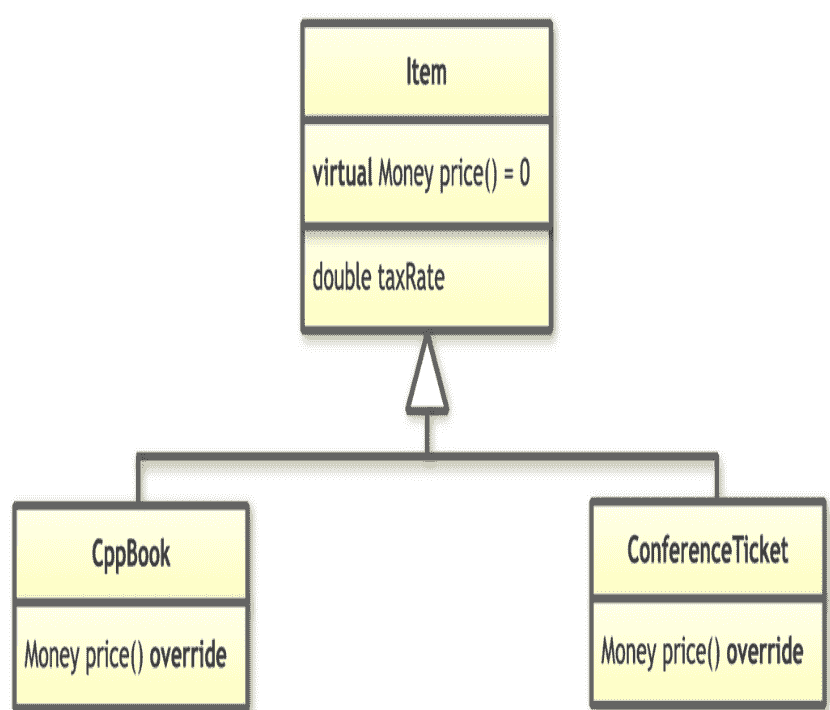
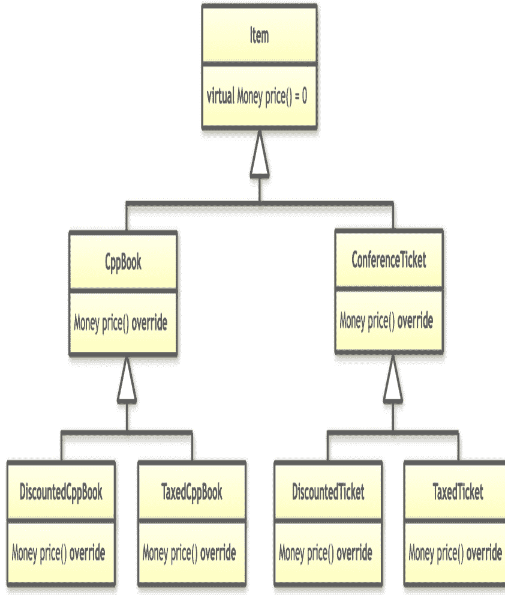
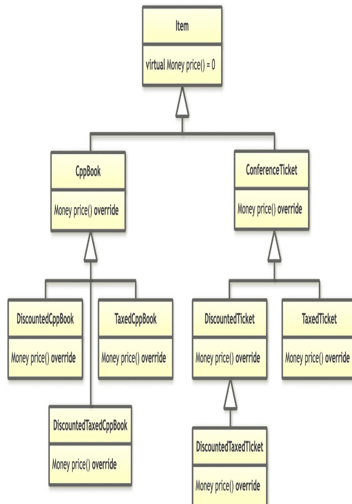
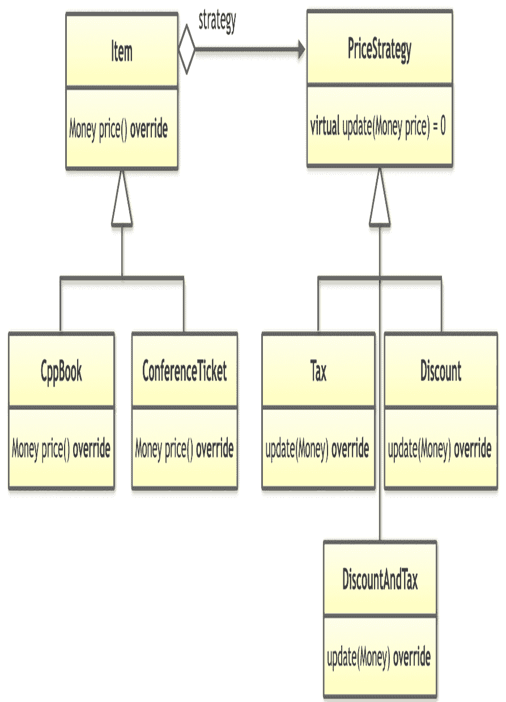
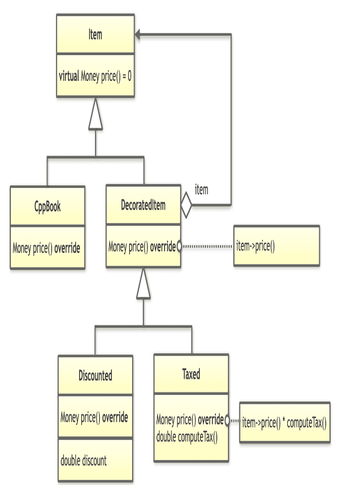

## Chapter 9. The Decorator Design Pattern

### A NOTE FOR EARLY RELEASE READERS

With Early Release ebooks, you get books in their earliest form—the author’s raw and unedited content as they write—so you can take advantage of these technologies long before the official release of these titles.

This will be the 9th chapter of the final book. Please note that the GitHub repo will be made active later on.

If you have comments about how we might improve the content and/or examples in this book, or if you notice missing material within this chapter, please reach out to the editor at sevans@oreilly.com.

This chapter is dedicated to another classic design pattern: the *Decorator* design pattern. Over the years, *Decorator* has proven to be one of the most useful design patterns when it comes to combining and reusing different implementations. So it does not come as a surprise that it is commonly used, even for one of the most impressive reworks of a C++ Standard Library feature. My primary objective in this chapter will be to give you a very good idea why, and when, *Decorator* is a great choice for designing software. Additionally, I will show you the modern, more value-based forms of *Decorator*.

In “Guideline 35: Use Decorators to Add Customization Hierarchically”, we will dive into the design aspects of the *Decorator* design pattern. You will see, when it is the right design choice and which benefits you are gaining by using it. Additionally, you will learn about differences compared to other design patterns and its potential shortcomings.


在“准则 36：理解运行时与编译时抽象之间的权衡”中，我们将再来看两种 *Decorator* 设计模式的实现。虽然这两种实现都将牢牢扎根于 *值语义* 的领域，但第一个将基于静态多态，而第二个将基于动态多态。尽管两者意图相同因此都实现了 *Decorator*，但这两种实现之间的对比将让你感受到设计模式设计空间的广阔。

### 准则 35：使用 Decorator 分层添加定制

自从你通过提出基于 *Strategy* 设计模式的解决方案解决了团队 2D 图形工具的设计问题后，你作为设计模式专家的声誉已在公司内传播开来。因此，其他团队来寻求你的指导也就不足为奇了。有一天，你公司的商品管理系统中的两位开发人员来到你的办公室请求你的帮助。

### 你的同事的设计问题

这两位开发人员的团队处理着大量不同的 `Items`（见图 9-1）。所有这些商品都有一个共同点：它们都有一个 `price()` 标签。这两位开发人员通过从 C++ 商品商店中取出的两个商品来解释他们的问题：一个代表 C++ 书籍的类（`CppBook` 类）和一张 C++ 会议票（`ConferenceTicket` 类）。



图 9-1. 初始的 Item 继承层次结构。

当他们绘制问题时，你开始理解，他们的问题似乎是修改价格的多种不同方式。起初，他们告诉你，他们只需要考虑税收。为此，Item 基类配备了一个受保护的数据成员来表示税率：

```
//---- <Money.h> ----------------

class Money { /*...*/ };

Money operator*( Money money, double factor );
Money operator+( Money lhs, Money rhs );
```

```
//---- <Item.h> ----------------

#include <Money.h>

class Item
{
public:
    virtual ~Item() = default;

    virtual Money price() const = 0;
    // ...

protected:
    double taxRate_;
};
```

这显然在一段时间里运行良好，直到有一天，他们被要求还要考虑不同的折扣率。这显然需要大量工作来重构他们众多不同商品的大量现有类。你可以很容易想象这是必要的，因为所有派生类都在访问受保护的数据成员。“是的，你应该始终为变化而设计……”，你心想。¹

他们继续承认自己不幸的错误设计。当然他们本应该更好地将税率封装在 Item 基类中。然而，随着这一认识的到来，他们也理解到，当通过基类中的数据成员表示价格修饰符时，任何新的价格修饰符种类都将是一种侵入性操作，并且将始终直接影响 Item 类。因此，他们开始思考如何避免未来这种大规模重构，以及如何实现新修饰符的轻松添加。“这就是正确的方法！”你心想。不幸的是，他们脑中首先出现的方案是通过继承层次结构来分解不同种类的价格修饰符（见图 9-2）。



图 9-2. 扩展的 Item 继承层次结构。

不是将税和折扣值封装在基类内部，这些修饰符被分解到派生类中，这些派生类执行所需的价格调整。“哦，哦……”，你开始思考。显然你的表情已经透露出你对这个想法并不特别喜欢，于是他们很快告诉你，他们已经放弃了这个想法。显然他们自己也意识到，这会带来更多问题：这个解决方案会迅速导致类型的爆炸，并且功能重用很差。不幸的是大量代码会被重复，因为对于每一个特定的 `Item`，税和折扣的代码都必须被复制。最麻烦的是，处理同时受税和某种折扣影响的 `Items`：他们既不喜欢提供同时处理两者的类，也不愿在继承层次结构中引入另一层（见图 9-3）。



图 9-3. 有问题的 Item 继承层次结构。

显然，出乎他们的意料，他们既无法通过基类处理价格修饰符，也无法通过直接继承在派生类中处理。然而，在你有机会就分离关注点发表评论之前，他们解释说他们最近听说了你的 Strategy 解决方案。这最终给了他们一个如何正确重构问题的想法（见图 9-4）：



图 9-4. 基于 Strategy 的 Item 继承层次结构。

通过将价格修饰符提取到单独的层次结构中，并通过 PriceStrategy 在构造时配置 Items，他们终于找到了一个非侵入式地添加新价格修饰符的可用解决方案，这将为他们节省大量重构工作。“嗯，这就是分离关注点和优先使用组合而非继承的好处，”你心想。² 而大声你问道：“这很棒，我真的为你们高兴。一切似乎都正常了，你们自己就想明白了！你们到底为什么在这里？”

他们告诉你，你的 Strategy 解决方案是他们迄今为止最好的方法（附带感激的目光）。然而，他们承认他们对该方法并不完全满意。从他们的角度来看，仍有两个问题存在，当然他们希望你能想出解决办法。第一个问题是，每个 Item 实例都需要一个 Strategy 类，即使没有任何价格修饰符适用。虽然他们同意这可以通过某种 Null Object 来解决，但他们觉得应该有更简单的解决方案：³

```
class PriceStrategy
{
public:
    virtual ~PriceStrategy() = default;
    virtual Money update( Money price ) const = 0;
    // ...
};

class NullPriceStrategy : public PriceStrategy
{
public:
    Money update( Money price ) const override { return price; }
};
```

他们遇到的第二个问题，看起来更难解决。显然他们有兴趣组合不同种类的修饰符（例如 Discount 和 Tax 合成 DiscountAndTax）。不幸的是，他们在当前实现中遇到了一些代码重复。例如，Tax 和 DiscountAndTax 类都包含与税相关的计算。而现在，仅有这两种修饰符时，有合理的解决方案来应对重复，但他们预见到在添加更多修饰符和这些修饰符的任意组合时会出现问题。因此他们想知道是否有另一种、更好的处理不同种类价格修饰符的解决方案。

这确实是一个引人入胜的问题，你很高兴抽出时间帮助他们。他们绝对正确：Strategy 设计模式不是这个问题的正确解决方案。虽然 Strategy 是消除对函数完整实现细节的依赖并优雅地处理不同实现的好方案，但它并不能实现不同实现的轻松组合和重用。尝试这样做会迅速导致一个不期望的复杂的 Strategy 继承层次结构。

他们为问题所需的东西看起来更像是一种分层的 Strategy 形式，一种形式可以解耦不同的价格修饰符，同时也允许非常灵活地组合它们。因此，成功的关键是分离关注点的彻底应用：任何像 DiscountAndTax 类那样手动编码的僵化组合都是不可取的。然而，解决方案也应该是非侵入式的，以便他们能够随时实现新想法而无需修改现有代码。最后，不应需要通过人工的 Null Object 来处理默认情况。相反，更合理的做法是彻底基于组合而非继承，并以包装器的形式实现价格修饰符。带着这一认识，你开始微笑。是的，有一个恰好适合此目的的设计模式：你的两位客人需要的，正是 Decorator 设计模式的实现。

### Decorator 设计模式详解

Decorator 设计模式也源自 GoF 书籍。其主要关注点是通过组合灵活组合不同的功能片段：


### 装饰器设计模式

意图：“动态地向对象附加额外的职责。装饰器为扩展功能提供了一种灵活的替代子类化的方法。”（GoF）

图 9-5 显示了给定 Item 问题的 UML 图。如前所述，Item 基类表示所有可能项目的抽象。而派生的 CppBook 类则充当 Item 不同实现的代表。该层次结构中的问题是难以为现有的 price() 函数添加新的修饰符。在装饰器设计模式中，这种添加新的“职责”被识别为一个变化点，并以 DecoratedItem 类的形式提取出来。该类是 Item 基类的一个独立的、特殊的实现，表示对任何给定项目的附加职责。一方面，DecoratedItem 派生自 Item，因此必须遵守 Item 抽象的所有期望（参见“准则 6：遵守抽象的预期行为”）。另一方面，它也包含一个 Item（通过组合或聚合）。因此，DecoratedItem 充当每个项目的包装器，可能本身也可以扩展功能。因此，它为修饰符的层次化应用提供了基础。两种可能的修饰符由 Discounted 类表示，该类表示特定项目的折扣，以及 Taxed 类，该类表示某种税。⁴



*图 9-5. 装饰器设计模式的 UML 表示。*

通过引入 `DecoratedItem` 类并分离需要更改的方面，你遵循了 *单一职责原则 (SRP)*。通过分离这一关注点并因此允许轻松添加新的价格修饰符，你也遵循了 *开放-封闭原则 (OCP)*。由于 `DecoratedItem` 类的层次化、递归性质，以及获得轻松重用和组合不同修饰符的能力，你也遵循了 *不要重复自己 (DRY)* 原则的建议。最后但同样重要的是，由于 *Decorator* 的包装器方法，没有必要以 *空对象* 的形式定义任何默认行为。任何不需要修饰符的 `Item` 都可以照常使用。

图 9-6 说明了 *Decorator* 设计模式的依赖图。在此图中，`Item` 类位于架构的最高层。所有其他类都依赖于它，包括位于其下一层的 `DecoratedItem` 类。当然这不是一个要求：如果 `Item` 和 `DecoratedItem` 在同一架构层引入也是完全可以接受的。然而，此示例演示了，任何时候、任何地方都可以引入新的 *Decorator* 而无需修改现有代码。`Items` 的具体类型在架构的最低层实现。注意，这些项目之间没有依赖关系：所有项目，包括 `Discounted` 等修饰符，都可以由任何人在任何时候独立引入，并且由于 *Decorator* 的结构，可以灵活地任意组合。

```
class Item
{
public:
    virtual ~Item() = default;
    virtual Money price() const = 0;
};
```

High-level

Architectural
Boundary

```
class DecoratedItem : public Item
{
public:
    explicit DecoratedItem( std::unique_ptr<Item>&& item );
    // ...
protected:
    // ... Access functions for item_
private:
    std::unique_ptr<Item> item_;
};
```

Architectural
Boundary

```
class CppBook : public Item
{
public:
    CppBook( std::string title, double price );
    Money price() const noexcept override;
private:
    // ...
};
```

```
class Discounted : public DecoratedItem
{
public:
    Discounted( std::unique_ptr<Item>&& item, double discount );
    Money price() const override;
private:
    // ...
};
```

Low-level

图 9-6. 装饰器设计模式的依赖图。

### 装饰器设计模式的经典实现

让我们通过给定的 Item 示例来看一下装饰器设计模式的完整、GoF 风格的实现：

```
//---- <Item.h> ----------------

#include <Money.h>

class Item
{
public:
    virtual ~Item() = default;
    virtual Money price() const = 0;
};
```

Item 基类表示所有可能项目的抽象。唯一的要求是由纯虚 price() 函数定义，可用于查询给定项目的价格。DecoratedItem 类表示 Item 类的一种可能实现（1）：

```
//---- <DecoratedItem.h> ----------------

#include <Item.h>
#include <memory>
#include <stdexcept>
#include <utility>

class DecoratedItem : public Item 1
{
public:
    explicit DecoratedItem( std::unique_ptr<Item> item ) 3
        : item_( std::move(item) )
    {
        if( !item_ ) {
            throw std::invalid_argument( "Invalid item" );
        }
    }

```

```
protected:
    Item& item() { return *item_; }
    Item const& item() const { return *item_; }

private:
    std::unique_ptr<Item> item_;
};
```

DecoratedItem 派生自 Item 类，但也包含一个 item_（2）。此 item_ 通过构造函数指定，该构造函数接受指向另一个 Item 的非空 std::unique_ptr（3）。请注意，此 DecoratedItem 类仍然是抽象的，因为纯虚 price() 函数尚未定义。DecoratedItem 仅提供存储 Item 并通过受保护成员函数访问 Item 的必要功能（4）。

配备了这两个类，可以实现具体的 Items：

```
//---- <CppBook.h> -------------

#include <Item.h>
#include <string>
#include <utility>

class CppBook : public Item  5
{
public:
    CppBook( std::string title, Money price )
        : title_{ std::move(title) }
        , price_{ price }
    {}

    std::string const& title() const { return title_; }
    Money price() const override { return price_; }

private:
    std::string title_{};
    Money price_{};
};
```

```
//---- <ConferenceTicket.h> ----------------

#include <Item.h>
#include <string>
#include <utility>

class ConferenceTicket : public Item ⑥
{
public:
    ConferenceTicket( std::string name, Money price )
    : name_{ std::move(name) }
    , price_{ price }
    {}

    std::string const& name() const { return name_; }
    Money price() const override { return price_; }

private:
    std::string name_{};
    Money price_{};
};
```

CppBook 和 ConferenceTicket 类表示可能的特定 Item 实现（⑤ 和 ⑥）。虽然 C++ 书籍通过书籍的标题表示，C++ 会议通过会议的名称表示。最重要的是，这两个类都通过返回指定的 price_ 来重写 price() 函数。

CppBook 和 ConferenceTicket 对任何税或折扣都一无所知。但显然，这两种 Item 都可能同时受其影响。这些价格修饰符由 Discounted 和 Taxed 类实现：

```
//---- <Discounted.h> ----------------

#include <DecoratedItem.h>

class Discounted : public DecoratedItem
{
public:
    Discounted( double discount, std::unique_ptr<Item> item )  ⑦
```

```
: DecoratedItem( std::move(item) )
, factor_( 1.0 - discount )
{
    if( !std::isfinite(discount) || discount < 0.0 || discount > 1.0 ) {
        throw std::invalid_argument( "Invalid discount" );
    }
}

Money price() const override
{
    return item().price() * factor_; ⑧
}

private:
    double factor_;
};
```

Discounted 类（⑦）通过传递指向 Item 的 std::unique_ptr 和一个折扣值进行初始化，折扣值由介于 0.0 和 1.0 之间的 double 值表示。虽然给定的 Item 立即传递给 DecoratedItem 基类，但给定的折扣值用于计算折扣因子 factor_。此因子在 price() 函数的实现中用于修改给定项目的价格（⑧）。请注意，此项目可以是 CppBook 或 ConferenceTicket 等特定项目，也可以是 Discounted 等装饰器，后者反过来修改另一个 Item 的价格。因此，price() 函数是装饰器层次结构完全被利用的地方。

```
//---- <Taxed.h> ----------------

#include <DecoratedItem.h>

class Taxed : public DecoratedItem
{
public:
    Taxed( double taxRate, std::unique_ptr<Item> item )  ⑨
    : DecoratedItem( std::move(item) )
    , factor_( 1.0 + taxRate )
    {
        if( !std::isfinite(taxRate) || taxRate < 0.0 ) {
```


```
throw std::invalid_argument( "Invalid tax" );
}
}

Money price() const override
{
    return item().price() * factor_;
}

private:
    double factor_;
};
```

Taxed 类与 Discounted 类非常相似。主要区别在于构造函数中对税相关因子的评估 ⑨。同样，这个因子在 price() 函数中被用来修改被包装的 Item 的价格。

所有这些功能都在 main() 函数中组合在一起：

```
#include <ConferenceTicket.h>
#include <CppBook.h>
#include <Discounted.h>
#include <Taxed.h>
#include <cstdlib>
#include <memory>

int main()
{
    // 7% tax: 19*1.07 = 20.33
    std::unique_ptr<Item> item1( ⑩
        std::make_unique<Taxed>( 0.07,
            std::make_unique<CppBook>( "Effective C++", 19.0 ) ) );

    // 20% discount, 19% tax: (999*0.8)*1.19 = 951.05
    std::unique_ptr<Item> item2( ⑪
        std::make_unique<Taxed>( 0.19,
            std::make_unique<Discounted>( 0.2,
                std::make_unique<ConferenceTicket>( "CppCon", 999.0 )
    ) ) );

    Money const totalPrice1 = item1->price();  // Results in 20.33
    Money const totalPrice2 = item2->price();  // Results in 951.05

// ...

return EXIT_SUCCESS;
}
```

作为第一个 Item，我们创建一个 CppBook。假设这本书需缴纳 7% 的税，该税通过在 item 周围包装一个 Taxed 装饰器来应用。因此 resulting item1 代表一本已缴税的 C++ 书籍（¶）。作为第二个 Item，我们创建一个 ConferenceTicket 实例，表示 CppCon。我们很幸运地获得了早鸟票之一，这意味着我们可享受 20% 的折扣。此折扣通过 Discounted 类包裹在 ConferenceTicket 实例周围。票同时需缴纳 19% 的税，与之前一样，也通过 Taxed 装饰器应用。因此 resulting item2 代表一张已折扣且已缴税的 C++ 大会门票（¶）。

### 第二个装饰器示例

另一个令人印象深刻的示例，展示了装饰器设计模式的好处，可以在 C++17 对 STL 分配器的重构中找到。由于其基于装饰器的实现，可以创建分配器任意复杂的层级，以满足最特殊的内存需求。例如，考虑以下使用 std::pmr::monotonic_buffer_resource 的示例（¶）：

```
#include <array>
#include <cstddef>
#include <cstdlib>
#include <memory_resource>
#include <string>
#include <vector>

int main()
{
    std::array<std::byte,1000> raw;  // Note: not initialized!

std::pmr::monotonic_buffer_resource
    buffer{ raw.data(), raw.size(),
std::pmr::null_memory_resource() };

    std::pmr::vector<std::pmr::string> strings{ &buffer };

    strings.emplace_back( "String longer than what SSO can handle"
);
    strings.emplace_back( "Another long string that goes beyond SSO" );
    strings.emplace_back( "A third long string that cannot be handled by SSO" );

    // ...

    return EXIT_SUCCESS;
}
```

std::pmr::monotonic_buffer_resource 是 std::pmr 命名空间中提供的多个分配器之一。在此示例中，它被配置为：每当 strings 向量请求内存时，它只会分发给定的字节数组 raw 的块。无法处理的内存请求，例如因为缓冲区内存不足，会通过抛出 std::bad_alloc 异常来处理。此行为是通过在构造期间传递 std::pmr::null_memory_resource 指定的。std::pmr::monotonic_buffer_resource 还有许多其他可能的用途。例如，也可以通过 std::pmr::new_delete_resource() 在动态内存之上构建，并让其通过 new 和 delete 重新分配额外的内存块：

```
// ...

int main()
{
    std::pmr::monotonic_buffer_resource
        buffer{ std::pmr::new_delete_resource() };

    // ...
}
```

这种灵活性和分配器的层级配置是通过 *Decorator* 设计模式实现的。`std::pmr::monotonic_buffer_resource` 派生自 `std::pmr::memory_resource` 基类，同时也充当另一个派生自 `std::pmr::memory_resource` 的分配器的包装器。当缓冲区内存耗尽时使用的上游分配器是在构造 `std::pmr::monotonic_buffer_resource` 时指定的。

最令人印象深刻的是，你可以轻松且非侵入性地自定义分配策略。例如，这可能很有趣，以便让你对大块内存的请求与对小块内存的请求采用不同的处理方式。你所需要做的就是提供你自己的自定义分配器。考虑以下 `CustomAllocator` 的草图：

```
//---- <CustomAllocator.h> ----------------

#include <cstdlib>
#include <memory_resource>

class CustomAllocator : public std::pmr::memory_resource
{
public:
    CustomAllocator( std::pmr::memory_resource* upstream )
        : upstream_{ upstream }
    {}

private:
    void* do_allocate( size_t bytes, size_t alignment ) override;

    void do_deallocate( void* ptr, [[maybe_unused]] size_t bytes,
                        [[maybe_unused]] size_t alignment )
    override;

    bool do_is_equal(
        std::pmr::memory_resource const& other ) const noexcept
    override;

std::pmr::memory_resource* upstream_{};
};
```

为了被识别为 C++17 分配器，CustomAllocator 类派生自 std::pmr::memory_resource 类，后者代表了所有 C++17 分配器的要求集合（⑧）。巧合的是，CustomAllocator 还拥有一个指向 std::pmr::memory_resource 的指针，（⑨），该指针通过其构造函数进行初始化（⑩）。

C++17 分配器的要求集合由虚函数 do_allocate()、do_deallocate() 和 do_is_equal() 组成。do_allocate() 函数负责获取内存，可能通过其上游分配器（⑪），而 do_deallocate() 函数在需要归还内存时被调用（⑫）。最后但同样重要的是，do_is_equal() 函数在需要检查两个分配器的相等性时被调用（⑬）。⁵

仅通过引入 CustomAllocator，而无需更改任何其他代码，特别是标准库中的代码，就能轻松地将这种新型分配器插入 std::pmr::monotonic_buffer_resource 和 std::pmr::new_delete_resource() 之间（⑳），从而允许你非侵入性地扩展分配行为：

```
// ...
#include <CustomAllocator.h>

int main()
{
    CustomAllocator custom_allocator{
    std::pmr::new_delete_resource() };

    std::pmr::monotonic_buffer_resource buffer{ &custom_allocator }; ⑳

    // ...
}
```

### 装饰器、适配器和策略的比较

听到 *Decorator* 和 *Adapter* 名称，这两种设计模式听起来似乎有相似的目的。然而，经过更仔细的检查，这两种模式非常不同，几乎没有关联。*Adapter* 设计模式的意图是适配并改变给定的接口以匹配期望的接口。它不关心添加任何功能，只关心将一组函数映射到另一组（参见“准则 24：使用适配器来标准化接口”）。而 *Decorator* 设计模式则保留给定的接口，根本不关心改变它。相反，它提供了添加职责并扩展和定制现有函数集的能力。

*Strategy* 设计模式与 *Decorator* 更为相似。两种模式都提供了定制功能的能力。然而，两种模式适用于不同的应用，因此提供不同的好处。*Strategy* 设计模式专注于移除对特定功能实现细节的依赖，并使你能够从外部定义这些细节。因此从这个角度来看，它代表了该功能的核心、“内脏”。这种形式使其特别适合表示不同的实现并在它们之间切换（参见“准则 19：使用策略来隔离如何完成事情”）。相比之下，*Decorator* 设计模式专注于移除可附加的实现片段之间的依赖。由于其包装形式，*Decorator* 代表了功能性的“皮肤”。⁶ 在这种形式下，它特别适合组合不同的实现，从而使你能够增强和扩展功能，而不是替换它或在实现之间切换。

显然，*Strategy* 和 *Decorator* 各有其优势，应据此选择。然而，也可以将这两种设计模式结合起来以获得两者的优点。例如，可以使用 *Strategy* 设计模式来实现 Items，但通过 *Decorator* 对 *Strategy* 进行更细粒度的配置：


```
class PriceStrategy
{
    public:
        virtual ~PriceStrategy() = default;
        virtual Money update( Money price ) const = 0;
        // ...
};
```

```
class DecoratedPriceStrategy : public PriceStrategy
{
    public:
        // ...
    private:
        std::unique_ptr<PriceStrategy> priceModifier_;
};
```

```
class DiscountedPriceStrategy : public DecoratedPriceStrategy
{
    public:
        Money update( Money price ) const override;
        // ...
};
```

这种设计模式的组合在你已经有 Strategy 实现的情况下尤其有趣：虽然 Strategy 是侵入式的，需要修改一个类，但始终可以无侵入地添加一个如 DecoratedPriceStrategy 类这样的 Decorator。当然这取决于具体情况：这是否是正确的解决方案，你需要根据具体情况来决定。

### 分析 Decorator 设计模式的不足

凭借其分层扩展和定制行为的能力，Decorator 设计模式显然是设计模式目录中最有价值和最灵活的模式之一。然而，尽管有其优点，它也带来了一些缺点。首先也是最重要的是，Decorator 的灵活性是有代价的：给定层次结构中的每一层都会增加一层间接性。以一个具体例子来说，在 Item 层次结构面向对象实现中，这种间接性表现为每个 *Decorator* 一次虚函数调用。因此，大量使用 *Decorator* 可能会带来潜在的显著性能开销。这种可能的性能惩罚是否构成问题取决于上下文。你需要逐案使用基准测试来决定 *Decorator* 的灵活性和结构方面是否超过性能问题，或者不。

另一个缺点是组合 *Decorator* 产生无意义结果的潜在危险。例如，很容易将一个 Taxed *Decorator* 包装在另一个 Taxed *Decorator* 周围，或对一个已经征税的 Item 应用 Discounted。两种情况都会让你的政府高兴，但仍然不应该发生，因此应通过设计来避免。这种理性被 Scott Meyers 的通用设计原则很好地表达了：⁷

> *使接口易于正确使用且难以错误使用。*
> 
> —Scott Meyers

因此，*Decorator* 的巨大灵活性是极其出色的，但也可能很危险（当然取决于场景）。由于在这种场景下税收似乎扮演着特殊角色，似乎非常合理不要将它们作为 *Decorator* 来处理，而是以不同方式处理。由于在现实中税收被证明是一个相当复杂的话题，似乎合理的做法是通过 *Strategy* 设计模式分离这一关注点：

```
//---- <TaxStrategy.h> ----------------

#include <Money.h>

class TaxStrategy ①
{
public:
    virtual ~TaxStrategy() = default;
    virtual Money applyTax( Money price ) const = 0;
    // ...
};

//---- <TaxedItem.h> ----------------
```

```
#include <Money.h>
#include <TaxStrategy.h>
#include <memory>

class TaxedItem
{
public:
    explicit TaxedItem( std::unique_ptr<Item> item
        , std::unique_ptr<TaxStrategy> taxer )
        : item( std::move(item) )
        , taxer_( std::move(taxer) )
    {
        // Check for a valid item and tax strategy
    }

    Money netPrice() const  // Price without taxes
    {
        return price();
    }

    Money grossPrice() const  // Price including taxes
    {
        return taxer_.applyTax( item_.price() );
    }

private:
    std::unique_ptr<Item> item_;
    std::unique_ptr<TaxStrategy> taxer_;
};
```

TaxStrategy 类表示对 Item 应用税的多种不同方式(3)。这样的 TaxStrategy 在 TaxedItem 类中与 Item 组合(22)。请注意 TaxedItem 本身不是 Item，因此不能通过另一个 Item 来装饰它。它因此充当一种终止 Decorator，只能作为最后一个装饰器应用。它也不提供 price() 函数：相反，它提供 netPrice()(23) 和 grossPrice()(24) 函数，以便查询包含税的价格和被包装 Item 的原始价格。8

你可能看到的唯一其他问题是基于引用语义的 Decorator 设计模式实现：大量指针，包括 nullptr 检查和悬空指针的危险，通过 std::unique_ptr 和 std::make_unique() 进行显式生命周期管理，以及许多小的手动内存分配。然而，幸运的是你仍然有王牌，可以展示如何基于值语义实现 Decorator（参见以下准则）。

总之，Decorator 设计模式是基本设计模式之一，尽管有一些缺点，但仍将证明是工具箱中非常宝贵的补充。只要确保你不要对 Decorator 太兴奋并开始将其用于一切。毕竟，对于每种模式，良好使用和过度使用之间都有一条细线。

### GUIDELINE 35: 使用装饰器分层添加定制

- 理解继承很少是答案；
- 采用 Decorator 设计模式的意图是无侵入地分层扩展和定制行为；
- 考虑使用 Decorator 来组合和重用独立的行为片段；
- 理解 Decorator、Adapter 和 Strategy 设计模式之间的区别；
- 利用 Decorator 的极端灵活性，但了解其缺点；
- 避免无意义的 Decorator，但更倾向于易于正确使用的设计。

### Guideline 36: 理解运行时与编译时之间的权衡

#### 抽象

在“Guideline 35: 使用装饰器分层添加定制”中，我向你介绍了 Decorator 设计模式，并希望给你一个强有力的理由将此设计模式添加到你的工具箱中。然而，到目前为止，我仅通过经典的面向对象实现来说明 Decorator，并且再次没有遵循“Guideline 22: 优先使用值语义而非引用语义”的建议。由于我假设你迫切想知道如何基于值语义实现 Decorator，现在是展示两种可能方法的时候了。是的，两种方法：我将弥补延迟，通过展示两种非常不同的实现。两者都坚定地基于值语义，但在比较中几乎处于设计空间的对立面。虽然第一种方法将是基于静态多态的实现，使你能够利用所有可用的编译时信息，第二种方法则更利用动态多态的运行时优势。两种方法各有优点，但当然也有各自的缺点。因此这些示例将很好地展示你可用的设计选择的广度。

#### 基于值的编译时装饰器

让我们从基于静态多态的 Decorator 实现开始。“我假设这又会非常依赖模板，对吧？”你在问。是的，我将使用模板作为主要抽象机制，是的，我将使用 C++20 concept 甚至转发引用。但不，我会尽量不让它特别依赖模板。相反，主要关注点仍然在于 Decorator 设计模式的设计方面，以及使添加新类型的 Decorator 和新类型的常规项变得容易的目标。其中一个这样的项是 ConferenceTicket 类：

```
//---- <ConferenceTicket.h> ----------------

#include <Money.h>
#include <string>
```

```
#include <utility>

class ConferenceTicket
{
public:
    ConferenceTicket( std::string name, Money price )
        : name_{ std::move(name) }
        , price_{ price }
    {}

    std::string const& name() const { return name_; }
    Money price() const { return price_; }

private:
    std::string name_;
    Money price_;
};
```

ConferenceTicket 完美地满足了值类型的期望：没有涉及基类，也没有虚函数。这表明项不再通过指针到基来装饰，而是通过组合，或者 alternatively，通过直接非公开继承。以下是对 Discounted 和 Taxed 类的两种实现示例：

```
//---- <PricedItem.h> ----------------

#include <Money.h>

template< typename T >
concept PricedItem = ③
    requires ( T item ) {
    { item.price() } -> std::same_as<Money>;
};
```

```
//---- <Discounted.h> ----------------

#include <Money.h>
#include <PricedItem.h>
#include <utility>

template< double discount, PricedItem Item >
```


```
class Discounted  // Using composition ①
{
    public:
        template< typename... Args >
        explicit Discounted( Args&&... args )
            : item_{ std::forward<Args>(args)... }
        {}

        Money price() const {
            return item_.price() * ( 1.0 - discount );
        }

    private:
        Item item_;
};
```

```
//---- <Taxed.h> ----------------

#include <Money.h>
#include <PricedItem.h>
#include <utility>

template< double taxRate, PricedItem Item >
class Taxed : private Item  // Using inheritance ②
{
    public:
        template< typename... Args >
        explicit Taxed( Args&&... args )
            : Item{ std::forward<Args>(args)... }
        {}

        Money price() const {
            return Item::price() * ( 1.0 + taxRate );
        }
};
```

Both Discounted ① and Taxed ② serve as Decorators for other kinds of Items: the Discounted class represents a certain discount on a given item, the Taxed class represents some kind of tax. This time, however, both are implemented in form of class templates. The first template argument specifies the discount and the tax rate, respectively, the second template argument specifies the type of the decorated Item.⁹

Most noteworthy, however, is the `PricedItem` constraint on the second template argument ③. This constraint represents the set of semantic requirements, i.e. the expected behavior. Due to this constraint, you can only provide types that represent items with a `price()` member function. Using any other type would immediately result in a compilation error. Thus `PricedItem` plays the same role as the `Item` base class in the classic *Decorator* implementation in “Guideline 35: Use Decorators to Add Customization Hierarchically”. For the same reason, it also represents the separation of concerns based on the *Single-Responsibility Principle (SRP)*. Furthermore, if this constraint is owned by some high-level in your architecture, then you, as well as anyone else, are able to add new kinds of items *and* new kinds of *Decorators* on any lower level. This feature perfectly fulfills the *Open-Closed Principle (OCP)*, and due to the proper ownership of the abstraction, also the *Dependency Inversion Principle (DIP)* (see Figure 9-7). 10

```
template< typename T >
concept PricedItem =
  requires ( const T item ) {
    { item.price() } -> std::same_as<Money>;
  };
```

High-level

Architectural
Boundary

Inversion of
dependencies

Low-level

```
class ConferenceTicket
{
public:
  explicit ConferenceTicket( Money price );

  Money price() const;

private:
  Money price_;
};
```

```
template< double discount, PricedItem Item >
class Discounted
{
public:
  template< typename... Args >
  explicit Discounted( Args&&... args );

  Money price() const;

private:
  Item item_;
};
```

No dependency between items
and decorated items

Figure 9-7. Dependency graph for the compile time Decorator.

Both the `Discounted` and `Taxed` class templates are very similar, except for the way they handle the decorated `Item`: while the `Discounted` class template stores the `Item` in form of a data member and therefore follows “Guideline 20: Favor Composition Over Inheritance”, the `Taxed` class template privately inherits from the given `Item` class. Both approaches are possible, reasonable, and have their individual strengths, but you should consider the composition approach taken by the `Discounted` class template as the more common approach. As explained in “Guideline 24: Use Adapters to Standardize Interfaces”, there are only five reasons to prefer non-public inheritance to composition (some of them being very rare):

- If you have to override a virtual function;
- If you need access to a `protected` member function;
- If you require the adapted type to be constructed before another base class;
- If you need to share a common virtual base class or override the construction of a virtual base class;
- If you can draw significant advantage from the Empty Base Optimization (EBO).

Arguably, for a large number of adapters, EBO may be a reason to favor inheritance, but you should make sure that your choice is backed up by numbers (for instance by means of representative benchmarks).

With these three classes in place, you are able to specify a `ConferenceTicket` with a discount of 20% and a tax of 15%:

```
#include <ConferenceTicket.h>
#include <Discounted.h>
#include <Taxed.h>
#include <cstdlib>
```

```
int main()
{
    // 20% discount, 15% tax: (499*0.8)*1.15 = 459.08
    Taxed<0.15,Discounted<0.2,ConferenceTicket>> item{ "Core C++", 499.0 };

    Money const totalPrice = item.price();  // Results in 459.08

    // ...

    return EXIT_SUCCESS;
}
```

The biggest advantage of this compile time approach, is the significant performance improvement: since there are no pointer indirections and due to the possibility to inline, the compiler is able to go all out on optimizing the resulting code. Also arguably, the resulting code is much shorter, not bloated with any boilerplate code, and therefore easier to read.

“Could you be a little more specific about the performance results? In C++, developers are bickering about a 1% performance difference and call it significant. So seriously: how much faster is the compile time approach?” I see, you seem to know the performance zeal of the C++ community pretty well. Well, as long as you promise me again, that you do not consider my results as the definitive answer, but only as a single example, and if we agree that this comparison will not evolve into a performance study, I can show you some numbers. But before I do, let me quickly outline the benchmark, that I will use: I am comparing the classic object-oriented implementation from “Guideline 35: Use Decorators to Add Customization Hierarchically” with the described compile time version. Of course, there is an arbitrary number of decorator combinations, but I am restricting myself to the following four item types:¹¹

```
using DiscountedConferenceTicket =
Discounted<0.2,ConferenceTicket>;
using TaxedConferenceTicket = Taxed<0.19,ConferenceTicket>;
using TaxedDiscountedConferenceTicket =
Taxed<0.19,Discounted<0.2,ConferenceTicket>>;
using DiscountedTaxedConferenceTicket =
Discounted<0.2,Taxed<0.19,ConferenceTicket>>;
```

Since in the compile time solution these four types do not have a common base class, I am filling four specific std::vectors with these. In comparison, for the classic runtime solution, I use a single std::vector of std::unique_ptr<Item>s. In total, I am creating 10,000 items with random prices for both solutions and call std::accumulate() 5,000 times to compute the total price of all items.

With this background information, let us take a look at the performance results. Again, I am normalizing the results, this time to the performance of the runtime implementation:

### Table 9-1. Performance results for
the
compile
time
Decorator
implementation

|  | GCC 11.1 | Clang 11.1 |
|---|---|---|
| Classic Decorator | 1.0 | 1.0 |
| Compile Time Decorator | 0.078067 | 0.080313 |

As stated before, the performance of the compile time solution is significantly faster than the runtime solution: for both GCC and Clang it only takes approx. 8% of the time of the runtime solution and therefore is faster by more than one order of magnitude. I know, this sounds amazing. However, while the performance of the compile time solution is extraordinary, it comes with a couple of potentially severe limitations: due to the complete focus on templates, there is no runtime flexibility left. Since even the discount and tax rates are realized via template parameters, a new type needs to be created for each different rate. This may lead to longer compile times and more generated code (i.e. larger executables).
Additionally, it stands to reason that all class templates reside in header files, which again increases compile time and may reveal more implementation details than desired. More importantly, changes to the implementation details are widely visible and may cause massive recompilations. However, the most limiting factor appears to be that the solution can only be used in this form, if all information is available at compile time. Thus, you may only be able to get to this performance level for a few special cases.

### A Value-Based Runtime Decorator


由于编译时 *Decorator* 可能很快，但运行时非常不灵活，让我们把注意力转向第二种基于值的 *Decorator* 实现。通过这种实现，我们将回到动态多态的领域，拥有其所有的运行时灵活性。

当你现在已经了解 *Decorator* 设计模式时，你会意识到我们需要能够轻松添加新类型：新的 Item 类型，以及新的价格修饰符。因此，将“Guideline 35: Use Decorators to Add Customization Hierarchically”中的 *Decorator* 实现转变为基于 *value semantics* 的实现的*设计模式*选择是 *Type Erasure.*¹²。下面的 Item 类实现了我们定价项示例的拥有型 *Type Erasure* 包装器：

```
//---- <Item.h> ----------------

#include <Money.h>
#include <memory>
#include <utility>

class Item
{
public:
    // ...

private:
    struct Concept ④
    {
        virtual ~Concept() = default;
        virtual Money price() const = 0;
        virtual std::unique_ptr<Concept> clone() const = 0;
    };

    template< typename T >
    struct Model : public Concept ⑤
    {
        explicit Model( T const& item ) : item_( item ) {}
        explicit Model( T&& item ) : item_( std::move(item) ) {}

        Money price() const override
        {
            return item_.price();
        }
```

```
std::unique_ptr<Concept> clone() const override
{
    return std::make_unique<Model<T>>(*this);
}

    T item_;
};

    std::unique_ptr<Concept> pimpl_;
};
```

在此实现中，Item 类在其私有部分 ④ 定义了一个嵌套的 Concept 基类。如常，Concept 基类表示被包装类型的需求集，即预期的行为，这些需求由 price() 和 clone() 成员函数表达。这些需求由嵌套的 Model 类模板 ⑤ 实现。Model 通过将调用转发给存储的 item_ 数据成员的 price() 成员函数来实现 price() 函数，并通过创建存储项的副本来实现 clone() 函数。

Item 类的公共部分应该很熟悉：

```
//---- <Item.h> ----------------

// ...

class Item
{
public:
    template< typename T >
    Item( T item ) ⑥
        : pimpl_( std::make_unique<Model<T>>( std::move(item) ) )
    {}

    Item( Item const& item ) : pimpl_( item.pimpl_->clone() ) {}

    Item& operator=( Item const& item )
    {
        pimpl_ = item.pimpl_->clone();
        return *this;
    }
```

```
}
~Item() = default;
Item( Item&& ) = default;
Item& operator=( Item&& item ) = default;

Money price() const { return pimpl_->price(); } ⑦

private:
    // ...
};
```

除了通常的 Rule of 5 实现外，该类再次配备了一个模板化构造函数，可接受各种各样的项 ⑥。最后但同样重要的是，该类提供了一个 price() 成员函数，模仿了所有项的预期接口 ⑦。

有了这个包装类，你就可以轻松添加新项：既不需要对现有代码进行侵入性修改，也不需要使用基类。任何提供 price() 成员函数并且可复制的类都可以使用。幸运的是，这包括我们编译时 Decorator 实现中的 ConferenceTicket 类，它提供了我们所需的一切，并且牢牢基于值语义。不幸的是，这对 Discounted 和 Taxed 类不成立，因为它们期望以模板参数形式装饰的项。因此我们为 Type Erasure 上下文重新实现 Discounted 和 Taxed：

```
//---- <Discounted.h> ----------------

#include <Item.h>
#include <utility>

class Discounted
{
public:
    Discounted( double discount, Item item )
        : item_( std::move(item) )
        , factor_( 1.0 - discount )
    {}

    Money price() const
{
```

```
return item_.price() * factor_;
}

private:
    Item item_;
    double factor_;
};

//---- <Taxed.h> ----------------

#include <Item.h>
#include <utility>

class Taxed
{
public:
    Taxed( double taxRate, Item item )
        : item_( std::move(item) )
        , factor_( 1.0 + taxRate )
    {}

    Money price() const
    {
        return item_.price() * factor_;
    }

private:
    Item item_;
    double factor_;
};
```

特别有趣的是，这两个类都没有派生自任何基类，但都完美地实现了 Decorator 设计模式。一方面，它们实现了 Item 包装器所需的操作以算作一个项，特别是 price() 成员函数和拷贝构造函数，但另一方面，它们拥有一个 Item。因此，两者都使你能够任意组合 Decorator，如以下 main() 函数所示：

```
#include <ConferenceTicket.h>
#include <Discounted.h>
#include <Taxed.h>
```

```
int main()
{
    // 20% discount, 15% tax: (499*0.8)*1.15 = 459.08
    Item item( Taxed( 0.19, Discounted( 0.2,
ConferenceTicket{"Core C++",499.0} ) ) );

    Money const totalPrice = item.price();

    // ...

    return EXIT_SUCCESS;
}
```

“哇，这很美：没有指针，没有手动分配，感觉非常自然直观。但同时它又极其灵活。这好得不真实，一定有陷阱。性能如何？”你说。嗯，你听起来像是期望性能完全崩溃。所以让我们对这个解决方案进行基准测试。当然我使用的是与编译时 Decorator 版本相同的基准测试，只是增加了基于 Type Erasure 的第三种方案。以下是性能数据：

Table 9-2. Performance results for the Type Erasure Decorator implementation

|  | GCC 11.1 | Clang 11.1 |
|---|---|---|
| Classic Decorator | 1.0 | 1.0 |
| Compile Time Decorator | 0.078067 | 0.080313 |
| Type Erasure Decorator | 0.997510 | 0.971875 |

正如你所见，性能并不比其他经典运行时解决方案差。事实上，性能甚至看起来略微好一点，但尽管这是多次运行的平均值，我也不会太过强调这一点。然而，请记住，有多种方法可以提高 Type Erasure 解决方案的性能，如“Guideline 33: Know about the Optimization Potential of Type Erasure”中所示。

虽然性能可能不是运行时解决方案的主要优势，至少与编译时解决方案相比如此，但它在运行时灵活性方面确实 shines。例如，可以在运行时决定将任何 Item 包装在另一个 Decorator 中，基于用户输入、基于计算结果……这当然会再次产生一个 Item，该 Item 可以与许多其他 Item 一起存储在单个容器中。它确实为你提供了巨大的运行时灵活性。

另一个优势是更轻松地在源文件中隐藏实现细节。虽然这可能会导致运行时性能损失，但很可能会带来更好的编译时间。最重要的是：对隐藏代码的任何修改都不会影响任何其他代码，从而节省大量重新编译，因为实现细节得到了更强的封装。

总之，编译时和运行时解决方案都是基于值的，并导致更简单、更易理解的用户代码。然而，它们也各有优缺点：虽然运行时方法提供更多灵活性，但编译时方法在性能方面占主导。在现实中，你很少会遇到纯编译时或纯运行时的方法，但你经常会发现自己处于这两个极端之间。确保你了解你的选择：权衡它们并找到一个完美结合两者优点并适合你特定情况的折中方案。

### GUIDELINE 36: UNDERSTAND THE TRADEOFF BETWEEN RUNTIME AND COMPILE TIME ABSTRACTION

- Be aware of both runtime and compile time implementations of the *Decorator* design pattern;
- Understand that compile time solutions usually perform better, but limit runtime flexibility and encapsulation;
- Understand that runtime solutions are more flexible and are good at hiding details, but perform worse;
- Prefer a *value semantics* solution to a *reference semantics* solution.

1 Remember “Guideline 2: Design for Change” and Core Guideline C.133: “Avoid protected data”.

2 See “Guideline 20: Favor Composition Over Inheritance” for the discussion, why so many design patterns draw their power from composition rather than inheritance.

3 A *Null Object* represents an object with neutral (null) behavior. As such, it can be seen as a default for a *Strategy* implementation.

4 You may be wondering if this is the most reasonable approach for dealing with taxes. No, unfortunately it is not. That is because first, as usual, reality is so much more complex than this simple, educational example, and second, because in this form it is easy to apply taxes


incorrectly. While I cannot help with the first point (I am just a mere mortal), I will go into detail about the second point at the end of this guideline.

5 In case you are wondering about the incomplete implementation: the focus here is entirely on how to *design* allocators, not on how to *implement* an allocator. For a thorough introduction on how to implement a C++17 allocator, see Nicolai Josuttis’ “C++17 - The Complete Guide”, NicoJosuttis, Sept. 2019, ISBN: 978-3967309171.

6 The metaphor of *Strategy* being the guts of an object and *Decorator* being the skin originates from the GoF book.

7 Scott Meyers, “Effective C++ - Third Edition”, Addison-Wesley, May 2005, ISBN: 978-0321334879.

8 If right now you are thinking that the original `price()` function should be renamed to `netPrice()` to reflect its true purpose, then I agree.

9 Note, that it is only possible to use floating-point values as non-type template parameters (NTTPs) since C++20. Alternatively, you could store the discount and tax rates in form of data members.

10 Alternatively, in particular if you cannot use C++20 concepts yet, this is an opportunity to use the *Curiously Recurring Template Pattern (CRTP)*; see “Guideline 26: Use CRTP to Introduce Static Type Categories”.

11 In order to avoid a visit from the tax collection office, I should explicitly state that I am aware of the questionable nature of the `Discounted<0.2, Taxed<0.19, ConferenceTicket>>` class (see also the list of potential problems of *Decorator* at the end of “Guideline 35: Use Decorators to Add Customization Hierarchically”). In my defense: it is an obvious permutation of decorators, which is well suited for this benchmark.

12 For a thorough overview of *Type Erasure*, see Chapter 8 and in particular “Guideline 32: Consider Replacing Inheritance Hierarchies with Type Erasure”.
