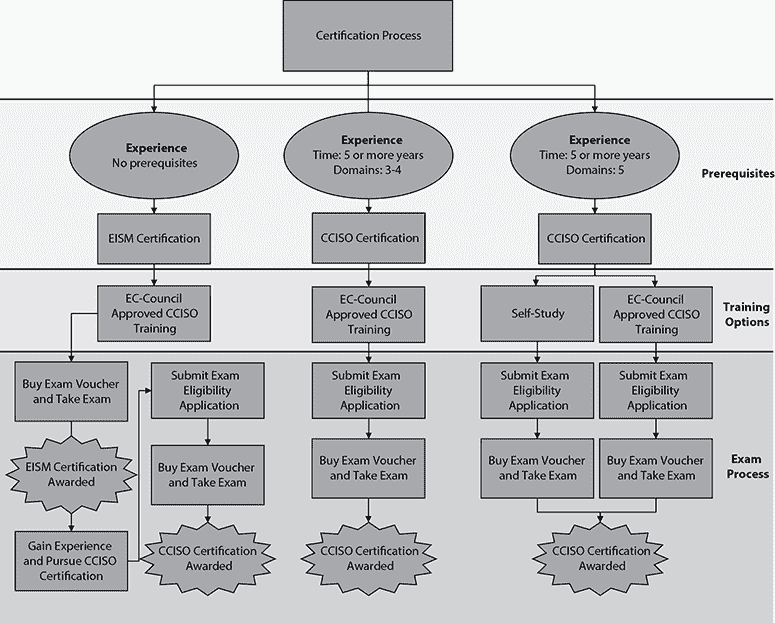

# CCISO 认证首席信息安全官全能考试指南

# 第 3 章

## 总结

## 章节复习

### 快速复习

### 问题

### 答案

## 词汇表

## 索引

## 指南

### 封面

### 扉页

### 页面列表

#### i

#### ii

#### iii

#### iv

#### v

#### vi

#### vii

#### viii

#### ix

10. [十] (`#contents.xhtml#page_x`)
11. [十一] (`#contents.xhtml#page_xi`)
12. [十二] (`#contents.xhtml#page_xii`)
13. [十三] (`#contents.xhtml#page_xiii`)
14. [十四] (`#contents.xhtml#page_xiv`)
15. [十五] (`#contents.xhtml#page_xv`)
16. [十六] (`#acknow.xhtml#page_xvi`)
17. [十七] (`#intro.xhtml#page_xvii`)
18. [十八] (`#intro.xhtml#page_xviii`)
19. [十九] (`#intro.xhtml#page_xix`)
20. [二十] (`#intro.xhtml#page_xx`)
21. [二十一] (`#intro.xhtml#page_xxi`)
22. [二十二] (`#intro.xhtml#page_xxii`)
23. [二十三] (`#intro.xhtml#page_xxiii`)
24. [二十四] (`#intro.xhtml#page_xxiv`)
25. [1] (`#ch1.xhtml#page_1`)
26. [2] (`#ch1.xhtml#page_2`)
27. [3] (`#ch1.xhtml#page_3`)
28. [4] (`#ch1.xhtml#page_4`)
29. [5] (`#ch1.xhtml#page_5`)
30. [6] (`#ch1.xhtml#page_6`)
31. [7] (`#ch1.xhtml#page_7`)
32. [9] (`#ch1.xhtml#page_9`)
33. [8] (`#ch1.xhtml#page_8`)
34. [10] (`#ch1.xhtml#page_10`)
35. [11] (`#ch1.xhtml#page_11`)
36. [12] (`#ch1.xhtml#page_12`)
37. [13] (`#ch1.xhtml#page_13`)
38. [14] (`#ch1.xhtml#page_14`)
39. [15] (`#ch1.xhtml#page_15`)
40. [16] (`#ch1.xhtml#page_16`)
41. [17] (`#ch1.xhtml#page_17`)
42. [18] (`#ch1.xhtml#page_18`)
43. [19] (`#ch1.xhtml#page_19`)
44. [20] (`#ch1.xhtml#page_20`)
45. [21] (`#ch1.xhtml#page_21`)
46. [22] (`#ch1.xhtml#page_22`)
47. [23] (`#ch1.xhtml#page_23`)
48. [24] (`#ch1.xhtml#page_24`)
49. [25] (`#ch1.xhtml#page_25`)
50. [26] (`#ch1.xhtml#page_26`)
51. [28] (`#ch1.xhtml#page_28`)
52. [27] (`#ch1.xhtml#page_27`)
53. [29] (`#ch1.xhtml#page_29`)
54. [30] (`#ch1.xhtml#page_30`)
55. [31] (`#ch1.xhtml#page_31`)
56. [32] (`#ch1.xhtml#page_32`)
57. [33] (`#ch1.xhtml#page_33`)
58. [34] (`#ch1.xhtml#page_34`)
59. [35] (`#ch1.xhtml#page_35`)
60. [36] (`#ch1.xhtml#page_36`)
61. [37] (`#ch1.xhtml#page_37`)
62. [38] (`#ch1.xhtml#page_38`)
63. [39] (`#ch1.xhtml#page_39`)
64. [40] (`#ch1.xhtml#page_40`)
65. [41] (`#ch1.xhtml#page_41`)
66. [42] (`#ch1.xhtml#page_42`)
67. [43] (`#ch1.xhtml#page_43`)
68. [44] (`#ch1.xhtml#page_44`)
69. [45] (`#ch1.xhtml#page_45`)
70. [46] (`#ch1.xhtml#page_46`)
71. [47] (`#ch1.xhtml#page_47`)
72. [48] (`#ch1.xhtml#page_48`)
73. [49] (`#ch1.xhtml#page_49`)
74. [50] (`#ch1.xhtml#page_50`)
75. [51] (`#ch1.xhtml#page_51`)
76. [52] (`#ch1.xhtml#page_52`)
77. [53] (`#ch1.xhtml#page_53`)
78. [54] (`#ch1.xhtml#page_54`)
79. [55] (`#ch1.xhtml#page_55`)
80. [56] (`#ch1.xhtml#page_56`)
81. [57] (`#ch1.xhtml#page_57`)
82. [58] (`#ch1.xhtml#page_58`)
83. [59] (`#ch1.xhtml#page_59`)
84. [60] (`#ch1.xhtml#page_60`)
85. [61] (`#ch1.xhtml#page_61`)
86. [62] (`#ch1.xhtml#page_62`)
87. [63] (`#ch1.xhtml#page_63`)
88. [64] (`#ch1.xhtml#page_64`)
89. [65] (`#ch1.xhtml#page_65`)
90. [66] (`#ch1.xhtml#page_66`)
91. [67] (`#ch1.xhtml#page_67`)
92. [68] (`#ch1.xhtml#page_68`)
93. [69] (`#ch1.xhtml#page_69`)
94. [70] (`#ch1.xhtml#page_70`)
95. [71] (`#ch2.xhtml#page_71`)
96. [72] (`#ch2.xhtml#page_72`)
97. [73] (`#ch2.xhtml#page_73`)
98. [74] (`#ch2.xhtml#page_74`)
99. [75] (`#ch2.xhtml#page_75`)
100. [76] (`#ch2.xhtml#page_76`)
101. [77] (`#ch2.xhtml#page_77`)
102. [78] (`#ch2.xhtml#page_78`)
103. [79] (`#ch2.xhtml#page_79`)
104. [80] (`#ch2.xhtml#page_80`)
105. [81] (`#ch2.xhtml#page_81`)
106. [82] (`#ch2.xhtml#page_82`)
107. [83] (`#ch2.xhtml#page_83`)
108. [84] (`#ch2.xhtml#page_84`)
109. [85] (`#ch2.xhtml#page_85`)
110. [87] (`#ch2.xhtml#page_87`)
111. [88] (`#ch2.xhtml#page_88`)
112. [89] (`#ch2.xhtml#page_89`)
113. [90] (`#ch2.xhtml#page_90`)
114. [91] (`#ch2.xhtml#page_91`)
115. [92] (`#ch2.xhtml#page_92`)
116. [93] (`#ch2.xhtml#page_93`)
117. [94] (`#ch2.xhtml#page_94`)
118. [95] (`#ch2.xhtml#page_95`)
119. [96] (`#ch2.xhtml#page_96`)
120. [97] (`#ch2.xhtml#page_97`)
121. [98] (`#ch2.xhtml#page_98`)
122. [99] (`#ch2.xhtml#page_99`)
123. [100] (`#ch2.xhtml#page_100`)
124. [101] (`#ch2.xhtml#page_101`)
125. [102] (`#ch2.xhtml#page_102`)
126. [103] (`#ch2.xhtml#page_103`)
127. [104] (`#ch2.xhtml#page_104`)
128. [105] (`#ch2.xhtml#page_105`)
129. [106] (`#ch2.xhtml#page_106`)
130. [107] (`#ch2.xhtml#page_107`)
131. [108] (`#ch2.xhtml#page_108`)
132. [109] (`#ch2.xhtml#page_109`)
133. [110] (`#ch2.xhtml#page_110`)
134. [111] (`#ch2.xhtml#page_111`)
135. [112] (`#ch2.xhtml#page_112`)
136. [113] (`#ch2.xhtml#page_113`)
137. [114] (`#ch2.xhtml#page_114`)
138. [115] (`#ch2.xhtml#page_115`)
139. [116] (`#ch2.xhtml#page_116`)
140. [117] (`#ch2.xhtml#page_117`)
141. [118] (`#ch2.xhtml#page_118`)
142. [119] (`#ch2.xhtml#page_119`)
143. [120] (`#ch2.xhtml#page_120`)
144. [121] (`#ch3.xhtml#page_121`)
145. [122] (`#ch3.xhtml#page_122`)
146. [123] (`#ch3.xhtml#page_123`)
147. [124] (`#ch3.xhtml#page_124`)
148. [125] (`#ch3.xhtml#page_125`)
149. [126] (`#ch3.xhtml#page_126`)
150. [127] (`#ch3.xhtml#page_127`)
151. [128] (`#ch3.xhtml#page_128`)
152. [129] (`#ch3.xhtml#page_129`)
153. [130] (`#ch3.xhtml#page_130`)
154. [131] (`#ch3.xhtml#page_131`)
155. [132] (`#ch3.xhtml#page_132`)
156. [133] (`#ch3.xhtml#page_133`)
157. [134] (`#ch3.xhtml#page_134`)
158. [135] (`#ch3.xhtml#page_135`)
159. [136] (`#ch3.xhtml#page_136`)
160. [137] (`#ch3.xhtml#page_137`)
161. [138] (`#ch3.xhtml#page_138`)
162. [139] (`#ch3.xhtml#page_139`)
163. [140] (`#ch3.xhtml#page_140`)
164. [141] (`#ch3.xhtml#page_141`)
165. [142] (`#ch3.xhtml#page_142`)
166. [143] (`#ch3.xhtml#page_143`)
167. [144] (`#ch3.xhtml#page_144`)
168. [145] (`#ch3.xhtml#page_145`)
169. [146] (`#ch3.xhtml#page_146`)
170. [147] (`#ch3.xhtml#page_147`)
171. [148] (`#ch3.xhtml#page_148`)
172. [149] (`#ch3.xhtml#page_149`)
173. [150] (`#ch3.xhtml#page_150`)
174. [151] (`#ch3.xhtml#page_151`)
175. [152] (`#ch3.xhtml#page_152`)
176. [153] (`#ch3.xhtml#page_153`)
177. [154] (`#ch3.xhtml#page_154`)
178. [155] (`#ch3.xhtml#page_155`)
179. [156] (`#ch3.xhtml#page_156`)
180. [157] (`#ch3.xhtml#page_157`)
181. [158] (`#ch3.xhtml#page_158`)
182. [159] (`#ch3.xhtml#page_159`)
183. [160] (`#ch3.xhtml#page_160`)
184. [161] (`#ch3.xhtml#page_161`)
185. [162] (`#ch4.xhtml#page_162`)
186. [163] (`#ch4.xhtml#page_163`)
187. [164] (`#ch4.xhtml#page_164`)
188. [165] (`#ch4.xhtml#page_165`)
189. [166] (`#ch4.xhtml#page_166`)
190. [167] (`#ch4.xhtml#page_167`)
191. [168] (`#ch4.xhtml#page_168`)
192. [169] (`#ch4.xhtml#page_169`)
193. [170] (`#ch4.xhtml#page_170`)
194. [171] (`#ch4.xhtml#page_171`)
195. [172] (`#ch4.xhtml#page_172`)
196. [173] (`#ch4.xhtml#page_173`)
197. [174] (`#ch4.xhtml#page_174`)
198. [175] (`#ch4.xhtml#page_175`)
199. [176] (`#ch4.xhtml#page_176`)
200. [177] (`#ch4.xhtml#page_177`)
201. [178] (`#ch4.xhtml#page_178`)
202. [179] (`#ch4.xhtml#page_179`)
203. [180] (`#ch4.xhtml#page_180`)
204. [181] (`#ch4.xhtml#page_181`)
205. [182] (`#ch4.xhtml#page_182`)
206. [183] (`#ch4.xhtml#page_183`)
207. [184] (`#ch4.xhtml#page_184`)
208. [185] (`#ch4.xhtml#page_185`)
209. [186] (`#ch4.xhtml#page_186`)
210. [187] (`#ch4.xhtml#page_187`)
211. [188] (`#ch4.xhtml#page_188`)
212. [189] (`#ch4.xhtml#page_189`)
213. [190] (`#ch4.xhtml#page_190`)
214. [191] (`#ch4.xhtml#page_191`)
215. [192] (`#ch4.xhtml#page_192`)
216. [193] (`#ch4.xhtml#page_193`)
217. [194] (`#ch4.xhtml#page_194`)
218. [195] (`#ch4.xhtml#page_195`)
219. [196] (`#ch4.xhtml#page_196`)
220. [197] (`#ch4.xhtml#page_197`)
221. [198] (`#ch4.xhtml#page_198`)
222. [199] (`#ch4.xhtml#page_199`)
223. [200] (`#ch4.xhtml#page_200`)
224. [201] (`#ch4.xhtml#page_201`)
225. [202] (`#ch4.xhtml#page_202`)
226. [203] (`#ch4.xhtml#page_203`)

# 索引

227. 204
228. 205
229. 206
230. 207
231. 208
232. 209
233. 210
234. 211
235. 212
236. 213
237. 214
238. 215
239. 216
240. 217
241. 218
242. 219
243. 220
244. 221
245. 222
246. 223
247. 224
248. 225
249. 226
250. 227
251. 228
252. 229
253. 230
254. 231
255. 232
256. 233
257. 234
258. 235
259. 236
260. 237
261. 238
262. 239
263. 240
264. 241
265. 242
266. 243
267. 244
268. 245
269. 246
270. 247
271. 248
272. 249
273. 250
274. 251
275. 252
276. 253
277. 254
278. 255
279. 256
280. 257
281. 258
282. 259
283. 260
284. 261
285. 262
286. 263
287. 264
288. 265
289. 266
290. 267
291. 268
292. 269
293. 270
294. 271
295. 272
296. 273
297. 274
298. 275
299. 276
300. 277
301. 278
302. 279
303. 280
304. 281
305. 282
306. 283
307. 284
308. 285
309. 286
310. 287
311. 288
312. 289
313. 290
314. 291
315. 292
316. 293
317. 294
318. 295
319. 296
320. 297
321. 298
322. 299
323. 300
324. 301
325. 302
326. 303
327. 304
328. 305
329. 306
330. 307
331. 308
332. 309
333. 310
334. 311
335. 312
336. 313
337. 314
338. 315
339. 316
340. 317
341. 318
342. 319
343. 320
344. 321
345. 322
346. 323
347. 324
348. 325
349. 326
350. 327
351. 328
352. 329
353. 330
354. 331
355. 332
356. 333
357. 334
358. 335
359. 336
360. 337
361. 338
362. 339
363. 340
364. 341
365. 342
366. 343
367. 344
368. 345
369. 346
370. 347
371. 348
372. 349
373. 350
374. 351
375. 352
376. 353
377. 354
378. 355
379. 356
380. 357
381. 358
382. 359
383. 360
384. 361
385. 362
386. 363
387. 364
388. 365
389. 366
390. 367
391. 368
392. 369
393. 370
394. 371
395. 372
396. 373
397. 374
398. 375
399. 376

## 作者简介

**Steven Bennett**，CCISO、CISSP、CISA，是一位工程师、体育爱好者、企业家和顾问。他在信息技术领域深耕超过 40 年，帮助组织保护其最重要的资产免受犯罪威胁。Steve 一生致力于研究复杂系统中的人类与动物行为、捕食者与猎物之间的关系，以及在商业和自然界中观察到的进攻与防御生存策略和战术。Steve 的信息安全咨询生涯涵盖了为医疗、制造、零售、金融、军事和政府客户提供支持。

**Jordan Genung**，CCISO、CISSP、CISM、CISA，曾担任公共和私营部门组织的信息安全官和安全顾问。他的经验包括为财富 100 强企业和政府机构提供安全咨询、建立信息安全计划以及开发信息安全课程。Jordan 拥有德克萨斯大学圣安东尼奥分校的计算机科学和信息安全学位，该校是美国国家安全局（NSA）和国土安全部（DHS）指定的网络运营、网络防御和研究国家学术卓越中心。

### 技术编辑简介

# 关于作者

**Michael Lester** 在信息安全行业工作超过 20 年，目前担任 WindTalker Inc.（数据中心安全加密软件产品制造商）的首席技术官 (CTO)。此前，Mike 曾担任 Shon Harris 的 Logical Security LLC（现 Human Element LLC）的首席讲师和顾问，讲授并开发了 CISSP、黑客/渗透测试、数字取证/电子取证、CISA 等课程。Mike 还为 LinkedIn Learning 编写和讲授课程。他拥有波士顿大学（美国国家安全局 [NSA] 学术卓越中心）信息系统安全硕士学位，以及 20 多项行业认证，包括 CISSP、CISA、CCE、Security+、MCSE:Security、CCSE+ 和 ITIL。

# 献词

纪念 Shon Harris。

### 国际隐私专业人士协会

### Offensive Security（进攻性安全）

## 职业道德

## 章节回顾

### 快速回顾

### 问题

### 答案

# 第 2 章：信息安全控制、合规与审计管理

## 信息安全控制

### 控制基础

### 控制框架

## 信息安全控制生命周期框架

### NIST 风险管理框架

### NIST 网络安全框架

### ISO/IEC 27000

## 信息安全控制生命周期

### 步骤 1：风险评估

### 步骤 2：设计

### 步骤 3：实施

### 步骤 4：评估

### 步骤 5：监控

## 探索信息安全控制框架

### NIST SP 800-53

### NIST 网络安全框架

### ISO/IEC 27002

### CIS 关键安全控制

### CSA 云控制矩阵

## 面向 CISO 的审计

### 审计管理

### 审计流程

### 控制自我评估

### 持续审计

### 特定类型的审计与评估

## 章节回顾

### 快速回顾

### 问题

### 答案

# 第 3 章：安全项目管理与运营

## 安全项目管理

### 安全关注领域

### 安全工作流

### 资产安全管理

### 安全项目

## 安全项目预算、财务与成本控制

### 制定预算

### 管理与监控支出

## 安全项目资源管理：建设安全团队

## 项目管理

### 项目管理基础

### 项目管理培训与认证

## 项目管理阶段

### 启动

### 规划

### 执行

### 监控与控制

### 收尾

## 章节回顾

### 快速回顾

### 问题

### 答案

# 第 4 章：信息安全核心能力

## 恶意软件与攻击

### 恶意软件

### 脚本与漏洞特定攻击

## 社会工程学

### 社会工程学攻击类型

### 员工为何易受社会工程学攻击

### 社会工程学防御

## 资产安全

### 资产清单与配置管理

### 安全配置基线

### 漏洞管理

### 资产安全技术

## 数据安全

### 静态数据

### 传输中数据

### 使用中数据

### 数据生命周期

## 身份与访问管理

### 身份与访问管理基础

### 身份管理技术

### 认证因素与机制

### 访问控制原则

### 访问控制模型

### 访问控制管理

### 身份与访问管理生命周期

## 通信与网络安全

### 广域网与局域网

### IP 寻址

### 网络地址转换

### 网络协议与通信

### 无线网络

### 网络技术与防御

## 密码学

### 密码学定义

### 密码学服务

### 对称、非对称与混合密码系统

### 哈希算法

### 消息认证码

### 数字签名

### 公钥基础设施

## 云安全

### 云计算特征

### 云部署模型

### 云服务模型

### 云安全风险与保障等级

### 云安全资源

## 物理安全

### 物理安全威胁

### 物理安全项目规划

### 物理安全资源

### 物理安全控制

### 物理安全审计与度量

### 人员安全

## 软件开发安全

### 将安全集成到 SDLC 中

### 安全 SDLC 角色与职责

### 软件漏洞

### 安全编码实践

### 软件漏洞分析与评估

## 取证、事件处理与调查

### 相关法律

### 日志记录与监控

### 事件响应与调查

### 取证与数字证据

## 安全评估与测试

### 漏洞评估

### 渗透测试

### 法规合规性评估

### 安全项目评估

## 业务连续性与灾难恢复

### 连续性规划启动

### 业务影响分析

### 识别预防性控制

### 制定恢复策略与解决方案

### 制定计划

### 测试计划

### 维护计划

## 章节回顾

# 目录

## 第 4 章复习
- 快速复习
- 问题
- 答案

# 第 5 章：战略规划、财务、采购和供应商管理
- 战略规划
  - 组织战略规划
  - 组织战略规划团队
  - 战略规划流程
  - 安全战略规划示例
- 制定安全决策
  - 企业架构
- 财务管理
  - 会计与财务基础
  - 信息安全年度预算
- 采购与供应商管理
  - 采购核心原则与流程
  - 合同类型
  - 范围协议
  - 第三方供应商风险管理
- 章节复习
- 快速复习
- 问题
- 答案

## 附录：关于在线内容
- 系统要求
- 您的 Total Seminars Training Hub 账户
  - 隐私声明
- 单用户许可条款和条件
- TotalTester Online
- 技术支持

- 术语表
- 索引

# 致谢

Steve 感谢他令人难以置信的妻子 Debby，感谢她在写书过程中坚定不移的支持。我爱你，亲爱的。现在也许这里的一切都能恢复正常了。最衷心的感谢合著者 Jordan，他包容了我的固执，让这个项目变得有趣。

Jordan 感谢他的家人和朋友持续的支持和鼓励。特别感谢 Steve 邀请我合作这本书。您的专业知识和指导对此项工作至关重要。这是一种荣幸，也是一种快乐。

两位作者都要感谢 Wendy Rinaldi、Emily Walters 以及 McGraw Hill 的非凡团队。你们的专业精神、洞察力和建议对该项目的成功起到了关键作用。非常感谢我们的朋友 Mike Lester 出色的技术编辑、睿智和指导。其他为我们提供建议并值得我们感谢的朋友包括 Tom Conkle、Ray Gabler、David Goldstein 和 Greg Witte。最后，感谢所有必须保持匿名的 CISO，他们与我们分享了他们的故事、建议和经验，帮助我们描述了现实世界中 CISO 的生活和挑战。

# 简介

> *安全是凡人的头号敌人。*  
> —— 威廉·莎士比亚《麦克白》中的 Hecate

在我们为这本书添加最后润色之时，Twitter 正忙于从媒体广泛报道的最新一起非常公开且具有新闻价值的网络安全事件中恢复。每一起备受关注的泄露事件背后，都有数百起其他破坏性的网络攻击被企业和政府实体所经历。为了帮助组织保护自己免受信息安全事件的侵害并做出响应，许多组织寻求 **首席信息安全官（CISO）** 的领导。CISO 正成为现代企业的守护者，肩负着保护组织免受数字世界安全威胁的重任。

二十五年前，CISO 这个角色甚至不存在，但现在超过 60% 的《财富》500 强企业都有 CISO。虽然这似乎是快速采用，但也表明 40% 的大公司认为没有必要聘请 CISO 来担任组织的守护者。CISO 角色的普及和发展是由以下问题驱动的：

- CISO 在组织架构中的位置在哪里？
- CISO 与其他 C 级高管之间的关系是什么？
- 成为一名成功的 CISO 需要什么资格？
- 拥有 CISO 对企业意味着什么？

随着越来越多的组织采用并设立 CISO 职位，这些问题的答案也在不断演变。

像许多行业一样，信息安全领域包括专业组织和标准机构，它们制定标准并认证人员在行业特定技能方面的能力。有时这些团体仅反映当前的行业趋势和实践，而有时它们则发挥领导作用，引领行业走向新的方向。EC-Council 作为 CCISO 认证的管理机构，似乎正朝着后者迈进。CCISO 认证的存在本身就开创了新天地。虽然还有其他几个组织提供 CISO 认证项目，但没有一个获得太大关注。EC-Council CCISO 是美国国防部批准的基准认证 DoD 8140/8570 中唯一包含的 CISO 专用认证。

对于有志成为 CISO 的人，EC-Council CCISO 项目提供了一个模板，定义了每个 CISO 应具备的核心知识和技能。对于寻求创建 CISO 职位或聘用 CISO 的组织，该认证不仅提供了优秀 CISO 应具备技能的图景，还提供了一种独立验证特定候选人资格的手段。

有人可能会争辩说，认证 CISO 是一种谬误，因为 CISO 没有一刀切的标准。确实，CISO 的角色因其所在行业、组织的规模和性质，以及他们个人的背景和个性而差异巨大。软件产品供应商的 CISO 关注点可能与公用事业供应商的 CISO 截然不同。然而，所有 CISO 都应具备核心技能。CCISO 认证专注于这些核心技能。

安全不是非黑即白的，组织要么拥有安全，要么没有。相反，安全是一个滑动标度：组织可以拥有大量安全措施并将风险降至最低，也可以只有少量安全措施而承担大量风险。CISO 的工作是根据组织对风险的承受能力，确定需要多少安全措施。

CISO 的方法深受其自身世界观的影响。作者认识的一位 CISO 具有执法背景，这影响了他对公司信息安全项目的方法。他公司的安全项目强调事件检测和响应，而非安全的其他方面。许多组织的安全项目反映了其各自 CISO 的个性或背景。CCISO 认证不寻求改变这种动态，而是试图确保无论谁负责，都能应用良好的安全实践。如果我们这位朋友的“检测和响应”方法适合其公司的业务和威胁环境，那么他的方法可能完全恰当。CCISO 项目向 CISO 传达任何安全项目的核心要素，CISO 可以根据许多因素对其进行调整，包括组织对风险的承受能力以及 CISO 自身的特征和经验。

# CCISO 认证概述

CCISO 认证反映了当今 CISO 群体的现状：其中一些人从技术岗位晋升而来，但缺乏商业敏锐度；另一些人已是商业领袖，但可能没有技术或安全背景。CCISO 认证为这两类人群各自确立了核心标准。对于从技术岗位晋升至 CISO 的技术型安全专业人员，CCISO 计划通过涵盖战略规划、财务、会计和资源管理等主题，将其技能组合拓展至技术领域之外。这些主题对 CISO 至关重要，但可能不包含在传统的安全专业认证项目中，例如 (ISC)² 的 CISSP 或 CompTIA 的 Security+。同样，对于没有信息技术或安全背景、但拥有商业经验并即将担任 CISO 角色的商业领袖，CCISO 计划会教授大多数 CISO 应该掌握的技术主题。

## 关于 EC-Council

国际电子商务顾问委员会（称为 EC-Council）成立于 2003 年，旨在提供安全教育、培训和认证项目。EC-Council 可能最为人熟知的是其认证道德黑客 (CEH)、计算机黑客取证调查员 (CHFI)、认证安全分析师 (ECSA) 和持证渗透测试员认证。如前所述，EC-Council 还是认证首席信息安全官 (CCISO) 认证的认证机构，该认证旨在作为面向安全高管的认证项目。

2006 年，EC-Council 成立了 EC-Council 大学，提供网络安全学士和硕士学位，硕士专业方向和研究生证书涵盖以下领域：信息安全专业人员、安全分析师、企业安全架构师、云安全架构师、数字取证、事件管理与业务连续性，以及信息保障高管领导力。

## 认证流程

本节概述了获得 CCISO 认证的 EC-Council 流程。该流程如图 1 所示。主要有三条认证途径：

- 通过自学获得 CCISO 认证
- 通过 EC-Council 认可的培训获得 CCISO 认证
- 面向不满足 CCISO 先决条件人员的 EC-Council 信息安全经理 (EISM) 认证项目

**图 1** EC-Council 认证流程

### EC-Council 要求

EC-Council 的认证要求经常变动，因此考生务必查看 EC-Council 网站以获取最新信息。本节列出的要求在撰写本文时是准确的。

### 先决条件

CCISO 考试资格根据考生在五个 CCISO 领域的从业年限来确定：

- 领域 1：治理与风险管理
- 领域 2：信息安全控制、合规与审计管理
- 领域 3：安全项目管理与运营
- 领域 4：信息安全核心能力
- 领域 5：战略规划、财务、采购与供应商管理

要在不接受官方 EC-Council 培训（自学）的情况下具备参加 CCISO 考试的资格，考生必须能够证明在*五个* CCISO 领域*每个领域均拥有至少五年经验*。

或者，如果考生完成了 EC-Council 认可的 CCISO 培训课程，则只需在*五个* CCISO 领域中的*三个*领域拥有五年经验即可。

EC-Council 信息安全经理 (EISM) 认证项目是*不具备所需从业年限*、无法申请 CCISO 认证（通过自学或培训途径）人员的第三种选择。考生可以参加相同的 EC-Council 认可 CCISO 培训课程，参加 EISM 考试（CCISO 考试的简化版），考试通过后，在满足最低经验要求的前提下申请 CCISO 认证。

**注意** 某些学位和认证可计入认证的最低经验要求。有关可接受的经验豁免清单，请访问 EC-Council 网站。

### 培训选项

获得认证主要有两条培训途径：

- **自学** 自学选项（例如使用本书 *CCISO 认证首席信息安全官综合考试指南*）适用于在五个 CCISO 领域*每个*领域均具备必要经验的 CCISO 考生。
- **培训** EC-Council 认可的 CCISO 培训课程由 EC-Council 及其认可的培训机构提供。对于最适合训练营式培训的考生，或不满足自学最低经验要求的考生，此途径可能更合适。此外，这是有意参加 EISM 考试、并在满足经验要求后申请 CCISO 认证的 EISM 考生的必要条件。

### 考试流程

考试流程因所选培训选项和项目而异：

- **自学** 为获得考试资格，自学考生必须在 EC-Council 网站上填写考试资格申请（撰写时申请费为 100 美元），并列出其所有经验、认证和学位（如适用），以证明其在每个 CCISO 领域均具备必要的从业年限（五个领域均为五年）。考生申请被接受、验证并批准后，可从 EC-Council 购买考试券（撰写时费用为 999 美元）参加 CCISO 考试。考试通过后，考生将获得 CCISO 认证。
- **培训** 完成 EC-Council 认可的 CCISO 培训课程后，CCISO 考生须提交考试资格申请，证明在五个 CCISO 领域中至少三个领域拥有五年经验。考生申请被接受、验证并批准后，可从 EC-Council 获取考试券参加 CCISO 考试。考试通过后，考生将获得 CCISO 认证。
- **EISM 项目** 完成 EC-Council 认可的 CCISO 培训课程后，EISM 考生可从 EC-Council 获取考试券参加 EISM 考试。考试通过后，考生将获得 EISM 资格。一旦考生获得申请 CCISO 认证所需的经验（在至少三个领域拥有最低五年经验），必须提交考试资格申请。申请被接受、验证并批准后，考生可半价从 EC-Council 获取考试券参加 CCISO 考试。考试通过后，考生将获得 CCISO 认证。

### 考试信息

CCISO 考试包含 150 道基于场景的多项选择题。考生有 2.5 小时完成考试，得分必须达到至少 72%。CCISO 考试包含三类题目，按难度递增顺序列出如下：

- **知识** 此类题目仅测试考生回忆信息的能力。这通常表现为测试考生对定义的理解或对术语的掌握。
- **应用** 此类题目测试考生应用概念的能力。这要求考生了解该概念，并理解如何应用该概念。
- **分析** 此类题目最为严格。它们测试考生分析场景并确定正确行动方案的能力。

# CCISO/EISM 考试概述

与 CCISO 考试类似，EISM 考试包含 150 道题目。EISM 考试基于与 CCISO 考试相同的题库，但不包含基于场景的（分析类）题目。此外，EISM 考试必须在 2 小时内完成，及格分数为 70%。获得 EISM 认证的考生，在满足 CCISO 认证的经验要求后，可以以优惠价格参加完整的 CCISO 考试。

## 如何使用本书

本书按章节组织，章节对应 EC-Council 定义的 CCISO 领域。每章涵盖 EC-Council 考试大纲要求的主题。在某些情况下，这种方法会导致内容重叠，因为 EC-Council 在多个领域中列出了相同的主题。当某个主题出现在多个章节时，我们尽量避免重复信息，而是从不同角度阐述该主题。例如，*保护资产* 这一主题在 第 1 章 中从风险管理流程角度讨论，在 第 3 章 中从资产管理角度讨论，在 第 4 章 中从资产安全角度讨论。

各章节介绍如下：

- **第 1 章，“治理与风险管理”**，涵盖 CISO 的基础概念。重点关注 CISO 确保组织安全计划与业务目标保持一致的方式。本章涵盖信息安全治理、信息安全基础、典型信息安全计划的构成，以及与安全相关的法律法规和框架的描述。

- **第 2 章，“信息安全控制、合规与审计管理”**，描述组织如何建立和实施安全控制、控制框架及控制生命周期。还广泛涵盖了信息安全审计的概念和流程。

- **第 3 章，“安全计划管理与运营”**，探讨 CISO 如何定义和管理安全计划。本章涉及计划管理方法和流程，以及资源和预算管理。此外还涉及安全项目管理，因为安全计划通常除持续的安全工作流外，还包含项目。

- **第 4 章，“信息安全核心能力”**，包含每位 CCISO 都应熟悉的广泛主题。每项能力都与其他几项相关，但它们之间的关系复杂，因此不影响本书呈现这些能力的顺序。核心能力按最易解释的顺序排列。本章首先介绍最常见的网络攻击类型和方法，然后是技术安全能力，最后是管理和流程导向的能力。

- **第 5 章，“战略规划、财务、采购与供应商管理”**，探讨组织如何利用战略规划确立目标并制定实现计划。还描述了 CISO 如何利用战略规划来定义和实施信息安全计划。本章涵盖对 CISO 重要的管理主题，包括会计、财务和采购，以及管理组织第三方和供应商的方法，以确保它们不会给组织企业架构引入漏洞。

每章开始时都有简短的大纲和介绍所涵盖主题的文本，随后是对应大纲的各个小节。全书各章通过以下特色功能提供补充信息，帮助您理解和记忆各种主题：

**NOTE** **注意** 贯穿全书，旨在突出或强化主题，或提供建议。

**TIP** **技巧** 提供节省精力或时间的信息。技巧可能包括窍门、捷径或帮助您记忆主题的建议。技巧也可用于提供概念或流程的真实案例。

**EXAM TIP** **考试技巧** 这些针对性技巧提供 CCISO 考生应了解的关键考试信息。考试技巧可能包括应试建议或考试陷阱预警。

除了注意、技巧和考试技巧外，您还会遇到阴影框，用于深入探讨主题、呈现案例研究，或分享阐述或强调章节主题的轶事。

像所有 McGraw Hill All-in-One Exam Guides（全能考试指南）一样，本书利用重复作为辅助手段，以强化所呈现的信息，并促进信息进入长期记忆。每章末尾都有“章节复习”部分，回顾章节内各节的核心主题。章节复习后是“快速复习”部分，列出本章需牢记的关键点列表。“章节复习”和“快速复习”相结合，共同强化章节所呈现的信息。

每章最后附有测试题，考察 CCISO 考生对所涵盖主题的掌握和理解程度。书中的题目旨在作为强化主题的另一种手段。答案包含简短解释，说明正确答案的理由，在某些情况下也会解释错误答案的原因。

附录“关于在线内容”包含访问名为 TotalTester Online 的在线测试资源的说明。该在线工具允许 CCISO 考生通过按领域、题目数量和其他可自定义选项配置测试，来练习类似真实考试的题目。

## CCISO 考试准备

我们建议通过以下重复序列准备 CCISO 考试：

1. **阅读本书** 并尝试回答每章末尾的问题，以加深对信息的理解。
2. **使用 TotalTester Online** 按领域进行模拟测试。记下您答错或难以理解的每道题的主题。
3. **以困难主题列表作为学习清单**，返回重读书中相应章节，做笔记或使用过去对您有效的学习方法。
4. **重复循环** 阅读、测试和学习，直到您使用 TotalTester Online 练习题在每个领域持续稳定得分超过 80%。

一旦您在每个领域经常能获得 80% 或更高的分数，您就应该有信心参加 CCISO 考试了。
