# 第 1 章：治理与风险管理

本章讨论以下主题：

- 治理
- 信息安全管理架构
- 信息安全原则
- 风险管理
- 管理与技术信息安全要素
- 合规
- 隐私
- 法律与监管驱动因素
- 标准与框架
- 信息安全趋势与最佳实践
- 信息安全培训与认证
- 职业道德

本章描述组织的信息安全计划如何与整体业务相关联，并讨论信息安全计划的关键组成部分和目的。本章还讨论信息安全计划如何确保组织遵守与业务相关的法律法规，以及如何利用框架指导信息安全计划的设计和实施，从而实现合规成功。


作为安全顾问，我们经常听到客户说：“我们的组织与众不同，所以我们不能像其他人那样应用安全措施。我们的（*填空*）就是为什么我们不能像其他公司那样做安全的原因。”当我们听到这个“我们不一样”的论点时，我们的回答是：“是也不是。”事实是，每个公司和组织都是独一无二的。虽然良好安全的原则是不变的，但将这些安全原则应用到组织的特定情况中，最终决定了成败。每位首席信息安全官（CISO）的关键在于了解组织的业务、目标、运营和风险承受能力，以便 CISO 能够制定*适合该组织*的安全计划。将组织的安全计划与组织的业务和运营相协调，是任何安全计划成功的关键，也是 CISO 角色的核心。

### 治理

任何关于 CISO 角色的讨论都始于对治理的讨论。*治理*是组织定义、实施和控制整体业务（如组织治理或企业治理）或组织的特定部分（如 IT 治理、财务治理或信息安全治理）的制度。适当的治理可确保组织的战略与其业务、监管和运营环境保持一致。

企业治理可以从两个角度来考虑：战略和权威。*治理战略*涉及定义和理解对组织重要的因素。典型的治理战略图描绘了组织确定的重要战略因素。图 1-1 中的示例图显示了所有汇聚到治理战略中的因素，因此也显示了该战略应启用的功能。例如，组织决定*透明度*很重要，并应在组织的组织结构、文化、业务流程和业务运营中加以体现。

如前所述，组织治理的另一个视角是*治理权威*。该视角描绘了组织结构和权力线，如图 1-2 中的示例所示。

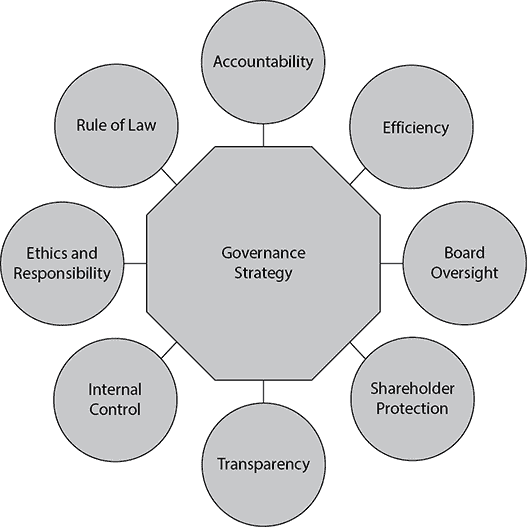

**图 1-1** 显示治理计划战略因素的治理战略图

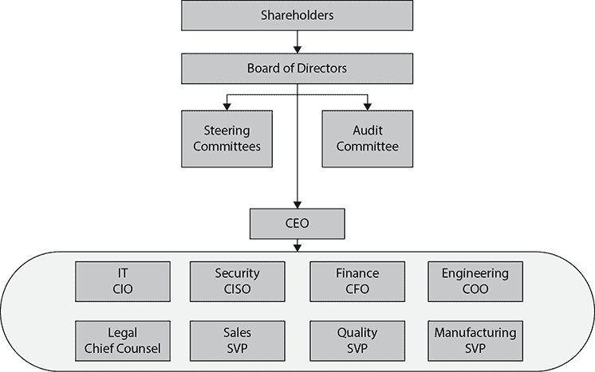

**图 1-2** 显示权力线的治理图

每个组织都有某种形式的治理，尽管有些组织没有正式的治理计划。无论正式与否，组织领导者总会在某个时刻考虑组织的目标和商业环境，然后定义实现这些目标所需的战略、流程、控制、组织结构和业务职能。

企业治理有许多模型。在某些情况下，法律法规驱动组织的治理要求。例如，在公开证券交易所上市销售股票的公司必须遵守交易所的企业治理要求。以纽约证券交易所和纳斯达克股票市场为例，两者都要求会员公司拥有包含以下要求的治理计划：

- 独立董事
- 审计
- 报告
- 年会
- 行为准则
- 利益冲突规避
- 股东批准

这些治理要求定义了公司*必须做什么*，但没有规定公司*必须怎么做*。

国际标准化组织（ISO）正在制定 ISO 37000《组织治理指南》。预计该标准将于 2020 年完成。ISO 37000 旨在配合监管政策使用，提供基于全球共识的良好治理构成指导。

### 信息安全治理

信息安全治理是组织治理的一个子集，涉及信息安全计划的战略方向、领导力和框架。信息安全治理框架指导安全计划的开发和维护。信息安全治理框架没有单一标准，但框架通常应包含以下要素：

- 与组织治理和组织目标保持一致的信息安全战略定义
- 信息安全组织架构
- *风险管理*方法论
- 信息安全*管理指令*（包括策略、标准、指南等）
- 对计划的持续衡量和改进

理想情况下，信息安全治理框架与组织治理框架保持一致，并考虑塑造安全计划的内部和外部因素。

影响安全计划的外部驱动因素包括

- **监管驱动因素** 某些组织受影响安全计划的法律及其相应法规的约束。这些应在治理层面加以解决，以确保组织合规。示例包括《健康保险流通与责任法案》（HIPAA），该法案对保护患者信息有要求；《萨班斯-奥克斯利法案》（SOX），该法案对保护上市公司财务信息有要求；以及《格雷姆-里奇-比利雷法案》（GLBA），该法案对金融和保险公司有安全要求。本章后面将更详细地讨论这些法律。

- **行业实践** 某些组织的安全计划由其所在行业适用的标准和实践所塑造。一个例子是支付卡行业数据安全标准（PCI DSS），它为处理信用卡数据或交易的公司定义了安全要求。另一个是美国国家标准与技术研究院（NIST）《改善关键基础设施网络安全框架》（通常称为 NIST 网络安全框架），这是一个自愿性框架，为以下关键基础设施部门的组织提供指导：化工、商业设施、通信、关键制造、大坝、国防工业基础、应急服务、能源、金融服务、食品和农业、政府设施、医疗保健和公共卫生、信息技术、核能、运输、水和废水系统。尽管最初是为关键基础设施组织开发的，但非关键基础设施实体也在使用它。

- **风险和威胁** 每个组织都在其自身的威胁环境中运营（本章后面将详细介绍风险和威胁）。例如，由于需要保护的资产性质以及潜在对手的画像和意图，支持军事行动的政府机构面临的威胁与百货商店面临的威胁截然不同。每个组织都必须了解自己的威胁和风险环境，并建立安全计划来应对它们。

影响安全计划的内部驱动因素包括


# CISO 内部驱动因素与安全治理

## 领导层的理解与认知

这可能是 CISO 工作中最具挑战性的方面之一。安全始于组织的最高层。因此，成功的安全计划取决于领导层对安全的理解与 CISO 的理解保持一致。CEO 或组织负责人不必是安全专家，但他们确实需要准确理解安全对组织的重要性。CISO 工作的一个方面是评估领导层对安全的掌握程度，并在必要时加以改进。

## 管理架构

CISO 以及最终的安全组织在管理或组织架构中的位置在哪里？答案因组织而异，没有“正确”的答案。在某些组织中，CISO 直接向 CEO 汇报，并拥有与其他 C 级高管（如首席财务官 `CFO` 或首席信息官 `CIO`）同等的权力。在其他组织中，CISO 向另一位 C 级高管汇报，如 `CIO` 或 `CFO`。事实上，后一种情况比前一种更常见。任何方法都可以成功；关键不在于 CISO 在组织中的位置，而在于 CISO 与 CEO 及领导层之间存在的沟通。CEO 必须准确了解威胁和风险环境，领导层与 CISO 之间应就组织的安全战略达成共同理解。

## 沟通

在前两个内部驱动因素的基础上，如果组织架构、高管的个性或风格促进了关于组织安全的信息和思想交流，安全计划成功的可能性就更大。有时，如果 CISO 向另一位高管汇报而非 CEO，可能会导致 CISO 与领导层之间出现阻碍一致性的“防火墙”。但决定性因素不一定是组织架构——沟通才是关键。

## 文化与氛围

公司和组织的存在是为了实现其业务目标。对组织最重要的是制造产品、提供服务、实现销售等。信息安全通常在重要性列表中排得很靠后。管理者需要运营其组织或团队以实现目标；员工希望完成工作、获得良好的绩效考核和加薪、并推进职业生涯。安全如何融入组织文化？理解安全在文化光谱中的位置、可能的位置以及应有的位置，是安全计划的重要驱动因素。

## 历史与经验教训

每个安全计划都应建立反馈循环，以衡量计划绩效并根据需要进行调整，即使在最高（治理）层面也是如此。没有什么比安全漏洞更能促使组织重新思考安全。从正式绩效衡量或现实事件（如安全事件）中吸取的教训，是影响安全计划治理决策的驱动因素。

## 安全治理框架示例

Figure 1-3 展示了一个安全治理框架示例。基于信息安全驱动因素，`security governance` 定义了总体安全战略和计划的关键要素，在本例中包括安全组织及相关角色和职责、安全策略及支持文档，以及企业信息安全架构（`EISA`）。战略和 `EISA` 将在 `Chapter 5` 中详细讨论。

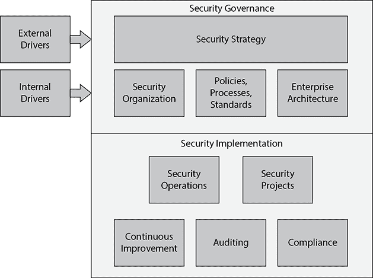

**Figure 1-3** Security governance framework example

CISO 应在文档中定义组织的安全治理，该文档有时称为 `security program plan` 或 `security charter`。该文档及治理本身应是一个活的教义。它应随时间演变，并始终反映当前的方法。此安全章程应展示安全计划如何与组织的目标和治理保持一致。

安全治理的一个关键方面是衡量和监控治理计划本身。通常这些衡量是为了支持组织对安全投资回报率（`ROI`）的理解。组织应了解安全支出是否充足，以及安全计划是否达到其目标。在许多组织中，CISO 花费大量时间衡量、理解、沟通并向整个组织证明信息安全计划的经济价值。这些促进计划持续改进的衡量指标，由工具和报告提供支持。这些包括平衡计分卡以及多种商业可用的应用程序，用于收集、分析和展示各种指标的信息报告。

# 业务形式与安全漏洞责任

存在几种业务形式或实体，其区别基于所有权、管理结构、责任和税务责任等因素。对 CISO 重要的是业务形式如何与信息安全相关。由于安全关乎风险管理，每种业务形式在安全和隐私的责任与义务方面都有其自身特征。

## 独资企业或合伙企业

独资企业由一人所有；普通合伙企业由两人或以上所有。在独资企业和普通合伙企业中，所有者管理并控制业务运营，并对实体的行为承担个人责任。这意味着所有者可能被认定对组织的安全漏洞承担个人责任，其个人资产可能面临风险。即使某合伙人未直接参与不当行为，这也是成立的，因为普通合伙人需对其合伙人的不当行为负责。有限合伙企业与普通合伙企业不同，其所有者由所有者/管理者（普通合伙人）和投资者（有限合伙人）组成。有限合伙企业的普通合伙人管理并控制业务运营，并对实体行为承担个人责任，就像普通合伙企业的普通合伙人一样。有限合伙人通常不对有限合伙企业的行为负责（除非他们亲自参与了不当行为），其风险通常限于其投资额。


## 公司制企业

公司制企业由股东所有，由董事会和向董事会汇报的高管管理。与独资企业或合伙企业相比，公司制企业提供更高级别的责任保护。个别股东、高管和董事通常不对第三方负责，但如果能确定他们对索赔人（疏忽的受害者）负有注意义务，则可能因自身的疏忽行为而承担个人责任。公司通常同意对这些个人进行赔偿（即提供抗辩并承担任何判决或和解费用），前提是该个人在其对公司的职责范围内行事且未违反任何法律。公司提供赔偿协议的价值部分取决于公司是否有能力提供（即负担得起支付）赔偿。公司本身可能因安全漏洞及其造成的影响而被追究责任。请注意，也存在小型公司（有时称为“紧密持股”公司），仅由少数股东甚至一个股东组成。在这些情况下，个人可能面临更大的潜在责任，因为公司本身可能没有资源来抗辩或支付索赔。

## 有限责任公司 (LLC)

就税务目的而言，LLC 被视为合伙企业（即它们通常是税收“穿透”实体），但就管理和责任目的而言，其结构类似于公司。它们由一个或多个个人（称为“成员”）基于所有权百分比拥有。LLC 成员的责任保护和风险与公司类似。

## 非营利组织

非营利组织将其利润用于慈善目的。非营利组织是一种特定类型的公司，也可以是 LLC。无论哪种情况，所有者都受到保护，免受因安全漏洞产生的责任，前提是他们个人未违反任何法律。与公司一样，非营利实体对安全漏洞和违规行为负责。然而，非营利组织的一个有趣特征是，它们有时拥有知名且声望高的捐赠者，这些捐赠者期望非营利组织保护其声誉免受安全漏洞造成的损害。在本书作者的一次项目中，非营利实体的安全决策部分源于保护捐赠者的意图——不是免受个人责任，而是免受其声誉和美名可能受到的损害。

### 责任保护的局限性

LLC、公司和非营利组织提供的责任保护存在局限性。董事会的责任保护仅在董事会履行了其“注意义务”责任时适用。注意义务是指“一个理性的人在特定情况下会怎么做”。考虑这种情况：CISO 建议董事会，除非实施特定控制措施，否则公司容易遭受攻击并导致客户个人信息泄露。董事会无视此建议，黑客利用漏洞窃取客户数据。在这种情况下，董事会可能被认定为未履行其注意义务，并可能对客户的损害或赔偿承担责任。这些实体的管理者、高管和董事可以主张“商业判断规则”的保护，如果他们能证明在采取相关行动时行使了商业判断，即使该判断是错误的，通常也可免除责任。这比单纯的注意义务标准赋予个人更大的行动灵活性，但该规则在诉讼中通常争议激烈，并涉及相互竞争的专家证人证词。

## 信息安全管理架构

CISO 的工作是创建并领导正确的管理和组织架构，以实现安全职能。如果 `治理` 定义了信息安全计划的战略，那么 `组织架构` 则实现其落地。架构由部门、人员、资源、分配的职责和沟通渠道组成。这些特征可以通过无限种方式定义和安排。CISO 的工作是创建最优组织以满足安全计划的目标。本节讨论信息组织的规模和管理。角色和职责、人员配置以及信息安全计划组织的其他细节将在第 3 章中讨论。

### 规模确定

信息安全组织应该多大？多少安全投入才算合适？许多高管喜欢将其组织或公司的规模和支出与同行业的其他类似组织进行比较。事实上，有第三方和行业团体会对信息安全领导者和管理者进行调查以获取规模信息，然后发布结果。与其他组织的比较提供了有趣的数据点，但不应作为确定安全组织规模的驱动因素。相反，组织规模应基于组织的风险承受能力来确定。这将在本章后面风险管理部分更详细地讨论。基本原则是，年度安全支出应为保护组织信息资产所需的金额。

发布安全支出行业趋势的一些第三方团体包括 PwC、Gartner、Forrester 和 InformationWeek，尽管还有许多其他机构。这些组织发布数据，说明安全支出与其他组织指标的对比，以及这些数字随时间的变化。以下是一些广泛发布的规模数字和趋势：

- 一家行业来源报告称，2018 年人均年安全支出为 1,178 美元（而 2012 年为 584 美元）。
- 信息安全支出每全职员工可能在 1,000 美元至 3,000 美元之间。
- 信息安全支出占 IT 支出的百分比因报告来源和所分析的行业而异，范围在 1% 至 15% 之间。许多调查报告平均值为 6%，有些报告的信息安全支出占 IT 支出的比例高达 30%。
- 信息安全支出可能占公司收入的 0.2% 至 0.9%。

正如此列表所示，信息安全支出差异巨大；因此，与其他组织的比较价值有限。尽管如此，许多 CEO 或领导者会问他们的 CISO：“为什么我们的信息安全支出是 X，而我们的行业支出是 Y？”CISO 最好知道答案。影响安全组织支出和规模的因素很多，但以下是其中几个：

- 资产的价值，尤其是对组织最重要的资产
- 风险和威胁的类型及频率
- 组织安全态势的当前状态
- 法规要求

### 管理架构

信息安全组织的架构应是最适合整个组织的架构。无论选择何种具体架构，管理架构都应具备以下要素：

- `清晰的授权线（指挥链）` 信息安全组织应具有明确定义的汇报和授权线。每个职能、部门和角色都应明确指定负责人，并建立向更高层级汇报的路径。这提供了适当的监督。
- `态势感知` 架构应为 CISO 提供整个安全计划绩效的视图，以便 CISO 了解所有资产的安全态势和计划各方面的当前状态。


## 内部与外部沟通及报告

架构应提供在安全组织内部以及外部报告最关键信息的方式。关键在于与企业领导层以及安全组织之外的所有部门和群体进行沟通。

## 组织架构

有多种类型的组织架构和框架可用于实施安全组织。以下是几种最常见的类型：

### 层级制（分级）

拥有从上到下指挥链的组织属于层级制。因此，组织中的每个实体都隶属于一个（且仅一个）其他实体，除处于信息安全组织顶端的 CISO（首席信息安全官）外。层级制提供了清晰的汇报路线、严格的控制和明确定义的角色。然而，层级制也可能导致官僚主义，造成决策缓慢和成本增加。

### 扁平化（水平）

也称为有机组织，扁平化组织与层级制相反，实体可以隶属于多个上级实体。这形成了一个扁平的实体网络。扁平化组织赋予实体（或个人）更多责任，并要求更多协作。扁平化组织所需的管理层级比层级制组织少，可能最适合较小的组织，因为组织规模越大，越难维持扁平结构。

### 矩阵式

矩阵式结构可被视为层级制和扁平化的混合体。汇报关系更像是一个网格，而非层级或网络。例如，在矩阵式组织中，一名工程师可能属于工程部门并向工程经理汇报，同时该工程师可能也是产品团队的一员并向产品经理汇报。矩阵式结构可以成为共享资源并更高效利用资源的好方法。然而，矩阵式组织也可能造成混乱甚至冲突，因为存在许多目标和优先级可能相互竞争的管理者。

我们遇到的大多数信息安全组织都是层级制的。这些组织架构可以围绕职能型（如安全工程、安全运营、事件管理等）、事业部型（如美洲、欧洲、亚洲等）或产品型（如飞机、火车、汽车等）顶级实体构建。我们熟悉的大多数信息安全组织都是职能型的。一个典型示例见 图 1-4。

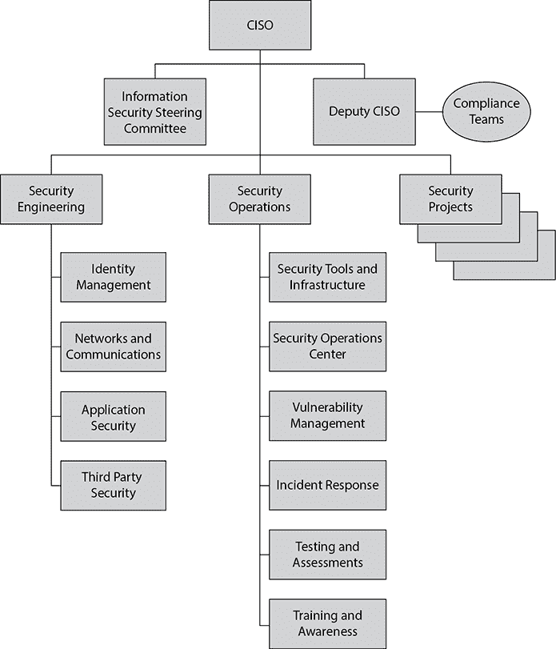

**图 1-4** 信息安全组织架构图示例

# 信息安全原则

本节介绍作为所有信息安全计划基础的信息安全核心原则。尽管本书的大多数读者可能已经熟悉这些概念，但我们仍将其列入，以确立全书使用的术语，并回顾这些基本的信息安全要素。关键的信息安全原则包括：

- CIA 三要素
- 安全漏洞、威胁、风险和暴露
- 网络攻击要素
- 纵深防御

## CIA 三要素

信息安全的三大基本原则是：

- 机密性
- 完整性
- 可用性

这些被称为 CIA 三要素，如 图 1-5 所示。信息安全控制旨在解决这些原则中的任何一项或多项。

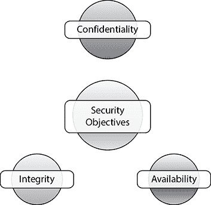

**图 1-5** CIA 三要素

### 机密性

*机密性* 是指保护数据，确保数据仅可被授权人员访问。机密性泄露的一个例子是攻击者窃取信用卡数据。机密性保护确保在数据处理系统中强制执行必要的保密级别，并防止机密信息的未授权披露。这种机密级别应在数据驻留在系统和设备上时、数据传输过程中以及到达目的地后始终存在。

### 完整性

*完整性* 是指数据的准确性。完整性攻击的例子包括攻击者篡改网站或更改文件内容。完整性保护确保数据准确可靠，并防止未授权或非预期的修改。硬件、软件和通信机制必须协同工作，以正确维护和处理数据，并将数据移动到预期目的地而不发生意外更改。系统和网络应受到保护，免受未授权的干扰和污染。

### 可用性

*可用性* 是指保护系统，确保可靠地访问数据和资源。可用性受损的一个例子是攻击者破坏网站运行以阻止访问，即*拒绝服务（DoS）攻击*。网络设备、计算机和应用程序应可用于完成其工作。它们应能以安全的方式从中断中恢复，以免生产力受到负面影响。必须建立必要的保护机制，以防范可能影响所有业务处理系统可用性和生产力的内部和外部威胁。

## 安全漏洞、威胁、风险和暴露

一个重要的概念是漏洞、威胁、风险、暴露和对策之间的关系。

- **漏洞**：任何可能被利用的弱点。弱点可能存在于软件、硬件、流程或人员中。示例包括应用程序漏洞、未打补丁的系统、配置错误的网络设备和未锁的门。
- **威胁**：与漏洞利用相关的潜在破坏性事件。利用漏洞的行为体称为*威胁主体*。
- **风险**：漏洞被利用的可能性及此类事件造成的相应影响。风险将漏洞、威胁和被利用的可能性与最终的业务影响联系起来。
- **暴露**：安全漏洞发生的可能性。例如，未打补丁的系统使组织*面临*潜在损失的风险。
- **对策**：为降低风险而实施的控制措施。控制措施包括使用访问控制列表、部署防火墙、强制执行强密码策略和使用加密。


> **考试提示** CCISO 候选人应对基础信息安全术语（如漏洞、威胁、风险、暴露和对策）有实际理解。

## 网络攻击要素

*网络攻击* 是恶意行为体为获取访问权限或破坏信息系统而采取的蓄意行动，意图造成损害或伤害。网络攻击通常涉及攻击者执行以下步骤：

1. 侦察
2. 枚举
3. 利用
4. 目标行动

### 侦察

攻击的第一步是攻击者收集目标组织的信息。攻击者通过执行网络搜索、检查组织及其员工的社交媒体账号、阅读新闻稿和媒体文章、参加会议、研讨会或贸易展览，甚至亲自观察组织的员工或设施来进行研究，以了解目标。攻击者试图挖掘尽可能多的关于目标的信息，例如：

- 域名
- 企业信息
- 网络拓扑图
- 员工和关键管理人员姓名
- 电子邮件地址和电话号码
- 社交媒体活动和好友
- 设施位置和布局
- 进出口详情

### 枚举

### 利用

### 目标行动


## 枚举

在此阶段，攻击者试图识别组织的信息资产及相应的漏洞，以便在下一阶段加以利用。基于从侦察活动中收集的数据，攻击者分析侦察结果，试图识别具体目标，如人员、组织、部门、设施、能力、数据、供应商名称和信息系统。攻击者可能会对环境进行扫描以生成系统列表，然后进一步探测以发现可能被利用的漏洞。此阶段的主要目标是枚举组织的系统和数据，以识别在下一阶段可利用的漏洞。

## 利用

一旦资产和漏洞被枚举出来，攻击者就可以设计并执行其攻击。此阶段涉及探测和利用特定漏洞，目标是获得对企业的未授权访问。很多时候，这涉及 `weaponization`（武器化），即设计和创建工具以协助攻击。以下是攻击者常用的一些武器化和利用工具及方法：

- `Phishing`（网络钓鱼） 通过伪装成受信任的实体（通常通过电子邮件）获取敏感信息
- `Fake websites`（虚假网站） 用于收集敏感信息（凭证）
- `Malware`（恶意软件） 故意设计为有害或恶意的软件
- `Virus`（病毒） 通常隐藏在另一个应用程序内部的一种恶意软件
- `Trojan`（特洛伊木马/木马病毒） 伪装成有用工具的病毒
- `Worm`（蠕虫） 一种能自我传播到其他系统的病毒
- `Rootkit`（Rootkit/根工具包） 一种通过修改操作系统来隐藏自身的病毒
- `Social engineering`（社会工程学） 诱骗他人做不符合其最佳利益的事情
- `Scripting`（脚本攻击） 操纵输入字段的数据以产生非预期的结果
- `Vulnerability-specific attacks`（针对特定漏洞的攻击） 利用缓冲区溢出或其他软件缺陷

利用阶段的最终目标是获得对系统和数据的未授权访问。

## 目标行动

一旦攻击者获得访问权限，他们就可以窃取或泄露数据（机密性受损）、修改数据（完整性受损），或销毁数据并以其他方式破坏环境（可用性受损）。通常，攻击者会尝试在整个网络中横向扩展访问权限，以探索和发现更多系统和数据，获取更深层的访问权限并发动更多攻击。攻击者经常试图掩盖踪迹，以避免被受害者或其组织发现。

# 纵深防御

`Defense-in-depth`（纵深防御）的概念是组织不应仅依赖单一控制措施进行防护，而应使用多层控制措施来增加潜在攻击者的攻击成本。纵深防御是以分层方法协调使用多种安全控制措施。多层防御系统将成功渗透和妥协的概率降至最低，因为攻击者必须突破多种不同类型的保护机制才能访问关键资产。

# 风险管理

风险管理是识别和评估风险、将其降低到可接受水平，并实施 `right controls`（适当的控制措施）以维持该水平的过程。一些组织利用风险管理在资产价值和保护资产的控制成本之间取得平衡，如**图 1-6**所示。组织花费 100 万美元保护一个价值 10 万美元的资产可能是不明智的。风险管理确保选择适合资产和组织业务的 `right controls`（适当的控制措施）。

## 现实世界中的风险管理

在现实世界中，风险管理计划在其正式性和结构上差异很大（甚至可以说是天差地别）。一些组织遵循结构化的风险管理框架，并投入大量时间、精力和资源进行风险分析、威胁建模和实施风险管理计划。然而，其他组织（甚至可能是大多数）以缺乏纪律甚至随意的方式对待风险管理。有许多组织不进行任何形式的风险分析来确定组织可接受的目标风险水平，而是根据一两个关键决策者的直觉或经验做出这些决定。在本书中，我们描述了成功的风险管理计划包含的内容。然而，此处描述的功能在特定组织中实施的程度取决于许多因素，包括领导层的经验和判断、组织的文化、业务和运营环境，以及组织过往遭遇的威胁和事件历史（如果有对组织造成损害的事件）。组织实施风险管理的程度本身就是一个具有风险的决策，在 CISO（首席信息安全官）的职业生涯中占据重要地位。

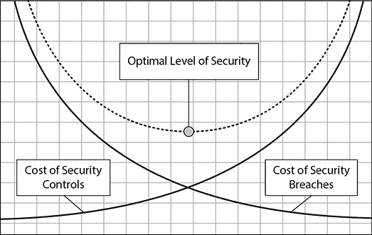

**图 1-6** 风险管理包括选择适当的控制措施，并在安全性与成本之间实现适当的平衡。

在实践中，风险管理可以应用于整个组织，也可以应用于特定资产，甚至可以应用于资产组。NIST 特别出版物 (SP) 800-39 `Managing Information Security Risk`（管理信息安全风险）提出了一种整体方法，即在三个层面上整体地将风险管理应用于整个组织：

- `Organizational tier`（组织层） 通过定义和实施适用于整个组织或业务实体的整体风险管理计划，在组织层面应对风险
- `Mission/business process`（使命/业务流程） 使用“风险感知”的业务流程或将企业架构作为一个整体来应对组织风险
- `Information system`（信息系统） 作为特定信息系统的系统开发生命周期 (SDLC) 的一部分来应对风险

无论风险管理是否按层级处理，对信息安全掌控得最好的组织都会在组织层面和系统层面同时应对风险。

风险管理是对未来的预测尝试。它涉及试图弄清组织或系统可能发生的所有坏事，以决定如何最佳地分配资源。需要考虑大量变量。这包括试图识别可能的威胁（如飓风、火灾、窃贼、黑客等）并提出解决方案以防御它们或减轻其影响。风险管理还涉及各种未知因素，例如“飓风多久会袭击一次我们的设施？”因此，风险管理预测包含一定程度的不确定性。此外，预测试图量化那些本质上可能是定性的事物。这意味着给难以量化的事物（如组织声誉）标上美元符号或数字。这些都是风险管理所涉及的一些挑战。

# 风险管理计划

信息安全风险管理计划通常包含三个组成部分：方法、流程和方法论。视组织而定，这些组成部分可能未被正式定义和实施，但每个组成部分通常都会在一定程度上被采用。请注意，我们在本书中使用方法、流程和方法论这三个术语来解释风险管理，但这些确切术语不一定用于行业风险管理标准和框架中。这些组成部分如**图 1-7**所示。

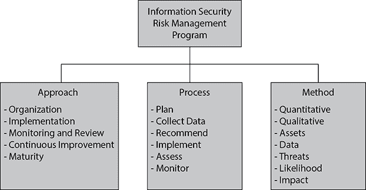

**图 1-7** 风险管理计划组成部分


许多组织选择遵循行业标准风险管理框架来建立其风险管理计划。目前常用的风险管理框架可能包含这三个组成部分中的一项、两项或全部。例如，NIST 网络安全框架涵盖了“方法”和“过程”，但将风险方法类型的选择权留给组织。我们将在本章后面讨论一些较流行的风险管理框架。

## 风险管理计划：方法

“方法”组成部分涵盖了管理、实施和改进风险管理计划的所有活动和因素。行业框架可用作指导，但“方法”必须根据组织的治理和运营方式进行定制。与任何组织计划一样，风险管理计划通常遵循计划、执行、检查、处理（PDCA）循环来实施。以下是风险管理方法中应考虑的一些因素：

### 组织
信息安全风险管理可以作为现有组织风险计划的一部分来处理，该计划可能在首席风险官（CRO）、风险委员会或类似实体的指导下进行。组织必须指定负责管理风险管理计划的责任方，同样重要的是，指定谁对组织中的风险负责。无论是 CISO、CRO、CEO 还是其他人员，负责人或小组最终将批准计划的产出。这些产出包括确定组织和资产的可接受风险水平、选择风险缓解方法，以及批准缓解结果和风险评估结果。负责人或小组必须与组织各层级的领导和利益相关者密切协作执行此任务，以确保风险决策与组织的业务目标和运营环境相称。

### 实施
风险管理计划由计划章程、计划和风险管理策略定义，这些文件规定了计划的范围、目标和要求。计划应定义所需资源，包括人员、设备和预算。计划按照既定方案实施，并与所有在风险结果上有利益关系的组织实体密切协作。这通常包括组织内部的部门和职能，以及外部驱动因素。风险管理计划遵循由程序、规则、报告要求等组成的协议来实施。

### 监控、报告和持续改进
报告应包括已识别风险水平与定义的可接受水平相比的差距分析。至少应有一个非正式审查周期来监控计划。根据组织的成熟度，可能会有正式或非正式的方式，基于明确定义的成功因素来建立目标并衡量计划绩效。应有明确的流程用于报告和上报风险评估期间发现的任何重大风险。事实上，对于美国上市实体，美国证券交易委员会（SEC）要求向股东报告重大风险及相关缓解措施。

### 成熟度
希望组织执行风险管理的能力能随时间推移而提高。如果组织采用正式的过程改进方法，如 ISACA 的能力成熟度模型集成（CMMI）或其他类似模型，就可以实现改进。目标是通过渐进式改进来提升组织的能力。例如，CMMI 的成熟度级别包括：

- **初始** — 过程是被动的，不基于任何形式的结构化规划。
- **已管理** — 过程按计划执行。
- **已定义** — 组织已采用标准，并主动运作以达成目标。
- **定量管理** — 组织利用定义明确的度量指标和定量数据来驱动其过程和决策。
- **优化** — 组织已发展到能够将创新、敏捷性和灵活性应用于其高度成熟过程的程度。

正如前文侧边栏“现实世界中的风险管理”所述，许多组织永远无法超越初始能力级别。对于这些组织而言，关于如何最好地处理风险的决策可能并非基于可靠的研究和分析，因此它们可能偏离目标，使自身处于脆弱状态。但对于每个组织来说，任何能力（包括风险管理）的成熟度都是一项商业决策，而这本身也伴随着自身的风险。

## 风险管理计划：过程

尽管该过程有无数种变体，但总体而言，风险管理过程包含 `Figure 1-8` 中所示并将在下文描述的活动。


**图 1-8** 风险管理过程

### 规划
风险管理规划涉及以下活动：

#### 确定团队
鉴于风险管理的重要性以及风险管理决策影响整个业务这一事实，团队应尽可能包含来自组织各个部门的代表——不仅仅是 IT 或安全部门，还包括其他主要职能和角色。例如，审计人员往往对组织有非常独特的见解，因此他们应参与其中。不同业务单元的领导者应在会议上拥有发言权。组织的法务职能应被纳入，不仅仅是因为涉及监管驱动因素（虽然那也是一个充分的理由），还因为安全和风险管理经常需要针对非法行为以及涉及某种犯罪的行为进行抗辩。此外，组织的隐私职能可能归属于法务部门。由于涉及员工，应纳入人力资源代表，当然，管理层必须参与，因为他们将做出重大决策。

#### 定义范围
下一步是定义风险管理项目的范围。组织定义风险评估、分析和缓解的对象。例如，工作范围是覆盖单个设施还是多个设施；某个特定区域；还是全企业范围？范围可以通过以下方式定义：

- 系统或其他资产
- 业务流程
- 职能、区域或部门

在实践中，大多数组织出于风险管理的目的，将环境视为系统的集合。然后对每个系统应用风险管理。

定义范围还应考虑所选模型中包含的变量类型。如果模型包含对威胁类型的考量，则应决定包含哪些类型的威胁。例如，入室盗窃或骚乱等人为威胁是否在范围内？又或是飓风、野火等自然灾害是否在范围内？黑客攻击或某种数据连接丢失等技术威胁是否在范围内？这些决定定义了工作的范围。模型将在本章后面更详细地讨论。


## 定义方法或模型

下一步是定义将采用何种风险方法。谈到风险分析，基本上有两种方法：`quantitative analysis` 和 `qualitative analysis`。

**定量分析** 旨在确定如果风险成真，将给组织造成多少资金损失。例如，一个组织可能将某资产估值为 100,000 美元，并估计如果该资产遭遇火灾，将损失其价值的 50%，从而使 `Single Loss Expectancy (SLE)` 为 50,000 美元。该组织还可能估计该资产每年遭遇火灾的几率（`Annualized Rate of Occurrence (ARO)`）为 1%，从而计算出 `Annualized Loss Expectancy (ALE)` 为 500 美元。这就是定量分析的一个例证。

**定性分析** 则稍微主观一些。组织通常使用风险等级（如 1 到 10 或低/中/高）来框架资产的定性分析。定量分析和定性分析将在本章后面更详细地讨论。在实践中，我们通常会看到两者的某种结合，因为某些事物难以轻易量化，例如声誉或品牌。

## 工具的使用

根据风险管理计划的复杂程度，如果手动完成，收集所有数据并正确解读结果可能会让人应接不暇。有几种自动化风险管理工具可用，它们可以帮助更快、更准确地完成这一过程。虽然这些工具的初衷是减少人工工作量，但它们真正的价值在于用户能够快速更改参数并运行各种场景。这使得风险管理团队可以尝试不同的假设场景，并在查看结果后选择最佳方案。单一集成工具听起来很理想，确实也有一些这样的工具，但许多组织使用的是集成解决方案，它提供多种工具，每种工具执行任务的一部分。工具类别包括：

- 提供存储库以列出和跟踪环境中资产的配置管理数据库
- 收集并传播当前外部威胁信息的威胁情报平台
- 实现运行定量或定性模型过程自动化的完整风险管理套件

## 理解可接受风险水平

此活动的目标是建立环境中各类系统或资产的最低可接受风险水平。然后对所有系统进行评估并与该标准进行比较，理想情况下，除非资产符合此标准，否则不应批准其投入运行。

风险接受水平是组织应接受的最大整体风险敞口。我们这里讨论的风险是 `residual risk`，即在实施控制或对策后仍然存在的风险。因此，组织必须定义何种级别的风险是可接受的。

请注意，有些组织完全跳过此步骤，而是根据管理层的判断来确定可接受的风险水平。

## 收集信息

风险管理过程中要收集的确切信息由所用的方法指定。定量模型可能需要收集详细的财务信息，包括人工和材料成本，甚至外部供应商的报价，以确定资产价值。定性模型需要关于资产、威胁、漏洞以及不同事件发生概率的信息。收集到这些信息后，将进行分析以捕捉威胁对业务的意义。

## 定义建议

作为风险分析过程的一部分，会考虑处理特定风险的可能方法，并向决策机构提出建议，我们称之为“管理层”。在此语境下，“管理层”的定义因组织而异。在某些组织中是 CEO，在其他组织中可能是 CISO、董事会，甚至是风险委员会。关键在于，每个组织中必须有人决定如何最好地处理特定资产或整个组织的风险。

一旦风险处理决策最终确定，就可以通过应用相应的控制来实施。通常，关于风险建议如何制定及如何实施，有四种选择：

- **缓解** 或通过实施某种控制来降低风险。
- **转移** 风险，使其成为别人的问题。
- **接受** 风险，这意味着只要在可接受风险水平内，组织就可以“与风险共存”并承担后果。
- **完全避免** 风险，通过停止相关活动或彻底关闭系统来实现。

在管理层批准下，通过部署、衡量、监控和持续改进适当的缓解措施和控制来处理风险。


## 考试提示

CCISO 候选人应了解不同的风险处理选项，并能根据场景选择一种方法。

## 风险管理计划：方法

风险管理 `methods` 通常分为两类：定量和定性。

### 定量方法

定量方法用于计算与特定威胁相关的货币损失。这是通过为分析中的每个因素分配数值来实现的。因素可能包括：

- 资产价值
- 威胁概率
- 漏洞
- 损失影响
- 对策或控制的成本

两种常用的定量方法是 `Single Loss Expectancy (SLE)` 和 `Annualized Loss Expectancy (ALE)`。

#### 单次损失期望值 (SLE)

`Single Loss Expectancy (SLE)` 是单次威胁事件的潜在损失价值。注意，该事件可适用于单个资产或一组资产。公式为：

```
AV × EF = SLE
```

- **资产价值 (AV)** 是受事件影响的资产或资产组的成本。AV 可以简单地是资产的替换成本，也可以包括如果资产丢失可能产生的其他成本，如人工和安装成本、因停机给业务造成的成本，甚至因业务损失造成的成本。
- **暴露因子 (EF)** 是针对主体事件可能发生的损失百分比。例如，如果建模的威胁是 `theft`，资产是 `laptop`，EF 可能是 100%，因为没人会只偷走笔记本电脑的一部分。或者，如果威胁是火灾，资产是整个数据中心，EF 可能估计为 40%，作为潜在损失的估算。EF 是一个预测，应有数据、研究或某些文档化的理由作为支持。

#### 年化损失期望值 (ALE)

`Annualized Loss Expectancy (ALE)` 引入了时间因素。ALE 用于预测年度基础上的潜在损失价值。公式为：

```
SLE × ARO = ALE
```

- **年化发生率 (ARO)** 是对事件在给定年份中预计发生次数的估计。

ALE 定量分析使组织能够以美元金额预测特定事件的年度损失。它可用于建立组织的容忍度水平；例如，组织可能通过分析发现，任何 ALE 大于 100 万美元的资产具有最高风险优先级，应具有最高级别的缓解控制。组织也可能使用 ALE 来确定支出，因为每年花费 10 万美元来保护 ALE 仅为 1 万美元的资产和威胁组合可能说不通。


# 定性方法

定性方法不使用美元金额（尽管它们可能仍涉及计算）。定性分析可能仅仅是一位高管说“系统 X 对我们至关重要，因此我将其指定为高风险”，也可能是包含许多变量的高度复杂的分析。定性分析可能考虑多种因素，包括：

- 威胁严重性
- 威胁发生的可能性
- 对业务的影响严重性（也称为*后果*）
- 控制措施的有效性

在大多数情况下，定性风险分析用于确定特定威胁作用于特定资产时的风险，例如组织仓库发生洪水的风险，或针对组织 Web 服务器的拒绝服务攻击的风险。以下三个表格提供了定性分析方法的示例。

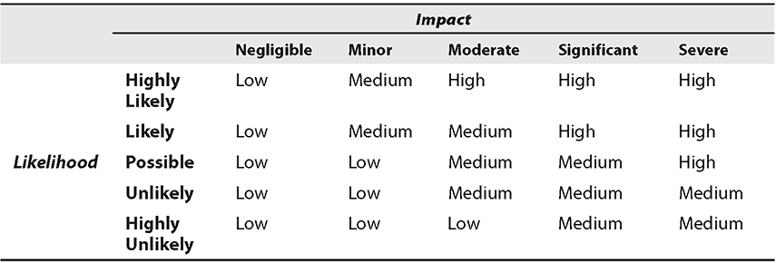

**表 1-1** 使用影响与可能性确定风险等级

表 1-2 说明了组织如何确定企业中特定类型系统的机密性、完整性或可用性遭到破坏的风险等级。总体风险通常是这三种事件类型中最高的风险。在本例中，总体风险为高。

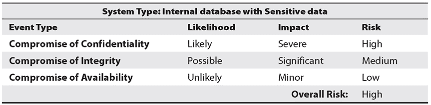

**表 1-2** 破坏类型风险建模

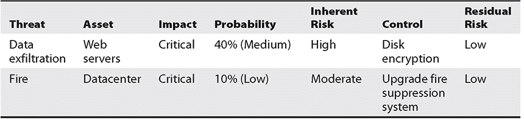

**表 1-3** 固有风险与剩余风险示例

表 1-3 中的下一个示例展示了组织如何在应用缓解控制之前（固有风险）和之后（剩余风险）对风险进行建模。

风险评估团队可能会使用特定技术，以帮助他们最有效地使用选定的模型。以下是一些最佳实践技术：

- **SWIFT** 结构化假设分析技术是一种用于团队协作的结构化过程。它涉及使用引导词和其他要素进行头脑风暴会议，以描述系统、识别和评估风险，并提出将风险降低到可接受水平的行动。
- **Delphi** 德尔菲法由兰德公司开发，旨在预测技术变革。现在它被用于促进主题专家之间的讨论以达成共识。它采用分层、迭代的过程向小组提问，每次迭代都更深入地探讨主题。
- **Bowtie** 蝴蝶结法因其代表图形形似蝴蝶结而得名。蝴蝶结的中心或结点是一个事件。左侧（来源）和右侧（后果）比中心大，因为对于单个事件，可能存在许多来源和后果。蝴蝶结技术提供了一种结构化的方式来建模和分析威胁、其对组织的影响，并评估缓解措施。
- **决策树分析** 该技术用于帮助人们从多个可能的选择中选出最佳方案。它使用可视化模型来帮助说明和理解风险分析中所考虑变量之间的关系。它还有助于理解问题某一方面的变化如何影响其他方面。


> **考试提示** CCISO 候选人应熟悉定量和定性风险管理，并能够根据场景识别正在使用哪种方法。

## 风险管理最佳实践框架

以下是一些为帮助组织执行信息安全风险管理而开发的框架的简要总结。

- **OCTAVE（运营关键威胁、资产和漏洞评估）** OCTAVE 最初由卡内基梅隆大学软件工程研究所开发。目前有三个版本：OCTAVE、OCTAVE-Allegro（更精简的框架）和 OCTAVE-S（面向小型组织）。OCTAVE 依赖于这样一个理念：在组织中工作的人最适合理解和分析风险。它涉及资产、威胁、漏洞以及解决它们所需的内容。OCTAVE 是一个定性风险管理框架，带有相关模型。
- **FAIR（信息风险因素分析）** FAIR 是一个定量风险框架。FAIR 提供了一种风险分类法，将风险分解为特定因素和子因素。它包含非常具体的损失类型、威胁和漏洞，并包含衡量它们和得出定量分析结果的方法。
- **ISACA Risk IT 框架** ISACA Risk IT 是一个面向 IT 的框架，而非专门针对信息安全的框架。Risk IT 包含三个领域：风险治理、风险评估和风险响应，并包含使用定量和定性混合方法进行分析的具体实施模型。
- **ISO/IEC 27005** ISO/IEC 27005《信息技术——安全技术——信息安全风险管理》是一个高层框架，支持将信息安全作为 ISO/IEC 27000 系列指南的一部分加以应用。它意味着一个持续的过程，用于执行定量或定性风险分析，但不包含具体模型。ISO 31000《风险管理——指南》是一个更稳健的风险管理框架，包含三个要素：原则、框架和实施过程。然而，ISO 31000 并不建议采用定量或定性方法。
- **FISMA/FIPS/NIST RMF** 用于满足美国《联邦信息安全现代化法案》（FISMA）要求的标准和特别出版物集合，提供了一个框架、流程和模型，用于执行定性风险分析。这些标准还提供了安全控制库，从而形成一个用于风险管理和实施的端到端框架。

## 管理与技术信息安全要素

一个优秀的信息安全计划包含许多管理和技术要素，如图 1-9 所示。每个安全计划都应包含这些要素，尽管每个组织都有自己命名和组织它们的方式。

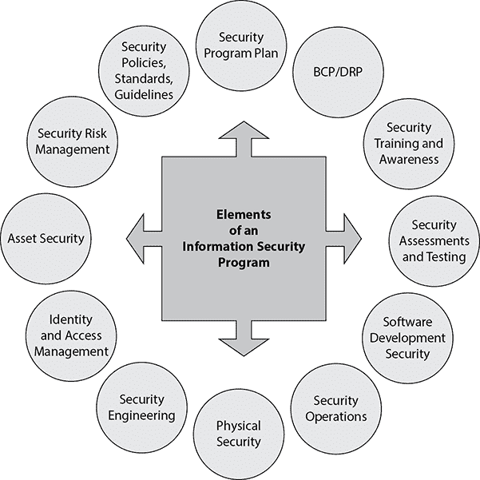

**图 1-9** 信息安全计划的关键要素

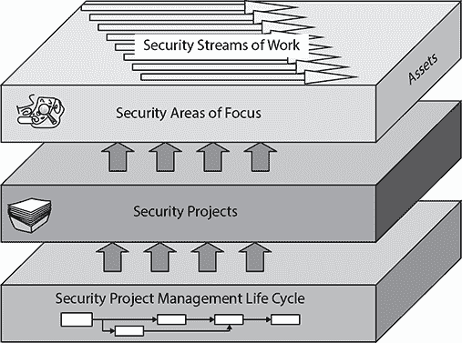

**图 1-10** 安全计划组件示例

以下各节介绍每个要素。它们将在第 4 章中详细讨论。

### 安全计划规划

许多组织都有一个安全计划，用于定义完整的信息安全项目。该计划定义了所有安全角色和职责，规定了项目的战略目标，并确定了安全活动。该计划识别了所有法规和业务驱动因素，并确保计划中呈现的项目是基于风险的。图 1-10 说明了一个示例安全项目，并展示了项目组件之间的关系。接下来将讨论示例中的每个组件。

- **安全工作流** 工作流是为实施信息安全的核心主题领域或域而执行的活动。示例工作流可能包括入侵检测和监控、访问控制和身份管理、漏洞管理以及变更控制。这些工作流最终必须在整个企业中实施，才能拥有一个完整的安全项目。
- **资产** 资产是应用工作流的系统、数据、业务单元、部门或企业的关键领域。与资产相关的活动解决了基于资产的相对优先级、风险或资源等因素，在何处以及何时应用何种安全措施的问题。


## 安全计划组成部分

### 安全关注领域
安全计划中有些方面因外部驱动因素（通常是法规驱动因素）而需要重点关注。例如，PCI DSS 要求绘制企业内所有信用卡数据的流向图，并根据数据驻留位置实施特定的安全控制。关注领域的示例包括 PCI DSS、HIPAA、《萨班斯-奥克斯利法案》，以及内部驱动因素如 ISO/IEC 27000 系列。这些领域定义了需要在何处应用何种安全活动。关注领域可能适用于一项或多项资产。

### 安全项目
项目是将工作流应用于目标和/或关注领域而产生的具体活动。安全项目的示例可能包括单点登录 (SSO) 的实施、特定入侵检测系统 (IDS) 的部署，或安全仪表盘的设计与实施。

### 安全项目管理生命周期
所有安全项目都应遵循既定的生命周期进行管理。生命周期确保安全项目定义明确、文档完善，并具有明确的开始、中间和结束阶段。生命周期定义了安全项目如何被管理，并为资源、质量和结果的适当控制提供保障。

## 安全策略、标准和指南

安全计划通常拥有一系列管理安全指令，如图 1-11 所示。这些指令构成了计划人员必须遵循的规则和实践库。顶层文档是安全策略，它们定义了管控将做什么（但不一定规定如何做）的硬性规则（要求）。示例包括访问控制策略、密码策略、事件处理策略等——基本上，每一项信息安全活动或领域（核心能力）都应有其自己的策略。

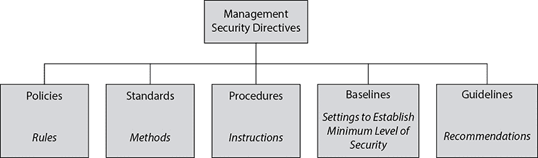

**图 1-11** 管理安全指令

其他文档包括以下内容：

- **标准** 标准规定了满足策略中定义要求的具体方法。例如，标准可用于定义特定的加密工具或产品，或在特定情况下为满足组织数据加密策略而使用的控制类型。

- **流程或程序** 流程或程序是分步的工作流或指令，定义了如何执行特定安全功能。它们规定了谁负责这些活动以及如何执行。

- **基线** 基线有时归类于标准中，规定了硬件或软件实施的具体配置。它们可能包括 Windows 注册表和其他类型的设置，以确保企业中资产安全实施的正确性和可重复性。

- **指南** 指南提供大致方向或建议，而不规定要求。示例可能是一份指南，描述用户如何使用*口令短语*来满足密码策略要求。在此示例中，使用口令短语不是要求，而是一个好的建议，最适合通过指南来传达。


**考试提示** CCISO 考生应理解策略、标准、程序、基线和指南之间的区别，包括哪些是强制性的，哪些是建议性的。

## 资产安全

资产安全是识别组织拥有哪些资产，并确定哪些类型的控制适用于每项资产的概念。环境中的资产类型及每类资产使用的控制类型，均在组织的策略、标准和程序中进行识别和处理。

资产安全通常关注数据（信息资产）。资产安全涉及在整个数据生命周期中实施安全控制，如图 1-12 所示。

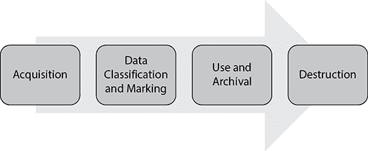

**图 1-12** 数据生命周期

资产安全计划定义并实施控制措施，以保护静态数据和传输中数据的访问，并使用访问控制、加密和数字签名等技术。

## 身份与访问管理

访问控制是控制用户和系统如何与其他系统和资源通信及交互的安全功能。它们保护系统和资源免受未经授权的访问，并包含在认证过程成功完成后参与确定授权级别的组件。虽然人们通常认为“用户”是需要访问网络资源或信息的实体，但还有其他类型的实体（如其他系统）也需要访问受访问控制约束的资源。

身份与访问管理使用的概念包括识别、认证、授权和问责。它使用的模型包括自主访问控制 (DAC)、基于角色的访问控制 (RBAC) 和强制访问控制 (MAC)。它包括使用身份管理系统（如 Microsoft Active Directory 和 Kerberos）、协议（如轻量级目录访问协议 (LDAP)）以及安全控制（如生物识别和密码）。所有这些项目均在第 4 章中解释。

## 安全工程

安全工程是一个广泛的领域，涉及信息系统的安全设计与实施。关键概念是安全应成为企业设计的组成部分。安全工程涉及计算环境的各个方面，例如：

- 计算机体系结构组件
- 操作系统安全与保护机制
- 信息系统架构与保护机制
- 网络安全设计
- 企业安全解决方案（如防火墙、反恶意软件、数据丢失防护、端点安全和安全网关）
- 远程连接
- 无线连接
- 云计算
- 网络物理系统
- 数据库安全
- 移动设备安全
- 安全模型
- 安全评估与授权
- 密码学

## 物理安全

物理安全涉及理解对物理信息系统、设施和人员的威胁，以及应对这些威胁的控制措施。物理安全并不总是在 CISO 的职责范围内。有时物理安全与信息安全分开管理，具体取决于组织的实践。物理安全包括以下内容：

- 设施选址
- 设施建设
- 物理安全风险、威胁和对策
- 人员安全

正如 IT 安全一样，物理安全也有纵深防御的概念，使用多层防御，如图 1-13 所示。

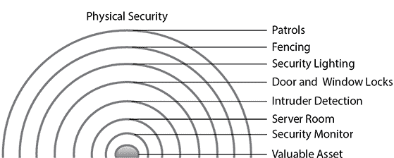

**图 1-13** 物理安全纵深防御层

## 安全运营

安全运营专注于主动执行日常职能，以预防、检测和响应安全风险与威胁。这些职能包括以下内容：

- **漏洞、配置和补丁管理** 所有 IT 资产都存在漏洞。这些资产包括台式机、笔记本电脑、移动设备、服务器、网络和存储设备、操作系统、应用软件等。跟踪组织中的所有资产及其是否拥有最新补丁和正确软件版本是一项全职工作。一个良好的漏洞、配置和补丁管理计划应为组织提供“态势感知”，即所有资产及其配置和补丁状态的准确图景。


### 监控与日志记录

这一关键功能涉及捕获 IT 企业内的所有重大事件，以检测恶意活动，并支持对先前或正在进行的安全事件进行调查。此功能通过配置企业中的系统来捕获活动（如登录和资产访问、数据读/写/修改、数据渗出、对外部和内部系统的访问、登录尝试等）来执行。捕获这些活动并实时监控它们支持*入侵检测*。捕获这些事件以供未来分析支持*取证调查*。监控与日志记录涵盖了根据业务风险和可用资源决定记录和监控哪些事件。捕获过多会导致高昂的存储和网络流量成本。捕获过少则无法获取足够有用的数据。成熟的组织会不断调整其日志记录和监控能力，以最适应其业务。

### 事件处理

弄清楚如何应对安全漏洞的时间点不是在漏洞发生之后。事件处理的核心在于为各类安全事件提前规划并定义应对措施。通常事件处理遵循六步模型，如图 1-14 所示。

针对重大安全事件，会遵循这六个步骤。*准备*阶段提前执行。在此阶段，安全组织尝试预测可能发生的事件类型。针对每种事件类型，会规划其余步骤，有时还会进行演练。目标是能够*识别*发生了何种类型的事件，*遏制*损害扩散，*根除*导致问题的原因，*恢复*事件影响并恢复正常运营，最后开展*经验教训总结*活动，以确定可采取或应采取哪些行动来防止事件再次发生或改进事件响应方式。事件处理流程的一个关键方面是知道何时将问题上报给管理层或董事会，或通知执法机构。

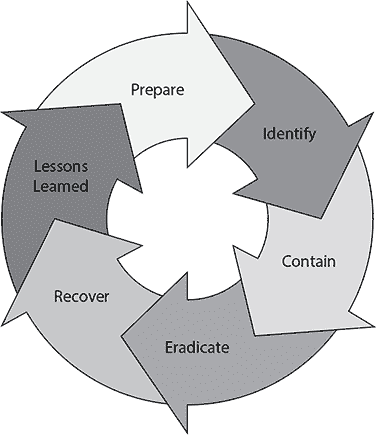

*图 1-14：事件处理的六个步骤*

### 取证与调查

某些安全漏洞可能表明违反了法律或公司政策。此类事件可能需要进行计算机取证调查，以充分揭示事件的所有信息。此类事件可能还需要联系并配合执法组织。所有这些都需要相应规划，以免因失误给相关业务或个人造成进一步损害。

### 安全运营中心

所有安全运营活动通常由组织安全运营中心（SOC）的人员配备并执行。SOC 通常运营组织的安全信息和事件管理（SIEM）系统，该系统对网络、计算机和用户活动提供 24/7 监控，以检测、预防和响应安全事件。

### 软件开发安全

许多组织开发自己的软件或构建自定义应用程序供自己使用。此类软件的构建方式必须确保其不包含安全漏洞。软件和应用程序必须结合安全专业知识来构建，以确保开发人员定义、构建、测试、发布和维护安全的应用程序。除了防止漏洞外，软件和应用程序的构建必须使用支撑访问控制和身份管理的关键概念，例如*最小权限*和*职责分离*。

### 安全评估与测试

所有安全计划都必须包含持续的*评估与测试*组件，以持续评估和验证安全计划的各个方面。作为安全计划一部分而开发和实施的行政、技术、管理和运营控制，通过审计和清单进行评估，以确定是否符合既定目标。此外，应有持续的*漏洞管理*活动，包括漏洞测试，以确保漏洞修复活动的成功执行和管理。测试通常涉及漏洞评估和渗透测试的结合。*漏洞评估*是使用工具扫描整个计算环境（内部和外部）以发现和枚举已知漏洞的综合测试。这些测试结果输入到*漏洞与补丁管理*活动集中，以报告和跟踪修复活动。*渗透测试*通常由伪装成黑客的工程师执行。这些工程师寻求利用漏洞来访问系统和数据。虽然漏洞测试是全面的，但渗透测试是有限的，旨在演示如果漏洞暴露会发生什么。

### 安全培训与意识

所有员工都应了解组织的安全政策和流程以及通用的良好安全实践。安全意识和培训应面向组织的全体用户群体。培训应包含多种形式，特别是实践、演练和练习，为用户提供应对网络攻击（包括社会工程学）的基于现实的经验。最好的培训计划利用现成培训教授通用概念和定制培训教授公司或组织特有的特定概念相结合的方式。

### 业务连续性与灾难恢复

每个组织都应制定计划和程序，以确保在发生安全漏洞或其他灾难时组织能够继续运营。为实现这一点，组织会制定业务连续性规划和灾难恢复（BCP/DR）计划（或运营连续性[COOP]计划），重点在于在业务规定的时间范围内恢复支持关键业务功能的系统和服务。BCP/DR 计划根据组织的风险承受能力，定义组织从漏洞或灾难中恢复的程度。有时（但并非总是），BCP 和 DR 由 CISO 主管。

### 合规

本章前面介绍了 CISO 负责的许多治理实践，包括了解组织的业务驱动因素，以及创建和维护促进这些驱动因素的安全计划。开发这些驱动因素的一个关键方面是了解组织的合规要求。*合规*是一种治理方法，旨在确保与适用的法律、法规、标准、组织政策、道德行为和其他业务目标保持一致。关于合规的讨论通常侧重于法规遵从，因为不合规的后果（罚款、声誉受损等）可能很严重。然而，法规遵从并非合规的唯一形式。如图 1-15 所述，既有内部也有外部合规要求，它们推动组织实施政策、标准和程序以支持合规。

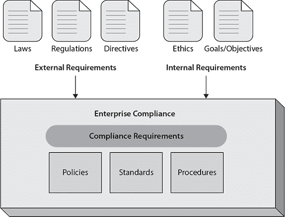

*图 1-15：合规驱动因素*


## 外部合规

`External compliance`（外部合规）侧重于遵守外部法律、法规、标准或其他行业强制要求。维护对大量法律和监管要求的合规性是高管们的主要关注点。通过实施控制措施、定期审计和法律意识培训，可实现对法律、法规、合同和法定要求的合规。需要考虑的外部要求类型繁多：

- `Industry regulations or directives`（行业法规或指令）
- `State regulations`（州法规）
- `Federal regulations`（联邦法规）
- `Local laws and regulations`（地方法律法规）
- `International standards`（国际标准）

## 内部合规

`Internal compliance`（内部合规）侧重于使能并保护人员、流程和技术的内部业务实践。这些实践旨在确保遵守内部政策、道德准则或其他业务规则和目标。这些活动通常侧重于良好的商业实践，并非直接源于外部立法授权、法规或指令。这些活动包括确保：

- `Alignment with internal codes of conduct, policies, standards, and procedures`（与内部行为准则、政策、标准和程序保持一致）
- `Ethical employee behavior`（员工道德行为）
- `Alignment with other key organizational rules or objectives (reputation, image, preventing financial loss, and so on)`（与其他关键组织规则或目标保持一致，如声誉、形象、防止财务损失等）

在本节中，我们将讨论合规团队并演示合规管理流程。

## 合规与安全

高管们普遍存在一个误区，认为合规即意味着组织是安全的。合规不一定意味着组织安全，反之，良好的安全计划也不一定符合其驱动因素的合规要求。例如，组织可能被要求遵守 `PCI DSS` 或《通用数据保护条例》（`GDPR`）。`PCI DSS` 合规要求以满足 `PCI DSS` 关于处理信用卡信息规范的方式运营，而 `GDPR` 合规要求保护欧盟公民的数据。与许多外部合规因素一样，这些要求非常具体。在本例中，它们侧重于特定类型的数据。然而，仅专注于保护此类数据的组织可能会在其他攻击向量上暴露自身。

安全不断演进以应对威胁、技术和防护措施的变化。合规要求也会变化，但通常不以相同的速度变化，无法充分应对安全挑战。虽然合规可能无法全面解决安全问题，但合规是重要的业务推动因素，不符合行业法律法规等外部因素的组织无法长期在其选择的业务领域运营。

### 合规团队

合规团队通常参与提供内部政策和程序指导，以及评估当前流程和技术以确定改进合规性的方法。根据组织情况，团队可能仅专注于内部合规、仅专注于外部合规，或两者兼顾。合规团队的职责可能包括：

- `Identification of external compliance requirements (for example, laws and regulations)`（识别外部合规要求，例如法律法规）
- `Development and management of internal compliance requirements (for example, ethics)`（制定和管理内部合规要求，例如道德规范）
- `Development or guidance on policies, standards, and procedures`（制定或指导政策、标准和程序）
- `Managing the organization's privacy program`（管理组织的隐私计划）
- `Oversight and execution of compliance training initiatives`（监督和执行合规培训计划）
- `Monitoring the program for violations and efficiency`（监控项目的违规情况和有效性）

并非所有组织都有专门的合规资源。小型组织通常采用共享责任方式进行合规管理，或设置单一的专职合规资源，如合规官。大型组织通常设有合规部门，向高级合规官汇报，如首席合规官（`CCO`）。具有特定或复杂合规要求的企业甚至可能针对特定合规因素设立独立团队，如 `PCI DSS` 团队或 `HIPAA` 团队。

合规团队的汇报结构因组织而异。同样，在大型组织中，合规团队通常向 `CCO` 汇报。`CCO` 可能向法务部门的总法律顾问汇报（因为他们在法律法规合规方面具有专业知识），或直接向 `CEO`、董事会或审计/合规委员会汇报。与 `CISO` 的汇报结构类似，没有放之四海而皆准的解决方案。归根结底，如果合规团队负责人的汇报结构能促进沟通和汇报，使 `CEO` 和/或董事会了解合规风险，则该结构是有效的。

### 合规管理

合规贯穿业务的各个方面，像任何其他计划一样，必须得到适当管理以确保一致性。`Compliance management`（合规管理）是组织规划、实施和维护支持合规活动的过程。合规管理使组织能够建立治理、政策、系统和流程、报告和度量。每个组织都从事某种形式的合规管理活动，但并非所有组织都有正式的合规计划、专门的合规团队，或遵循既定的合规管理流程。

所有组织都必须遵守管辖其业务行为的企业政策、标准、法律、法规和内部要求的组合。临时性的合规管理方法可能适用于合规义务有限的小型组织。然而，具有许多合规驱动因素的组织必须妥善管理和维护合规，以确保其合规工作的准确性和完整性。管理合规有许多流程和方法。本章介绍的流程基于 `ISO 19600:2014`《合规管理体系》，侧重于类似于计划-执行-检查-处理（`PDCA`）循环（也称为戴明循环或休哈特循环）的循环方法。步骤如下：

1. `Plan`（计划）
2. `Implement`（实施）
3. `Evaluate`（评价）
4. `Maintain`（保持）

该流程如图 1-16 所示。外部和内部要求（法律、法规、指令、道德、目标和指标）作为合规管理流程的输入。

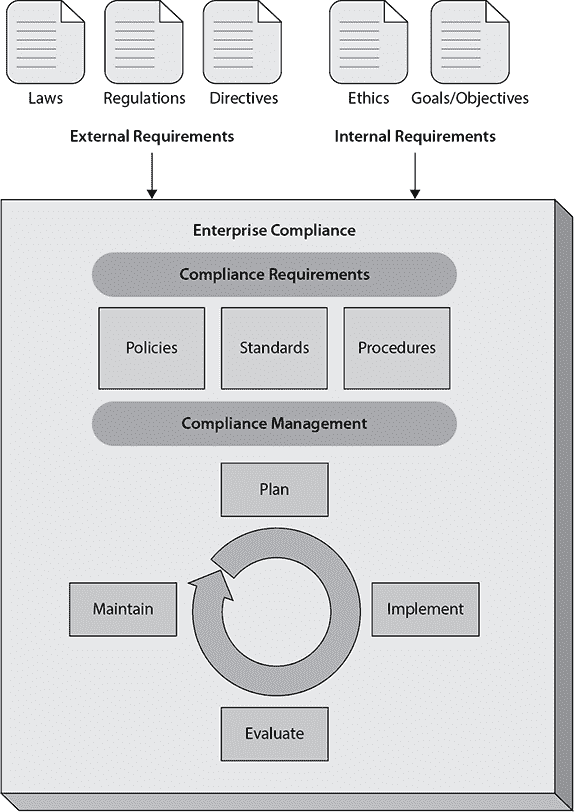

**图 1-16** 合规管理流程


> **考试提示** `CCISO` 考试不会包含本节概述的合规管理确切步骤相关问题。目标是从概念上理解管理合规的一般流程，并能区分特定合规方法适用的场景。

#### 计划

合规管理流程的第一步是确定适用的内部和外部合规要求的范围，以了解完整的合规格局。这要求彻底了解内部业务需求、组织所在的行业、业务处理的信息类型以及组织运营的地理区域。在地方、州、联邦和国家层面存在不同的法律法规，这些法律法规通常适用于特定数据类型。应编制适用的法律和监管驱动因素以及内部要求的清单，以识别影响业务的合规风险。目标是制定识别、衡量和纠正不合规实例的策略。

#### 实施


# 实施

在制定战略或行动计划后，必须采取措施解决不合规实例。实施通常需要跨部门的协作，并可能体现为多种不同的活动，包括要求：

- 制定并维护特定的政策、程序或文档
- 实施特定的控制措施
- 对不合规或违反内部要求的行为实施纪律处分
- 评估胜任力并实施培训
- 向组织传达合规期望

最终，实施步骤要求组织将法规和要求与具体的政策、程序和控制措施联系起来。作为解决发现问题的一部分，需要有某种方式来跟踪补救措施的进度和实施情况。一些组织利用软件工具来协助跟踪和补救过程。需求和要求不太复杂的其他组织可能只需使用简单的电子表格或清单。你并不总是需要复杂的工具。有时最简单的解决方案可能是最有效的。

## 评估

下一步是评估合规计划控制措施并衡量发现结果。合规评估用于识别和衡量因缺少控制措施而导致的合规风险。在某些情况下，合规评估可能涵盖多项法律、法规和业务要求。在其他情况下，组织可能会针对特定的合规义务（如 PCI DSS、HIPAA、ISO/IEC 27001 或内部道德调查）进行评估。合规评估可以是内部的，也可以是外部的。

内部合规评估由内部员工执行，旨在衡量组织的合规风险，并确定为遵守法律、法规和其他合规要求而需要采取的行动。它们还用于确定组织是否遵循内部目标、政策、标准和最佳实践。内部评估可由内部审计团队、合规团队或其他内部资源执行，具体取决于组织的结构和合规责任的分配。

外部合规评估由独立的第三方执行，评估组织与特定法律、法规或标准（例如 PCI DSS 或 HIPAA）的一致性。外部合规评估会产生一份报告，衡量组织的合规情况。根据评估类型，生成的报告可能被监管机构用于评估不合规情况，以决定是否实施罚款或其他处罚。外部合规评估也可能导致认证。例如，一些组织可能会寻求 ISO/IEC 27001 或 PCI DSS 认证。为了获得认证，组织必须接受合格第三方的全面审计（例如，PCI DSS 的合格安全评估机构 [QSA]）。审计成功完成且满足所有要求后，组织将被认证为合规。合规是确保与要求保持一致的持续过程，而认证是在特定时间段内对合规性的证明。

CISO 可以利用合规评估的结果来提高组织的成熟度，并作为申请资金以实施控制措施、降低风险和解决发现问题的依据。

## 维护

为有效确保合规，组织必须时刻警惕不断变化的合规要求。合规像任何其他计划一样，需要持续的维护、监控和报告。随着组织的发展，新法律颁布、新法规实施、新的内部组织要求产生。随着组织的技术基础设施、业务流程或范围发生变化，以前不适用的新法律法规可能会管辖该业务。目标是使计划能够应对新的合规风险，识别和检查不合规实例，并持续适应不断变化的环境。

# 隐私

本章后面讨论的许多法律和监管驱动因素都有一个共同主题，即关注隐私。数据隐私是合规的一个重要方面。组织必须了解其所在行业的隐私、法律和监管要求。记录隐私相关信息的处理方式至关重要；这包括收集、使用、共享、归档和销毁。开始成熟隐私工作时需要考虑的一些关键事项如下：

- 组织拥有哪些数据？
- 数据如何使用？
- 数据存储和处理在何处？
- 哪些隐私法律法规管辖该业务？

## 隐私影响评估

为评估隐私而进行的风险评估称为*隐私影响评估 (PIA)*。PIA 侧重于分析数据收集、使用、传播、归档和销毁，以实现以下目的：

- 遵守适用的法律法规
- 确定数据处理的风险和影响
- 评估数据保护措施和流程以减轻隐私风险

许多组织设有数据隐私官和专门部门，负责确保隐私和遵守隐私法律。通常隐私部门隶属于法务部门。最终，隐私应是法务、合规、审计和安全部门之间的多方面协作。安全部门拥有实施隐私所需的技术要求和控制措施的专业知识，而法务团队拥有遵守法律和法规的专业知识。

## 隐私与安全

隐私和安全常被混为一谈，但必须记住，这是两种不同的实践。*隐私*表示个人对其自身敏感数据应拥有的控制程度。这通常侧重于组织被委托的个人信息的授权收集、使用、共享、归档和销毁。例如，HIPAA 要求医疗机构保护患者个人信息的隐私。*安全*是指防范威胁的措施，通常侧重于保护数据免受未经授权的访问，并确保在不再需要数据时对其进行适当销毁。组织通过实施良好的安全实践来实现隐私目标。

# 法律和监管驱动因素

本节重点介绍 CISO 应了解的一些关键法律和监管驱动因素。某些组织在法律上不强制要求遵守这些法律。然而，如果组织与其他依法必须合规的实体开展业务，这些业务可能会作为其合规或风险管理计划的一部分，要求其供应商、合作伙伴或供应商遵守合规要求。本节涵盖的法律和监管驱动因素列表如下：

- FISMA
- DFARS 252.204-7012
- 克林格-科恩法案
- PCI DSS
- 隐私法案
- GLBA
- HIPAA
- FERPA
- SOX
- GDPR
- NERC-CIP


**考试提示** CCISO 候选人应熟悉影响组织信息安全的法律条款。

## 联邦信息安全现代化法案


## FISMA（联邦信息安全管理法案）

*2002 年联邦信息安全管理法案（FISMA 或 FISMA 2002）*是美国法律，作为 2002 年电子政府法案的一部分颁布。FISMA 的目的是帮助美国联邦机构实施最低安全要求，以降低数据丢失的风险。FISMA 要求美国联邦机构构建、记录并实施覆盖全机构的信息安全计划，以支持机构运作。这包括以下内容：

- 遵循关键安全最佳实践
- 评估其对这些实践的合规性
- 向管理和预算办公室（OMB）报告其调查结果

*2014 年联邦信息安全现代化法案（FISMA 或 FISMA 2014）*修订了 FISMA 2002，提供了新要求，旨在使联邦安全实践现代化，专注于基于风险的安全，而非清单式方法。这些新要求包括联邦安全监督机构职责的变更、更新的安全报告要求，以及促进自动化工具使用的步骤。

### FISMA 适用于谁？

FISMA 合规对美国联邦机构而言是强制性的，但也适用于处理联邦政府信息的任何人。联邦承包商、管理联邦项目的州机构以及拥有政府合同的私营公司必须遵守 FISMA。未能遵守可能导致失去联邦资金。

### 合规如何影响组织？

根据 FISMA 要求，NIST 负责制定标准、指南和其他出版物，这些文件代表了适用于美国联邦机构的安全要求。这些包括联邦信息处理标准（FIPS）和 NIST 特别出版物（SP）。本章稍后将更详细地介绍这些出版物。FISMA 的关键要求包括以下内容：

- **信息系统清单** 必须确定准确的系统边界，包括资产的完整清单。
- **信息系统安全风险分类** 必须使用 FIPS 200 和 NIST SP 800-53 中的指南对信息系统进行分类。
- **安全控制** 必须根据系统的风险分类实施安全控制。FIPS 200 和 NIST SP 800-53 中提供了实施安全控制的指南。
- **风险评估** 必须执行安全风险评估，以评估系统风险和关键性。
- **系统安全计划** 必须使用 NIST SP 800-18 中的指南制定系统安全计划（SSP）。
- **认证测试** 必须根据 NIST SP 800-37 中的指南对系统进行授权。
- **持续监控** 必须监控系统以确保其符合控制要求和基线。

## 国防联邦采购条例补充 252.204-7012

*国防联邦采购条例补充（DFARS）*由美国国防部（DoD）管理，是联邦采购条例（FAR）的补充。DFARS 提供了国防部承包商和分包商在采购过程中必须遵循的具体采购条例。DFARS 252.204-7012 概述了在非联邦信息系统中保护受控非密信息（CUI）的最低安全要求。

### DFARS 252.204-7012 适用于谁？

DFARS 252.204-7012 适用于在非联邦信息系统中处理、存储或传输 CUI 的国防部承包商和分包商。如果组织处理国防部 CUI，则该组织必须遵守 DFARS 252.204-7012 要求，并使其业务达到合规。

### 合规如何影响组织？

必须实施的安全控制指南见 NIST SP 800-171《保护非联邦系统和组织中的受控非密信息》。NIST SP 800-171 本质上是处理 CUI 的组织必须实施的网络安全框架。如果国防部承包商未能遵守 DFARS 252.204-7012/NIST SP 800-171，该承包商将面临一系列潜在的刑事、民事、行政或合同处罚，包括合同终止和违约损害赔偿。

## 克林杰-科恩法案

*1996 年克林杰-科恩法案*是一项美国联邦法律，适用于专注于改进信息技术采购、使用和处置的联邦机构。其目的是改进 IT 采购、投资和支出，以减少浪费。

### 克林杰-科恩法案适用于谁？

克林杰-科恩法案适用于美国联邦机构。

### 合规如何影响组织？

克林杰-科恩法案由两项同时通过的法律组成：《信息技术管理改革法案》（ITMRA）和《联邦采购改革法案》（FARA）。克林杰-科恩法案的一些关键要求包括以下内容：

- 强制机构负责人对 IT 管理和投资以及信息安全负责
- 实施资本预算规划和投资流程
- 制定评估风险和最大化 IT 投资价值的计划
- 在机构中设立首席信息官（CIO）角色
- 制定 IT 系统和投资的标准和基准
- 创建企业架构
- 定期审查预算流程

## 支付卡行业数据安全标准

*支付卡行业数据安全标准（PCI DSS）*是一个专注于保护信用卡信息的控制框架。PCI DSS 是隐私和数据安全自律方法的一个例子，因为它不是政府法律或法规。它是由支付卡行业标准委员会管理和执行的私营行业倡议。该委员会由主要信用卡公司成立，包括 Visa、MasterCard、Discover、JCB 和 American Express。撰写本文时，PCI DSS 的当前版本为 3.2.1 版，可在 `https://www.pcisecuritystandards.org/document_library` 获取。

### PCI DSS 适用于谁？

PCI DSS 在全球范围内适用于处理持卡人数据的任何组织。这包括存储、处理或传输持卡人数据的任何组织，例如处理信用卡交易的企业。

### 合规如何影响组织？

PCI DSS 控制框架由 12 项控制要求组成，归类为以下六大类：

- 构建并维护安全的网络和系统
- 保护持卡人数据
- 维护漏洞管理计划
- 实施强访问控制措施
- 定期监控和测试网络
- 维护信息安全策略

PCI DSS 的 12 项控制目标是：

- 安装并维护防火墙。
- 重置系统的默认供应商提供的密码和安全参数。
- 保护存储的持卡人数据。
- 在开放或公共网络上传输持卡人数据时进行加密。
- 实施并维护最新的防病毒软件或程序。
- 以安全为出发点开发应用程序和系统。
- 基于业务知情需要限制对持卡人数据的访问。
- 为每个拥有系统访问权限的个人分配唯一 ID。
- 限制对持卡人数据的物理访问。
- 跟踪并监控对持卡人数据和网络资源的访问。
- 定期测试系统和流程安全性。
- 维护信息安全策略。

未能遵守 PCI DSS 可能导致信用卡公司罚款、客户流失、声誉和品牌形象受损，以及客户提起的诉讼。此外，信用卡公司可能会撤销组织接受信用卡的资格。

## 1974 年隐私法案


# 1974 年隐私法案

多年来，人们非常关注美国联邦政府参与对个人的监视和调查，以及政府所持有的个人数据被滥用的可能性。`1974 年隐私法案 (Privacy Act)` 是一项美国联邦法律，旨在通过在政府收集和维护个人个人信息的需求与个人隐私权之间寻求平衡，来解决这些担忧。

## 隐私法案适用于谁？

`1974 年隐私法案` 适用于美国联邦政府特定部门维护的记录和文件。与许多法律类似，立法中列出了豁免机构和情况的例外清单。

## 合规性如何影响组织？

`隐私法案` 要求机构保护美国联邦政府维护的特定记录。该立法侧重于四大主要政策目标（参见 [`www.justice.gov/opcl/policy-objectives`](https://www.justice.gov/opcl/policy-objectives)）：

- 限制机构披露可识别个人身份的记录
- 授予个人更多权利以访问机构维护的关于自己的记录
- 授予个人寻求修正机构维护的关于自己记录的权利，前提是证明这些记录不准确、不相关、不及时或不完整
- 建立一套“公平信息实践”准则，要求机构在收集、维护和传播记录时遵守法定规范

违反该法案可能导致民事诉讼，包括罚款、赔偿和刑事处罚。

# 格雷姆-里奇-比利雷法案

`格雷姆-里奇-比利雷法案 (GLBA)`，也称为 1999 年金融服务现代化法案，要求金融机构保护个人的非公开个人信息。这包括向客户披露其私人信息将如何受到保护，以及是否会分发给第三方。

## 格雷姆-里奇-比利雷法案适用于谁？

`GLBA` 对金融机构具有强制约力，包括银行、抵押贷款经纪人、房地产公司、保险公司以及其他从事提供金融服务或产品的组织。

## 合规性如何影响组织？

`GLBA` 有三项主要条款保护客户信息：金融隐私规则、保障规则和借口规则。

金融隐私规则要求金融机构向每位客户提供隐私通知，概述以下内容：

- 收集的数据类型
- 组织将如何使用、共享和保护数据
- 客户对数据的权利

保障规则要求金融机构制定信息安全计划，包括：

- 指定一名员工管理信息安全计划
- 制定风险管理计划以识别客户信息面临的风险
- 确保服务提供商保护客户信息
- 设计、实施、测试和监控控制措施以缓解已识别的风险
- 持续监控信息安全计划

借口规则要求金融机构实施控制措施以防范借口攻击，也称为社会工程学，这可能包括某人通过电话、邮件或电子邮件冒充账户持有人以收集其私人数据。（社会工程学在 第 4 章 中有更深入的介绍。）`GLBA` 规定通过借口手段获取或披露客户信息属于非法行为。为满足 `GLBA` 在此方面的要求，组织必须制定安全意识培训计划，内容包括识别社会工程学和网络钓鱼骗局。

未能遵守 `GLBA` 可能导致严重后果，包括罚款、刑事处罚、声誉受损和监禁。

# 健康保险流通与责任法案

`1996 年健康保险流通与责任法案 (HIPAA)` 是一项美国联邦法规，涵盖受保护健康信息 (`PHI`) 的处理。`HIPAA` 为保护健康信息的安全性和隐私性提供了框架。

## HIPAA 适用于谁？

`HIPAA` 中的规则适用于受监管实体和业务关联方。受监管实体被定义为医疗服务提供者、健康计划或医疗信息清算机构。业务关联方是指向受监管实体提供涉及使用或披露 `PHI` 服务的实体。

## 合规性如何影响组织？

`HIPAA` 由美国卫生与公众服务部 (`HHS`) 民权办公室 (`OCR`) 执行。违反 `HIPAA` 可能导致基于疏忽程度的严厉处罚。违规可能导致民事和刑事处罚，包括潜在的罚款和监禁。最常见的 `HIPAA` 合规问题包括：

- 未经授权使用或披露受保护的健康信息
- 未能保护受保护的健康信息
- 患者请求时未能提供其访问受保护健康信息的权限
- 披露超出必要范围的受保护健康信息

`HIPAA` 的一些关键组成部分包括：

- **隐私规则** 确立 `PHI` 隐私标准，包括授权使用和披露，并赋予患者对其信息的权利。
- **安全规则** 确立保护 `PHI` 的管理、技术和物理安全标准。
- **违规通知规则** 确立受监管实体在发生 `PHI` 违规时的具体报告要求。

为帮助确保 `HIPAA` 的执行，美国政府将 `健康信息技术经济与临床健康法案 (HITECH)` 作为 `2009 年美国复苏与再投资法案 (ARRA)` 的一部分通过。`HITECH` 适用于 `HIPAA` 下的业务关联方和受监管实体。`HITECH` 法案的 D 部分通过加强违规的法律处罚，部分扩大了 `HIPAA` 下安全和隐私要求的范围，以保护健康数据。


> **注意** 创建、使用、传输或存储受保护健康信息的受监管实体和业务关联方必须同时遵守 `HIPAA` 和 `HITECH`。

# 家庭教育权利和隐私法案

`1974 年家庭教育权利和隐私法案 (FERPA)` 是一项美国联邦法律，侧重于保护学生教育记录的隐私和机密性。`FERPA` 不要求实施特定的信息安全保障措施或控制。然而，`FERPA` 确实要求使用合理的方法来保护学生记录。

## FERPA 适用于谁？

该法律适用于所有接受美国教育部管理的项目资助的教育机构和学校。

## 合规性如何影响组织？

`FERPA` 要求教育机构对学生可识别个人身份信息的隐私负责。该法案的一些关键条款包括：

- 向父母和学生提供访问学生教育记录的权限
- 向父母和学生提供请求修正教育记录的权利
- 要求学校在披露学生教育记录信息前获得父母或学生的书面许可

违反 `FERPA` 可能导致失去来自美国教育部的资助。

# 萨班斯-奥克斯利法案


## 2002 年萨班斯-奥克斯利法案 (SOX)

2002 年萨班斯-奥克斯利法案 (SOX)，也称为 2002 年上市公司会计改革和投资者保护法案，是一项美国联邦法律，旨在让董事会成员和高管对其组织财务报表的准确性负责。SOX 的通过源于多起大型丑闻，在这些丑闻中，高管故意误导公众其财务状况（例如安然事件），导致投资者损失数十亿美元。

### SOX 适用于哪些对象？

SOX 适用于所有在美国开展业务的上市公司。这包括任何在美国市场上市交易的公司。

### 合规性对组织有何影响？

SOX 的目标是减少欺诈，并让董事会成员和高管对财务报表的准确性负责。该法律的大部分内容涉及会计实践，但法律的第 404 条除外，该条款适用于信息技术。SOX 第 404 条通过要求以下事项，推动了内部控制评估活动：

- 管理层负责建立和维护财务报告的充分内部控制
- 由公共会计事务所评估内部控制的有效性

这些内部控制要求通常通过为组织实施行业安全框架来实现，该框架可根据其特定需求进行定制。

未能遵守 SOX 可能导致负面宣传、诉讼、罚款和监禁。如果发现公司向证券交易委员会 (SEC) 提交了欺诈性财务报告，高管可能会入狱。

## 通用数据保护条例 (GDPR)

通用数据保护条例 (GDPR) 是一项欧洲联盟 (EU) 隐私法，用于监管欧盟公民个人数据的处理。

### GDPR 适用于哪些对象？

GDPR 适用于处理个人数据的欧盟组织，以及位于欧盟以外但向欧盟提供涉及处理欧盟公民数据服务的组织。这意味着，如果位于欧盟以外的企业拥有互联网业务，并在提供服务过程中收集欧盟个人数据，则无论其位于何处，该企业都需要遵守 GDPR。因此，如果美国公司想要与欧盟企业开展业务或在欧盟成员国拥有客户，可能需要遵守 GDPR。

### 合规性对组织有何影响？

该立法旨在将个人对其个人数据的控制权交到个人手中。GDPR 的一些关键规定包括：

- **同意** 要求处理个人数据的组织获得数据主体的知情同意，以便在特定合法目的之外处理其数据。还要求条款和条件声明清晰简洁，不得包含全包式同意。
- **违规通知** 公司必须在发现安全漏洞后 72 小时内通知数据主体。
- **访问权** 应数据主体要求，公司必须确认其个人数据正在被处理，包括处理地点和目的。公司还必须免费向数据主体提供一份数据副本。公司有一个月的时间回复数据主体访问请求。
- **被遗忘权** 当数据主体提出请求时，公司必须擦除个人数据。
- **数据可携带性** 公司必须为数据主体提供一种方法，以常用的机器可读格式接收关于自己的数据。数据主体还有权要求将其数据免费传输给另一家公司。
- **隐私设计** 数据保护和隐私必须从设计过程开始就纳入考量，且仅收集处理所绝对必要的数据。
- **数据保护官** 符合特定标准的组织将被要求指定一名数据保护官 (DPO) 来监督 GDPR 合规性。

GDPR 根据侵权性质对不合规行为处以巨额罚款。罚款最高可达 2000 万欧元或全球年收入的 4%，以较高者为准。


**注意** 脱欧后，即英国 (UK) 退出欧盟，英国在 2020 年 1 月 31 日至 2020 年 12 月 31 日期间的过渡期内仍将受欧盟法律（包括 GDPR）约束，除非双方同意进一步延长。这意味着英国公民在过渡期内仍受 GDPR 保护。过渡期结束后，将遵循英国修订版 GDPR，称为英国 GDPR，涵盖英国公民数据的保护。然而，如果英国组织收集欧盟公民的个人数据，它们仍将受欧盟 GDPR 约束。

## 北美电力可靠性公司关键基础设施保护 (NERC CIP)

北美电力可靠性公司 (NERC) 制定能源系统运行和监控标准，并强制执行这些标准的合规性。这些标准对所有北美大型电力系统均为强制性。NERC 的授权由联邦能源监管委员会 (FERC) 授予，后者指定 NERC 为国家电力可靠性组织 (ERO)。NERC 制定了关键基础设施保护 (CIP) 标准，称为 `NERC CIP`，这是一套用于北美电网安全的网络安全标准。`NERC CIP` 为北美大型电力系统的关键系统保护提供了框架。

### NERC CIP 适用于哪些对象？

NERC 标准概述了北美电力公用设施基础设施保护的控制措施。这包括 `NERC CIP`，即网络安全标准族。此前，NERC 标准是自愿性的。这随着 2005 年能源政策法案而改变，该法案授权 FERC 使 NERC 标准成为强制性。这些标准现在对所有北美大型电力系统均为强制性。这意味着涉及北美电力传输、发电和电力系统互联的组织必须遵守 NERC 标准。这是在电力行业开展业务的条件。

### 合规性对组织有何影响？

截至撰写本文时，NERC 网络安全标准 `NERC CIP` 由 11 个标准组成。根据 [`https://www.nerc.com/pa/Stand/Pages/CIPStandards.aspx`](https://www.nerc.com/pa/Stand/Pages/CIPStandards.aspx)，目前强制执行的标准如下：

- `CIP-002` 网络安全 – BES 网络系统分类
- `CIP-003` 网络安全 – 安全管理控制
- `CIP-004` 网络安全 – 人员与培训
- `CIP-005` 网络安全 – 电子安全边界
- `CIP-006` 网络安全 – BES 网络系统物理安全
- `CIP-007` 网络安全 – 系统安全管理
- `CIP-008` 网络安全 – 事件报告和响应规划
- `CIP-009` 网络安全 – BES 网络系统恢复计划
- `CIP-010` 网络安全 – 配置变更管理和漏洞评估
- `CIP-011` 网络安全 – 信息保护
- `CIP-014` 物理安全

`NERC CIP` 标准通过定期的 CIP 合规性审计来强制执行，因此大型电力系统组织能够证明合规性至关重要。未能遵守 `NERC CIP` 可能导致巨额罚款。

## 法律和监管驱动因素摘要

表 1-4 提供了本节涵盖的监管驱动因素的高层摘要。

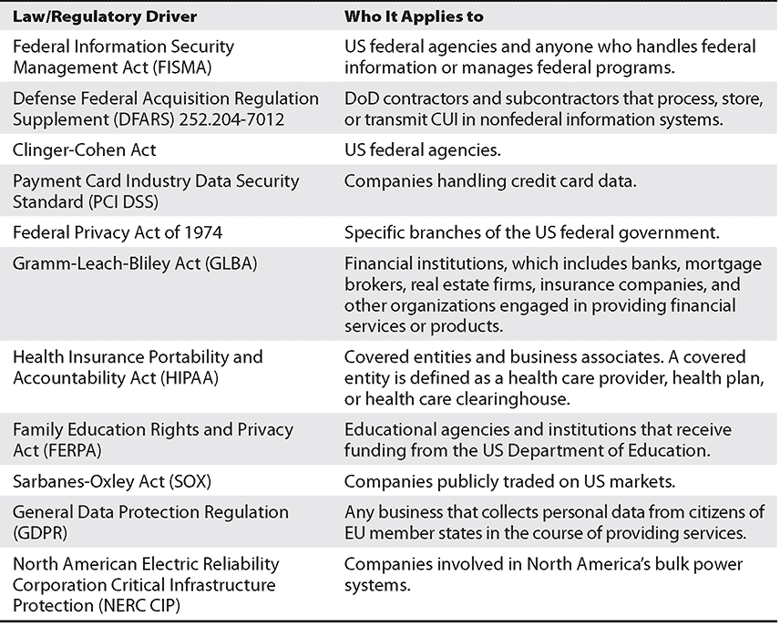

**表 1-4** 法律和监管驱动因素影响行业摘要

## 标准和框架


# 信息安全标准与框架

有许多非监管性标准和最佳实践框架可供组织用来构建其信息安全计划。虽然可能没有法律要求实施这些标准，但它们可以作为构建安全计划、建立合规基线以及让 CISO 识别当前策略差距的基础工具。此外，将实践与行业框架对齐表明了某种程度的承诺，这可能受到客户、合作伙伴和利益相关者的重视。本节讨论的标准和框架列在此处：

- `ISO/IEC 27000 series`
- `ISO/IEC 27001`
- `NIST Cybersecurity Framework`
- `Federal Information Processing Standards (FIPS)`
- `NIST Special Publications`
- `Privacy Shield`
- `COBIT`


**考试提示** CCISO 候选人应熟悉常见的信息安全标准、框架和最佳实践。

## ISO/IEC 27000 系列

国际标准化组织 (ISO) 和国际电工委员会 (IEC) 共同制定国际标准。`ISO/IEC 27000 系列`被称为信息安全管理体系 (ISMS) 标准族，作为全面管理安全的行业最佳实践。以下是 `ISO/IEC 27000 系列`中的一些关键标准及其简略标题：

- `ISO/IEC 27000` ISMS 概述与术语
- `ISO/IEC 27001` ISMS 要求
- `ISO/IEC 27002` 信息安全控制实践守则
- `ISO/IEC 27003` ISMS 实施指南
- `ISO/IEC 27004` ISMS 监控、测量、分析与评价
- `ISO/IEC 27005` 信息安全风险管理
- `ISO/IEC 27006` ISMS 认证机构要求
- `ISO/IEC 27007` ISMS 审核指南
- `ISO/IEC 27008` 面向审核员的信息安全控制指南
- `ISO/IEC 27014` 信息安全治理
- `ISO/IEC 27017` 云计算服务信息安全控制
- `ISO/IEC 27018` 公有云中 PII 的保护
- `ISO/IEC 27031` 业务连续性的技术就绪
- `ISO/IEC 27032` 网络安全指南
- `ISO/IEC 27033` 网络安全
- `ISO/IEC 27037` 数字证据处理指南
- `ISO/IEC 27799` 医疗信息安全管理

以下是一些已起草但尚未发布的出版物：

- `ISO/IEC 27030` 物联网 (IoT) 中的安全与隐私
- `ISO/IEC 27099` 公钥基础设施
- `ISO/IEC 27100` 网络安全概述与概念
- `ISO/IEC 27101` 网络安全框架开发指南
- `ISO/IEC 27102` 网络保险指南
- `ISO/IEC 27550` 系统生命周期过程的隐私工程

`ISO/IEC` 标准备受推崇且实用；然而，它们并非免费，这限制了它们与其他标准相比的采用率。可从 `https://www.iso.org` 购买。

## ISO/IEC 27001

`ISO/IEC 27001`，*信息技术 — 安全技术 — 信息安全管理体系 — 要求*，是 `ISO/IEC 27000 系列`家族中最知名的框架。`ISO/IEC 27001` 包含关于建立整体 ISMS 的指南。构成 `ISO/IEC 27001` 的关键要求在出版物中组织为以下十个部分：

- 范围
- 规范性引用文件
- 术语和定义
- 组织环境
- 领导作用
- 策划
- 支持
- 运行
- 绩效评价
- 改进

图 1-17 概述了根据 `ISO/IEC 27001` 规定的信息安全管理体系的核心组件。

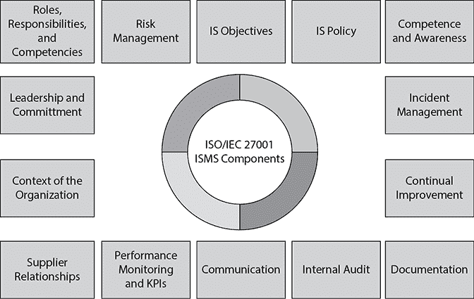

**图 1-17** `ISO/IEC 27001` ISMS 组件

组织可寻求经认可的第三方进行 `ISO/IEC 27001` 认证。第三方将根据 `ISO/IEC 27001` 中的要求评估组织的 ISMS，并证明组织的合规水平。

## NIST 网络安全框架

`NIST 网络安全框架 (NIST CSF)` 是一种基于风险的网络安全框架，可根据组织的需求和业务要求进行定制。该框架专为关键基础设施设计，但适用于任何组织。许多寻求安全计划基线的组织都在使用 CSF。CSF 的三个主要组成部分在 图 1-18 中进行了说明，并概述如下：

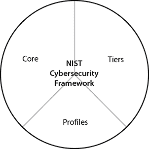

**图 1-18** NIST 网络安全框架组件

- `Framework Core` 框架核心由五大功能组成：识别、保护、检测、响应和恢复。每个功能由类别（控制族）组成，类别又由子类别（控制措施）和参考资料（映射到其他控制框架）组成。
- `Framework Implementation Tiers` 框架实施层级从部分 (第 1 层)、风险知情 (第 2 层)、可重复 (第 3 层) 到自适应 (第 4 层) 不等。虽然这些层级看起来像成熟度等级，但它们旨在作为关于风险偏好、任务优先级和预算沟通的上下文参考。
- `Framework Profiles` 框架概况代表组织将其资源、需求和风险偏好与框架核心（功能、类别、子类别和参考资料）的期望结果相对齐。概况用于将组织的“当前”状态与“目标”状态进行评估。

## 联邦信息处理标准

`联邦信息处理标准 (FIPS)` 是 NIST 为美国联邦信息系统安全发布的标准和指南。并非所有 `FIPS` 出版物对联邦机构都是强制性的。每份 `FIPS` 文档的“适用性”部分指明了该标准是否适用且强制。虽然这些文件是专门为美国联邦政府开发的，但对于寻求行业最佳实践指导的组织来说，它们也很有用。此外，`FIPS` 对与联邦机构开展业务的政府承包商和供应商也是强制性的。联邦机构受 FISMA 强制要求实施 `FIPS`。截至撰写本文时，当前的 `FIPS` 如下：

- `FIPS 140-2` 密码模块安全要求
- `FIPS 180-4` 安全哈希标准 (SHS)
- `FIPS 186-4` 数字签名标准 (DSS)
- `FIPS 197` 高级加密标准 (AES)
- `FIPS 198-1` 基于密钥的哈希消息认证码 (HMAC)
- `FIPS 199` 联邦信息和信息系统安全分类标准
- `FIPS 200` 联邦信息和信息系统最低安全要求
- `FIPS 201-2` 联邦雇员和承包商个人身份验证 (PIV)
- `FIPS 202` SHA-3 标准：基于置换的哈希和可扩展输出函数

## NIST 特别出版物

`NIST 特别出版物 (SP)` 是 NIST 发布的文件，通常用于支持 `FIPS` 出版物，或作为 NIST 根据 FISMA 履行职责的一部分而开发。`NIST SP 800 系列`是针对计算机安全的出版物。许多私营部门组织在开发其安全计划和策略时使用 `NIST SP 800 系列`文件。以下是 `NIST SP 800 系列`中一些最常用标准的列表：

- `NIST SP 800-18` 联邦信息系统安全计划制定指南
- `NIST SP 800-30` 开展风险评估指南
- `NIST SP 800-34` 联邦信息系统应急计划指南
- `NIST SP 800-37` 信息系统和组织风险管理框架
- `NIST SP 800-39` 管理信息安全风险


## NIST 特别出版物 800 系列

- **NIST SP 800-40** 企业补丁管理技术指南
- **NIST SP 800-53** 联邦信息系统和组织的安全与隐私控制
- **NIST SP 800-53A** 评估联邦信息系统和组织中的安全与隐私控制
- **NIST SP 800-55** 信息安全绩效测量指南
- **NIST SP 800-60** 将信息类型和信息系统映射到安全类别的指南
- **NIST SP 800-61** 计算机安全事件处理指南
- **NIST SP 800-66** 实施《健康保险流通与责任法案》（HIPAA）安全规则的入门资源指南
- **NIST SP 800-70** IT 产品国家核对清单计划
- **NIST SP 800-88** 媒体清理指南
- **NIST SP 800-114** 远程办公和自带设备（BYOD）安全用户指南
- **NIST SP 800-122** 保护个人身份信息（PII）机密性指南
- **NIST SP 800-124** 企业移动设备安全管理指南
- **NIST SP 800-125** 全虚拟化技术安全指南
- **NIST SP 800-137** 联邦信息系统和组织的信息安全持续监控（ISCM）
- **NIST SP 800-160** 系统安全工程
- **NIST SP 800-171** 在非联邦系统和组织中保护受控非密信息
- **NIST SP 800-181** 国家网络安全教育倡议（NICE）网络安全人才框架

800 系列涵盖了广泛的主题。具体的 NIST SP 将在后续章节中更深入地讨论。

## 隐私盾

欧盟-美国和瑞士-美国 *隐私盾* 框架旨在监管从欧盟和瑞士向美国传输个人信息。这些框架由美国商务部与欧盟委员会及瑞士政府共同制定，目标是使美国公司能够在遵守欧盟隐私法律的前提下接收来自欧盟的个人数据。要加入欧盟-美国或瑞士-美国隐私盾框架，组织必须进行自我认证，并公开承诺遵守隐私盾原则。一旦公司自我认证，该承诺即在美国法律下具有强制执行力。商务部在 [`https://www.privacyshield.gov/list`](https://www.privacyshield.gov/list) 维护了一份已自我认证的美国组织公开名单。

截至撰写本文时，隐私盾由 7 项原则和 16 项补充原则组成，列于 [`https://www.privacyshield.gov/eu-us-framework`](https://www.privacyshield.gov/eu-us-framework)，如下所示：

**原则：**

- 通知
- 选择
- 后续转移责任
- 安全
- 数据完整性和目的限制
- 访问
- 救济、执法和责任

**补充原则：**

- 敏感数据
- 新闻豁免
- 次要责任
- 尽职调查与审计实施
- 数据保护机构的作用
- 自我认证
- 验证
- 访问
- 人力资源数据
- 后续转移的强制性合同
- 争议解决与执法
- 选择——选择退出的时机
- 旅行信息
- 药品和医疗产品
- 公共记录和公开可获取信息
- 公共机构的访问请求

参与组织若未能遵守隐私盾，可能面临罚款或制裁。持续未能遵守将导致该组织从隐私盾名单中移除，并要求其退还或删除根据协议收集的个人信息。

## COBIT

*信息及相关技术控制目标（COBIT）* 是由 ISACA 和 IT 治理协会开发的 IT 治理与管理最佳实践框架。撰写本文时的最新版本是 COBIT 2019。COBIT 2019 由五个治理和管理领域目标组成，如 图 1-19 所示。这些领域包含 40 个目标。

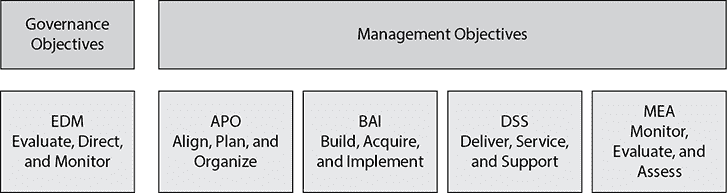

**图 1-19** COBIT 治理和管理目标

COBIT 2019 的核心出版物可从 [`http://www.isaca.org/resources/cobit`](http://www.isaca.org/resources/cobit) 付费获取。出版物包括以下内容：

- COBIT 2019 框架：介绍与方法论
- COBIT 2019 框架：治理与管理目标
- COBIT 2019 设计指南：设计信息与技术治理解决方案
- COBIT 2019 实施指南：实施与优化信息与技术治理解决方案

## 信息安全趋势与最佳实践

本节介绍了信息安全专业人员获取安全趋势和最佳实践的几个信息来源。有许多组织专注于提供资源以改进信息安全行业。本节并未对这些组织进行全面调查，但确实介绍了行业中一些较为知名的安全最佳实践组织。这些组织为社区提供一系列益处，包括工具和安全最佳实践资源。CISO 了解最佳实践组织非常重要，既可将其作为资源，也可借此掌握行业动态。

### 开放 Web 应用安全项目

*开放 Web 应用安全项目（OWASP）* 是一个国际性组织，专注于使组织掌握规划、开发、获取、运营和维护安全应用程序所需的技能和工具。OWASP 开发工具、指南和最佳实践文档，并组织专注于应用安全的会议。关于应用安全的更多信息见 第 4 章。

### 云安全联盟

*云安全联盟（CSA）* 是一个非营利组织，专注于推广云计算使用和采用的最佳实践。CSA 提供云安全、治理和合规方面的工具、研究、框架和最佳实践文档。云安全联盟提供云安全、云治理和合规培训，以及以下认证：

- 云安全知识证书（CCSK）
- 云审计知识证书（CCAK）

### 互联网安全中心

*互联网安全中心（CIS）* 是一个非营利组织，专注于开发信息安全的最佳实践工具、框架和资源。CIS 开发了 CIS 控制基准，这是信息安全最佳实践的全球标准。这些标准将在 第 2 章 和 第 4 章 中更深入地介绍。CIS 还托管多州信息共享与分析中心（MS-ISAC）和选举基础设施信息共享与分析中心（EI-ISAC）。这些信息共享与分析中心为州、地方、领土和部落政府提供关键资源和优惠服务。

## 信息安全培训与认证

本节介绍了一些知名的厂商中立信息安全认证机构。这些认证机构为社区提供一系列益处，包括论坛、会议、社交机会、安全最佳实践资源，以及用于持续学习的认证和培训。CISO 了解持续学习机会非常重要，以便为自己和团队发掘培训机会。

### 国际信息系统安全认证联盟


## (ISC)²

*国际信息系统安全认证联盟 (ISC)*² 是一个专注于信息安全专业人员认证和培训的非营利组织。(ISC)² 定期举办会议，提供研究和最佳实践资料，并提供各种认证和培训项目。(ISC)² 认证包括以下内容：

- 认证信息系统安全专家 (CISSP)
- 信息系统安全架构专家 (CISSP-ISSAP)
- 信息系统安全工程专家 (CISSP-ISSEP)
- 信息系统安全管理专家 (CISSP-ISSMP)
- 系统安全认证从业者 (SSCP)
- 认证云安全专家 (CCSP)
- 认证授权专家 (CAP)
- 认证安全软件生命周期专家 (CSSLP)
- 医疗保健信息安全与隐私从业者 (HCISPP)

## ISACA

*ISACA*，前身为信息系统审计与控制协会，是一个致力于推动信息安全、保障、风险管理和治理领域发展的非营利专业协会。ISACA 为会员提供最佳实践框架、文档、会议和培训项目的访问权限。ISACA 可能最广为人知的是开发了 COBIT（前文已讨论）。ISACA 提供以下培训和认证：

- 认证信息系统审计师 (CISA)
- 认证风险与信息系统控制专家 (CRISC)
- 认证信息安全经理 (CISM)
- 认证企业 IT 治理专家 (CGEIT)
- 网络安全 Nexus (CSX)

## 国际电子商务顾问委员会

*国际电子商务顾问委员会 (EC-Council)* 是一个专业安全组织，提供各种 IT 安全主题的培训和认证。EC-Council 是认证首席信息安全官 (CCISO) 认证的认证机构。EC-Council 还运营多个安全会议以及 EC-Council 大学 (ECCU)。EC-Council 提供的部分认证包括以下内容：

- 认证道德黑客 (CEH)
- 认证网络防御者 (CND)
- EC-Council 认证安全分析师 (ECSA)
- EC-Council 认证安全专家 (ECSS)
- EC-Council 认证加密专家 (ECES)
- 认证安全计算机用户 (CSCU)
- EC-Council 灾难恢复专业人员 (EDRP)
- 计算机黑客取证调查员 (CHFI)
- EC-Council 认证事件处理专家 (ECIH)
- 认证首席信息安全官 (CCISO)
- 认证应用安全工程师 (CASE)
- 认证威胁情报分析师 (CTIA)
- 认证 SOC 分析师 (CSA)

## SANS 学院

*SANS 学院*，正式名称为 Escal 高级技术学院，是一个信息安全培训和认证组织。SANS 提供各种资源，包括培训/认证、会议、网络研讨会、文章和其他资源，以帮助培养安全专业人员。SANS 特别以其实战培训而闻名。SANS 代表系统管理、审计、网络和安全，涵盖其认证和培训的主题范围。以下是部分 SANS 认证的列表：

- GIAC 安全基础 (GSEC)
- GIAC 认证事件处理专家 (GCIH)
- GIAC 认证取证分析师 (GCFA)
- GIAC 渗透测试员 (GPEN)
- GIAC 认证入侵分析师 (GCIA)
- GIAC Web 应用渗透测试员 (GWAPT)
- GIAC 认证取证检查员 (GCFE)
- GIAC 安全领导力 (GSLC)
- GIAC 恶意代码逆向工程 (GREM)
- GIAC 信息安全基础 (GISF)
- GIAC 认证企业防御者 (GCED)
- GIAC 系统与网络审计师 (GSNA)
- 全球工业网络安全专业人员 (GICSP)
- GIAC 认证 Windows 安全管理员 (GCWN)
- GIAC 持续监控认证 (GMON)
- GIAC 网络取证分析师 (GNFA)
- GIAC 漏洞利用研究员与高级渗透测试员 (GXPN)
- GIAC 认证边界保护分析师 (GPPA)
- GIAC 信息安全专业人员 (GISP)
- GIAC 关键控制认证 (GCCC)
- GIAC 移动设备安全分析师 (GMOB)
- GIAC 无线网络评估与审计 (GAWN)
- GIAC 认证 UNIX 安全管理员 (GCUX)
- GIAC 网络威胁情报 (GCTI)
- GIAC 安全软件程序员-Java (GSSP-JAVA)
- GIAC 认证 Web 应用防御者 (GWEB)
- GIAC Python 编码员 (GPYC)
- GIAC 数据安全与调查法律 (GLEG)
- GIAC 战略规划、政策与领导力 (GSTRT)
- GIAC 高级智能手机取证 (GASF)
- GIAC 响应与工业防御 (GRID)
- GIAC 认证检测分析师 (GCDA)
- GIAC 安全软件程序员-.NET (GSSP-.NET)
- GIAC 防御高级威胁 (GDAT)
- GIAC 认证项目经理 (GCPM)
- GIAC 安全专家 (GSE)
- GIAC 关键基础设施保护 (GCIP)
- GIAC 可防御的安全架构 (GDSA)
- GIAC 企业漏洞评估师 (GEVA)

## 计算技术行业协会

*计算技术行业协会 (CompTIA)* 是一个非营利组织，专注于通过培训和认证在信息安全和技术行业进行持续培训。除了培训，CompTIA 还发布研究报告以追踪行业趋势和变化。以下是 CompTIA 认证列表：

- CompTIA IT 基础 (ITF+)
- CompTIA A+ (A+)
- CompTIA Network+ (Network+)
- CompTIA Security+ (Security+)
- CompTIA Cloud+ (Cloud+)
- CompTIA Linux+ (Linux+)
- CompTIA Server+ (Server+)
- CompTIA 网络安全分析师 (CySA+)
- CompTIA 高级安全从业者 (CASP+)
- CompTIA PenTest+ (PenTest+)
- CompTIA Project+ (Project+)
- CompTIA 认证技术培训师 (CTT+)
- CompTIA 云基础+ (Cloud Essentials+)

## 国际隐私专业人士协会

*国际隐私专业人士协会 (IAPP)* 是一个非营利组织，专注于为隐私专业人士提供论坛以建立人脉、获取资源和追求隐私认证。IAPP 认证包括以下内容：

- 认证信息隐私专业人士/亚洲 (CIPP/A)
- 认证信息隐私专业人士/加拿大 (CIPP/Canada)
- 认证信息隐私专业人士/欧洲 (CIPP/E)
- 认证信息隐私专业人士/美国私营部门 (CIPP/US)
- 认证信息隐私经理 (CIPM)
- 认证信息隐私技术专家 (CIPT)

## Offensive Security

*Offensive Security* 是一家安全公司，专注于为安全社区提供渗透测试专业服务、培训、认证和工具。他们的课程专注于实战渗透测试和道德黑客技术。Offensive Security 开发了预装渗透测试和取证工具的 Kali Linux 发行版。他们的认证项目包括以下内容：

- Offensive Security 认证专业人员 (OSCP)
- Offensive Security 认证专家 (OSCE)
- Offensive Security Web 专家 (OSWE)
- Offensive Security 无线专业人员 (OSWP)
- Offensive Security 漏洞利用专家 (OSEE)

## 道德


# 组织伦理与治理

## 组织伦理

组织伦理是规范组织行为的原则，重点在于诚信、问责和负责任地行事。伦理始于个人员工的道德指南针。然而，公司和组织并不总能信任员工做正确的事。因此，许多组织都制定了道德准则、伦理政策和伦理计划。这为董事会、高管、员工以及整个组织的预期行为定下了基调。伦理举措有时会与组织的合规举措挂钩，并成为内部合规的重点。最终，组织伦理应超越单纯发布行为准则的阶段，成熟为创建一种透明、诚信、社会责任和良好治理的文化。

## CISO 与组织伦理

CISO 通常不负责整个公司或组织的道德行为。然而，CISO 和安全组织的许多道德决策会影响公司整体。因此，CISO 与董事会及领导层之间必须在道德政策、标准和决策上进行良好协调。

CISO 对其自身的道德行为及其信息安全组织的行为负责。CISO 必须为信息安全计划和员工设定道德标准。CISO 这一角色尤其需要在组织中培养信任和信誉。

## 利益相关者与伦理

伦理有时从涉及的利益相关者角度来考量。通常利益相关者包括员工、客户和所有者/股东。这些利益相关者是道德行为的接受者或受益者。以下是伦理如何影响信息安全运营和 CISO 角色的一些示例：

- 在开展漏洞和渗透测试时，信息安全员工发现商业产品中一个先前未知的安全缺陷。在这种情况下，安全专业人员没有法律义务向产品制造商报告该缺陷。然而，向制造商报告缺陷将是负责任的做法。此时伦理在员工行为中发挥了作用。
- 安全员工认为客户数据可能已泄露，但不确定。是否应通知客户？这是一个道德决策，不应临时决定——应有相应的政策和指南来处理该情况。
- 政府机构要求组织披露与客户相关的信息。如果您的组织法律上不要求遵守，是否仍应照做？在这种情况下，道德责任是什么，对象是客户还是政府机构？

## 信息安全伦理计划

CISO 应在安全职能内定义并实施伦理计划，类似于组织的合规计划，以确保伦理得到良好管理，且员工和公司的行为符合组织目标。伦理计划应包含以下组成部分：

- 为信息安全组织内的道德行为设定标准
- 定义与伦理相关的政策、标准和指南
- 为信息安全员工开展伦理培训
- 评估计划的绩效和有效性
- 通过将经验教训应用于伦理计划的各个方面改进，维护并提升道德绩效

## EC-Council 道德准则

CCISO 候选人应了解 EC-Council 道德准则（`https://www.eccouncil.org/code-of-ethics/`），该准则适用于 EC-Council 认证持有者和成员。作为成为 CCISO 过程的一部分，候选人必须同意并遵守 EC-Council 道德准则。该准则概述了作为信息安全专业人员的具体行为要求。

## 章节复习

组织治理是对组织战略、组织结构和授权线的自上而下的定义。同样，信息安全治理是对信息安全计划目标和组织的定义。为了保持一致，企业治理和信息安全治理都必须考虑外部和内部驱动因素，如法规和行业实践。组织治理和信息安全治理成功的关键在于组织领导者（如 CEO 和董事会）与信息安全计划领导者（CISO）之间的良好沟通。

信息安全计划的构建应确保机密性、完整性和可用性（`CIA`）三要素均得到满足，同时考虑组织的漏洞、风险、威胁和暴露。这是通过基于风险管理方法实施纵深防御来实现的，以确保选择适当的控制措施，达到安全与成本的适当平衡。信息安全计划通常包括以下要素：

- 安全计划规划
- 安全政策、标准和指南
- 安全风险管理
- 资产安全
- 身份与访问管理
- 安全工程
- 物理安全
- 安全运营
- 软件开发安全
- 安全评估与测试
- 安全培训与意识
- 业务连续性与灾难恢复

业务结构形式包括独资企业、合伙企业、公司和有限责任公司（LLC）。这些业务形式在发生安全漏洞或事件时，为公司高管提供某种形式的责任保护。然而，这种保护只有在领导者履行其注意义务，并在做出信息安全相关决策时遵循商业判断规则的情况下才会生效。

信息安全计划的组织结构可以采取多种形式，但应提供清晰的授权线、态势感知，以及良好的内部和外部沟通与报告。

信息安全计划是确保遵守外部和内部业务驱动因素的机制。许多（但非所有）组织都有合规计划和合规团队（或多个团队）来实施良好的合规管理。合规管理可以使用行业模型（如 `ISO 19600:2014`）来帮助确保合规。

## 快速复习

- 将组织的安全计划与组织的业务和运营保持一致，是其安全计划成功的关键，也是 CISO 角色的核心。
- 治理即问责、决策授权和监督。适当的治理确保组织战略与其业务、监管和运营环境保持一致。
- 信息安全治理是降低组织信息安全风险的框架。
- 影响信息安全计划的外部驱动因素包括监管驱动因素、行业实践、风险和威胁。
- 影响信息安全计划的内部驱动因素包括领导层的理解和认知、组织结构、文化与氛围、历史和经验教训。
- 信息安全的基本原则是机密性、可用性和完整性。
- 漏洞是可能被利用的弱点。
- 威胁是与漏洞利用相关的任何潜在危险。
- 风险是威胁主体利用漏洞的可能性及相应的业务影响。
- 暴露是面临因威胁导致损失的风险实例。漏洞可能使组织面临潜在损害。


# 安全概念与原则

- 对策（或控制措施）的实施旨在缓解潜在风险。
- 深度防御是指组织不应仅依赖单一控制措施进行防护，而应使用多层控制措施来增加潜在攻击者的工作量因子。
- 风险管理是识别和评估风险、将其降低到可接受水平，并实施正确机制以维持该水平的过程。
- 组织使用定性或定量方法来分析风险。
- 安全计划通常包含一系列管理安全指令（策略、标准、指南），这些指令构成了规则和实践库，计划人员应遵循这些规则和实践。
- 资产安全是指识别组织拥有哪些资产，并确定哪些类型的控制措施适用于每项资产的概念。
- 访问控制是控制用户和系统如何与其他系统和资源进行通信和交互的安全功能。
- 安全工程是一个广泛的领域，涉及信息系统的安全设计与实施。
- 安全运营侧重于主动执行日常职能，以预防、检测和响应安全风险与威胁。
- 软件必须以确保不包含安全漏洞的方式进行开发。
- 所有安全计划都必须包含持续的评估和测试组件，以进行漏洞测试，并确保漏洞修复活动的成功执行和管理。
- 所有员工都应了解组织的安全策略和流程以及通用的良好安全实践。
- 每个组织都应制定计划和程序，以确保在发生安全漏洞或其他灾难时业务能够持续运营。
- 信息安全组织的规模应根据组织的风险承受能力来确定。
- 安全组织的架构应包含以下要素：清晰的授权线、态势感知，以及内部和外部的沟通与报告。
- 合规是一种治理方法，旨在确保与适用的法律、法规、标准、组织策略、道德行为及其他业务目标保持一致。
- 合规不一定意味着组织是安全的，良好的安全计划也不一定合规。
- 合规团队通常参与为内部策略和程序提供指导，以及评估当前流程和技术以确定改进合规性的方法。
- 合规管理是组织规划、实施和维护支持合规活动的过程。
- 隐私是指个人对其自身敏感数据应拥有的控制程度。
- 《联邦信息安全现代化法案》（FISMA）要求美国联邦机构建立、记录并实施覆盖全机构的信息安全计划，以支持机构运作。
- 1996 年的《克林格-科恩法案》是一项美国联邦法律，适用于联邦机构，旨在改进信息技术的采购、使用和处置。
- 《格雷姆-里奇-比利雷法案》（GLBA），也称为 1999 年《金融服务现代化法案》，要求金融机构保护个人的非公开个人信息。
- 《健康保险流通与责任法案》（HIPAA）是一项美国联邦法规，涵盖受保护健康信息（PHI）的处理，并为保护健康信息的安全和隐私提供了框架。
- 1974 年《家庭教育权利和隐私法案》（FERPA）是一项美国联邦法律，侧重于保护学生教育记录的隐私和机密性。
- 2002 年《萨班斯-奥克斯利法案》（SOX）是一项美国联邦法律，侧重于让董事会成员和高管对其组织财务报表的准确性负责。
- 组织道德是规范组织行为的原则，侧重于诚信、问责和责任感。

## 问题

**1.** 以下哪项是判断信息安全计划是否支持组织业务目标的最佳方式？

**A.** 确定信息安全计划或章程是否与管理策略一致  
**B.** 确定信息安全计划是否人员配备充足  
**C.** 确定信息安全计划是否高效利用其人员和设备  
**D.** 确定信息安全计划是否能轻松适应变化

**2.** 一名学生攻破了一个包含考试成绩的系统，并将她最近一次考试的成绩从 D 改为了 A。以下哪项遭到了破坏？

**A.** 完整性  
**B.** 可用性  
**C.** 机密性  
**D.** 可用性和机密性均遭破坏

**3.** 以下哪项最为正确？

**A.** 对策通常旨在减少威胁。  
**B.** 风险、威胁和暴露通常是相同的。  
**C.** 漏洞是密码管理不善的结果。  
**D.** 对策是为缓解风险而实施的控制措施。

**4.** CISO 必须定义组织实现其安全目标所遵循的规则。以下哪份文件或文件集是实现这一目标的最佳机制？

**A.** 安全计划  
**B.** 安全策略  
**C.** 安全指南  
**D.** 安全标准

**5.** 在定义信息安全计划的组织架构时，以下哪项最重要？

**A.** 确保 CISO 直接向 CEO 汇报  
**B.** 体现清晰的授权线  
**C.** 采用矩阵式组织以确保态势感知  
**D.** 将组织规模设定为与同行业其他公司相似

**6.** 以下哪部法律专门关注受保护健康信息的处理？

**A.** GLBA  
**B.** SOX  
**C.** HIPAA  
**D.** FISMA

**7.** 一个接受在线支付的电子商务网站正在扩张，并聘请了一名 CISO 以确保组织遵守行业法规和标准。对于 CISO 而言，以下哪个框架对于确保合规性最为关键？

**A.** SOX  
**B.** FISMA  
**C.** ISO/IEC 27001  
**D.** PCI DSS

**8.** 一个组织有业务需求接收欧盟公民的个人数据，并需要 CISO 就如何遵守欧盟隐私法律提供指导。对于 CISO 来说，以下哪个框架是满足这一要求的良好起点？

**A.** 隐私盾  
**B.** FISMA  
**C.** FIPS  
**D.** SOX

**9.** 一个组织正在寻找保护其 Web 应用程序的最佳实践指南。以下哪个组织将是该组织的最佳资源？

**A.** CSA  
**B.** OWASP  
**C.** CIS  
**D.** IAPP

**10.** 一家上市公司在业务运营过程中收集持卡人数据。该组织的 CEO 认识到信息安全的重要性并聘请了一名 CISO。CISO 必须确保企业遵守以下哪项要求？

**A.** GDPR 和 FISMA  
**B.** PCI DSS 和 GDPR  
**C.** PCI DSS 和 SOX  
**D.** GDPR 和 SOX

## 答案

**1.** **A.** 虽然许多答案可能都表明信息安全计划与业务目标一致，但判断信息安全策略是否支持业务目标的最佳方式，是审查信息安全计划或章程，确认其与管理策略的一致性。


# 第 1 章复习题

## 问题 2
**答案：A。** 只有允许授权更改时，才能维护系统的完整性。在本例中，该学生无权修改自己的成绩。

## 问题 3
**答案：D。** 采取对策是为了缓解潜在风险。对策也称为控制，是指设备、配置或产品等功能，可降低漏洞被利用的可能性。

## 问题 4
**答案：B。** 安全策略定义了必须遵守的硬性规则。安全计划描述了整体安全计划和组织架构，而指南和标准是重要的支持性文档，但不定义要求。

## 问题 5
**答案：B。** 组织应优先建立清晰的授权线。只要沟通良好，CISO 不必总是向 CEO 汇报。矩阵式组织只是几种可行方法中的一种。组织规模应根据其风险承受能力确定，而不应基于与其他公司的比较。

## 问题 6
**答案：C。** 《健康保险流通与责任法案》（HIPAA）是一项美国联邦法规，专门关注受保护健康信息（PHI）的处理。HIPAA 为保护健康信息的安全性和隐私提供了框架。HIPAA 中的规则适用于涵盖实体和业务关联方。

## 问题 7
**答案：D。** 支付卡行业数据安全标准（PCI DSS）是一个专注于保护信用卡信息的控制框架。PCI DSS 适用于处理持卡人数据的任何组织。

## 问题 8
**答案：A。** 欧盟-美国和瑞士-美国隐私盾框架旨在监管从欧盟和瑞士向美国传输个人信息。隐私盾的目标是让美国公司在遵守欧盟隐私法的前提下接收来自欧盟的个人数据。

## 问题 9
**答案：B。** 开放 Web 应用安全项目（OWASP）是一个国际组织，专注于赋予组织规划、开发、获取、运营和维护安全应用程序所需的技能和工具。OWASP 开发工具、指南、最佳实践文档，并组织专注于应用安全的会议。

## 问题 10
**答案：C。** CISO 必须确保组织符合 PCI DSS 和 SOX 要求。《萨班斯-奥克斯利法案》（SOX）适用于在美国开展业务的所有上市公司。支付卡行业数据安全标准（PCI DSS）适用于处理持卡人数据的任何组织。由于该组织既是上市公司又处理持卡人数据，因此必须同时符合这两项要求。
