# 第 2 章：信息安全控制、合规性与审计管理

## 章节主题
- 信息安全控制
- 信息安全控制生命周期框架
- 信息安全控制生命周期
- 探索信息安全控制框架
- 面向 CISO 的审计

## 简介
第 1 章介绍了风险管理的概念，组织在其中对整个企业进行风险分析，以了解每项资产对业务的重要性。资产是指用于支持运营的信息系统、设施、数据或任何组件（硬件、软件或数据）。本章探讨组织如何为给定资产选择和审计安全控制。*安全控制*是为应对风险而实施的流程或技术。实施强密码策略、加密静态数据以及使用日志记录捕获事件只是安全控制的几个例子。对于给定的信息系统或资产，可能会实施数百种控制。组织可以制定自己的控制定义；然而，一种更简单且资源消耗更少的方法是使用现有的行业标准框架，这些框架提供控制库以及选择控制的指南。这些框架的使用方式通常相似，且一般遵循相同的流程：

1. 第一步是使用定义类别的模型对资产或系统进行分类。通常，类别通过为资产的每个安全特性（机密性、可用性和完整性）评定安全等级来定义，等级可以简单到低、中或高。

2. 根据资产的类别，选择相应的安全控制集以实现适当的安全性。框架通常提供将类别映射到建议控制列表的方法。

3. 有时组织会根据其特定需求以及运营和业务环境，对框架建议的控制集进行裁剪。

4. 一旦选定控制措施，就会在资产的整个生命周期内对其进行实施、评估、审计和监控。

本章探讨安全控制、安全控制生命周期、常用安全控制框架以及控制审计。

## 信息安全控制
本节介绍信息安全控制的基础细节，包括控制类别、控制功能和控制框架类型。

## 控制基础
安全控制也称为保障措施或对策，是为缓解风险并保护资产的机密性、完整性和可用性（CIA）而实施的机制。本节回顾控制类别和控制功能等基本术语。

### 控制类别
控制可分组为*类别*，其名称因所用框架而异。实践中最常用的三个类别是 `administrative`、`technical` 和 `physical`。然而，NIST 使用一组不同的类别：`management`、`operational` 和 `technical`。不同组织使用不同术语。以下是最常用术语的描述：

#### 管理类
`Administrative` 面向管理的控制，如策略、程序、指南、培训、风险管理和雇佣实践（招聘、解雇等）。管理类控制也称为软控制或管理控制。

#### 技术类
`Technical` 提供安全控制功能的硬件或软件组件。示例包括加密、密码强制、多因素认证、入侵检测系统 (IDS)、入侵防御系统 (IPS) 和防火墙。技术类控制也称为逻辑控制。

#### 物理类
`Physical` 为保护人员、资产和设施免受物理威胁而实施的有形控制。这包括保护人员、资产和设施。示例包括围栏、照明、锁、防撞柱、服务器机房门、警报和保安。

#### NIST 控制类别
如前所述，NIST 定义了一组不同的类别。FIPS 200《联邦信息和信息系统的最低安全要求》和 NIST SP 800-53 Rev.3《联邦信息系统和组织的安全和隐私控制》（及早期版本）使用控制类别 `management`、`operational` 和 `technical`。NIST 对这些类别的定义如下：

##### 管理类
`Management` 专注于风险管理和信息系统安全管理的信息系统安全控制（即保障措施或对策）。

##### 运营类
`Operational` 主要由人员（而非系统）实施和执行的信息系统安全控制（即保障措施或对策）。

# 安全控制概述

## 技术安全控制

**技术** 信息系统的安全控制（即保障措施或对策）主要由信息系统通过硬件、软件或固件组件中包含的机制来实施和执行。

## 控制类别映射

通用控制类别（管理、技术和物理）与 NIST 控制类别（管理、运营和技术）之间不存在一对一的映射关系，技术类别除外。某些控制（如风险管理）属于管理和管理控制。其他控制（如员工离职）属于管理和运营控制。

表 2-1 展示了 NIST SP 800-53 安全控制类别及其对应的控制族。 *控制族* 是一组通常针对同一安全域或功能的控制。例如，针对访问控制的控制位于 NIST SP 800-53 的访问控制（AC）族中。EC-Council 认为 CCISO 候选人应熟悉表中所示的映射。然而，最新版本的 NIST SP 800-53（Rev. 4）不包含此映射，因为在实践中，控制族中的许多控制会映射到多个控制类别。

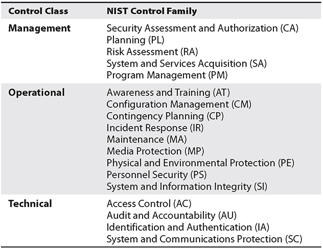

**表 2-1** NIST SP 800-53 控制类别及对应的控制族

**考试提示** CCISO 候选人应熟悉 NIST 控制类别和控制族。

## 控制功能

管理、技术和物理这些术语涉及控制的类别，而非控制如何运作和发挥作用。安全控制可根据其构成和功能进行细分。控制的安全功能描述了控制为组织做什么。控制的功能包括以下内容：

- **预防性** 此类控制可预防或阻止不利事件或事故的发生。示例包括强制背景调查、防火墙访问控制列表 (ACL)、门锁、围栏、防撞柱和 IPS。
- **检测性** 此类控制可发现、检测或识别潜在的不利活动、事件、入侵者或事故。示例包括 IDS、安全日志审查、强制休假和审查监控摄像头捕获的事件。
- **威慑性** 此类控制可威慑或阻止潜在对手发动攻击或从事不良行为。示例包括系统警告横幅和警告标志。
- **纠正性** 此类控制通过修复系统、流程或活动来纠正已发生的不利事件。示例包括 IPS、违规后解雇员工、隔离恶意软件的防病毒软件、使用灭火器灭火，以及实施业务连续性计划或应急响应计划。
- **指令性** 此类控制通常是管理控制，通过指定允许或不允许的操作来传达预期行为。示例包括安全策略、标准和程序。
- **恢复性** 此类控制可将环境或运营恢复到正常功能。它们在功能上类似于纠正性控制，但被认为具有更高级的能力。示例包括从备份恢复系统、从受感染系统中清除恶意软件，以及利用看门狗进程确定服务是否停滞并重启它。
- **补偿性** 此类控制作为主要控制的替代或辅助实施。当主要控制因成本、复杂性或其他业务限制而无法实施时，常使用此类控制。示例包括对无法打补丁的业务关键应用实施网络隔离，以及在认定全职保安成本过高后安装围栏、锁和报警器。

**考试提示** 一个控制可以与多种控制功能相关联。例如，IPS 可被视为既是预防性又是纠正性的，围栏可被视为既是预防性又是威慑性的，具体取决于上下文和问题的呈现方式。

## 控制框架

*控制框架* 是一份控制目录，用于提供基础，以协助实施全面的信息安全计划。控制框架有助于评估、规划、实施和记录组织如何以及实施了哪些安全控制。如果没有控制框架，将需要花费额外的时间和精力来设计控制并制定实施方法。

### 框架类型

安全专业人员使用许多不同类型的框架，但有三种基本类型：

- **过程模型** 描述如何实施安全控制（示例包括 NIST RMF、ISO/IEC 27001 和 NIST CSF）。
- **确定性** 描述实施什么，如控制库（示例包括 NIST SP 800-53、ISO/IEC 27001/27002、CIS Top 20 和 NIST CSF）。
- **评估性** 描述如何评估实施情况，因此可用于审计（示例包括 NIST SP 800-53A、ISO/IEC 27007 和 ISO/IEC 27008）。

某些框架可能仅包含其中一种特征，而其他框架可能包含所有三种，或可能利用或引用其他框架以实现其他功能。例如，NIST 风险管理框架（过程模型框架）将 NIST SP 800-53（确定性框架）和 NIST SP 800-53A（评估性框架）作为生命周期过程步骤的一部分。

**考试提示** 此处使用过程模型、确定性和评估这些术语仅是为了讨论和分类不同类型的控制框架；这些术语可能不会出现在实际的 CCISO 考试中。

### 选择控制框架

以下是有兴趣使用框架而非从头构建框架的组织最常选择的一些控制框架：

- NIST SP 800-53
- NIST 网络安全框架 (CSF)
- ISO/IEC 27001/27002
- CIS 关键安全控制/CIS Top 20
- CSA 云控制矩阵

本章稍后将更深入地讨论这些框架中的每一个。

组织根据各种组织驱动因素和因素选择框架，包括以下内容：

- 法律法规
- 行业垂直领域（例如，美国联邦政府、关键基础设施等）
- 合规要求（例如 PCI DSS、SOX、GDPR 等）
- 竞争优势（例如 ISO/IEC 27001）
- 框架覆盖范围的广度
- 安全团队的过往经验（例如，对特定框架的熟悉度或偏好）
- 其他业务目标或要求

例如，在美国联邦政府工作的安全专业人员将日夜钻研 NIST 风险管理框架（过程模型）和 NIST SP 800-53（确定性框架）。私营部门的安全专业人员可能会根据组织的行业或合规要求使用某个框架，或者仅仅因为组织之前选择了该框架。CISO 的部分工作是评估组织正在使用或正在考虑的框架，以确定它是否最适合该组织，并能够实现关键业务目标。

## 信息安全控制生命周期框架

安全专业人员通过遵循一个生命周期来选择合适的控制措施，该生命周期通常包括风险评估、设计、实施、评估和监控。使用生命周期框架通过定义正式的控制实施流程来帮助组织。如果没有明确的流程，控制实施通常以临时的方式进行。这可能适用于小型组织。然而，随着组织规模扩大，其控制要求和环境变得更加复杂，结构化的控制生命周期流程变得愈发重要。最佳实践是无论组织规模大小，都采用正式化的流程。本节将探讨一些来自流程模型框架中最知名的生命周期。

## NIST 风险管理框架

控制生命周期的一个例子是 NIST 风险管理框架（NIST RMF 或 RMF）。RMF 主要供美国联邦政府机构使用，用于根据《联邦信息安全管理法案》（FISMA，见第 1 章介绍）实施控制措施。RMF 记录于 NIST SP 800-37 中，是一个将风险管理和信息安全整合到安全控制选择和实施过程中的流程。RMF 是一个循环的六步生命周期，外加一个准备组件：

**准备。**

1.  **分类** 信息系统。
2.  **选择** 适用的安全控制基线。
3.  **实施并记录** 安全控制措施。
4.  **评估** 安全控制措施。
5.  **授权** 信息系统运行。
6.  **监控** 信息系统中的安全控制措施。

## NIST 网络安全框架

NIST 网络安全框架（NIST CSF 或 CSF）在第 1 章中讨论过，是一个基于风险的网络安全框架，最初为关键基础设施设计，但已被许多不同组织采用。CSF 有一套实施框架的特定方法论，包含七个步骤：

1.  **确定优先级和范围。**
2.  **定向。**
3.  **创建当前概况。**
4.  **进行风险评估。**
5.  **创建目标概况。**
6.  **确定、分析并确定差距优先级。**
7.  **实施行动计划。**

## ISO/IEC 27000

ISO/IEC 27000 系列出版物，即信息安全管理体系（ISMS）系列标准，使用计划、执行、检查、处理（PDCA）生命周期来实施安全控制作为 ISMS 的一部分。

-   **计划** 建立 ISMS。
-   **执行** 实施并运行 ISMS。
-   **检查** 监控并评审 ISMS。
-   **处理** 维护并改进 ISMS。

## 信息安全控制生命周期

前一节讨论了几个成熟的安全控制生命周期框架。一些组织通过结合多个不同框架和方法论的概念，将其作为信息安全计划的一部分，来定制自己的生命周期。这里我们将演示一个源自 NIST RMF、NIST CSF 和 ISO/IEC 27000 的生命周期。该流程包含五个步骤：

1.  **风险评估**
2.  **设计**
3.  **实施**
4.  **评估**
5.  **监控**

> **注意** CISO 的部分职责是监督和管理控制生命周期流程，以确保目标达成，且项目在既定预算、范围和时间线内执行。CISO 还负责确保进度向对项目有既得利益的关键利益相关者传达（例如，系统所有者、高管团队、董事会等）。

## 步骤 1：风险评估

第一步是执行风险评估，以获得需要保护的资产相关风险的整体视角。风险评估可能由以往的风险评估或组织的风险管理流程指导。风险评估使组织了解特定资产的威胁形势。这包括以下内容：

-   资产的感知价值
-   威胁和漏洞
-   安全受损的可能性和影响

如果没有适当的风险评估，组织最终可能会实施无法应对实际威胁的控制措施，实施成本超过受保护资产价值的控制措施，或无法根据组织的风险偏好为资产提供适当级别的安全性。风险评估识别风险，从而支持就针对特定工作设计合适的控制措施做出明智决策。虽然风险评估是控制生命周期的一部分，但正式的风险管理流程在第 1 章的“风险管理”部分有详细介绍。

### NIST 安全分类

NIST 风险管理框架使用 FIPS 199《联邦信息和信息系统安全分类标准》作为风险评估的一部分，根据潜在影响确定信息或信息系统所需的安全级别。这发生在 RMF 流程生命周期的“分类”步骤中。表 2-2 概述了 FIPS 199 中针对各安全目标的潜在影响定义。在 RMF 中，潜在影响用于确定信息系统所需的安全级别（低、中或高）。这决定了

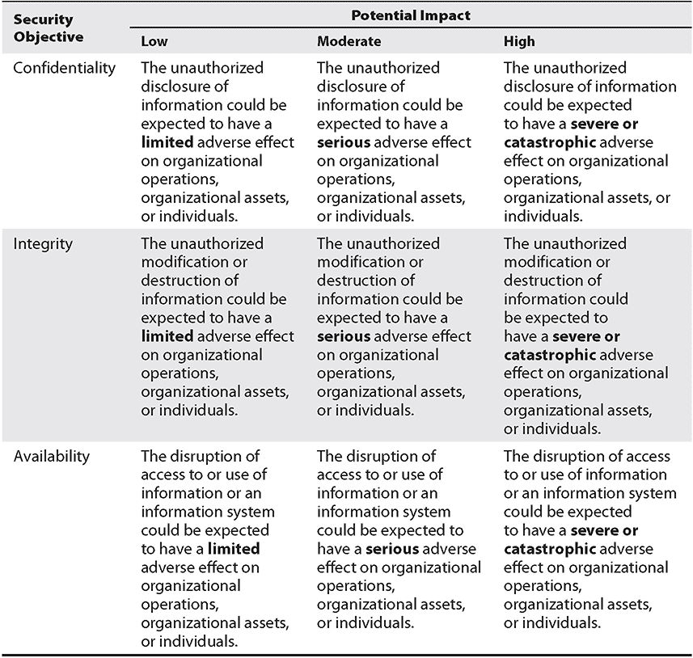

**表 2-2** FIPS 199 安全目标潜在影响定义

## 步骤 2：设计

风险评估使组织能够根据已识别的风险以及组织的运营需求和目标，设计合适的安全控制措施。设计阶段的主要目标如下：

-   **控制选择** 选择控制措施以应对风险评估中识别的风险，并与组织的目标、宗旨和需求保持一致。
-   **控制设计** 确定控制实施和维护所需的资源（例如，财务、人员、架构等）。
-   **控制测试** 在控制措施投入生产前对其进行测试，以确保控制有效性。

### 控制选择

组织可以选择从头设计控制措施，或利用控制框架。控制框架根据资产的风险评估，提供应实施的具体控制措施清单。除了控制框架，或结合控制框架，还可以根据最佳实践建议、经验、判断或预算要求来选择控制措施，以缓解已识别的风险。

还应考虑控制措施是自动化的还是手动的：

-   **自动化** 由自动化系统执行的控制，极少或无需人工交互。控制自动化的工具和技术示例包括自动灭火、安全信息和事件管理（SIEM）警报以及 IPS。
-   **手动** 由人员执行、不直接使用自动化的控制。示例包括策略、标准、程序、培训和访客日志。

大多数信息系统同时使用手动和自动化控制的组合。此外，虽然某些控制流程可能是手动的（如安全策略更新），但可能存在辅助的自动化技术，例如使用治理、风险管理与合规（GRC）系统来自动化策略评审和审批工作流，并发送年度评审提醒。

### 控制设计

控制设计过程的关键部分是确定和规划实施和运行控制所需的资源。即使使用了控制框架，仍有许多设计因素需要考虑和记录，包括以下内容：

-   预算和范围
-   人员和配置要求

### 控制设计要求

- 基础设施和架构要求（例如操作系统、应用程序、硬件、工具等）
- 持续的控制成本和维护（例如维护、支持、监控等）
- 负责控制设计、实施、评估和监控的员工
- 向利益相关者通报项目状态的沟通计划
- 制定用于衡量控制成效的指标

#### 控制测试

控制设计过程还应包括在控制投入生产前对其进行测试，以确保控制的有效性，且不会对环境产生负面影响。此外，还应制定回退计划，以防控制实施对环境产生负面影响。虽然生命周期的评估阶段发生在实施阶段之后，但这并不否定在实施前作为设计过程一部分进行测试的必要性。生命周期的评估阶段是一个持续的阶段，确保控制得到持续评估。

### 步骤 3：实施

下一步是实施控制，以缓解风险评估中识别出的风险。控制设计完成后，即可执行设计阶段中概述的项目。实施可能简单也可能复杂，取决于所涉及的控制。例如，制定密码安全策略所需的时间和资源远少于建立漏洞管理计划。视具体控制而定，实施可能需要对以下内容进行更改：

- 策略、标准和程序
- 业务流程或工作流
- 信息系统或软件架构

当实施多项控制时，有必要对控制实施进行优先级排序。优先级应采用基于风险的方法确定，以确保得到适当的资产保护，并优先保护对实现业务目标至关重要的资产。作为实施的一部分，维护控制文档至关重要，以确保控制设计、开发、实施和预期行为存在适当的详细记录。

**注意** CISO 角色的一项关键职责是监督安全计划，其中包括监督控制实施过程，以确保控制能及时实施和记录在案，在项目预算和范围内，并解决预期目的。此外，沟通是实施的关键组成部分，因为应让适当的利益相关者及时了解项目实施状态。

#### 文档示例

控制文档的方法之一是制定系统安全计划（SSP），该计划描述并记录给定系统的控制实施方式。SSP 通常至少包含以下内容：

- **描述** 系统描述，包括名称、用途、信息所有者、保管人、安全分类、数据流等
- **环境和边界** 系统环境边界的描述，包括架构、拓扑、软硬件资产、端口、协议、服务等的描述
- **安全控制实施** 每个适用安全控制的实施方式描述，以及每个控制的实施状态

### 步骤 4：评估

控制评估是生命周期的一个持续阶段。必须评估控制，以确保其有效、正确实施和运行、解决其预期目的，并按照组织的策略、标准和程序运行。评估阶段由三个主要部分组成：

- 评估和测试
- 报告
- 整改

#### 评估和测试

评估类型多样，包括以下几种：

- 内部审计
- 外部审计
- 控制自我评估

评估控制的基本技术包括检查、访谈和测试。以下这些术语的定义已根据 `NIST 800-53` 进行修改，以使其适用于任何控制框架：

- **检查** 审查、视察、观察或分析流程或控制，以确保其按预期执行并与控制目标保持一致。
- **访谈** 与组织内的关键个人或利益相关者进行讨论，以促进理解或获取流程或控制运行方式的证据。
- **测试** 执行一项或多项控制目标，将实际结果与预期行为进行比较。测试包含对控制的“实地”评估。

组织将在其控制评估中采用一种或多种此类方法。

#### 报告

评估完成后，应记录并分析发现的任何缺陷。调查结果应说明控制的哪个方面未按预期运行，以及实施情况与计划或预期有何不同。评估产生的调查结果用于确定与受评估资产相关的控制的总体有效性。评估结果通常由信息所有者和高级管理层（CISO、高管领导等）审查，以确定及时补救的适当行动方案。评估结果应包含以下内容：

- 适用控制列表
- 控制的评估和测试计划
- 指示每个受测控制通过或失败的报告
- 确定缺陷所需的纠正措施和缓解措施

#### 整改

整改在记录调查结果并确定补救流程后开始。整改活动和方法通常由许多既得利益相关者（信息所有者、保管人、系统维护人员、CISO 及其他所需人员）决定。整改通常根据多种因素进行优先级排序，包括以下因素：

- 整改所需资源
- 资产的风险和严重程度
- 与调查结果相关的风险
- 调查结果的范围
- 评估类型（内部审计与外部审计）
- 调查结果在组织内部和外部的可见性

视调查结果的关键性或相关风险而定，组织通常会有政策规定预期的整改时限。如果调查结果源于合规性审计，也可能会提供整改时限。

**注意** 对环境进行任何更改时，制定回退计划非常重要。这应在实施整改工作前创建并记录在案。在进行任何更改前，务必制定回退计划，以防整改工作失败。

#### NIST 安全评估程序示例

评估和测试方法可能会在组织选择使用的控制框架中概述。例如，使用 `NIST SP 800-53`《联邦信息系统和组织的安全和隐私控制》（确定性框架）的组织，可以利用 `NIST SP 800-53A`《联邦信息系统和组织中安全和隐私控制评估：构建有效的评估计划》（评价性框架）。图 2-1 展示了来自 `NIST SP 800-53A` Rev. 4 中 `CP-9` 信息系统备份控制的一个控制和评估程序示例。

## 步骤 5：监控

安全控制生命周期的最后阶段是持续监控。必须持续监控控制措施，以确定以下内容：

- `Control performance and effectiveness`
- `Alignment with organization strategies and objectives`
- `Changes to information systems and environment`
- `Compliance with legislation, regulation, and organizational policy and procedures`

此阶段的重点从实施安全转移到持续维护安全。在设计阶段考虑监控组件非常重要，以确保控制措施可被监控，并考虑监控将如何进行。如果没有适当的监控，组织将难以确保控制措施有效运行和执行。为了有效监控控制措施，应制定 `S.M.A.R.T.` 指标。`S.M.A.R.T.` 代表具体的、可衡量的、可执行的、相关的和及时的。

- `Specific`：指标清晰、定义明确，且针对被测量的控制措施
- `Measurable`：指标可被衡量，且数据准确完整
- `Actionable`：指标数据易于理解并可据此采取行动
- `Relevant`：指标必须相关，并提供关于控制措施的有意义数据
- `Timely`：指标数据在需要时可用

`S.M.A.R.T.` 方法论有助于制定有意义的指标和关键绩效指标。`关键绩效指标 (KPI)` 是衡量组织执行特定任务有效程度的指标。在此背景下，`KPI` 是衡量控制措施性能的指标。`KPI` 还用于衡量战略安全计划范围内的目标和目的。作为控制监控的一部分，记录控制性能和指标非常重要，不仅为了生成报告以显示控制措施如何执行和满足目标，还为了解决偏离预期行为的问题。监控阶段允许开发控制状态报告并与关键利益相关者共享，以支持决策制定，并确保控制措施满足组织要求和目标。

监控是安全控制生命周期的一个重要方面，因为威胁在不断变化。组织必须持续监控控制措施以及环境中的新威胁，并利用控制生命周期识别和实施适当的控制措施以缓解相关风险。

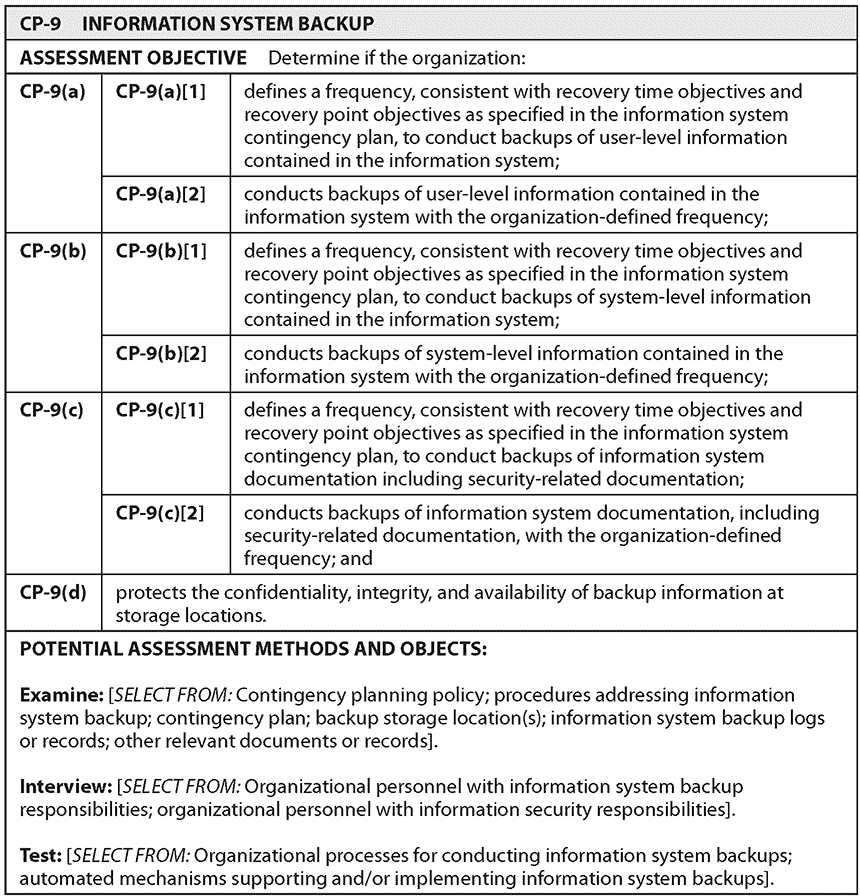

**图 2-1** NIST SP 800-53A 控制与评估程序示例（来源：NIST）

## 探索信息安全控制框架

本节探讨一些最常用的信息安全控制框架的构成和结构：

- `NIST SP 800-53`
- `NIST Cybersecurity Framework`
- `ISO/IEC 27002`
- `CIS Critical Security Controls`
- `CSA Cloud Controls Matrix`

这绝非详尽列表，但这些是一些主流框架。其中一些框架在第 1 章中已通过治理、合规、标准和最佳实践框架的视角简要介绍。本节将更深入地探讨这些框架，以探索控制框架结构，包括控制措施和控制族。控制框架的组织结构通常遵循相似的模式，可能包含以下部分或全部组件：

- `Control family`：涵盖特定领域的一组控制措施（例如，访问控制、风险管理等）。根据框架不同，这可能被称为控制、控制族、控制组或控制类别。
- `Control family identifier`：控制族的唯一标识符，可能是字母或数字的组合（例如，`AC`、`RM`、`1`、`A.1` 等）。
- `Control name`：单个控制措施的名称，可能属于某个控制族，也可能不属于（例如，访问控制策略和程序、变更管理、文档化操作程序等）。根据框架不同，单个控制措施可能被称为控制、子控制或子类别。
- `Control identifier`：控制措施的唯一标识符（可能也包含控制族标识符；例如，`AC-1`、`ID.RM-1`、`ID.RM-2`、`A.12.1.1`、`12.1.1` 等）。
- `Control description`：控制措施的描述，包括其功能。某些框架可能仅包含待实施控制措施的描述，而不包含控制名称。
- `Supplemental guidance`：特定控制措施的指南、参考或附加信息，供实施时使用。
- `Assessment guidance`：关于如何评估控制措施的指南。
- `Control mappings`：显示控制措施如何映射到其他框架中的控制措施的信息性参考或章节。

**考试提示** CCISO 考生应熟悉常用的信息安全控制框架。

## NIST SP 800-53

`NIST SP 800-53`、*联邦信息系统和组织的安全与隐私控制*，是一份著名的 NIST 出版物，包含一套安全和隐私控制目录，用于协助美国联邦政府机构满足 `FISMA` 的要求，并作为其他非联邦实体的最佳实践框架。

NIST 控制措施组织为 18 个不同的控制族，如表 2-3 所列。除了这些控制族之外，`SP 800-53 Rev. 4`（附录 J）中还增加了隐私控制目录，以解决日益增长的隐私担忧，并建立安全控制与隐私控制之间关系的联系。

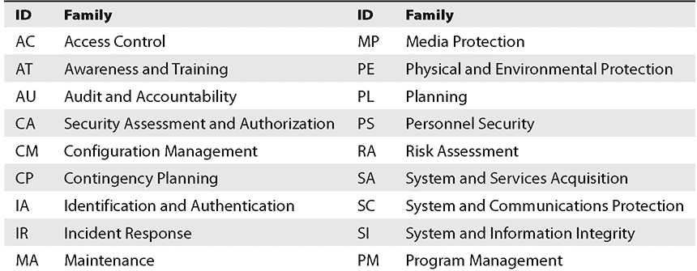

**表 2-3** NIST SP 800-53 安全控制族

控制措施进一步根据潜在影响（低、中、高）和优先级代码分组为控制基线，优先级代码用于协助确定控制实施的优先级（根据 `NIST 800-53`：“优先级代码 1 [`P1`] 控制的实施优先级高于优先级代码 2 [`P2`] 控制，优先级代码 2 [`P2`] 控制的实施优先级高于优先级代码 3 [`P3`] 控制，而优先级代码 0 [`P0`] 表示该安全控制未在任何基线中选定”）。对于美国联邦机构，基线的选择依据 `FIPS 199`《联邦信息和信息系统安全分类标准》中的指导。

NIST 控制措施遵循特定的约定和格式。`NIST 800-53` 控制措施包含以下部分（描述摘自第 4 版）：

- `Control`：规定组织或信息系统执行的特定安全相关活动或行动
- `Supplemental Guidance`：为特定安全控制提供非规范性的附加信息
- `Control Enhancements`：提供安全能力声明，旨在：(i) 为控制增加功能/特定性；和/或 (ii) 增强控制的强度（提供比基本控制更强的保护）
- `References`：包含与特定控制相关的适用联邦法律、行政命令、指令、政策、法规、标准和指南的列表
- `Priority and Baseline Allocation`：提供：(i) 用于安全控制实施排序决策的推荐优先级代码；和 (ii) 安全控制和控制增强措施向基线的初始分配

Figure 2-2 中的示例源自 `NIST 800-53` 的审计与问责系列。该图展示了典型 NIST 安全控制的结构。

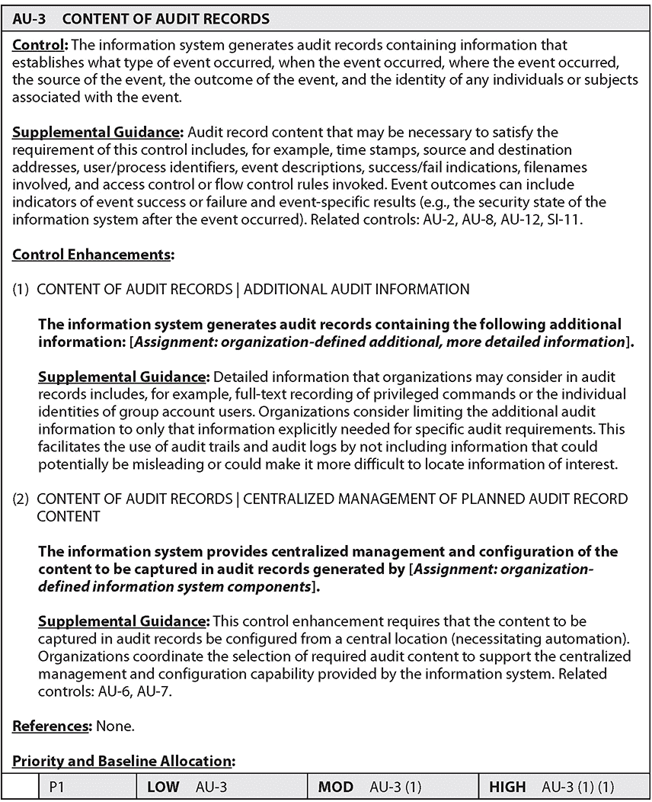

**Figure 2-2** NIST 800-53 控制示例（来源：NIST）

## NIST 网络安全框架

NIST 网络安全框架（`NIST CSF` 或 `CSF`）是一个自愿性安全框架，旨在协助组织管理安全风险并促进利益相关者之间的沟通。`NIST CSF` 的三个主要组成部分在第 1 章中已介绍，此处总结供您复习：

- **框架核心** 由五大功能组成：识别、保护、检测、响应和恢复。每个功能由类别组成，类别又由子类别和参考资料构成。
- **框架实施层级** 范围从部分（`Tier 1`）、风险知情（`Tier 2`）、可重复（`Tier 3`）到自适应（`Tier 4`）。虽然层级看似成熟度等级，但它们旨在作为关于风险偏好、任务优先级和预算沟通的上下文参考。
- **框架概况** 代表组织将资源、需求和风险偏好与框架核心（功能、类别、子类别和参考资料）的期望成果相协调。概况用于将组织的“当前”状态与“目标”状态进行评估。

NIST 网络安全框架核心包含以下组件：

- **功能** 高层级网络安全活动分组，包含五大功能（识别、保护、检测、响应和恢复）
- **类别** 将每个功能细分为控制系列分组（例如，资产管理、治理、风险管理策略等）
- **子类别** 将类别细分为具体活动（例如，`ID.AM-1`：组织内的物理设备和系统已清单化，`ID.RM-1`：风险管理流程已建立、管理并经组织利益相关者同意等）
- **信息性参考** 将每个子类别映射到其他控制框架（例如，CIS 关键安全控制、COBIT 5、ISO/IEC 27001: 2013、`NIST SP 800-53 Rev. 4`）

每个功能、类别和子类别均分配有唯一 ID。表 2-4 展示了功能和类别的细分以及相应的标识符。

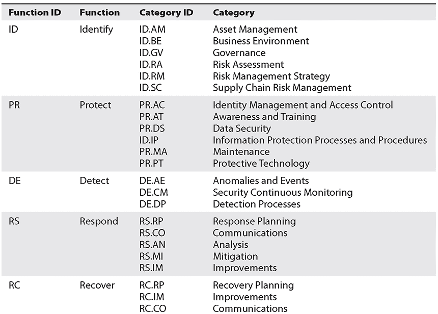

**Table 2-4** NIST 网络安全框架功能和类别标识符

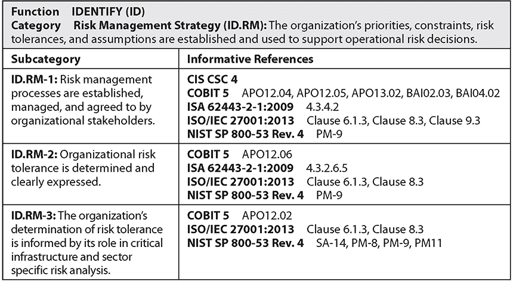

**Figure 2-3** NIST CSF 框架核心示例（来源：NIST）

图 2-3 以风险管理策略类别为例，展示了 NIST CSF 框架核心样例组件的说明。风险管理策略（`ID.RM`）类别归属于识别（`ID`）功能，由三个子类别（`ID.RM-1`、`ID.RM-2` 和 `ID.RM-3`）组成，每个子类别均包含信息性参考映射。

## ISO/IEC 27002

正如第 1 章所述，`ISO/IEC 27001`、*信息技术 – 安全技术 – 信息安全管理体系 – 要求*，是一个用于实施信息安全管理体系（ISMS）并确定采用哪些控制措施的最佳实践框架。`ISO/IEC 27002`、*信息技术 – 安全技术 – 信息安全控制实践规范*，是一个补充标准，侧重于组织为实现安全目标可能决定实施的推荐控制措施。`ISO/IEC 27002` 的控制措施摘要包含在 `ISO/IEC 27001` 的附录 A 中，但每个控制措施仅用几句话描述。而 `ISO/IEC 27002` 则详细得多，讨论每个控制措施、控制措施如何运作、控制目标是什么以及如何实施控制措施。与 `ISO/IEC 27001` 不同，组织无法通过 `ISO/IEC 27002` 认证。它仅是一份信息安全控制的参考和指导文档。

`ISO/IEC 27002` 由 14 个安全控制条款组成，包含 35 个安全控制类别和 114 项控制措施。每个安全控制类别包含一个待实现的控制目标以及一项或多项可为实现该目标而实施的控制措施。`ISO/IEC 27002` 中的安全控制条款如下：

- 信息安全策略
- 信息安全组织
- 人力资源安全
- 资产管理
- 访问控制
- 密码学
- 物理与环境安全
- 运营安全
- 通信安全
- 系统获取、开发与维护
- 供应商关系
- 信息安全事件管理
- 业务连续性管理的信息安全方面
- 合规性

**NOTE** `ISO/IEC 27002` 是一个确定性框架（控制清单），应与另一个过程框架（例如，`ISO/IEC 27001` 等过程指南）结合使用，以实施全面的信息安全计划。

## CIS 关键安全控制

互联网安全中心关键安全控制（`CIS CSC`），也称为 `CIS Top 20`，前身为 `SANS Top 20`，是一个自愿性框架，包含一组用于降低信息和信息系统风险的最佳实践控制措施。该框架由 20 项“关键”控制措施组成，聚焦于信息安全的关键基础。表 2-5 列出了 20 项关键安全控制，并复制了来自互联网安全中心的描述，网址为 <https://www.cisecurity.org/controls/cis-controls-list/>。

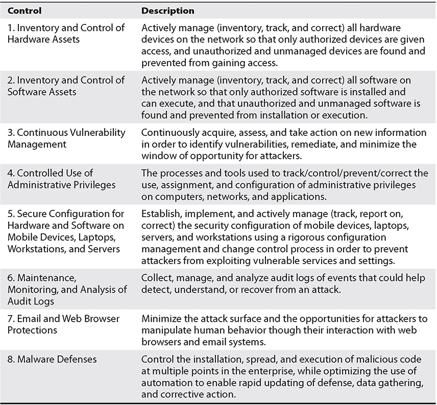
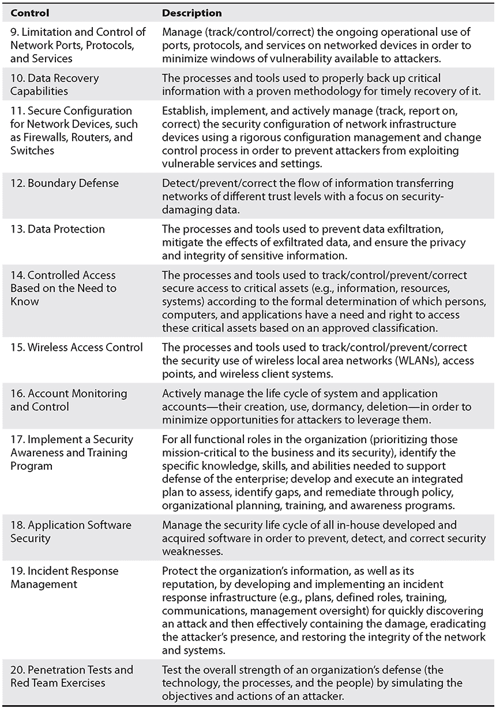

**Table 2-5** CIS 关键安全控制

每项关键安全控制进一步细分为若干子控制。每个子控制包含以下组件：

- **子控制** 唯一的子控制标识符。
- **资产类型** 资产类型，如设备、应用、用户、网络、数据或不适用。
- **安全功能** 基于 `NIST CSF` 中功能的安全功能。
- **控制标题** 控制子类型的名称。
- **控制描述** 待实施控制的描述。
- **实施组** 子控制根据组织概况分为三个实施组（`IGs`）。`IGs` 旨在协助组织确定其概况，并为控制实施提供优先级（`IG 1`、`IG 2`，然后是 `IG 3`），同时作为过程框架。对某些组织而言，基于其风险评估，`IG 1` 可能已足够。

## CSA 云控制矩阵

*云安全联盟云控制矩阵*（`CSA CCM` 或 `CCM`）是一个用于云安全的安全概念和原则控制框架。它是供云客户评估供应商云实施的安全风险，或供组织评估自身云实施的工具。`CCM` 包含以下 16 个控制域，细分为约 100 个单独控制，每个控制分配有唯一控制 ID。`CCM` 基于一系列行业标准，将每个控制映射到其他行业框架和法规，包括 `ISO/IEC 27001/27002`、`COBIT`、`PCI DSS`、`HIPAA`、`NERC CIP`、`NIST SP 800-53` 等。

- 应用与接口安全（`AIS`）
- 审计保证与合规（`AAC`）
- 业务连续性管理与运营韧性（`BCR`）
- 变更控制与配置管理（`CCC`）
- 数据安全与信息生命周期管理（`DSI`）
- 数据中心安全（`DCS`）
- 加密与密钥管理（`EKM`）
- 治理与风险管理（`GRM`）
- 人力资源安全（`HRS`）
- 身份与访问管理（`IAM`）
- 基础设施与虚拟化（`IVS`）
- 互操作性与可移植性（`IPY`）

- 移动安全 (MOS)
- 安全事件管理、电子取证与云取证 (SEF)
- 供应链管理、透明度与问责制 (STA)
- 威胁与漏洞管理 (TVM)

CSA 开发的另一个有用的框架工具是*共识评估计划问卷 (CAIQ)*。CAIQ 包含 CCM 中每个单独控制措施的评估问题，提供了一种根据 CCM 评估组织或供应商云安全状况的方法。它是 CSA CCM 评估框架的一个示例。图 2-4 展示了 CAIQ 的一个示例。该示例包含治理与风险管理控制组中两个控制措施的评估问题：策略执行和业务/策略变更影响。CAIQ 提供了一种优雅的解决方案，可对照 CCM 执行快速、高层级的差距评估。

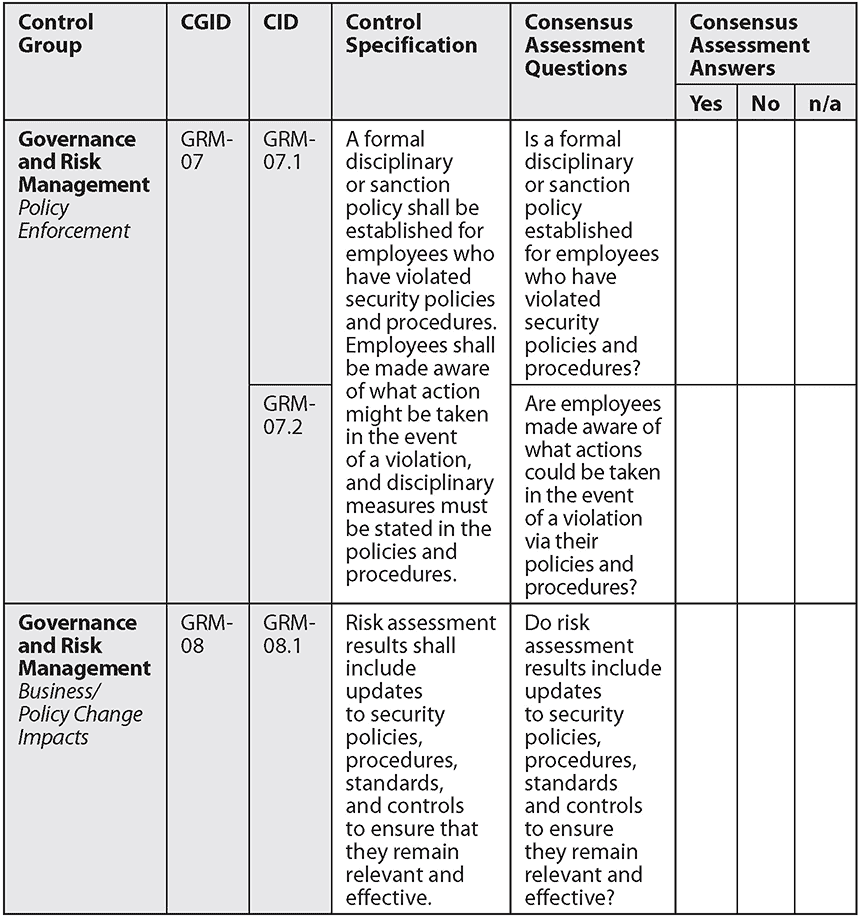

**图 2-4** 共识评估计划问卷 (CAIQ) 示例（来源：云安全联盟）

## 面向 CISO 的审计

CISO 和组织必须了解其安全计划的有效性，以及在多大程度上实现了合规目标。这通过*审计*来实现，审计是对安全职能的仔细检查，旨在验证其正确性和有效性，并识别任何缺陷。本节将探讨审计管理、审计流程、控制自我评估、持续审计以及特定类型的审计。

**考试提示** 考试可能不会涉及特定的审计术语或技术。对审计实践和流程有良好的理解应该足以应对考试。

### 审计管理

安全审计可以单独进行，但通常作为更大审计计划的一部分进行管理，该计划包括检查组织的其他方面，如组织的财务或信息系统职能。

一些组织设有审计委员会，负责监督组织的审计计划（通常主要用于财务审计目的）。在公司中，审计委员会通常向董事会汇报。委员会确保审计计划符合法规，如美国的《萨班斯-奥克斯利法案》或欧盟的指令。视组织而定，信息安全审计职能可能是组织整体审计计划的一部分，也可能在安全部门内，由 CISO 负责。

#### 内部与外部审计

审计可由内部或外部实体执行，或两者结合。内部审计由熟悉组织的员工执行，包括其政策、程序、人员和威胁形势。目标是确保组织遵守其内部政策并遵循适用的法律法规和标准。外部审计由外部实体执行，可以是公司或监管机构。外部审计通常涉及针对法规（法律）和行业标准的合规性审计。

尽管有一种观点认为所有审计都应由独立于被审计实体的独立外部实体执行，但内部和外部审计各有优缺点。由于内部审计员是接受审计组织的员工，他们可能非常熟悉组织的内部运作。这可能带来一些优势。例如，内部审计员因对组织系统或流程有更深入的了解，可能更有可能发现隐藏在深处的问题。此外，由于了解组织内部运作，内部审计员可能能更高效、在更短时间内完成审计。相反，内部审计员可能缺乏外部审计员的独立性或客观性，且常受内部组织政治影响，这可能影响其判断或动力。因此，外部审计有时被视为首选方法。许多组织两者结合使用。

#### 审计章程与委聘函

审计范围可在*审计章程*中定义，该文件记录审计的权限、范围和职责。章程有助于规划审计职能，使审计能以明确定义且可重复的方式进行。以下是审计章程中可能解答的一些问题：

- 利益相关者和资产所有者是谁？
- 哪些资产在审计范围内？
- 审计哪些职能？
- 谁执行审计？
- 审计活动的周期性如何？
- 管理层在审计流程中的责任是什么？
- 如何批准事项，升级流程是什么？

审计章程的一个关键优势是可用作基准工具。通过明确定义审计范围，可以比较不同时间审计的结果。这有助于了解趋势，描绘安全计划如何随时间变化，并希望不断改进。如果业务部门领导有抵触情绪，审计章程也能赋予审计员权力。

虽然审计章程定义了审计要求，但*委聘函*类似于被审计实体与审计员之间的服务级别协议 (SLA)。当实体聘请外部审计组织执行审计时，委聘函特别有帮助。该函件用于定义聘用条款、设定适当预期并防止任何误解。该函件可以是合同的一部分，也可以起到合同的作用。

章程和委聘函旨在消除或降低因缺乏理解而导致审计无法产生预期结果的风险。章程和/或函件确立了管理层对审计内容的理解，以便他们能妥善准备审计结果、充分利用结果并做出适当回应。

#### 审计规划

在实施审计前，规划所有必要活动并确定所需资源非常重要。大多数审计范围相当广，涉及大量数据的收集和分析。如果规划不善，此类活动可能会失控。

在开始审计规划前，审计员必须首先定义审计范围，这是描述审计范围和规模的重要术语。*审计范围*描述审计中包含的所有业务流程和资产。一位 CISO 朋友常说，“你无法烧开整片海洋”；同样，你无法审计所有内容，因此必须选择最相关的项目以支持组织目标。审计范围定义了审计范围内的所有内容。

确定审计范围的第一标准是识别满足法规合规要求所必需的业务流程和相关资产。例如，如果审计目的是确定 HIPAA 合规性，而公司将患者数据存储在数据库中，则该数据库及相关安全控制很可能属于审计范围。

一些组织采用基于风险的方法确定审计范围。使用此方法，业务流程和相应资产按风险等级（如高、中、低）排序。对业务构成最大风险（业务影响最大）的业务流程或职能在审计规划中优先级最高。

## 审计规划

审计规划有时会体现在两份文档中：审计策略和审计计划。*审计策略*定义审计的范围、时间安排和方向，而*审计计划*定义审计活动的性质、时间安排和范围。图 2-5 展示了典型审计规划流程的概览。以下对图中各编号步骤进行说明。

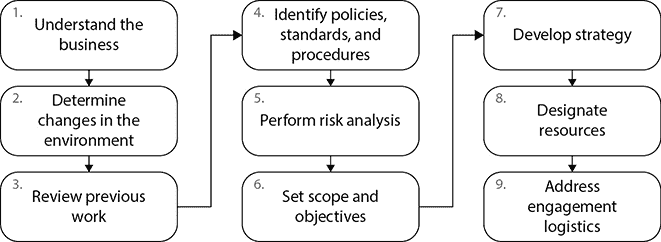

**图 2-5** 典型审计规划流程

1. **了解业务。** 为获得这种业务理解，审计规划人员可执行以下操作：
   - 审查长期战略规划
   - 对组织进行演练，了解各小组或部门的职责、运作方式及其关键系统、流程和资产
   - 访谈关键领导和人员，了解趋势、历史、驱动因素和运营情况
   - 确定驱动业务决策或影响业务运营的具体法规
   - 识别外包活动（是否存在第三方？）

2. **确定自上次审计以来业务或环境是否发生变化，如果有，这些变化可能如何影响本次审计。**

3. **审查上次审计的工作，了解发现的缺陷和提出的建议。** 上次审计的建议应在下一次审计中进行核查。

4. **审查策略、计划、标准和程序，以了解和识别为满足要求而实施的控制措施。**

5. **执行风险分析，根据业务流程和资产对组织的价值以及机密性、完整性或可用性丧失的影响，对其进行评估和排序。**

6. **根据前面步骤获得的信息设定审计的范围和目标。** 这是通过将审计划分为可管理的块来定义的，例如类别（基于控制类型或技术）或阶段（基于基于时间的活动）。

7. **制定并记录审计执行策略。** 该策略考虑了规划过程中前几步收集的所有数据。该策略本质上是数据收集期间提出的所有问题的答案。它定义将做什么，并作为审计计划的基础，后者详细规划审计策略将如何实施。

8. **指定实施审计策略所需的资源，通常在审计计划中。** 这包括内部和外部资源。

9. **处理并确定其他业务后勤事项。** 这些可能包括所有审计活动的总进度表，其中标明资源、优先级和相互依赖关系；以及获取所需资源，如设备和软件。

### 验证审计计划

在实施审计前，应检查审计计划，以确保其能提供组织所需的合规性验证。是的，这意味着审计计划本身也应接受审计。提前检查计划总比在流程后期发现计划未涵盖应涵盖的内容要好。

### 获得审计计划批准

如果信息安全审计在审计委员会的职权范围内，则该计划需要委员会的批准。如果是这种情况，这很可能是委员会必须遵守的批准（和预批准）策略所定义的批准流程的一部分。例如，如果组织必须遵守美国证券交易委员会（SEC）法规，则 SEC 对会计审计的治理和批准方式有要求。在这种情况下，审计委员会对审计拥有监督权。

## 审计流程

没有精心设计的计划，审计无法完成。计划应包含每项活动的文档化步骤，以及用于存储和维护所有审计工件的存储库的识别和/或创建。目标是定义一个可重复的审计流程，使其能够持续演进和改进。审计流程提供了一种机制来传达审计的范围和要求，以确保审计实现其预期目的。该流程应包含以下审计最佳实践：

- **制衡机制** 降低审计错误风险的一种方法是利用制衡机制实施职责分离。在此方法中，负责执行任务的人员与负责验证任务是否正确完成的人员是分开的。

- **双人规则** 在切实可行的情况下，审计活动应由双人小组执行，一人执行任务，另一人在旁监督以确保其正确完成。双人规则的关键在于它是一条*规则*，意味着属于双人规则范围的活动*不允许*由单人执行。

- **独立验证者** 类似于制衡机制，其理念是审计应由对审计结果无利害关系的个人执行。例如，如果 Joe 设计并实施了一个安全控制，他不应成为审计该实施以确保其正确完成的人员。相反，应由无利害关系的第三方执行审计。

- **核对清单** "过去" 审计人员手持写字板，上面有待检查和验证项目的核对清单。如今他们使用电子表格和数据库，但概念相同——创建并使用包含相应复选框或数据采集字段的操作核对清单。详细的核对清单是审计人员最好的帮手，因为它们定义了与相应结果对齐的每个审计动作。

- **建立审计记录** 应始终保留谁检查了什么以及检查发生时间的记录。审计记录允许组织回顾并验证做了什么以及是否正确执行。

- **安全存储审计记录** 审计记录高度敏感，因为它们包含有关环境中漏洞的信息。如果与错误的个人或组织共享，这些信息可能被利用。审计记录应妥善保管，访问权限应严格控制，以便只有授权人员才能查看该信息。

审计流程通常包括以下活动，每一项将在后续章节中讨论：

- 为组织选择审计和控制框架
- 考虑并确定审计风险、规模调整和抽样等特殊因素的范围
- 进行审计准备
- 收集评价证据
- 评估证据并确定合规性
- 向领导层、管理层和利益相关者传达审计结果
- 进行审计收尾活动

### 选择审计标准和框架

如前所述，本书讨论三类控制框架：*过程* *模型框架*，定义组织可遵循以实施控制的过程或生命周期模型；*确定性框架*，包含可用于或定制以满足目标的控制库；以及*评估框架*，提供衡量合规性的指南。许多已发布的控制框架包含这些类别中的一种或多种指南，尽管它们不一定使用这些术语。

本节重点介绍用于支持审计的评估框架。组织可以定义自己的评估框架，但从头创建框架可能是一项艰巨的任务。许多组织发现，遵循行业标准框架会更好。使用成熟的框架不仅能节省时间，还能提供更好的结果，因为行业标准框架很可能经受住了时间的考验，并经过多年的改进和完善。评估和审计框架为审计控制提供了流程。以下是实践中常用的一些标准和框架：

- NIST SP 800-53A
- ISO/IEC 27007
- ISO/IEC 27008

## 常见评估框架

### NIST SP 800-53A

NIST 风险管理框架包含一个审计组件，该组件在流程的评估阶段中概述，并引用了 NIST SP 800-53A *《联邦信息系统和组织中安全与隐私控制的评估：构建有效的评估计划》*。NIST SP 800-53A 包含一套用于在系统开发生命周期的各个阶段评估安全和隐私控制（在 NIST SP 800-53 中概述）的程序。

### ISO/IEC 27007:2017

ISO/IEC 27007 *《信息技术——安全技术——信息安全管理体系审核指南》* 是一个为信息安全管理体系提供指导的标准。ISO/IEC 27007 建议如何在 ISMS 背景下应用 ISO 19011:2018 *《管理体系审核指南》*。该标准涵盖以下内容：

- 管理 ISMS 审核计划（谁、什么、哪里、何时以及如何审核）
- 实施内部或外部 ISMS 审核（审核流程）
- 管理 ISMS 审核员（技能、胜任力）

对于有兴趣审核 ISMS 或建立内部 ISMS 审核职能的组织，ISO/IEC 27007 很有帮助。

### ISO/IEC TS 27008:2019

ISO/IEC 27008 *《信息技术——安全技术——信息安全控制评估指南》* 是一个专注于评估信息安全控制的标准。ISO/IEC 27008 旨在补充 ISO/IEC 27007。ISO/IEC 27007 侧重于审核 ISMS 的管理方面，而 ISO/IEC 27008 侧重于审核 ISMS 内部的控制。

## 考虑并界定特殊审计因素

在着手进行信息安全控制审计之前，应解决一些特殊考虑因素。其中之一是*审计风险*的主题，即审计可能产生包含错误结果的风险。这些错误可能是由于不正确的审计程序、不准确的系统文档、错误配置或其他问题导致的。审计过程中的错误可能会产生不正确的结果并导致错误的结论，从而造成时间和精力的浪费。

组织处理审计风险的方式与处理其他风险类似——通过预测和分类潜在风险，并为每个项目决定处理方法。以下是一些最常见的处理方法：

- **缓解** 风险缓解是采取行动以减少或最小化风险的影响。
- **接受** 风险接受是做出决定允许活动继续进行，因为风险被确定为可接受级别，或者因为缓解成本相对于潜在影响过高。
- **规避** 风险规避是基于风险过高而不可接受的判断，做出不继续进行活动的决定。
- **转移** 风险转移是将风险转移给另一个实体。风险转移最常通过购买保险或将活动外包给承担风险责任的另一个实体来实现。

另一个审计考虑因素是确定正确的审计规模，以及是否以及何时使用抽样。审计应根据业务需求进行规模调整。例如，花费 1000 万美元审计一项 100 万美元的资产可能说不通。如果审计该资产至关重要，则应适当调整其审计活动的规模。审计规模调整的一种方法是抽样。在*抽样*中，不是审计整个系统或部门，而是检查系统的代表性样本或子集。该方法的关键在于选择合适的样本，以良好地代表整个系统。

抽样需要对被审计资产有深入的了解，以确定应选择哪些流程，以及哪些流程需要更多的抽样。有两种通用的抽样方法：

- **统计抽样** 使用定量方法选择构成样本的项目。统计抽样首先客观地确定样本量，然后使用随机或近似随机的方法选择所需大小的样本项目。统计抽样需要对结果进行数学分析，以推断结果如何反映整个系统的情况。
- **非统计抽样** 使用定性方法选择要包含在审计中的项目。项目的选择基于审计员的判断，使用非定量手段。本质上，任何不使用样本量和随机化来选择待审计项目的方法都被视为非统计抽样。如果执行得当，这两种方法（统计或非统计）都可能有价值，但没有一种比审计环境中的所有项目那样彻底。

## 实施审计准备

审计是通过将某事物与定义的标准进行比较来完成的。因此，为了规划审计，首先要做的就是确定标准。如果你不知道“好”是什么样子，就无法判断某事物是否好。对于任何审计，规划阶段都必须包括定义审计要求。定义并理解要求，是为了创建一组标准，以便将审计数据与之比较。顶层要求可能源自组织必须遵守的法规、组织采用的框架，或两者兼有。

确定要求是谁的责任？理想情况下，要求不是由审计员决定的，而是由正在接受审计的系统、流程和控制的设计者或构建者决定的。毕竟，如果他们不知道要求，怎么知道该构建什么？然而，在现实世界中，开发人员并不总是很好地理解要求，或者在某些情况下，法规是在系统或流程就位后颁布的。因此，在实践中，捕获和记录用作审计标准的要求的责任通常落在审计员身上。

审计要求源自组织采用的法规驱动因素、框架、策略、程序和标准。这些被整合并构成审计规划过程的基础。规划应产生以下指导审计活动的工件：

- 审计章程和/或审计计划
- 审计程序
- 审计清单
- 时间线和进度安排

如果审计用于确定法规合规性，规划应从识别和记录法律或法规的外部要求开始。然后将这些要求映射到旨在满足它们的系统、流程和控制。这项活动有时是一项极其庞大的任务，因为在大型企业中，可能有数千个要求映射到众多系统和控制。审计规划人员广泛使用电子表格或功能丰富的工具，以帮助他们捕获要求、将其分配给系统和资产、将其映射到派生要求、将派生要求分配给待测试项目，并捕获测试结果。

一旦需求被识别并映射到资产，就会制定测试或审计程序以验证合规性。这些程序通常由检查表支持，用于记录测试结果。这些文件构成了审计计划的基础，并使审计能够继续进行。

## 案例研究：父需求与派生需求

ABC Online 是一家处理信用卡交易的在线零售商店，因此必须遵守支付卡行业数据安全标准 (PCI DSS)。PCI DSS 包含以下要求（PCI DSS 要求编号 6.4）：“遵循变更控制流程和程序，以应对所有系统组件的变更。”ABC 有一项包含以下要求的变更控制策略：

-   ABC 应为 ABC 计算环境中的所有计算资产开发、记录并发布标准化配置。
-   这些标准配置在实施前必须经过 IS 经理的批准。
-   IS 经理应负责开发和组建 ABC 变更管理委员会 (CMB)。
-   CMB 应负责对变更请求 (RFC) 进行分类和优先级排序。
-   除非变更已由 CMB 授权、测试、批准和计划，否则不得对任何资产进行变更。

在此示例中，父级 PCI DSS 要求被分解为策略中列出的几个派生要求。审计员测试的正是这些派生要求，以确定组织对父级要求的合规性。

## 收集评估证据

`评估证据` 是审计员作为审计活动结果而收集的数据。然后将证据与要求进行比较或进行分析以确定合规性。通常，使用以下四种方法来收集和评估证据：

-   `检查` 审查数据，例如：
    -   审查文档，如策略、程序和图表
    -   审查源代码
    -   审查配置设置和文件
    -   阅读日志文件
    -   阅读文件属性
    -   检查序列号（硬件）或许可证（软件）
    -   观察物理属性
    -   面谈人员（用户、员工、技术人员）
-   `演示` 执行一个过程（如测试），产生可读并与一组预期结果进行比较的结果。演示有时包括进行观察，例如观察屏幕上对输入的响应。
-   `测试` 执行一系列步骤或检查几个不同演示的结果。
-   `分析` 处理演示或测试的结果。例如，分析通常用于确定性能特征，如效率、延迟等。

证据被收集并存储在审计存储库或数据库中。如前所述，证据可能包含敏感信息，如漏洞枚举，因此其访问应根据“需知”原则严格控制。

## 评估证据并确定合规性

一旦收集到评估证据，下一步就是利用它来确定合规性或识别必须整改的不合规领域。在评估证据时，一些审计员认为将 `观察结果` 与 `洞察` 分开很重要。

-   `观察结果` 检查、演示、测试或分析的结果
-   `洞察` 从观察结果中得出的结论

两者的区别在于观察结果纯粹是事实性的，而洞察是源自事实的直观解释。区分这两者很重要，因为审计员可能在掌握所有事实之前过早得出洞察，这可能会扭曲审计结果。

这里有一个例子。在审计期间，审计员发现大量用户帐户已超过 90 天未被使用。这是一个观察结果。可以从这个观察结果中得出什么洞察？一个可能的洞察是“用户帐户配置策略不充分”。其他可能的洞察包括“未遵循用户帐户配置程序”或“用户帐户未被集中管理”。这些洞察任何一个或全部都可能是正确的。需要更多的数据和观察结果才能进行适当的评估。根据观察结果、洞察和相应的控制，可以确定对特定监管要求的合规性。

洞察是执行 `根因分析 (RCA)` 的第一步，这是一项检查审计发现以了解安全合规问题根本原因的活动。通常，通过修复眼前的问题（救火）来解决漏洞或不合规领域，而不解决问题的根本原因。RCA 用作一种发现问题根源以防止其再次发生的方法。

审计结果的评估应考虑发现的 `重要性`。如果发现显示未能满足控制目标，则被认定为重要。重要性要求定义阈值或通过/失败标准，尽管有时这种阈值并不完全清晰。因此，确定重要性有时是一个专业判断的问题。以下是在确定重要性时有时会考虑的因素：

## 案例研究：根因分析

对一家大型医疗服务公司的审计显示，大多数内部开发的软件应用程序包含安全漏洞，例如由于缺乏输入错误检查导致的缓冲区溢出。尽管这些错误在被发现后得到了修复，但对软件应用程序的持续测试不断揭示同类问题。在面谈内部开发人员后，发现他们未接受过任何关于安全编码实践的指导或培训。这种缺乏培训和指南的情况就是问题的 `根本原因`。因为修复漏洞并未解决潜在的根本原因，所以新开发的软件仍存在类似问题。一旦根本原因被揭示，公司就为开发人员采用了培训计划，并指派一个团队为组织制定安全编码标准。这些活动解决了根本原因，并在未来的审计中消除了该问题的再次发生。在分析发现或缺陷时，确定根本原因很重要，因为发现往往是更大潜在问题的症状。执行根因分析有助于识别潜在问题，以防止其再次发生。

-   `重要程度` 应考虑发现对整体要求影响的程度。适用“影响程度”概念。发现可能只影响单个要求，但该要求对业务可能重要到足以产生关联。
-   `利益相关者` 应考虑作为重要性“受众”的人员。此类利益相关者包括董事会、首席执行官、政府监管机构、贷款人、保险公司等。重要的不是审计员的观点；而是审计员必须考虑利益相关者的观点。
-   `度量` 发现可以使用定量或定性评估（或两者的结合）来确定。`定量` 是一种数值度量，例如无效控制影响的系统百分比，或面临风险的数据量。定量评估基于数值阈值的建立。定量评估可能包括受影响的业务流程或资产的成本，甚至不合规的罚款成本。`定性` 度量基于非数值标准，如相关控制所支持的业务功能或系统的关键性。

## 审计完整性

重要性概念不应被用作规避满足要求的手段。不应滥用重要性；它应该是为审计带来现实世界解释的一种方式，而不是作为跳过或忽略难以实施或测试的要求的借口。

欲了解更多信息，美国注册会计师协会（AICPA）发布了关于重要性的有用指南。请参阅 AU-C 第 320 节，*审计计划与实施中的重要性*，该文件可在 AICPA 网站上获取。

## 沟通审计结果

审计的一个关键部分是审计师或审计组织如何向关键利益相关者报告和沟通发现。这通常通过审计报告和离职访谈来完成，两者均由一套审计记录库提供支持，通常称为*审计工作底稿*。

*审计报告*是所有审计工作的副产品。它是提交给管理层的最终交付成果。有时会向管理层提交报告的初步版本，可能会在离职访谈（稍后将详细描述）中进行审查，以便在最终确定之前讨论初步发现。这是一个澄清误解甚至解决在最终报告生成前发现的问题的机会。

审计师应注意确保最终报告既便于技术人员也便于非技术人员理解。通常报告包含一份执行摘要，以介绍审计、定义其范围并总结审计发现。执行摘要的目的是概述审计范围以及关键发现，以便管理层能快速了解最重要的信息。执行摘要的信息传达可以通过使用图表等可视化表示来支持。

如果没有正文部分的核心内容，审计就不算完整，这些核心内容位于文档主体和技术附件中，将由系统和网络管理员及安全分析师等技术人员进行审查。

报告的确切格式有时由政策或程序规定，并将根据范围和预期受众而有所不同。通常，审计报告包含以下章节：

- **执行摘要** 总结范围和发现。
- **目的、目标和审计范围声明** 描述进行审计的原因。
- **发现** 描述审计师发现的情况；具体而言，是否有迹象表明控制措施未到位或无效。
- **结论** 讨论审计师基于发现得出的结论。这包括从发现中得出的见解或可确定的根本原因。
- **建议** 提供关于如何整改发现的建议。报告中是否包含此章节取决于审计类型。一些审计专注于仅识别控制缺陷，将整改发现的责任留给被审计组织。

在某些情况下，审计师或审计组织会为管理人员进行*离职访谈*或*简报会*。这为审计师提供了一个展示发现和结论的机会。这很重要，因为它不仅为管理层提供了纠正任何误解的机会，还提供了就审计如何进行或审计结果表达任何观点的机会。根据审计类型和范围，与会者还可能讨论建议的可行性和实施时间表。一般来说，审计师在离职访谈中执行以下活动：

- 向管理层展示初步发现和结论
- 提供纠正任何误解的机会
- 允许管理层表达他们的观点

记录关于离职访谈的所有内容非常重要，尤其是关键结论或关注点。需记录的项目包括简报会地点、出席人员名单、讨论的关键项目清单以及会议详细记录。

所有这些信息都应由*审计工作底稿*文件提供支持。审计工作底稿是一个包含所有审计文档的资料库，包括审计计划、程序、审计师笔记以及审计报告中包含的工件。这些审计文档对于证明审计师如何得出特定结论、描述他们做了什么以及证明尽职调查至关重要。这些工作底稿应妥善处理和存储，以保持完整性。

## 结束审计

审计结束时，应有序关闭审计活动，准备和交付审计发现，并（有时）进行简报会或离职访谈，向董事会或审计委员会等利益相关者展示审计结果。

审计结束通常包括清理、组织和存储审计数据的内务活动。应仔细决定保留哪些评估证据和工作底稿，以及丢弃哪些。一些审计师保留所有资料，而另一些仅保留支持报告和发现所需的最少数据。这始终是一种权衡——保留太多会有保留组织高度敏感漏洞数据的风险；保留太少则可能没有足够的数据来妥善支持报告中的发现。

## 控制自我评估

许多组织发现，将审计职能与组织的其他职能分离的传统做法是低效的。虽然独立审计因其公正性和客观性而被采纳，但将审计师与其他运营工作分离可能成本高昂并导致额外工作。独立审计师对其审计的资产不如开发人员或运营人员熟悉。同样，如果开发人员和运营人员不熟悉审计师的目标、方法和要求，他们就不太可能创建合规的系统或流程。这种情况促使许多组织采用控制自我评估（CSA），通过将审计职能整合到组织运营中，使组织更加高效。

传统审计由独立于组织运营或开发人员的员工执行。审计人员可以是组织的内部员工，也可以是受聘执行审计的外部公司员工（或两者的结合）。传统审计通常定期执行。与传统审计相反，CSA 由组织的运营人员执行，审计职能融入运营之中。

### CSA 的优势

如果没有 CSA 计划，组织在审计发生之前不会了解自身状况。因此，问题和安全漏洞可能在被发现前长时间处于暴露状态。CSA 为组织提供持续的视角，并支持对控制措施进行持续整改和改进。

CSA 还提供了将审计职能融入控制措施实际实施中的机会。这提供了加强控制措施的机会。CSA 还使组织能够指派人员整合控制实施和监控职能。毕竟，比起设计和实施控制措施的人员，还有谁更能定义衡量安全控制成功与否的指标呢？

# 控制自我评估 (CSA)

在 CSA 出现之前，我们存在孤岛现象。实施人员负责实施，审计人员负责评估。这被证明效率极低，且导致整改流程缓慢。通过允许运维人员执行评估，控制措施能更好地与业务和组织目标保持一致。CSA 提高了实施人员的素质和知识水平。它们让员工更重视控制措施的质量。

许多监管机构要求实施 CSA 计划（如 FDIC）。许多组织利用 CSA 来帮助满足《萨班斯-奥克斯利法案》的内部控制报告要求。使用 CSA 的益处包括：

- 将审计融入组织的日常职能
- 整合控制*实施*与控制*监控*
- 允许更好地定义和使用指标
- 更有利于在问题源头解决问题
- 允许组织更早地发现问题

## CSA 的陷阱

一些组织可能抵制实施 CSA，因为认为这会给运维人员增加工作量。在许多组织中，运维人员（及其他部门人员）已经忙得不可开交。然而，其核心理念是：组织反正都要整改审计人员发现的问题，所以如果组织能内部自行识别并修复这些问题，流程将变得更高效，总体上反而减轻了运维人员的工作量。这就是其设计初衷，在实践中，如果 CSA 计划实施得当，确实能带来这种效率。

让同一批人员同时实施和评估可能导致无法客观评价。这可能是因为员工离问题太近，或者过于投入于控制措施的创建或实施。通过实施审计最佳实践（如双人规则），并确保审计流程在实施前经过同行评审，可以解决这一问题。

另一个潜在陷阱是，运维人员可能不愿指出本部门、同事或上级造成的问题。为解决此问题，一些组织允许员工匿名参与 CSA，或在审计报告中隐去其姓名。然而，最好的解决方式是管理层培育一种开放的文化和持续改进的职场氛围。

## 实施 CSA 计划

一些组织发现，成立一个 CSA 小组或职能部门来推动全组织的 CSA 开展是最佳选择。该 CSA 小组应由精通 CSA 的审计人员组成。审计人员懂得如何评估，并能确保 CSA 与其他审计目标保持一致。以下是实施 CSA 计划的一般步骤：

- **制定章程** 就像审计章程一样，CSA 章程为所有部门和小组定义了一套通用的目标和流程。它还明确了负责 CSA 职能的员工以及组织中开展 CSA 的层级。章程中还可能包含一份路线图，列出 CSA 活动的时间表。
- **定义流程** CSA 可以使用与传统审计相同的方法来收集评估证据。然而，CSA 也可以使用协作方法，如桌面推演研讨会和操作场景演练。如果使用研讨会，通常会有一名主持人，确保遵循结构化流程并收集正确信息。目的是利用最佳手段收集关于组织如何运作的信息。
- **跟踪整改活动** CSA 流程涉及持续不断的任务：收集数据、执行分析、编目并优先处理缺陷、定义整改措施、验证整改成效。这些活动应在列表、工具或数据库中进行跟踪。工具应始终提供 CSA 活动当前状态的最新信息。
- **建立态势感知** 参与的管理层和员工应始终掌握其符合 CSA 目标的状态。组织应使用指标、仪表盘和其他工具，提供组织、部门及公司/机构层面的态势感知。

# 持续审计

*持续审计*本质上是以更高频率进行审计。这通常由技术实现，技术能快速收集和分析数据。事实上，持续审计通常是自动化的，以提供实时或近实时的结果。

持续审计几乎总是使用代理，例如嵌入业务流程中的一段软件或硬件传感器。代理实时运行，拉取信息或检测特定事件，并将结果发送到数据库或数据仓库进行存储、排序和标准化。随后对数据进行挖掘，以发现关联并得出结论。基于事务的应用程序使用事务日志向数据库提供数据。

## 持续审计的益处

技术支持的持续审计可提供以下益处：

- 自动化数据收集过程，使审计过程更高效。自动化也支持控制自我评估实践。
- 提供即时输出，以便在错误、低效和问题出现时即刻发现（而非等到下一季度的审计）。
- 提供独立性和客观性，因为审计人员（人工）被移出了数据收集环节。
- 集成工具和代理，使得审计那些原本难以轻易审计的事项成为可能。例如，利用自动化工具可以暴露深嵌应用程序内部的数据或事件。

## 持续审计适用于哪些场景？

持续审计适用于特定场景，例如：

- 业务流程的交易量极高，以至于时间点审计无法获取足够大的样本量来准确反映组织状态。此时，审计人员可使用代理随时间收集数据并存入数据库以供处理。
- 定期抽样检查不足以应对的场景。
- 必须及时发现违规以避免处罚的场景（组织无法等到事后才发现问题）。如果组织面临的情况是一个错误就会导致违规，持续监控的代理能缩短组织感知问题的时间，从而更快修复。
- 需要高效率（调优和成熟）的场景。通过持续审计，组织调优和纠偏的速度比等待下一次审计快得多。

# 具体审计和评估类型

本节探讨 CISO 应熟悉的最常见审计类型。涵盖以下审计类型：

- SOC 审计
- ISO/IEC 27001 认证审计
- FedRAMP 评估
- 行业特定审计

## SOC 审计

*服务组织控制 (SOC) 审计*是由第三方对服务组织（如云服务提供商）执行的审计，第三方评估服务组织的内部控制。这些内部控制可能包括 IT 控制、安全控制或组织的其他系统性控制。审计完成后，第三方审计师出具报告，证明服务组织的内部控制状况。服务组织将此报告提供给客户、合作伙伴和监管机构作为证明。

## SOC 审计

SOC 审计源于美国注册会计师协会 (AICPA) 制定的*审计准则第 70 号 (SAS 70)* 审计标准。2010 年，在美国，SAS 70 标准被*鉴证业务准则第 16 号 (SSAE 16)* 标准取代；在美国境外，则被国际鉴证业务准则第 3402 号 (ISAE 3402) 取代。2017 年，SSAE 16 被 *SSAE 18* 取代。

共有三种类型的 SOC 审计和报告：

- **SOC 1**：涉及财务控制。
  - **类型 I**：对服务组织控制和设计的单一时间点检查。侧重于确定控制是否设计得当。
  - **类型 II**：一段时间内的审计（通常为六个月至一年）。将类型 I 的范围扩大到包括评估控制有效性。
- **SOC 2**：涉及信任服务（安全性、可用性、机密性、处理完整性和隐私性）。
  - **类型 I**：对服务组织控制和设计的单一时间点检查。侧重于确定控制是否设计得当。
  - **类型 II**：一段时间内的审计（通常为六个月至一年）。将类型 I 的范围扩大到包括评估控制有效性。
- **SOC 3**：与 SOC 2 类似，也涉及信任服务。SOC 3 与 SOC 2 相似，但详细程度低得多，主要用作提供给客户的营销工具。

SOC 审计为服务组织提供了一种向客户和合作伙伴证明其已建立强有力的内部控制的方式。所涵盖的各种 SOC 审计类型概述于表 2-6 中。此外，SOC 报告可帮助 CISO 在供应商或服务选择期间评估潜在服务提供商控制的强度。

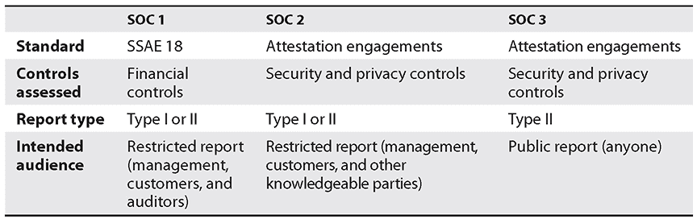

**表 2-6**：SOC 审计类型

### ISO/IEC 27001 认证审计

ISO/IEC 27001，*信息技术 – 安全技术 – 信息安全管理体系 – 要求*，在第 1 章中作为最佳实践框架被引入，该框架为建立整体信息安全管理体系 (ISMS) 提供指导。此外，组织可通过经认可的第三方获得 ISO/IEC 27001 认证。第三方将根据 ISO/IEC 27001 的要求评估组织的 ISMS，并证明组织的合规水平。此外，需要定期进行内部审计，以确保持续符合 ISO/IEC 27001。

### FedRAMP 审计

*联邦风险和授权管理计划 (FedRAMP)* 是美国联邦政府的一项计划，为评估、授权和持续监控基于云的产品和服务提供标准化方法。云服务提供商 (CSP) 要想向美国联邦政府销售服务，必须获得 FedRAMP 授权。FedRAMP 本质上是基于云的产品和服务的网络安全审批流程。正如第 1 章所述，《联邦信息安全管理法案》(FISMA) 要求美国联邦政府机构授权其使用的信息系统（此过程使用 NIST RMF）。FedRAMP 本质上是面向云的 FISMA。其目标是利用“一次授权，多次使用”的方法协助授权流程，以便每个美国联邦机构无需进行冗余的安全评估。

CSP 通过经认可的第三方评估组织 (3PAO) 的评估来获得 FedRAMP 授权。3PAO 评估并认证 CSP 的控制措施。FedRAMP 安全基线（低、中、高）源自 NIST SP 800-53 控制措施，并包含一组控制增强措施，以应对云服务的独特安全要求。FedRAMP 文档和信息可在 <https://www.fedramp.gov> 找到。

### 行业特定审计

第 1 章讨论了许多可能影响 CISO 组织的法律和法规驱动因素。这些驱动因素中许多都包含各自的一套控制和审计要求，必须实施这些要求以实现合规。这些包括但不限于：

- **PCI DSS** 适用于接受支付卡信息的组织
- **HIPAA** 或 **HITECH** 适用于 HIPAA 下的医疗保健“受保护实体”
- **FISMA** 适用于联邦政府
- **GDPR** 适用于收集欧盟客户数据的组织

> **考试提示** CCISO 候选人应熟悉可能影响信息安全计划的行业特定审计。

## 章节回顾

组织实施风险管理，以了解每项资产对业务的重要性。首先对资产进行分类，以确定每项资产风险的性质以及存储、处理或传输的信息的敏感度。组织通常使用框架，这些框架为每个安全类别提供建议的控制库。组织使用或定制这些库，以确定要应用于特定资产的安全控制集。然后，组织可以设计控制的实施，实施并测试它们，然后在资产的整个生命周期内监控资产以确保持续合规。

审计是一种正式过程，用于确定是否符合法规要求或组织的内部政策，或两者兼有。安全审计通常是组织整体审计计划的一部分，该计划可能在 CISO 的权限之下，也可能不在。传统审计由独立于被审计组织或部门的审计人员定期执行。或者，一些组织使用控制自我评估来完成审计。CSA 定期执行，并利用运营人员执行审计以提供审计效率。常见的安全审计包括 SOC 审计、ISO/IEC 27001 认证审计、FedRAMP 审计和其他行业特定审计。

## 快速回顾

- 安全控制，也称为保障措施或对策，是一种为降低风险并保护信息或信息资产的机密性、完整性和可用性而设立的机制。
- 选择控制的方法是：首先根据风险、资产对企业的价值以及资产机密性、完整性和/或可用性潜在丢失的影响对资产进行分类。
- 控制分为三大类：
  - **管理控制**，也称为软控制，是面向管理的控制，如政策、程序、指南、培训、风险管理和雇佣实践（招聘、解雇等）。
  - **技术控制**，也称为逻辑控制，是提供安全控制功能的硬件或软件组件。
  - **物理控制** 是为防范物理安全领域的威胁而设立的有形控制。
- NIST 定义了一组不同的类别：
  - **管理控制** 侧重于风险管理和信息系统安全管理。
  - **运行控制** 主要由人员（而非系统）实施和执行。
  - **技术控制** 主要由信息系统通过硬件、软件或固件组件中包含的机制实施和执行。
- 控制族是框架中控制的分组，通常针对同一安全领域或功能。
- 控制的安全功能描述了控制为组织做什么。控制的功能包括以下内容：
  - **预防性控制** 防止或阻止不利事件或事故的发生。
  - **检测性控制** 发现、检测或识别潜在的不利活动、事件、入侵者或事故。

# 控制类型

- **威慑控制** 能够威慑或阻止潜在对手实施攻击或从事不当行为。
- **纠正控制** 通过修复系统、流程或活动来纠正已发生的不利事件。
- **指令控制** 通常是管理控制，通过规定允许或不允许的操作来传达预期行为。
- **恢复控制** 将环境或操作恢复到正常功能。它们的功能与纠正控制相似，但被认为具有更高级的能力。
- **补偿控制** 作为主要控制的替代或次要控制实现。当主要控制因成本、复杂性或其他业务限制而无法实施时，通常会使用这些控制。

# 控制框架

**控制框架** 是控制目录，用于为实施全面的信息安全计划提供基础。控制框架的三种基本类型是**过程模型**、**决定因素**和**评估**。

## 常见信息安全控制框架

- `NIST SP 800-53`
- `NIST Cybersecurity Framework`
- `ISO/IEC 27001/27002`
- `CIS Critical Security Controls/CIS Top 20`
- `CSA Cloud Controls Matrix`

## 安全控制生命周期

安全专业人员通过遵循安全控制生命周期来选择控制，该生命周期通常包括**风险评估**、**设计**、**实施**、**评估**和**监控**。

# 安全审计

**安全审计** 是对安全功能的仔细检查，以验证其正确性和有效性，并识别任何缺陷。

- 审计可以由内部实体、外部实体或两者的组合执行。
- **审计章程** 定义了审计的要求，而**业务约定书** 用于定义审计业务的条款、设定适当的预期并防止任何误解。
- **审计范围** 描述了审计中包含的所有业务流程和资产。
- 审计规划有时体现在两份文件中：**审计策略**，它定义审计的范围、时间和方向；**审计计划**，它定义审计活动的性质、时间和范围。
- 减轻审计错误风险的一种方法是使用制衡机制实施**职责分离**。
- 审计记录应妥善保护，对其的访问应严格控制，以便只有授权人员才能查看信息。

## 常用审计框架

- `NIST SP 800-53A`
- `ISO/IEC 27007`
- `ISO/IEC 27008`

## 抽样审计

在抽样中，不是审计整个系统或部门，而是检查系统的代表性样本或子集。抽样有两种类型：**统计抽样**和**非统计抽样**。

## 评估证据

**评估证据** 是审计员因审计活动而收集的数据。然后将证据与要求进行比较或进行分析以确定合规性。

## 审计结果评估

审计结果的评估应考虑发现的**重要性**。重要性是指：仅仅因为测试发现了错误，并不一定意味着控制目标未达成。应建立阈值以便评估控制目标；如果次要错误不表明控制目标失败，则可以允许。

## 控制自我评估

与传统审计相反，**控制自我评估** 由组织的运营人员执行。

## 持续审计

**持续审计** 本质上是以更频繁的基础进行审计，通常是自动化的，以提供实时或近实时的结果。

# CISO 可能遇到的常见审计类型

- **SOC 审计** 是由第三方对服务组织执行的审计，该第三方评估服务组织的内部控制。
- **ISO/IEC 27001 认证审计** 是第三方对组织信息安全管理体系的评估。
- **FedRAMP 评估** 是支持美国政府的基于云的产品和服务的网络安全批准流程。

## 行业特定审计

- `PCI DSS` 适用于接受支付卡信息的组织
- `HIPAA` 或 `HITECH` 适用于 HIPAA 下的医疗保健“受保护实体”
- `FISMA` 适用于联邦政府
- `GDPR` 适用于收集欧盟客户数据的组织

# 练习题

## 问题 1

安全分析师正在查看 Web 服务器的安全日志以寻找妥协指标。这是以下哪种控制功能的示例？

**A.** 检测型  
**B.** 预防型  
**C.** 恢复型  
**D.** 指令型

## 问题 2

CISO 的任务是确定控制是否充分。CISO 将使用以下哪项来确定这一点？

**A.** 业务驱动因素  
**B.** 法规驱动因素  
**C.** 评估结果  
**D.** 决定因素框架

## 问题 3

新聘用的 CISO 正在对组织的数据中心进行物理安全审查。在评估过程中，CISO 确定组织已实施服务器机房门锁、围栏和防撞柱。这些控制代表哪种类型的控制？

**A.** 指令型  
**B.** 恢复型  
**C.** 预防型  
**D.** 技术型

## 问题 4

在 CISO 的指导下，安全团队正在实施预防性技术控制以解决信息系统的风险。在控制生命周期的哪个阶段应测试该控制？

**A.** 实施前  
**B.** 实施前及之后定期测试  
**C.** 风险评估后  
**D.** 实施后

## 问题 5

`NIST SP 800-53` 概述了管理、运营和技术类别。以下哪个 NIST 控制系列是管理控制类别的示例？

**A.** 风险评估  
**B.** 意识与培训  
**C.** 物理与环境保护  
**D.** 人员安全

## 问题 6

组织的 CISO 正在寻找对信息安全计划的公正评估。以下哪项将提供最公正的评估？

**A.** 内部审计  
**B.** 控制自我评估  
**C.** 外部审计  
**D.** 财务审计

## 问题 7

在审计规划过程中，以下哪个步骤必须在其他步骤之前完成？

**A.** 设定范围和目标  
**B.** 制定策略  
**C.** 指定资源  
**D.** 了解业务

## 问题 8

以下哪项包括审计范围内的流程、资产、实体、用户和资源？

**A.** 业务约定书  
**B.** 审计复查  
**C.** 审计范围  
**D.** 审计清单

## 问题 9

CISO 正在编写组织安全策略。这是以下哪种控制类型的示例？

**A.** 管理型  
**B.** 技术型  
**C.** 物理型  
**D.** 检测型

## 问题 10

某组织遭受攻击，其网站上的电子商务网页被篡改，导致客户无法再使用它进行购买。这影响了哪个安全基本要素？

**A.** 完整性和可用性两者  
**B.** 可用性  
**C.** 完整性  
**D.** 既非完整性也非可用性

# 答案

## 问题 1

**A.** 查看系统的安全日志以寻找妥协指标是检测型控制的示例，因为这种类型的控制用于识别潜在的不利事件或活动。预防型控制阻止不利事件的发生，恢复型控制将环境恢复到正常功能，指令型控制传达预期行为。

## 复习题

2. **C.** CISO 会使用评估结果来确定控制措施是否达到其预定目的并按预期运行。业务驱动因素和法规驱动因素将作为安全战略的基础，并可能协助决定确定性框架，且可用作评估标准，但它们不会用于评估控制措施的充分性。

3. **C.** 服务器机房门锁、围栏和防撞柱属于预防性控制，因为它们旨在防止不利事件发生。指令性控制传达预期行为，恢复性控制将环境恢复到正常功能。所列控制措施属于物理控制，而非技术控制。

4. **B.** 控制措施应在实施前作为控制生命周期的一部分进行测试，之后应按组织定义的间隔定期测试。虽然生命周期的评估阶段发生在实施阶段之后，但这并不否定在实施前作为设计过程一部分进行测试的必要性。生命周期的评估阶段是一个持续阶段，确保控制措施得到持续评估。

5. **A.** 风险评估控制族属于管理控制类。安全意识与培训、物理与环境保护、人员安全属于运营控制类。

6. **C.** 外部审计能为安全计划提供最公正的评估。内部审计和控制自我评估由内部员工执行，他们可能因与组织的紧密关联而受到影响，往往缺乏公正性。财务审计不涉及题目要求的公正性。

7. **D.** 审计规划的第一步是了解业务。如果不了解业务，就无法完成审计规划过程中的其他步骤。

8. **C.** 审计范围描述了审计中包含的所有业务流程和资产。审计范围定义了审计涵盖的所有内容。

9. **A.** 制定组织安全策略属于管理控制。管理控制是面向管理的控制，如策略、程序、指南和培训。技术控制（也称逻辑控制）是提供安全控制功能的硬件或软件组件。物理控制是为防范物理安全领域的威胁而实施的有形控制。检测性控制用于发现、检测或识别潜在的不利活动、事件、入侵者或事件。

10. **A.** 完整性和可用性均受到影响，因为电商网站被篡改（影响完整性），且客户无法再访问该网站（影响可用性）。
