# 第 3 章

## 安全计划管理与运营

本章讨论以下主题：

- 安全计划管理
- 安全计划预算、财务与成本控制
- 安全计划资源管理：组建安全团队
- 项目管理

CISO 通过实施经过周密规划和执行的信息安全计划来保护组织资产。本章介绍有效信息安全计划的样貌，以及如何对其进行管理、配备人员和提供资金。信息安全计划通常包含两类活动：**子计划**（*subprograms*），也称为**工作流**（*streams of work*），属于长期或持续性活动；以及**安全项目**（*security projects*），具有明确的结束状态，达到该状态即标志着活动结束。本章介绍用于执行这两类活动的管理流程。

### 安全计划管理

第 1 章 介绍了典型安全计划的组成部分。回顾如下（参见 图 3-1）：

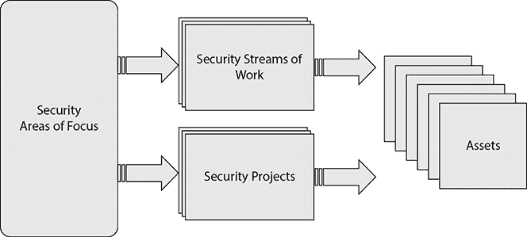

**图 3-1** 安全计划组件

- **安全关注领域** 影响安全计划的外部驱动因素，如 `PCI DSS`、`HIPAA`、`Sarbanes-Oxley` 或 `FISMA`，以及内部驱动因素，如 IT 部门的 IT 服务管理策略。
- **安全工作流** 持续性的安全活动，如安全事件监控、事件响应、漏洞管理等。
- **安全项目** 由安全组织发起并实施的非持续性活动，具有明确的目标或最终产品。安全项目示例包括：选择身份管理解决方案、部署特定 `GRC` 系统（见侧边栏）、构建安全意识门户、执行漏洞评估。项目遵循项目管理流程实施。
- **资产** 组织拥有的资源。在安全计划背景下，资产是需要针对威胁进行保护的资源，通常由系统和数据组成。

CISO 的挑战在于以协调一致的方式管理这些要素。

### 安全关注领域

安全关注领域是影响工作流和安全项目执行方式的驱动因素。这些领域影响组织关于需要哪些安全活动及其应用范围的决策。关注领域可能适用于特定资产或资产组。例如，`PCI DSS` 要求根据企业中信用卡数据的存储位置实施特定安全控制。因此，`PCI DSS` 影响存储、处理或传输信用卡数据的企业资产在设计、实施和运营方面的安全要求。`PCI DSS` 可能影响一个或多个工作流和一个或多个安全项目。

#### 治理、风险管理与合规

**治理、风险管理与合规**（*Governance, risk management, and compliance*，`GRC`）是描述这三种实践及其相关活动的综合方法的术语。一些组织实施 `GRC` 计划，以实现对组织 `GRC` 的统一、整体方法，确保组织通过将战略与组织目标对齐，按照其内部策略、外部合规要求和风险偏好行事。`GRC` 的优势在于跨组织同步这些职能之间的信息，确保它们不相互孤立。

- **治理** 确保战略目标、规则、策略和实践与业务目标保持一致
- **风险管理** 通过分析风险概率和影响、优先实施控制措施，将风险维持在可接受水平
- **合规** 监控并报告组织对内部要求（策略和程序）及适用外部要求（法律法规）的遵从情况

`GRC` 通常通过实施 `GRC` 系统借助技术手段实现。`GRC` **系统**（*GRC system*）使组织能够使用集中式工具完成 `GRC` 相关工作。每个 `GRC` 职能都会生成和管理各类信息，如资产清单、策略、标准、程序、审计工作底稿、安全事件信息、风险管理信息、合规信息、控制监控与报告信息等。这些信息通常分散在文档、电子表格和/或系统中。`GRC` 系统的主要优势包括：将数据整合到中心位置、自动化业务流程、编译并报告集中的 `GRC` 数据。

## GRC 系统

GRC 系统提供一系列功能，可能包括以下部分或全部功能：

- 管理政策和程序的制定、管理及审查工作流
- 记录政策例外情况
- 记录控制措施并管理控制监控工作流
- 维护资产清单
- 管理资产风险评估
- 记录和管理控制缺陷
- 维护风险登记册和风险文档
- 跟踪控制测试
- 管理审计文档、计划和业务约定
- 记录和跟踪事件
- 仪表板和报告

### 实施 GRC 系统的考量因素

在决定是否实施 GRC 系统时，组织需要考虑许多因素。与任何工具一样，实现价值需要前期投入工作。对于 GRC 系统而言，如果组织未能确定用例，或缺乏健全的治理、风险管理和合规基础，则这种前期工作可能非常繁重，尤其是对于较小的安全团队。为了实现 GRC 系统的全部价值，组织应考虑以下因素：

- 组织是否拥有完整的资产清单、合规义务和控制措施清单？
- 是否已确定资产所有者和数据所有者？
- 是否有坚实的政策、程序、标准等基础？
- 是否已确定 GRC 系统的用例？
- 是否对待自动化的手动流程工作流有透彻的理解？
- 是否已确定参与工作流的人员？
- 组织是否有员工和资源来实施、管理和维护 GRC 系统？
- 需要哪种定制？
- GRC 系统需要满足哪些报告要求？

### GRC 系统的价值

尽管它提供了许多好处，但 GRC 系统无法修复定义不清的 GRC 计划。当 GRC 系统用于增强一个定义明确的 GRC 计划时，它能提供良好的价值。

### 关注领域

关注领域包括组织必须遵守的法律、法规、标准或政策。解决合规性（以及关注领域）的过程在 第 1 章 的“合规性”部分中有描述。`CISO` 负责确保关注领域正确地融入安全计划中。

## 安全工作流

持续进行且没有明确开始、中间和结束的活动，属于某些 `CISO` 所谓的 `streams of work`（工作流），也有人称之为信息安全计划的 `subprograms`（子计划）。为便于讨论，我们使用术语 `streams of work`。由于其性质，这些活动将贯穿安全计划的整个生命周期。这些持续的安全活动因组织而异。以下是一些典型的安全工作流列表：

- 安全文档维护（安全章程、政策、程序、标准和指南）
- `GRC`
- 风险分析和管理
- 用户身份管理和供应
- 资产管理
- 威胁情报
- 安全监控和入侵检测
- 入侵防御
- 安全管理
- 配置和补丁管理
- 应用安全
- 安全培训和意识
- 安全测试
- 物理安全
- 业务连续性
- 灾难恢复

尽管这些活动是持续进行的，但它们仍有一个生命周期过程，这与项目管理生命周期有些相似。`Streams of work`（工作流）可以遵循计划、执行、检查、处理（`PDCA`）过程模型来完成，该模型此前在 第 1 章 和 第 2 章 中已讨论过。常被引用的威廉·爱德华·德明（William Edwards Deming）倡导 `PDCA` 模型，他曾说：“尽力而为是不够的；你必须知道该做什么，然后尽力去做。”遵循德明的建议，许多行业常用的 `PDCA` 循环非常适合执行 `streams of work`（工作流），因为每个工作流都应该：

- 计划周密
- 按计划执行
- 根据成功标准进行衡量
- 持续改进，以解决任何不足并随时间推移而变得更好

第 1 章 介绍了应用于合规管理的 `PDCA` 过程。然而，`PDCA` 模型（也称为德明循环或休哈特循环）适用于任何工作流，无论是否涉及合规。图 3-2 说明了 `PDCA` 模型如何用于安全工作流，具体描述如下。

**图 3-2** 工作流过程

### 计划

持续的 `streams of work`（工作流）应当单独地、整体地作为一项协调的活动组合进行周密规划。`CISO` 应根据 第 1 章 中描述的治理和风险分析活动确定的优先级，制定完成这些活动的路线图。路线图应体现在安全章程或安全计划等文档中。路线图反映了短期和长期计划，并应至少每年更新一次。

规划应根据组织的业务、利益相关者需求或安全审计/评估结果，反映重点领域。例如，如果漏洞评估表明组织有许多未打补丁的系统，组织可能需要在短期内给其 `patch management program`（补丁管理计划）更高的优先级。计划应根据组织的实际需求频繁更新。

规划 `streams of work`（工作流）包括确定完成安全计划所包含活动所需资源的范围。资源可能包括以下内容：

- `Staffing`（人员配备） 本章后面的“安全计划资源管理：建设安全团队”部分将更详细地讨论，人员配备涉及确定合适的团队以最好地完成工作流目标。人员配备规划还包括确定工作流团队的组织架构，以及团队架构如何融入信息安全部门的整体架构中。

- `Supporting infrastructure and tools`（支持基础设施和工具） 每个工作流都有其特定的工具和 IT 基础设施需求。规划包括确定需要哪些工具，以及组织是采购每个工具还是自行开发（`build versus buy`，即“买还是自建”）。工具还需要维护。维护工具的需求和资源也是规划活动的一部分。

- `Financial resources`（财务资源） 执行工作流所需的资金可能会随时间支出。工作流活动可能会经历支出较大的时期，例如采购设备、扩充人员或活动激增时（例如在事件响应或合规演练期间）。支出预算通常按年度制定。

- `"X as a Service"`（X 即服务） 如今，许多 `CISO` 选择不使用内部资源或工具，而是采用 `as-a-service`（即服务）模式外包安全职能。此类服务范围可大可小，从安全计划的小片段（如防病毒）到大片段（如企业完整的安全监控和入侵检测）。安全计划的几乎任何方面都可以使用 `as-a-service` 模式实现。

## 工作流 PDCA 循环

### 计划

与工作流相关的计划应包含对目标和目的的清晰定义。如果没有明确的目标，该工作流可能无法产生有利于组织的成果。计划还应说明成果如何衡量和报告。工作流计划文档存储在文档存储库中，该库设有遵循“需知原则”的`access controls`（访问控制）以及用于管理文档基线的`change control processes`（变更控制流程）。计划标明了该工作流适用的资产。计划还应涉及`security relationship`（安全关系），包括工作流如何影响其他部门、组织内部人员和外部实体。`security relationship`（安全关系）的描述还应确定与这些利益相关者沟通、协调和协作的方法以及沟通的频率。

### 执行

根据上一节所述计划，工作流开展活动以实现既定目标。所有活动应遵循计划中确定或定义的流程和程序。每个工作流都配备一名工作流负责人或工作流经理，这可能是 CISO 或指定的经理或主管。

在 CISO 的指导下，安全组织应制定并完善 `operating`（运行）（或 `operational`（操作））`rhythm`（节奏），这指定期发生的沟通（通常是报告和会议），但不会对工作流或其他活动的运行流程产生不利影响。需要召开会议，以便团队成员进行沟通协作、解决问题、汇报状态和讨论改进。需要报告，以向管理层和决策者提供数据和指标。这些沟通必须按固定的节奏、以明确且可重复的方式进行。表现最好的安全组织往往是那些理解最佳运行节奏价值并相应调整其计划的组织。

工作流活动应在自我意识下完成。这意味着每个参与工作流的人员不仅应知道自己在做什么以及如何与他人的工作配合，还应了解工作流相对于其目标的执行情况。失败的工作流往往只有老板真正知道发生了什么。当每个人都对结果负责并知道如何为工作流的成功做出贡献时，工作流才能取得成功。

工作流人员应记录所有内容，包括计划、程序、指南、报告和指标。为创建一个有用的活文档库，工作流数据应存储在文档存储库中。这些文档虽然对组织很重要，但也包含有关组织安全漏洞和弱点的信息。因此，只有`need to know`（需知）人员才能访问工作流文档和数据。

#### 安全联络员

为取得成功，安全活动（包括工作流）必须与组织内的其他群体和人员密切协作。因此，安全团队需要与其他组织建立`security relationship`（安全关系）。许多`security groups`（安全小组）使用安全联络员，即安全团队中负责与组织其他部门联络的成员。安全联络员提供双向沟通，提供安全`messaging, expertise, and advise`（信息传递、专业知识和建议）以宣传信息安全实践，包括组织为改善安全所做的工作，并充当 CISO 的眼睛和耳朵，`listen to what employees think and feel about security policies, practices, and initiatives.`（倾听员工对安全政策、实践和举措的想法和感受。）我们都知道，人是信息安全中最薄弱的环节。安全联络员有助于改善组织的安全文化，进而减少安全事件。

### 检查

CISO 如何判断工作流是否有效？它们必须根据成功标准进行衡量。每个工作流都应有一套明确的目标，以及衡量这些目标实现程度的指标。工作流规划包括确立如何衡量和报告成功。然而，PDCA 的检查阶段不仅涉及针对活动主要目标的绩效指标。还包括评估活动各方面的方法。这可能包括衡量准确性、实用性、适用性、弹性或适应性等。CISO 应始终寻找衡量和了解安全计划各方面执行情况的方法。

某些绩效指标每天测量，例如监控日志和检测警报。其他指标作为评估或审计行动的一部分进行测量。正如第 2 章所述，安全审计通常作为更大审计计划的一部分完成，但这些审计可用作评估工作流绩效的工具。然而，审计计划之外可能还有其他衡量措施。许多组织使用安全仪表板显示工作流活动状态，例如来自安全监控职能的工单统计数据，或来自补丁管理工作流的已修补/未修补系统。

评估应成为运行节奏的一部分，如前所述，这是一个沟通报告的节奏，包含工作流执行情况的衡量指标。

### 行动

行动阶段的目的是维护安全职能（工作流）的质量并寻求改进方法。这是通过审查和分析检查阶段的结果和数据来实现的。将结果与每个工作流定义的目标进行比较。然后确定缺陷和差距的范围以进行补救。

一些组织使用行动计划与里程碑 (POA&M) 或纠正行动计划 (CAP) 将补救流程正式化。这些术语源自 FISMA 及支持 FISMA 的各种指南和出版物；不过，它们也被通用于描述捕获、跟踪和沟通安全补救活动的方法。POA&M 和 CAP 按系统创建，用于跟踪作为风险管理框架 (RMF) 流程一部分的安全测试中发现的问题的解决情况，但也可用于支持安全工作流中缺陷或所需改进的解决。POA&M 是描述解决缺陷治疗方案的计划。它包含一个 CAP，详细描述将采取（或已采取）什么措施来解决缺陷。

PDCA 循环行动阶段的一部分包括查看跨工作流的结果汇总，以发现趋势并确定根本原因。

行动阶段执行的活动包括跟踪为解决差距、消除根本原因和实施改进而采取的行动。如果跟踪数据存储在数据库中，组织将拥有一个存储库和活记录，显示工作流随时间的执行和改进情况。

## 资产安全管理

第 1 章讨论了资产的安全分类和风险缓解。第 4 章描述了资产安全的核心能力以及其他核心能力。本节讨论资产的安全管理，并在第 3-3 图 Figure 3-3 中进行了说明。

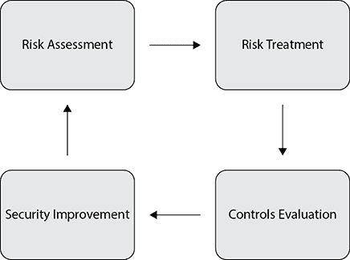

**图 3-3** 资产安全管理

## 资产管理与风险生命周期

图 3-3 源自 ISO/IEC 27001，展示了风险管理如何应用于特定资产的生命周期。每项资产都会作为风险评估和风险分析过程的一部分进行评估，从而实现资产的优先级排序和分类。在此基础上，为资产定义风险处理方案。处理方案得以实施，通常以控制措施的形式呈现，随后进行评估。测试过程中发现的任何缺陷或差距随即得到解决。通过随时间监控资产并开展后续风险分析活动，从而实现安全改进。此循环将持续至资产生命周期结束。

信息安全计划的一个关键方面是了解所有资产是什么、位于何处以及其安全态势如何。这种态势感知是安全计划管理的关键职能。理想情况下，安全团队维护或有权访问一个包含此信息的单一数据库。然而在实践中，这些信息往往分散在不同的数据存储库中，或由其他团体（如 IT 部门）维护。

无论数据位于何处，安全团队都应有权访问或维护每项资产的相关数据。以下是可能为资产维护的信息示例：

- 资产名称、制造商、型号、序列号等
- IP 地址和 MAC 地址
- 资产类型
- 资产所有者和保管人的姓名
- 位置
- 配置信息，如安全基线、配置设置或标准构建标识
- 许可信息和状态
- 安全分类、密级、风险或影响级别，或其他表明资产预期安全特性的信息
- 最近一次评估、审计或合规审查的结果
- 资产当前的安全监控方法
- 当前运行状态
- 当前补丁状态或级别
- 与其他系统或资产的关系
- 安全授权状态

控制组织资产并确保其得到妥善保护，是 CISO 面临的最大挑战之一。流氓设备可能意外或故意出现在网络上。此外，包括手机、平板电脑和 PC 在内的便携设备虽属于企业资产，但更难追踪。许多组织使用自动化解决方案来发现资产，旨在协助资产态势感知，并防止未经授权的资产连接到企业网络或造成中断。

### 信息资产

就本讨论而言，**信息资产**即数据。数据简直是任何组织的生命线，最常成为网络攻击的目标，也是安全事件及后续恢复活动的对象。信息资产与支撑它们的资产（系统、硬件和软件）一样，需要安全团队进行管理。信息资产管理包括以下内容：

- **信息资产分类** 安全团队确保所有数据均按照组织的数据分类策略及相关指南进行分类。分类方案因业务环境性质而异，但每个组织至少有两类（或分类）数据：
  - 需要一定程度保护的私有数据
  - 不需要保护的公开数据
- **数据处理** 安全计划制定策略、标准和指南，规定每类数据在存储、处理或传输过程中应如何处理。这些规则定义了数据处理的主体、地点和方式，包括定义加密、访问控制、标记和物理介质等实施方法。
- **数据清单** 与支撑资产（硬件和软件）一样，信息资产通过清单和相关流程进行追踪，以维持对组织信息资产所在位置、保护方式以及组织遵守适用于该资产的策略和规则情况的了解。

### 安全项目

安全项目是安全计划中具有开始和结束的活动。工作流是持续进行的，而安全项目有明确的结束目标，一旦达成目标，项目即告结束。组织的活跃安全项目列表不断变化。每年随着旧项目的完成，都会产生新的安全项目需求。可能纳入安全计划的示例项目包括：

- 采购并实施漏洞扫描工具
- 执行网络安全架构审查
- 开发安全工具
- 部署应急响应能力
- 为数据中心设计物理安全控制
- 对服务提供商执行风险评估
- 制定软件开发安全标准
- 使安全实践与行业框架保持一致（例如 ISO/IEC 27001、NIST SP 800-53 等）

所有这些示例都会导致某种项目的创建，必须对其进行妥善管理以确保成功。项目与工作流一样，需要严格的管理才能成功。但项目管理过程与工作流略有不同，因为项目有明确的结束状态，所有活动都旨在实现该结束状态。项目管理流程将在本章后面的“项目管理”部分详细讨论。

### 安全计划预算、财务与成本控制

CISO 对安全预算和支出的负责程度因组织而异，通常与显示汇报关系的顶层组织架构图保持一致。如果 CISO 向 CIO 汇报，安全预算很可能是 IT 预算的一部分，预算编制和支出流程通过该汇报链进行管理。在 CISO 直接向 CEO 汇报的情况下，CISO 通常在预算编制和支出方面拥有更大的自主权。

#### 安全职能共享时

在某些组织中，CISO 不负责信息安全预算的某些部分。例如，许多安全漏洞由未打补丁的系统引起，但在一些组织中，补丁管理不在 CISO 职责范围内，而是归 IT 部门或 IT 服务管理团队管辖。另一个例子是安全意识。CISO 可能负责安全意识培训，但培训预算可能由人力资源部门管理。在各种安全相关职能不在 CISO 预算权限之下的情况下，CISO 可能会被要求为负责团体的预算流程提供意见。这种预算流程中的协作很常见。

### 制定预算

正如第 1 章“规模划分”节所讨论的，该节涵盖了信息安全组织的规模划分，一些高管和 CISO 喜欢将其组织的安全支出与同类组织的支出进行比较。虽然参考同类组织可以提供一个良好的数据点，但它不应成为确定信息安全预算的主要方法。安全预算应为为组织提供适当保护水平所需的金额。

# 信息安全预算编制

除非组织是初创公司，否则在几乎所有情况下，信息安全预算都是基于组织的历史支出制定的，即“我们去年花了多少钱？”。事实上，这并不是一个糟糕的预算编制起点。预算编制的核心在于预测未来，CISO 掌握的过往数据越多，对未来可能发生的情况就越了解。这种方法在运营多年后特别有用，因为先前的经验和教训可以告诉 CISO 什么有效、什么无效。然而，安全计划始终在变化、演进并面临新威胁，因此逐年的支出总会有所调整。总体而言，最有效的方法是自下而上的方式：首先估算最小工作单元，再将其整合为大型计划。最底层的要素应采用基于风险的方法进行估算，并参考过往经验。

以下是制定信息安全预算的一些方法和因素：

## 从基线开始

使用上一年的数据作为起点。CISO 不应只关注上一年的实际支出，还应关注上一年的预算。上一年的预算与实际支出相比如何？从中能获得什么经验教训？

## 建立工作分解结构 (`WBS`)

`WBS` 是一种通过将大型工作拆解为更易估算和控制的较小单元，来估算大型工作量所需工作的方法。使用 `WBS`（详见本章后文“项目管理”部分的详细解释），CISO 可以对每项活动的成本进行自下而上的估算。`WBS` 应与工作流及安全组的所有其他活动保持一致，并应与组织收集和报告成本的方式对齐。用一种方法编制预算却用另一种方式报告支出是不合理的。如果预算与成本报告方式一致，CISO 将能更好地管理支出，并逐年改进预算编制流程。

## 查看风险评估结果

如果防火墙管理的支出为 X，但测试表明防火墙频繁配置错误，那么未来防火墙管理的支出可能应超过 X。又如 第 1 章 所述，如果某系统的年化损失期望值 (`ALE`) 为 10,000 美元，组织很可能不应每年花费 100,000 美元来保护它。风险评估和分析活动的结果应当且必须为预算流程提供参考。

## 估算差距整改成本

CISO 利用评估和审计结果确定支出重点。不合规领域通常需要投入资源进行整改。事实上，`POA&M` 或 `CAP` 流程应包含建议措施的成本估算，并将其纳入预算。

## 考虑生命周期成本

许多软硬件产品都有明确的生命周期。现代系统和技术可能面临生命周期结束（即停止支持）、过时或需要升级的情况。技术刷新和维护协议的成本应计入预算。

## 实施价值工程

优秀的 CISO 总会考虑是否有成本更低的实现方式。在能够提升效率的地方，往往也能节省成本。

## 确定新增需求

CISO 应估算应对新举措、改进、引入新技术或满足新法规的成本。组织本身也在变化：收购或合并其他公司、推出新产品和服务、进入新市场等。所有年度变化都应被考量并在必要时反映在预算中。

## 考虑潜在风险事件

意外事件不可避免。CISO 应为重大安全事件、大流行、灾害、劳资纠纷或其他无法具体预测的突发情况预留预算。CISO 还应评估为组织购买安全事件保险的成本与可行性。

## 设立管理储备

很少有组织允许 CISO 为未定义支出编制预算，但 CISO 应在预算中预留一定的 `wiggle room`（有时称为 `management reserve`）。这只是在估算中增加的一笔“以防万一”的额外金额。有时通过在预算项中包含可动用的额外金额来实现。最优秀的 CISO 既不虚报成本，也不愿让自己陷入资金短缺的境地。

## 实施滚动预测

信息安全计划预算通常按年编制，但许多组织会制定超出下一年的预测。CISO 需要着眼长远、规划未来。通常会制定三年滚动预测，并随年度预算每年更新一次。

## 明确预算范围

预算涵盖 CISO 负责的所有项目，包括硬件、软件、员工、顾问、外包服务、供应商、托管服务，以及安全计划范围内 CISO 被指定负责的任何其他项目。

## 明确支出时间节点

CISO 应规定每个 `WBS` 要素的支出上限及发生时间。通常按月分配成本进行估算。财务会计部门需要此信息来预估应计项目和现金流。CISO 也需要此信息来规划活动时间、跟踪和审批支出。如果某预算行项目假设成本分摊至全年，预算应反映支出时间线。按月分配预算可使 CISO 按计划管理支出。

# 资本性支出与运营性支出 (`CAPEX` vs. `OPEX`)

在与一位 CISO 讨论托管服务时，他表示不使用此类服务，但原因并非显而易见。他的决定基于公司的财务偏好。出于会计原因，公司倾向于资本性支出 (`CAPEX`) 而非运营性支出 (`OPEX`)，因此鼓励投资基础设施建设而非支付服务费用。因此，他选择在内部构建安全能力（视为 `CAPEX`），而非外包服务（视为 `OPEX`）。

# 向管理层推销预算

预算估算完成后，CISO 必须向上级审批链“推销”预算。此流程因组织而异，但无论何种情况，CISO 都必须能够为估算提供合理依据。预算应辅以扎实的数据。更重要的是，CISO 必须说上级听得懂的语言，回应他们的关切和工作方式。什么类型的数据最能说服 CEO？组织过去是怎么做的？CISO 是否考虑周全？能否降低成本？作者见过许多耗费巨大精力和精心编制的预算，却因 CISO 无法说服管理层所有支出均为必要而被驳回或削减。

# CISO 预算论证与安全团队管理

CISO 使用多种策略来论证其预算请求。如前所述，一个有用的策略是纳入与行业内其他组织预算的对比。尽管 CISO 不应过分强调行业对比来*制定*预算，但此类对比有时有助于向他人*论证*预算的合理性。CEO 总爱听到组织在某方面的支出少于竞争对手。如果行业对比显示确实如此，CISO 可以利用该信息为己所用。Gartner 和 Forrester 等行业来源，以及 RSA、Verizon 和 IBM 等供应商，都可以作为安全支出数据的良好来源。

论证信息安全预算的两种最常见方法是将讨论框架限定在风险和/或合规性方面：

## 风险论证

**风险** CISO 很可能已执行风险分析，以了解组织资产及其对业务的价值，并利用此信息确定优先级，决定在何处以及投入多少资源保护这些资产。这些相同信息可用于论证支出。如果 CEO 或预算批准者理解风险、业务影响及缓解风险成本之间的关系，他们更有可能支持该支出。

## 合规论证

**合规** 法规是驱动安全支出的常见强制力。如果法规要求保护信息并规定了不合规的罚款，那么这些罚款的风险即可论证支出的合理性。

## 管理和监控支出

一旦预算获批，即可作为监控和控制成本的基准。构成预算的各个项目（按 WBS 或其他方法定义）可用于建立成本核算和跟踪方式。例如，若 WBS 包含安全运营中心（SOC）的运营成本要素，财务部门可建立成本账户和费用编号，以批准和记录与 SOC 相关的支出。预算与实际支出的一致性使安全财务可通过对比*预算与实际值*来控制和监控。定期将实际支出与预算对比，是管理安全财务的关键。

应为预算中的所有项目或项目组建立成本账户。这要求 CISO 与财务或会计团队紧密协作。建立成本账户包括定义谁可批准支出及批准阈值。成本账户的责任可能由 CISO 承担，或由 CISO 委派其他经理批准支出。实践中，这通过定义谁可批准工时表、创建或批准采购订单、或承诺合同来实现。

会计团队按成本账户向 CISO 报告人工或费用的实际支出。若成本账户与预算行项目一致（本应如此），CISO 即可将预算中定义的计划支出与正在发生的实际支出进行对比。这能显示支出节余或超支，使 CISO 能相应调整未来支出。

## 安全计划资源管理：建设安全团队

安全团队是 CISO 保护组织信息资产可用的最重要资源。CISO“掌舵领航”，负责让*合适*的人上车——合适的人不一定是技术最好的人，而是最能执行 CISO 愿景的人。因此，团队的合适人选可能是那些拥有技术、沟通和人际技能最佳组合，且具备正直、诚实、谦逊等性格特质的人。

以下是创建和维护优秀安全团队的因素：

### 制定人员配置策略

**制定人员配置策略** 配置安全团队始于定义人员配置策略。CISO 应明确想要什么样的团队，再规划实现路径。理想情况下，CISO 定义团队文化、能力、方法、工作方式、招聘和保留的目标。这为团队配置提供指导。例如，若 CISO 想要高度协作的团队，却雇佣内向且沟通不畅的人，可能无法实现目标。同样，若 CISO 认定技术安全知识至关重要，则应将其纳入策略，以获得所需的强技术人员。

### 实施岗位分析

**实施岗位分析** 岗位分析是收集所需工作类型和职能所有可用信息的过程，使 CISO 能识别团队所需的所有岗位角色并编写职位描述。收集信息包括职责、责任、成果、技术、流程、法规驱动因素、标准及相关数据。信息越全面，CISO 定义角色越容易。

### 定义岗位角色并编写职位描述

**定义岗位角色并编写职位描述** 岗位角色和描述用于招聘员工并为员工设定清晰期望。利用岗位分析收集的数据，CISO 可创建功能性职位描述，定义团队中的每个角色。在某些组织中，这属于 HR 职责；在某些情况下，CISO 无权定义岗位角色，必须使用 HR 定义或强制的角色。这可能限制 CISO 利用角色和描述作为招聘和建设团队的工具。也可能成为 CISO 与 HR 协作定义团队的机会。目标是拥有一套职位描述，可作为建设团队和向员工传达期望的工具。

### 使用 NICE 工作角色框架

**使用 NICE 工作角色框架** 美国国家标准与技术研究院（NIST）创建了网络安全岗位角色框架，其中的职位描述和培训要求以库的形式供任何雇主使用。这就是国家网络安全教育计划（NICE）网络安全工作角色框架（NIST 特别出版物 800-181）。CISO 可利用这些预定义的*工作角色*创建组织的安全职位描述。这不仅节省 CISO 时间，还能利用经过行业验证并随时间更新的工作角色。

### 定义职业路径

**定义职业路径** 许多公司用来吸引、支持和留住员工的一个工具是定义和使用*职业路径*。职业路径是员工可遵循的岗位角色、培训和绩效标准的定义序列，帮助他们在组织内发展职业。在当今竞争激烈的招聘环境中，雇主寻求吸引和留住员工的方法。员工想了解在公司如何晋升。定义和记录组织和员工可遵循的职业路径，有助于保持员工满意度，帮助组织留住人才，并使员工扩展技能、提升工作能力。

## 员工管理

### 培训
与商业领域的许多方面一样，安全形势也在不断变化和发展。人员几乎需要持续不断的培训，以保持其知识和技能的时效性。CISO 制定培训计划和相关预算，以确保安全团队接受适当的教育，这至关重要。有些 CISO 会与培训机构或高校建立合作关系，为员工提供独特的学习机会。我们认识一位 CISO，他每年全年都会引入专家讲授安全认证课程，以便整个安全团队能更好地获得重要的行业认证。CISO 都知道，他们需要在培训上明智投资，以使员工能够达成安全计划的目标。

### 处理人员与团队合作问题
所有 CISO 都应制定计划，在不中断运营的前提下处理人员问题。然而，大多数 CISO 通过在第一时间预防问题来应对这一挑战。实现这一点的一种方法，如前所述，是将品德和沟通能力纳入招聘标准。招聘合适的人员将在预防涉及人际关系和团队合作的问题方面发挥巨大作用。预防此类问题的其他方法包括：创建门户网站以帮助团队成员协作、明确界定角色和职责，以及定期举行跨部门协作会议以促进和便利更好的沟通。如果问题确实发生，应有书面程序将问题上报给人力资源部、CISO 或两者兼有，并制定规则和纪律处分措施，以惩戒影响安全计划绩效任何方面的问题行为。

## 寻找优秀的 IT 安全人员真的那么难吗？

媒体和行业团体广泛报道称，负责 IT 安全职位的人员存在巨大短缺。我们最近问一位 CISO 他是如何应对这一可用人才短缺问题的。他的回答是：“什么短缺？”这位身处数十亿美元公司的 CISO 拥有庞大的团队，且在过去两年里规模翻了一番。他没有遇到任何扩充团队的问题。为什么？他从公司内部挖掘人才。历史上，大多数 IT 人员不愿意从事安全工作。但现在不一样了。他公司的 IT 人员纷纷请求加入他的团队。公司鼓励员工在内部流动，管理层也鼓励他从内部选拔人员。该 CISO 在其团队内打造了良好的文化，吸引了 IT 部门的人员主动寻求加入安全团队的职位。他根据个性而非经验来选择人员，因为他知道可以通过培训为他们提供所需的安全知识和技能。正如他所说：“技能可以培养，但品德难以培养。”

## 项目管理

项目管理是管理层级（投资组合、项目集和项目）中最底层的级别。项目管理的目标是确保每个项目都能按时、在预算内实现预期成果。项目管理包括识别和控制资源、衡量进度，以及根据进展情况根据需要调整计划。CISO 可能直接担任部分或全部安全项目的项目经理，也可能指派他人担任项目经理。无论哪种情况，CISO 都应熟悉项目管理原则和技术。

将良好的项目管理实践应用于各种规模的项目非常重要。有些组织将项目管理精力集中在大型项目上，往往忽视小型项目。如果这些小型项目得不到妥善管理，最终可能会耗费组织大量的时间和资源。并非所有项目都需要正式的项目管理。正式化的程度可能取决于项目的规模或重要性；然而，良好的项目管理原则应应用于所有项目。这至少包括：确定范围、制定成功衡量标准、监控和控制资源，以及在计划中记录这些项目。本节讨论项目管理的一些基本原则，并演示项目管理流程。

## 项目管理基础

与信息安全的 CIA 三要素（机密性、完整性和可用性）类似，项目管理也有一个三要素，由以下要素组成：

- **范围**：要执行的工作边界
- **进度**：执行工作的时间线
- **预算**：执行工作所需的成本和资源

如果其中一个要素发生变化，通常会影响其他两个要素。例如，项目范围的变更可能会影响项目预算和进度。这些要素的应用方式决定了项目的质量。这种相互依赖关系如图 3-4 所示。

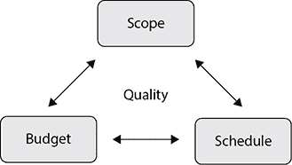

**图 3-4** 项目管理基础

归根结底，项目管理作为一种实践，专注于管理和控制这三个基本要素，以实现项目目标。项目管理中总是存在权衡。关于成本、进度和范围的决策会影响项目交付物的质量。成功的项目按时完成（进度）、在成本预期内（预算），并实现技术和业务目标（范围）。

> **考试提示** CCISO 考生应熟悉基本的项目管理术语——范围、进度和预算，并理解这些要素如何影响项目。

### 项目管理考量因素

在项目管理和软件/系统开发中有一句老话：“好、快、省——三选二。”这是对形势的一种简化表述，但它阐释了一个重要概念。其含义是，虽然目标始终是在三个原则之间取得平衡，但有时必须让两个原则压倒另一个。在每个项目中，都必须就哪个原则最重要做出一些关键决策。目标是高质量（好）的最终产品、低成本开发（省）的产品，还是快速交付（快）的产品？总是需要做出权衡，如图 3-5 所示，具体说明如下：

- 好 + 省 = 交付慢
- 省 + 快 = 质量差
- 快 + 好 = 成本高
- 快 + 好 + 省 = 最佳平衡点

最终目标通常是协调这三个原则。这可能难以实现，但应作为目标。

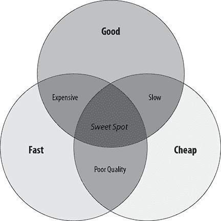

**图 3-5** 好、快、省——三选二

## 项目管理培训与认证

有多个项目管理认证机构；其中两个知名机构是项目管理协会和 AXELOS。这些组织为社区提供一系列福利，包括出版物、论坛、会议、社交机会和最佳实践资源，并提供认证和培训以支持持续学习。

> **注意** 本节并未对项目管理培训机构进行全面调查。此处介绍的机构只是行业内普遍存在的几个，用于说明可用的项目管理培训和认证范围。

### 项目管理协会

*项目管理协会 (PMI)* 是一个专注于项目管理认证和教育的全球性非营利组织。PMI 制定标准、开展研究、出版刊物、举办会议，并为项目管理专业人士提供社交与合作便利。PMI 的旗舰认证是项目管理专业人士资格认证 (PMP)，但它还为以下内容提供培训和认证：

# 项目管理认证

## PMI 认证

- 项目集管理专业人士 (PgMP)
- 项目组合管理专业人士 (PfMP)
- 项目管理认证助理 (CAPM)
- PMI 商业分析专业人士 (PMI-PBA)
- PMI 敏捷认证从业者 (PMI-ACP)
- PMI 风险管理专业人士 (PMI-RMP)
- PMI 进度计划专业人士 (PMI-SP)

## AXELOS 认证

AXELOS 是一个全球最佳实践组织，提供多个领域的认证和培训，包括项目管理、IT 服务管理和网络安全。AXELOS 认证体系包括以下内容：

- IT 服务管理 (ITIL)
- 网络弹性 (RESILIA)
- 受控环境中的项目 (PRINCE2)
- PRINCE2 敏捷
- AgileSHIFT
- 成功项目集管理 (MSP)
- 风险管理 (`M_o_R`)
- 项目组合、项目集和项目办公室 (P3O)
- 项目组合管理 (MoP)
- 价值管理 (MoV)

# 项目管理阶段

良好的项目管理通过分配适当的资源、提供领导力以及为可能导致项目偏离轨道的事件做计划，使项目能够朝着正确的方向前进。项目由一个或多个阶段组成，这些阶段共同代表了项目中涉及的活动和任务。应建立项目管理机制，以确保遵循项目的每个阶段。这是通过选择并遵循项目管理模型来实现的。有许多项目管理模型可供选择。本书概述的模型基于 PMI 项目管理知识体系 (`PMBOK`) 过程组，如图 3-6 所示，包括以下内容：

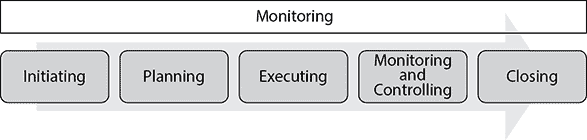

**图 3-6** 项目管理阶段

- **启动** 识别业务需求并定义项目。
- **规划** 制定计划以确保项目满足范围、时间和成本目标。
- **执行** 协调资源以执行项目计划。
- **监控** 测量项目绩效，监控偏差，并采取纠正措施。
- **收尾** 正式验收并有序结束项目。

虽然这些阶段是按顺序讨论的，但在实践中，它们可以按顺序、迭代或并发方式实施。在图 3-6 所示的模型中，监控过程贯穿整个项目。在实践中，监控过程发生在执行阶段，并在一定程度上发生在启动、规划和收尾阶段。此外，在某些组织中，启动和规划阶段可能同时发生。项目管理过程组可以裁剪和定制，以满足组织的需求。在本节中，我们将通过分解这些过程并讨论每个过程的组成部分来探讨项目管理。

**注意** 虽然本节讨论的项目管理模型基于 PMI `PMBOK` 过程组，但本节并不旨在完全与 `PMBOK` 的项目管理方法保持一致。本节基于作者观察项目管理在实践中如何应用的经验编写。

## 启动

在项目开始之前，必须在启动阶段完成前期工作。首先，必须识别业务需求或问题，并讨论潜在解决方案。根据解决方案的可行性，这可能需要创建一个项目。启动阶段发生的关键举措包括以下内容：

- 收集需求
- 定义项目范围
- 识别并访谈干系人
- 定义假设和制约因素
- 确定大致的项目预算和时间表
- 编制项目范围文件

### 收集需求

每个项目都必须有一组`requirements`（需求），即满足项目目标所需的最终交付物中的一组能力或项目。需求为定义项目范围提供了基础。收集需求所需的工作各不相同。在某些情况下，需求由客户提供或在项目开始前定义。其他时候，需求是作为项目的一部分开发的。提供的需求在详细程度上可能有所不同，可能需要额外的信息收集会议来创建清晰完整的需求。

### 定义项目范围

作为项目启动的一部分，对要完成的工作设定某种界限很重要。项目的`scope`（范围）定义了项目的边界。它是满足客户需求所需的工作。范围应概述项目包含和不包含的内容。范围包括项目目标、需求、干系人、进度计划和预算。清晰定义、文档化和受监控的范围是项目成功的重要因素。定义不清的项目范围可能导致以下一种或多种情况：

- `Scope creep`（范围蔓延） 由于增加需求、愿望或目标，导致项目范围不受控制地增长
- `Cost overrun`（成本超支） 项目过程中发生的超出预算金额的意外成本
- `Schedule overrun`（进度超期） 项目过程中发生的意外进度延误

范围在`project scope document`（项目范围文件）或`scope statement`（范围说明书）中定义，其中描述了项目交付物和成果。

### 识别并访谈干系人

作为项目启动的一部分，应识别并访谈干系人，并评估他们的需求。`Stakeholders`（干系人）是对项目有`vested interest or stake`（既得利益或利害关系）的人员。这包括内部和外部干系人。

- `Internal stakeholders`（内部干系人） 组织内部人员，如团队成员、业务领域经理、高级管理人员等
- `External stakeholders`（外部干系人） 组织外部人员，如客户、供应商、用户、承包商、供货商或投资者

识别干系人并记录他们的详细信息，至少包括姓名、角色、联系信息和关注领域。例如，一些干系人可能执行工作，另一些可能受工作影响，还有一些可能是接收方，如客户、业务所有者或投资者。干系人识别通常通过访谈、经验教训、头脑风暴会议或使用核对表来完成。干系人有时根据其影响力、兴趣和权力进行分类。具有高度影响力和兴趣并能直接影响项目产出的干系人有时被称为`key stakeholders`（关键干系人）。

对干系人进行访谈和评估，以确定他们的需求、期望以及对项目成功的定义。这些信息会被记录下来，以确保清楚理解他们的需求。

### 定义假设和制约因素

在启动阶段，应捕获并记录可能的假设和已知的制约因素。这些构成了项目规划的基础。

- `Assumptions`（假设） 基于知识或经验在规划中持有的信念或预期，可能不确定、不真实或不切实际（例如，假设资源 `X` 在项目期间将可用）。
- `Constraints`（制约因素） 对项目进度计划、资源、质量、预算、范围或风险的限制或约束，可能在执行期间影响项目（例如，资源 `X` 只能在周末测试）。制约因素可以是业务导向的，也可以是技术导向的。

## 启动

### 假设与约束

在启动阶段，假设与约束会在高层面上被记录下来，并应在整个项目生命周期中进行跟踪。假设是指可能被证明为错误的信念，而约束是指对项目执行的限制或障碍。两者都可能增加项目风险并影响项目需求，因此在整个项目过程中记录、分析和监控它们至关重要。

### 确定总体项目预算与时间表

启动阶段包括讨论和估算项目的初始预算。预算在启动阶段可能不是非常详细；然而，对项目总体预算有一个估算是很重要的。项目时间表也需要被讨论和估算，以预测成果大致何时需要交付。

### 制定项目范围文档

启动阶段描述的所有组成部分都应被记录下来，并将信息整合到项目范围文档中。*项目范围文档*记录所有范围数据以及关于项目的高层决策，通常至少包含以下内容：

- 范围定义
- 干系人输入
- 假设与约束
- 预算与时间框架
- 初步进度计划与资源

项目范围文档也可能被称为*范围说明书*。项目范围文档的目的是记录项目的边界。这用于确保项目没有偏差导致范围蔓延，并确保有明确定义的项目目标，使成功变得有据可查。

## 规划

规划阶段包含以下组成部分：

- 确定 SDLC 方法论
- 制定可衡量的目标
- 制定工作分解结构
- 制定项目进度计划
- 分配项目资源与预算
- 评估项目风险
- 记录项目计划

### 确定 SDLC 方法论

规划阶段的一个重要步骤是决定使用哪种方法论和技术来管理项目。该决策可能受组织的项目管理标准和首选方法论管辖，也可能由项目经理自行决定。该决定包括考虑是否遵循系统开发生命周期。

如前所述，本章概述的项目管理模型包括启动、规划（本节主题）、执行、监控与控制以及收尾过程。在此模型中，如果项目涉及开发或管理系统、产品或服务，项目经理可以选择在（通常）规划和执行阶段引入*系统开发生命周期 (SDLC)* 以建立遵循的方法论。本节讨论的系统开发生命周期包括*瀑布*方法论、*增量*和*敏捷*。

**注意** 并非所有项目都在项目过程中使用 SDLC。例如，如果 CISO 管理一个将公司安全控制映射到 NIST SP 800-53 的项目，CISO 可能会遵循项目过程（启动、规划、执行、监控与控制、收尾），但极不可能使用 SDLC，因为没有开发系统、产品或服务。然而，如果项目包括开发和实施新控制，如安全工具、系统或应用程序，CISO 可能会选择在项目过程中引入 SDLC。

**传统/分阶段/瀑布** 分阶段生命周期的特点是线性顺序的不同步骤，每个步骤必须在后续步骤开始前完成。这种方法也通常被称为*传统*或*瀑布*方法。在该模型中，项目范围、进度计划和预算在项目开始时（规划阶段）确定。范围在项目启动时固定，进度计划和预算的变更在整个过程中被仔细管理。关键因素是每个阶段的所有活动必须在开始后续阶段前执行、记录并完成。此概念如图 3-7 所示。该模型非常强调前期规划和管理。

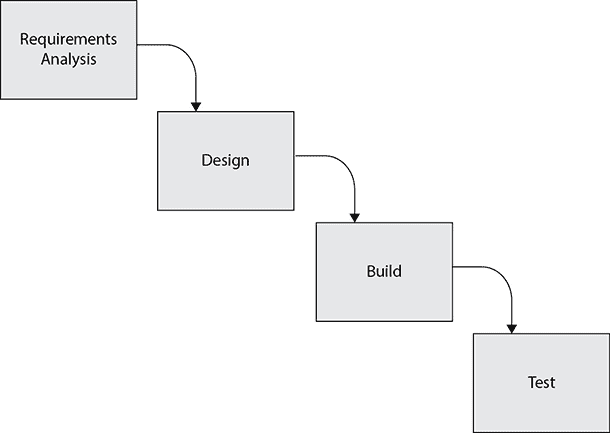

**图 3-7** 瀑布生命周期方法论

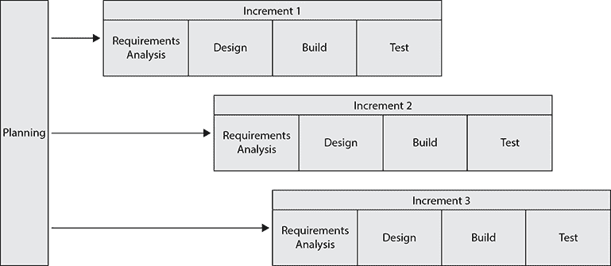

**图 3-8** 增量构建模型

该模型适用于受控的、可预测的开发，以及需求明确且提前有良好文档记录的项目。该方法的缺点是过程不灵活，因为它假设需求可以在开始时定义且在项目期间不会改变。这对某些项目可能有益，但对那些有许多变量影响项目范围或需求不确定、不完整的项目则有害。如果在项目后期需要变更，这种方法可能导致显著的成本增加。

**增量** 在*增量*生命周期模型中，会执行多个开发生命周期。每个生命周期都有预定的时间框架，并产生一个完整的能力增量。然后将每个能力与前一阶段的能力集成，以生成完整产品。此概念如图 3-8 所示。

**敏捷** *敏捷*是一个统称，指代多种利用迭代和增量开发过程并鼓励基于团队协作的开发方法论。敏捷方法论不是在前期制定详细需求后进行刚性开发，而是在过程中引入迭代模型，以实现速度和灵活性。在敏捷方法论中，产品开发工作被分解为称为*冲刺* 的计划迭代。此过程如图 3-9 所示。每个冲刺的长度各异，但冲刺通常持续两到四周。范围在迭代开始前定义。

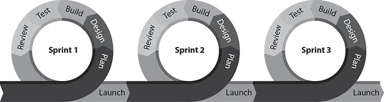

**图 3-9** 敏捷方法论

**考试提示** CCISO 候选人应熟悉各种开发生命周期方法论。

### 制定可衡量的目标

规划阶段的一个关键部分是制定可衡量的目标。这些目标用于制定在监控与控制阶段贯穿整个项目使用的度量指标，以衡量成功、识别需要纠正措施的偏差，并确定项目何时完成。如果没人知道成功是什么样子，项目就不能被视为成功。设定和衡量目标的方法论之一是 S.M.A.R.T.，在第 2 章中介绍过。

### 制定工作分解结构

项目规划的首要活动之一是将较大的项目分解为更小、更易管理、规模适中的块或工作包。这些被定义为先前介绍的*工作分解结构 (WBS)* 的一部分，WBS 是项目团队为完成项目目标并交付成果而必须执行的工作的层级分解。WBS 是一种项目管理工具，用于将项目分解为有组织的单个工作元素（任务、子任务和交付成果）。图 3-10 展示了图形化 WBS 的一种表示形式；然而，WBS 可以简单到只是一个任务列表。

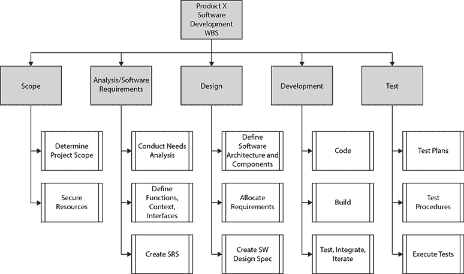

**图 3-10** 工作分解结构示例

## 工作分解结构

其理念是 WBS 中的每个元素或任务都被分解，并分配其自身的预算、资源、范围和进度计划。这是组织一切的一种方式。创建优秀 WBS 的诀窍在于包含适当详细程度的细节。如果 WBS 细节过多，项目经理将拥有极强的控制力和周密的计划，但可能会陷入管理开销和过载的泥沼。如果 WBS 细节不足，项目经理将控制力减弱、计划模糊，这可能导致范围蔓延、预算超支和进度延误。

工作分解结构可以是*面向职能的*或*面向任务的*。例如，面向职能的 WBS 会根据项目的各个阶段来定义任务，例如：

- 分析、设计、构建、测试
- 计划、执行、检查、处理
- 启动、规划、执行、监控、收尾

面向任务的 WBS 则按任务、配置项或需要构建的项目进行组织，例如：

- 选择扫描工具、实施工具、执行扫描、调整配置文件和策略
- 资产清单、硬件、软件、网络、数据
- 用户界面、通信协议栈、数据库、中间件

面向职能和面向任务的 WBS 都很有用。究竟使用哪种类型，最终取决于项目经理的风格或偏好，以及什么对项目和组织最合理。

### 制定项目进度计划

WBS 制定完成后，预算和进度计划将被分配给 WBS 中的每个元素。在制定项目进度计划时，必须考虑以下因素：

- **资源和工期** 每个特定元素涉及哪些资源？预期工期是多少？
- **依赖关系** 依赖关系是什么？每个特定项目/元素需要什么？

在规划阶段的这一环节中，项目经理开始更清晰地看到哪些活动位于关键路径上。*关键路径*是一系列事件或活动，如果发生变更，将改变项目的整体结束日期。如果关键路径上的任何一个活动延迟，整个项目交付的结束日期都会受到影响。项目经理必须时刻关注关键路径上的项目。

记录和可视化项目依赖关系的一种方法是使用*甘特图*，这是一种展示项目进度并显示任务依赖关系的图表类型。它提供了一种极好的方式来可视化所有必须作为输入提供给其他任务的任务输出。它显示了必须完成哪些任务才能开始其他任务。这有助于项目经理识别项目依赖关系，并构思和可视化关键路径上的项目。Microsoft Project 是一款流行的项目规划工具，它使用甘特图来帮助规划和展示项目进度。图 3-11 展示了 Microsoft Project 中甘特图的高层示例。

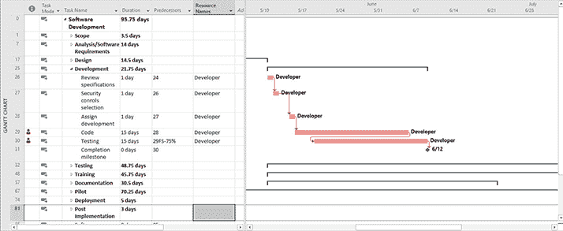

**图 3-11** Microsoft Project 中的甘特图示例（含关键路径）

### 分配项目资源和预算

WBS 和项目进度计划创建完成后，将为每个项目元素分配资源和预算。规划阶段的这一部分通常涉及关于使用内部资源还是外部资源，以及自建、购买还是租赁的决策。以下是一些考量因素：

- **内部资源**
  - 为每个 WBS 元素选择并分配资源
  - 根据可用资源调整 WBS
  - 可能需要新招聘或对员工进行新培训
  - 可能需要采购硬件和软件
- **外部资源**
  - 如果时间/资源允许，进行竞争性选择流程
  - 建立合同和工作说明书 (SOW)
  - 定义交付成果、里程碑和义务
  - 建立服务级别协议 (SLA)

#### 职责矩阵

*职责矩阵*可用于划分为满足项目交付成果所涉及的每个活动或任务的责任。职责矩阵通常称为 *RACI 图表*，该首字母缩写代表以下含义：

- **负责 (Responsible)** 负责完成特定项目任务或活动的个人
- **批准 (Accountable)** 通常意味着对活动或任务的管理
- **咨询 (Consulted)** 就特定活动或任务提供意见被咨询的个人，通常是主题专家 (SME)
- **知情 (Informed)** 被告知特定任务或活动进展的个人

图 3-12 展示了一个高层 RACI 图表示例。

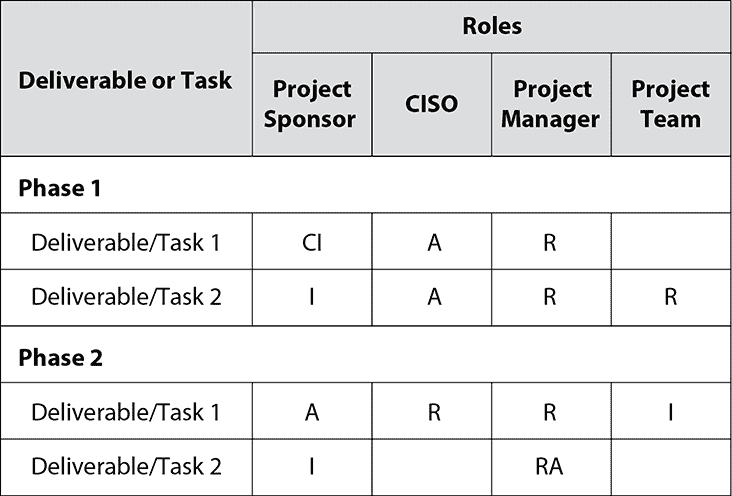

**图 3-12** RACI 图表示例

### 评估项目风险

每个项目都存在一定程度的风险。在项目管理的语境下，风险是指项目风险，而非信息安全风险。*项目风险*是指项目期间可能发生并可能对项目成功产生不利影响的事项。项目风险应在规划阶段予以考虑，并在整个项目期间进行管理。应执行初始*项目风险评估*，以了解和预测潜在的项目风险。感知到的项目风险应被识别、分析，并在风险排序中进行排名。有三种主要风险类型需要考虑：

- **技术** 因技术原因导致无法满足需求的风险
- **进度** 因内部或外部因素（如供应商未按时交付）导致错过项目截止日期的风险
- **预算** 因预算估算不善或范围蔓延导致成本超支的风险

初始项目风险评估之后，将确定应采取哪些行动来降低或缓解项目风险。

### 编制项目计划

规划阶段的最后一步是编制项目计划。项目计划作为活动路线图，分发给项目团队遵循执行，并传达给相关方。项目计划至少应涵盖以下组成部分：

- 范围管理计划
- 进度管理计划
- 资源管理计划
- 成本管理计划
- 质量管理计划
- 变更管理计划
- 配置管理计划
- 沟通计划
- 风险管理计划
- 系统安全计划

组织可以使用简单的 Word 文档或 Excel 电子表格作为项目计划，也可以实施更复杂的项目规划工具，例如带有后端数据库并提供 Web 门户以管理任务和存储文档的应用程序。选择取决于组织的需求和成熟度水平以及项目的复杂性。计划可以通过多种方式编制和管理。关键在于它必须被记录下来。

根据组织及其项目管理实践的不同，规划阶段制定的项目计划和启动阶段制定的项目范围文档可能是同一文档。无论如何，必须制定某种类型的计划并在项目整个生命周期中遵循执行。坚持计划对于防止范围蔓延非常重要。如果范围以不受控的方式持续扩大，项目可能永远无法达到目标、资金耗尽或进度超期。

## 执行

规划完成后，便进入项目执行阶段，遵循计划行事。此阶段是根据工作说明书中描述的项目范围创建和生成交付成果的阶段。此阶段包括以下活动：

- 遵循计划，执行项目任务，管理项目预算
- 实施变更并跟踪项目进度
- 向相关方和其他利益相关方沟通并汇报进度
- 在团队内部和向管理层汇报状态

- 让员工和供应商承担责任

重要的是要记住根据需要调整计划。没有任何项目能完全按计划进行。项目管理实际上就是关于规划，并在需要时进行战略性调整。

### 监控与控制

生命周期的监控与控制阶段侧重于监控和控制关键项目变量。虽然本阶段在执行阶段之后按顺序讨论，但在实践中，该阶段贯穿于项目生命周期的始终。监控与控制包含以下活动：

- 监控和管理范围蔓延
- 监控和管理项目预算
- 监控、跟踪并报告关键绩效指标（KPI）
- 处理变更请求
- 跟踪项目偏差
- 跟踪并报告项目指标和绩效
- 监控和管理成本、进度安排、资源利用率、预算和风险

本节讨论了必须贯穿项目生命周期的监控与控制的一些关键方面，包括配置管理、变更管理和质量管理。

#### 配置与变更管理

在每个项目中纳入配置管理和变更管理非常重要。*配置管理*由管理产品或交付物的需求、规格和标准配置的流程和工具组成。*变更管理*由用于识别、跟踪、监控和控制项目计划和基线变更的流程和工具组成。

*配置管理计划*定义了对交付物配置进行变更的流程。它记录了需要正式变更控制的可配置项，并描述了控制这些变更的流程。*变更管理计划*记录了管理项目变更的流程，并描述了如何对变更执行监控和控制。

用于配置和变更管理的流程记录在各自的计划中，并在项目生命周期的规划阶段纳入项目计划。配置和变更管理流程随后在项目的整个生命周期中受到监控和控制。

#### 质量管理

项目*质量管理*是确保所有项目活动达到规定卓越水平的实践。它涉及定义质量标准，并建立流程以确保标准在项目中得到正确应用。*质量管理**体系（QMS）*是一系列旨在确保达到预期质量水平的流程和活动。QMS 包含质量保证和质量控制实践，如图 3-13 所示。这些术语在质量管理讨论中有时会交替使用，但存在一些关键差异：

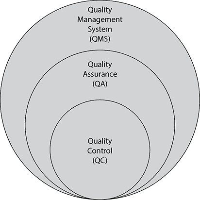

**图 3-13** 质量管理概念

- **质量保证（QA）** 侧重于通过创建一个系统来在整个*过程*中衡量和控制质量，主动*预防*项目缺陷
- **质量控制（QC）** 侧重于基于质量保证标准对*交付物*中的缺陷进行*检测*

关于项目期间如何处理质量管理的决策记录在规划阶段的质量管理计划中，纳入项目计划，并在整个项目生命周期中受到监控和控制。本节讨论了两种常见的质量管理方法论：六西格玛和 ISO 9000 系列标准。

**六西格玛** 六西格玛是一种过程改进方法论，侧重于通过使用统计方法衡量运营效率、减少变异、缺陷和浪费来提高过程质量。它最初由摩托罗拉开发，旨在识别并消除制造过程中的缺陷。过程的成熟度由西格玛等级描述，该等级指示过程包含的缺陷百分比。六西格玛项目使用 DMAIC 和 DMADV 项目方法论，它们基于戴明的计划、执行、检查、处理（PDCA）循环。DMAIC 代表“定义、测量、分析、改进、控制”，DMADV 代表“定义、测量、分析、设计、验证”。尽管六西格玛方法论最初用于制造业，但它已演变为被许多行业和业务职能使用。一些组织利用六西格玛通过衡量不同安全控制和流程的成功因素来提高安全保障。

**ISO 9000** 第 1 章和第 2 章讨论了 ISO/IEC 27000 系列标准，该系列侧重于实施信息安全管理体系（ISMS）。ISO 9000 系列标准侧重于质量管理的各个方面以及实施 QMS。这些出版物提供指导和工具，帮助组织满足客户对交付物的要求，同时确保质量得到管理和改进。ISO 9000 系列中的关键出版物概述如下：

- **ISO 9000** 质量管理体系——基础和术语
- **ISO 9001** 质量管理体系——要求
- **ISO 9004** 质量管理——组织质量——实现持续成功的指南
- **ISO 19011** 管理体系审核指南

此外，还有基于 ISO 9001 的行业特定标准，包括以下内容（括号内的简略标题表示其应用领域）：

- **ISO 13485** 医疗器械
- **ISO/TS 54001** 各级政府选举组织
- **ISO 18091** 地方政府
- **ISO/TS 22163** 铁路组织
- **ISO/TS 29001** 石油、石化和天然气行业
- **ISO/IEC/IEEE 90003** 软件工程

### 收尾

项目的最后阶段是*项目收尾。* 收尾阶段包括以下活动：

- 审查项目范围文档，确保满足需求
- 确保利益相关者对交付物进行签收
- 结束合同，处理并支付发票，停止项目支出
- 更新最终项目成本核算
- 安全处置项目材料，因为某些记录可能包含敏感信息
- 归档必须保留以备将来参考的项目记录
- 进行经验教训总结，包括利益相关者的任何反馈
- 释放并重新分配资源

适当的收尾阶段允许对项目进行最终审查和验收，完成合同和财务活动，并释放资源。虽然这个特定项目可能已完成，但拐角处很可能还有另一个项目，可能需要一些已被占用的资源。

**考试提示** CCISO 候选人应熟悉项目管理的一般阶段及相应的项目活动。

### 项目管理监督

CISO 通常不负责主动管理每一个安全项目。CISO 参与项目监督，但可能会指派其他资源（如安全项目经理、副 CISO 或其他员工）作为项目经理。在审查安全项目时，CISO 应考虑以下问题：

- 项目是否遵循组织的项目管理实践？
- 流程是否基于行业标准和最佳实践？
- 是否遵循项目计划？
- 关键路径是否定义明确？
- 团队成员和项目经理是否彻底理解关键路径上的活动？
- 项目按时且在预算内完成的频率如何？
- 项目是否有明确的沟通计划？
- 业务目标是否以具有成本效益的方式实现？

# 章节回顾

CISO 负责管理组织的信息安全计划。安全计划的关键方面包括安全关注领域（影响工作流和安全项目实施方式的内部和外部驱动因素，例如 `PCI DSS`、`HIPAA` 以及内部政策和要求）；安全工作流（子计划，如漏洞管理计划、应急响应计划和风险管理计划），通常采用 `PDCA` 方法进行管理；安全项目管理；资产与数据安全管理；以及安全计划预算和资源管理。以协调一致的方式管理这些要素并非易事，需要深思熟虑的方法。

项目管理是 CISO 必须掌握的关键技能。尽管 CISO 通常不担任每个安全项目的项目经理，但 CISO 必须监督并对信息安全计划中开展的项目负责。项目管理的三要素包括范围、进度和预算。如果其中一个要素发生变化，通常会影响其他两个要素。项目遵循项目管理模型，该模型通常包括启动、规划、执行、监控与控制以及收尾过程。

# 快速回顾

- 安全计划管理侧重于监督和管理安全关注领域、安全工作流、安全项目、资产与数据安全，以及安全计划预算和资源。
- 安全关注领域是影响工作流和安全项目实施方式的内部和外部组织驱动因素，例如 `PCI DSS`、`HIPAA` 以及内部政策和要求。
- 信息安全计划的安全工作流（又称子计划）是持续进行且没有明确开始、中间和结束的活动，例如身份与访问管理、漏洞管理和事件管理。
- 项目管理的三要素包括范围、进度和预算。
- 传统项目管理模型由以下过程组成：启动、规划、执行、监控与控制以及收尾。
- 项目范围定义了项目的边界。它是满足客户需求所需完成的工作。
- 范围蔓延是指由于需求、愿望或目标的增加而导致项目范围不受控制的增长。
- 系统开发生命周期（`SDLC`）是指项目中与系统、软件、服务或产品开发相关的阶段。`SDLC` 通常发生在项目管理模型的规划和执行过程中。
- `SDLC` 模型包括瀑布模型、迭代模型、增量模型和敏捷模型。
- 工作分解结构（`WBS`）是项目团队为实现项目目标并交付成果而必须执行的工作的层级分解。它是一种项目管理工具，用于将项目分解为有组织的单个工作要素（任务、子任务和交付成果）。
- 项目的关键路径是一系列事件或活动，如果这些事件或活动发生变化，将会改变项目的整体结束日期。
- 甘特图展示项目进度并显示任务的依赖关系。
- 职责分配矩阵或 `RACI` 图可用于划分为满足项目交付成果所涉及的每个活动或任务的责任。`RACI` 是负责、批准、咨询和知情的首字母缩写。
- 配置管理关注产品或交付成果的需求、规格和标准配置。
- 变更管理侧重于识别、跟踪、监控和控制项目计划和基线的变更。
- 六西格玛是一种过程改进方法论，侧重于通过使用统计方法衡量运营效率、减少变异、缺陷和浪费来提高过程质量。
- ISO 9000 系列标准侧重于质量管理的各个方面以及质量管理体系（`QMSs`）的实施。

# 问题

1. 以下哪项活动是子计划或工作流的示例？

   A. 进行网络监控  
   B. 部署入侵检测系统  
   C. 构建身份管理系统  
   D. 进行渗透测试

2. 在制定信息安全预算时，以下哪项是最不重要的考虑因素？

   A. 老板对安全的看法  
   B. 确保预算每年增长，以便安全部门能持续发展  
   C. 为所有工作流配备人员的劳动力成本  
   D. 组织去年在安全方面的支出

3. 以下哪项不是建立强大安全团队的好方法？

   A. 为员工提供职业发展路径  
   B. 根据品格而非仅凭技术技能选拔人员  
   C. 限制员工培训，以免员工技能提升后决定离职  
   D. 提供鼓励沟通与协作的环境

4. 确定安全子计划执行情况的关键是什么？

   A. 尽可能使用“双人规则”  
   B. 建立成功标准并据此衡量活动绩效  
   C. 引入外部专家审查活动  
   D. 面谈子计划员工

5. 关于项目管理，以下哪项陈述最准确？

   A. 项目管理仅对小型项目重要。  
   B. 项目管理对大型项目重要，而项目集管理对持续性项目重要。  
   C. 项目管理仅对大型项目重要。  
   D. 项目管理对各种规模的项目都很重要。

6. 以下哪个术语描述了项目需求不受控制的增长？

   A. 干系人输入  
   B. 范围蔓延  
   C. 定义蔓延  
   D. 有机增长

7. 以下哪项最能描述项目管理中的关键路径？

   A. 如果发生变化将会改变项目结束日期的活动  
   B. 将会改变项目结束日期的活动  
   C. 对项目至关重要的活动  
   D. 对项目不重要的活动

8. CISO 在审查当前安全项目时发现，网络重新设计项目的安全项目经理未使用经批准的 `WBS`。这属于以下哪种情况？

   A. 范围蔓延  
   B. 瀑布方法  
   C. 备用 `WBS`  
   D. 未遵循计划

9. 项目收尾阶段应进行以下哪项活动？

   A. 进行经验教训总结  
   B. 勾勒范围  
   C. 需求收集  
   D. 继续向项目收费

10. 项目集与项目的主要区别是什么？

    A. 没有区别。  
    B. 项目集由项目组成，项目由活动组成。  
    C. 与项目集不同，项目没有结束。  
    D. 项目集可能包含多个项目，而项目仅包含一个项目。

# 答案

1. **A.** 信息安全计划包含贯穿组织生命周期的工作流（又称子计划）。进行网络监控是一项在组织和安全计划生命周期内持续进行的活动。构建系统和部署系统通常是项目，而非持续性的子计划或工作流。渗透测试有明确的结束时间。

## 复习题

**2. B.** 启动信息安全预算流程时，建议先查看上一年的支出情况，包含所有人工成本，并以管理层能够理解的方式呈现预算。扩充安全团队的愿望不应成为制定安全预算的考量因素。

**3. C.** 组织不应因担心员工离职而限制员工培训。这始终是一种风险，但如果员工未接受适当培训，组织将无法建立一支强有力的团队。提供职业发展路径、根据品德选拔人才以及鼓励沟通，这些做法都是有益的。

**5. B.** 虽然面试子项目工作人员始终是个好主意，但判断安全子项目绩效最关键的方法是确立成功标准并据此进行衡量。

**6. D.** 尽管项目看似微不足道，但项目管理对各种规模的项目都至关重要，而不仅限于大型项目。

**7. B.** 范围蔓延描述的是项目范围的不受控增长。

**8. A.** 项目的关键路径是指一系列事件或活动，如果这些事件或活动发生变更，将导致项目结束日期发生变化。如果关键路径上的任何活动延期，整个项目交付的结束日期都会受到影响。

**9. D.** 安全项目经理未使用经批准的工作分解结构（WBS），属于员工未遵循经批准计划的例子。范围蔓延是指项目过程中范围的增加，而瀑布模型是一种软件开发方法论。备选 WBS 是一个旨在干扰的错误选项。

**10. A.** 项目收尾阶段的“经验教训”环节常被忽视。这是一项关键活动，旨在从过往错误中吸取教训，改进未来项目。

**11. D.** 一个项目集可能包含多个项目，而项目是独立自足的。
