# 第 4 章：信息安全核心能力

本章讨论以下主题：

- 恶意软件与攻击
- 社会工程学
- 资产安全
- 数据安全
- 身份与访问管理
- 通信与网络安全
- 密码学
- 云安全
- 物理安全
- 软件开发安全
- 取证、事件处理与调查
- 安全评估与测试
- 业务连续性与灾难恢复

本章探讨每位 CISO 都应扎实掌握的核心能力。这些主题的技术深度各异，从偏管理性质的能力（如安全评估与测试）到高度技术性的能力（如密码学）。CISO 不一定非要成为这些领域的专家，但精通这些领域绝无坏处。CISO 对这些 IT、业务和安全主题理解得越深入，就越能做出明智决策并应对问题。


> **注意** 在某些组织中，这些核心能力中的部分可能不属于 CISO 的职责范围。例如，并非所有 CISO 都负责组织的物理安全或业务连续性规划。这些领域可能由其他领导者负责，或由其他部门共同分担。

## 恶意软件与攻击

第 1 章 描述了攻击者在典型网络攻击中通常执行的以下步骤：

1. 侦察
2. 枚举
3. 利用
4. 目标行动

在利用步骤中，攻击者利用漏洞获取系统访问权限，并最终转向实施攻击者的进攻性目标。很多时候，此活动涉及*武器化*，即部署恶意软件、脚本或其他手段来利用一个或多个系统。本节将探讨以下类型的武器化：

- 恶意软件
- 脚本攻击与针对特定漏洞的攻击

恶意软件和网络攻击的形势广阔且瞬息万变。本节绝非详尽无遗的恶意软件及相关攻击大全。相反，它描述了安全专业人员所遇到的主要武器化攻击类型。


> **考试提示** CCISO 考试可能不包含关于特定攻击类型的问题。不过，我们仍收录了本节内容，因为每位 CISO 都应充分了解攻击是如何规划和执行的，以便能够采取适当的防御措施。

### 恶意软件

*恶意软件* 是 *恶意软件* 的缩写，指旨在渗透并未经授权访问计算机系统以造成破坏或干扰的任何软件。攻击者利用恶意软件攻陷系统并实施目标，例如：

- 记录用户按键以窃取密码和其他敏感信息
- 使用间谍软件收集敏感信息以转售
- 实施网络钓鱼攻击
- 实施勒索软件攻击，强迫用户支付赎金以防止数据丢失或被销毁
- 实施拒绝服务攻击以中断业务运营
- 将互联网流量重定向到非预期或恶意网站

本节介绍以下类型的恶意软件：

- 病毒
- 特洛伊木马
- 蠕虫
- 僵尸网络
- 勒索软件
- 根工具包

#### 病毒

*病毒* 是一种感染合法程序以执行其恶意任务的程序或代码片段。病毒利用其他程序作为载体来投放其有效载荷或自我复制。*有效载荷* 是执行恶意活动的病毒部分，例如删除、窃取或加密数据、修改文件或发送垃圾邮件。以下是几种常见的病毒类型：

- **宏病毒** 许多应用程序具有宏功能，允许用户创建和使用脚本来自动执行应用程序的功能。Microsoft Word 和 Excel 是常见的具有宏功能的应用程序。每个宏都是一个执行任务的脚本，编写执行恶意任务的宏是可行的。宏还能自我复制并感染该应用程序使用的其他文件。

- **压缩病毒** 此术语用于识别嵌入在压缩文件中的病毒。当用户解压文件以访问其内容时，病毒执行并执行其恶意任务。

- **隐形病毒** 隐形病毒既隐藏其存在，也隐藏其对受感染文件或系统造成的破坏。隐形病毒在设计上就难以检测。

- **多态病毒** 与隐形病毒类似，多态病毒通过隐藏自身来逃避检测。它通过在每次运行时改变自身（实际改变代码）来实现这一点。因此，旨在查找特定程序或文件的杀毒程序将无法发现该病毒，因为它的外观永远不相同。

- **引导扇区病毒** 这是插入磁盘引导扇区的恶意代码。安装后，病毒要么移动引导扇区的数据，要么用新信息覆盖它。系统重启时，恶意代码随之执行。

- **多重病毒** 同时感染引导扇区和系统中其他文件的病毒称为*多重病毒*。

其他类型的病毒还包括*瞬态病毒*，它仅在其宿主应用程序运行时运行；以及*驻留病毒*，它常驻内存，即使宿主应用程序关闭后仍可保持活动状态。

#### 特洛伊木马、蠕虫和僵尸网络

其他类型的恶意软件与病毒相似，但具有不同的特征和功能。以下是其中几种：


# 恶意软件类型

## Trojan
特洛伊木马是一种恶意程序，它欺骗用户运行它，因为它看起来像是一个合法程序。有时特洛伊木马包含用户打算运行的实际程序，因此看起来程序运行正常，但实际上也在运行恶意代码。

## Worm
蠕虫类似于病毒，但与病毒不同，它能够自我复制。而且与需要宿主程序来感染的病毒不同，蠕虫可以独立存在，不需要宿主程序即可造成破坏或自我复制。蠕虫通常通过已知漏洞进入系统，一旦进入，可以扫描网络中其他有漏洞的计算机并传播给它们。一些蠕虫不试图对系统做任何更改；它们的任务只是传播到其他系统，并通过增加网络流量造成干扰。

## Botnet
僵尸网络是一组协同工作以执行攻击的受感染系统。僵尸网络最常由网络犯罪分子远程控制，以发起拒绝服务（DoS）攻击，或旨在窃取数据或发送消息的攻击。远程控制通过某种命令与控制系统进行，使攻击者能够作为一个群体控制僵尸网络。有时僵尸程序被用来创建“肉鸡”计算机网络，这些计算机被远程控制以执行几乎任何类型的操作。

# 知名且常见的计算机病毒和攻击

在成千上万的计算机病毒中，有几个因其影响重大或具有新闻价值而广为人知。以下是其中一些病毒以及仍在肆虐的一些常见病毒：

## Gameover ZeuS
该特洛伊木马于 2011 年被发现，通过在网页中插入恶意代码记录用户的按键，从而窃取用户的网页登录凭据。

## Code Red
该病毒利用 Microsoft IIS Web 服务器中的漏洞，由 eEye Digital Security 的两名工程师发现（当时他们正在喝 Code Red 汽水，因此得名）。病毒传播迅速，被用于对包括美国白宫在内的知名网站发起拒绝服务攻击。据估计，Code Red 可能在全球造成了高达 20 亿美元的生产力损失。

## ILOVEYOU
该病毒于 2000 年发布，结合了社会工程学和对 Microsoft Windows 缺陷的利用。受害者收到一封带有附件的电子邮件，据称包含一封情书。一些人发现附件名称太诱人而无法抗拒，当他们打开文件时，其中包含一个 Visual Basic 脚本，该脚本覆盖了受害者的文件，并通过电子邮件将自己发送给用户通讯录中的所有人。据信，ILOVEYOU 在当时感染了世界上 10% 的计算机。

## PoisonIvy
该病毒最初于 2005 年发布（据信起源于中国），允许攻击者使用后门远程控制受感染系统。网络犯罪分子可以移动数据、更改设置，甚至调用系统的麦克风和扬声器。即使在今天，PoisonIvy 仍被用于对全球政府和私人系统发动攻击。

## Mydoom
与 ILOVEYOU 类似，Mydoom 是另一种通过电子邮件传播的后门特洛伊木马。它编写于 2004 年，据报道因导致拒绝服务而造成了超过 300 亿美元的损失。它通过带有诱人主题的电子邮件传播，如“Error”或“Mail Transaction Failed”。当用户打开附件时，会安装一个后门程序。Mydoom 的新变种会阻止某些防病毒软件的运行，并干扰防病毒程序的更新。

## W32.DisTrack
也称为 Shamoon，该病毒于 2012 年发布，针对沙特政府和商业公司。它通过嵌入在文档文件中的宏传播，执行后允许攻击者使用 Microsoft PowerShell 与受感染系统通信。该宏支持远程安装 W32.DisTrack 恶意软件，随后擦除计算机的硬盘驱动器。

## Sapphire (or SQL Slammer)
该蠕虫最初于 2003 年发布，Sapphire 是另一种 DoS 蠕虫。它传播速度极快，造成了超过 10 亿美元的损失，最著名的是导致数千台 Bank of America ATM 机脱机。Sapphire 从一台 SQL 服务器传播到另一台，利用 Microsoft SQL Server 软件中的已知漏洞。

# 勒索软件

勒索软件是一种特别阴险的恶意软件，它迫使受害者在支付赎金或失去宝贵资产之间做出选择。勒索软件通过常见机制传递：网络钓鱼电子邮件、社会工程学技巧，或利用操作系统或其他程序中的已知漏洞。一旦勒索软件感染系统，通常会加密文件并通知用户，除非支付赎金（通常使用比特币或其他难以追踪的交易方式），否则数据将保持加密状态，用户及其组织将无法访问。

勒索软件攻击的变体包括威胁泄露敏感信息或色情材料（这些可能是受害者存储在其系统上的，也可能是攻击者放置在那里的）。但所有勒索软件都给组织带来了两难境地：支付赎金，否则将发生不好的事情。

支付赎金并不总意味着用户或组织能拿回资产。毕竟，他们面对的是罪犯。然而，有时支付赎金后，网络犯罪分子会兑现承诺，提供解密密钥或以其他方式帮助受害者从攻击中恢复。这是因为网络犯罪分子希望能够继续他们的活动，如果未来的受害者知道犯罪分子在支付赎金后会兑现承诺，其成功的可能性就更大。事实上，一些网络犯罪组织设有“呼叫中心”，帮助受害者付款并解密数据。

勒索软件使组织处于困境中，必须权衡两个非常糟糕的选项的影响：支付赎金或失去资产。CISO 正处于这一决策的核心。像对所有安全漏洞的响应一样，对勒索软件攻击的响应应该经过周密计划和演练。决定如何应对这种危机的时间不是在危机发生时，因为局势的紧迫性会模糊即使是最冷静领导者的判断。组织应提前规划，了解各种信息资产的价值，以及在遭受攻击时组织可能愿意支付多少赎金。勒索软件规划还应包括何时将执法部门作为事件响应的一部分介入。勒索软件规划还包括拥有良好的 BCP/DR 计划和相关措施，以便能够恢复丢失的数据并从攻击中恢复。

## 勒索软件示例

### SamSam
这是“勒索软件即服务”，网络犯罪组织利用目标并将受感染的目标出售给其他网络犯罪分子，后者试图进一步利用受害者勒索赎金。据估计，SamSam 导致美国公司损失超过 3000 万美元。

### Zeppelin
这种勒索软件避开在俄罗斯、哈萨克斯坦、乌克兰和白俄罗斯运行的系统。它以多种方式部署，包括通过被利用的托管安全服务提供商（MSSP）。

### Ryuk
Ryuk 在 2018 年和 2019 年广泛流行，犯罪分子提出了相对较高的赎金要求。Ryuk 的一个特点是它禁用 Windows 系统还原功能，从而阻止受害者组织回退到早期的、未感染的时间点，以尝试在不支付赎金的情况下从攻击中恢复。


## PureLocker

PureLocker 是一种恶意软件，它通过利用其他恶意软件程序安装的后门进行安装。它针对作为高价值资产的 Windows 或 Linux 系统（如企业服务器），因此这些攻击通常涉及高额赎金要求。

## Rootkits

Rootkit 是能够启用并维持对操作系统特权访问的工具。Rootkit 不总是恶意的（它们可以有合法用途），但本讨论仅涵盖携带恶意代码的 Rootkit。Rootkit 与其他恶意软件一样，必须通过某种方式传递给目标。因此，Rootkit 总是与其他类型的漏洞利用相结合，以便安装 Rootkit。一旦安装，Rootkit 就可以将自己隐藏起来以逃避检测。Rootkit 很难或不可能被检测到，尤其是当它们驻留在内核内部时。有时只能通过重新安装操作系统甚至更换硬件来清除，特别是在 Rootkit 影响了固件或导致电子设备损坏的情况下。

Rootkit 有多种类型，但大多数属于以下两类之一：内核模式或用户模式。这些模式指的是操作系统的模式，例如 Windows。

### Kernel-mode rootkits

内核模式 Rootkit 通过添加代码或替换核心操作系统的部分内容，在内核级别运行。核心操作系统的修改是通过使用修改后的操作系统功能来完成的，例如 Windows 设备驱动程序或 Linux 可加载内核模块 (LKM)。由于这些类型的 Rootkit 修改核心操作系统，因此它们难以编写，并可能严重破坏系统操作。既然这些 Rootkit 在系统的最高安全级别运行，它们就可以颠覆安全控制并隐藏起来以逃避检测。

### User-mode rootkits

用户模式 Rootkit 修改或替换系统库等应用程序，而不是像内核模式 Rootkit 那样修改低级核心。例如，Rootkit 可能会将动态链接库 (DLL) 注入到一个进程中，强制应用程序调用攻击者想要的未经授权的函数。

### Rootkit Example: ZeroAccess

ZeroAccess 是一种在 2011 年发现的内核模式 Rootkit，已在全球感染了 200 多万个系统。该 Rootkit 仍处于活跃状态，它安装隐蔽的恶意软件，使系统成为全球僵尸网络的一部分。攻击者利用 ZeroAccess 调用受感染系统的两种未经授权操作之一。ZeroAccess 导致受感染系统成为比特币挖矿网络或*点击欺诈*网络的一部分，在后者中，系统会模拟对按点击付费广告网站的点击。ZeroAccess 通过社会工程学或*漏洞利用包*进行传播。漏洞利用包是存储在攻击者控制的 Web 服务器上的一组脚本。当受害者系统尝试访问该 Web 服务器时，脚本会尝试利用系统上的漏洞并安装由 Rootkit 软件组成的载荷。许多系统是通过漏洞利用包感染的，这些包可能一次性安装多种恶意软件。攻击者还使用社会工程学方法诱使用户运行安装 ZeroAccess 的可执行程序。

## Scripting and Vulnerability-Specific Attacks

网络犯罪分子使用脚本来利用操作系统和应用程序中的漏洞。这些漏洞是由于制造商（商业软件的情况）或开发人员（定制或内部开发软件的情况）的编程或配置错误造成的。制造商经常在其产品中发现此类漏洞，并定期以补丁或软件更新的形式发布错误修复。例如，微软每月在每月第二个周二（通俗称为 *Patch Tuesday*）发布补丁以修复 Windows 中的安全漏洞。对于非商业软件，漏洞通常由内部安全人员、运营人员或第三方测试人员和审计人员发现，无论是偶然发现还是正式安全测试的结果。

漏洞可能发生在任何操作系统或程序中，但归纳起来有几种常见类型。以下各节将讨论一些最常见的安全漏洞类型。

### Buffer Overflows

当程序期望输入时，无论是来自另一个程序还是用户在字段中输入文本，它都会将该数据存储在缓冲区（内存区域）中。程序通常期望数据具有给定大小，因此会创建适当大小的缓冲区来接收预期数据。如果接收到的数据大小超过缓冲区大小，多余的数据就会溢出到其他缓冲区或内存区域，从而导致错误操作。网络攻击者设计攻击来利用那些未对输入数据执行适当检查、因此容易受到缓冲区溢出攻击的程序。

当发生缓冲区溢出时，超出缓冲区大小的数据会溢出到相邻的内存区域。如果该内存是另一个缓冲区，则数据可能会破坏使用它的程序的操作。在某些情况下，溢出的数据会被系统当作命令甚至可执行程序来执行。缓冲区溢出可用于拒绝服务攻击，但更常用于强制系统在未经正确授权的情况下执行命令。攻击者通常会将恶意代码注入缓冲区，该代码将代表攻击者执行，但在当前正在执行的程序上下文中运行。这可能导致攻击者控制系统并提升权限，从而导致重大安全漏洞。

缓冲区溢出可以在软件工程的开发阶段通过实施适当的输入检查来预防，以确保程序只接受正确类型和大小的数据。也可以通过防止数据写入某些内存区域来缓解缓冲区溢出，从而最小化溢出的潜在影响。一种常见方法是直接使用具有自动边界检查的程序，例如 Java。

### Timing and Race Conditions

*时序攻击*，也称为*竞争条件攻击*，发生在攻击者利用一系列事件之间的时间间隙时。一个例子是检查时间/使用时间 (TOC/TOU) 攻击。这发生在系统检查特定文件是否存在以供后续操作时，攻击者在检查时间和使用时间之间用恶意文件替换了该文件。这种类型的攻击有无数种变体。任何程序实现依赖于其他程序或外部事件的特定事件序列的实例，都可能容易受到竞争条件或时序攻击。此类攻击要求攻击者具有极高的精确度，但它们确实可行且已被实施。

### Backdoors

后门不是一种特定类型的攻击，而是多种不同攻击的一种*特性*。*后门*是一个宽泛的术语，用于描述未经授权的用户绕过安全控制以访问系统或程序的任何方法。当系统或程序设计或编码不正确时，后门可能存在；也可能由网络犯罪分子使用恶意软件创建。后门促进了受感染或受损系统与未经授权的系统或用户之间的通信。

### Cross-Site Scripting


# 跨站脚本攻击 (XSS)

跨站脚本攻击 (XSS) 是一种攻击类型，攻击者将恶意脚本注入到受害者信任的网站中。然后，当毫无戒心的受害者访问该网站时，脚本会由受害者的浏览器执行。此类脚本可以访问受害者的 Cookie、令牌或其他敏感信息。XSS 攻击利用了网页与浏览器之间的信任关系。通常，XSS 分为两种类型：持久型（或存储型）和非持久型（或反射型）。

## 持久型 XSS

当恶意脚本存储在目标服务器上时，会发生 `persistent XSS` 攻击。攻击者通常利用允许他们输入信息并存储、随后呈现给其他用户（这些用户成为受害者）的网站。例如留言板、论坛或其他社交媒体网站，如约会网站。攻击者可能会发布合法信息供受害者查看，同时夹带一个对受害者隐藏但由受害者浏览器执行以实施攻击的脚本。

## 非持久型 XSS

当恶意脚本被反射回受害者的浏览器时，会发生 `nonpersistent XSS` 攻击。一个例子是用户收到一封恶意电子邮件，诱使受害者点击链接。该电子邮件不仅包含指向 Web 服务器的链接，还包含由服务器反射给受害者浏览器的恶意脚本。随后浏览器执行该脚本，实施恶意活动。

## HTTP 响应拆分

另一种源于软件程序未正确执行输入检查和验证的漏洞称为 `HTTP response splitting`。在此类攻击中，攻击者构造包含畸形头部的数据。这可用于接管用户的浏览器、窃取 Cookie，或将流量重定向到另一个网站或服务器，进而收集用户的凭据。HTTP 响应拆分还可用于用虚假数据“污染” Web 缓存，导致网站被篡改。

## SQL 注入

很多时候，用户在网页表单中输入的数据会由 Web 服务器发送到数据库，例如使用结构化查询语言 (SQL) 的数据库。如果 Web 服务器软件未正确检查用户输入的数据，可能会允许攻击者在字段中放入 SQL 命令，随后由 SQL 数据库执行。此类攻击可用于控制数据库、提升权限，并在未经适当授权的情况下修改或泄露数据库中的数据。


`NOTE` 开源基金会的开放 Web 应用安全项目 (OWASP) 发布工具和资源，帮助开发人员创建安全的 Web 应用程序。OWASP 发布各种优秀且经验证的安全编码实践指南，有助于防范脚本攻击。这些 Web 安全资源可在 [`owasp.org`](https://owasp.org) 找到。

# 社会工程学

当今的网络犯罪分子知道人是信息安全中最薄弱的环节，因此利用 `social engineering` 精心策划攻击。`social engineering` 一词是指利用欺骗手段诱使某人做可能不符合其最佳利益的事情。社会工程学多年来一直被骗子使用，现在已成为网络攻击不可或缺的一部分。坏人早就发现，诱骗某人透露密码比使用技术手段闯入系统容易得多。要应对这一点，需要一个网络防御计划，重点防御导致安全漏洞的人为行为。本节涵盖以下主题：

- 社会工程学攻击的类型
- 员工为何容易受社会工程学攻击
- 社会工程学防御

## 社会工程学攻击的类型

社会工程学形式多样，但可归纳为三类：借口欺骗、互惠利诱和诱饵攻击。

### 借口欺骗

`Pretexting` 是指利用虚假场景欺骗他人。许多人听说过“尼日利亚王子”诈骗，犯罪分子告诉受害者他是尼日利亚王子，有一大笔钱到账，但除非能使用受害者的银行账户，否则无法收到款项。骗子说服受害者让“王子”使用其银行账户，并承诺支付受害者一笔费用。当然，一旦受害者给骗子银行账户访问权限，骗子就会窃取其钱财。这是一个非网络环境下的借口欺骗例子。借口欺骗现在也用于网络世界。以下是几个例子：

- 用户接到“技术支持”的来电，称其电脑中了病毒，技术人员需要远程访问其电脑来“修复”问题。攻击者说服受害者提供远程访问权限或共享其登录凭据。当然，来电者并非来自技术支持部门。
- 公司首席财务官 (CFO) 收到一封来自“首席执行官 (CEO)”的电子邮件，要求他将一大笔钱转账到新供应商的银行账户。首席财务官遵照首席执行官的指示操作，事后才发现邮件并非来自首席执行官，而是来自网络攻击者，此时转账至国外银行账户已完成。这种攻击最近发生在一家美国大型制造商身上，导致数百万美元损失。
- 用户收到一封来自其银行的电子邮件，称其密码已过期，应点击链接进行更改。该电子邮件在用户看来是合法的，用于更改密码的网页也是如此。但电子邮件和网页都是假的，坏人利用该网页窃取用户的登录凭据。攻击者随后使用这些凭据访问用户的银行账户并窃取钱财。

### 互惠利诱

互惠利诱 (QPQ) 是信息或商品的交换，例如购买。如果交易听起来好得令人难以置信，那它很可能就是假的。以下是一些互惠利诱社会工程学的例子：

- 一名公司采购员需要购买 1,000 个 USB 驱动器。他访问的大多数在线网站每个售价 50 美元，但他发现一家中国公司仅以 10 美元每个出售。多么划算的交易！可惜这些便宜的驱动器包含恶意软件，感染了公司所有电脑。
- 许多在线网站以真品成本的一小部分出售软件产品版本。但其中许多是欺诈版本，即使能运行，也包含广告软件和/或恶意软件，可能导致严重的安全漏洞。

### 诱饵攻击

`Baiting` 就是引诱某人陷入陷阱。我们都听过公元前 12 世纪希腊人送给特洛伊城的著名特洛伊木马的故事。当特洛伊人将巨大的木马雕像拉进城内时，里面藏着希腊士兵，其后的故事正如人们所说，已成为历史。以下是几个网络诱饵攻击的例子：

- 一名毫无戒心的人在地上捡到一个钥匙扣并交给前台接待员。钥匙扣上连着一个 USB 驱动器。接待员决定将驱动器插入电脑查看归属。但它包含恶意软件，感染了接待员的系统，随后蔓延到网络上的其他系统。丢弃 USB 驱动器是黑客非常常见的攻击手段。这是一些人无法抗拒的诱饵。
- 一名员工收到一封电子邮件，宣布他们是新电脑游戏的幸运得主。但该电子邮件将受害者引诱到一个包含漏洞利用代码的网站，该代码从用户的浏览器运行。这是另一个结合社会工程学和跨站脚本攻击的成功案例。

## 员工为何容易受社会工程学攻击


# 社会工程学风险与防御

许多组织在培训员工了解网络和社会工程学风险方面投入巨资。尽管如此，人为错误（包括因陷入社会工程学攻击而导致的错误）目前仍是企业面临的最大安全风险。本书所述的许多控制措施、技术和流程，以及当今 CISO 和安全组织所采取的实践，都可能被精明骗子施展的简单社会工程学伎俩化为无用。

这是如何发生的？员工接受过相关培训，为何仍会陷入这些圈套？以下是人们易受社会工程学攻击的一些主要原因：

## 导致社会工程学脆弱性的人为因素

- **工作优先级** 对大多数人而言，工作绩效比信息安全更重要。人们面临完成工作的压力，而在衡量工作成效时，安全极少被纳入考量。其中一个原因可能是：员工绩效考核几乎总是对一个人的工作表现进行评级，但几乎从不对一个人的安全实践进行评级。因此，具备安全意识和遵循良好的安全卫生习惯，未必是员工关注的重中之重。

- **职场文化** 职场文化和氛围对员工安全意识和社会工程学防御有重大影响。在许多行业中，*职场安全* 是一大关注点，尤其是在存在受伤和死亡风险的环境下。在这些环境中，组织拥有政策、程序和职场文化，将员工对危险和安全实践的意识提升到极高水平。在这些以安全为导向的工作场所，员工会调整行为，将安全融入所做的一切。然而，安全极少获得与安全同等的关注。安全通常未内化于职场氛围之中。

- **人性** 人们不一定会时刻警惕潜在的社会工程学伎俩。人们倾向于信任他人，这与良好的社会工程学防御所要求的恰恰相反。

当组织领导层和文化与安全目标不一致时，可能会引发一系列事件，导致安全事件或数据泄露。例如：领导施压员工完成任务（导致安全走捷径），或表扬完成任务更快的人（但不顾及为达成结果而承担的安全风险）。这可能导致偏离安全程序或规则。这种偏离有时是无意的（人们可能没意识到自己在偏离规则），有时是有意的（人们可能有意决定打破规则）。在许多情况下，人们陷入社会工程学圈套是因为他们未能识别风险。

## 社会工程学防御

历史上，仅靠安全培训和意识提升项目，无法有效帮助组织抵御社会工程学攻击。原因之一是培训只是一个行动。与成熟的完成任务的生命周期（如 *Plan, Do, Check, Act (PDCA)*）相比，培训只是其中一环（即 *Do* 环节）。采取了什么措施来 *Check*（检查）确保培训有效？又采取了什么措施根据测量结果 *Act*（处置/改进）？单纯的培训无法解决社会工程学问题。比单纯培训更有效的是一个全面的社会工程学对策项目，包含以下组成部分：

- 领导层支持
- 培训与意识提升
- 测试
- 实践与演练
- 运营监控与修复

### 领导层支持

组织领导层对安全的重视程度（或不重视程度），将决定社会工程学漏洞的数量和程度，以及随之而来的安全漏洞。安全文化始于组织的高层。我们知道，如果员工遵守安全策略被纳入年度绩效考核，员工更有可能遵守策略。然而，将安全纳入考核通常需要领导层的批准或赞助。组织高层的认同在很大程度上决定了良好的信息安全实践在多大程度上融入组织文化。

### 培训与意识提升

所有员工都应了解组织的安全策略和流程，以及通用的良好安全实践。大多数组织通过实施全组织范围的安全培训和意识提升项目来实现这一点。社会工程学培训应是安全培训项目的关键组成部分。

社会工程学安全意识培训应覆盖组织的全体用户群体。培训应采用多种形式，特别是实践、演练和练习，为用户提供应对网络攻击的基于现实的经验。最好的培训项目会利用现成商用培训（COTS）教授通用概念，并结合定制化培训教授公司或组织特有的概念。

培训应涵盖前文介绍的各类社会工程学攻击类型：借口攻击、互惠利诱和诱饵攻击。培训项目应具备以下特性和特征：

- **模块化** 大量简短的培训模块库优于少量冗长的模块库。简短培训已被证明更有效，因为它能更好地促进学习和记忆。此外，管理简短培训课程向用户群体的分发也更容易，因为短课程更易融入员工的工作日程。

- **相关性** 培训应与业务环境相关。许多组织试图通过购买 COTS 培训产品来省钱，希望其适用于自身业务，却发现效果大打折扣。例如，面向企业办公环境的培训（许多 COTS 产品皆是如此）可能无法引起车间工人或外勤人员的共鸣。相关性让培训更贴近用户，帮助他们更好地关联材料，有助于学习记忆，更重要的是，帮助他们将所学技能应用到工作中。

- **一致性** 培训必须符合组织的安全策略和实践，以便强化它们。组织最常见的错误之一是选择与组织安全策略不匹配或相冲突的信息安全培训。如果培训告诉员工采取某行动，而策略却要求采取不同行动，就会造成困惑，增加安全漏洞的可能性。

- **技能导向** 社会工程学和信息安全培训不应仅传授知识；还应传授员工践行良好安全卫生所需的*技能*。员工无需了解密码如何存储在其计算机上，就能知道不应将密码告诉他人。通过专注于技能，员工可以练习并学习在工作中可能面临的情境下该怎么做。


## 安全意识与培训

培训通常与意识计划相结合，以持续向员工提供有关安全的信息。许多组织发布来自 CISO 或其他安全人员的频繁通讯或博客，讨论安全主题。安全意识通常通过使用信息安全 Web 门户来推广，员工可以在其中查看安全策略、标准和指南，访问安全测试工具，并了解更多关于安全风险和实践的信息。这些资源可以成为扩展信息安全培训并促进安全文化的极其有效的方式。

## 测试

社会工程学测试是应作为持续漏洞评估和渗透测试计划一部分执行的测试子集。进行这些测试的目的是通过揭示弱点并提供可指导安全改进的有用信息，来改善组织的安全态势。这些测试的推进方式与真实攻击者的工作方式相同，即通过测试、探测、再测试和再探测。每一次成功都是向窃取敏感信息这一目标迈出的渐进式步骤。以下是组织工具箱中应具备的一些社会工程学测试活动列表。

- **投放 USB 驱动器** 在这种情况下，组织会在设施的各个位置放置 USB 驱动器。驱动器中包含商用现货软件 (COTS) 或定制开发的软件，通过为测试人员提供对系统的远程控制来模拟恶意软件，类似于真实攻击。然而，该软件并非真正的恶意软件，并在测试结束时被完全移除。
- **网络钓鱼邮件** 测试人员向组织中选定的个人或群体发送精心制作的电子邮件，诱导他们执行某项操作或点击链接。这些邮件可能看起来来自外部第三方或冒充的权威人士。
- **网络钓鱼短信** 与网络钓鱼邮件类似，这些短信看起来合法，诱导当事人执行某项操作或泄露信息。
- **虚假网站（虚构的和冒充的）** 通常与电子邮件或短信结合使用，这些网站看起来合法，诱导当事人泄露敏感信息。
- **致电员工实施借口攻击** 测试人员使用各种虚假场景，以电话作为攻击载体。每个电话都旨在建立信任，说服受害者泄露可用于攻击的敏感信息。
- **尾随进入** 这是一种物理入侵，测试人员跟随员工通过通常受保护的门以获得未经授权的物理访问权限。员工使用其授权的访问方式（如工牌），然后测试人员在不使用工牌的情况下溜过已打开的门。
- **物理冒充** 在此测试中，测试人员使用各种技术伪装成合法访客，以进入物理区域。技术包括穿着制服、携带工具以冒充服务人员，或使用假工牌冒充真实员工。
- **社交媒体员工审查** 网络攻击的一个关键部分是侦察或收集目标信息。社交媒体是网络攻击者使用的关键侦察工具。在这些测试中，测试人员通过各种手段，根据企业或个人的社交媒体帖子了解组织情况。网络攻击者还会通过社交媒体与员工互动，诱导他们泄露有助于攻击的信息。测试人员将测试员工抵御此类技术的能力。
- **检查垃圾（翻垃圾桶）** 测试人员可以使用这一屡试不爽的方法对目标组织进行侦察，或寻找获取访问权限的方法。
- **检查处置或捐赠的设备** 许多组织在处置前未能对不需要的设备或存储介质进行适当的清理。测试人员可以使用网络攻击者的技术追踪这些物品的去向，并寻找敏感数据。


**注意** 实施社会工程学测试是一项高度敏感且颇具争议的活动。重要的是要确保社会工程学测试不会让员工难堪或造成工作场所混乱。这就是为什么此类测试必须经过领导和管理层的批准和认可，并应在整个组织中进行宣传以提前获得接受。CISO 必须与人力资源、法务及其他部门密切合作，协调社会工程学测试。

## 实践与演练

想象一下，你正在为手术做准备并见到了外科医生。你问：“你做过多少次这个手术？我打赌你练习过很多次！”他回答：“练习？我们没时间练习。但别担心，我参加过培训，看过很多相关视频。”你不会指望一个没练习过的人能完成重要任务，那么为什么指望员工在没有练习的情况下能抵御社会工程学攻击呢？社会工程学防御是一项不同寻常且有时违背直觉的技能，需要通过练习来开发和磨练技能。培训很重要，但如果没有练习，培训中传达的信息很快就会遗忘。

每个组织都应该有一套可供员工使用的活动，让他们练习社会工程学防御（及其他安全相关）技能。许多供应商现在提供社会工程学测试软件，向员工呈现场景并测试他们的响应能力。事实上，上一节讨论的许多测试可以反复使用，以便员工开发和提高他们的防御技能。

团体演练是练习社会工程学防御的另一种方式。一些组织开展角色扮演演练，让一名员工冒充黑客给另一名员工打电话实施社会工程学攻击，让潜在受害者练习识别攻击。如前所述，这些演练必须经过管理层审核并精心协调，以避免争议和混乱。但一个规划周密、执行得当的社会工程学演练计划可以成为抵御此类攻击的极其有效的对策。

## 运营监控与补救

组织应跟踪、记录和研究发生的所有安全事件和违规行为。这包括与社会工程学相关的事件。跟踪的一个目的是了解导致事件的事件序列，并理解事件的根本原因。基于这种理解，可以开展安全补救活动。

*态势感知* 是指了解企业的安全态势。这包括了解企业中*每个资产*的安全态势。在社会工程学防御中，态势感知的概念扩展到企业中的*每个人*。作为安全运营职能的一部分，组织应掌握每个人的系统和数据访问权限；操作行为；安全培训出勤情况；社会工程学实践、演练和练习的结果；以及安全相关活动的记录。所有这些的目的是建立并维护每个人潜在漏洞和风险敞口的图景。这为组织提供了数据，以便进行改进、衡量和跟踪。态势感知是了解组织拥有哪些资产、资产位于何处以及每个资产的安全态势如何的实践。


## 用户行为分析 (UBA)

用户行为分析 (UBA) 是安全运营的另一个子集，它使用工具来监控用户网络活动。UBA 工具收集数据，并随时间推移建立每个用户正常行为的档案。当工具检测到该用户的异常行为时，这可能表明存在安全漏洞、风险敞口，甚至是安全事件或数据泄露。多年前，安全专业人员仅监控系统活动。但现在组织意识到人类是许多网络问题的核心，因此使用 UBA 工具来监控人员活动，以基于人为因素检测安全事件。

## 资产安全

资产安全领域侧重于组织对其资产的理解，以及基于风险和分类为每项资产确定适当的控制措施。从本质上讲，这意味着了解组织拥有什么，以及每项资产是如何受到保护的。重点通常在于支持信息相关活动的资产，例如存储或处理数据。这些资产可能包括硬件（笔记本电脑、台式机、移动设备、服务器、网络设备等）、软件（数据库、应用程序等）和信息（文件、文档等）。环境中的资产类型以及用于每种资产的控制类型，均在组织的策略、标准和程序中进行识别和处理。

资产安全控制通常作为信息安全控制生命周期框架的一部分来实施，如 第 2 章 所述。例如，NIST 风险管理框架的分类步骤用于确定系统的基线安全控制，这些控制受系统上存储的数据类型影响。组织可能会执行风险评估，以确定与信息系统相关的风险，以及系统存储的信息，并选择控制措施以缓解已识别的风险。风险评估可能由之前的风险评估或组织的风险管理流程指导。

正式的风险管理流程（在 第 1 章 中讨论）是组织对企业执行持续风险管理的地方，以跟踪资产、为其分配价值、评估风险，并决定如何处理风险（规避、接受、转移或缓解）。风险管理流程的输出为组织提供了可用于做出资产安全决策的信息，例如：

- 组织拥有哪些资产？
- 资产在关键组织流程中扮演什么角色？
- 应如何保护资产？
- 每项资产的优先级是什么？
- 资产上存储了什么数据？

实施可靠的资产安全工作流，使组织能够更好地了解威胁和风险、资产的价值，以及每项资产所需的必要保护级别。资产应进行清点，应用适当级别的安全控制，并在此之后进行监控。本节讨论以下资产安全主题：

- 资产清单与配置管理
- 安全配置基线
- 漏洞管理
- 资产安全技术

### 资产清单与配置管理

资产应在资产清单中进行跟踪，以便进行监控和管理。各种规模的组织面临的最重要的安全挑战之一，是保持对组织环境中资产的可见性和态势感知。如前所述，态势感知是指对企业安全态势的理解。这包括了解组织拥有哪些资产、它们位于何处，以及每项资产的安全态势如何。许多组织使用资产发现和清点工具来识别组织网络上的设备和软件，并在资产管理系统中对其进行跟踪。

组织还必须管理资产的配置和变更控制流程，以便跟踪资产的状态及其与其他资产的关系。（配置和变更管理在 第 3 章 的“项目管理”部分中已介绍。）为实现这些工作，一些组织使用配置管理数据库 (CMDB)，即环境中资产和组件信息的存储库。CMDB 可作为跟踪资产配置变更的基线工具。一些组织使用包含资产发现功能的 CMDB 系统，以自动填充资产条目。其他组织使用单独的发现工具或单独的资产管理工具，这些工具可能与其 CMDB 集成。CMDB 提供多种功能，包括以下内容：

- 资产管理与清点
- 配置管理
- 变更管理
- 资产关系映射
- 资产发现

CMDB 包含通常称为配置项 (CI) 的记录。CI 是存储在 CMDB 中的元素，代表组织环境中的可配置资产或组件，如硬件、软件、位置、网络、文档，甚至人员。这允许跟踪这些项目及其关系。

### 安全配置基线

资产应进行配置以减少攻击面，并消除攻击者可利用的潜在攻击向量。这通常通过更改默认密码、移除不必要的账户、程序和功能，以及禁用不必要的服务和端口来实现。目标是防止攻击者利用潜在的脆弱程序和服务。这通常被称为资产加固。资产通过建立、实施和管理安全配置基线来进行加固。安全配置基线是针对特定资产（如操作系统、数据库等）的一组配置设置，这些设置已被识别并选定为组织采用的标准配置集。例如，组织通常会为组织中的每种操作系统开发操作系统安全配置基线（例如，Windows Server 2019、Red Hat Enterprise Linux 8 和 Oracle Linux 8 各自都会有一个加固标准）。配置基线标准应用于部署的每个资产。互联网安全中心 (CIS) 是关于资产加固指导的绝佳资源 (`https://www.cisecurity.org/`)。CIS 为包括操作系统、网络设备、数据库、移动应用程序、云环境、打印机等在内的各种系统提供安全加固基准。

### 漏洞管理

资产管理的另一个核心功能是监控环境中的资产以发现已知漏洞。这是通过一个管理良好的漏洞管理计划来完成的。漏洞管理是一个持续的过程，用于识别、确定优先级、修复和缓解组织环境中的已知漏洞。已知漏洞是产品中可被利用导致安全受损的缺陷或配置设置。安全组织必须持续检查其资产，以查看是否存在已知漏洞，以便进行修复。以下是漏洞管理计划的一些关键组成部分：


# 漏洞管理

## 漏洞扫描器
扫描器是检查网络上设备已知弱点（漏洞或其他弱点，如配置错误）的程序。扫描器制造商维护产品及其相关弱点的库。这些库被扫描器用于执行扫描，并持续更新。产品供应商和扫描器制造商共享漏洞信息，使组织能够通过修补系统或更改配置设置来检测和修复漏洞。`NIST` 维护一个国家漏洞数据库（`National Vulnerability Database`），许多供应商用它获取最新的漏洞信息。（因为未知漏洞尚未被广大社区识别和记录，漏洞扫描工具无法扫描它们。）许多扫描器还充当跟踪工具，维护已识别和已修复漏洞的数据库。

## 补丁管理
漏洞扫描工具可协助验证资产是否已正确打补丁。应使用自动化补丁管理工具，以确保操作系统、第三方软件和其他资产运行最新软件。

## 配置管理
漏洞扫描器还可通过根据已知配置基线扫描资产，来协助配置管理，以确定它们是否按规范进行了加固。

## 认证扫描
如果不进行认证（以批准用户身份登录），某些漏洞无法被检测到。这是因为某些漏洞只能由特权（或管理员级别）用户看到。执行认证扫描时，漏洞扫描返回的结果最准确。这可以通过安装在系统上的代理程序来实现，也可以通过授予扫描器在被扫描系统上的提升权限来实现。

## 定期审查
应按组织定义的间隔定期执行漏洞扫描。应审查扫描结果并与过去的扫描进行比较，以确保漏洞已得到修复。

## 基于风险的优先级排序
应根据风险对漏洞结果进行排序，以确定修复的优先级。

漏洞管理包括定期报告和跟踪环境中漏洞的状态。这包括报告和跟踪未解决漏洞、新漏洞和已关闭漏洞，以及报告和跟踪修复行动，例如修复分配给谁和修复状态。

# 资产安全技术

本节讨论几种保护组织资产（如介质、纸张、传真机和其他终端设备）的技术。讨论的主题包括：

- 终端安全
- 介质控制
- 纸质记录安全
- 传真安全
- 打印机安全
- 保险柜


> **注意** `Center for Internet Security (CIS)`（互联网安全中心）是资产加固指南的绝佳资源。`CIS` 为各种系统提供安全加固基准，包括操作系统、网络设备、数据库、移动应用程序、云环境、打印机等。

## 终端安全

组织网络上的每个终端在其整个生命周期内都必须得到妥善保护、加固和管理，以确保其打上补丁且漏洞得到修复。终端包括服务器、台式计算机、笔记本电脑、网络基础设施设备以及组织网络上的其他资产。以下是在加固资产时应考虑的一些关键终端安全控制：

### 终端防护软件
服务器、台式机、笔记本电脑和移动设备应配置终端防护软件，以防范病毒、恶意软件和其他攻击。传统上，这种防护是通过防病毒软件实现的，但现代终端防护软件提供防病毒保护以及额外工具，让组织深入了解终端内部发生的情况。此信息可用于协助调查，并提供对终端设备上安全相关事件的可见性。

### 移除不必要的软件和服务
系统应配置为仅启用执行其预期功能所需的最少量软件和服务。即使在正常操作期间未使用，不需要的软件或服务也是潜在的攻击向量。为保安全，应移除或禁用所有不需要的软件，并关闭不需要的服务。

### 加密
确保数据在静止时（例如全盘加密）和传输时（例如 `SFTP`、`HTTPS` 等）均已加密。

### 漏洞管理
定期扫描系统以识别和修复已知漏洞。

### 补丁管理
确保系统运行最新的软件和固件，以防范已知漏洞。

### 配置基线
维护设备的安全基线配置，以便在预配过程中使用，并遵循配置和变更控制实践。

### 数据和配置备份
应定期备份数据，以确保在紧急情况或系统故障时的可用性。这包括服务器、台式机、笔记本电脑等的系统镜像，以及网络设备的设备配置文件。

### 网络准入控制 (NAC)
`NAC` 是一种终端管理的综合方法，允许定义特定策略，以管控网络访问的安全要求以及特定角色的访问级别。例如，`NAC` 策略可能不允许设备连接到网络，除非它们满足特定的安全要求，如安装了防病毒软件并应用了最新补丁。

### 访问控制
资产应配置适当的经认证的访问控制，如密码、智能卡、生物识别、多因素认证等。

移动设备在可见性和管理方面可能带来独特挑战。每年有大量移动设备（如手机和笔记本电脑）被盗。这给设备上存储的数据带来风险，因为这些设备常用于电子邮件、连接组织网络和存储组织数据。这些设备必须纳入资产安全策略中。除了前面提到的控制措施外，还应考虑以下措施以确保存储在移动设备上的数据安全：

### 移动设备管理 (MDM)
许多组织使用企业 `MDM` 软件，实现对移动设备的集中管理。`MDM` 功能通常包括远程设备跟踪、设备锁定、设备清理功能，以及密码长度和复杂度、加密、`VPN`、应用程序管理和容器化等策略设置。`容器化` 是一种允许组织在设备上建立独立加密容器的技术，以将个人信息与组织数据分离。

### 自带设备 (BYOD)
`BYOD` 是一个概念，指员工自带个人设备（笔记本电脑和/或智能手机），将其用于业务目的，并可能将其连接到组织网络的能力。虽然 `BYOD` 可能提高生产力并降低成本，但它也可能因在网络上增加不安全设备而增加风险。此外，还有关于组织数据如何在个人设备上受到保护和管理的额外担忧。组织通过实施 `MDM` 和 `NAC` 软件来应对这些风险，以更好地控制设备以及访问网络的策略。

## 介质控制


# 媒体控制

媒体控制包括各种措施，为磁带、磁盘、USB 和其他物理媒体提供物理保护和问责制。媒体控制包括：

- `Media marking` 媒体应清晰标记和标签，以指示存储信息的数据分类。
- `Media access` 对组织媒体的访问应限制为具有知情需求的授权个人。
- `Media storage` 应围绕媒体处理（包括存储）制定政策和程序。这些措施应包括使用加密技术保护静态数据，以及通过使用上锁的柜子、保险箱等进行物理访问控制保护。
- `Media transport` 在传输过程中，应使用组织定义的适当安全措施保护媒体，例如加密措施或用于传输的上锁容器。
- `Media sanitization` 当媒体不再需要时，应根据组织的媒体清除政策和程序进行安全处置。这包括本章后面 `Data Security` 部分讨论的方法。

## 数据残留

当媒体未被正确清除时，可能包含数据残留。`Data remanence` 是指擦除后仍可重构的数据。当数据被擦除或删除时，数据本身通常仍存在于介质上。仅仅是移除了指向数据的指针，并将该存储空间标记为可用。即使擦除后，敏感数据仍可能通过合适的工具和专业知识进行检索。正确的数据清除技术包括清除、覆写/归零、消磁和物理销毁。

## 纸质记录安全

尽管我们生活在数字信息时代，组织仍依赖物理资源来开展工作，包括纸质记录。重要的是，文档应根据其分级进行适当标记，并对员工进行分类方案和处理要求的教育。包含敏感信息（如健康信息、信用卡号或社会安全号）的文档在不再需要时应进行物理销毁。安全销毁方法包括粉碎和焚烧。

## 传真安全

传真机可用于传输敏感数据，并带来其独特的数据安全挑战。例如，如果传输敏感文档，纸张可能最终留在接收盘中供任何人查看。组织通常会在文档上标记分类标记，但打印分类横幅或封面页可能无法提供足够的保护。以下是一些可实施的控制措施以保护传真信息：

- 实施传真服务器而非传真机，以允许操作系统级访问控制
- 禁用打印功能，使敏感文档保持数字化
- 使用全盘加密和访问控制加固传真服务器

虽然前述控制侧重于保护静态数据，但也必须考虑保护传输中的传真数据。保护传输中数据的最佳控制是适当的加密。以下是传真传输需考虑的一些安全控制：

- `Traditional fax` 对于通过传统公共交换电话网络 (`PSTN`) 传输的传真，实施传真加密器以进行批量数据链路加密
- `Internet fax` 确保通过互联网发送的传真（如使用云传真服务）使用现代版本的 `Transport Layer Security (TLS)` 1.2 或更高版本
- `Auditing and logging` 确保在传真服务器或服务上启用日志记录和审计

## 打印机安全

打印机本质上只是网络上的另一台计算机，旨在打印文件的硬拷贝。虽然打印机表面上看似乎不是重要资产，但它们通常包含大量有价值的敏感信息，且常运行自己的 Web 服务器。当打印机退役时，由于存储在打印机上的潜在敏感信息，它会成为严重的安全和隐私问题。打印机应像其他资产一样进行加固，需考虑以下控制措施：

- 使用唯一 PIN 码保护打印任务，要求用户在打印机上输入其 PIN 码以进行打印
- 使用经批准的销毁流程正确清除和处置打印机
- 对打印机传入和传出的数据传输使用加密（如打印服务器的 `HTTPS`）
- 使用漏洞扫描器扫描打印机漏洞
- 确保打印机运行最新软件并应用最新安全补丁

## 保险箱

保险箱常用于资产安全，为驱动器、磁盘、磁带、纸质合同和其他贵重媒体提供物理保护。除了防穿透以防盗窃外，保险箱还应提供防火保护，以确保内容免受火灾损害。常用的保险箱从落地保险箱、壁挂保险箱到包含整个房间并提供走入式访问的金库不等。使用保险箱时应考虑以下控制措施：

- 确保只有“需知”人员才能访问保险箱钥匙或密码
- 确保如果使用密码，则定期更换
- 考虑将保险箱放置在刷卡门禁房间内或摄像头监控范围内，以提供访问审计追踪

# 数据安全

数据安全控制应用于信息，以防止未经授权的访问、泄露和修改。这些控制作为数据生命周期的一部分应用，将在本节后面讨论。数据安全控制因数据状态而异。数据状态包括 `data at rest`、`data in transit` 和 `data in use`。这是安全专业人员使用的一种概念模型，用于描述数据在各种状态下必须在何处以及如何受到保护。数据安全控制通过正确配置和加固存储和处理信息的资产（如服务器、网络设备、应用程序等）来实施。本节讨论以下主题：

- `Data at rest`
- `Data in transit`
- `Data in use`
- `Data life cycle`

## 静态数据

术语 `data at rest` 指驻留在持久存储设备上的数据，如硬盘、闪存驱动器、光盘、磁带或其他存储介质。如今许多组织都有政策，要求某些数据在存储于信息系统时必须加密。静态数据安全控制包括以下内容：

- 全盘加密
- 数据库加密
- 特定数据结构加密（文件、记录或字段加密）

## 传输中数据

术语 `data in transit`（也称为 `data in motion`）指在网络上的计算节点之间或网络之间移动的数据。这包括通过公共不受信网络流动的数据，以及通过私有企业网络（如局域网 (`LAN`)）流动的数据。传输中数据安全控制侧重于使用加密网络连接协议，包括以下内容：

- `Transport Layer Security (TLS)`
- `IPSec` (IP Security)
- `Virtual private network (VPN)` encryption

## 使用中数据


术语*使用中的数据*是指系统或应用程序当前正在处理或使用的数据。这主要是指驻留在系统内存中、正在被访问以进行处理的数据。这包括驻留在主存储器中（如易失性内存 RAM、CPU 寄存器和内存缓存）且正在被处理的数据。保护使用中数据的挑战在于，即使存储和传输过程采用了适当的加密，数据通常也必须解密才能被使用和处理。保护使用中的数据包括实施良好的访问控制、使用专门查找、警报或防止不当写入和读取内存的防病毒软件，以及设计应用程序以防止未经授权或不当访问应用程序数据（例如防止某些应用程序的剪切粘贴功能或屏幕截图）。

## 数据生命周期

数据生命周期（在第 1 章中简要介绍）是指数据如何被获取或创建、如何被保护和使用，以及最终如何被处置。生命周期通常包括以下阶段，如图 4-1 所示：

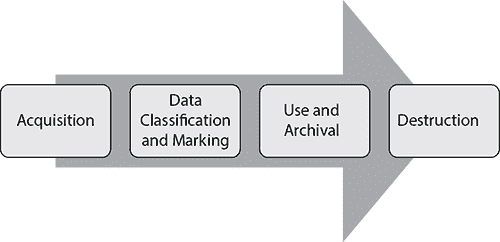

- 获取
- 数据分类与标记
- 使用与归档
- 销毁

本节描述生命周期的每个阶段及其相应活动。

### 获取

第一阶段涉及数据的来源。数据通常通过以下两种方法之一获得：

- **获取** 从外部来源（如供应商、客户或其他利益相关者）获取
- **创建** 在组织内部从头创建或开发

生命周期的下一步是对数据进行分类，以便应用适当的安全控制（如加密、访问控制等）。

#### 权限：访问控制矩阵

用于数据安全以定义访问控制权限的一种工具是访问控制矩阵，它是一个列出主体（用户）及其对特定数据元素或数据集的相应权限级别的表格。以下是针对特定数据元素或数据集的访问控制矩阵可能的示例：


或者，矩阵也可以将数据元素或对象作为列标题（例如文件 1、文件 2 等），并用主体对每个对象拥有的权限（读、写、打印、数据所有者等）替换掉 X 标记。

### 数据分类与标记

在数据被获取或创建后、被使用前，应通过使用安全控制来保护它。然而，要保护数据（静态、传输中和使用中），需要某种框架或流程来确定所需的保护级别。这就是数据分类发挥作用的地方。*数据分类*本质上是根据组织的分类策略、程序和指南，为数据分配敏感度值，以确定所需的保护级别（如加密、访问控制和安全销毁等安全控制）。表 4-1 展示了私营部门和公共部门（军事和联邦政府）常用分类方案的一些示例，按从最高分类级别到最低分类级别排列。

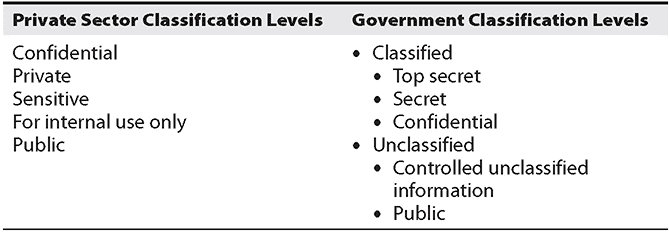

在实践中，分级因组织而异。有些组织可能只有两级，而其他组织可能有四级或五级。每个组织必须决定使用哪些分类级别，并明确这些级别的含义。为制定分类级别，组织应执行以下操作：

1. 定义分类级别，并指定确定数据如何分类的标准。
2. 确定责任方，如*数据所有者*（负责对数据分类）和*数据管理员*（负责维护数据并实施安全控制）。
3. 确定每个分类级别所需的安全控制。

#### 数据所有者要求

数据或系统所有者负责数据的分类。为正确分类数据，所有者必须：

- 作为流程所有者，深入熟悉被分类的数据
- 了解组织的分类方案和标准
- 熟悉组织的法律和法规要求
- 以一致、可重复的方式执行分类流程
- 在必要时执行解密程序

与信息安全中的大多数事物一样，制定分类级别是一项平衡工作。过多的分类级别会变得不切实际且令人困惑，而过少的分类级别可能提供的价值或实际用处很小。定义分类级别时，级别之间不应有重叠，以便数据所有者能轻松识别特定信息属于哪个分类级别。制定数据分类标准时，应考虑以下因素：

- 信息的有用性和价值
- 如果信息被泄露、修改或损坏，对组织的影响
- 与信息相关的法律、法规和责任义务
- 数据所有权、管理权和使用权相关的角色和职责

所有分类材料都应清晰地标记和标签，并根据格式（例如纸质、数字、介质、传真等）为每个级别制定独特的处理要求。至关重要的是，要确保组织始终如一地遵循针对各分类级别的安全策略、程序和控制，以确保在环境中得到一致应用。

#### 数据分类策略、程序和指南

组织应制定围绕数据分类的策略、程序和指南。数据分类策略应概述：

- 分类方案
- 每个分类级别的定义
- 每个分类的标准
- 分类的角色和职责

数据分类程序和指南应回答以下问题：

- 数据分类的流程是什么？
- 信息如何分类？
- 如果需要，如何更改分类级别？
- 分类变更如何传达给 IT 部门？
- 材料如何解密和销毁？

### 使用与归档

在数据生命周期的此阶段，信息被各种具有不同访问级别的用户和相关方利用（读取、修改，并可能在外部共享）。此阶段在数据机密性、完整性和可用性（CIA）方面提出了若干挑战。数据必须可用，但仅限于根据其组织角色拥有适当授权的人员（例如，某些用户可能仅被授权读取特定数据元素）。每个分类级别都应有具体的处理要求和程序，规定如何根据其分类级别访问、使用、处理、共享和最终销毁数据。


# 数据生命周期

作为数据生命周期的一部分，数据可能需要根据组织的数据保留策略和要求进行归档。*归档*是指将数据从生产用途中移出并保留以供将来使用或参考。这通常是为了协助管理存储空间，并确保满足长期保留要求。保留要求受组织内部要求（例如将来可能需要访问或恢复数据）以及外部要求（例如法律、法规或其他合规驱动因素）的影响。归档和保留既适用于数字/电子信息，也适用于物理文档。

## 销毁

当数据超过其有用寿命和保留要求时，必须对其进行安全销毁。安全专业人员深知，当通过按计算机上的 DELETE 键擦除数据时，该驱动器上的数据存储位置本质上只是被标记为可供操作系统使用。这会告知操作系统，该驱动器扇区、簇或块（取决于所使用的文件系统）现在可被重新占用。然而，所有“已删除”的数据仍然在驱动器上。这种方法称为*擦除*。由于所有数据仍保留在介质上，擦除不是一种安全的数据处置方法。当介质被安全地清除其内容时，称其已被*清理*。这意味着擦除信息，使其无法通过常规操作系统命令或商业取证/数据恢复软件轻易检索。介质可以通过多种方式进行清理：清除、覆盖/归零、消磁和物理销毁。这些方法用于安全清理硬盘和其他存储介质等资产中的数据。下面定义并讨论了每种方法：

- **清除** 是指使信息即使在实验室进行物理取证等非凡努力下也无法恢复。当介质将被移出允许访问介质上信息的物理范围，或将被重新用于不同的隔间时，需要进行清除。

- **覆盖/归零** 涉及某种数据覆盖。使用几种常见方法：

  - **单次覆盖** 数据通过*一次*全 1 或全 0 的传递被覆盖。
  - **美国国防部 (DoD) 方法** 数据区通过*三次*传递被覆盖；第一次全 0，第二次全 1，最后一次用伪随机数据。
  - **美国国家安全局 (NSA) 擦除算法** 数据被覆盖*七次*，先全 0，再全 1，依此类推。
  - **古特曼方法** 数据区被覆盖 35 次。

- **消磁** 是一种使磁性介质去磁的过程，使介质上仅留下极低残留磁感应强度。这需要将介质暴露在极强的磁场中。消磁足以清理传统磁性介质以供重用；然而，对带有芯片组的现代介质（如磁盘和磁带）进行消磁将使其无法操作（实质上是销毁）。

- **物理销毁** 是销毁介质的过程，使其无法重用且数据无法访问。这是最安全的数据销毁方法。这包括粉碎、压碎、焚烧、分解和在化合物中溶解。物理销毁也是用于物理文档的方法，因为你无法清除、归零或消磁纸质文档。

### 弱点：垃圾桶！

在使用寿命结束后，旧电脑连同其硬盘和其他磁性存储介质被替换并丢弃。为了降低这些资产上残留数据的风险，使用了多种数据清理方法，包括清除、归零、消磁和介质物理销毁。然而，数字数据并非唯一必须受保护的信息类型。其他形式的信息（如纸张）也需要安全处置，以防止垃圾桶翻找。*垃圾桶翻找* 是指搜索垃圾（垃圾桶、办公室废纸篓、回收箱等），以定位未经适当清理就被丢弃的有价值信息（如敏感纸质文档或未清理的物理介质）。处置敏感文档的最佳方法是物理销毁，如粉碎或焚烧。这将防范垃圾桶翻找者。

## 身份与访问管理

*身份与访问管理 (IAM)* 是指为管理和控制对企业资源的访问而建立的系统和流程。IAM 涉及对*谁*在访问*什么*以及他们能对其*做*什么的管理和实施。这意味着三个关键术语：

- **主体** 主动访问对象的实体
- **对象** 被主体访问的实体
- **访问** 主体可对对象执行或施加的操作

*主体* 是访问对象的主动实体，如个人、系统、进程或设备。对主体身份的管理和验证是身份管理发挥作用的地方。*身份管理* 专注于识别主体是谁，并验证（认证）他们就是他们自称的那个人。*对象* 是包含被主体访问的信息的实体，如网络、计算机、文件、设备、记录、表、进程、域、数据库或程序。对象通常是存储、处理或发送/接收数据的资源。*访问* 是主体对对象施加的操作，如读取、修改、删除、创建或执行。这是访问管理发挥作用的地方。*访问管理* 系统管理主体可以访问哪些对象以及可以对它们做什么。

### 硬拷贝示例

通过考虑访问概念如何不仅适用于数字数据，也适用于硬拷贝数据，可以说明访问的概念。例如，如果组织将敏感文档存放在保险柜中，组织必须通过仅向授权员工提供组合锁来限制谁有权访问保险柜（访问管理）。为了向某人提供组合密码，组织必须知道此人是谁，并验证其身份以确保其就是其自称的那个人（身份管理）。在这个例子中，拥有使用组合密码打开保险柜权限的授权员工是主体，保险柜是对象。

本节讨论以下主题：

- 身份与访问管理基础
- 身份管理技术
- 认证因素与机制
- 访问控制原则
- 访问控制模型
- 访问控制管理
- 身份与访问管理生命周期

### 身份与访问管理基础

身份管理专注于识别和验证主体身份，而访问管理专注于管理主体对对象的访问、定义可执行的操作以及跟踪这些操作。这些通过识别、认证、授权和问责/审计来实现，定义如下：

- **识别** 识别功能确定主体是谁。在许多系统中，主体提供信息来识别自己，如用户名、账号或用户 ID。

- **认证** 认证功能验证主体就是其自称的那个人。身份验证通常通过密码、口令、令牌设备、智能卡、加密密钥或生物特征来执行。这些是认证方法。

- **授权** 授权功能根据预定义的访问管理规则授予对对象的访问权限，这些规则确立了允许主体对对象执行哪些操作。


### 问责/审计

问责/审计功能通过审计日志和监控实现对活动的跟踪。这使主体对其行为负责，只有当主体通过身份管理被唯一标识时，才能实现这一点。

实现认证、授权和记账/审计的协议称为 AAA（“三重 A”）协议。示例包括 `RADIUS`、`TACACS+` 和 `Diameter` 等协议。

### 身份管理技术

身份管理技术包括一系列产品、应用程序和解决方案，用于识别、认证和授权主体以进行访问。以下是支持身份管理的一些关键技术：

*   **目录** 大多数组织使用包含组织用户、资源和网络信息的目录。目录存储并集中管理资源信息、策略和用户凭据。最常见的示例是用于管理 Windows 域网络的微软 `Active Directory (AD)`。
*   **密码管理器** 密码管理器通常被可能没有基础设施或资源部署目录服务的小型组织和家庭用户使用。密码管理器为密码存储和管理提供了一个集中的加密数据库。产品形式从基于云的解决方案到桌面应用程序不等。
*   **单点登录 (SSO)** 单点登录允许用户使用一组凭据进行一次认证，即可访问一系列资源（而不是为每个系统设置单独的密码）。`SSO` 有助于减少管理工作，因为它减少了需要管理的密码数量，并有助于鼓励使用更强的密码，因为用户需要记住的密码更少。然而，`SSO` 也可能成为安全隐患，因为被攻破的账户可用于访问各种资源。
*   **联合身份管理 (FIM)** 联合身份管理是单点登录的一种变体，允许组织建立安排，利用相同的标识和认证数据跨多个组织认证用户。`SSO` 仅允许用户向单个组织内的系统进行认证，而 `FIM` 允许用户向安排中涉及的任何组织的系统进行认证。`安全断言标记语言 (SAML)` 是一种 `可扩展标记语言 (XML)` 标准，支持组织间交换身份信息。
*   **身份即服务 (IDaaS)** `IDaaS` 是另一种基于云的“即服务”模型。基于云的身份管理提供身份和访问管理功能，包括预配和撤销身份的能力，以及监控（包括日志记录和报告）的能力。`IDaaS` 通常包括配置其他技术的能力，例如目录同步、单点登录和联合身份。

### 认证因素和机制

认证的三个主要因素包括：

*   **类型 1，你知道的某物***（如密码、口令或 PIN 码）
*   **类型 2，你拥有的某物***（如令牌设备、智能卡或 USB 驱动器）
*   **类型 3，你本身的某物***（生物特征，如语音、指纹或掌纹扫描）

仅使用其中一个因素称为*单因素认证*。使用两个认证因素称为*双因素认证*（如智能卡和 PIN 码、密码和生物特征，或密码和物理令牌）。*多因素认证*是使用两个或更多因素。


**提示** 就“性价比最高”而言，多因素认证的实施已被反复证明能显著提升安全态势并降低妥协风险。这是因为每个因素都增加了网络犯罪分子实施攻击所需的工作量。例如，即使用户被诱骗泄露了密码，攻击者仍需要额外的认证因素才能获得访问权限。

### 访问控制原则

*访问控制* 是调节和控制主体如何与对象（系统、建筑物和数据）交互以确保授权访问的安全控制。目标是防止未授权主体访问系统、文件和数据等对象。以下是 CISO（首席信息安全官）应了解的一些基本访问控制：

*   **访问控制策略和程序** 与任何信息安全工作流或子项目一样，组织的访问控制策略和方法必须记录在访问控制策略和程序中。
*   **最小权限** 应使用*最小权限原则*模型授予访问权限，即用户仅获得完成其工作和相应任务所需的必要权限级别。
*   **需知原则** 用户应对其有权访问的信息具有有效的知情需求。*需知原则*与最小权限类似，意味着用户访问特定信息有合法理由。
*   **职责分离** 确保没有单个个体能单独完成关键流程、活动或任务，可防止欺诈和其他恶意活动的发生。审计职能的职责分离尤为重要，以确保执行任务的个人不审计自己。
*   **系统使用通知** 组织通常使用警告横幅，在授予系统访问权限前提供系统使用通知或消息。这些横幅提供隐私、安全和可接受使用通知，告知用户监控实践并传达预期行为。

### 访问控制模型

访问控制模型是用于调节主体和对象之间交互的规则集。供应商在操作系统和应用程序等产品的设计中实现这些模型。组织也使用它们来设计企业中访问控制的实施方式。以下是主要的访问控制模型类型：

*   **强制访问控制 (MAC)** `MAC` 模型使用中央授权机构，基于主体的*许可*和对象的*分级*来调节访问。主体的许可必须大于或等于对象的许可。`MAC` 模型通常用于专用政府和军事系统，或专用操作系统发行版，例如由 NSA 和红帽开发的 `Security-Enhanced Linux (SELinux)`。
*   **自主访问控制 (DAC)** `DAC` 模型为所有者（通常是创建者）提供对象（资源）的完全控制权，以确定哪些主体（用户和组）可以访问和共享该对象。`DAC` 是一种基于身份的模型。`DAC` 系统的示例包括大多数 Unix 和 Linux 变体，以及所有 Windows 和 macOS 系统。`DAC` 集成在操作系统内核中，可使用 `访问控制列表 (ACLs)` 应用于单个文件以及整个目录。
*   **基于属性的访问控制 (ABAC)** `ABAC` 也称为 `基于策略的访问控制 (PBAC)` 或 `基于声明的访问控制 (CBAC)`，根据结合各种属性的技术策略授予访问权限，这些属性包括：发起请求者（主体）、请求的资源（对象）、环境条件（如时间或位置，即环境上下文）以及请求的操作。可以根据日期、时间、IP 地址等各种属性及其组合来授予访问权限。


## 基于角色的访问控制 (RBAC)

**基于角色的访问控制 (RBAC)**，也称为非自主访问控制，根据主体在组织中的角色来实施访问控制。每个角色被分配特定的权限，用户则根据其职能被分配到相应的角色。例如，可以构建用户、IT 管理员、人力资源和开发人员等角色及其权限集，并根据用户的工作职责将他们分配到这些角色中。这种模型简化了管理，并为组织架构提供了更好的支持。RBAC 可以（且通常）与 DAC 和 MAC 结合使用。


> **注意** 像 Windows、Linux 和 macOS 这样的现代操作系统会将 DAC 和 MAC 一起使用。它们在每个操作系统中有不同的名称；然而，传统上被视为基于 DAC 的系统在底层融入了 MAC 功能，通常是为了降低恶意软件被管理员用户执行的风险。例如，Windows 采用用户账户控制 (UAC)，这是一种 MAC 实施机制，可隔离具有不同权限级别的进程。

访问控制模型通过操作系统/应用程序设计特性与组织实施的结合，在企业级别应用。例如，Microsoft Active Directory 提供了工具供组织实施 RBAC。使用 AD，组织可以定义分配了特定权限的组织角色，然后通过分配角色来为每个用户进行预配。

虽然 AD 等系统处理 RBAC 的实施，但弄清组织需要哪些角色以及每个角色关联哪些权限是一项挑战。事实上，许多组织发现实施 RBAC 很困难，因为它需要组织内部大规模的协作努力来定义角色和权限。为克服这一问题，一些组织分阶段实施 RBAC，先粗略定义角色，然后在一段时间内逐步增加粒度。

## 访问控制管理

访问控制通常采用集中式、分散式或混合方法进行管理，如 图 4-2 所示。此处定义并讨论了这些管理类型：

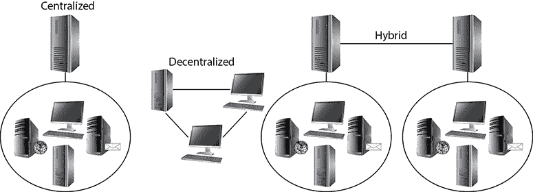

**图 4-2** 访问控制管理

- **集中式** 大多数组织采用集中式访问控制管理模型，由一个部门或实体负责治理、管理和配置技术以实施访问决策（通常是 IT 部门）。所有访问请求和变更都通过该部门，账户受到集中监控。这种方法提供了更高的流程一致性；然而，与分散式模型相比，变更可能不那么迅速。

- **分散式** 在分散式访问控制管理模型中，访问管理通常由资产或资源的所有者负责。这意味着变更处理可能更快，因为没有单一实体管理所有访问请求；然而，这可能导致在应用访问控制和身份管理生命周期时出现不一致。例如，离职员工可能未被妥善移除所有访问权限，从而在整个组织中造成不一致和安全漏洞。此外，由于职责分离可能不足，该模型可能导致利益冲突。

- **混合式** 混合访问控制管理模型结合了集中式和分散式访问控制管理技术。例如，组织的 IT 部门可能管理关键资源（如 Active Directory）的访问控制（集中式管理），而属于各个部门的系统（如销售团队的 CRM）可能由各个部门自行管理（分散式管理）。

## 身份与访问管理生命周期

身份与访问管理的运作遵循一个通用的生命周期，如 图 4-3 所示并在此描述：


**图 4-3** 访问控制与身份管理生命周期

- **预配** 生命周期的第一步是账户预配，通常作为入职流程的一部分进行。预配是在账户生命周期内创建、更改、禁用和删除用户账户，以及授予和撤销账户权限的过程。组织应有文档化的程序，包含对账户请求的管理批准。此外，必须注意确保权限和访问级别是执行工作所需的最低要求（最小权限），并且用户有合法的业务需求访问（需知原则）。

- **审查** 必须定期审查和监控账户，以确保随时间推移仍存在访问需求。这对于管理员账户和其他具有提升访问级别的特权账户尤为重要。当员工在组织内调任新角色时，应审查其账户和权限，以确保访问级别适合该角色（最小权限和需知原则）。*权限蔓延* 是指用户逐渐积累超出其角色所需的访问权限。这在账户未被仔细管理的小型 IT 团队中尤为常见。担任 IT 通才的特权员工可能从服务台转到系统管理、数据库管理、安全管理或其他特权角色，最终拥有危险的权限级别。应定期执行账户审查，这通常是许多法律和法规合规驱动因素的要求。

- **撤销** 生命周期的最后一步是在员工离开组织或不再需要相关账户或访问权限时移除访问权限。此步骤常见的错误是撤销了员工的部分而非所有账户。如果拥有高权限的员工被解雇并决定报复组织，这可能会带来特别严重的问题。必须建立并遵循撤销流程程序，以确保所有相关账户均被撤销。

## 通信与网络安全

网络可被视为组织的循环系统，为执行基本功能的服务器和端点提供生命力。本节介绍现代局域网和广域网的设计与实施方式、如何最好地防御这些网络，以及如何从安全角度审视它们。具体而言，本节涵盖以下主题：

- 广域网和局域网
- IP 寻址
- 网络地址转换
- 网络协议与通信
- 无线网络
- 网络技术与防御

### 广域网和局域网

当代数据通信发生在局域网和广域网上。局域网 (LAN) 实现设施、家庭、办公楼或建筑群（如校园）内计算设备和设备的通信。广域网 (WAN) 实现局域网之间及局域网间的通信。有时使用城域网 (MAN) 一词来指代连接多个局域网的校园网络。城域网可被视为覆盖较小地理区域的广域网。


# WAN 和 LAN

WAN 使用适合长距离通信（数十或数千英里）的电信电路。直到上一个十年，这些技术包括使用传输协议的电路交换或分组交换网络，这些协议包括异步传输模式 (ATM)、同步光网络 (SONET)、帧中继和 X.25。然而，近年来，这些技术已在很大程度上被基于 IP 的技术所取代，包括*城域以太网* (*MetroE*) 和*虚拟专用局域网服务* (*VPLS*)。LAN 使用适合较短距离的通信设备和装置。然而，LAN 和 WAN 都使用网络协议，包括传输控制协议/互联网协议 (TCP/IP)，以管理信息从源头、跨越网络到预期目的地的传送。

WAN 和 LAN 之间的一个主要区别在于，WAN 通常由第三方 WAN 服务提供商或运营商提供，而 LAN 通常由组织内部运营和维护。

## WAN 拓扑

服务提供商使用多种拓扑提供 WAN 基础设施，包括

- **点对点** 点对点拓扑由两个端点之间的单条路径或电路组成。在这种情况下，组织连接到服务提供商的网络，该网络提供一条穿过网络到达另一侧的单一路径，另一侧可能是对等设施或另一个 LAN。
- **中心辐射型** 当组织的设施需要连接到多个位置时，会使用中心辐射型布局。在这种情况下，虽然使用多个点对点连接是一种选择，但中心辐射型提供了一种成本更低的替代方案。组织连接到一个中心，该中心维护与多个站点的连接。这种拓扑也称为*单归属*，指的是使用单个中心。*双归属*布局在组织设施使用两个中心，每个中心维护自己到其他位置的辐射连接，以实现冗余和性能提升。
- **全网状** 全网状网络也用于提供多个位置之间的连接。当每个位置（节点）都有连接到其他每个位置的电路时，即实现该方案。这种安排提供了最大的冗余性和灵活性。

选择哪种拓扑取决于业务性质、性能考量和成本。点对点是最简单、成本最低的选项，但在调整容量方面灵活性有限，且不提供冗余。网状拓扑成本可能最高，但为负载均衡和性能优化提供了更好的冗余和控制。

## WAN 技术

与组织 LAN 边界连接（或终止）的 WAN 链路部分称为*本地环路*，有时也称为连接的“最后一英里”。图 4-4 提供了示意图。

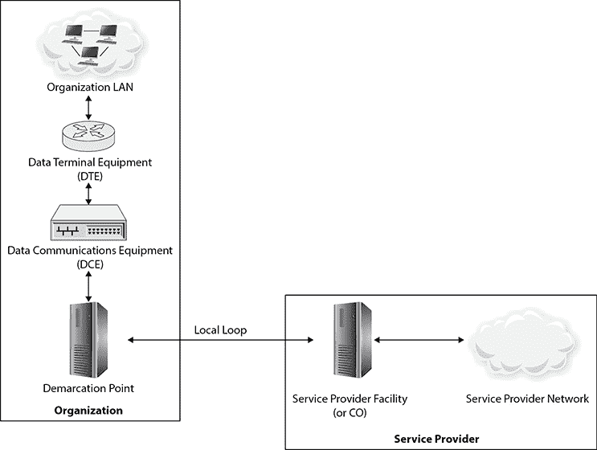

**图 4-4** WAN 最后一英里组件

本地环路终止于组织的分界点，分界点可以简单到只是一个用于将本地环路连接到设施的接线块。*数据通信设备 (DCE)* 是将本地环路与*数据终端设备 (DTE)* 连接的设备，DTE 可以是位于 LAN 边界的计算机或路由器。本地环路连接的特性取决于所使用的通信链路类型和服务提供商网络。

服务提供商网络可以实现前面讨论的任何拓扑。它们也可以使用多种连接技术，如下所示：

- **租用线路** 这些是连接两个位置的物理点对点通信线路。专线昂贵但仍被广泛使用。这些线路从提供商处租用。T1 链路的数据传输速率为 1.544 Mbps，T3 链路（也称为数字信号 3 或 DS3）为 44.736 Mbps。T3 链路承载 28 个复用的 T1 信道。
- **电路交换网络** 这些网络在呼叫的两端之间提供专用电路路径。一种常见的电路交换技术是综合业务数字网 (ISDN)，它是一种支持数据和语音通信的交换电话网络。ISDN 在 2000 年代初期被广泛使用，但已在很大程度上被有线、光纤或 DSL 等快得多的服务所取代。电路交换通信的另一个例子是公用交换电话网 (PSTN)，主要用于语音和低速数据通信。
- **分组交换网络** 分组交换使用共享网络，而不是租用线路或电路交换提供的专用电路。由于网络在许多服务提供商客户之间共享，数据被放入*分组*中，并被*路由*到其正确的目的地。分组交换网络也可用于提供虚拟电路，即两个网络设备之间的逻辑连接路径。分组交换连接的例子包括 X.25、帧中继、ATM 和城域以太网。前几种技术仍在使用，但正逐渐被城域以太网和其他基于以太网的技术所取代。

其他 WAN 通信技术包括 DSL、有线电缆和 FTTP、卫星以及无线：

- **DSL** *数字用户线路* 在电话线上提供数据通信。尽管近年来许多此类电路已被有线或光纤服务取代，但 DSL 仍被广泛使用，且在许多地区可用。非对称 DSL (ADSL) 指具有非对称速率的 DSL，即下行数据传输速度快于上行。ADSL 通常供住宅用户使用。使用对称 DSL (SDSL) 时，数据上行和下行速率相同。DSL 的高速版本包括高速率 DSL (HDSL) 和超高速率 DSL (VDSL)。随着 DSL 技术的不断发展，速度可达 1000 Mbps 甚至更高。SDSL 通常供企业使用。
- **有线电缆和 FTTP** *有线电缆* 或 *有线互联网* 是指由有线电视提供商提供的宽带互联网接入。此类提供商也充当*互联网服务提供商 (ISP)*。有线电缆使用宽带电气或光纤到户 (FTTP) 技术作为最后一英里链路连接到用户（组织或住宅）设施的介质。通信速率通常是非对称的，每条链路可达 1 Gbps。
- **卫星** 尽管存在一些技术限制，但企业使用卫星进行互联网和企业间连接的需求正在增长。现代卫星链路可提供高达 1000 Gbps 的下行速度和高达 1000 Mbps 的上行速度。卫星通信性能可能受天气影响，从而影响通信所需的视距。且由于卫星、地面站和用户设备之间的长距离和跳数，卫星通信存在延迟。低地球轨道 (LEO) 基础服务等新技术可能在不久的将来带来更好的性能并降低成本。
- **无线** 无线 WAN 与更普遍的无线 LAN 不同，它们使用蜂窝技术实现更长距离的通信。无线 LAN 使用 2G、3G、4G LTE 和 5G 等蜂窝技术。由于无线 WAN 不受有线技术的物理保护，它们通常使用认证和加密来保护通信免受拦截或窃听。

## LAN 基础设施


## LAN 组件与拓扑

典型的 LAN 由一个或多个由边界设备启用的外部连接以及一个内部网络组成，内部网络通常会被分段以实现性能和/或安全目标。内部网络可以是有线网络（如今几乎总是以太网）、无线网络，或有线和无线的组合。图 4-5 描绘了一个典型网络。图中所示的一些组件将在此介绍，而其他组件将在本节后面讨论。

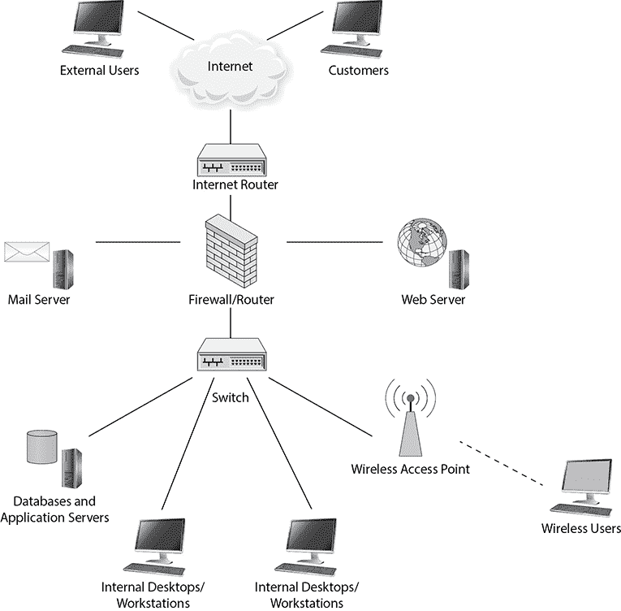

**图 4-5** 典型 LAN

外部用户和客户通过互联网访问组织的网络，“最后一英里”由组织场所内的互联网路由器终止，该路由器路由并控制进出组织 LAN 的流量。各种设备的物理排列方式称为网络*拓扑*。图 4-5 并未显示特定的拓扑。存在许多可能的网络拓扑，包括总线型、环型、树型、星型、网状和混合型。大多数现代 LAN 使用星型拓扑。

网络上的每个设备都有一个互联网协议 (IP) 地址。数据使用这些 IP 地址在设备之间路由。路由器是连接相似或不同网络的设备，并使用 IP 地址“路由”流量。

LAN 内部和之间的所有数据通信都使用由*协议*定义的标准消息格式。消息包含每个设备和应用程序根据协议处理消息所需的所有信息。每条消息由一个*数据包*组成，其中包含以下信息：

- 消息源或发起者的标识
- 消息目的地的标识
- 控制信息，可能包括序列号、标志、指针、长度、校验和等
- 数据（但不总是有——某些消息仅包含控制信息而无数据）

根据数据包中的信息，网络上的各种设备对数据进行路由和/或处理。以下是一些最常见网络设备的简要总结：

- **互联网路由器** 这是位于 LAN 边界的设备，提供与 WAN 链路的接口。
- **路由器** 有时互联网路由器与边界路由器合二为一，甚至可充当外部防火墙，根据组织的安全策略过滤流量。路由器执行网段间的数据路由，并可能执行其他功能，如网络地址转换 (NAT)，将在后续章节讨论。
- **防火墙** 防火墙是用于实施安全策略（如允许或拒绝特定类型的流量）的专用设备。本节后面将更详细地讨论防火墙，它们在保护组织网络方面发挥着重要作用。在图 4-5 中，防火墙用于控制 LAN 边界的流量，并专门过滤进出组织邮件服务器、外部面向的网站以及内部分段网络的流量。
- **交换机** 交换机工作在 OSI 第 2 层（稍后将详述 OSI 模型），允许将网络配置为多个段，从而更有效地利用可用带宽，并可用于创建安全区域。

### IP 寻址

地址决定了数据如何在以太网络中发送和接收。正如房屋地址使邮件能够投递给预期收件人一样，IP 寻址使数据能够发送到网络上的正确位置。正如房屋地址使用多个元素（如城市名、街道名、门牌号）寻址一样，网络上的组件使用两个元素寻址：*网络*和*节点*（或*主机*）。事实上，每个 IP 地址都包含两部分：网络标识符和节点标识符。

在 IPv4 中，IP 地址由 32 位组成，包含四个八位字节。存在公共 IP 地址和私有 IP 地址；公共 IP 地址在互联网上路由，私有 IP 地址用于企业、组织和政府实体内部（私有 IP 地址不能在互联网上路由）。公共 IP 地址由互联网号码分配局 (IANA) 分配，该组织负责在全球范围内管理 IP 地址。私有 IP 地址可由任何公司、组织或个人免费分配供自己使用。以下是不可在互联网上路由的私有 IP 地址范围：

- 10.0.0.0–10.255.255.255
- 172.16.0.0–172.31.255.255
- 192.168.0.0–192.168.255.255

IP 地址与*子网掩码*结合使用，后者标识 IP 地址的哪一部分指定网络，哪一部分指定节点（或主机）。掩码与 IP 地址一样，长 32 位。每一位为开启 (1) 或关闭 (0)，从左向右读取。开启的位指示地址中哪些部分指定网络；关闭的位指定节点。子网掩码作为地址的一部分，使用无类别域间路由 (CIDR) 表示法定义，如下所示：

- IP 地址后跟一个斜杠 (/)
- 十进制数字（0 到 32），指示 IP 地址中构成网络 ID 的位数

例如，地址 192.168.0.10/24 表示该地址的前 24 位（从左侧开始）是网络地址，其余位是节点或主机的地址。

### 网络地址转换

互联网路由器未配置为跨互联网路由私有 IP 地址。那么，如果不使用私有地址，数据如何跨互联网路由到网络内的设备？为此，IPv4 使用网络地址转换 (NAT)。

使用 NAT 时，私有组织边界的路由器被配置为将外部（公共）IP 地址映射到内部（私有）IP 地址。NAT 有多种类型，最基本的提供外部地址到内部地址的一对一映射。本书不涵盖所有各种 NAT 类型，但它们各自提供了一种以对源和目标主机透明的方式穿越公共和私有网络的方法。

### 向 IPv6 迁移

IPv4 使用 32 位寻址，可提供超过 37 亿个地址。这似乎已经足够，但考虑到地球上约有 60 亿人（更不用说其他地方了），似乎总有一天地址会用完。为解决此问题，IPv6 于 2012 年开发并发布。IPv6 使用 128 位，支持 2 的 128 次方（即 340,282,366,920,938,463,463,374,607,431,768,211,456）个地址。这应该足够了。然而，IPv6 的采用进展缓慢，尽管现在采用它可以简化某些事情，例如消除对 NAT 的需求。目前，全球约有 30% 采用了 IPv6。采用缓慢的原因各异，但在许多情况下，IPv4 代表了已在设备上投入的巨大资产，这些设备无法轻松升级到 IPv6。此外，行业内许多个人和组织已经精通并驾驭了 IPv4，不愿做出如此大的改变。IPv4 不会在短期内关闭，但最终行业将跟上步伐，128 位寻址将成为常态。

### 网络协议与通信

现代网络上设备间的通信只有在所有设备遵循通用模型时才能发生。行业最常用开放系统互连 (OSI) 模型（或称为 TCP/IP 模型的一个变体）作为建立和描述网络上每个设备如何相互通信的方式。OSI 模型具有以下特点：

- 解释网络如何工作，并用于设计网络服务和协议
- 通过定义接口标准，实现供应商产品之间的互操作性


# OSI 参考模型和常见协议

## 模块化方法
- 提供模块化方法，以便更换某个组件而不影响其他组件

## OSI 参考模型层
根据 ISO 标准 7498 定义的 OSI 参考模型，将网络任务、协议和服务分段为各层（或网络栈），如下所示：

- **应用层（第 7 层）** 主要负责与用户交互。这是用户所体验的应用程序接口。
- **表示层（第 6 层）** 主要负责将数据从用户预期的格式转换为网络预期的格式。
- **会话层（第 5 层）** 主要负责系统和应用程序之间的对话控制。
- **传输层（第 4 层）** 主要负责处理端到端的数据传输服务。
- **网络层（第 3 层）** 主要负责逻辑寻址（如 IP 地址），并包含路由规范等内容。
- **数据链路层（第 2 层）** 主要负责物理寻址（如 MAC 地址）。
- **物理层（第 1 层）** 主要负责物理传输和规范，如电压变化和持续时间。

## 协议概述
协议是用于通信数据的规则和标准集合。协议定义了系统、设备或应用程序之间交换数据所使用的过程和消息格式。许多协议包含认证、服务质量或纠错方法。表 4-2 显示了常用协议及其在 OSI 模型中运行的层。

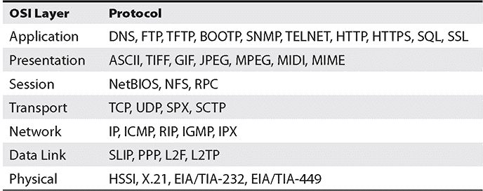

## 表 4-2 常见协议

### 应用层
应用层协议处理文件传输、执行网络管理功能，并满足来自应用程序的网络请求。以下是一些常见的应用层协议：

- **域名系统** DNS 就像互联网的地址簿。它允许我们使用域名（如 google.com），而不必记住特定服务器的 IP 地址。DNS 协议使应用程序能够交换和满足 DNS 请求。
- **文件传输协议** 此协议用于在系统之间传输整个文件。
- **简单网络管理协议** 该协议于 1998 年首次发布，作为管理网络设备的一种方式。它采用客户端-服务器架构，客户端使用在待管理网络设备上运行的*代理*。代理收集有关设备的信息并将其报告回服务器上的*管理器*。SNMP 早期版本提供了一种控制和获取网络设备状态的好方法，但存在重大安全缺陷。SNMP 使用一种称为*团体字*的密码系统进行认证，而在实践中，它们通常以明文形式跨网络发送或存储，这使得攻击者很容易获取有关网络设备配置方式以及网络如何被攻破的信息。SNMP 第 3 版增加了加密和更好的认证。不应使用旧版本的 SNMP。
- **超文本传输协议** 此协议是在客户端和服务器之间传输和格式化消息的一种方法。它是浏览器获取信息以供显示并与万维网上的服务器通信的主要方式。当用户在浏览器中输入 `//` 作为统一资源定位符 (URL) 的一部分时，这会告诉浏览器使用 HTTP 作为协议。
- **HTTP 安全** 此协议是增加了加密以提高安全性的 HTTP。HTTPS 以前使用现已降级的 SSL 协议，但现在使用 TLS 作为加密方法。HTTPS 确保一旦建立 HTTPS 会话，所有流量（包括密码和认证信息）都将使用加密进行保护。这可以保护 HTTP 会话免受窃听、中间人和欺骗攻击。
- **安全套接字层/传输层安全** SSL 和 TLS 经常被归为一类，因为 SSL 是 TLS 的前身。两者都是使用*公钥加密*（本章后面将讨论）来保护通信的协议。TLS 早期版本存在安全问题。组织应确保使用 TLS 1.2 或更高版本，以确保正确实施。

### 表示层
表示服务是指将数据转换为标准格式以进行传输的服务。这些服务通常执行压缩、解压缩、加密和解密。这些功能实际上是服务而非协议。以下列出了一些最常见的表示层标准：

- **ASCII** 美国信息交换标准代码是一种字符编码标准。用户每次在键盘上敲击按键，ASCII 代码都是该按键的表示。它主要用于传输字母和数字信息。
- **TIFF、GIF、JPEG** 这些是用于压缩图像以便于存储和传输的格式。
- **MIME** 多用途互联网邮件扩展 (MIME) 确立了除 ASCII 之外的邮件内容格式。

### 会话层
会话层协议用于建立应用程序之间的连接。它们建立和拆除连接，并进行维护工作以帮助通信顺利运行。以下是一些常见的会话层协议：

- **网络文件系统** 这是一种使用客户端/服务器关系共享文件的方法。
- **网络基本输入/输出系统** NetBIOS 提供服务，允许不同计算机上的应用程序通过 LAN 进行通信。NetBIOS 运行在 TCP/IP 之上，但有其自己的方法，使用 NetBIOS 名称来识别使用它的应用程序。它有三种不同的服务：命名服务、数据报分发服务和会话服务。
- **远程过程调用** 这是一种应用程序可用来请求位于另一系统上的另一个程序提供服务的协议。

### 传输层
传输层协议处理数据的端到端传输和分段。除其他协议外，以下协议在此层运行：

- **传输控制协议** TCP 是一种面向连接的协议，它使用三次握手在两个系统之间建立连接。连接的建立确保了可靠性，并且该协议会定期检查连接以确保其仍然建立。
- **用户数据报协议** 与 TCP 相反，UDP 不是面向连接的。因此，它用于发送方不需要知道消息是否实际送达的情况。虽然不如 TCP 可靠，但 UDP 所需的开销比 TCP 少。

#### TCP 三次握手及相关攻击
TCP 使用“三次握手”来建立通信，如图 4-6 所示。在第一步中，客户端发送同步 (SYN) 消息，告诉服务器它想要开始通信。服务器响应序列号加确认 (SYN+ACK)。然后客户端响应自己的确认 (ACK)，传输即可继续。

攻击者历史上一直利用这一序列执行拒绝服务攻击。在 SYN 攻击中，网络犯罪分子发送大量 SYN，从而淹没服务器。或者这种攻击的一种变体是 SYN-ACK 攻击，网络犯罪分子伪造 SYN 消息，使其看起来像是来自另一个客户端。服务器随后向被欺骗的客户端而不是攻击者的系统响应 SYN-ACK。这本来可能没事，但 TCP 是一种弹性协议，会持续发送 SYN-ACK 直到收到响应。这些 SYN-ACK 可能会淹没被欺骗的客户端系统。

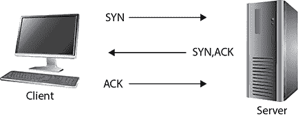

**图 4-6** TCP 三次握手

### 网络层


## 网络层协议

网络层协议主要涉及路由以及其他网络和互联网服务。以下是常用的网络层协议：

- **互联网协议 (IP)** IP 负责根据 IP 地址将数据包（也称为数据报）从源端传送到目的端。路由器维护表格以跟踪 IP 地址和相关系统，并遵循 IP 规则及其他协议在整个网络中路由流量。

- **互联网组管理协议 (IGMP)** IGMP 用于管理多播组。当系统想要参与多播流量时，它会成为一个多播组的成员。IGMP 用于通知路由器该系统属于某个组。一旦建立成员关系，协议无关多播 (PIM) 服务就会被用来将多播流量导向成员系统。

### 数据链路层

*数据链路*层由子层组成：逻辑链路控制 (LLC) 和介质访问控制 (MAC)。数据链路层的协议将数据转换为帧以便传输。

- **地址解析协议 (ARP)** ARP 将 IP 地址映射到 MAC 地址。MAC 地址是一个硬连线到网络设备或计算机系统中的 48 位地址。网络上的计算机使用 ARP 来了解哪个 MAC 地址对应哪个 IP 地址，然后利用该信息进行未来的通信。*ARP 投毒*是一种攻击类型，攻击者欺骗交换机在其缓存中保存错误信息，导致数据在网络上被错误路由。

- **点对点协议 (PPP)** PPP 用于提供两个实体之间的通信。它提供包括认证、加密和压缩在内的服务。它常用于拨号接入和串行通信链路。

- **以太网** 以太网取代了旧的局域网技术，现已成为局域网通信的事实标准。以太网将通信划分为称为帧的片段，每个帧包含源和目的 MAC 地址以及用于增强传输可靠性的错误检查数据。

### 物理层

物理层实际上没有协议，而是有定义传输物理层面的标准。这些标准包括用于串行传输的 EIA-232、422、423、449 等，以太网物理层 (10BASE-T、10BASE2、10BASE5 等)、光传输网 (OTN) 以及其他能够承载符合 OSI 标准协议的物理技术。

### 网络协议和设备摘要

前文关于 OSI 模型及相关协议的讨论总结在 `图 4-7` 中。请注意，该图还展示了替代的 TCP/IP 模型（也称为 DoD 模型），它合并了 OSI 的某些层。

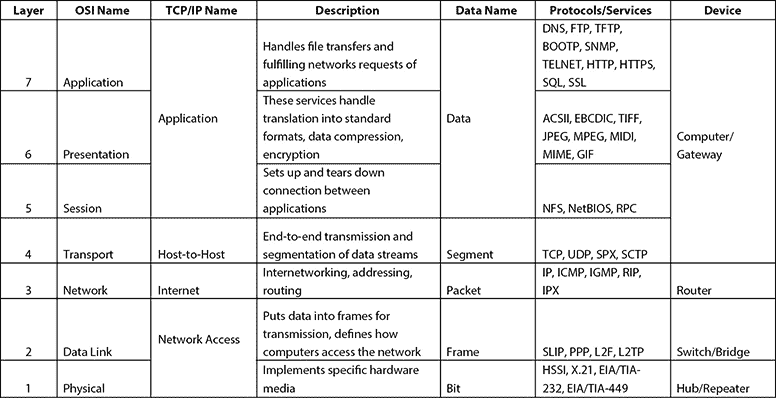

**图 4-7** 网络摘要

## 无线

无线技术允许计算机和其他设备使用射频 (RF) 通信连接到局域网。这为计算机的物理布局和位置提供了极大的灵活性。如今的无线局域网遵循 IEEE 802.11 LAN 协议，大多数在两个射频频段运行：2.4 GHz 和 5 GHz。无线网络通过两个组件在局域网上实现：

- 无线路由器（接入点）
- 无线网络适配器，作为外挂件实现或内置于计算机、手机和其他设备中

无线网络使用服务集标识符 (SSID) 作为网络的名称。SSID 允许所有设备连接到并成为同一无线网络的一部分。连接到无线网络的所有设备称为*站点*。

802.11 网络有两种基本形式：*基础设施*和*自组织*（也称为*网状*）。在基础设施网络中，所有站点通过接入点或无线路由器进行通信。接入点充当通往其他网络的桥梁，最常见的是有线局域网或互联网连接。自组织模式允许站点以对等方式通信，无需接入点。

无线网络缺乏物理控制带来了特殊的安全挑战。任何路过的人都可以访问从站点发出的 802.11 信号。在无线技术的早期，认证机制要么不存在，要么实现得很差，使得无线成为网络犯罪分子实施网络攻击的简易途径。然而，多年来无线技术增加了更好的安全功能。旧方法称为有线等效保密 (WEP)，其安全性无效，已被不断演进的 Wi-Fi 保护访问版本 (WPA、WPA2 和 WPA3) 所取代。

## 网络技术和防御

本节讨论与局域网和组织网络相关的一些风险以及缓解这些风险的常用方法。

### 防火墙

前文“局域网基础设施”部分中的图 4-5 展示了一个由防火墙保护的、具有单一数据出口点的网络。防火墙是一种用途广泛且广泛使用的技术，用于控制两个网络或网络两个段之间的访问。防火墙有三种主要类型：包过滤、代理和状态/动态包过滤。有时这些类型分别被称为第 1、2、3 代。

#### 包过滤

包过滤是最基础、成本最低的防火墙。包过滤是一种路由器，它根据内部访问控制列表 (ACL) 筛选流量。路由器筛选所有流量，并根据每条消息的网络层和传输层头部信息，决定是允许还是拒绝流量从其一个接口通过到另一个接口。防火墙可以根据包括以下内容的标准做出访问决策：

- 源和目的 IP 地址
- 源和目的端口号
- 协议
- 流量方向

例如，ACL 可能包含一条规则，规定使用 HTTP 协议的 Web 流量只有在包含组织 Web 服务器的目的 IP 地址时才能进入局域网。通过限制可进入和离开网络的流量类型及其特定目的，可以降低恶意或错误活动的风险。防火墙可用于局域网边界或内部，以创建特殊的安全区域，进一步控制企业的安全性。

#### 代理

代理防火墙位于受信网络和非受信网络之间，充当守卫。通俗地说，*代理*是代表他人行事的人。代理充当中间人。使用代理防火墙时，网络之间不会发生直接通信，因为代理会冒充连接另一端的系统，并隐藏其所保护网络内设备的 IP 地址。代理拦截并重新封装所有流量，应用安全策略，并防止两个网络之间的直接连接。这使得网络犯罪分子更难发现代理另一侧的信息。

#### 状态/动态包过滤

状态/动态包过滤就像一个爱管闲事的邻居，偷听人们的谈话并插手他们的事务。这些防火墙不仅检查消息以做决策，还会记录它们之前了解到的关于会话的信息，以便对拒绝或允许哪种类型的流量做出更明智的决策。它们基于以下信息做出访问决策：

- IP 地址
- 协议和命令
- 与之前数据包的历史比较
- 数据包的内容


# 有状态防火墙

有状态防火墙监控网络会话的状态，仅当数据包属于现有授权会话的一部分时，才允许其通过防火墙。当授权主机创建新会话时，会跟踪该会话的“状态”，以便允许返回流量（来自另一方）通过。当会话完成时，防火墙会注意到会话的结束（因为它正在监控会话状态），并关闭返回流量的通道。然后，即使之前参与过会话、其流量之前被允许的同一主机（另一方）尝试通过防火墙通信，其流量也会被阻止。


> **考试提示** CCISO 候选人应熟悉不同类型的防火墙及其功能。

## 网络分段与 DMZ

网络通常被划分为*段*，以实施安全控制，限制对网络部分区域的访问或来自这些区域的访问。分段根据策略限制流向网络各部分的流量。例如，组织可能会使用分段来限制对其网络中用于财务系统的部分区域的访问。只有授权用户才能访问该网络部分。分段为攻击者到达敏感系统设置了更多障碍，增加了攻击的*工作因子*。

分段可以通过将网络分离为较小的网络来在*物理上*实现。或者，分段可以通过使用相同的物理网络硬件创建逻辑上独立的网络（虚拟网络或 VLAN）在*逻辑上*实现。VLAN 通过配置网络交换机和路由器，将网络上的特定节点与逻辑段关联，并根据安全策略限制段之间的通信来实现。

非军事区（DMZ）是位于受保护的内部网络和外部网络之间的网络段，如图 4-8 所示。

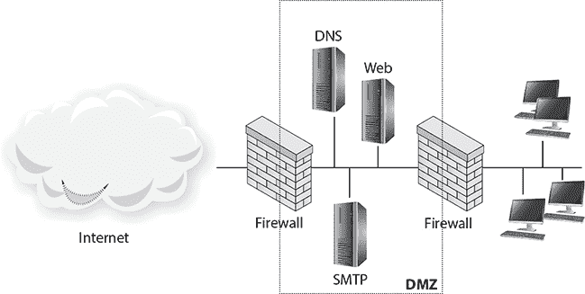

**图 4-8** 非军事区

DMZ 创建了一个缓冲区。两层防火墙构成 DMZ 边界并保护内部网络资产。公司通常将其电子邮件、Web 和 DNS 服务器放置在 DMZ 中。尽管这些服务器“面向互联网”，但它们仍位于一道防火墙之后。但 DMZ 中的服务器仍然脆弱，应仔细加固，因为它们是外部攻击的第一目标。

## 虚拟专用网络

VPN 是通往组织受保护网络的安全专用连接，它穿越公共不受信网络。使用 VPN 技术，组织可以在虚拟层面上将其专用网络扩展到正常网络边界之外。它通过使用隧道技术来实现这一点，该技术通过不受信网络（如互联网）提供一条通往组织受保护企业网络的加密通道。因此，远程用户（如在家办公的员工）可以访问内部企业网络上的资源，就像他们拥有直接连接一样。

VPN 使用隧道协议封装帧/数据包，以便其能通过网络传输。它们保留原始协议头，以便消息能在目的地“解包”，但允许封装的帧作为正常流量进行路由。以下是最常用的 VPN 协议：

- **点对点隧道协议 (PPTP)** PPTP 多年来一直是事实上的 VPN 标准。然而，有更新的 VPN 技术更好且应用更广泛，例如 IPSec。
- **第 2 层隧道协议 (L2TP)** L2TP 由思科开发，作为 PPTP 局限性的解决方案。然而，L2TP 不提供加密，因此通常与其他方法（如 IPSec）结合使用。
- **IP 安全 (IPSec)** IPSec 是一套协议，组合使用可提供数据完整性、认证和机密性。它现在是 VPN 的事实标准。

## IDS/IPS

入侵检测系统 (IDS) 和入侵防御系统 (IPS) 是配套技术，涉及用于检测 (IDS) 和防御 (IPS) 恶意活动的专用工具。两者都在整个网络中部署传感器，这些传感器与控制或报告系统通信，允许安全人员查看恶意活动的指标并采取措施防止安全漏洞。

*基于网络的 IDS (NIDS)* 使用以计算机或专用设备形式部署在整个网络中的传感器。*基于主机的 IDS (HIDS)* 使用安装在主机上的代理来监控和检测主机上的恶意活动。HIDS 代理查找特定于主机或操作系统的活动，如正在运行的进程、注册表更改、文件篡改等。无论是基于网络还是基于主机，IDS 都采用多种检测方法。现代 IDS 产品通常利用不止一种方法：

- *基于特征的 IDS* 在流量、特定消息或系统上的特定文件中查找特定模式。这些特定模式称为*特征码*。通常特征码维护在一个库中。IDS 产品供应商通常提供订阅服务，第三方供应商开展威胁情报活动，持续了解新攻击以及哪些特征码能指示其存在。这些特征码被下载到 IDS 产品中，使其能持续监控并检测最新攻击。基于特征的 IDS 擅长检测已知攻击和恶意软件，但不擅长检测新型攻击。
- *基于异常的 IDS* 更适合检测未知攻击。如果基于特征的 IDS 擅长知道“坏的样子”，那么基于异常的 IDS 擅长知道“好的样子”。基于异常的 IDS 使用人工智能和机器学习等专用方法来构建网络或系统上正常活动的图景。然后，如果 IDS 发现偏离常态的活动，它会发出警报，指示应调查该活动。基于异常的 IDS 擅长检测此前未知的、可能不存在特征码的攻击。

IDS 和 IPS 产品使用基本相同的技术和方法来检测潜在的恶意活动。区别在于它们对该活动采取的措施。IDS 只是将活动报告给控制台，安全人员可以在控制台看到警报并进行调查，以确定警报是否代表实际的恶意活动或漏洞，然后确定正确的应对措施。IPS 不仅限于检测和报告，还会采取行动试图阻止攻击或最小化其影响。候选动作可能包括阻止来自特定 IP 地址的流量、关闭防火墙上的端口、重置路由器等设备，甚至更改数据包或主机中的数据以移除或替换恶意消息或文件。虽然部署能自动阻止攻击的 IPS 听起来很诱人，但许多组织，特别是政府/军事/国防组织，由于在未先测试影响的情况下自动更改环境的风险，不愿使用 IPS 功能。


## IDS/IPS 调优与风险管理

明智使用 `IDS/IPS` 解决方案的关键在于 `tuning`（调优）。调优涉及选择检测、报告、警报和预防功能的灵敏度级别。如果安全运营人员将阈值设置得非常低，他们可以检测到所有潜在的恶意事件；如果设置得非常高，他们可能会错过某些事件，但能确保捕获最重要的事件。然而，将级别设置得过低可能导致组织和安全运营人员被过多的消息和警报淹没，这些消息和警报并不表示入侵活动（误报）。同样，将阈值设置得过高可能导致严重的安全漏洞未被发现（漏报）。每个安全组织和 `CISO` 面临的挑战是确定合适的 `IDS/IPS` 运行级别。

那么，`CISO` 应该如何决定合适的级别呢？与所有安全决策一样，这归结为风险管理。受监控的资产有多大价值？检测的成本是多少？将级别设低并捕获超出必要范围的事件会增加运营成本。每年花费 200 万美元运营 `IDS` 功能来监控一个价值 100 万美元的网络可能是不明智的。`CISO` 和安全组织应建立模型，预测在不同检测阈值下部署和维护 `IDS/IPS` 所需的设备和运营工作量，并将其与组织的风险偏好进行比较。

`IDS/IPS` 本质上只是另一种安全控制措施，其实施应基于风险，与其他候选控制措施一同考量。

## 密码学

`Cryptography`（密码学）是最基础的信息安全实践之一，也可能是最古老的。现代 `cryptography` 是利用数学来保护信息的实践，通过使信息对未授权方变得不可理解来实现安全。本节介绍以下密码学主题和概念：

- `加密定义`
- `加密服务`
- `对称、非对称和混合密码系统`
- `哈希算法`
- `消息认证码`
- `数字签名`
- `公钥基础设施`

### 隐写术

`Steganography`（隐写术）是一种在显而易见的地方隐藏秘密信息的技术，通常隐藏在看似无害的数字文件中。这是通过使用特殊软件将消息嵌入图像、视频、音频、文本或其他文件中来实现的。

`Steganography` 和 `cryptography` 是同一枚硬币的两面。虽然两者都用于通传秘密信息，但实现方法不同。`Steganography` 隐藏了通信发生的事实本身，因为文件的非预期接收者不知道文件包含隐藏消息。`Cryptography` 不隐藏通信本身，而是通过加密隐藏数据本身。如果非预期接收者收到加密消息，他们知道消息存在但无法读取。`Steganography` 不加密消息；它只是将消息隐藏在另一个文件中。

### 加密定义

必须建立一些基本定义以便于讨论密码学。密码学的基础组件包括以下内容：

- `加密密钥` 一串值，结合加密算法用于加密和解密等操作。一般来说，密钥长度越长提供的安全性越高；但这也取决于所使用的算法和实现。
- `加密算法` 一种可用于加密、解密或哈希的数学方程。
- `明文` 可读格式的信息，未被加密或已被解密。
- `密文` 不可读格式的信息，已被加密。
- `加密` 使用加密密钥和算法将明文转换为密文的过程。
- `解密` 使用加密密钥和算法将密文转换为明文的过程。
- `哈希` 一种单向函数，使用算法将信息转换为一串数据，常用于完整性检查。
- `密码系统` 包含加密和解密所需的所有系统组件，如软件、协议、算法、密钥、密钥管理等。

加密密钥值被加密算法用来指示使用哪些方程、以何种顺序以及使用何种值。密钥和算法共同使加密和解密操作得以进行，实现明文与密文的相互转换。加密和解密操作如 图 4-9 所示。

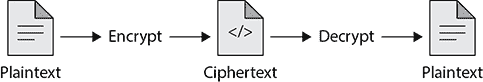

**图 4-9** 加密操作

### 加密服务

密码学美妙的方面之一在于它能提供的安全服务范围，包括：

- `机密性` 确保数据仅可被授权方访问，并对未授权实体保持不可理解状态（例如加密）
- `完整性` 确保数据未被未授权方篡改（例如数字签名或消息认证码）
- `认证` 验证创建资源的系统或用户的身份
- `不可抵赖性` 防止发送者合理地否认其发送过消息（例如数字签名）

在探索各种算法和加密实现的过程中，将贯穿讨论这些服务。

### 对称、非对称和混合密码系统

目前用于加密和解密的两种加密算法类型是对称和非对称。此外，还有利用两者优势的混合方法。


**考试提示** `CCISO` 考生应了解对称加密和非对称加密的区别。

#### 对称加密

`对称加密`，也称为对称密钥密码学，其特点是使用单个密钥进行加密和解密。这意味着加密消息的发送者和接收者必须都拥有同一密钥的副本。因为任何拥有该密钥的人都能解密消息，所以密钥必须保持私密。这就是为什么它被称为 `私钥`。例如，在 图 4-10 中，Alice 和 Bob 想要交换机密信息。为了将消息发送给 Bob，Alice 使用共享私钥加密消息，将消息从明文转换为密文。Bob 反过来必须拥有同一私钥的副本，以将消息从密文解密为明文。同样，如果 Bob 想给 Alice 发送消息，他用共享私钥加密消息，Alice 用同一私钥解密消息。

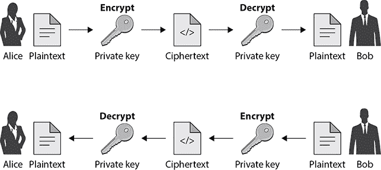

**图 4-10** 对称加密示例

对称算法的示例包括以下内容：

- `数据加密标准 (DES)` 该算法使用 56 位密钥，因密钥长度短、易受暴力攻击而被认为不安全。因此，`DES` 被 `3DES` 和 `AES` 取代。
- `三重 DES (3DES)` `3DES` 作为 `DES` 的临时替代品发布，当时 `AES` 仍在开发中。`3DES` 在加密过程中对每个数据块应用三次 `DES`。现代 `3DES` 实现提供 168 位安全强度。
- `高级加密标准 (AES)` `AES` 作为 `DES` 的替代品而构建。`AES` 提供 128、192 和 256 位的密钥长度。`AES` 是一种成熟的、国际通用的对称加密标准。


## 对称加密

对称加密的优势在于其速度。对称密钥加密比非对称加密快得多，且计算强度低得多。对称加密的缺点是它需要一种带外传输私钥的安全方法，并且扩展性不佳，因为每一对用户都必须拥有一个唯一的密钥。随着用户数量的增加，密钥数量也会增加，这会使密钥管理变得困难。基于用户数（记为 `N`）计算对称加密所需密钥数量的公式如下：


例如，如果 Alice、Bob 和 Carole 想要分别相互通信，以防止其他人阅读他们的消息，他们将需要三个密钥（一个用于 Alice 和 Bob，一个用于 Alice 和 Carole，一个用于 Bob 和 Carole）。然而，如果用户数量增长到例如 100 个，如图所示，将需要 4,950 个密钥：


对称加密通过加密提供机密性，但不提供真实性或不可抵赖性。需要非对称加密来提供这些服务。

### 非对称加密

`Asymmetric encryption`（非对称加密），也称为公钥加密，其特点是使用两个数学上相关的密钥：公钥和私钥。公钥可以提供给所有者想要安全通信的任何人，但私钥必须仅为所有者所知。例如，在图 4-11 中，Alice 和 Bob 想要交换机密信息。为了将消息发送给 Bob，Alice 使用 Bob 的公钥（已共享给她）加密明文消息。Bob 反过来必须使用仅他所知的私钥将密文解密为明文。同样，如果 Bob 想要发送消息给 Alice，他用 Alice 的公钥加密消息，Alice 用她的私钥解密消息。在安全服务方面，非对称加密通过加密提供机密性，并通过利用数字签名（本节稍后讨论）提供真实性和不可抵赖性。

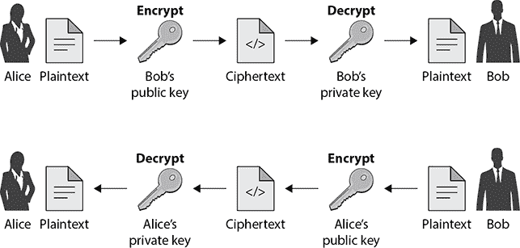

`Figure 4-11` 非对称加密示例

常见的非对称算法实现包括以下内容：

- `Diffie-Hellman` 密钥协议，允许两个实体生成并商定一个对称密钥（会话密钥）值，随后由单独的对称算法用于执行加密和解密。它提供密钥协商功能，但不提供加密或数字签名功能。
- `Rivest-Shamir-Adleman (RSA)` RSA 由 Ron Rivest、Adi Shamir 和 Leonard Adleman 开发。该算法提供数字签名、密钥分发和加密服务。公钥和私钥在数学上相关，该算法基于大素数乘积分解困难的数学原理。
- `Elliptic curve cryptography (ECC)` ECC 是另一种非对称实现，当与其他加密方案结合时，提供数字签名、密钥分发和加密服务。其不同之处在于其效率和密钥生成方式。ECC 比其他非对称算法高效得多，在保持相同安全级别的同时，允许更快的加密/解密和更小的密钥尺寸。此外，密钥是基于椭圆曲线的性质生成的，而不是基于大素数乘积的分解。

非对称加密的主要优势是可扩展性和密钥分发。非对称加密更容易扩展，因为每个用户只需要两个密钥（一个公钥和一个私钥）。基于用户数（记为 `N`）计算非对称加密所需密钥数量的公式如下：

```
2 × N = number of unique keys needed
```

此外，由于公钥可以自由共享，密钥分发变得更容易；公钥不需要保护，因为它与所有人共享。非对称加密的缺点是它比对称加密慢，且计算强度更大。对称密钥加密比非对称加密快得多，且计算强度低得多。这就是为什么对称加密常用于加密数据（内容），并结合非对称加密用于交换加密密钥。这就是为什么对称加密常用于加密数据（内容），而非对称加密最常用于加密密钥。

### 混合加密

如前所述，对称加密和非对称加密各有优缺点。现代密码系统通常采用同时利用两者的混合模型。这两种技术的结合使用通常被称为 `hybrid cryptography`（混合加密）或 `digital envelope`（数字信封）。图 4-12 说明了常见混合密码系统的工作原理。步骤如下：

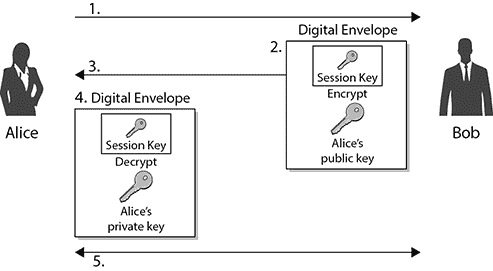

`Figure 4-12` 混合密码系统示例

1. Alice 与 Bob 共享她的公钥。
2. Bob 生成一个会话密钥，并用 Alice 的公钥加密它以创建数字信封。
3. Bob 将数字信封发送给 Alice。
4. Alice 使用她的私钥解密数字信封以获取会话密钥。
5. Alice 和 Bob 都拥有会话密钥（对称密钥）的访问权限，并可以用它来加密和解密彼此的消息。

混合方法提供了两全其美的方案，因为它允许使用对称加密快速加密消息数据，并使用非对称加密轻松交换对称密钥。采用混合方法的协议包括：

- SSL/TLS
- SSH
- OpenPGP

为简单起见，此示例使用两个用户 Alice 和 Bob。然而，在实践中，这通常是用户与 Web 服务器通信以共享文件（例如 SFTP 或 FTPS）或安全访问站点（例如 HTTPS）。

### 密码系统总结

表 4-3 提供了对称和非对称加密功能基本差异的总结和比较。

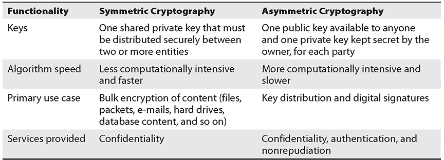

`Table 4-3` 对称加密和非对称加密的比较

## 哈希算法

哈希在“加密定义”部分已简要介绍。回顾一下，哈希算法是一种单向函数，它将信息映射为固定长度的数据字符串，称为哈希值、指纹或消息摘要。之所以称为单向函数，是因为原始消息无法从哈希值重现，这与加密不同，加密的密文可以使用解密操作转换回明文。此外，使用哈希算法时不涉及密钥。例如，考虑图 4-13 中所示的文本字符串“my-secret”和“My-secret”的 `MD5` 哈希值。

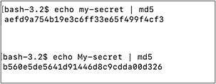

`Figure 4-13` MD5 哈希示例

如果消息的一个比特发生变化（例如大写 M 代替小写 m），哈希值会发生巨大变化，如图 4-13 的输出所示。哈希值可用于完整性检查，以确保消息未被修改。常见的哈希算法包括以下内容：

- `MD5` 消息摘要算法第 5 版，生成 128 位哈希值
- `SHA-1` 安全哈希算法 1，生成 160 位哈希值
- `SHA-2` 安全哈希算法 2，包含一系列生成 224、256、384 或 512 位哈希值的哈希函数：SHA-224、SHA-256、SHA-384、SHA-512、SHA-512/224、SHA-512/256
- `SHA-3` 安全哈希算法 3，包含一系列哈希函数：SHA3-224、SHA3-256、SHA3-384、SHA3-512、SHAKE128 和 SHAKE256


利用另一个 Alice 和 Bob 的示例，假设 Alice 想要给 Bob 发送一条消息，但 Bob 希望确信该消息未被篡改。哈希可以对此提供帮助。在该示例中利用哈希的一般步骤如 图 4-14 所示，并概述如下：

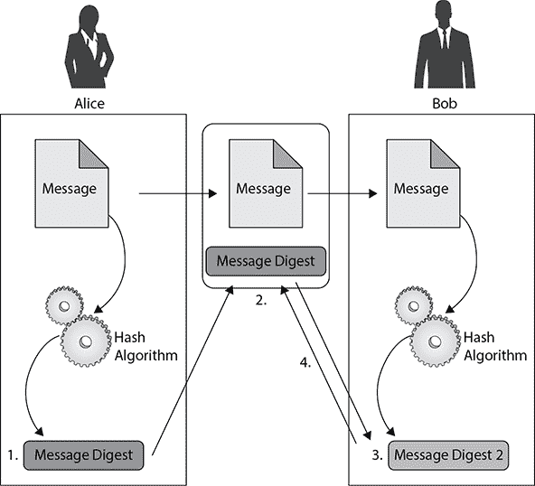

**图 4-14** 哈希示例

1.  Alice 将消息通过哈希函数以生成消息摘要 (MD)。
2.  将 MD 附加到消息后并发送给 Bob。
3.  Bob 将消息通过相同的哈希函数以生成他自己的独立 MD。
4.  Bob 随后比较这两个 MD 值。如果它们相同，则消息未被篡改。

## 冲突

如果哈希算法为两条不同的消息生成相同的哈希输出，这被称为*冲突*。为了降低发生冲突的风险，应使用具有更大消息摘要输出（以位为单位）的哈希算法。这意味着产生 256 位哈希值的哈希算法通常比 128 位的哈希算法更能抵抗冲突。

冲突可能会导致安全问题，具体取决于哈希的使用方式。已证明 MD5 易受冲突攻击。这是否意味着不应使用 MD5？答案是，*视情况而定*。哈希值可用于多种目的。它可用于执行文件的完整性检查，或用于在密码存储到数据库前对其进行哈希。对于简单的文件完整性检查，MD5 可能适用，但在应用程序中对密码进行哈希时，更安全的算法（如 SHA-256）可能是更好的选择。

## 密码哈希

明文密码不应存储在系统中。如果攻击者攻破了此类系统或密码数据库，他们将获得明文密码的访问权限。在现代操作系统中，存储的是密码哈希，而不是明文密码。如果系统被攻破，这降低了攻击者访问明文密码的风险，同时也防止了系统管理员知晓存储的密码（因为仅存储哈希值）。在 Windows 中，用户和密码哈希存储在安全账户管理器 (SAM) 数据库或 Active Directory 中。在 Unix/Linux 系统中，用户账户信息和密码哈希存储在 `/etc/passwd` 和 `/etc/shadow` 文件中。

### 密码攻击

攻击者攻击密码有几种不同的方法：

-   **字典攻击** 攻击者利用一个包含单词和术语字典列表的工具，尝试作为密码尝试登录系统。因此，重要的是要阻止或防止将字典单词用作密码。某些系统可以对密码执行检查，以防止使用字典单词。
-   **暴力破解攻击** 攻击者逐个尝试所有可能的字符组合，作为密码尝试闯入系统。这就是为什么密码复杂度很重要。密码越长、越复杂（大小写字母、数字、特殊字符等的组合），成功实施暴力破解攻击所需的工作量就越大。
-   **彩虹表攻击** 攻击者使用预先计算好的明文输入及其对应哈希值的表来破解密码哈希。例如，如果攻击者窃取或攻破了系统的哈希密码数据库，他们可以将哈希与彩虹表中的值进行比较，以确定明文密码。此风险通常通过使用加密盐来缓解。

### 加密盐与加盐

*盐* 是附加到将要进行哈希的消息（内容）上的额外随机或伪随机数据。盐用于增加对字典攻击和彩虹表攻击的抵御能力。每次哈希操作使用不同的盐；因此，如果使用两个不同的盐对相同的内容（如密码）进行两次哈希，生成的哈希值将不同。这意味着碰巧拥有相同密码的两个用户，在密码数据库中将存储不同的哈希值。这在 图 4-15 中进行了说明。

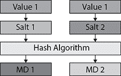

**图 4-15** 加密盐示例

## 消息认证码

哈希算法提供消息未被修改的完整性，但不提供消息的真实性。*消息认证码 (MAC)* 是一种加密函数，它使用发送方和接收方共享的密钥，同时提供完整性和真实性。MAC 可以使用哈希算法和特定模式下的对称加密算法来创建。MAC 算法的示例包括：

-   **基于哈希的消息认证码 (HMAC)** HMAC 也称为*键控哈希*，它使用哈希算法和共享密钥来生成 MAC。
-   **密码分组链消息认证码 (CBC-MAC)** 密码分组链是对称分组加密算法的众多模式之一。尽管这些算法主要用于加密数据，但 CBC-MAC 是一种使用对称算法（如 AES）生成 MAC 以提供真实性和完整性的方法。*基于密码的消息认证码 (CMAC)* 是 CBC-MAC 的较新实现，通过轻微调整增加了一个额外操作以增强安全性。

## 数字签名

*数字签名* 是使用发送方私钥加密的哈希值。数字签名提供完整性、真实性和不可抵赖性。这确保消息未被修改（完整性），确保消息来自发送方（真实性），并防止发送方否认发送过该消息，因为只有发送方应拥有其私钥以执行加密（不可抵赖性）。基于前面讨论的哈希步骤，该过程的一般步骤如下：

1.  Alice 将消息通过哈希函数以生成消息摘要。
2.  使用 Alice 的私钥加密消息摘要，并将其附加到发送给 Bob 的消息中。
3.  Bob 使用 Alice 的公钥解密消息摘要，并将消息通过相同的哈希函数运行以生成他自己的独立消息摘要。
4.  Bob 随后比较这两个消息摘要值（他从 Alice 处收到的和他自己创建的）。如果它们相同，则消息未被篡改（完整性），必定来自 Alice（真实性），且她无法否认发送过它（不可抵赖性）。

## 公钥基础设施

密钥管理是任何密码系统的关键部分。考虑到使用强算法的情况下，密钥是密码系统中最薄弱的环节。如果私钥被泄露，密码系统的安全性也就随之泄露。密钥需要安全的创建、分发、存储、恢复和销毁。此外，公钥密码学的一个问题是任何人都可以生成自己的密钥对。当每个人都在生成自己的密钥对时，你如何知道收到的公钥实际上来自你认为的那个人？例如，Bob 可以创建一个密钥对，将他的公钥发送给 Alice，并声称这是 Tim 的公钥。Alice 需要某种方法来验证密钥所有者的身份。这就是公钥基础设施发挥作用的地方。NIST 将*公钥基础设施 (PKI)* 定义为“一组策略、流程、服务器平台、软件和工作站，用于管理证书和公私钥对，包括发布、维护和撤销公钥证书的能力。”


## 公钥基础设施 (PKI)

*公钥证书*，也称为*数字证书*，是一种电子证书，包含用于标识实体作为公钥所有者（称为*主体*）的数据。这些证书由受信任的第三方（称为*颁发者*或*证书颁发机构*）颁发并进行数字签名，该第三方已验证公钥所有者的身份。证书颁发机构验证主体的身份，并创建一个包含主体名称及其公钥的证书，然后使用证书颁发机构的私钥通过数字签名对该证书进行签名。图 4-16 是在 Mac 上运行的 Chrome 浏览器查看使用 HTTPS 连接的网站证书时的屏幕截图。

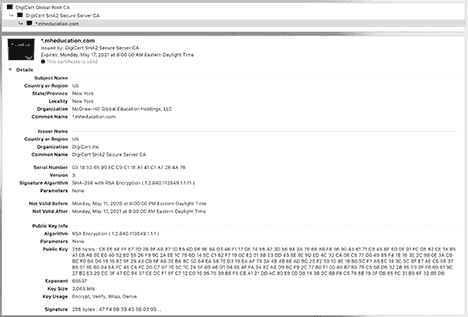

*图 4-16：数字证书示例*

**PKI 的主要组件**

- **注册机构 (RA)** 注册机构负责接受用户的注册请求、验证其身份，并将请求传递给证书颁发机构。RA 无法创建证书；它仅充当验证者并将请求发送给证书颁发机构。
- **证书颁发机构 (CA)** 证书颁发机构创建、颁发并管理使用 CA 私钥签名的数字证书的吊销。
- **数字证书** 参与 PKI 的每个人都必须由受信任方颁发数字证书。每个人必须拥有自己的公钥/私钥对。这要么在其机器上本地生成，要么由 CA 颁发。无论哪种情况，公钥都必须提供给 CA。CA 将个人身份与公钥绑定，并将其嵌入数字证书中。这充当该个人的凭证，将其身份与公钥绑定。数字证书由 CA 的私钥签名，这证明了证书是由 CA 颁发的，并且 CA 已验证该公钥属于相关主体。这为接收该密钥的接收者提供了保证。
- **证书目录** 证书目录作为存储数字证书的存储库。
- **证书吊销** CA 负责处理证书吊销。如果用户丢失私钥或离开组织，证书可能会被吊销。吊销证书会告知他人不应信任该个人的公钥。吊销的证书存储在证书吊销列表 (CRL) 中。

PKI 用于实施混合密码系统方法（对称和非对称密码学），并具有密钥管理和公钥保证的额外优势。PKI 通过加密提供机密性，通过签名和数字证书提供完整性、不可抵赖性和认证。在实践中，通信流程如下所示：

**通信流程**

1. Alice 想要与 Bob 通信。
2. Alice 将她从 CA 收到的数字证书发送给 Bob。
3. Bob 通过确保证书是由他信任的 CA 创建的、未过期、与 Alice 的信息匹配、且具有 CA 的有效数字签名来验证证书。
4. 在 Bob 确信证书有效后，他提取 Alice 的公钥，并确信该公钥来自 Alice。
5. Bob 将他的证书发送给 Alice，Alice 执行与 Bob 相同的步骤。
6. Bob 使用会话密钥（对称密钥）加密消息发送给 Alice，并使用 Alice 的公钥加密会话密钥。
7. 现在双方都拥有彼此的公钥以及会话密钥，他们可以来回共享消息。

## 云安全

NIST 特别出版物 800-145《NIST 云计算定义》将*云计算*定义为：“一种模型，用于实现普遍、便捷、按需的网络访问，进入可配置的计算资源共享池（例如网络、服务器、存储、应用程序和服务），这些资源能够以最少的管理工作或服务提供商交互快速配置和释放。”组织在使用云服务时最大的担忧之一是缺乏控制。例如，云服务提供商 (CSP) 通常管理数据中心、硬件和其他功能（取决于服务），但组织仍需对安全负责，并必须确保 CSP 实施适当的安全实践。本节讨论云计算的以下基础知识：

- 云计算特征
- 云部署模型
- 云服务模型
- 云安全风险和保障级别
- 云安全资源

### 云计算特征

根据 NIST SP 800-145，云计算的基本特征如下：

- **按需和弹性** 使用云计算的组织可以在需要时配置所需资源，从而使他们能够灵活地根据需求定制资源。
- **资源池化** 计算资源以对组织及其用户透明的方式在多个租户之间共享。
- **可度量服务** 资源使用量可以被计量和测量，使组织能够了解其使用情况，并根据需要获取更多或更少的能力。
- **广泛的网络访问** 通过网络启用访问，并由在各种终端设备上运行的瘦客户端或厚客户端平台支持。

ISO/IEC 17788《信息技术 — 云计算 — 概述和词汇》也提供了云计算的定义。它列出了特征，包括上述提到的特征，外加多租户。*多租户*描述了以一种方式分配物理或虚拟资源，使多个租户可以利用资源池，同时计算和数据与其他租户隔离。

### 云部署模型

有以下四种类型的云部署模型，每种模型的特点在于基础设施的位置：

- **公有云** 在公有云部署模型中，云资源由第三方云服务提供商运营，供公众普遍使用，通常通过订阅或按需定价模式。公有 CSP 的示例包括 Microsoft Azure、Amazon Web Services 和 Oracle Cloud Infrastructure。
- **私有云** 私有云部署模型由专供单个组织使用的计算基础设施和资源组成。资源归组织所有并由其运营，或由第三方所有并运营，或两者结合，专供一个组织独家使用，不像公有云模型那样在多个组织间共享。一些公司在其数据中心运营私有云，或支付第三方托管私有云。
- **社区云** 社区云部署模型由多个组织为特定目的共享基础设施，例如协作、特定任务，或出于安全和合规原因。所有权归涉及的一个或多个组织，或第三方所有。
- **混合云** 混合云部署模型是其他模型的混合。例如，组织可能在其环境中运营私有云，并利用公有云服务进行“云爆发”。这是指在环境之间进行负载均衡。应用程序或资源可能在私有云上运行，如果需求激增，则切换处理到公有云，以便使用额外的计算处理资源。

### 云服务模型


# 云服务模型与安全概述

要了解使用云服务的影响，最好从服务模型入手，以理解各方的责任。以下是三种主要的云服务模型：

## 基础设施即服务

为客户提供访问基础设施资源池的权限，例如网络、服务器和存储资源，这些资源可进行虚拟化供给。CSP 管理底层物理基础设施。客户管理平台和软件，如操作系统、开发工具和应用程序。

## 平台即服务

为客户提供开发或应用平台，客户可用其部署应用程序。这本质上是一个用于开发、测试和运行各种编程语言开发的应用程序代码的场所，从而实现简化的部署流程。在此模型中，CSP 管理底层基础设施（网络、服务器和存储）和操作系统。

## 软件即服务

为客户提供访问由 CSP 托管的应用程序的权限。CSP 管理底层基础设施和平台，而客户通常仅管理特定于用户的应用程序配置。SaaS 的示例包括基于 Web 的电子邮件或其他基于 Web 的应用程序，如客户关系管理 (CRM) 系统。

## 云共享责任模型

确保云环境中存在安全性，始于对云服务模型的透彻理解，以及它们如何促成共享责任。图 4-17 概述了客户和云服务提供商各自的责任。

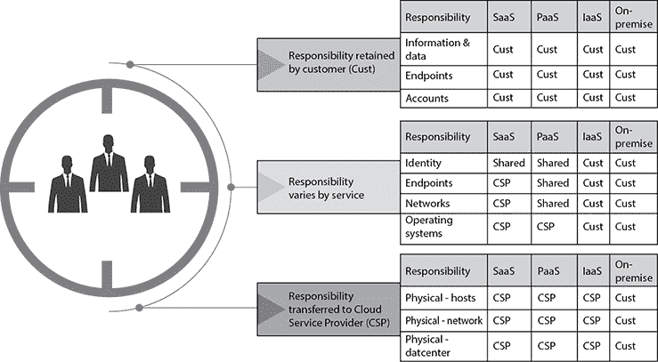

*图 4-17：云共享责任模型*

正如 图 4-17 所示，IaaS、PaaS 和 SaaS 中特定功能的责任在于 CSP。然而，即使 CSP 承担了这些责任，组织仍有责任确保组织数据的保护，并必须确保正在实施适当的安全实践。例如，CSP 可能提供一项安全功能（如托管在公有云中系统的物理安全），但组织必须尽职调查，以确保 CSP 正在实施适当的控制和对策。

## 云安全风险与保障等级

使用云服务提供商的风险之一是组织对某些功能失去了控制，但仍需对安全负责。以下是 CSP 通常提供给客户的各种云相关安全保障等级，以协助组织进行尽职调查：

- **服务级别协议 (SLA)** — SLA 有助于了解 CSP 同意为客户提供的服务级别，并可协助组织确定某项服务是否满足其运营和安全要求。
- **SOC 2/SOC 3** — 组织可以要求 CSP 出示 SOC 2 或 SOC 3 报告，这些报告报告了与信任服务（安全性、可用性、处理完整性、机密性和隐私）相关的系统和组织控制的评估情况。
- **ISO 27001** — 部分 CSP 可能已通过其信息安全管理体系 (ISMS) 的 ISO 27001 认证，以证明其符合信息安全管理的行业最佳实践。
- **FedRAMP** — 联邦风险和授权管理计划 (FedRAMP) 是美国联邦政府的一项计划，为评估、授权和持续监控基于云的产品和服务提供标准化方法。CSP 要向美国联邦政府销售服务，必须获得 FedRAMP 授权（实质上是针对云服务的 FISMA）。如果 CSP 获得 FedRAMP 授权，则其控制措施已由经认可的第三方评估组织 (3PAO) 进行评估。已获授权的云服务产品列在 FedRAMP 网站 `https://www.fedramp.gov` 上。
- **CSA STAR** — 云安全联盟 (CSA) 安全信任保障和风险 (STAR) 计划是一个多层级保障计划，使 CSP 能够记录各种云服务提供的安全控制。该计划范围涵盖从自我评估选项到经批准的第三方评估公司评估后颁发的认证。

正如罗纳德·里根所说：“信任，但要核实。”CISO 仍对组织信息和资产的安全负责，必须确保围绕云计划有适当的治理和风险管理，并确保组织使用的所有 CSP 都在实施可靠的安全实践。

## 云安全资源

以下是一些云安全最佳实践的关键资源：

- **云安全联盟** — 一家专注于推广云计算最佳实践和安全的非营利机构。CSA 提供工具、研究、框架、认证计划（如 STAR）和其他文档，例如 第 2 章 中讨论的共识评估倡议问卷 (CAIQ) 和云控制矩阵 (CCM)。
- **互联网安全中心** — 一个提供安全工具和最佳实践信息的非营利组织，如操作系统加固标准和基准。

## 物理安全

物理安全通常是组织人员和资产的第一道防线。物理安全的责任因组织而异，可能不属于 CISO 的职权范围。一些组织设有单独的首席安全官 (CSO) 或其他负责物理和/或人员安全的个人。因此，信息安全职能责任可能与物理安全重叠或整合。无论实施方式和组织架构如何，CISO 都应了解物理安全及其与信息安全的关系。本节讨论以下主题：

- 物理安全威胁
- 物理安全计划规划
- 物理安全资源
- 物理安全控制
- 物理安全审计与度量
- 人员安全

### 物理安全威胁

物理安全威胁形式多样，如风暴、停电或人为错误。了解组织面临的威胁类型对于设计适当的控制至关重要。威胁通常可归类为以下几类：

- **自然/环境** — 来自自然或环境风险因素的威胁，如地震、洪水、龙卷风、火灾或极端温度。
- **供应系统** — 针对供应系统的威胁，如停电、网络和通信中断、暖通空调 (HVAC) 故障，或煤气、水等其他公用设施中断。
- **人为** — 来自人的威胁，如不满的员工、人为错误、破坏、欺诈、盗窃或未经授权的访问。
- **政治** — 具有政治动机的威胁，如恐怖主义、公民抗命、骚乱或罢工。

每一类威胁都代表潜在风险。组织应将其纳入 第 1 章 介绍的风险分析中。回顾如下：

- 首先，执行业务影响分析：
- 列出潜在的物理威胁清单。
- 评估每个威胁，以确定其发生的可能性及适用的资产。
- 基于威胁和相关资产，评估损失对业务的影响。
- 然后根据风险，为每项资产选择适当的风险缓解措施和控制。

关键在于在威胁的影响与对抗该威胁的对策成本之间取得平衡。

### 安全是关键


# 物理安全

当涉及物理安全时，最重要的事情是保护员工和工作环境内人员的安全。安全甚至胜过安保。例如，在灾难发生时，最佳的安保可能通过自动锁定设施的所有门来实现，这被称为“故障安全锁定”（fail-secure）。然而，这可能会将人困在里面，因此更安全、更好的做法是在紧急情况下自动解锁门，这被称为“故障安全开启”（fail-safe）。组织应确保故障安全开启机制到位，因为人员安全始终是重中之重。

## 物理安全计划规划

组织应制定物理安全计划，以定义安全计划的目标。以下是物理安全计划中常见的主题列表：

- 物理控制计划，包括威慑、延迟机制和检测控制
- 定期或非定期评估物理控制的计划
- 应对物理事件的计划，以确保人员安全、评估影响程度并确保恢复正常业务功能
- 识别、获取和支持执行计划所需资源的计划

与所有安全职能一样，物理安全必须由政策和程序提供支持，以确保执行一致、可靠且可衡量的物理安全活动。

## 物理安全资源

在物理安全人员配置方面，资源要么直接作为内部员工雇佣，要么从第三方或服务提供商处外包。

### 内部雇佣

组织可以选择雇佣物理安全资源来管理物理安全计划。这可能包括以下角色：

- 设施经理，负责监督建筑和设施运营
- 安全主任，负责监督人员安全
- 保安，负责巡逻关键区域、管理入口点和监控监视系统
- IT 资源，负责管理技术组件（工牌读卡器、门禁系统和其他技术物理访问控制）

### 外包

一些组织选择与第三方物理安全公司签约，该公司可能提供从保安到完整的报警、监控和视频监控系统等一系列服务。在当今的云服务世界中，物理安全由云服务提供商提供。如果组织使用 CSP 托管其基础设施，CSP 数据中心的物理安全当然是一个关注点。当托管组织信息资产和敏感数据的系统托管在 CSP 的数据中心时，组织必须确信 CSP 拥有适当的物理安全控制以及信息安全控制。物理安全应在 CSP 的合同或服务级别协议中予以规定，并且应有对 CSP 设施和实践的独立或第三方评估，CSP 可将其作为证明提供。

## 物理安全控制

物理安全控制可按如下类别考虑：

### 威慑控制

*威慑控制*旨在通过向潜在入侵者传达“他们可能需要重新考虑其行为”来预防物理入侵。威慑控制包括围栏、保安、护卫犬、警示标志、照明和其他措施，旨在让入侵者在继续行动前三思而后行。当然，刑法及其相关惩罚也是良好的威慑控制。

### 延迟控制

*延迟控制*是大多数人想到物理控制时所联想到的内容。它们通常分层实施，在每一步都减缓攻击或入侵（或增加*工作因子*），因为每一层都呈现入侵者必须克服的另一个防御障碍。延迟控制包括门、锁、墙、围栏和屏障。

### 检测控制

*检测控制*向组织或公众传达发生了破坏性事件。这些控制包括烟雾探测器和火灾报警器、防盗报警器、门窗传感器、安全摄像头和闭路电视（CCTV）系统。

## 设施安全与控制

物理安全应作为设施*环境设计与建设*以及场地和位置选择的一部分来处理。环境设计涉及三个影响安全的因素：

### 自然准入控制

**自然准入控制** 设施外部的设计涉及创建路径，供人员绕行建筑物以获得进入权限。这些自然路径是准入控制的第一层，因为它们引导人员去组织希望他们去的地方，并防止人员去组织不希望他们去的地方。这些自然准入控制包括人行道、隔离桩、树木灌木、围栏和照明。

### 自然监视

**自然监视** 有助于自然准入控制的相同特征也可以提供自然监视。物理环境特征、人员通道、照明等的使用和布局，都有助于看清建筑物出入口附近的人员。

### 领域强化

**领域强化** 领域强化是指建筑外部的物理设计，提供视觉线索，使人们能够区分私人区域和公共区域。例如，装卸区的设计和外观应告知人们，如果他们不是在装卸货物，就应远离该区域。同样，前门更具欢迎性的设计和外观应使人们显然知道那是他们应该去的地方。

虽然设施的环境设计利用自然和人造手段来控制准入、支持监视和提供领域强化，但*物理设计与建设*提供了第一级加固。加固涉及建筑物外部和内部组件的物理结构和材料构成，以提供适当级别的保护。用与诺克斯堡相同类型的加固来建造当地银行分行是讲不通的，因为每个设施保护的资产价值不同。关键是根据风险，为具体情况选择合适的建设和加固类型。

## 安全区域

内部而言，建筑物可以建造以提供*安全区域*。就像网络可以通过访问控制进行分段以支持最小权限概念一样，建筑物也可以以类似的方式设计。在这种情况下，建筑物被划分为具有不同安全级别的区域，具体取决于谁需要进入每个区域以及相关风险。

门和墙是控制建筑物内安全区域、房间或其他分段区域之间访问的广泛使用的方法。门、墙、地板和天花板的结构和材料是根据预测威胁和受保护资产来选择的。空心墙和门提供的保护最少；最坚固的是由实心材料建造并用混凝土或钢材等更坚固的材料加固的。

关键在于平衡威胁的影响与对抗该威胁的对策成本。

## 预防还是检测？


# 物理安全控制

## 天花板卡扣

有时，只要你知道坏人来过，可能并不重要把他们挡在外面。许多建筑使用吊顶，其面板易于拆卸，可用于进入天花板上方的区域。墙壁可能仅建到吊顶高度，允许某人爬入天花板区域，翻过墙壁，进入相邻房间，从而绕过门和锁。但如果使用了 `ceiling clips`（天花板卡扣），这可能是可以接受的。这些卡扣确保如果有人拆除天花板面板，面板会被破坏，在天花板上留下一个洞，在地板上留下一堆碎屑。在这种情况下，入侵者无法以所描述的方式进入房间而不被人发现。根据房间的用途，这种安全级别可能已经足够。

## 锁和访问控制

门控制对建筑物或房间的进出。然而，除非门上有锁，否则门不提供 `authentication`（身份认证）。锁限制 `who`（谁）可以打开门，是身份管理的物理等价物，因为只有特定的人或群体拥有钥匙、密码或其他开门方法。因此，锁可用于对物理设施强制执行最小权限原则。锁已存在几个世纪，有多种类型可供选择，以提供不同级别的保护和易用性功能。以下是几种：

- 使用物理钥匙或密码的传统锁。
- 使用电子钥匙（刷卡、钥匙扣等）或键盘的智能锁。
- 通过读取人的身体特征来识别个人，并根据其身份授予访问权限的生物识别锁。生物识别读取器包括指纹、虹膜、手掌和面部识别系统。

智能锁和生物识别读取器通常作为 `physical access control system`（物理访问控制系统）的一部分使用。与管理和分发物理钥匙或手动更改锁密码相比，此类系统使管理谁有权进入某区域变得容易得多。访问控制系统支持以下功能：

- 谁有权访问哪些建筑物、区域和房间的电子清单
- 用户账户创建、访问权限编辑，以及在用户不再需要访问权限或离职时停用账户
- 谁在何时访问了哪个区域的自动记录

物理访问控制系统还可以提供单因素、双因素或多因素认证的物理实现，如本章“身份与访问管理”部分所述。例如，双因素认证可通过要求访客使用刷卡（你拥有的东西）并在键盘上输入 PIN 码（你知道的东西）来开门的系统来实现。同样，系统可能要求同时提供 PIN 码（你知道的东西）和指纹读取器的扫描（你本身的东西）进行认证。

## 门禁夹道

另一种常用的建筑物或房间访问控制机制是 `mantrap`（门禁夹道，有时称为人员夹道），它是一个小区域或门厅，有两扇门，构造使得第一扇门必须关闭后第二扇门才能打开。门禁夹道要求访客通过两扇门并打开两把锁才能进入安全区域，用于需要更高安全级别的场合。数据中心通常使用门禁夹道。

## 围栏

围栏为建筑物或建筑群周围的区域提供物理屏障和访问控制。与墙壁和门的建造类似，材料的强度、厚度和尺寸以及施工方法决定了围栏提供的保护级别。适合特定情况的围栏类型基于风险。例如，三英尺高的围栏可能阻止偶然闯入者，但容易被翻越；而顶部带刺铁丝网的八英尺高围栏对大多数人来说是个挑战。大多数关键区域的围栏至少八英尺高。

## 照明

照明用于关键区域、停车场以及门、窗和建筑物周界附近的安全。照明提供几项重要的安全功能：它能阻止入侵者，因为他们通常不想被看见；它为人员提供安全保障；最重要的是，它为保安、员工和监控摄像头提供了一种观察和记录人员及活动的方式。照明特性和类型包括以下内容：

- **防眩光保护** 光线照向潜在入侵者最可能出现的区域，而不是照向可能因眩光而视力受损的保安或摄像头。
- **持续照明** 一组灯为停车场或场地等区域提供均匀的光照。
- **受控照明** 光线不越过地界线，因此只照亮组织自己的区域，而不照亮邻居的区域。
- **备用照明** 不同的灯自动开关，造成有人在楼里的假象，而实际上可能没人。
- **响应式区域照明** 检测到可能的入侵者时，灯光自动开启。

## 保安人员

保安人员是安全领域昂贵的工具，但他们具有特殊价值，因为他们可以同时执行所有三项核心物理访问控制功能：

- **威慑** 保安的单纯存在就能威慑入侵者。
- **延迟** 保安可以亲自质询入侵者，并提供一个入侵者必须克服的障碍，以实施其攻击。
- **检测** 保安有眼睛和耳朵，可以用它们发现入侵，然后发出警报通知他人。

与人类保安类似，护卫犬也可以执行所有三项物理访问控制功能，并且可以成为一种有价值的工具。

## 检测控制

检测控制最常部署为监控或报警系统。类似于网络 IDS，物理监控系统使用传感器向中心点报告，以向组织提供事件已发生的信息。根据事件详情，可进一步调查。

物理入侵传感器包括检测潜在入侵者的运动探测器，以及记录潜在入侵并存储视频以供日后检查的监控摄像头。其他各类传感器包括：检测门窗开启或破碎的、检测高于环境噪音水平声音的、以及检测人体散发热量的传感器。

正如本章其他地方讨论的日志记录和监控系统一样，物理安全监控系统必须经过 `tuned`（调优），以向组织提供适当级别的检测和信息。

## 数据中心

数据中心通常存放组织信息资产的“皇冠上的明珠”。此外，数据中心将组织的许多高价值资产集中在一个封闭空间内，这增加了与单一威胁事件相关的脆弱性。因此，严重的物理安全事件或环境灾害的影响可能是巨大的。

数据中心安全控制应具有高弹性和冗余，以提供最大保护。以下是数据中心需要特别考虑的一些方面：

- **位置** 数据中心的选址应能提供针对外部威胁的最大保护。将数据中心设在建筑物的顶层或地下室可能不明智。同样，带有外窗的数据中心可能也不是个好主意。根据数据中心所在的世界地区，飓风、龙卷风、洪水和地震可能是一些驱动建筑施工和数据中心选址的威胁。


# 物理安全

## 数据中心设施

### 分离

数据中心的电气设施和暖通空调（HVAC）系统应与设施的其余部分分开设置。这使得组织能够根据需要控制和调节数据中心的温度和湿度，并提供备用设施冗余。数据中心的备用电源（使用电池或外部发电机）也可能与设施的其余部分分开。

### 环境

由于计算机设备的特殊性质，数据中心的环境控制具有独特性，且对于满足设备对电力、温度和湿度的要求至关重要。火灾抑制是数据中心的特殊关注点，需要量身定制的解决方案。

## 火灾抑制

火灾发生的原因多种多样，包括电气故障、因疏忽导致可燃材料着火，甚至纵火。火灾的发生和燃烧需要四个条件：

- 热量
- 燃料
- 氧气
- 化学反应

移除这四个条件中的任何一个，火灾就会停止。现代火灾抑制系统执行两个功能：探测火灾和释放灭火剂。灭火剂通过实现以下目标之一来发挥作用：

- 降低温度
- 移除燃料或氧气
- 破坏化学反应

火灾探测器通过探测烟雾（烟雾触发）、热量（温度触发）或火焰（红外火焰触发）来工作。探测到火灾后，系统会向中央控制台或直接向消防站发送警报，并释放灭火剂（液体或化学药剂）以扑灭火灾。目前通常有三类火灾抑制系统在使用：

- **湿式管道** 湿式管道系统是安装在天花板上或上方的简单管道布置，管道内充满水，随时准备喷洒到下方的物体上。以这种方式灭火具有相当大的破坏性，尤其是对电子设备。

- **预作用** 预作用系统很像湿式管道系统，不同之处在于管道内平时不含水，直到探测到火灾，管道才迅速注水并喷水。干式管道被认为比湿式管道更安全，因为意外泄漏的几率较小，且干式管道不太可能因冷凝而滴水。

- **气体** 气体系统释放气体灭火剂以移除氧气和热量。由于这些灭火剂是气态的，因此不使用水，所以气体系统对电子设备和办公设备的友好程度高得多。大多数现代气体系统使用 FM-200 或类似的灭火剂。

对于数据中心，气体系统是首选，因为它们破坏性最小；然而，它们也是这三类系统中成本最高的。为了降低成本，一些组织选择为数据中心使用预作用系统。

## 物理安全审计与度量

物理安全可以通过访问日志以及对物理安全措施的持续审查和评估来进行审计和度量。

- **访问日志** 组织应审计物理访问日志。这些日志可能从签到表到具有审计功能的软件不等，后者可生成所有尝试访问房间或设施人员的审计踪迹。无论使用哪种类型的访问日志，它们都是重要的侦查型控制，可用于了解导致未经授权访问或入侵的事件。为了使日志有用，必须至少记录以下内容：

  - 访问的日期和时间
  - 访问该地点人员的身份（如姓名和某种形式的识别号码）

- **物理脆弱性评估** 物理脆弱性评估，也称为物理安全审计或审查，旨在识别物理安全控制和策略中的弱点。评估通常包括对以下防护类别的审查：

  - 设施和外围防护
  - 内部防护
  - 针对人为、自然或技术威胁的防护


**注意** 物理脆弱性评估将在本章后面的“脆弱性评估”部分进行更详细的讨论。

## 人员安全

物理安全计划应考虑人员安全。正如本章前面所述，人员安全应是组织的首要任务。人员安全是一个广泛的主题，包括实施通用安全实践、雇佣程序，以及供应商、顾问和承包商程序。

### 通用安全实践

人员安全最重要的部分是保障人员安全。以下是应实施的一些关键实践，以确保为人员提供安全的环境：

- **物理安全事件响应** 政策和程序应详细说明组织如何应对人员安全威胁。关键组成部分是确保员工接受过程序培训。

- **演练与培训** 员工接受有关如何应对各种物理安全威胁的培训和实践非常重要。这包括针对枪手袭击、火灾、风暴、大流行病等的培训和演练。

- **继任计划** 必须制定计划，以确保有继任计划规定在高管、经理或主管不可用或丧失能力时由谁接管。

- **差旅** 前往世界某些地区的员工或高管可能需要特殊培训或第三方安保服务，如贴身保镖或护卫。此外，可能需要特殊做法；例如，组织可能决定某些高级高管不应乘坐同一交通工具（如同一航班），以减少发生事故或灾难时失去多位关键领导人的风险。

- **作业安全** 也称为 OPSEC，作业安全是指攻击者可以通过收集看似无害的信息并将其拼凑起来，从而获取敏感信息。人员应通过限制分享信息的对象、时间和目的来实践良好的 OPSEC。安全事件曾因人们不注意在社交媒体上发布的内容、在餐厅里说的话，甚至与同事分享的信息而发生。

### 雇佣程序

人员安全的一部分包括管理雇佣流程的生命周期，其中包括以下内容：

- **雇佣筛选程序** 这些是招聘过程中为确定员工适配性而遵循的程序。这些可能包括：

  - 背景调查
  - 药物筛查
  - 安全许可要求
  - 信用调查

- **雇佣协议与政策** 这些是员工签署的文件，用于传达预期行为，例如：

  - 保密协议 (NDA)
  - 行为准则政策
  - 职业道德协议
  - 利益冲突政策

- **雇佣终止程序** 这些是员工/雇主关系终止时遵循的程序。这些包括以下程序：

  - 进行离职面谈
  - 审查保密协议
  - 收回工牌、钥匙和公司资产
  - 禁用用户账户
  - 更改用户有权访问的密码、组合密码或 PIN 码
  - 将该人员护送出办公室/设施

### 供应商、顾问和承包商程序

物理安全还必须考虑第三方安全，适用于供应商、顾问或承包商访问组织设施的情况。常见程序包括：

- 在第三方人员现场期间对其进行陪同
- 确保适当的访问控制机制到位以验证身份：


# 物理安全验证

- 验证许可证或其他形式的身份证明
- 要求填写签到表
- 要求佩戴姓名牌
- 确保适当的协议已到位：
  - 保密协议 (NDAs)
  - 服务级别协议 (SLAs)
- 确保对供应商、顾问和承包商进行适当的背景审查

# 软件开发安全

许多组织，尤其是中大型组织，会构建自己的软件应用程序来执行业务功能。对于那些选择软件开发路径的组织来说，在开发过程中关注信息安全有时被轻视，这可能导致严重后果。未能在软件开发过程中早期且正确地解决安全问题的组织，最终会将漏洞引入其企业环境。攻击者向环境中引入风险是一回事，但组织因自身作为而引入风险则是另一回事。作为组织的守护者，CISO 的职责是确保这种情况不发生。内建安全优于事后添加。在开发过程中解决安全问题，而非事后补救，成本更低、难度更小，且在大多数情况下更安全。

即使在当今网络犯罪分子活跃、网络攻击普遍且广泛报道的环境下，一些工程组织仍未能在软件开发项目的规划阶段纳入安全需求。以下是安全在 SDLC（软件开发生命周期）中经常未被解决的几个原因：

- **疏忽** 在某些情况下，未能解决安全问题纯属疏忽。有人没有关注他们本应关注的事项。疏忽的根源在于规划和确定开发工作范围的人员缺乏安全意识。

- **无知** 我们经常看到领导者因缺乏知识而无法理解安全的重要性，从而忽视安全。这种缺乏理解可能导致组织在企业的许多领域（包括业务应用程序开发期间）未能解决安全问题。

- **资源** 在开发过程中解决安全问题是否会增加时间、精力和成本？许多人认为会。毕竟，增加哪怕一项需求也会影响构建产品所需的精力。因此，增加安全需求肯定比忽略安全需求需要更多精力。但这种在精力或成本上的节省充其量只是暂时的。忽略安全需求只是将解决安全漏洞和缺陷的不可避免的成本推迟到了未来。增加的风险将在未来要求额外的成本和精力，无论是由于安全漏洞造成的实际损失，还是由于后期不得不添加安全功能或修复程序的成本。

- **开发人员知识** 许多开发人员不具备信息安全的基础知识，不知道如何在开发过程中解决安全问题。

事后添加安全通常包括向软件或环境添加*补偿性控制*，以弥补未内建安全的事实。补偿性控制正确用于满足那些被认为难以实施或成本过高的安全需求。然而，补偿性控制也被用于向环境中添加安全性，以弥补产品、系统或软件的安全缺陷。例如，如果一个供财务人员使用的应用程序在构建时没有有效的访问控制功能，可能需要采取其他手段来实现访问控制。在这种情况下，补偿性控制可能是将系统部署在防火墙后面，仅限制财务人员所属计算机的访问。这种控制可能不如真正的身份管理/访问控制解决方案好，但根据系统的风险，可能是一种足够的补偿性控制。

本节剩余部分将探讨以下主题：

- 将安全集成到 SDLC 中
- 安全 SDLC 角色与职责
- 软件漏洞
- 安全编码实践
- 软件漏洞分析与评估

## 自建与采购

组织要么购买商用现成软件 (COTS)，要么自行开发。自建与采购的决策会对信息安全产生影响。如果组织考虑购买 COTS 产品，其安全团队应评估该产品是否满足组织的安全需求。对于任何有望成为企业一部分的候选产品，都应定义此类需求。产品需求作为项目或工作流程的一部分进行定义（详见第 3 章），也是系统分类和控制选择过程的一部分（详见第 2 章）。通过分析或测试（有时两者兼有）来评估 COTS 产品是否符合安全需求。分析包括审查制造商提供的产品数据，其中可能包括产品的第三方测试结果。由组织决定 COTS 软件是否以及在多大程度上满足安全需求。同样，由组织开发或为组织开发的定制软件也必须满足安全需求。创建安全需求应是产品开发规划过程的首要步骤之一。

## 将安全集成到 SDLC 中

软件项目使用多种类型的开发生命周期（瀑布模型、增量模型、敏捷模型等），详见第 3 章。无论采用哪种类型的 SDLC，安全都必须内建到流程中，以便在每个阶段都得到充分解决。将安全集成到 SDLC 的目标是确保以下几点：

- 定义软件的安全需求
- 安全功能经过设计、编码、测试，并根据安全需求进行验证
- 遵循安全编码实践，且软件不包含安全漏洞

图 4-18 描绘了通用但典型的 SDLC 阶段，并展示了如何在每个阶段解决安全问题。不同组织可能选择不同的 SDLC 方法，但安全目标是通用的：在整个 SDLC 中集成安全，使安全内建于软件中。

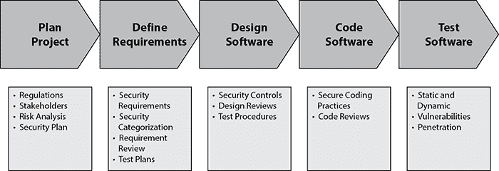

**图 4-18** SDLC 中的安全

此处讨论各个阶段：

- **规划项目** 在项目启动或规划阶段，确定项目的初始目标范围，并考虑安全驱动因素。驱动因素包括与业务相关的法律法规；利益相关者（如客户、股东或其他对信息安全或隐私有顾虑的方）；或源自组织业务环境的因素。项目规划阶段还可能包括风险分析，如第 1 章“风险管理”节所述。风险分析提供了软件产品对业务的价值、与企业其他组件的关系、威胁、潜在漏洞，以及其将处理、存储或传输的数据的性质和价值的初步视图。所有这些信息都会被记录下来，有时会汇总在安全计划中。


## 安全 SDLC 阶段

### 定义需求

在需求定义阶段，安全需求与软件的功能、操作、接口或其他需求一同被定义。此阶段可能包括系统的安全分类，例如 NIST 风险管理框架 (RMF) 流程所要求的分类。安全需求在数据库、需求列表或软件需求规格说明书中建模并表达，且可能在正式需求评审期间进行审查。针对安全需求的测试计划也可能在此阶段制定。

### 设计软件

在设计阶段，安全控制的实现体现在软件设计中。安全需求被分配到软件架构的适用部分，以及将在编码阶段编写的具体组件。设计解决方案可能源自行业最佳实践，例如来自 OWASP 的实践。

### 编写软件代码

编码阶段是构建和测试软件组件以实现安全需求的时期。开发人员应遵循内部标准或行业实体（如 OWASP）发布的安全编码实践。

### 测试软件

为确保满足安全需求，软件将使用静态和动态技术进行彻底测试。动态测试应包括彻底的漏洞测试以及渗透测试，以手动探测潜在的攻击向量。

## 安全 SDLC 角色与职责

为开发安全软件，开发团队应包含具有特定安全相关角色的成员。这些角色可由在项目中担任其他角色的团队成员兼任，也可由专职安全人员担任。角色分配通常由项目的规模和复杂性驱动。以下是软件开发项目中可能存在的一些关键安全角色（名称可能因组织而异，但活动应始终执行）：

### 信息安全经理或主管

该角色通过发布安全原则（包括政策、标准和指南）并确保它们在软件开发项目中得到正确应用，来保障安全得到重视。

### 信息安全工程师/主题专家

安全工程师和主题专家与开发人员协作，设计和编写满足安全需求的解决方案。安全工程师还参与软件的评估和测试，以根据需求对其进行验证，并确保未向环境中引入漏洞。

如前所述，信息安全角色可根据管理层决定和项目需求与项目中的其他角色合并。这些角色也可能相互合并。

## 软件漏洞

本章开头的“恶意软件和攻击”部分描述了利用软件漏洞的脚本攻击和特定漏洞攻击。许多此类攻击利用了由系统设计或编码错误导致的漏洞。以下各节简要总结了最新 OWASP 十大应用漏洞列表 ([`owasp.org/www-project-top-ten/`](https://owasp.org/www-project-top-ten/)) 中一些最常见的软件漏洞。

### 注入

注入是一种软件漏洞，允许攻击者向解释器发送不受信任的数据。这些数据可被构造为导致解释器在未经授权的情况下执行非预期命令。根据被利用的后端系统不同，存在各类注入缺陷，包括 `SQL`、`NoSQL`、`OS commands`、`LDAP` 等。开发人员可通过应用以下实践来预防注入漏洞：

- 使用安全 API 而非解释器
- 通过仅允许特定字符串或字符来过滤输入字段
- 在发往后端系统的命令中包含控制措施，将可用功能限制为仅允许的功能（例如 `SQL LIMIT` 控制）

### 失效的身份认证

失效的身份认证是一系列问题的统称，均与身份管理、身份认证和会话管理实现不当有关。攻击者利用这些弱点破解密码、密钥和令牌，并利用其他缺陷冒充用户身份。如果应用程序包含以下任何弱点，则存在漏洞：

- 允许自动化身份认证攻击，使攻击者能尝试使用大量用户名和密码登录
- 允许使用简单或易猜测的密码
- 使用薄弱的密码恢复功能
- 未以安全方式存储或传输密码
- 身份认证实现不佳，包括多因素认证
- 泄露、不轮换或不使会话 ID 失效

开发人员可通过应用以下实践来预防失效的身份认证：

- 尽可能实施多因素认证
- 限制登录失败次数
- 实施弱密码检查
- 使用安全的会话管理技术，如安全的随机会话 ID
- 遵循 `NIST 800-63B` 关于记忆秘密的指南
- 避免使用攻击者可能获取的默认凭据

### 敏感数据泄露

敏感数据泄露是一系列问题的统称，均与未能妥善保护敏感数据有关。即使应用程序使用加密，敏感数据在加密前或解密后也可能易受攻击。敏感数据可以是组织视为敏感的任何数据，但最常见的是个人信息，如医疗数据、信用卡数据、凭据和专有信息。如果应用程序包含以下任何弱点，则存在漏洞：

- 敏感数据未被妥善识别和分类，以便应用相应级别的保护
- 敏感数据以明文传输
- 使用薄弱或过时的加密算法或方法
- 使用不良的加密密钥管理，如使用弱密钥、重新生成密钥或不轮换密钥
- 未强制使用加密
- 未验证证书

开发人员可通过应用以下实践来预防敏感数据泄露：

- 正确分类数据，并根据组织安全策略定义的分类应用控制措施
- 仅按需存储敏感数据，且仅存储所需时长；不必要地保留或缓存敏感数据
- 使用强哈希函数存储密码
- 对静态敏感数据进行加密
- 使用当前最新的加密算法和协议
- 使用最新的安全协议在传输过程中保护敏感数据

### XML 外部实体

`XML` 文档可包含 `external entities`（存储单元），用于访问本地或远程内容。每个实体使用 `Universal Resource Identifier (URI)` 来引用内容源。`XML processor`（或 `parser`）读取 `URI` 并用预期数据替换引用。然而，并非所有 `XML` 处理器都能正确执行此操作，且可能被修改或破坏，以处理外部实体并使用非预期数据作为内容。攻击者可通过使用 `XML` 文件检索敏感数据来利用此漏洞。如果应用程序和基于 `XML` 的服务包含以下弱点，则存在漏洞：

- 接受来自不受信任源的 `XML` 数据
- 将不受信任的数据插入 `XML` 文档
- 使用启用了 `document type definitions (DTDs)` 的 `XML` 处理器
- 使用 `SAML` 进行身份处理
- 使用 1.2 版本之前的 `Simple Object Access Protocol (SOAP)` 版本


# 安全漏洞与安全编码实践

开发人员可以通过应用以下实践来防止因 XML 外部实体而导致的利用：

- 使用 SOAP 1.2 或更高版本
- 在所有 XML 解析器上禁用 DTD 和 XML 外部实体处理
- 确保 XML 解析器已应用最新升级补丁
- 使用 XML 验证

## 失效的访问控制

应用程序应强制规定经过身份验证的用户被允许执行哪些操作，但许多应用程序未能做到这一点。这可能导致攻击者能够访问用户账户、访问敏感数据或执行未授权的功能。如果应用程序包含以下任何弱点，则存在漏洞：

- 绕过其他软件的访问控制检查
- 允许权限提升
- 允许跨账户访问
- 允许操纵元数据，例如修改令牌、Cookie 或隐藏字段
- 允许跨源资源共享（CORS），这允许从另一个域使用受限的 Web 资源

开发人员可以通过应用以下实践来避免失效的访问控制：

- 默认拒绝
- 根据组织策略强制执行访问控制
- 避免使用 CORS
- 禁用 Web 服务器目录列表

## 安全配置错误

配置错误的软件和操作系统无疑是最常遇到的漏洞。操作系统和软件通常因使用默认设置、不正确的安全设置、不需要的功能，甚至因过时或未打补丁而被错误配置。如果应用程序包含以下任何弱点，则存在漏洞：

- 过时或未打补丁的软件
- 启用了默认账户
- 启用了不需要的功能
- 未启用安全功能
- 安全设置或值设置不正确
- 过于详细的错误消息（泄露超出必要范围的信息）

开发人员可以通过应用以下实践来防止因配置错误导致的漏洞：

- 保持所有软件更新至最新版本和安全补丁
- 遵循配置指南（如美国国防部国防信息系统局 [DISA] 安全技术实施指南 [STIGs] 或互联网安全中心 [CIS] 基准）对所有软件进行加固
- 仅启用绝对必要的功能和设置
- 审查并应用产品开发商推荐的安全设置

## 跨站脚本

跨站脚本（XSS）是一种允许攻击者在网页中嵌入不受信数据的缺陷。该数据包含由受害者浏览器执行的脚本，可能会危害系统和数据。受害者通过社会工程学技术被诱导或重定向到受感染或恶意的网页。如果应用程序包含以下任何弱点，则存在漏洞：

- 缺乏对网站输入数据的过滤（例如，允许在博客或社交媒体网站上发布任何内容而不检查其中是否包含恶意代码）
- 动态包含攻击者可控数据的应用程序或 API

开发人员可以通过应用以下实践来防止 XSS：

- 使用专门设计用于防止 XSS 的框架（如 Ruby on Rails 或 React JS）
- 教育用户不要点击指向不受信网页的链接
- 禁止不受信的 HTTP 请求
- 对浏览器 API 应用内容敏感型过滤

## 不安全的反序列化

序列化是将对象转换为数据字节的过程；反序列化是相反的过程。如果攻击者将特制数据输入到易受攻击的应用程序的网页字段中，当对象被反序列化时，可能会导致任意数量的利用，包括远程代码执行、SQL 注入或其他恶意未授权功能。如果应用程序接受来自不受信来源的序列化对象，则存在漏洞。

开发人员可以通过应用以下实践来防止不安全的反序列化漏洞：

- 不接受来自不受信来源的序列化对象
- 对序列化对象执行完整性检查
- 在单独隔离的系统上运行反序列化功能
- 限制来自反序列化系统的网络流量
- 监控反序列化操作

## 使用含已知漏洞的组件

应用程序使用的组件库可能包含漏洞，在使用前应像部署到环境中的任何软件一样进行验证或清理。如果应用程序包含以下任何弱点，则存在漏洞：

- 来源不明的组件
- 版本未知的组件
- 过时或不再受支持的组件
- 未经测试的组件

开发人员可以通过应用以下实践来防止暴露：

- 实施持续的计划以清点、升级和修补所有组件库
- 仅使用来自受信来源的组件库
- 从受信站点通过安全链接获取组件

## 日志记录和监控不足

如果没有充分的日志记录，监控事件可能无法被检测到，且难以调查和解决。这会因延迟或使响应和补救行动复杂化而使糟糕的局势雪上加霜。如果应用程序包含以下任何弱点，则存在漏洞：

- 未记录错误和警告消息
- 未记录值得审计的事件，如登录失败
- 数据以不适合支持调查和理解的格式记录
- 审计日志仅本地存储
- 日志记录阈值设置过低或过高
- 事件检测阈值定义不清晰或与日志记录不一致

开发人员可以通过应用以下实践来防止日志记录缺陷：

- 根据组织的风险偏好和目标调整日志记录阈值
- 确保数据以可用格式记录
- 记录高价值交易
- 实施定义明确且经过充分演练的事件响应能力

## 安全编码实践

每个开发软件的组织都应建立一套计划，将信息安全集成到其 SDLC 中。无论该计划是正式还是非正式，都应包含 `secure coding practices`（安全编码实践），即开发不包含安全漏洞软件的具体方法。OWASP 为开发人员发布指南，作者发现 OWASP 是该主题最广泛使用的行业指南。OWASP 为开发人员提供下列类别的安全编码指南：

- 输入验证
- 输出编码
- 身份验证和密码管理
- 会话管理
- 访问控制
- 加密实践
- 错误处理和日志记录
- 数据保护
- 系统配置
- 数据库安全
- 文件管理
- 内存管理
- 通用编码实践

许多组织遵循 OWASP 指南，或根据自身环境和经验对其进行增强，形成自己的改编或特定编码实践实施。安全编码实践应形成文档，以便组织拥有一种可以应用、衡量并随时间改进的一致性方法。安全编码实践最好作为整体计划的一部分来实施，该计划包括以下内容：

- 将安全编码纳入 SDLC，如前所述。
- 将安全纳入供应链，以确保从 COTS 供应商或第三方开发人员处获取的软件产品不包含安全漏洞。
- 建立编码和开发标准以及可复用代码库。
- 持续培训开发人员


培训可能是安全软件开发中最重要但也最容易被忽视的方面。令人惊讶的是，许多计算机科学专业并不教授安全编码，尽管一些学校现在提供安全软件开发的专业学位。因此，雇佣开发人员的公司和组织有责任为其软件开发员工提供必要的培训。组织通常会聘请顾问或使用第三方培训机构来满足这一需求。这种方法可能非常有效，具体取决于讲师和课程的质量。

## 软件漏洞分析与评估

所有开发的软件都应经过测试和评估，以确保其满足安全要求且不存在漏洞。为实现这一目标，组织会结合使用自动化和手动技术。自动化工具用于检查源代码中的编程错误，或对部署在测试或生产环境中的程序进行自动漏洞扫描。手动测试包括软件架构审查、源代码人工检查以及运行中系统的手动渗透测试，具体如下所述：

- **安全架构评估** 安全架构评估的目标是确定并评估应用程序的关键安全设计特征。实现这一目标的一种方法是将应用程序分解为组件，从而根据每个组件的机密性、完整性和可用性特征对其进行评估。另一种模型是根据每个组件控制参与者（用户或系统）与资产（数据）之间访问的能力来评估每个组件。无论使用哪种模型，架构评估都应包括审查标准的定义、评估证据的收集、依据标准对证据的评估以及结果报告。

- **源代码审查（静态分析）** 对源代码的静态分析可识别可能导致安全漏洞的缺陷和弱点。此类工具包括检查未编译代码的源代码分析器、追踪组件和库来源的软件成分分析工具，以及移动应用分析器等专用工具。（另请参阅本章后面“漏洞评估”部分中的 SAST。）

- **漏洞测试（动态分析）** 动态分析由工具针对已编译并部署的应用程序执行，部署环境可以是测试环境，也可以是实时生产环境。这些工具测试接口、事务、会话管理、访问控制和其他功能是否存在安全缺陷。（另请参阅本章后面“漏洞评估”部分中的 DAST。）

- **渗透测试** 手动应用渗透测试通常从源代码审查和漏洞扫描的结果开始。利用这些产出物并理解系统后，评估团队会对实施进行有针对性的测试，以发现并识别弱点，并演示如何从攻击者的角度利用这些弱点。

应用安全测试的理念是寻找本不应存在的功能。测试用于发现可能并非刻意设计且可能出乎意料的行为。测试还用于查找后门或绕过设计的访问控制的方法。测试应在实时部署前的测试环境中执行，并在软件部署到生产环境后再次执行。安全测试结果的报告通常使用某种排名系统，作为了解每个*发现*、漏洞或缺陷的相对风险和影响的一种方式。例如，评估团队可能会根据*业务影响*和*发生可能性*对每个发现进行评分（高、中、低）。然后以图表形式呈现该信息，以直观展示应用程序的风险概况。

软件安全测试可以非常全面且昂贵，也可以快速且廉价，或介于两者之间。测试越广泛，产生有意义结果的可能性就越大。这种规模关系如图 4-19 所示。

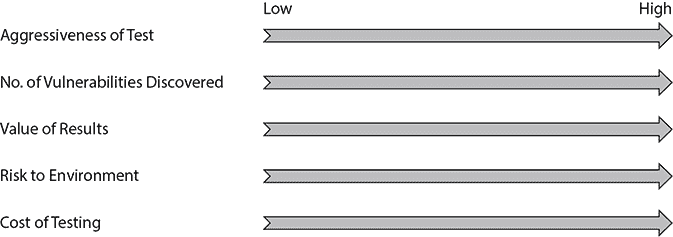

**图 4-19** 软件安全测试规模

组织必须选择适当的应用程序测试范围以满足其需求。通常，测试范围基于风险。例如，包含绝密数据的军事系统有理由以巨大成本进行广泛测试，而不包含敏感数据的系统则会以较低成本进行不那么广泛的审查。

## 取证、事件处理与调查

坏事总会发生，一旦发生，组织必须具备相应的流程和技术来了解发生了什么并做出适当响应。本节讨论组织如何检测安全事件、进行调查、响应和恢复。还涵盖了与安全漏洞相关的法律以及 CISO 应了解的取证概念。本节涵盖以下主题：

- 相关法律
- 日志记录与监控
- 事件响应与调查
- 取证与数字证据

关于检测和响应事件的重要概念是*准备*。决定如何处理事件的时间不是在事件发生时。在战火纷飞时，能够依靠经过精心制定、实践和不断完善的既定流程和程序是非常有价值的。当 CISO 和安全团队做好充分准备以响应安全事件时，这些事件对业务的影响就可以降到最低。

## 相关法律

尽管 CCISO 是一项国际认证，但关于相关安全法律的讨论带有明显的美国倾向。


**考试提示** CCISO 考试可能不包含关于具体法律的问题，但 CISO 应充分了解其组织运营所在司法管辖区适用的法律。

在理解与计算机犯罪相关的法律时，应理解并澄清以下常见谬误：

- *编写计算机病毒属于言论自由，受法律保护。* 并非如此：在大多数国家，编写病毒本身不违法，但传播病毒是违法的。
- *信息应为所有人所用；因此获取信息不违法。* 错误：信息属于其所有者，通常是创建它的个人或实体。任何人都无权窃取或篡改他人的信息。
- *如果网络犯罪分子从黑客活动中不获利，就不违法。* 错误：美国《计算机欺诈和滥用法》等法律不要求行为人从非法行为中获利。
- *系统应受到保护，如果它们没有被锁定，那是受害者的错，不是黑客的。* 错误：如果你忘记锁前门，罪犯走进你家偷走电视仍然是违法的。同样的原则适用于网络犯罪。

虽然计算机犯罪法律的细节差异巨大，但可以肯定地说，大多数计算机犯罪法律都包含条款以保护公众免受以下行为侵害：

- 未经授权的访问
- 恶意代码植入
- 未经授权的数据修改或破坏
- 未经授权的信息披露


# 计算机犯罪与网络犯罪法律

## 打击计算机犯罪面临的挑战

计算机犯罪难以打击，主要有几个原因。首先且最重要的是，确定对攻击负责的网络犯罪分子的身份可能非常困难。调查能力在不断提高，但网络犯罪分子用于逃避检测的方法也在不断进步。其次，网络犯罪留下的是电子证据，通常没有物理证据。电子证据可能难以查找和解读，这增加了犯罪的隐蔽性，也加大了寻找罪犯的难度。

## 与网络犯罪相关的法律

### 完整性法律

现有法律旨在保护公众使用的信息的完整性。例如，美国《萨班斯-奥克斯利法案》（也称为《2002 年上市公司会计改革和投资者保护法案》）是在多起上市公司实施欺诈的企业丑闻之后出台的。该法律包含有助于确保公司财务信息准确性及相关安全实践的条款。

### 隐私法律

隐私法律旨在保护个人的个人信息免遭未经授权的披露。在美国，这些法律包括《健康保险流通与责任法案（`HIPAA`）》，其中包含保护个人受保护健康信息（`PHI`）不被未经授权披露的条款，以及《格拉姆-里奇-比利雷法案（`GLBA`）》，其中包括对个人财务信息的保护。同样，欧盟的《通用数据保护条例（`GDPR`）》包含保护个人个人信息的条款。

### 欺诈与滥用

在美国，包括《计算机欺诈和滥用法案（`CFAA`）》、《身份盗窃执法和赔偿法案》以及州法律在内的法律，定义了非法行为及相应的惩罚，针对故意未经授权访问计算机的行为，包括造成损害或损失的此类行为。

### 其他法律

其他与计算机安全和取证相关的法律包括网络霸凌法律（这些法律因地区而异）、儿童色情和发送淫秽信息法律（美国联邦和州法律，如美国法典第 18 编第 2256 节，涉及禁止材料的存储或传播），以及专门保护政府免受黑客攻击、间谍活动、网络恐怖主义和网络战的各种法律。

## 日志记录与监控

信息安全有两面：攻击防护和事后恢复。本节大部分内容涵盖恢复，其第一步是检测。`CISO` 用于检测安全事件发生的最基本工具是日志记录和监控，以下各节将对此进行详细阐述。

### 调优日志记录与监控

日志记录（事件的记录）和监控（事件的检查）都会捕获和报告大量数据。人们可以记录整个企业发生的每一个事件，并花费大量资源（自动和人工）进行监控。但这需要在存储、处理和解读所有这些数据方面付出代价。每个安全部门在合理记录和监控信息量方面都有实际限制。诀窍（如前文“`IDS/IPS`”一节所述）是调整日志记录和监控以获取正确的数据。多少才是适量的数据？答案是根据风险和组织的能力来调整日志记录和监控。在进行全面的风险分析后，`CISO` 将了解最关键的系统、威胁以及资产对业务的价值，从而使 `CISO` 能够确定收集和处理什么信息很重要，以及在日志记录和监控环境上合理花费多少资源。

### 日志记录

日志记录是捕获和存储活动以供后续分析。日志记录用于支持审计、故障排除、系统的功能/运营分析，当然还有安全。日志可以捕获整个企业发生的事件，包括以下类型：

- **系统和事件日志** 服务器、工作站、数据库，甚至某些网络设备都具备配置和执行日志记录的能力，以捕获事件并存储它们以供后续检索和分析。
- **`OS`、应用程序、`IDS/IPS` 和防火墙日志** 这些日志有助于识别异常或帮助重建过去的安全事件。异常包括配置设置或重要文件的更改，这可能是恶意活动的迹象。

通常为支持安全调查而捕获的事件包括：

- 输入/输出故障
- 认证/授权事件
- `OS` 和应用程序错误
- 系统启动和关闭事件
- 安全指标，如添加/删除用户、更改权限、添加/删除令牌
- 管理员或特权用户执行的操作

通常捕获的关于事件的信息包括：

- 事件发生的时间
- 事件发生的位置（系统、应用程序、服务、地理位置、组件、网页）
- 执行操作的人员（用户名、IP 地址）
- 发生了什么（类型、严重性、优先级、描述）

*日志管理* 是指为维护日志以使其对组织有用而进行的所有活动。日志不仅对组织极具价值，而且高度敏感，应防止被修改/删除，且仅允许授权用户访问。在存储容量规划期间必须考虑日志，以确保日志不会占满可用存储空间导致没有空间，从而导致无法记录重要数据。

### 监控

一旦事件作为日志记录过程的一部分被捕获，就可以对其进行检查，以检测与安全相关的事件（如入侵），并支持对这些事件的调查。大多数组织采用某种安全信息和事件管理（`SIEM`）系统，该系统将来自各种来源的事件日志聚合并关联到一个中央存储库中。`SIEM` 系统便于事件分析，并提供企业的全局视图。`SIEM` 功能包括：

- **日志聚合** 监控解决方案从各种来源收集事件数据，包括系统和服务器、网络设备、数据库和应用程序。
- **安全存储** `SIEM` 中央存储库必须位于安全位置，例如妥善保护的数据库，因为记录的信息很敏感。事实上，`SIEM` 数据库通常比日志的原始来源更安全。
- **关联与分析** 比较不同 `SIEM` 解决方案时，最大的价值和可能最大的区别在于它如何帮助安全人员从事件数据中得出结论。`SIEM` 软件分析数据以构建趋势并建立关系，从而能够检测异常活动。更好的 `SIEM` 会持续构建趋势数据，提供一种不断进化且随时间改进的能力。
- **警报** `SIEM` 具备筛选噪音并在发生需要操作员关注的事件时发送或显示警报的能力。大多数 `SIEM` 允许组织调整阈值，以针对组织最关键的事件提供警报。
- **合规** `SIEM` 供应商宣传的一个卖点是其帮助组织确定并报告符合监管驱动因素的能力。通常，此功能通过模板或插件启用，以帮助构建针对组织重要法规的特定报告。


**考试提示** `CCISO` 考生应熟悉 `SIEM` 系统以及 `IDS` 和 `IPS` 的目的和功能。

## 事件响应与调查


安全事件处理始于潜在安全事件的指示，终于解决与关闭。中间有许多步骤，每个步骤都必须经过周密计划、在策略指导下，并遵循精心设计和演练过的程序执行。与安全的所有方面一样，组织对事件处理程序进行规划、演练和文档化的*程度*取决于业务性质及其风险承受能力。

## 涉及执法部门

在调查过程中，组织可能会识别出嫌疑行为人。这些行为人可能是外部人员，也可能是组织内部员工。无论哪种情况，如果怀疑发生了犯罪，都应联系执法部门。然而，何时以及如何联系执法部门的决定不应轻率做出，因为这可能对组织产生影响。应制定程序，为何时联系执法机构（报告阈值）、谁应参与决策，以及如何以及由谁进行此类联系提供指导。

组织应让法律顾问参与事件处理程序的制定，特别是那些涉及疑似犯罪活动和与执法部门互动的程序。

当联系执法部门时，组织将调查控制权移交给执法机构。因此，执法机构可能会控制或占有组织的资产以进行调查。这可能导致组织业务运营中断，这是建立完善的 BCP/DR 流程的一个原因（有时会被忽视），以便组织能够使用备份或备用系统和数据恢复业务运营。

根据法律规定，某些信息必须立即向执法机构报告，例如在公司计算机上发现某些类型的违禁品。然而，一些事件由组织自行决定是否报告，例如员工违反访问控制策略，从技术上讲可能违法，但如果没有敏感数据（如 HIPAA PHI）被非法访问，通常不会上报。

## 员工违反策略

安全策略与人力资源策略无异，员工必须对合规性负责。组织的义务是确保策略得到一致执行。如果组织不一致地执行策略，就会使自己面临员工向其提出索赔的风险。良好的安全策略执行规则包括以下内容：

- 发布策略并确保所有员工知晓。
- 定义并记录报告安全违规、调查违规和实施执行的流程。执行措施可能包括纪律处分，直至并包括解雇员工。
- 向管理者和主管提供培训，不仅涵盖策略本身，还包括报告和执行方面。
- 在新员工入职培训和定期复训简报中包含安全策略内容。

每个组织都应建立机制，供员工报告疑似违反安全策略的行为。员工应感到报告所见情况不会遭受任何报复。一些组织通过提供匿名举报选项、举报人保护计划或指定调解人（作为举报人与组织之间的代理）来实现这一点。

## 事件处理流程

正如第 1 章所述，事件处理通常采用类似于图 4-20 所示的流程来实施。

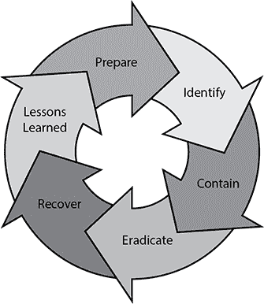

**图 4-20** 事件处理的六个步骤

该图展示了处理事件的当前行业实践。尽管确切的步骤名称和数量因组织而异（NIST 定义了四步流程），但基本概念是通用的：提前为事件做好准备、调查并解决事件、将组织恢复到正常运营，然后从发生的事情中吸取教训，以便将来预防或更好地处理类似事件。图中的每个步骤将在以下各节中讨论。

### 准备

准备阶段涉及解决良好事件处理计划的以下先决条件：

- 对事件处理活动提供监督，以确保组织内每个业务单元或小组执行适当的事件处理流程。
- 制定、发布和维护涵盖整个组织和企业的事件处理计划，以及支持性的策略、指南和程序。
- 建立培训计划，确保人员充分掌握事件处理方法。
- 定义所有参与事件处理人员的角色和职责，并确保角色和职责与事件处理计划、策略和程序保持一致。
- 采购和部署足够的工具以支持事件处理活动。
- 准备处理特定类型事件的具体程序。

### 识别

事件发生后，安全团队必须确定正在发生什么。这始于团队成员发现事件证据时。他们可能开始看到来自 IDS 或 SIEM 的警报、日志文件中异常活动的迹象、异常网络活动、员工报告等。在某个时刻，证据（或证据的积累）表明可能已经发生了安全事件（或正在发生），此时应开始遏制。

### 遏制

一旦识别出事件，团队必须对其进行遏制，以便在防止其扩散或造成额外损害的同时进一步评估。遏制策略应预先定义，以便（理想情况下）针对特定类型的事件调用特定策略。遏制策略可能包括：

- **边界遏制** 防止蔓延至网络边界之外的行动，如阻断入站/出站流量、更新边界防火墙策略、切换到备用通信链路。
- **内部遏制** 防止蔓延至网络某部分之外的行动，如隔离网段或 VLAN、更新路由器、防火墙和交换机设置以阻断特定 IP 地址或端口。
- **端点遏制** 防止蔓延至设备、服务器、工作站或笔记本电脑之外的行动，如断开特定端点的网络访问。

### 根除

此步骤也可称为“修复它”。安全团队从受影响的系统中移除导致问题的恶意软件、程序、设置或账户。理想情况下，团队会注意最大限度地减少数据丢失，但这并非总是可行。根除通常与恢复阶段结合，例如重新映像磁盘，这会在一步中擦除不良内容并替换为良好内容。

### 恢复

恢复涉及将系统恢复到运行状态。恢复可能包括重新映像磁盘、安装新的操作系统和应用程序、更新 STIGs、强化设置和安装补丁。恢复使系统达到一个新的、干净的且功能完全正常的运行状态。


## 经验教训

一切恢复正常后，安全团队可以复盘发生的一切。首先，他们记录事件经过、行动和处理活动，以提供发生了什么、由谁操作以及何时发生的记录。安全团队捕获并存储日志、警报、电子邮件及所有相关数据，编写并发布事件报告供管理层参考。管理层将审查报告，并找出经验教训，这些教训可能会导致架构、策略、系统和程序的变更，或为因该事件而改善组织安全态势所需的任何其他变更。

### 事件响应团队

事件处理流程由一个由管理人员和分析师组成的团队执行，他们与组织内外的利益相关者进行交互和协调。视组织规模而定，事件响应团队可能相当庞大，成员专注于流程的特定方面或拥有独特技术的专业知识。至少而言，大多数事件响应团队由至少三个角色组成：

- **经理或负责人** 协调团队活动并管理与组织其他部门的沟通。
- **一级分析师** 监控来自监控设备的日志和警报，执行分流，并作为调查和响应的第一层级。
- **二级分析师** 担任第二层级调查角色，可能涉及取证活动。

这个最小化团队可能由内部或外部专家提供支持，领域包括事件调查、执法、恢复，或通信、服务器技术、专用应用等技术领域。

事件响应团队通常与组织内部的人员或群体进行正式交互，以建立监控和事件处理策略、流程及程序。此类交互可能是综合事件响应委员会的一部分。团队交互的角色可能包括：组织的首席财务官（CFO）或财务团队、总法律顾问或法务团队、高层管理人员和部门主管、人力资源部门，以及首席信息官（CIO）或信息技术部门。

对于某些事件，可能需要额外的个人或其所属部门参与实际的事件响应活动。例如，法律顾问或法务部门肯定会参与联系执法机关的决策。同样，如果事件调查表明员工有不当行为或违反策略，将会联系人力资源部门。

## 取证与数字证据

在调查安全事件的过程中，保留证据的*可采性*至关重要。证据的可采性由法官在其作为刑事或民事审判的一部分提交法庭时决定。要被采纳，证据必须具有关联性和可靠性，定义如下：

- **关联性** 要具有关联性，证据必须与发生的事情有合理关系。乔的浏览记录可能与在他硬盘上发现非他所有的受版权保护材料这一事实有关。法官决定关联性，但事件响应或调查团队在调查期间应假设所有事物都可能具有关联性。
- **可靠性** 证据必须准确。必须证明证据的获取和处理方式未导致其被篡改，也不可能被篡改，从而合理地保证其可靠性。

事件响应或调查团队最关心的可能是证据必须合法合规，这意味着证据必须合法获取且遵循了保管链。*保管链* 是一份书面记录，证明证据在其整个生命周期中是如何被获取、存储和处理的。*规范的保管链* 是应遵循的做法，以确保保管链记录显示证据得到了妥善处理，从而使其*可靠且可采纳*。例如，如果笔记本的内容被认为与调查有关，应保留记录，说明从调查人员获取笔记本那一刻起，直到将其提交法庭，笔记本是如何被存储、运输和保存的。目的是能够证明证据自首次获取以来未被篡改。

### 处理数字证据

规范的保管链要求事件响应或调查团队遵循书面程序来处理和存储证据。这包括获取证据、标记、包装、存储、运输的程序，以及在分析过程中保持其完整性的程序。

保管链在数字证据方面面临诸多挑战。数字证据必须通过电子方式读取，正常的系统启动和数据读取过程可能会改变证据。因此，必须首先遵循特定标准复制数字证据，以确保副本的质量和可靠性，同时保持原件的完整性。然后应对原件进行包装、封存，并贴上存储在数据库中的追踪信息标签。该数据库用于记录证据的位置，并在证据全生命周期的每次转移时更新。数据库本身应通过访问控制得到妥善保护，以确保只有获得适当授权的人员才能访问。

### 数字证据分析

并非所有组织都有财力自行进行数字证据分析。那些有能力的组织可能拥有取证实验室，可在其中维护保管链、从原始来源复制介质，并在副本介质上进行取证分析。许多组织选择不在内部进行取证，而是聘请专门从事数字取证调查的外部公司。无论是内部还是外包，取证实验室都应具备以下基本能力：

- 用于安全存储、包装、标记和运输调查对象设备及介质的物理设施。
- 复制能力，能够安全可靠地制作介质的精确数字副本。实验室应具备检查和访问来自服务器、工作站、笔记本电脑、手机、平板电脑、打印机和网络设备的数字介质的能力。
- 分析工具，能够检查包含待调查设备副本的介质。由于数据在磁盘上的存储方式，数据通常必须从磁盘或介质的各个部分重建。


**注意** 数字证据可以是*持久的*，意味着它存储在介质上，即使系统重启仍然可用。或者数字证据可以是*易失的*，意味着数据仅在系统运行时存在。持久数据在磁盘上仍可能被修改或覆盖，因此取证团队必须格外小心以确保数据得以保存。易失性数据必须使用实时取证方法收集。易失性数据恢复从最易失的证据开始（如 CPU、缓存和寄存器内容），并遵循*易失性顺序*进行。

支持安全调查的数字证据分析旨在揭示安全漏洞背后的真相。检查团队会获得一份清单，列出发生的事件类型以及他们在调查期间寻找的信息类型。取证检查团队通常遵循以下流程：


## 取证调查流程

**1.** 制定*搜索线索*列表，即团队在数据中寻找的项目清单。例如，如果被调查的事件是员工可能下载了盗版音乐或电影文件，团队会将此类文件添加到搜索线索列表中。

**2.** 在调查过程中，随着团队对介质内容了解的加深，可能会向搜索线索列表添加新项目。

**3.** 如果在调查过程中团队发现了定罪证据，团队可能会立即停止调查，并向管理层报告调查结果以便移交执法部门。

**4.** 当团队从搜索线索列表中找到目标或做出其他重大发现时，团队会将该项目添加到另一个称为*相关数据*列表的清单中，对其进行记录并提取。

**5.** 团队分析相关数据，以拼凑出活动的全貌，尽可能展示发生了什么、谁干的、如何发生的、何时发生的，以及与该活动相关的其他数据或事件。这将记录在*分析结果*列表中。

所有这些列表和事件都记录在*分析结果报告*中，该报告描述了调查结果并提交给管理层。

## 反取证技术

网络犯罪分子了解调查人员用于发现数字证据的取证方法。作为回应，网络犯罪分子使用各种技术试图掩盖踪迹。以下是 CISO 应了解的坏人使用的一些反取证伎俩：

- **覆盖数据** 网络犯罪分子掩盖踪迹的一种方法是用模式或随机数据覆盖数据或元数据。如果操作得当，取证分析师很难或根本无法察觉这一点。然而，攻击者面临的挑战在于知道要擦除哪些数据才能掩盖踪迹。如果他们不彻底，可能会遗漏某些东西并留下证据。

- **隐藏数据** 数据可以隐藏在文件系统结构内部，例如文件表的未使用部分、目录内部或磁盘的松散空间中。网络犯罪分子还可以使用隐写术或加密来隐藏数据。加密数据可使其不可读，但如果相关元数据（如文件头）未加密，加密数据的存在就会暴露，这可能向调查人员表明发生了某些事情。另一方面，隐写术将数据隐藏在通常用于其他目的的容器内，例如图像文件。在这种情况下，数据的存在本身可能很难被检测到。

- **隐藏行为** 操作系统和应用程序会创建元数据，指示文件何时被创建、修改或访问。网络犯罪分子使用多种方法通过混淆原本可用于指示行为的元数据来掩盖其活动。

## 安全评估与测试

安全计划最终由人员、流程和技术组成。安全计划的这些方面必须各司其职，以促进整体安全计划的有效运行。为了了解这些组件的运行情况，测试其有效性非常重要。这通过安全评估和测试来实现，以衡量和验证计划组件的有效性。本节概述了评估和测试安全计划的一些方法：

- 漏洞评估
- 渗透测试
- 法规合规性评估
- 安全计划评估

每种评估类型都提供了一种独特的方式来检查组织安全态势的不同方面。每种安全评估都遵循一个通用的生命周期，包括：

- 确定评估的要求和目标
- 评估环境的当前状况
- 识别并报告与期望状态的差距


> **考试提示** CCISO 候选人应熟悉不同类型的安全评估，并能根据场景选择合适的安全评估类型。

### 注意事项与考量

安全评估可以为组织提供关于其安全态势弱点的宝贵见解，但在开展评估之前，有几个重要的考量因素。其中两个主要考量因素是确保已获得测试的适当授权，以及理解、沟通并管理对组织业务运营的任何潜在干扰。

- **授权** 对于本节提到的任何安全评估，无论是内部评估还是外部评估，评估人员都必须获得组织的许可和签署。必须明确定义并达成一致的范围，概述可测试的系统和批准的评估类型。这对于入侵性测试（如渗透测试）尤为重要，因为在没有适当书面许可的情况下闯入系统可能违反法律。此类文件有时被称为“免死金牌”。

- **管理业务中断** 安全评估和测试可能会造成干扰，甚至在最坏的情况下对组织造成破坏。测试可能导致服务器或应用程序关闭，或资源过度占用。因此，测试必须通过让必要的利益相关者和部门参与，在整个组织范围内进行协调。应考虑如何在不干扰组织业务运营的情况下执行测试。例如，可能存在一些任务关键型系统，因风险过高而无法直接测试。在这种情况下，一些组织可能会选择在测试环境中而非实时“生产”系统中执行测试。测试环境允许组织在不冒直接干扰生产系统风险的情况下进行测试和识别漏洞。

## 漏洞评估

漏洞评估是专注于在特定环境中查找和识别漏洞的测试。这些评估在范围和技术深度上各不相同。例如，物理漏洞评估可能仅包含一份物理安全控制清单，而网络或系统漏洞评估可能包含使用漏洞扫描工具来识别环境中的技术漏洞。测试可以在组织内部进行（内部测试）或组织外部进行（外部测试）。漏洞评估项目可能包括以下一种或所有类型的漏洞评估测试：

- 网络和系统漏洞评估
- 应用程序漏洞评估
- 物理漏洞评估
- 基于人员的漏洞评估

在漏洞评估期间，评估团队识别资产（系统、应用程序、建筑物或人员），对其进行枚举，并识别漏洞。本节将逐一介绍上述各类漏洞评估。

### 网络和系统漏洞评估

网络和系统漏洞评估是最常见的评估类型之一。它们通常通过使用自动化扫描工具来识别漏洞来完成，例如以下各项：

- **脆弱软件** 生命周期结束、未打补丁或已弃用的软件
- **开放端口** 可用的端口和服务，无意中增加了暴露面
- **脆弱协议** `TLS/SSL` 的弃用版本，使用明文协议如 `FTP` 或 `Telnet` 等
- **错误配置** 可能允许攻击者获取信息或提供系统立足点的配置


# 漏洞评估与渗透测试

## 网络与系统漏洞扫描

可使用多种工具进行网络与系统漏洞扫描，包括开源工具、商业工具和专有测试工具。网络与系统漏洞扫描是健康漏洞管理计划的重要组成部分，应根据组织的需求和要求，按固定计划定期执行（例如每周或每月）。

## 网络与系统架构评估

网络与系统架构评估是对组织企业架构的设计与实施进行的人工检查。这通常涉及检查和评估以下内容：

- 网络架构，包括网络拓扑图和支持文档
- 端口上启用的服务和协议，以验证仅启用了必要的服务
- 端口和功能上实施的访问控制
- 任何需要凭据的连接和功能的密码强度
- 在网络边界提供安全控制的设备（防火墙、边界路由器等）
- 其他网络设备（电信设备、无线设备等）
- 防火墙规则集、边界路由器、无线实施和入侵检测系统

网络架构评估可能复杂、耗时且成本高昂，因此通常不频繁执行。它可能在环境发生重大变更时，或根据风险评估的要求时执行。

## 应用漏洞评估

应用漏洞评估通过手动和自动化手段评估应用程序的安全特性。此测试不仅适用于内部开发的定制应用软件，也适用于商用现成软件（COTS）应用或集成应用系统。这些测试用于识别应用层漏洞，例如：

- 跨站脚本攻击（XSS）
- SQL 注入
- 安全配置错误
- 目录遍历
- 易受攻击的组件
- 敏感数据泄露


> **注意** 应用漏洞及相应的防护措施在本章前面的“恶意软件与攻击”和“软件开发安全”部分有更深入的讨论。

应用漏洞评估的范围各不相同，从单纯使用自动化漏洞扫描工具，到执行应用架构和设计评估、代码审查、手动渗透测试、自动化源代码分析，以及利用运行时扫描技术。以下是几种不同类型的应用安全测试方法：

- **静态应用安全测试（SAST）** 在应用源代码编译或执行前对其进行扫描和分析，以在源代码级别检测漏洞。SAST 是*白盒测试*的一个例子，因为评估人员会获得有关应用程序的信息，如源代码访问权限、架构图等。
- **动态应用安全测试（DAST）** 在应用执行期间对其进行测试，以检测应用运行状态下的漏洞。这是通常作为基本应用漏洞评估扫描一部分执行的测试类型。DAST 工具执行多种测试，包括*模糊测试*（或*模糊测试*），即向应用程序发送无效或意外的数据作为输入，通常大量发送，以查看应用程序如何响应。
- **应用安全测试即服务（ASTaaS）** 另一种“即服务”模式，组织付费让他人执行应用安全测试。测试类型因服务内容而异，但可能包括 SAST、DAST、应用渗透测试等。

作为业务的一部分，评估人员可协助组织采用和实施应用安全最佳实践，以确保当前和未来的应用程序以保护数据和资产的方式进行开发和部署。

## 物理漏洞评估

物理漏洞评估，也称为物理安全评估，侧重于识别、评估环境（办公室、数据中心等）中的物理安全控制，并可能进行修复。物理漏洞评估通常包含对以下内容的审查：

- **设施与外围防护** 这可能包括围栏、锁门、摄像头等
- **内部防护** 用于保护服务器机房、布线间、敏感系统和资产的控制措施
- **人为、自然或技术威胁防护** 防止翻垃圾桶、火灾抑制等

## 基于人员的漏洞评估

人员也是资产。就像硬件和软件一样，他们应被列举和评估。必须先识别基于人员的漏洞，才能进行修复。基于人员的漏洞可通过测试、面谈、观察和与相关人员的互动演练来发现。一些基于人员的评估方法包括：

- **互动培训** 安全意识培训产品通常包含评估，用于测试员工对安全概念的了解，并衡量他们将这些知识应用于保护和捍卫组织资产的技能。
- **熟练度测试** 组织使用熟练度测试来评估员工对组织安全策略以及通用安全最佳实践的理解。
- **社会工程学测试** 组织测试员工对社会工程学攻击的抵御能力。这包括网络钓鱼安全测试，即向员工发送模拟网络钓鱼邮件，以测试他们是否点击链接或附件。真实的网络钓鱼邮件包含有害链接和附件，而模拟网络钓鱼邮件包含安全的链接和附件，用于追踪员工是否点击它们。

基于人员的漏洞评估主题在本章前面的“社会工程学”部分有更详细的介绍。

## 渗透测试

虽然漏洞评估提供了组织漏洞的全面视图（识别漏洞），但渗透测试展示了特定漏洞如何被利用以危害数据或以其他方式对组织造成不利影响（演示妥协的影响）。渗透测试是一项有针对性的测试，旨在提供攻击者如何利用漏洞获取访问权限、提升权限，并最终危害客户或其他组织数据的真实案例。渗透测试人员利用配置错误、缺失补丁和过度开放的服务，尝试获取对内部系统的远程访问权限。他们还会评估通过利用内部系统上发现的其他漏洞，能在内部网络中渗透多深，这可能允许外部攻击者从系统跳转到系统，以访问更敏感的系统或数据。渗透测试方法各异，但通常遵循此处概述的方法论：

1. **侦察/发现** 评估人员尝试获取有关组织及其系统的信息。在此步骤中，侦察通常是被动的。*被动侦察*侧重于尽可能隐蔽，通过网络搜索和其他方法收集信息，以免直接警告组织。
2. **枚举** 评估人员尝试使用主动侦察获取有关系统的更多信息。*主动侦察*涉及主动扫描和探测系统以获取信息。
3. **漏洞分析** 识别并分析漏洞。
4. **执行/利用** 利用漏洞在系统中获得立足点。


## 5. 发现的文档化

发现会被记录并作为最终报告的一部分报告给管理层。

渗透测试将其他漏洞评估工具作为评估的一部分加以利用，以识别可被利用的漏洞。渗透测试还可能包括基于人为因素的漏洞评估，通过使用社会工程学战术来获取进入网络的初始立足点。存在不同类型的渗透测试方法论，其中包括：

- **黑盒测试** 也称为*零知识测试*或*盲测*，评估人员对评估目标没有任何先验知识。*双盲测试*是指运营人员（如 IT 或安全团队）不知情测试的进行，可用于测试他们对潜在入侵的响应。

- **灰盒测试** 也称为*部分知识测试*，评估人员对被评估目标有一定了解。

- **白盒测试** 也称为*完全知识测试*，评估人员完全了解目标，例如网络拓扑图、资产清单、系统名称、IP 地址等。


**注意** 这些测试方法论也适用于其他类型的安全评估。例如，漏洞评估可以作为黑盒、灰盒或白盒评估来进行。

渗透测试提供了安全缺陷的可证明证据，并允许开展有针对性的风险修复活动。

### 法规合规性评估

法规合规性评估侧重于评估组织遵守法律法规要求以及与组织相关的其他合规要求的程度。这些业务涉及的法规要求包括：

- 《健康保险流通与责任法案》(HIPAA)
- 支付卡行业数据安全标准 (PCI DSS)
- 《格雷姆-里奇-比利雷法案》(GLBA)
- ISO/IEC 27001
- 服务组织控制审计 (SOC 1、SOC 2 和/或 SOC 3)
- 通用数据保护条例 (GDPR)
- 联邦风险和授权管理计划 (FedRAMP)

这些评估通常作为内部或外部审计的一部分进行。业务通常从评估组织的合规性要求开始（对于特定框架的审计和评估，如 PCI DSS 或 ISO/IEC 27001，这可能已是已知的），评估组织的当前实践，以及识别和记录差距。结果通常是一份*差距分析*报告，概述已识别的差距。根据业务的性质和范围，可能包含修复协助，或者报告可能为修复已识别的差距提供指导。

### 安全计划评估

安全计划评估对组织的信息安全计划或安全计划的特定组件或*流程*进行评估。这可能包括对组织基础设施、安全策略和程序、人员配备、员工队伍和工作场所的审查，以确定安全计划如何应对组织及其特定行业和部门面临的风险和威胁。安全计划评估可能侧重于特定安全工作流或子计划的治理。然而，如果与本节讨论的其他安全评估类型相结合，安全计划审查可能包含技术组件。安全计划评估可能包括以下任何或所有安全计划组件：

- 安全组织审查
- 风险管理审查
- 法规合规性审查
- 安全策略、标准和程序审查
- 安全运营审查
- 软件开发安全审查
- 物理安全审查
- 事件处理和响应审查
- 业务连续性和灾难恢复审查
- 安全意识和培训审查
- 数据安全审查

### 业务连续性和灾难恢复

*业务连续性管理 (BCM)* 是包含业务连续性规划 (BCP) 和灾难恢复规划 (DRP) 的总体管理过程。业务连续性管理的目标是为以下问题提供答案：

- 组织能否承受灾难的影响？
- 是否已实施控制措施以从灾难中恢复？
- 人员是否已为灾难做好准备？
- 连续性计划是否已记录并获批？
- 员工是否已接受恢复程序的适当培训？
- 连续性计划是否最新并定期测试？
- 连续性计划是否确保关键业务功能能及时恢复？

BCM 包括灾难恢复规划和业务连续性规划。*业务连续性规划*侧重于关键业务功能的连续性。目标是确保业务在灾难发生时能继续运营。与灾难恢复规划相比，这是长期规划，并记录在业务连续性计划 (BCP) 中。*灾难恢复规划*通常非常侧重 IT，专注于灾难发生后将资源恢复到运行状态。灾难恢复活动记录在灾难恢复计划 (DRP) 中，其中包含短期恢复程序，而 BCP 包含长期恢复程序。

如果一栋建筑被飓风摧毁，DRP 将说明组织应如何恢复 IT 功能，例如在备用位置重新启动服务器（可能通过启动冷站点），并从备份中恢复数据。DRP 侧重于让关键系统达到可以服务请求、组织流程得以恢复的状态。BCP 更侧重于业务运营，例如说明迁移人员和开始重建所需的程序，目标是恢复关键业务功能。DRP 让业务在灾难期间和灾难发生后立即保持运行。BCP 概述业务如何在受损状态下运作，并在长期内恢复正常业务。

不同的行业组织、标准和指南概述了不同的连续性规划流程；然而，它们都包含大体相同的概念。本章概述和讨论的流程如图 4-21 所示。该流程基于 NIST SP 800-34《连续性规划指南》中概述的步骤。本节讨论业务连续性管理流程中的各个阶段：

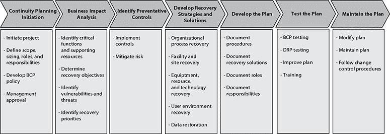

**图 4-21** 业务连续性管理流程

- 连续性规划启动
- 业务影响分析
- 识别预防性控制
- 制定恢复策略和解决方案
- 制定计划
- 测试计划
- 维护计划

### 连续性规划启动

与任何项目一样，连续性规划遵循项目管理方法论（如第 3 章所述）会很有帮助。项目启动并制定经组织领导层批准的项目计划。完成后，应制定业务连续性策略，也称为业务连续性计划声明。制定业务连续性计划的启动过程可能包括以下步骤：

1. 审查现有的 BCP（如果存在）。
2. 概述特定于组织的 BCP 目标。
3. 创建 BCP 策略声明。
4. 制定初步的 BCP 开发预算。
5. 制定计划批准程序。
6. 指定 BCP 协调员、项目经理和 BCP 项目团队。
7. 制定报告程序和 BCP 进度报告的频率。


### 8. 确定所需文档和信息收集技术

作为该过程的一部分，必须组建 BCP 团队，其关键组成部分是*业务连续性规划协调员*，该协调员负责监督从启动到测试和维护的业务连续性管理过程。BCP 协调员为 BCP 团队提供领导，并根据需要指导工作。BCP 开发团队应由熟悉组织内关键运营领域的代表组成，包括来自以下部门的代表：

- 高级管理层
- IT 部门
- 安全部门
- 风险管理部门
- 设施管理部门
- 组织领导和高管
- 公共关系和传播部门
- 法务部门


**注意** 团队由组织所有关键领域的人员组成非常重要。此外，负责*执行* BCP 的人员必须参与 BCP 的*制定*。所有这些利益相关者都应提供意见，并从各自的角度讨论所需内容。他们可以共同制定一份满足组织关键业务需求的计划。

### BCP 策略大纲

BCP 策略为 BCP 工作提供了基础。它记录了 BCP 的目的，有助于传达该计划的重要性，并作为一份由管理层签署批准的正式文件。业务连续性规划策略应概述以下内容：

- 策略范围
- 角色和职责
- 风险评估方法要求（定性、定量、影响分析、功能分析、指标等）
- 组织和管理计划制定的要求
- 测试和培训要求
- 确保计划时效性的要求

### 业务影响分析

连续性规划过程的一个基本组成部分是*业务影响分析 (BIA)*，它是用于连续性规划的功能性风险分析，旨在确定组织和系统需求、相互依赖关系、应急需求以及在发生重大中断时的优先级。BIA 本质上是业务连续性管理的风险分析。目标是识别组织最关键的业务功能、资产、资源和运营。BIA 涉及的步骤概述如下：

1. 识别关键功能和支持资源。
2. 确定恢复目标。
3. 识别漏洞和威胁。
4. 确定恢复优先级。

本节将逐步讲解 BIA 过程的每个步骤，并讨论每个阶段发生的活动。


**考试提示** 虽然 CCISO 考生可能不会被测试这些确切的 BIA 步骤，但他们应熟悉 BIA 术语、实施 BIA 的目的，以及 BIA 如何用于业务连续性管理。

#### 识别关键功能和支持资源

BIA 过程的第一步是识别组织的关键功能。这通常通过从关键利益相关者那里收集和汇集信息来完成。团队可能会执行以下任务以获取最佳数据：

- 选择要访谈的利益相关者
- 确定数据收集技术（例如研讨会、调查、访谈等）
- 设计问卷以获取运营和经济数据
- 通过数据收集和文档来源收集数据
- 记录组织职能、活动和事务
- 建立组织职能层级
- 应用分类方案以指示每个组织单元职能的关键性级别

在确定关键功能时，团队会考虑如果某项功能未运行时的业务影响。团队会考虑与该功能不可用相关的问题，例如以下问题：

- 将对收入流造成多大影响？
- 将如何影响生产环境？
- 将增加多少运营费用？
- 将如何影响公司声誉和公众信心？
- 公司是否可能失去竞争优势？
- 将如何导致违反合同协议或法规？
- 能承受哪些延迟成本？
- 哪些隐性成本未被核算？

除了识别关键功能外，还必须识别和记录支持资源。这些是组织关键功能赖以开展这些流程的资源。支持资源可能包括信息系统、人员、程序、物资、任务、来自供应商或承包商的外部支持，或 图 4-22 中所示的其他资源。此步骤的结果是一份经过严格审查的功能列表，利用排名系统（如关键、必要、需要和期望）进行分类。

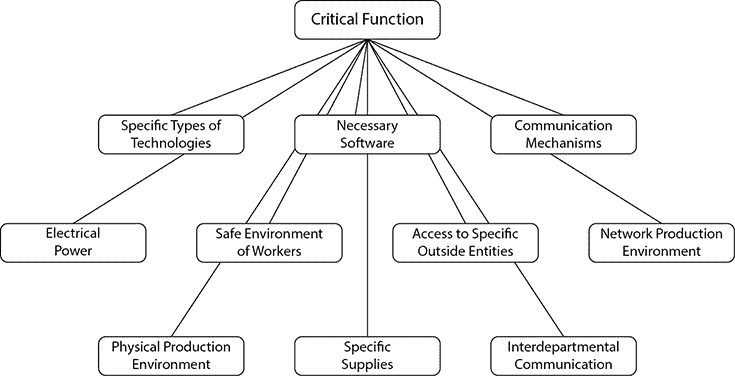

**图 4-22** 关键功能的支持资源

#### 确定恢复目标

BIA 过程的下一步是让团队分析功能和资源，并通过与关键利益相关者的讨论确定各自的恢复目标。这里的重点是确定功能和资源的可接受停机时间。可接受的停机时间水平可以用以下值来表示：

- **最大可容忍停机时间 (MTD)** 管理层愿意为给定流程、功能或资源因中断或故障而接受的停机时间量。MTD 有助于围绕恢复优先级、RTO 制定以及恢复策略和解决方案进行决策。
- **恢复时间目标 (RTO)** 资源在影响关键功能、流程或 MTD 之前可以不可用的最长时间。RTO 通常短于 MTD，以确保满足 MTD。
- **恢复点目标 (RPO)** 数据可恢复到中断或故障发生前的时间点。这是确定组织功能或流程在从故障中恢复时能容忍多少数据丢失。

该信息对于后续确定恢复解决方案和策略至关重要，并帮助团队决定将系统和资源恢复上线以恢复关键功能的顺序。例如，在与利益相关者的讨论中，可能会得知如果制造设施中的关键服务器停机超过三小时，整条生产线将需要重新启动，这将耗费整整一天。基于此信息，组织可能会决定该服务器的 MTD 不应超过三小时。

#### 识别漏洞和威胁

BIA 过程的下一步是让团队识别可能发生的漏洞和威胁，以确保了解对连续性的后果。需要考虑的一系列威胁包括：

- 自然灾害（飓风、地震、洪水、病毒等）
- 技术故障（系统、网络和通信中断）
- 供应系统（电力、暖通空调等）
- 人为因素（恐怖主义、不满员工、骚乱、破坏活动等）


# 业务影响分析与恢复规划

目的并非要想出可能发生的每一种威胁事件类型，这也是不可能的，而且那种头脑风暴会议可能会失控（例如，外星人入侵）。目标是为任何可能损害或中断关键组织职能或流程的威胁事件做好充分准备，并确保组织拥有确保关键职能连续性的计划。某些威胁对业务的影响可能大于其他威胁，因此可能会驱动关于恢复优先级的决策。例如，如果组织的制造能力受到高可能性发生的事件（如风暴）的严重影响，组织可能会决定在相应的恢复资源上投入相应的资金。

## 确定恢复优先级

BIA 流程的最后一步是检查各种有害事件类型及其对组织的相应影响，以确定恢复优先级。这些可以通过非正式会议或讨论，或通过更正式的风险评估（定量或定性）来识别。可以通过估算、衡量和分析以下因素来建立恢复优先级：

- 允许的中断时间（MTD、RTO、RPO）
- 业务流程关键性
- 财务、生产力和运营影响
- 法规合规要求
- 组织声誉考量

BIA 结果将被记录并提交管理层批准。随后，它们将被用于根据可容忍的中断时间，为职能和资源创建恢复和备份解决方案。BIA 的结果包含以下内容：

- 识别出的关键职能及支持资源
- 每个职能和资源的 MTD、RTO 和 RPO
- 识别出的威胁和漏洞
- 组织因每种威胁而面临的影响风险

## 识别预防性控制

一旦 BIA 完成，组织将更好地了解如果资产不可用将造成的业务影响。下一步是确定是否可以实施任何预防性控制来缓解这些风险。在某些情况下，BIA 中识别出的影响可能会被降低或消除。BIA 的结果可能表明需要预防性控制。以下是一些需要考虑的示例：

- 火灾探测和灭火系统
- 购买不间断电源 (UPS)
- 购买发电机
- 异地备份介质存储位置（磁带、硬盘、文档等）
- 通信链路冗余
- 服务器冗余
- 购买保险

在某些情况下，预防性控制比依赖中断后的恢复系统更具成本效益且更可取。预防性控制并不否定对恢复系统或规划的需求，但它们提供了一种降低中断发生概率的手段。

## 制定恢复策略和解决方案

业务连续性管理流程的下一步是根据可容忍的中断时间，为关键职能、资源和部门制定恢复策略和解决方案。本节将介绍以下恢复策略和解决方案领域的考虑因素：

- 组织流程恢复
- 设施和站点恢复
- 设备、资源和技术恢复
- 用户环境恢复
- 数据恢复

决定恢复策略和解决方案是一项平衡工作。组织必须在恢复成本与中断成本之间取得平衡。如果组织希望获得较短的 RTO，实现所需恢复技术和解决方案的恢复成本将非常高。然而，较长的 RTO 可能会因关键职能和运营的中断而给组织带来更高的成本。这一概念在 图 4-23 中进行了说明。

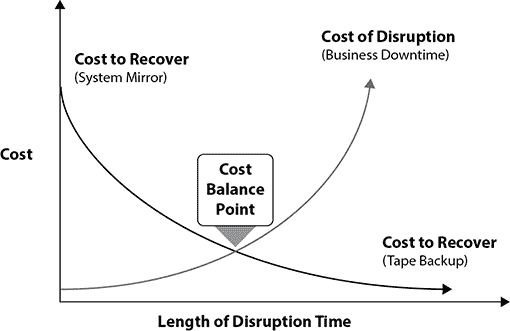

**图 4-23** 恢复成本考量（来源：NIST）

### 组织流程恢复

业务连续性规划团队考虑关键业务流程，并确定将其恢复到正常运营所需的适当资源和策略。在此工作中，团队必须了解关键组织流程的以下方面：

- 流程涉及的角色
- 资源需求
- 流程工作流步骤
- 与其他流程的接口和相互依赖关系

这些信息通常以工作流的形式呈现，记录流程步骤、角色、资源以及与其他流程的互连。这些信息有助于团队识别控制措施和应急策略，以减轻威胁导致的流程中断。

### 设施和站点恢复

任何组织灾难恢复规划的一个关键考虑因素是如何处理数据处理设施灾难。组织可以选择购买专用备用站点、租赁设施或签订互惠协议。`互惠协议` 是与另一个组织签订的协议，旨在在灾难发生时共享建筑和/或资源。这可能包括共享备用数据中心、办公空间或其他资源。无论选择哪种备用站点安排类型，都有各种设施和站点恢复选项可供选择：

- **热站点** 包含所有必要的处理系统、软件和设备，可在几小时或更短时间内准备好进行处理。只需要人员和数据备份。这是*成本最高*但*恢复时间最快*的选项。
- **温站点** 包含基本基础设施（电气布线、空调、管道等），并部分配备了一些系统硬件、软件和外围设备。该站点仍需要额外的计算机、软件、设备、人员和数据备份，可在一天或更长时间内准备就绪。这是一个折中选项，因为温站点*比热站点便宜*，且*比冷站点恢复更快*。
- **冷站点** 仅包含基本基础设施（电气布线、空调、管道等），没有系统。这是*成本最低*的选项；然而，它的*恢复时间最慢*（大约两周）。


**注意** 备份站点的位置应距离主站点足够远，以免受到同一灾难的影响，但也不能太远以至于迁移成本过高。像所有事情一样，适当的距离是基于组织目标和优先级的平衡行为。

以下是设施和站点恢复选项的几种变体：

- **灾难恢复即服务** 一种云计算服务，用于在灾难发生时进行恢复（也称为*恢复即服务*）。该服务范围可以从简单地将数据备份到云环境，到备份所有数据和应用程序，并在主站点维修期间充当备用处理基础设施。
- **冗余站点** 配置完全与主数据中心相同的数据中心（也称为*镜像站点*）。这是成本最高的选项，用于高可用性是必需的情况。
- **移动热站点** 配备数据处理设备的移动站点；本质上是一个移动数据中心。也称为*移动站点*。
- **第三备用站点** 当主备用站点不可用时使用的备用设施。


**考试提示** CCISO 候选人应熟悉各种设施和站点恢复选项，并能根据恢复目标或成本考量选择选项。

### 设备、资源和技术恢复


## 组织恢复的其他方面

还有其他组织恢复方面也必须予以考虑，包括但不限于以下内容：

- **人员** 确保人员生命安全、灾难期间有足够的人员配备，并制定适当的继任计划
- **文档** 确保关键文档（策略、程序、计划等）可用
- **硬件** 考虑网络和计算机设备、更换时间要求、供应商的 SLA，以及遗留和/或专有设备的风险
- **软件** 生产环境所需的应用程序、实用程序和操作系统
- **通信** 面向各利益相关者（客户、供应商、媒体和股东）的通信计划
- **基础设施** 语音和数据通信、电力及暖通空调 (HVAC) 的需求
- **物资** 纸张、布线、物理存储等的需求
- **其他风险** 灾难发生后可能出现的抢劫、破坏或其他欺诈活动

## 高管继任计划

组织高级领导层的暂时或永久缺失可能会对组织运营造成重大危害。组织必须制定高管继任计划，以便在高管人员流失时保护运营和领导力的连续性。例如，CISO 的继任计划可能规定由副 CISO、信息安全官 (ISO) 或信息安全经理 (ISM) 接管。继任计划的核心在于做好准备应对这些情况，以便公司能在极端情况下熟练地度过这一关键时期。

## 用户环境恢复

最终用户环境的恢复对于恢复组织运营至关重要。这包括关于通知员工的决策、确保关键员工资源可用，以及确保员工拥有安全的工作条件。为促进员工环境的恢复，BCP 团队至少必须执行以下操作：

- 制定电话树（呼叫树），通知员工灾难情况并让大家随时了解最新进展
- 确定维持关键职能运行所需的关键用户
- 确定当前自动化任务如何手动执行
- 确定用户资源和物资需求
- 如果需要，制定用户前往新设施的交通程序

## 数据恢复

恢复因灾难而丢失数据的传统方法是使用数据备份解决方案。采用这种方法时，数据会备份到集中式存储，如云存储、网络附属存储 (NAS) 或存储区域网络 (SAN)。备份程序应形成文档，并按每日、每周和/或每月的基础定期进行备份。数据备份的三种主要类型如下：

- **完全备份** 备份系统上的*所有*文件。提供最快的恢复速度，但执行备份耗时最长。
- **增量备份** 备份自上次*任何类型*备份以来已*更改*的所有文件。备份执行速度更快，但恢复时间更长，因为必须先恢复完全备份，然后再恢复此后执行的每个增量备份。
- **差异备份** 备份自上次*完全备份*以来已更改的所有文件。恢复时，先恢复完全备份，然后恢复最近的差异备份。


**考试提示** CCISO 考生应熟悉不同类型的备份。

在理想情况下，备份的数据会恢复到灾难发生前的确切状态；但在实践中，由于上次备份与灾难事件之间的时间间隔，备份/恢复过程可能导致部分数据丢失。为消除使用备份时潜在的数据丢失，组织可采用其他方法确保*数据弹性*。其中一种解决方案是*磁盘镜像*，它通过将相同数据写入多个磁盘来提供冗余。如果任一存储介质丢失，另一个仍可用于操作。现代镜像解决方案可提供快速无缝的灾难恢复，但仍有实施因素需考量。如果冗余磁盘位于同一位置，它们可能面临相同的灾难（如洪水或火灾），导致此类实施不适合从此类事件中恢复。此外，导致数据丢失的同一事件（如服务器宕机导致写入错误）可能在两个磁盘上产生相同错误，使数据无法恢复。因此，许多组织将镜像作为数据恢复的部分解决方案，但仍依赖备份。

数据可存储在多种介质上，包括磁带和磁盘。可使用 RAID（用于磁盘）或 RAIT（用于磁带）在磁带或磁盘级别实现冗余。*独立磁盘冗余阵列 (RAID)* 是一种用于跨磁盘实现冗余的技术。RAID 实质上允许数据跨多个磁盘写入，以实现更快的读/写操作以及冗余。冗余级别取决于所用的 RAID 级别。*独立磁带冗余阵列 (RAIT)* 类似于 RAID，但使用磁带代替磁盘。


**注意** 对于利用云服务的组织，云服务提供商可能会将自动备份和恢复功能作为订阅的一部分提供。这可能包含在套餐中，也可能作为附加组件提供。无论哪种情况，都必须确保云中的数据得到备份，且能像本地存储的数据一样可靠地恢复。

## 单点故障

*任何*仅使用单一组件执行任务的系统或网络都会产生*单点故障*。如果该单一组件失效，将没有替代组件接管。降低单点故障风险的控制措施示例包括：

- 冗余 LAN 路由
- 按需备份 WAN 连接
- 冗余和容错技术
- 应对故障的文档化程序
- 受过适当培训的人员

## 制定计划

在 BCP 团队制定 BCP 策略、执行 BIA、实施预防性控制，并开发恢复策略和解决方案后，下一步是制定计划。业务连续性计划的总体结构如 图 4-24 所示。

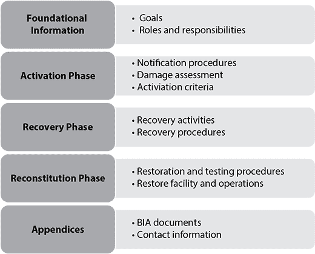

**图 4-24** BCP 结构（来源：NIST）

### BCP 机密性

大多数组织有两个版本的业务连续性计划：一个内部版本和一个供客户及其他关键合作伙伴查阅的清理版。客户尤其可能关心组织是否有 BCP，有些客户可能要求提供一个版本以满足其自身的合规要求。然而，BCP 因其本质属于敏感文档，一旦泄露可能对组织造成危害。它详细记录了组织在灾难发生时采用的恢复技术、解决方案和策略。这些信息对攻击者极具价值。这就是为什么要开发清理后的“公开”版本。清理后的 BCP 不应包含：

- 联系人名单
- 业务恢复程序
- 流程图
- 风险缓解方法
- BIA 结果

清理版应足够具体，以满足客户的安全和合规要求，但又应足够笼统，以免泄露敏感信息。

## 测试计划


# 计划测试与演练

确保计划有效性的关键方法是测试，以验证计划中的活动能否有效执行。组织不应等到灾难发生时才测试其业务连续性和灾难恢复计划。组织应至少每年执行一次测试，并制定具体的测试目标、场景和成功标准。这些可能包括确保：

- 响应在可接受的时间范围内
- 备用地点的运营状况良好
- 备份能够成功恢复
- 关键人员可在可接受的时间范围内联系到
- 团队成员了解当前计划的具体细节
- 团队成员能够履行其特定职责
- 计划是最新且相关的

## 测试类型

以下是可供选择的多种不同测试类型：

- **核对表测试** *BCP* 的副本分发给职能经理，由他们审查涉及其部门或业务领域的计划部分。
- **结构化演练测试** 召开会议，职能经理聚在一起对 *BCP* 进行“演练”。这也称为 *桌面演练* 或 *桌面推演*。
- **模拟测试** 执行灾难场景，演练 *BCP* 直到实际迁移到异地设施。测试范围可以从特定部门到整个组织不等。
- **并行测试** 使用运送到异地设施的系统进行并行处理来测试 *DRP*，以确保特定系统能在备用设施充分执行。此测试有助于确保备用系统的执行情况与主站点的系统相同。
- **全面中断测试** 这是最具侵入性但也最全面的 *DRP* 测试类型。原始处理站点关闭，所有处理转移到异地备用设施。


**考试提示** CCISO 考生应熟悉不同类型的业务连续性和灾难恢复计划测试。

## 测试后活动与培训

测试完成后，团队应进行并记录经验教训总结会议。经验教训应指出发现的任何缺陷或其他需要整改的重大发现。应审查、上报管理层并纳入计划，以在适用的地方提高其有效性。作为计划测试的一部分，确保恢复人员接受过关于其在计划执行中的角色和职责的培训至关重要。培训频率因组织而异，基于组织需求和已识别风险。然而，培训应在入职时进行，且通常至少每年一次。恢复人员至少应接受以下计划要素的培训：

- 计划的目的
- 沟通与协调流程
- 报告流程
- 安全要求
- 个人职责以及团队特定职责和流程
- 计划各阶段的职责（启动、激活、恢复、重组）

# 准备与测试是关键

在冠状病毒疾病（COVID-19）爆发期间，许多组织意识到他们未充分准备好应对此类灾难。就业务连续性而言，讨论往往集中在 IT 服务中断上。在冠状病毒爆发后，最普遍的问题之一是某些组织缺乏利用远程“居家办公”员工队伍运营的能力。有些组织在技术上受限，由于技术和基础设施能力不足，无法扩展以支持远程工作；而另一些组织在文化上受限，由于对如何远程开展和管理业务运营的狭隘思维。在爆发前，组织应将以下内容作为业务连续性和灾难恢复准备的一部分加以考虑：

- 制定在人员有限情况下维持服务交付的计划
- 确保关键合作伙伴和供应商有连续性计划
- 确保组织具备允许居家办公的技术能力（VPN 许可证、网络带宽、扩展能力等）
- 确保组织具备居家办公的文化能力（管理风格的改变、视频会议的使用、调整工作时间表等）

这就是为什么在考虑运营连续性场景时，考虑可能导致运营中断的各种事件范围至关重要。

# 维护计划

本节涵盖的各种连续性和应急计划及组件必须保持最新，并反映应如何处理连续性情况。由于人员流动或组织架构、流程、技术或软件的变更未准确反映在计划中，业务连续性计划可能迅速过时。以下是一些有助于确保计划保持最新的策略：

- 指派个人或团队负责更新计划
- 将计划维护职责纳入职位描述和考核中
- 将业务连续性和灾难恢复审查纳入组织审计
- 实施考虑 *BCP* 的变更控制流程
- 定期测试计划
- 确保相关人员接受过流程培训
- 融合测试以及实际事件的经验教训

作为计划维护的一部分，应遵循变更控制的最佳实践。计划变更应经过批准、测试和记录。应实施并强制执行严格的版本控制，以监控和管理变更。对于任何新变更，应考虑是否需要新培训，以确保相关人员知情并准备好执行计划。

# 章节回顾

CISO 应对信息安全的核心能力有扎实的理解。核心能力可分为三组：

- 来自网络攻击的威胁
- 技术安全领域
- 管理与程序安全领域

## 核心能力

### 来自网络攻击的威胁

恶意软件、脚本和社会工程学是网络犯罪分子实施网络攻击的主要方法。*武器化* 是部署恶意软件、脚本或其他手段以利用系统或系统的漏洞。恶意软件包括特洛伊木马、病毒、蠕虫和僵尸网络。脚本攻击由网络犯罪分子利用脚本实施，以利用操作系统和应用程序中的漏洞。*社会工程学* 一词是指利用欺骗手段诱使某人做可能不符合其最佳利益的事情。社会工程学多年来一直被骗子使用，现在已成为网络攻击不可或缺的一部分。

### 技术安全领域

所有组织都应充分了解其拥有哪些资产，以及基于风险和分类，每个资产需要哪些控制措施。*数据安全控制* 因数据状态而异，无论数据是静止、传输中还是使用中。数据安全控制通常作为数据生命周期的一部分来应用。通过正确配置和加固存储和处理信息的资产（如服务器、网络设备、应用程序等）来实施控制。*身份与访问管理* 是指为管理和控制对企业资源的访问而建立的系统和流程，涉及对*谁*在访问*什么*以及他们能*做*什么的管理和实施。这通过识别、认证、授权和问责/审计来实现。


## 网络和安全概念

`LANs` 和 `WANs` 为企业提供通信基础设施。现代网络遵循 OSI 模型构建，该模型定义了用于理解和设计有效协议、设备和安全性的层。防火墙、网络分段和加密是网络安全中使用的一些主要工具。`Cryptography`（密码学）是利用数学手段保护信息的实践，通过使信息对未授权方变得不可理解来实现安全。密码学用于支持机密性、完整性、认证和不可抵赖性。

`Cloud computing`（云计算）使组织能够访问共享的可配置计算资源池，这些资源可以以最小的工作量进行配置和释放。三种主要的云服务模型包括 IaaS、PaaS 和 SaaS。使用云服务提供商的风险之一是组织对某些功能失去控制，同时仍需对安全负责。组织必须尽职调查，以确保 CSP 实施了适当的控制和对策。

`Physical security`（物理安全）通常是组织人员和资产的第一道防线。物理安全的责任因组织而异，可能不在 CISO 的职权范围内。然而，CISO 应了解物理安全及其与信息安全计划的关系。

## 管理与程序安全域

所有内部开发或由第三方开发人员开发的软件，都应采用 SDLC 流程进行开发，在该流程中安全在最早阶段就集成到产品中，并在整个项目生命周期中得到关注。将安全集成到开发过程中可最大限度地减少漏洞并降低安全事件。

在响应安全事件时，准备工作是关键。决定如何处理安全事件的时间不是在事件发生时。CISO 和安全团队应做好充分准备，通过已演练和改进的既定策略和程序来响应安全事件。

安全计划最终由人员、流程和技术组成。安全计划的这些方面必须都有效运行，以促进全面的安全计划。为了了解这些组件的运行情况，测试其有效性非常重要。这通过安全评估和渗透测试来实现，以衡量和验证计划组件的有效性。

`Business continuity planning`（业务连续性规划）是专注于关键业务功能连续性的长期规划。目标是确保业务在灾难发生时能继续运营。`Disaster recover planning`（灾难恢复规划）通常非常侧重 IT，专注于在灾难发生后将资源恢复到运行状态，以确保组织流程的连续性。

## 快速回顾

- 勒索软件是一种恶意软件，迫使受害者在支付赎金或失去宝贵资产之间做选择。
- 社会工程学比纯技术攻击更有效，网络犯罪分子利用它更成功。
- 组织可以通过由员工培训、测试、演练和监控组成的综合计划，最好地防御社会工程学攻击。
- 资产安全控制通常作为信息安全控制生命周期框架的一部分实施，如第 2 章所述。
- 静止数据是指驻留在持久存储设备上的数据，如硬盘、闪存驱动器、光盘、磁带或其他存储设备。
- 传输中数据（也称为移动中数据）是指在网络上计算节点之间移动的数据。
- 使用中数据是指系统或应用程序当前正在处理或使用的数据。
- 三种主要的认证类型包括：你知道的东西（如密码、口令或 PIN）、你拥有的东西（如令牌设备、智能卡或 USB 驱动器）和你本身的东西（生物特征，如语音、指纹或掌纹扫描）。
- 仅使用其中一个因素称为单因素认证。使用两个认证因素称为双因素认证（如智能卡和 PIN、密码和生物特征、或密码和物理令牌）。多因素认证是使用两个或更多因素。
- 主要的访问控制模型包括强制、自主、基于属性和基于角色的访问控制。
- 身份和访问管理遵循一个通用的生命周期，包括身份和账户的配置、审查身份和账户，以及撤销账户。
- 网络的关键安全特性包括网络分段、防火墙、DMZ、VPN 和 IDS/IPS。
- 对称加密，也称为对称密钥密码学，其特点是使用单个密钥进行加密和解密。
- 非对称加密，也称为公钥密码学，其特点是使用两个密钥，一个公钥和一个私钥，它们在数学上相关。
- 三种主要的云服务模型包括基础设施即服务 (IaaS)、平台即服务 (PaaS) 和软件即服务 (SaaS)。
- 有四种云部署模型：公有云、私有云、混合云和社区云。
- 说到物理安全，最重要的是保护工作环境中员工和其他人员的安全。
- 软件开发人员应接受专门培训，学习如何创建不包含安全漏洞的应用程序。
- 大多数计算机犯罪法都包含条款，以保护公众免受以下行为侵害：
  - 未经授权的访问
  - 恶意代码植入
  - 未经授权的数据修改或销毁
  - 未经授权的信息披露
- 安全评估包括漏洞评估、渗透测试、合规性评估和安全计划评估。
- `Business continuity planning`（业务连续性规划）是专注于关键业务功能连续性的长期规划。目标是确保业务在灾难发生时能继续运营。
- `Disaster recover planning`（灾难恢复规划）通常非常侧重 IT，专注于在灾难发生后将资源恢复到运行状态，以确保组织流程的连续性。
- 业务影响分析（`BIA`）是用于连续性规划的功能性风险分析，旨在确定组织和系统需求、相互依赖性、应急需求，以及在发生重大中断时的优先级。它本质上是业务连续性管理的风险分析。

## 问题

1. 组织的安全团队发现了一种计算机病毒，它在网络上从一台计算机复制并传播到下一台计算机。这是哪种类型的恶意软件示例？

   A. 蠕虫
   B. 特洛伊木马
   C. 僵尸网络
   D. 勒索软件

2. 在列出的方法中，对抗社会工程学攻击的最佳对策是什么？

   A. 培训
   B. 练习和演练
   C. 观察
   D. 阅读

3. 以下哪项是一种端点管理的集成方法，允许特定策略管控连接到组织网络的资产的安全需求？

   A. 杀毒软件
   B. 移动设备管理
   C. 网络准入控制
   D. 配置基线

4. 组织的 CISO 希望确保在系统报废前，敏感数据无法从介质中恢复。以下哪项不是实现此目标的适当数据清理技术？

   A. 物理销毁
   B. 归零
   C. 清除
   D. 擦除


## 练习题

### 第 5 题
CISO 正在审查组织的访问控制策略和程序。组织根据请求者是谁、请求什么资源以及访问时间来实施访问控制。这是什么类型的访问控制模型？

**A.** 集中式  
**B.** 强制式  
**C.** 基于属性  
**D.** 基于角色

### 第 6 题
安全运营人员调整了 IDS 的阈值，因为员工无法跟上所有被报告的非入侵性活动。这是什么做法的示例？

**A.** 数据包过滤  
**B.** IDS 扩展  
**C.** IDS 调优  
**D.** IDS 资源调整

### 第 7 题
与非对称加密相比，以下哪项是对称加密的缺点？

**A.** 它加密数据的速度快。  
**B.** 它只能加密少量数据。  
**C.** 它使用弱加密。  
**D.** 它无法很好地扩展以支持大量用户。

### 第 8 题
CISO 正在与 CIO 合作评估一家新的基于云的托管电子邮件服务提供商。以下哪种云服务模型最能代表这种服务？

**A.** IDaaS  
**B.** PaaS  
**C.** SaaS  
**D.** IaaS

### 第 9 题
确定内部开发的 Web 应用程序是否容易受到脚本攻击的最佳方法是什么？

**A.** 对已部署的软件进行静态测试  
**B.** 对已部署的软件进行动态测试  
**C.** A 和 B 都进行  
**D.** A 和 B 都不进行

### 第 10 题
一名不满的员工在得知因裁员将被解雇后，闯入组织并窃取关键数据。这是哪种物理安全威胁的示例？

**A.** 人为威胁  
**B.** 自然威胁  
**C.** 环境威胁  
**D.** 供应系统威胁

### 第 11 题
CISO 决定对一台笔记本电脑进行取证调查，以查看是否存储了明文客户数据。以下哪项最能描述如何分析数据？

**A.** 为保留笔记本电脑硬盘上的证据，制作其数字副本并分析复制的数据  
**B.** 重启系统以清除任何脚本或恶意软件  
**C.** 直接在笔记本电脑硬盘上分析数据，因为复制数据可能会改变它  
**D.** 通过给笔记本电脑和硬盘贴标签来遵守保管链

### 第 12 题
一家医疗保健组织的 CISO 正在审查组织的策略和程序，以确保其符合 HIPAA。这是哪种安全评估的示例？

**A.** 法规合规性评估  
**B.** 应用程序安全评估  
**C.** 漏洞评估  
**D.** 渗透测试

### 第 13 题
CISO 正在与 BCP 协调员合作，为组织执行业务影响分析。他们必须确定资源在影响关键功能或流程之前最长可以不可用多长时间。以下哪个术语最能代表这一点？

**A.** 最大可容忍停机时间 (MTD)  
**B.** 恢复点目标 (RPO)  
**C.** 恢复界限目标 (RDO)  
**D.** 业务影响分析 (BIA)

## 答案

### 答案 1
**A.** 一种自我复制并将副本发送到其他计算机的计算机病毒称为蠕虫。问题中列出的其他类型的恶意软件具有其他特征：特洛伊木马将自己伪装成另一个程序，僵尸网络是网络犯罪分子控制的受感染系统网络，勒索软件是一种网络犯罪分子试图从受害者那里收取赎金的攻击类型。

### 答案 2
**B.** 培训、观察和阅读都有帮助，但实践和演练提供了强化知识，帮助人们为如何在特定情况下采取行动做好准备。

### 答案 3
**C.** 网络访问控制 (NAC) 是一种综合方法，允许定义特定策略来管理由网络访问要求。例如，NAC 策略可能禁止不满足特定安全要求（如安装了防病毒软件）的设备接入网络。

### 答案 4
**D.** 擦除不是一种安全的数据处置方法。发出擦除命令时，驱动器上的数据存储位置被标记为可用，但数据仍保留在介质上，直到被后续操作覆盖。

### 答案 5
**C.** 基于属性的访问控制 (ABAC) 基于定义的策略，指定哪些主体可以访问特定对象以及如何访问它们，基于被访问的特定对象和其他环境条件（如时间和位置）。集中式访问控制是一种访问控制管理类型，而非访问控制模型。强制访问控制 (MAC) 决策基于主体的许可和对象的分类。在基于角色的访问控制 (RBAC) 中，用户的访问权限基于其在组织中的角色。

### 答案 6
**C.** 入侵检测系统 (IDS) 调优是为了达到最佳检测和报告水平而执行的。

### 答案 7
**D.** 对称加密的一个缺点是它无法很好地扩展以支持大量用户。这是使用混合加密系统的主要原因之一，该系统使用对称密钥进行加密，并使用非对称加密共享密钥。

### 答案 8
**C.** 软件即服务 (SaaS) 产品将成品作为服务提供给客户，例如基于云的电子邮件服务。基础设施、操作系统、数据库、存储等所有维护均由 SaaS 提供商处理。身份即服务 (IDaaS) 是一种基于云的服务，提供一组身份和访问管理功能，并非主要服务模型之一。平台即服务 (PaaS) 是一种云计算形式，允许客户管理应用程序而无需在内部管理基础设施。基础设施即服务 (IaaS) 是一种基于云的计算形式，提供虚拟化计算资源。

### 答案 9
**C.** 所有开发的应用程序在部署到企业之前都应接受静态和动态测试。

### 答案 10
**A.** 不满的员工闯入组织窃取关键数据是人为威胁的示例。

### 答案 11
**A.** 制作数据的数字副本并对其进行分析。不要重启可疑设备，因为重启会以某种方式改变存储介质上的数据。切勿直接在可疑介质上执行分析。虽然给笔记本电脑和硬盘贴标签是个好主意，但这不是关于如何分析数据的最佳答案。

### 答案 12
**A.** 审查组织的策略和程序以确保符合《健康保险流通与责任法案》(HIPAA) 等法规驱动因素，是法规合规性评估的示例。

### 答案 13
**A.** 最大可容忍停机时间 (MTD) 是资源在影响关键功能或流程之前最长可以不可用的时间。
