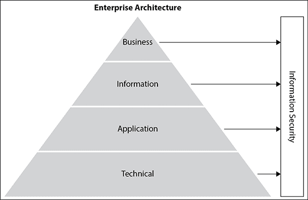
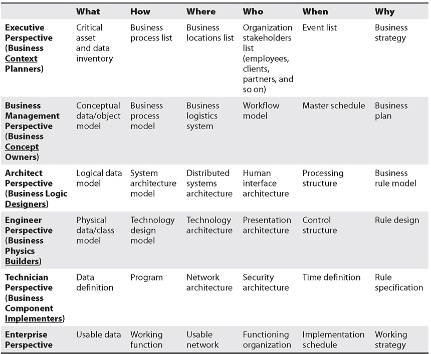
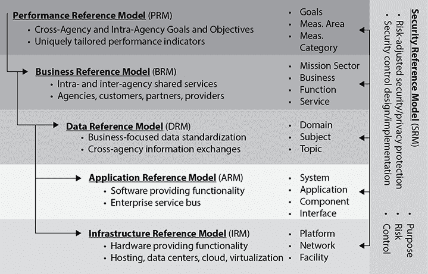
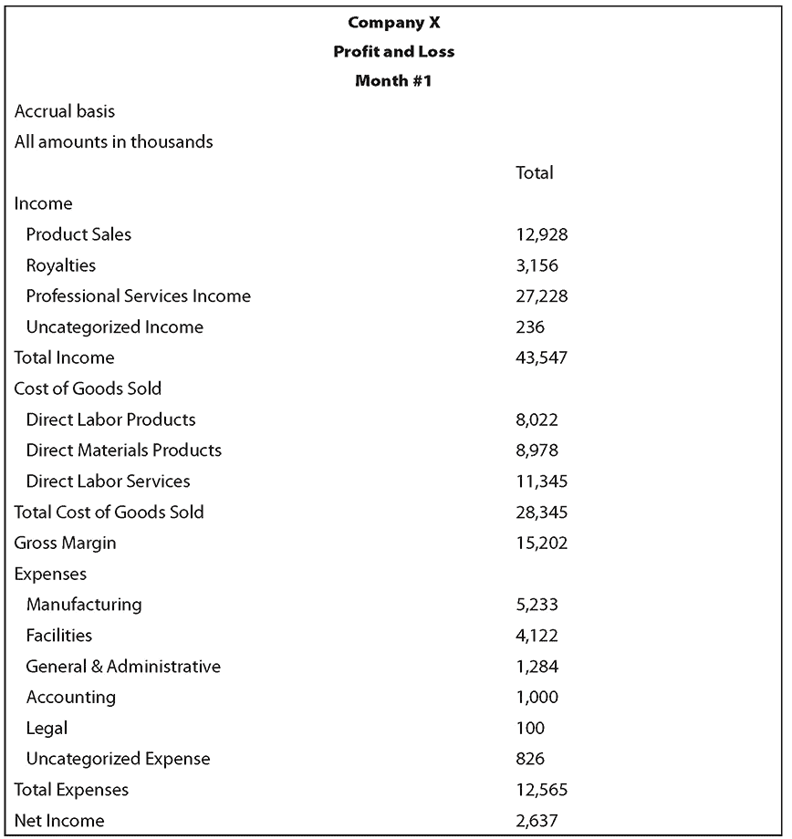
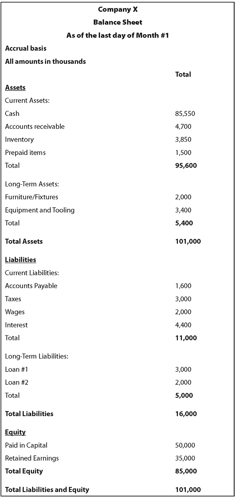
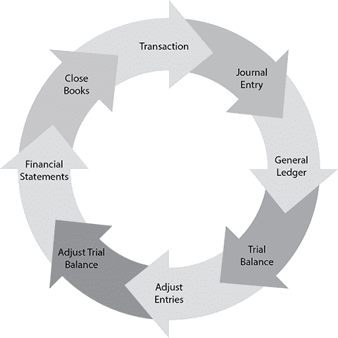
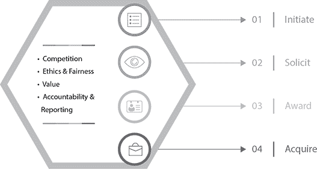
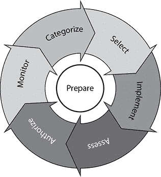

# 第 5 章：战略规划、财务、采购和供应商管理

本章讨论以下主题：

- 战略规划
- 做出安全决策
- 财务管理
- 采购和供应商管理

本章讨论管理信息安全计划的重要方面。前两节“战略规划”和“做出安全决策”探讨了 CISO 如何根据业务驱动因素规划和确定安全活动的优先级。第三节“财务管理”提供了每个 CISO 都应了解的会计和财务管理基本信息。最后一节“采购和供应商管理”描述了采购的基本概念，并提出了一个模型，说明 CISO 如何应对向组织提供产品或服务的第三方供应商带来的风险。

### 战略规划

# 战略规划

前几章讨论了作为组织信息安全计划一部分可以开展的无数活动。这些活动包括工作流（或子计划）、安全项目，以及应对威胁、外部和内部驱动因素以及合规要求的核心能力。但组织如何知道该做什么、何时做、投入多少资源以及什么优先级最高？其中一些决策可借助第 1 章中讨论的风险管理活动中的风险分析部分来辅助。但风险分析只是解决方案的一部分，因为它只针对特定资产，并不涉及组织的业务战略。为了确定如何执行安全计划、确定安全活动的优先级，并为实现安全目标建立路线图，*战略规划*是一个有用的工具。

战略规划帮助组织了解什么最重要，从而确定何时做什么以及应用什么资源。你无法*面面俱到*，所以你必须确定优先级。组织的文化和工作氛围应按领导层期望的方式塑造；不能听之任之。这些问题通过精心设计并有效实施的战略规划来解决。

整个组织的战略规划由组织领导层执行。CISO 很可能是制定组织战略规划团队的一员。*安全战略规划*是组织战略规划的一个子集。

本节讨论以下主题：

- 组织战略规划
- 组织战略规划团队
- 战略规划流程
- 安全战略规划示例

## 组织战略规划

组织战略规划是一种描述*战略是什么*并为*如何实施*制定计划的规划。战略通常通过定义在特定时间框架内要实现的目标来表达。实施通常通过列出组织为实现每个目标将采取的行动来表达。当然，这只是战略规划的一种类型，但它是最常见的，也是本书讨论的方法。

战略规划首先涉及定义组织的战略。组织通常使用愿景和/或使命声明在非常高的层面上定义战略，这些声明描述了组织希望成为什么样子，以及战略目标，有时还包括组织希望传达的核心价值观识别。然后，针对每个目标，组织制定实现该目标的计划，有时定义资金来源、工作时间表，以及如何衡量和确定成功。图 5-1 展示了一个战略规划模板，显示了构成该规划的各种要素。

对于遵循图 5-1 所示方法的组织，战略规划按以下方式进行：

**图 5-1** 典型战略规划模板

1. **创建愿景声明。**
2. **创建使命声明。**
3. **定义核心价值观。**
4. **创建可衡量的目标。**
5. **制定实现各目标的行动。**
6. **实施行动并衡量进度。**
7. **维护和更新规划。**

### 创建愿景声明

组织创建愿景声明，以向他人传达组织如何看待自己以及希望世界如何看待它。愿景声明可以是富有远见的、令人向往的、有时是乌托邦式的，甚至是浪漫的。以下是一些愿景声明示例：

- 电信公司：“让每张桌面、每个口袋都有一部电话。”
- 艺术用品公司：“激励并助力世界各地的艺术家。”
- 在线零售商：“成为访问量最大、利润最高的在线购物网站。”
- 烹饪学校：“我们的愿景是为美洲提供最好的烹饪教育体验。”

有些人用愿景声明描述组织的未来状态，而用使命声明描述当前状态。这两种声明都描述了组织的宗旨，这是向员工、客户和其他利益相关者（如股东或投资者）传达组织战略的重要第一步。

### 创建使命声明

愿景声明是鼓舞人心的信息，而使命声明则定义了组织是什么、为什么重要、解决什么问题以及为谁解决。使命声明为组织希望实现的具体目标奠定了基础。上一节列出的虚构公司可能有以下使命声明：

- 电信公司：“通过提供创新的通信产品和服务，连接人与企业。”
- 艺术用品公司：“我们为艺术家和工匠提供所需工具，助其创作经久不衰的作品。”
- 在线零售商：“利用电子货币推广、支持并创新在线零售。”
- 烹饪学校：“提供协作学习产品，让餐饮从业人员通过与他人合作体验烹饪成功。”

对照这些使命声明和相应的愿景声明进行审视，可以发现使命声明如何开始揭示各组织的战略。电信公司将自己视为产品和服务创新者。艺术用品公司制造的工具不仅面向艺术家，也面向工匠，这些工具专门支持创作经久不衰的艺术品。在线零售商专注于使用加密货币和相关技术。烹饪学校提供学习产品，让学生能与其他学生协作。

如图所示，愿景和使命声明从高层或战略角度传达了组织将做什么以及如何做。许多组织将愿景和使命声明合二为一，但也有同样多的组织分别定义和表达它们。

### 定义核心价值观

核心价值观是组织希望培养和提倡的员工特质。组织想要什么样的人？领导者还是追随者？创新者还是模仿者？外向者还是内向者？个人诚信重要吗？组织可以通过定义想要的核心价值观，然后实施计划来招聘、雇佣和培养这类人和行为，从而创建和塑造其文化和工作场所。反之，如果组织不专门定义和传达其核心价值观，那么组织拥有什么样的人以及由此产生的工作场所文化就只能听之任之了。

以下是软件工程公司可能拥有的核心价值观列表：

- 进取心
- 创造力
- 好奇心
- 诚信
- 适应力
- 谦逊
- 责任感

在某些战略规划中，核心价值观会通过详细描述进一步定义。随后，核心价值观被用于整个组织，以推动人力资源政策、招聘决策、职业阶梯、职位描述、绩效考核、工作场所文化、员工奖励计划，甚至员工聚会和社交活动的性质等事项。

### 创建可衡量的目标

战略规划通常是为了覆盖特定时间段而制定的。大多数战略规划覆盖三到五年的时期。少于三年的时间段往往不够前瞻，而超过五年的时间段可能不切实际，因为事物（政治环境、技术、法律等）会发生变化。针对相关时期，战略规划会明确目标。正是这些目标通过表达什么最重要来定义组织的方向。通常组织会定义少量目标。目标太少可能缺乏足够的清晰度来定义方向；目标太多可能会稀释最重要的内容。

例如，前几节介绍的假设电信产品公司可能将其三年目标定义如下：

- 目标 #1：开发智能手机产品线
- 目标 #2：建立年产 100 万部手机的制造能力
- 目标 #3：成为公认的智能手机生物识别技术世界领导者
- 目标 #4：实现 100% 用户自助服务

这家公司想做什么、认为什么重要非常清晰。它为想要设计的内容（#1）、制造能力（#2）、创新与市场开拓（#3）以及如何向客户提供支持（#4）定义了目标。有时未列为目标的内容与列为目标的内容同样重要。请注意，没有关于效率或成本节约的目标。显然，领导层决定在公司生命周期的这个阶段，效率和节约成本并不那么重要。

每个目标都必须是必要的、可实现的和可验证的，这至关重要：

- **必要** 如果目标对组织不是必要的，就不应将其定义为目标。目标应是组织取得成功的关键要素。
- **可实现** 组织应有合理的预期能够实现该目标，尽管目标往往具有愿景性，即相信组织有能力实现目标，即使具体实现手段尚未确立。目标可以极具雄心，仍被视为可实现。
- **可验证** 目标的定义应使其能够衡量每个目标是否已达成以及取得了何种进展。

### 制定实现各目标的行动

通常目标通过子目标或具体目标进一步细化。例如，为实现电信公司的*目标 #1，开发智能手机产品线*，团队会定义需要达成的具体目标，如下所示：

- 开展市场分析
- 制定需求
- 创建最小可行性产品
- 创建并发布商业产品

然后可以对每个具体目标进行规划，明确：

- 需要做什么
- 需要什么资源
- 预算多少资金
- 预期成果是什么
- 如何监控进度
- 如何衡量具体目标的成功

完成每个目标的这一步骤后，组织已定义其愿景、使命和价值观，设定了实现它们的目标，并制定了满足每个目标所需各项活动的计划。下一步是将计划付诸行动。

### 实施行动并衡量进度

具体目标本质上是各个小组和部门履行职责的行动指令。理想情况下，战略规划由由组织所有主要部门负责人组成的团队制定。例如，如果战略规划中定义了制造目标，则应由制造部门负责人参与定义。关键领导者的参与有助于确保计划各部分及整体计划的可实现性和可行性。

战略规划的实施由组织领导层管理，通常由 CEO、COO、总经理或总裁负责。计划的实施遵循 第 3 章 中讨论的项目与计划管理的一般原则。

### 维护和更新计划

组织制定战略规划后，应按周期性计划更新规划，但也可能因外部或内部事件而需要更新或变更。

最常见的情况是组织成立时制定战略规划，然后定期更新。如果战略规划覆盖五年期，组织应在五年结束时准备好另一份可实施的规划。然而，大多数组织不会等到五年期结束才更新规划。更常见的是，组织每年重新审视规划，并根据实际发生的事件和业务经历的变化对其进行修改。敏捷组织能够坚持规划的主题，但随时适应现实因素。

偶尔，甚至对某些组织而言经常，战略规划需要因外部或内部事件而更新。可能驱动战略规划大幅重写的外部因素包括影响业务的新法律法规、竞争对手创新或产品的出现、技术或制造领域的新发展，甚至社会、经济或政治变化（如大流行病）。可能促使组织调整规划的内部因素包括关键项目的成本或进度超支、收购与合并、内部重组、内部新技术和方法的开发。

当然，新威胁的出现也可能导致组织更改战略规划，要么为了保护业务免受威胁，要么为了提供缓解威胁的服务或产品。

### 组织战略规划团队

组织战略规划的制定通常由 CEO 领导的团队执行。工作在数周或数月内通过一系列协作头脑风暴会议完成，涉及整个团队或分工负责规划部分的小组。团队构成至关重要。拥有合适的人员是制定真正反映集体战略、且包含必要、可实现、可验证目标的计划的关键。最佳团队由全组织各层面的代表组成，包含以下成员：

- **CEO** 当 CEO 担任规划团队负责人时，能制定出最佳战略规划，因为根据定义，CEO 对组织的成功负最终责任。然而，很多时候该工作由*战略规划经理*领导或委托其负责，协助 CEO 进行协调和战术活动，以推动流程并确保其成功完成。
- **其他 C 级高管** 组织的所有 C 级高管都应参与，因为每个人负责的领域都反映在规划中，且每个人都为针对目标的行动执行做出贡献。例如，因为所有活动都有财务成分，CFO 应参与规划制定。
- **关键经理、主管和员工** 每个组织都有核心骨干员工，他们虽非 C 级高管，但因其经验、洞察力和才能，应纳入战略规划计划中。
- **专家和利益相关者** 外部顾问、主题专家、顾问或董事会成员常参与战略规划，因为他们能提供特殊的见解、经验或专业知识。

## CISO 在组织战略规划中的角色

- **外部协调者** 组织通常会聘请专门从事战略规划的顾问或公司来指导他们完成整个过程。这些公司能提供价值，但像任何顾问一样，应根据强有力的推荐信和口碑来选择。作为安全顾问，我们见过组织因外部协调者不力而浪费时间精力，最终制定出令人失望的战略规划。

作为 C 级高管，CISO 可能会与其他领导一起参与组织的战略规划。CISO 应从以下几个视角切入这一角色：

- **愿景与使命宣言** 愿景和使命宣言不仅仅是 CEO、CMO 和 CTO 来定义的。是否应将安全视角纳入组织的顶层视野？以之前讨论的电信公司为例，让客户知道他们的通信是私密且安全的，难道不重要吗？CISO 应将安全、隐私和保障引入关于组织正确愿景与使命的讨论中。

- **核心价值观** 既然核心价值观塑造了职场文化和员工特质，CISO 理应在其定义中拥有话语权。CISO 希望在安全团队中看到哪些核心价值观？或许更重要的是，哪些核心价值观能让全体员工更具安全意识、更能抵御社会工程学攻击、并能更好地与组织其他部门在安全计划上协作？

- **目标、目的与行动计划** 可能存在直接影响安全的特定组织目标。例如，许多组织将遵守 HIPAA、SOX 或 PCI DSS 等法规定义为其主要组织目标之一，前提是合规对业务成功至关重要。CISO 有助于塑造这一定义。但即使安全不是主要目标之一，它也可能与某些目的和行动计划相关。正如安全应内嵌于系统/软件工程流程中（如第 4 章所述），安全也必须内嵌于组织的所有运营中。因此，确立目标、目的和行动计划是定义安全战略规划的第一步，将在本节后面详述。

## 战略规划流程

制定战略规划的过程在很大程度上是一项头脑风暴练习。大多数组织都有自己进行头脑风暴活动的方式。第 1 章 中介绍的用于风险分析头脑风暴的方法（SWIFT、德尔菲法、蝴蝶结模型、决策树）均可应用于战略规划。此外，我们见过组织使用 IDEO (`www.ideo.com`) 设计思维方法进行战略规划并取得巨大成功。我们不规定或背书任何特定流程，但建议流程应包含以下基本要素：

- **让合适的人到场** 组织里是否有爱抱怨的人？最好让他们作为参与者加入，使他们成为解决方案的一部分，而不仅仅是抱怨。现实是，战略规划的质量完全取决于制定它的人。让所有合适的人到场。不仅应有关键管理者，还应有能提供真实业务洞察的关键员工。

- **选择成熟的模型和协调者** 战略规划团队不应在制定规划时还要浪费时间摸索规划流程。这就是为什么使用拥有成熟可靠流程的协调者会有益处。协调者通常拥有经过验证行之有效的辅助模板。外部协调者很棒——只要查证他们的推荐信即可。

- **制定时间表并严格执行** 战略规划过程非常耗时，且可能有点枯燥乏味。我们见过团队因所需时间过长而失去动力和专注，这会干扰团队成员的日常工作职责。规划过程必须严加管理。制定时间表并坚持执行。时间表松散的团队通常会制定出松散的计划。

## 安全战略规划示例

战略规划是定义复杂组织方向的绝佳方式。大型组织内的各个小组也能从中受益。CISO 不仅可能参与组织的战略规划，还可能制定信息安全战略规划。许多安全组织或部门都有自己的信息安全战略规划。前文讨论的组织战略规划的所有特征和活动均适用于信息安全战略规划：

1.  制定愿景宣言。
2.  制定使命宣言。
3.  定义核心价值观。
4.  制定可衡量的目标和目的。
5.  制定实现各目标的行动。
6.  实施行动并衡量进度。
7.  维护和更新规划。

为便于说明，假设这家假设的电信公司为三年期制定了一份信息安全战略规划。以下是该三年期的示例目标、目的和行动计划：

1.  **身份识别：将生物识别技术融入智能手机产品**
    - 选择核心技术
    - 开展研究
    - 建立评估实验室
    - 进行权衡分析
    - 开发能力
    - 构建并评估最小可行性产品
    - 过渡到产品
    - 持续支持
    - 进行可用性测试
    - 选择可用性合作伙伴/供应商
    - 执行测试并将结果融入产品

2.  **人员配备：确保安全团队具备足够的知识、技能和能力**
    - 制定并实施人员配备方案
    - 招聘安全人员配备经理
    - 制定人员配备流程和程序
    - 制定并实施职业发展阶梯
    - 聘请职业发展阶梯咨询公司
    - 组建职业发展阶梯团队
    - 为员工提供安全培训
    - 开发内部安全基础和安全运营课程
    - 部署学习管理系统
    - 持续的员工培训、测试和改进

3.  **影响领导层：增强领导层做出安全决策的能力**
    - 与企业领导共享威胁情报
    - 选择威胁来源
    - 为领导层构建并部署威胁情报源
    - 与企业领导协作
    - 建立内部安全领导力中心
    - 提供持续指导
    - 支持促进安全意识的项目

对于每项行动，CISO 和安全团队均可定义可衡量的目标，用于监控和跟踪绩效与成功。此外，可对每项行动进行范围界定，以确定所需资源。资源估算包括人员配备、硬件、软件和需采购的外部服务。随后可编制成本估算，以确定支持这些活动的预算。在实践中，战略规划的一个关键用途是为安全组织确立预算。通过将安全预算与战略规划挂钩，支出可分配给组织认为最重要的活动，并可确立支出优先级。

## 制定安全决策

战略规划使 CISO 能够基于业务目标做出安全决策。然而，安全计划的其他特性可能并非由组织的战略目标驱动（例如，组织制造流程的某些方面可能对安全很重要，但未反映在战略计划中）。为了做出明智的决策，CISO 必须遵循一个流程，以建立组织业务目标与安全决策之间的联系。这种联系通常通过解读 `security business drivers` 来实现。

理解、解读和转化 `security business drivers` 使 CISO 能够就安全计划的各个方面做出重要决策，包括：

- 安全目标、目的和计划
- 安全策略、标准、程序和指南
- 安全架构（包括人员、流程和技术）
- 安全控制

`Security business drivers` 是对安全产生影响的业务特性。CISO 用于将安全业务驱动因素转化为安全计划实施的流程取决于组织。方法多种多样，从更多基于交谈或直觉的非正式方法，到利用框架或流程的正式方法。

一些组织采用基于非正式评估或“直觉”的 `informal approach`。这些活动可能只是随意的交谈或信息分享会议，可能不会产生展示决策是如何形成的具体工件。决策也可能表现为高级管理层关于优先事项或关注重点的授权或指令。CISO 也可能对组织进行非正式评估，考虑合规或财务等不同的组织视角。

其他组织遵循使用正式流程、行业框架或模型、风险管理练习或企业架构模型的 `structured approach`。这些严格的流程通常会产生用于证明关键决策合理性的工件，例如风险评估文档、电子表格、架构图和其他文档。这些工件可用于证明 CISO 尽到了应有的职责。

## 企业架构

将安全业务驱动因素转化为安全决策的一种方法是遵循框架以生成企业信息安全架构（EISA）。`Enterprise architecture`（`EA`）是绘制和记录企业架构的实践，旨在协助决策者将组织战略围绕业务的人员、流程和技术进行对齐。EISA 只是将 EA 方法应用于安全计划。CISO 可以使用 EA 模型来分解和记录信息安全计划架构，以及它如何从高层 `business architecture` 视角（如组织结构图）一直到低层 `technical architecture` 流程（如数据流图或网络架构图）与企业相关联。目标是确保这些组件（如安全软件、硬件、解决方案、技术、项目、流程和运营）与组织的企业架构、战略和业务驱动因素保持一致并集成。这允许围绕解决方案和技术进行主动决策，以实现效率和一致性。

组织的企业架构通常可以分为子架构，如业务、信息、应用和技术架构，信息安全组件和影响贯穿这些层，如 Figure 5-2 所示。EA 本质上是一个用于架构分析的概念框架，包含在企业不同层面发生的文档记录和绘图练习。

**Figure 5-2** 通用企业架构层

- **Business architecture** 业务架构：驱动信息架构的组织业务战略、目标、治理和目的。
- **Information architecture** 信息架构：也称为数据架构，描述组织信息资产的结构、流程和存储架构。该层的需求规定了应用架构。
- **Application architecture** 应用架构：也称为信息系统架构，提供业务应用和服务的设计。这些由技术架构支持。
- **Technical architecture** 技术架构：支持业务应用和服务的 IT 基础设施，如硬件、软件和网络。

EA 有许多方法，组织可能会使用标准框架，如 Zachman 框架、联邦企业架构框架 (FEAF)、Sherwood 应用业务安全架构 (SABSA) 和 The Open Group 架构框架 (TOGAF)。

### Zachman

Zachman 框架是由 John Zachman 开发的用于企业架构开发的模型。它不是一种方法论，因为它不规定要使用的特定流程。相反，它提供了一个模式，可用于通过创建特定工件（如清单列表、设计文档、流程列表、数据流图和其他文档）来围绕特定功能、要素和流程定义和记录组织的企业架构。

该模型由分类名称（What、How、Where、Who、When 和 Why）与受众视角（Executive、Business Management、Architect、Engineer、Technician 和 Enterprise）相交形成的矩阵组成。这通过回答分类名称中概述的问题，允许记录和整合组织不同的企业观点和视角。例如，高管团队（业务背景）对企业的看法将不同于技术人员（业务组件实施者）。记录这些视角有助于实现企业架构的集成和整体方法。框架的一个简化实例如 Table 5-1 所示。请记住，EA 本质上是记录和绘制企业架构的练习。Table 5-1 中的 Zachman 模式本质上是所有应记录或绘制的工件的列表，以及它们如何与企业架构的各种视角相关联。

**Table 5-1** Zachman 框架示例

虽然 Zachman 框架并非专门为信息安全而构建，但这些问题大多具有潜在的安全含义。此外，它是一个通用模型，可应用于多种类型的企业架构并进行定制，包括 EISA。

### FEAF

`Federal Enterprise Architecture Framework (FEAF)` 是由联邦 CIO 委员会开发的企业架构框架，旨在响应 1996 年 Clinger-Cohen 法案中概述的要求，该法案要求美国政府分支机构开发和维护企业架构框架。目标是帮助联邦机构利用通用语言分析其企业架构投资，并确定“良好”的标准。该框架由六个参考模型组成，如 Figure 5-3 中的 FEAF Version 2 Consolidated Reference Model (CRM) 所示，描述了这些架构域：

**Figure 5-3** 联邦企业架构框架版本 2 综合参考模型  

(Source: [`obamawhitehouse.archives.gov/sites/default/files/omb/assets/egov_docs/fea_v2.pdf`](https://obamawhitehouse.archives.gov/sites/default/files/omb/assets/egov_docs/fea_v2.pdf))

- Performance（绩效）
- Business（业务）
- Data（数据）
- Application（应用）

# 企业安全架构框架

## FEAF（联邦企业架构框架）

- 基础设施
- 安全

类似于本节前面讨论的架构层（业务、信息、应用和技术），FEAF 中的每一层都会向下一层驱动并规定需求，且贯穿安全含义（由安全参考模型指示）。

## SABSA

**Sherwood 应用商业安全架构 (SABSA)** 框架是开发企业信息安全架构的模型和方法论。就框架模型的结构而言，它类似于 Zachman 框架（如表 5-1 所示），但 SABSA 也是一种方法论，这意味着它包含构建和维护 EISA 的过程和生命周期指导。SABSA 框架将概念和需求从高层视角（Contextual）分解到低层技术和应用（Component），并覆盖管理架构。其目标是消除抽象、增加颗粒度定义，并建立在其他架构层级的概念之上。

## TOGAF

**开放组架构框架 (TOGAF)** 是基于美国国防部技术架构框架信息管理（TAFIM）的企业架构框架。TOGAF 使用 **TOGAF 架构开发方法 (ADM)** 提供了一个过程生命周期方法论，用于设计、实施和治理企业架构。图 5-4 提供了基于 TOGAF ADM 的架构开发周期示意图。该过程是迭代的，侧重于需求和目标。这从生命周期的每个阶段都包含需求和目标检查这一事实中可见一斑。

**图 5-4** 架构开发周期示例

## 架构成熟度模型：能力成熟度模型集成

**能力成熟度模型集成 (CMMI)** 是工程界的一个过程改进概念，包含一系列技术，用作框架以允许对组织过程和实践进行受控的增量改进。CMMI 由卡内基梅隆大学软件工程研究所（SEI）开发，是 **能力成熟度模型 (CMM)** 的升级版。CMMI 最初旨在使软件开发过程成熟，但已被用于许多不同目的，包括衡量和成熟企业架构、系统工程、安全计划、控制、风险管理（如第 1 章所述）以及其他组织过程开发实践。

CMMI 规定了五个成熟度级别（初始级、已管理级/可重复级、已定义级、量化管理级和优化级），代表过程性能的不同演化阶段。这些级别的分类取决于组织过程的成熟度及其质量保证实践。组织可以使用 CMMI 开发结构化步骤，通过持续改进其过程，从一个成熟度级别演进到下一个级别。这在图 5-5 中有说明。

- **初始级（CMM Level 1）**：过程是被动的、无序的和混乱的。在此级别，过程仅靠个人的非凡表现才能生存。这使得过程环境更加不稳定。成功不太可能在此级别重复。
- **已管理级（CMMI Level 2）**，也称为 **可重复级**：过程按计划执行，因此成功是可重复的。但是，未定义正式过程模型。
- **已定义级（CMMI Level 3）**：组织能够生产或采用标准和过程。这种标准化只有在专注于过程定义后才可能实现。
- **量化管理级（CMMI Level 4）**：组织能够监控和控制自己的过程。此级别允许管理层指出调整过程的方法，使其没有显著的质量损失或偏离规格。这是通过数据驱动的过程管理和改进实现的。
- **优化级（CMMI Level 5）**：组织专注于通过优化持续改进过程性能。过程改进被度量和评估。持续过程改进是该级别的关键目标，允许敏捷性和创新。

**图 5-5** CMMI

# CISO 财务管理

CISO 是业务领导者，任何业务成功的记分卡都是资金。这就是为什么 CISO 不仅应具备良好的领导力和技术技能，还应对商业会计和财务基础有深刻掌握。CISO 需要能够用财务语言与组织中的所有其他领导者交流。每个 CISO 都应知道如何阅读资产负债表和利润表，并掌握资本支出和运营支出等关键概念。此外，CISO 必须能够管理安全部门的财务，其年度预算可能达数千万美元或更多。本节概述了与 CISO 相关的财务管理概念和术语：

- 会计与财务基础
- 会计系统
- 关键概念与术语
- 利润表
- 资产负债表
- 资本支出与运营支出
- 会计循环
- 信息安全年度预算

## 会计与财务基础

组织的安全职能是一项财务投资。CISO 必须能够向组织的其他部门证明每一美元安全支出的合理性。CISO 必须能够与其他 C-level 领导者一起为组织的财务成功做出贡献。正如 CIO 必须能够证明 IT 支出为组织带来价值一样，CISO 也必须能够证明安全投资的价值。本节探讨会计系统、交易和财务报告的概念，这些都是 CISO 财务理解的基础。

### 会计系统

会计系统是组织用于收集、存储和处理财务信息的一组资源和业务流程。组织会计系统通常包括数据处理系统，结合遵循 **公认会计准则 (GAAP)** 的会计政策和程序使用。GAAP 由 **财务会计准则委员会 (FASB)** 制定，确立了会计实践标准。在国际上，**国际财务报告准则 (IFRS)** 自 2001 年起生效。IFRS 在全球 110 多个国家广泛使用。然而，本讨论的重点是 GAAP 在美国的应用。

US GAAP 包含十项核心原则：

1. **规律性原则**  
   这是会计师应定期遵守 GAAP 并将其视为标准的概念。

2. **一致性原则**  
   这一原则要求在整个报告过程中一致应用相同的标准。这确保了报告在不同期间的一致性。

3. **真诚性原则**  
   这一原则要求会计师追求准确性和公正性。

4. **方法永久性原则**  
   类似于一致性原则，这一原则旨在确保过程在整个过程中一致使用。

### 5. 不抵销原则
财务报告应准确无误，不考虑补偿因素。换句话说，会计人员不应期望因提供更准确的报告而获得更多报酬。显然，在会计行业，“一分钱一分货”的概念不应发挥作用。

### 6. 谨慎性原则
这一概念要求报告应保守。例如，收入应基于事实而非投机。收入不应高估，费用不应低估。

### 7. 持续经营原则
这一概念假定企业将继续经营。这在考虑资产价值时很重要。如果企业不再持续经营，可能意味着某些资产将毫无价值，如果它们在未来没有价值，现在也不应有价值。因此，所有报告中都应假定企业持续经营。

### 8. 会计分期原则
这一概念要求分录应分配或分摊到适当的时间段。例如，如果销售发生在 6 月，收入应记录为发生在 6 月，而非 7 月。

### 9. 重要性原则
会计人员应力求准确呈现*相关*财务信息。

### 10. 最大诚信原则
源自拉丁语“Uberrimae Fidei”，意指企业在所有交易中应诚实守信。

## 关键概念与术语
每位 CISO 都应了解一些关键会计术语和概念。首先是*账户*的概念。账户是用于分类和存储交易数据的记录。每个企业都有一个*科目表*，即用于存储资产、负债、收入、费用和所有者权益的账户列表。资金通过*交易*借记和贷记到账户，交易记录在会计系统的*总账*中。

另一个关键概念是*报告*。报告是会计的沟通层面。它涉及向利益相关方传达企业信息。以下是组织财务报表中发现的两种主要报告形式：

- **利润表** 利润表（也称为损益表或 P&L 表）是组织在一段时间内*财务活动*的摘要。它列出了报告期内的所有交易，包括收入、费用以及任何利润或亏损。
- **资产负债表** 资产负债表是组织在特定时间点*财务状况*的快照。它列出了组织资产的价值（拥有什么）、负债的价值（欠什么）以及净值（资产与负债的差额）。

## 利润表
利润表通常包含两个部分：

- **收入** 因销售商品或提供服务而产生的营收和向客户开具的账单金额
- **费用** 组织为资产或服务所发生的成本

图 5-6 展示了一个简单利润表示例。

**图 5-6** 利润表示例

在图 5-6 的示例中，该组织在第 1 个月的营收为 4300 万美元，主要由产品销售、服务和特许权使用费组成。该组织还有未分类收入，即不属于其他类别（或类别尚未确定）但仍可确认的收入。

*销货成本*（或*销售成本*）是指与商品销售（或收入实现）直接相关的劳动力、材料或其他项目的成本。例如，如果公司制造并销售零件，零件销售收入归类为收入，制造零件的成本归类为销货成本。用收入减去销货成本，可得出组织销售的*毛利*（或*毛利润*）。这是公司在扣除运营成本前从销售零件中赚取的金额。在示例中，该组织第 1 月的毛利率为 35%（通过毛利除以收入计算），这大致符合典型公司的运营水平。

示例利润表中显示的费用是除销货成本外组织运营所发生的成本。费用可能包括租金、间接人员工资（管理、行政、会计和高管人员）、法律费用等。用毛利减去费用，得出组织的净收入或净利润。

## 资产负债表
资产负债表通常包含三个部分，报告组织截至特定日期（最常见是会计期末）的财务状况：

- **资产** 资产是组织持有的有价值物品。资产示例包括现金、*应收账款*、设备和家具。
- **负债** 负债是组织欠其他企业或个人的款项。示例包括应付账款、应付工资税和应付贷款。
- **所有者权益** 企业的净值。也称为*所有者权益*或*资本*，权益由投资者投入组织的现金加上未分配给所有者的企业净利润（称为*留存收益*）组成。

图 5-7 展示了一个简单资产负债表示例。

**图 5-7** 资产负债表示例

资产负债表显示了会计期末组织的净值。在该示例中，截至第 1 月最后一天，组织选择按*流动资产*和*长期资产*（组织拥有的价值）对资产进行分类，并对*负债*（公司欠他人的款项）做了相同处理。除了资产，组织的价值还由*所有者权益*决定，即投资于组织的资金量。权益由*实收资本*（股东、合伙人或其他投资者投入组织的金额）和*留存收益*（尚未分配给投资者的净利润累积额）组成。

## 收付实现制与权责发生制
根据销售或费用发生的时间，记录交易有两种方法。*收付实现制*在现金交易时确认销售或费用，而*权责发生制*在销售实现或费用发生时确认。

在权责发生制下，当工作执行完毕或开具发票时，收入视为已实现（无论何时实际从客户处收到款项）。同样，当组织承诺支付资金时，费用视为已发生，通常是在下订单或收到供应商发票时。

权责发生制的优势在于，与收付实现制相比，它能更真实地反映组织的财务绩效。这是因为现金支付往往滞后于导致支付的事件。如果转销商在 3 月购买库存并售出，权责发生制允许公司在 3 月同时确认销售和费用。如果组织使用收付实现制，销售和/或费用可能要等到现金交易时才确认，这可能要几个月后。因此，权责发生制能更好地反映 3 月实际发生的财务绩效。美国上市公司受证券交易委员会 (SEC) 要求必须使用权责发生制，大多数公私企业也如此。一般来说，只有小企业使用收付实现制。

## 资本支出与运营支出

*支出* 是组织花费的资金，可分为两类：*资本支出* 和 *运营支出*。用于企业日常运营的支出属于运营支出 (OPEX)。用于未来或长期收益的支出属于资本支出 (CAPEX)。从会计角度来看，每一类的处理方式不同。运营支出在发生时确认，而资本支出则通过一个称为 *折旧* 的过程在一段时间内确认。

运营支出是在日常业务过程中产生的。运营支出的例子包括软件许可费、办公用品、租金、保险、零星设备、维修保养和法律服务。支出在发生当天确认，采用应计制会计（购买物品或履行服务时记录交易）或现金制会计（现金易手时记录交易）均可。

资本支出（或支付）是组织为未来收益进行的投资。资本支出的例子包括设备、设施、建筑、车辆、知识产权和其他资产。与运营支出在购置时一次性确认不同，资本支出则在与物品使用寿命相对应的一段时间内确认。例如，一台机器可能有十年的使用寿命；因此，该物品的成本可以分摊到这十年期间。

随时间确认资产价值（如上一段提到的机器）称为 *折旧*。折旧的目的是将资产成本与其产生的收入相匹配。这称为会计的 *配比原则*。例如，这台机器可能被公司用来生产商品长达十年。每年机器都产生收入，因此在购买时一次性确认机器的所有购置成本是不合理的。相反，成本分摊到机器的使用寿命内。每个组织都有一套关于如何折旧不同类型资产的门槛标准。CISO 应与 CFO 合作，确保安全资产得到适当分类，并根据资产性质及任何适用的监管指南（如美国国税局规则）使用资产的适当使用寿命。

计算和分摊折旧有多种方法，包括：

- **`Straight-line`（直线法）** 资产价值除以期数（年或月），每期分摊相同金额。
- **`Sum of years`（年数总和法）** 由于某些资产在使用早期价值较大，此法允许早期分摊较多费用，后期较少。例如，若资产使用寿命为五年，“年数总和”为 5+4+3+2+1=15。则每年折旧额为：
  - 第 1 年 = 资产价值的 5/15
  - 第 2 年 = 资产价值的 4/15
  - 第 3 年 = 资产价值的 3/15
  - 第 4 年 = 资产价值的 2/15
  - 第 5 年 = 资产价值的 1/15
- **`Units of production`（产量法）** 此法允许组织根据资产实际使用情况调整折旧；例如，基于资产使用小时数或其生产的产量单位。例如，假设一台价值 1000 万美元的机器在其使用寿命内可生产 100 万件小工具。平均每件成本 10 美元（1000 万 ÷ 100 万 = 10）。如果第 1 年生产 5 万件，则第 1 年折旧额为 5 万 × 10 美元 = 50 万美元。

理解并协助管理 OPEX 和 CAPEX 是 CISO 工作的重要组成部分。CISO 应与 CFO 合作，确保对特定资产使用适当的折旧计划和方法。例如，如果一个新的 GRC 系统成本为 10 万美元，预计使用寿命十年，报废无残值，CISO 应确保 CFO 实施的折旧计划得当，且 CISO 制定的预算考虑了该资产的正确折旧。

## 会计循环

*会计循环* 是财务/会计人员遵循的工作流，用于实施财务管理。该循环实施了创建、组织和记录组织财务交易的过程。会计循环在 *会计期间* 内实施。*会计期间* 指组织财务报表所涵盖的任何时间段。通常组织设立年度会计期间，通常对应组织的财政年度，并划分为更小的会计月度期间。以下是企业和其他组织使用的会计期间示例：

- 1 月 1 日至 12 月 31 日的日历年
- 公司财政年度，如 10 月 1 日至 9 月 31 日（此法常见于美国联邦政府机构或联邦承包商）
- 连续的 52 周或 53 周期间
- 与组织会计年度对齐的日历月
- 采用 4-4-5 周轮换时间表的财政月（每月开始和结束于同一星期几，持续四周或五周）

**注意** 使用 4-4-5 周会计日历会导致年底剩余几天。这些天通常直接加到财政年的最后一周。

无论组织使用日历月还是财政月，每个月的会计循环都包含相同的一组活动。图 5-8 展示了会计循环示意图。

**图 5-8** 会计循环

以下是典型月度会计循环的分步描述：

1. **交易** 财务交易是指涉及资金流入或流出组织，或组织会计系统内部账户间资金往来的任何活动。交易包括采购、费用、租金、收入、特许权使用费——任何资金从一个账户转移到另一个账户。
2. **分录** 交易最初记录为 *分录*。每个组织都有 *日记账*（有时称为 *原始记录簿*），即从财政年度或会计期间开始的所有交易的按时间顺序列表。
3. **总账** 交易随后过账到总账，指明其适用的账户。账户在总账中维护，总账也称为 *最终记录簿*。
4. **试算平衡表** 试算平衡表是对所有借方和贷方的核对，以确保它们平衡。它是一项准确性检查，确保日记账和总账分录正确。
5. **调整分录** 通常会计师使用工作底稿进行调整并测试，然后再在账簿中更正。
6. **调整后试算平衡表** 验证工作底稿中的调整后，对账簿进行最终调整，并编制最终试算平衡表，证明借贷平衡。
7. **财务报表** 财务报表是显示近期会计活动摘要和组织当前财务状况的报告。财务报表以利润表（也称 *损益表* 或 *P&L 表*）、资产负债表和现金流量表的形式呈现。

## 8. 结账

会计循环的最后一步是对会计期间*结账*。一旦期间结账，就不能再录入适用于该期间的其他分录。任何调整或更正必须在后续期间进行。

会计循环存在许多变体，但它们始终遵循相同的总体顺序：录入分录以记录交易、检查分录并进行调整、编制财务报表以及结账。此循环每月重复一次。

## 信息安全年度预算

每年，CISO（首席信息安全官）都会制定一份计划，明确组织将在 CISO 负责的安全计划上投入多少资金。随后，CISO 会遵循该计划执行。该流程在第 3 章中有概述。在此，我们回顾一些制定和管理安全预算的策略：

### 1. 从战略规划入手

编制年度信息安全预算通常从战略规划开始。该规划阐述了目标和行动计划，随后对其进行估算和预算编制，以便获得资金批准推进活动。战略规划有助于从对业务的价值角度确定活动的优先级，进而有助于确定各项活动的预算。

### 2. 制定并批准财务计划（预算）

信息安全预算几乎总是按年度编制、执行和管理，尽管预算通常也包含长期预测。近期（即本年度）预算应包含足够的细节，以便合理管理每项活动或预算行项目，使其保持在预算目标之内。未来年度的预算细节较少，但有助于管理层关注未来即将发生的支出。估算安全预算有许多方法，此处介绍其中几种：

- **零基预算** 也称为*自下而上预算*，零基预算让每年的预算都从一张白纸开始。估算人员从零起步，遵循工作分解结构（WBS，见第 3 章介绍）逐项向上估算每项活动的成本。从零开始使估算人员能够每年重新审视支出。估算人员不再只是说“我们去年花了 X 美元，所以今年应该花 X 加 Y 美元”，而是逐一审视每个预算行项目，估算其真实成本。零基预算的优势在于，它迫使 CISO 每年审视并重新审视成本，即使是针对同一项目。

- **基准法** 基准法是一种利用上一年支出作为下一年预算起点的方法。如果 CISO 去年花费了 X，那么她理应预期明年花费 X 加减 Y（尤其是因为与上一年支出的对比可能是 CEO 在评估预算申请时首先要求查看的内容）。许多 CISO 会结合使用零基预算来估算新活动，用基准法来估算持续性活动。

- **价值基础（或 ROI）预算** 此方法旨在确定一项活动对业务的价值，以此作为支出多少的指导。此方法可在单个项目层面进行，也可通过审视整个安全项目组合从整体上进行。活动将根据业务价值和组织在该活动上的投资回报率进行审查、估算和论证。例如，新的身份管理系统可能因其降低了已知价值资产遭受身份盗窃攻击的风险而得到论证。资产的价值表明了为保护它合理应花费多少。然而，如果还能证明新身份管理系统相比旧系统降低了身份供给成本，CISO 就可以展示投资回报率，从而有助于论证成本的合理性。

**注意** 许多 CISO 会结合使用零基预算、基准法和价值基础法来编制和论证信息安全预算。

### 3. 批准并监控支出

一旦信息安全预算获批，CISO 会监控支出以确保其与预算一致。第 3 章涵盖了监控安全计划和项目支出的流程。组织通常有某种形式的审批流程，即采购或工时费用需提前批准。CISO 应确保其负责的财务账户支出需要经过其批准。支出由会计财务人员或安全团队内部人员进行跟踪。CISO 或指定的安全经理将实际支出与预算进行对比，以发现超支并根据需要进行调整。

### 4. 编制滚动预测

预算是固定时期内支出的估算。在预算之外，应编制预测并持续更新。预测是对未来支出的预判。与一经批准便不再变更的预算不同，预测着眼未来，基于项目、工作流或子项目的实际情况预测成本。最初（例如年初第一个月），预算等于预测。但过完第一个月后，支出预测可能开始偏离预算。由于预算不变，预测支出的变化将反映在预测中。

### 5. 报告

每月，CISO 或指定经理将实际支出与预算进行对比，并更新预测，以便了解下个月的计划支出，并能向领导层和利益相关者传达支出进展情况，将其与预算及上个月的预测进行对比。

## 给 CISO 的财务建议

许多组织中 CISO 不向 CEO 汇报的一个原因是他们缺乏财务敏锐度。如果 CISO 不能像其他管理者那样参与与领导层的业务讨论，可能无法获得同等的尊重。这可能导致安全得到的关注少于业务的其他方面。在繁忙且高压的商业环境中，如果 CISO 的公信力未建立和维护，安全很容易失去话语权。以下是 CISO 可作为组织财务领导者参与管理的几项举措：

- **达成财务目标** CISO 与其他 C 级高管失去公信力的最快方式就是预算超支。将团队财务管理在预算范围内是顶级管理者的基本和根本职责。预算应精心编制并严加管理，以便在问题产生不利影响前及时规避。CISO 必须展现出控制预算和胜任资金管理的能力。

- **使用正确术语** CISO 在讨论财务话题时应使用正确的财务术语。例如，在与 CFO（首席财务官）讨论权益报告时，CISO 不应提及利润表（因为它不显示权益）。同样，CISO 不应混淆预算和预测等术语，因为它们并不相同。CISO 应熟悉组织使用的术语，并与管理团队的其他成员使用相同的财务语言。

•  学习财务机制：每个组织的运作方式各不相同。CISO 必须了解组织财务和会计机器的**轮子和杠杆**，以便理解业务如何赚钱，使用什么系统和流程，以及安全职能如何融入组织的会计科目表和财务模型的其他方面。

•  构建并使用良好的模型：每位 CISO 都会使用模型和工具来帮助管理团队和财务。CISO 应完善其模型，并与其他领导讨论，以提高财务理解和绩效。CISO 应能够展示其所有数字的来源及确定方式，以确保并向他人证明他们掌握着组织的财务绩效。

•  创造价值：许多 CISO 认为其角色是帮助组织应对风险。这是一个好的视角，但帮助组织为投资者或其他财务利益相关者增加价值又如何呢？这是其他 C 级高管所做的事，那么 CISO 为什么不做呢？CISO 可以通过了解组织的财务驱动因素，并采取行动为组织的财务绩效和成功做出贡献。

•  在安全组织内建立财务意识文化：安全团队的每位成员都应留意如何更高效地工作、节约成本并创造价值。CISO 应提倡节约成本，并鼓励安全团队参与安全财务规划和执行决策。通过培训、沟通和参与，安全团队的财务意识可随时间推移而提高。

## 采购与供应商管理

本节论述 CISO 在从供应商采购商品和服务方面的角色。CISO 应精通组织的采购和供应商管理流程，主要有两个原因。首先，CISO 利用采购流程获取适用于安全计划的商品和服务。例如，安全部门采购新的入侵检测系统或威胁情报服务，需遵循采购流程。其次，组织采购的所有项目都可能具有安全隐患，因为它们可能向企业引入漏洞，或执行具有安全影响的功能。因此，安全部门应参与组织的所有采购活动，就像质量保证、会计或法务部门通常在一定程度上参与采购流程一样。本节涵盖以下主题：

•  采购核心原则与流程
•  合同类型
•  范围协议
•  第三方供应商风险管理

## 采购核心原则与流程

*采购* 是获取商品和服务的过程。这包括寻找来源（供应商）、通过竞争流程选择中标者、商定条款以及开展业务交易。在管理采购时，采购专业人员通常遵循以下基础概念或支柱：

•  **竞争**：通过竞争流程选择所获产品或服务的来源，供应商提交投标，组织选择最符合其需求的中标者。

•  **道德与公平**：开展竞争和选择供应商的过程应公开透明且公平。所有潜在来源都应有平等机会提供产品或服务，不带偏见，在公平的竞争环境中进行。

•  **价值**：该流程应经过优化，以确保采购组织获得最佳价值。根据范围、价格和总拥有成本评估产品和服务报价。通过竞争性方法选择供应商，以便以最低可能成本进行采购。

•  **问责与报告**：该流程应公开，以便接受监控、衡量和报告，向任何及所有利益相关者传达其状态。

图 5-9 展示了采购的基础支柱以及基本采购流程。

**图 5-9** 采购流程

采购流程的基本步骤为启动、征求、授标和获取，尽管业界对步骤数量及其名称并无标准或共识。每个组织实施采购的方式各不相同，因为不存在广泛使用的采购框架。虽然实施方式各异，但以下小节将讨论大多数组织常用的各步骤核心特征。

### 启动

采购流程始于对新项目、项目组或服务的需求或需求集的识别。需求可能像“我们需要一把十字螺丝刀”一样简单，也可能复杂到需要完整的规格说明。在启动步骤中，*请求方*（需要该项目的个人或团队）与潜在供应商接触，以进一步完善需求和/或制定项目的成本估算，这并不罕见。

一旦确定了需求，请求方会对大致成本进行估算，以获得继续采购的批准。成本估算可在内部制定、基于历史数据，或来自供应商。每个组织都有自己的要求，规定成本估算如何编制以及如何呈现给审批流程中的人员。

除了需求和成本估算外，根据组织规则，可能还需要提供采购项目的理由。项目理由说明了请求的原因，如果组织要求支持性文档，可能包括备用材料或附件。

一旦请求方准备好描述需求、理由和成本估算的所需信息，请求将根据组织的审批规则路由给相关人员进行审查和批准。一旦获得批准，采购即可进入下一步。

### 征求

采购获批后，组织的采购小组可向业界发布或公开需求并获取投标。为此，采购小组需要一份潜在供应商名单。一些组织（如美国联邦机构）可能会发布*信息请求 (RFI)* 或*征求来源*请求，询问有意投标的各方表明身份。有时这些请求包含要求，潜在投标人需提交其资质和能力，或回答问卷，以进入投标人名单。组织应尽最大努力进行推广，以吸引能够提供符合组织标准的产品或服务的潜在投标人。

请求方准备提供给投标人的征求文件。这可能像“十字螺丝刀 #2”这样简单的一行文本，也可能是包含规格、工作说明书 (SOW) 和交付物清单的完整征求包。对于系统或服务的采购，以下是可能包含在发送给潜在投标人的征求包中的项目清单：

## 招标包

- **工作说明书 (Statement of work)** 招标包中将包含某种形式的文件，用于定义工作范围，该范围将成为买方和卖方之间合同的主题。这可能采用*工作说明书*的形式，但某些组织使用*绩效工作说明书*或其他文件。SOW 定义了服务范围或所提供产品的描述，以及进度计划、交付清单、假设和约束等支持信息。

- **规格说明书 (Specification)** 对于更复杂的需求，可能会制定规格说明书或需求清单。规格说明书包含对产品或系统需求的描述。当需要开发某项产品（硬件或软件）时，规格说明书最为有用，尽管采购现成产品时规格说明书也很有帮助。

- **合同或条款和条件 (Contract or terms and conditions)** 招标包应包含组织拟使用的建议合同协议草案。合同将成为买方和卖方之间的法律协议，规定了双方为履行卖方的交付要求和买方的付款义务而应遵守的条款、条件和义务。

- **评估和授标标准 (Evaluation and award criteria)** 有时组织会发布其选择竞争性采购获胜者的方法描述。此类描述对投标人有帮助，因为它可以指导他们提出符合组织需求的解决方案。存在多种评估方法，但最常见的有以下几种：

  - **最低价技术合格 (Lowest price technically acceptable, LPTA)** LPTA 仅意味着报价最低的投标人获胜。所有提供满足要求的解决方案（产品或服务）的投标人均具备资格，报价最低者中标。但请注意，标准仅为“技术合格”。在 LPTA 中，不存在比较提案以判断某投标人的解决方案优于或劣于另一投标人的概念。若需进行此类比较，则采用*最佳价值*法。

  - **最佳价值 (Best value)** 最佳价值评估会考量投标人提案*多大程度*地满足要求或评估因素。它允许比较满足要求（或每项要求）的*程度*，并允许将合同授予提供最佳解决方案的投标人，即使该投标人报价不是最低的。许多开发项目采购或复杂产品、系统采购均采用最佳价值标准。

  - **提案提交说明 (Proposal submission instructions)** 招标包应包含投标人准备和提交提案的说明。其目的有二：一是确保每位投标人提供组织选择获胜者所需的基本信息；二是便于比较投标书，因为它们外观相似且包含关于各投标人产品的类似信息。提供清晰的提案编制说明是确保公平竞争环境的一种方式。

招标包将提供给所有潜在投标人，并包含具体的截止日期和时间。这确保所有投标人拥有相同的准备时间，也是确保公平的另一种方式。

## 授标

组织根据预先确定的评估标准评估所有提案。遵循此类标准并确保其始终如一地应用于所有提案至关重要。如果在评估过程中，组织发现需要向部分或所有投标人获取更多信息，可以要求提供补充信息或修订提案。在这种情况下，组织可能会决定发布更新后的 SOW 或其他更正信息，因为组织在招标包中发现错误或缺陷并不罕见。

在与投标人就其提案交换信息期间，组织应遵守以下道德规则：

- *以书面形式交换信息。* 组织应避免向投标人口头发出指示，而应始终以书面形式提供。

- *除非这样做会将一家投标人的专有信息泄露给另一家投标人，否则应向所有投标人提供相同的信息。* 例如，如果某投标人的提案存在缺陷需要更新，该要求不应透露给其他投标人（尽管应记录在案，以便日后必要时审查）。

- *给予所有投标人同等机会。* 例如，如果为某投标人延长了提案截止日期，则应为所有投标人延长。

一旦从投标人处获得所有信息，组织即可完成评估。每份提案的评估结果应记录在案或存入数据库等存储库中。这便于日后审查授标决策的制定过程，且在投标人对授标提出异议或通过法律途径提出抗议时可能至关重要。

使用 LPTA 评估简单物品（如螺丝刀示例）的提案相对直接：确定哪些报价满足标准，比较满足标准者的价格，并选择最低者。然而，对于更复杂的要求或采用最佳价值法的情况，评估过程可能更为严格。此类采购评估可能需要以下步骤：

- 列出每项要求或评估因素
- 基于预定的评估因素评估每项要求
- 为每项要求分配等级或度量值
- 处理所有单项要求评级的结果
- 比较和对比各提案

评级系统可使用数值来评估要求或评估因素的满足程度。例如，一种评级系统可能为：

- 0 – 无数据
- 1 – 不满意
- 2 – 满意
- 3 – 良好
- 4 – 优秀

通过评估每项要求和评估因素，组织可以描绘出提案的全貌，并与其他提案比较以揭示最佳选择。该信息将与价格结合，以确定哪个提案为组织提供最佳价值。

**注意** 提案可针对一组要求、评估因素或两者兼有进行评估。要求是指需求或强制性条件，例如“绳索长度应为十英尺”。评估因素是指考量的主题，例如“投标人执行计算机取证的经验”。这两种方法均使采购组织能够获取关于提案的信息并评估其优劣。

一旦组织选定获胜者，将通知所有相关方。一些组织，最著名的是美国联邦、州和地方政府，设有处理投标人认为受到不公平对待投诉的程序。

在某些情况下，组织在执行采购订单或合同前，可能会执行额外步骤与中标投标人协商合同条款。例如，某些投标人可能提出特殊付款条件或折扣，需与组织讨论以纳入合同。

## 采购

一旦采购订单或合同签署完毕，提供方即有义务按照条款和条件交付产品或服务。通常，组织内部的质量保证职能部门会参与评估所交付的项目，以确保其符合合同要求。测试可能是质量保证过程的一部分，旨在确保交付的项目满足要求。也可能会进行安全测试，以验证任何安全要求。

## 合同类型

采购流程涉及的产品和服务可以通过多种合同工具进行获取。*合同工具* 一词是指在买方和卖方之间建立业务关系的法律机制。本节介绍组织和 CISO 可用的常见合同工具类型。这些合同可用于采购任何产品或服务，包括 CISO 采购的安全产品和服务。

合同交付条款可采取以下两种形式之一：

- **完工交付** 完工合同是指必须在付款到期前交付或完成工作（即产品或服务）。例如，如果合同是为了采购 IDS 解决方案，付款可能在 IDS 交付时到期。这就是完工条款。
- **工时投入** 工时投入合同是指在规定的一段时间内分期付款。通常用于服务合同，工时投入合同允许卖方在工作期间收到付款，而不必等到所有工作完成。工时投入付款可以基于多种方式，包括工作工时、能力的增量交付、里程碑的达成，或仅仅是总工作量的百分比。

*合同付款条款* 可以采取多种形式，最常见的有以下几种：

- **固定总价** 固定总价是指工作按合同中确定的固定价格执行，或产品按固定价格交付。合同包含一个项目清单，每个项目都有自己的固定总价。价格在满足项目验收标准条件时支付。固定总价合同可用于采购按小时计费的劳务服务。在这种情况下，小时费率是针对每个工作小时收取的固定总价。
- **工料合同** 工料合同是指买方向卖方报销人工和材料费用。通常，人工费用按小时费率报销，该费率的计算旨在覆盖卖方的实际员工薪资成本加上任何间接费用和利润。同样，卖方也会获得硬件或软件等材料成本加上间接费用和利润的报销。
- **成本加成** 成本加成合同类似于工料合同，只是利润单独列出。利润（“加成”部分）可以基于成本的百分比，也可以基于绩效指标，即如果满足特定条件，卖方可以获得更高的利润。

合同交付条款和付款条款通常结合使用。例如，固定总价-完工合同意味着工作按固定总价完成，并在工作完成后付款。相反，固定总价-工时投入合同意味着工作按固定小时费率完成，并在工作小时发生的那段时间内开具发票并付款。

## 范围协议

合同有某种方法来定义工作范围或服务描述。定义工作范围最常用的方法是使用以下文档类型之一：

- **工作说明书** 工作说明书是对将要执行的工作的描述。它描述了需要什么工作以及如何完成。因此，工作说明书具有很强的规定性，因为它不仅告诉卖方*应该做什么*，还告诉*怎么做*。
- **绩效工作说明书** 与工作说明书相反，绩效工作说明书不描述工作*如何*完成。相反，绩效工作说明书以要产生的结果或成果来界定工作。绩效工作说明书还定义了可衡量的绩效标准，并确定了买方将如何衡量结果。由于结果定义明确，完全由卖方决定如何完成工作并达成结果。
- **目标陈述** 当组织（买方）不想定义工作*如何*完成（如工作说明书），且没有足够信息来定义可衡量的绩效结果（如绩效工作说明书）时，会使用目标陈述。相反，买方为卖方概述大致目标，由卖方制定工作说明书或绩效工作说明书（或两者兼有）。
- **服务等级协议** 服务等级协议用于定义承包商将为买方执行的服务。它对于 *x-as-a-service* 合同特别有帮助，在这类合同中，卖方提供传统上由组织内部执行的服务。与绩效工作说明书类似，服务等级协议以可衡量的术语规定了提供方的绩效义务。然而，服务等级协议包含额外条款，为卖方未能达成目标提供补救措施，如费用减免、服务抵扣或终止条款。

## 第三方供应商风险管理

无需远看，只需看看 2013 年零售巨头 Target 发生的著名安全漏洞，就能意识到供应商安全的重要性。在那次安全漏洞中，网络犯罪分子利用钓鱼邮件在 Target 一家制冷承包商拥有的计算机上安装了一个名为 Citadel 的恶意软件程序。如果该承包商使用最新的反恶意软件，本应能检测到 Citadel，但它没有，导致 Citadel 未被发现。攻击者随后利用 Citadel 提供的访问权限获取了承包商登录 Target 网络的凭证。这次攻击导致数百万客户支付卡账户泄露。尽管 Target 的网络存在促成漏洞的弱点，但制冷承包商的安全缺陷是网络犯罪分子能够利用的主要弱点。

有趣的是，Target 在安全漏洞发生时并没有 CISO，它本可以试图将责任推给承包商，但客户支付记录的安全最终是 Target 的责任。如果组织允许第三方供应商访问其网络，组织必须尽职调查，以确保供应商不会导致妥协。如果 Target 有一个良好的 *供应商安全计划*，它本可以采取措施确保供应商正确使用反恶意软件，并采取了防范钓鱼攻击的保护措施。

CISO 应通过实施第三方风险管理计划，确保第三方的使用不会给环境引入漏洞。第三方供应商风险管理计划可以作为一个工作流或子计划实施，并可遵循 第 3 章 中描述的流程进行管理。下一节描述了第三方风险管理计划的特性。

### 第三方风险管理计划

第三方风险管理计划应涵盖组织可能采购的各类第三方产品和服务。以下是几个示例：

- **产品和系统** 任何产品（硬件和软件）都可能存在安全漏洞。一旦安装在组织网络上，产品漏洞就会成为企业的漏洞并可能被利用。此类别包括 COTS 产品和开源产品，因为两者都可能包含漏洞。

# 第三方风险管理

## 第三方关系的类型

- **开发应用程序** 组织可能会从第三方供应商处获取定制开发的应用程序，这些应用程序可能包含漏洞并给企业带来风险。
- **顾问和服务提供商** 组织通常使用第三方供应商提供从法律服务到 IT 咨询再到暖通空调承包商等各类服务。任何连接到组织网络的供应商都可能引入风险。
- **云服务** X-as-a-service（一切即服务）供应商具有独特性，因为它们提供直接连接到组织网络的资产和/或提供开箱即用的企业服务。

## 调整 NIST 风险管理框架 (RMF)

尽管第三方风险管理计划可以通过多种方式实施，但此处讨论的方法是调整 NIST 风险管理框架 (RMF)。RMF 通常被视为一种用于将信息安全控制应用于系统的模型，但它可以量身定制，以提供一个将安全控制应用于供应商关系的框架。图 5-10 展示了典型的 RMF 阶段。下文将讨论每个阶段在第三方安全中的应用。

### 图 5-10：NIST 风险管理框架

## 应用于第三方安全的 RMF 阶段

### 准备

准备阶段涉及创建用于支持其他各阶段的工件和工具，以及在各阶段期间获取反馈以促进改进。在此阶段，CISO（首席信息安全官）准备以下内容：

- **第三方风险管理政策** 该政策反映指导第三方计划的所有要求。政策中的主题可能包括：
  - 第三方的角色和职责及组织架构
  - 与合同员工相关的要求（因为他们不是组织的员工，所以人力资源政策不适用于他们）
  - 涵盖物理、资产、通信和运营安全要求的章节
  - 产品开发，包括 SDLC（软件开发生命周期）期间的安全
  - 配置、补丁和变更管理
  - 事件管理
  - 业务连续性
  - 监控和审计
  - 法律和合规
  - 文档和记录保存

- **其他政策的剪裁** 有些组织倾向于保持第三方政策精简，编写时仅包含对其他政策的引用。在这种情况下，这些政策可能需要审查和剪裁，以确保它们正确解决第三方要求。

- **支持性标准、指南和流程** 除了政策外，组织还可能制定标准、指南和流程，供第三方使用，或供组织内负责监督或与第三方合作的个人使用。

- **获取评估工具** 组织可能会获取用于评估第三方供应商安全绩效的工具。例如，如果云服务提供商同意让组织进行漏洞扫描，组织可能会确定并获取用于此目的的扫描工具。

- **准备问卷** 供应商的信息也可以通过供应商安全问卷的形式收集，该问卷询问具体的安全计划问题。答案通常用于做出采购决策。供应商安全联盟 (<https://www.vendorsecurityalliance.org/>) 为此提供了准备供应商问卷的指导。

- **安排评估人员** 组织可以选择使用外部评估人员来进行扫描或对第三方的安全能力进行其他评估。

- **合同条款和工件** CISO 可能会提前准备好将在第三方协议中使用的合同条款和其他语言。

其余阶段应用于每个候选第三方供应商、产品或服务。在每个阶段，都会获得反馈并反馈到准备活动中，以改进下一次使用该流程时或针对下一个供应商的准备工作。

### 分类

在分类阶段，对供应商、产品或服务进行分类。分类应预先建立，并为每个类别建立相应的控制措施。例如，组织可能按如下方式定义三类第三方关系：

- 产品
- 服务提供商
- 定制软件开发商

在下一阶段，为每个类别选择安全控制措施。一些组织使用高度结构化的方法，预先为给定类别定义控制措施，从而能更快地为新供应商识别控制措施。

### 选择

在选择阶段，选择具体的控制措施。使用前面举例的类别，下面进一步举例说明控制措施。

- **全局控制** 这些控制措施是适用于所有类别的工件。这些工件是用于建立供应商安全态势的工具：
  - **安全产品或供应商的声誉** 在建立对产品的信任时，有时供应商的声誉是一个有价值的考量因素。历史上未能及时交付补丁的供应商，可能无法与及时交付的供应商相提并论。
  - **独立保证** 可能要求提供证据，证明产品或供应商已由可信的安全保证实体独立审计。例如，审计和第三方认证可遵循 SOC 1、SOC 2、ISO/IEC 27001 或 FedRAMP 等标准进行。
  - **法律协议** 法律协议可用于建立供应商对组织的承诺，例如，承担安全漏洞的责任。
  - **安全审查** 组织可能会对产品或服务进行安全审查，以确定其安全态势和是否适合组织使用。

- **产品控制** 适用于硬件或软件产品或系统采购的控制措施（除上述全局控制外）可能包括验证以下内容：
  - 供应商拥有及时报告漏洞的计划。
  - 供应商拥有及时发布安全补丁的计划。

  产品控制可能适用于 COTS（商用现成软件）或开源产品。

- **服务提供商控制** 重要控制措施可能包括验证供应商拥有并能提供以下方面的证据：
  - 建立的信息安全计划
  - 安全政策、标准和程序
  - *第四方*（供应商的第三方供应商）的安全程序
  - 愿意接受安全测试
  - 由独立测试或审计实体验证（如 SOC 2 审计）

- **定制软件开发商控制** 除了上述类别列出的所有控制措施外，软件开发组织还应接受评估，以确定其安全编码计划和 SDLC 的质量。

### 实施

一旦选定产品或服务供应商的安全控制措施，就会付诸实施。合同被编写、谈判和执行。审计和测试发生。保证供应商被聘用。组织审查供应商提供的文档，如安全政策和程序。实施阶段将选择阶段确定的所有控制措施付诸行动。

### 评估

在评估阶段，收集实施阶段期间的所有工件，并审查信息的整体情况，以决定是否使用该产品或服务。如果存在控制缺陷，将评估其对业务的风险影响。正如第 1 章所述，处理风险有四种选择：

- *缓解* 或通过实施额外控制来降低风险
- *转移* 风险（通常通过使用保险单）
- *接受* 风险，当组织可以“容忍”该风险时

## 风险应对策略

- **规避** 通过停止活动或更改产品或服务的功能或使用方式，完全消除风险
- **授权** 最终由 CISO（首席信息安全官）做出最终安全建议，决定组织是否可以继续部署产品、服务或供应商。视组织而定，CISO 的决定可能是最终的，也可能被领导层中的其他人推翻。如果被推翻，CISO 应确保决策者知晓他们选择接受剩余风险，并将其记录在案以备将来参考。
- **监控** 产品部署或服务启动后，应执行持续监控。监控旨在确保履行合同义务、控制措施到位，以及供应商履行其应尽职责。对不足之处进行评估，以确定其风险敞口和对业务的潜在影响，从而采取适当的行动。

## 规模较小的供应商可能构成最大风险

一些组织因关注错误的事物而遭受后果。很多时候，导致安全漏洞的并非承担所有主要 IT 职能外包的大型供应商，而是规模较小的夫妻店式运营（如制冷承包商）。有时，由于小型供应商在企业中的角色有限，其安全要求会被放宽。但正如 Target 数据泄露事件所证明的，即使是小型供应商也可能引发大问题。所有供应商，无论大小，都应纳入第三方风险管理计划。

### 章节回顾

战略规划帮助组织了解什么最重要，并利用该信息做出决策。组织整体的战略规划由组织领导层执行。CISO 很可能是制定组织战略规划的团队成员之一。*安全战略规划*是组织战略规划的一个子集。

理解、诠释和转化安全业务驱动因素，使 CISO 能够就安全计划的各个方面（如安全目标、目的、策略、程序、架构和控制）做出重要决策。为完成这一决策过程，一些组织采用非正式方法（如非正式交谈、会议或非正式评估），而另一些组织则采用更严谨的结构化方法（如正式流程、框架、风险评估或企业架构模型）。

CISO 应牢固掌握商业会计和财务基础知识。CISO 需要能够讲“财务语言”，懂得如何阅读资产负债表和利润表，并掌握资本支出和运营支出等关键概念。此外，CISO 必须能够管理并论证安全部门的财务预算。

安全部门应参与组织的所有产品和服务采购，以确保不会将漏洞引入环境中。采购流程的基本步骤包括启动、征求、授标和获取。安全团队应参与每个步骤。CISO 应通过实施第三方风险管理计划，确保第三方的使用不会将漏洞引入环境。

### 快速回顾

- 在安全战略规划中，每个目标都必须是必要的、可实现的和可验证的。
- 遵循企业架构框架是将安全业务驱动因素转化为安全决策以生成企业信息安全架构（EISA）的一种方法。
- EA 模型可用于分解和记录信息安全计划架构，以及它如何从高层业务架构视角关联到低层技术架构流程。
- 会计循环是财务/会计人员遵循的工作流，用于实施创建、组织和记录组织财务交易的过程。
- 组织会计系统包括数据处理系统，该系统结合遵循 GAAP（通用会计准则）的会计策略和程序使用。
- 利润表是组织在一段时间内财务活动的摘要。
- 资产负债表是组织在特定时间点财务状况的快照。
- 许多 CISO 结合使用零基预算、基准法和价值导向法来编制和论证信息安全预算。
- 采购是获取货物和服务的过程。
- 定义供应商工作范围最常用的方法是使用文件，如工作说明书、绩效工作说明书、目标说明书或服务级别协议。

### 问题

1. 以下哪项不被视为战略规划过程的必要组成部分？
   - **A.** 选拔合适的人员加入团队
   - **B.** 获取规划工具
   - **C.** 选择遵循的模型
   - **D.** 制定进度计划

2. CISO 可能使用以下哪种技术将安全业务驱动因素转化为安全决策？
   - **A.** 非正式会议
   - **B.** 企业架构框架
   - **C.** 风险管理演练
   - **D.** 以上皆是

3. 以下哪项最常出现在资产负债表上？
   - **A.** 收入、负债和所有者权益
   - **B.** 收入、负债和利润
   - **C.** 收入、费用和利润
   - **D.** 资产、负债和所有者权益

4. 以下哪项是采购的基础支柱？
   - **A.** 来源选择、建议书、评估
   - **B.** 收入、负债和利润
   - **C.** 竞争、道德、价值
   - **D.** 问责制、道德、来源选择

5. 一个组织想要购买一个包含硬件和软件的交钥匙库存管理系统。该组织希望价格保持较低，但其最重要的标准是承包商的经验和能力。哪种采购方法最适合这种情况？
   - **A.** 最佳价值
   - **B.** 技术合格最低价 (LPTA)
   - **C.** 成本加成
   - **D.** 工料合同

### 答案

1. **B.** 规划工具虽有用但非必要。更重要的是选拔合适的参与人员、选择既定的遵循模型，并制定进度计划并坚持执行。

2. **D.** 以上皆是。CISO 可利用非正式会议、企业架构框架或风险管理演练，以促进将安全业务驱动因素转化为安全决策。

3. **D.** 资产负债表最常显示组织在特定时间点的资产、负债和所有者权益。收入、费用和利润显示在利润表上。

4. **C.** 采购的基础支柱包括竞争、道德、公平、价值、问责制和报告。来源选择、建议书和评估不是采购的支柱。收入、负债和利润是会计特征，而非采购特征。

5. **A.** 最佳价值采购方法允许组织选择最能满足需求的供应商建议书。LPTA 将迫使组织选择满足最低要求的最低价建议书。成本加成和工料合同是合同条款类型，而非采购方法。
