# 关于作者

**Glen E. Clarke**，CCT, CCNA, MCITP, MCSE, MCSD, MCDBA, MCT, CEH, CHFI, CISSO, PenTest+, Security+, Network+, A+，是一名技术培训师，也是DC Advanced Technology Training (DCATT) 的所有者，该公司是一家总部位于加拿大新斯科舍省哈利法克斯的IT培训公司。Glen大部分时间都在讲授Windows Server、Office 365、Hyper-V、SQL Server、Exchange Server、SharePoint、Visual Basic .NET和ASP.NET的认证课程。Glen还教授多门与安全相关的课程，涵盖道德黑客和对策、计算机取证和调查、渗透测试以及信息系统安全官等主题。Glen还教授多门网络课程，如Cisco CCT、Cisco CCNA和数据包分析。

Glen是一位经验丰富的作者和技术编辑，其出版物曾被提名为Referenceware Excellence Awards。Glen撰写了大量认证准备指南，包括*CompTIA Network+ 认证学习指南*、*CompTIA Security+ 认证学习指南*、*CompTIA PenTest+ 认证傻瓜书*，以及畅销书*CompTIA A+ 认证一站式傻瓜书*。

当他不工作时，Glen喜欢与妻子Tanya以及他们的四个孩子Sara、Brendon、Ashlyn和Rebecca共度美好时光。您可以在www.dcatt.ca在线访问Glen，或通过glenclarke@dcatt.ca联系他。

几乎20年来，**Richard Deal**在佛罗里达州奥兰多以东的Oviedo经营着自己的公司The Deal Group, Inc.。Richard在计算和网络行业拥有超过25年的经验，包括网络、培训、系统管理和编程。除了在Grove City College获得数学学士学位外，他还持有许多Cisco认证，并教授过许多初级和高级Cisco课程。Richard是*Cisco ASA 配置*的作者，这是一本由McGraw Hill出版的关于Cisco ASA防火墙设备及其实施的深入书籍。Richard也是Cisco Press的两本书的作者：*完整的Cisco VPN 配置指南*和*Cisco 路由器防火墙安全*；这两本书都入选了Cisco的CCIE Security推荐阅读清单。

# 关于技术编辑

**Edward Tetz**于1990年毕业于安大略省Cornwall的Saint Lawrence College，获得工商管理学位。此后，他一直在微软培训中心提供认证技术培训，并在新斯科舍省哈利法克斯和安大略省渥太华担任服务交付专业人员。在他的职业生涯中，Ed支持过Apple Macintosh、IBM OS/2、Linux、Novell NetWare以及从MS-DOS到Windows Server 2019的所有Microsoft操作系统，以及大多数主要厂商的硬件。Ed目前在渥太华的微软客户成功部门工作，为企业和政府客户提供支持。

不与技术打交道时，Ed会与妻子Sharon和两个女儿Emily和Mackenzie共度时光。


致我美丽的妻子Tanya，她总是惊讶于我有写书的专注力，却同时每周都忘记倒垃圾。

—Glen


# 目录

# 致谢

我谨向 McGraw Hill 的优秀团队表示感谢，他们为本书的创作投入了大量的时间和辛勤工作。特别感谢执行编辑 Timothy Green 给予我撰写本书的机会，并在我完成各章节的过程中给予我所有的耐心和支持。感谢编辑协调员 Emily Walters 帮助我专注于下一步需要处理的内容，并快速回答我所有的疑问！我期待与您一起进行下一个项目！

感谢我的挚友兼前同事 Ed Tetz 在担任技术编辑期间提供的宝贵反馈和鼓励性想法。Ed 帮助我紧跟考试目标，并为本书的讨论提供了增值的绝佳点子。特别感谢校对编辑 Lisa Theobald 帮助我找到更直接的解释和措辞。非常感谢 Patty Mon（编辑主管）和 Revathi Viswanathan 在本书制作方面所做的出色工作。看起来太棒了！

特别感谢我的妻子 Tanya，在我撰写本书的漫长时光里给予我极大的支持和爱。我还要感谢我的四个孩子 Sara、Brendon、Ashlyn 和 Rebecca，他们帮助我记住生活中的重要事情。我喜欢与你们四个人共度的时光！

特别感谢 Brendon Clarke 帮助制作了本书中的部分图形。你做得太棒了！

# 引言

欢迎迈出成为 Cisco 认证的第一步！本书不仅为您提供管理 Cisco 设备所需的背景知识，还为 Cisco CCT 和 CCNA 认证考试提供详细的认证考试指南。无论您是网络新手希望在该领域开启职业生涯，还是经验丰富的网络专业人士正在寻找一本指导考试重点的书籍，本书都适合您！

本书涵盖了 Cisco CCT 和 CCNA 考试所需了解的广泛主题。让我们来看看本书中您将学到什么。

**第 1 章：网络基础** 本书从网络基础章节开始，涵盖网络类型、网络布线、网络架构、网络设备以及网络协议和应用等主题。

**第 2 章：OSI 参考模型** 然后您将了解 OSI 模型及其内部的不同层。您将学习 OSI 模型的每一层的作用、封装的概念，以及网络上发生的通信类型。

**第 3 章：TCP/IP 协议套件** 在本章中您将学习 TCP/IP 协议套件，以及每个协议在协议套件中的作用。协议按其网络层进行标识，并将 TCP/IP 模型与 OSI 模型进行比较。

**第 4 章：IP 地址基础** 在本章中您将学习 IP 地址、子网掩码和默认网关设置。本章还向您介绍网络 ID 和主机 ID，并讨论如何将二进制转换为十进制以及十进制转换为二进制。

**第 5 章：子网划分和 VLSM** 本章指导您了解子网划分的目的以及如何根据物理网络拓扑对 IP 范围进行子网划分。本章还讨论可变长子网掩码（VLSMs）的重要性以及根据场景计算 VLSM 的步骤。

**第 6 章：Cisco 设备基础** 第 6 章开始关注 Cisco 设备。在本章中您将学习 Cisco 设备类型、硬件组件、不同的端口和接口，以及如何将硬件模块安装到设备中。

**第 7 章：Cisco IOS 基础** 本章重点介绍 Cisco Internetwork Operating System（IOS）、不同的配置模式以及将基本配置应用于 Cisco 设备的命令。您还将学习在 Cisco 设备上验证配置的命令。

**第 8 章：Cisco 设备管理** 第 8 章是 Cisco CCT 考试的重要章节；您将学习 Cisco 设备的日常管理，包括如何备份 Cisco 配置文件和 IOS 映像，以及在出现问题时如何恢复 Cisco IOS 或配置设置。您还将学习配置寄存器以及如何执行密码恢复。

**第 9 章：交换基础** 这是专注于交换机的两个章节中的第一个。在本章中您将了解交换机的功能和基本配置命令。您还将学习接口配置、如何配置端口安全以及虚拟局域网（VLANs）这一重要主题。

**第 10 章：高级交换功能** 在本章中您将学习额外的交换功能，如 VLAN  trunking 协议、生成树协议（STP）、快速生成树协议（RSTP）和 EtherChannels。

**第 11 章：路由介绍** 本章是 Cisco CCNA 考试的非常重要的章节，介绍路由的概念。在本章中您将学习静态路由和浮动静态路由，并被介绍到动态路由。您还将学习路由过程以及 Cisco 设备如何选择到目的地的路由。

# 第 12 章：OSPF 路由

本章是第二个专注于路由的章节，但其目的是向您介绍开放最短路径优先（OSPF）作为动态路由协议。您将学习 OSPF 的工作原理、如何配置 OSPF 以及如何排除 OSPF 故障。

# 第 13 章：IP 服务

本章是 CCNA 认证的重要章节，有助于您了解 Cisco 环境中 IP 服务的配置。在本章中您将学习常见的网络服务，如域名系统（DNS）、动态主机控制协议（DHCP）和网络时间协议（NTP）。您还将学习如何在 Cisco 路由器上配置 DHCP 和网络地址转换（NAT）。

# 第 14 章：IPv6

在本章中您将学习 Internet 协议（IP）随 IPv6 带来的变化。您将学习不同的地址类型、如何在设备上配置 IPv6 地址以及如何使用 IPv6 配置路由。

# 第 15 章：无线网络

第 15 章讨论无线网络的基础知识，包括无线网络类型、无线标准和无线加密协议。您还将学习无线局域网控制器的目的和无线接入点模式。

# 第 16 章：安全基础

本章介绍一般安全概念，帮助您为 CCNA 考试的相关问题做准备。在本章中您将学习不同类型的攻击、身份验证和授权概念、密码策略的必要性以及虚拟专用网络（VPN）解决方案。

# 第 17 章：在 Cisco 设备上实施安全

本章重点介绍在 Cisco 设备上实施安全。在本章中您将学习如何在 Cisco 设备上配置密码、加密这些密码、交换机上的第二层安全功能以及访问控制列表（ACLs）。

**第 18 章：自动化和可编程性** 本书的最后一章涵盖 CCNA 的新主题，即自动化和可编程性。在本章中您将学习自动化的重要性，然后学习软件定义网络（SDN）和 Cisco Digital Network Architecture（DNA）。

**在线内容** 使用您的在线代码，您可以访问伴随本书的在线内容，包括练习测试、实验解决方案 PDF 文档以及作者演示 Cisco 设备上常见配置任务的 40 多个视频。

# 关于考试

本书可帮助您准备两项考试——Cisco CCT 认证考试和 Cisco CCNA 认证考试。您可以在 https://home.pearsonvue.com/cisco 注册 Cisco 考试。请查看 Cisco 网站以获取有关 Cisco 认证的最最新信息。以下信息截至本书出版之日为最新信息。

## Cisco CCT 认证：考试 100-490

Cisco 认证技术员（CCT）认证考试侧重于为客户或企业支持 Cisco 设备的 IT 技术人员的岗位角色。要获得此认证，您必须知道如何在网络上支持、配置和排除 Cisco 设备的故障。以下是有关考试的一些详细信息：

| 考试编号: | 100-490 |
| 时长: | 90 分钟 |
| 问题数量 | 60 |
| 领域百分比: | 通用网络知识 – 25% |
|  | Cisco 设备及相关硬件 – 20% |
|  | Cisco IOS 软件操作 – 29% |
|  | 服务相关知识 – 26% |


## 思科 CCNA 认证：考试 200-301

思科认证网络助理（CCNA）认证考试专为将在网络上部署思科设备的网络专业人员设计。

该考试涵盖广泛的主题，例如 IP 地址、子网划分和 VLSM、路由、无线、IP 服务和自动化。以下是有关考试的一些详细信息：

| 考试编号: | 200-301 |
| 时长: | 120 分钟 |
| 题目数量 | 102 |
| 领域百分比: | 网络基础 – 20%<br>网络访问 – 20%<br>IP 连接 – 25%<br>IP 服务 – 10%<br>安全基础 – 15%<br>自动化与可编程性 – 10% |

有关思科 CCT 和 CCNA 认证考试考试目标的详细列表，请查阅本书附录 A 中找到的考试准备清单。

## 在测试中心或在线参加考试

注册考试时，您可以选择在测试中心参加考试，或在家或办公室的舒适环境中在线参加考试。

如果您在测试中心参加考试，请务必提前 30 分钟到达并携带两种形式的身份证件，其中一种带有照片。您不得将任何物品带入考场。

如果您在线参加考试，您应在考试前 30 分钟登录，因为考试开始前需要执行一些验证步骤。作为验证过程的一部分，您需要上传带照片的身份证件，然后拍摄您周围环境的照片并提交。确保您的桌子上除了用于参加考试的电脑外没有任何东西。您必须始终让网络摄像头对准自己，并且不允许离开网络摄像头的视线。我建议您在上锁的房间内参加考试，因为您必须独自参加考试：不允许其他人进入房间或打扰您。

## 推荐的准备步骤

多年来我参加过很多认证考试，我被问到的最常见问题之一是：“您如何准备考试？”因此我想分享我准备任何认证考试的方法。

- **步骤 1：通读整本书** 从头到尾阅读本书。阅读时，完成练习和复习问题，但此时不必担心学习本书。这是您第一次阅读本书，因此您只需浏览主题，而不必担心记住什么。您还可以观看随书附带的视频，以了解所涵盖主题的演示。
- **步骤 2：再次阅读本书** 这次，您应该花时间更详细地学习本书，并探索一些可能没有配套练习的主题。我把这次阅读本书的过程视为我的玩乐时间。我在阅读时再次阅读并尝试相关主题。
- **步骤 3：第三次阅读本书** 到此时，您对主题已有扎实的理解，您已多次完成练习题，并且已自行实践（动手很重要）。第三次阅读将帮助您注意到前两次阅读中可能未关注的一些细节。
- **步骤 4：三次参加模拟考试** 需要注意的是，您不应在阅读完整本书并完成实验练习之前参加本书附带的模拟考试。许多人在阅读时喜欢参加模拟考试，但我不建议这样做，因为您会在慢慢练习时习惯这些问题。为了真实评估您在真实考试中的表现，您应在完成整本书的阅读后再参加模拟考试。

模拟考试旨在让您的思维进入“考试模式”，因此我建议在此阶段专注于它们。本书附带四套模拟考试的题目，包括 CCT 认证考试的 100 多道模拟考试题和 CCNA 认证考试的 200 多道模拟考试题。您可以根据章节或考试领域生成测试并选择想要的题目数量，或在考试模式下生成计时模拟考试。（有关更多信息，请参阅本书末尾的“关于在线内容”。）您也可以在开卷模式下参加模拟考试并阅读每个问题的解释，以确保您理解每个选项正确或错误的原因。我通常也会三次参加每套模拟考试，并阅读任何不确定的或答错的问题的解释。

# 网络基础

本章中，您将

- 了解常见的网络服务和设备
- 了解网络拓扑结构
- 了解布线类型
- 查看访问方法
- 了解网络架构
- 学习虚拟化基础知识

本章对网络进行了简要介绍，并介绍了您需要理解的 Cisco CCT 和 CCNA 考试的一些基本网络术语和概念。您可能已经熟悉这些材料；如果是这样，本章将提供基本网络概念的复习。对于考试，您应该了解网络中使用的各种网络拓扑结构，以及不同类型的网络，例如局域网（LAN）和广域网（WAN）。

## 网络简介

网络包括连接计算机和应用程序的所有组件（硬件和软件），跨越小距离和大距离。网络用于与用户共享信息和服务，以帮助他们提高生产力。例如，网络可以共享网络上的打印机，以便办公室里的每个人都可以访问它，而无需每个用户都拥有自己的打印机。

本节涵盖了网络涉及的一些组件，以及用于连接网络组件（包括计算机）的基本拓扑类型。网络中通常共享的资源包括数据和应用程序、打印机、网络存储组件（共享磁盘空间）和备份存储组件。

## 网络特征

为了设计成功的网络解决方案，您需要熟悉组织的需求和目标。设计网络时请考虑以下特征：

- **成本** 包括网络组件的成本、其安装及其持续维护。
- **安全性** 包括对网络组件及其包含的数据和/或在它们之间传输的数据的保护。
- **速度** 包括数据在网络端点之间传输的速度（数据速率）。
- **拓扑** 描述物理布线布局以及数据在组件之间逻辑移动的方式。
- **可扩展性** 定义网络适应新增长的能力，包括新用户、应用程序和网络组件。
- **可靠性** 定义网络组件提供适当支持级别和所需连接级别的能力。*平均故障间隔时间*（MTBF）是通常用来表示组件故障可能性的度量。
- **可用性** 衡量网络对用户可用的可能性，其中停机时间发生在网络因中断或计划维护而不可用时。可用的可用性通常以百分比衡量，基于一年中的分钟数。因此，*正常运行时间* 将是网络可用的分钟数除以一年中的分钟数。

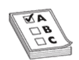

**考试提示** 对于考试，您需要记住设计和维护网络相关的这些重要因素：成本、安全、速度、拓扑、可扩展性、可靠性和可用性。

## 网络组件

*应用程序*，使用户能够执行各种任务的软件，是网络的关键组成部分。许多应用程序是*网络感知*的，这意味着它们使您能够访问和使用未直接存储在本地计算机上的资源。虽然网络应用程序的数量多达数千个，但大多数组织中使用的更常见的网络应用程序包括用于发送和接收电子邮件的电子邮件应用程序、用于传输文件的 File Transfer Protocol（FTP）应用程序以及用于提供信息图形表示的 Web 应用程序。

*协议* 用于使系统能够在网络上相互通信。一些协议是*开放标准*，这意味着许多厂商可以创建能够与其他使用该协议的应用程序互操作的应用程序。其他协议是*专有*的，这意味着它们仅适用于由特定厂商创建的其他应用程序。

以下是我们日常用于通过互联网通信的常见互联网协议列表：

- **简单邮件传输协议（SMTP）** 用于发送电子邮件的互联网协议。
- **邮局协议 3（POP3）** 用于从电子邮件服务器下载电子邮件到您的系统以便您阅读电子邮件的互联网协议。
- **互联网消息访问协议版本 4（IMAP4）** 用于阅读电子邮件的互联网协议。IMAP4 相对于 POP3 支持额外的功能和文件夹支持。
- **文件传输协议（FTP）** 用于在互联网上传输文件的互联网协议。
- **超文本传输协议（HTTP）** 用于从 Web 服务器向 Web 浏览器传送网页的协议。所有流行的

类似 Internet Information Services (IIS) 和 Apache 这样的 Web 服务器正在运行 HTTP 服务器。

一些应用程序，例如电子邮件，需要较少的带宽，而另一些应用程序，例如备份软件、视频软件和文件传输软件，则需要大量带宽。一些应用程序实时运行，例如语音 over IP (VoIP) 和视频；一些交互式运行，例如即时消息和数据库查询；还有一些以批处理模式运行，需要很少的用户交互。今天的网络需要容纳所有这些不同类型的资源和应用程序，包括它们特定的需求，例如大容量传输的带宽或 VoIP 和视频的最小延迟和时延。服务质量 (QoS) 功能通常用于满足这些需求。


**EXAM TIP** 请记住，在 Cisco CCT 和 CCNA 考试中，VoIP 和视频流量对延迟和时延很敏感。因此，通常会实施 QoS，以确保这些应用程序拥有足够的带宽，并在整个网络中得到优先处理，以限制它们产生的延迟。

要构建网络，您需要三个组件类别：

- **网络软件** 有两种类型的软件组件——服务器软件和客户端软件。服务器软件为网络上的客户端提供某种形式的服务（这就是我们想要网络的原因）。例如，服务器软件可能共享文件或提供电子邮件功能。客户端软件连接到服务器以请求使用服务。
- **网络硬件** 网络硬件组件——例如集线器、交换机、路由器、防火墙、无线接入点、调制解调器以及信道服务单元/数据服务单元 (CSU/DSU)——负责在 LAN 和 WAN 之间移动信息。
- **媒体类型** 铜缆或光纤电缆等媒体类型用于连接计算机和网络组件，以便组件之间可以共享信息。无线通信也属于此类，因为它用于在网络上的一个系统与另一个系统之间传输数据。

## 网络位置

网络组件用于各种位置。表 1-1 显示了一些用于描述网络组件位置的常用术语。

| 术语 | 定义 |
|---|---|
| 小型办公室/家庭办公室 (SOHO) | 在小型或家庭办公室工作的用户（仅少数人） |
| 分支办公室 | 在一个小区域（LAN）中连接的小组用户，与公司总部地理位置分离 |
| 移动用户 | 通过 LAN 或 WAN 从任何位置连接到网络的用户 |
| 企业或中央办公室 | 组织大多数用户及其资源所在的位置 |

表 1-1 网络位置

## 局域网

局域网 (LANs) 用于连接位于相近地理区域的网络设备，例如建筑物的一层、整栋建筑或校园环境。在 LAN 中，您会找到各种类型的设备，例如 PC、服务器、交换机、路由器、多层交换机、语音网关、防火墙和其他设备。LAN 中使用的媒体类型包括铜缆和光纤电缆。它们还可包括 Ethernet、快速以太网 (FE)、千兆以太网 (GE)、令牌环和光纤分布式数据接口 (FDDI)，这些是不同的网络架构。今天，大多数网络使用某种形式的以太网（本章后面“网络架构”部分会讨论）。


**NOTE** 以太网已成为基于 LAN 的网络的事实标准。因此，了解其拓扑和工作原理对于在公司网络中实施非常重要。集线器和网桥在当今网络中很少使用：它们已被交换机取代。

## 广域网

广域网 (WANs) 用于连接多个 LAN。例如，假设您在波士顿有一个办公室（一个 LAN），在温哥华有一个办公室（另一个 LAN）；WAN 用于连接这两个 LAN，以便用户可以与两个 LAN 上的其他用户和系统进行通信。通常，当必须连接的 LAN 被大距离分隔时，就会使用 WAN。而公司为 LAN 提供自己的基础设施，WAN 则从运营商网络租用，例如电话公司和互联网服务提供商 (ISPs)。WAN 服务中使用四种基本类型的连接或电路：电路交换、单元交换、分组交换和专用连接。

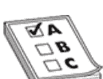

**EXAM TIP** 对于考试，请记住 LAN 提供高速带宽连接，用于在地理位置相近的位置（例如建筑物或校园）互连组件。WAN 提供较低速度的带宽连接，用于互连多个位置或站点。WAN 需要向服务提供商支付经常性的月度费用。

有大量 WAN 服务可用于连接不同的办公地点，包括模拟拨号、异步传输模式 (ATM)、专用电路、有线电视、数字用户线路 (DSL)、帧中继、综合业务数字网络 (ISDN) 和 X.25。模拟拨号和 ISDN 是电路交换服务的示例；ATM 是单元交换服务的示例；帧中继和 X.25 是分组交换服务的示例。

*电路交换* 服务通过电话电路提供临时连接。在网络中，这些服务通常用于主电路的备份和临时带宽提升。今天更常见的是，蜂窝无线服务（3G 和 4G）用于按需拨号应用或备份连接。

*专用电路* 是两个站点之间的永久连接，其中带宽专用于该公司的使用。当各种服务（例如语音、视频和数据）必须通过连接传输并且您希望保证带宽可用时，这些电路很常见。

*单元交换* 服务可以提供专用电路所提供的相同功能，例如具有专用链路，但其相对于专用电路的一个优势是，它使单个设备能够通过同一接口连接到多个设备。这些服务的缺点是它们并非在所有位置都可用，设置和故障排除困难，并且与专用电路所用设备相比，设备成本昂贵。

*分组交换* 服务与单元交换服务类似，只是单元交换服务交换称为单元的*固定长度*分组，而分组交换服务交换*可变长度*分组。此功能使分组交换服务更适合数据服务，但它们仍可提供单元交换服务提供的一些 QoS 功能。

另外两种非常流行的高速互联网连接技术 WAN 服务是数字用户线路 (DSLs) 和有线电视。DSL 提供最高几兆比特每秒 (Mbps) 的速度，并且成本远低于运营商的典型 WAN 电路。它支持语音和视频传输，并且不需要拨号连接（始终启用）。DSL 的主要缺点是覆盖范围限制在约 18,000 英尺，并且并非在所有地区都提供服务。有线接入使用同轴铜缆和光纤连接——与提供电视广播服务所使用的媒体相同。有线电视支持比 DSL 更高的传输速率，但与 DSL 一样，它提供全天候连接。然而，有线电视有两个主要缺点：它是一种共享服务，并且在逻辑上以总线拓扑运行，类似于以太网（第 2 章讨论），因此某个地区通过有线电视连接的客户越多，每个客户的带宽就越少；此外，由于许多人共享同一介质，它更容易受到安全风险的影响，例如窃听其他订阅者的流量。

用于 WAN 连接的网络设备示例包括有线电视和 DSL 调制解调器、运营商交换机、CSU/DSU、防火墙、模拟调制解调器和路由器。随着我们继续阅读章节，您将了解更多关于这些设备的信息。

## 常见网络服务和设备

您在 CCNA 考试中遇到的大多数问题将涉及在 Cisco 路由器或交换机上正确实施功能，但您会看到一些网络问题，测试您对基本概念的了解，例如不同网络服务和网络基础设施组件的目的。本节您将了解几种网络服务和基础设施组件，例如路由器和交换机。

## 服务类型

当今的网络包括许多提供不同类型服务的服务器。每项服务为网络提供特定的功能，了解这些服务非常重要。您应该熟悉网络上的以下服务器和服务：

- **DNS 服务器** 该服务负责将完全限定域名 (FQDNs) 解析为 IP 地址。例如，当您在浏览器窗口中输入类似 www.gleneclarke.com 的地址时，您的计算机会联系 DNS 服务器以确定该友好名称的 IP 地址。


- **DHCP 服务器** 该服务负责在计算机和设备连接到网络时为其分配 IP 地址，以便它们能够与网络上的其他系统通信或上网。
- **HTTP 服务器** 该服务负责托管网页，并将网页传送给连接到 Web 服务器的客户端。
- **文件服务器** 该服务用于保存公司的所有数据文件。文件服务器通常拥有大量存储空间，并成为公司的中央存储点。它也成为备份的中心位置，以确保公司数据文件得到备份。
- **应用服务器** 该服务器安装了指定的应用程序，以便在网络上提供服务。例如，在应用服务器上安装数据库产品，可以使服务器向网络提供应用数据；在服务器上安装电子邮件服务器应用程序，则可以使所有用户连接到服务器来收发电子邮件。
- **SMTP/POP** 该服务运行特定的协议，使电子邮件软件能够发送或接收电子邮件。SMTP 是用于发送电子邮件的 Internet 协议，而 POP 是用于阅读电子邮件的 Internet 协议。
- **FTP** 该服务可以安装在一台主机上，使人们能够连接到网络并在网络或 Internet 上传输文件。FTP 使用 TCP 作为传输层协议，并支持身份验证。
- **TFTP** 简单文件传输协议服务允许您上传或下载文件。TFTP 使用用户数据报协议（UDP），并且不支持身份验证。
- **Ping** 这实际上不是一种服务，而是一种用于测试与另一系统连通性的命令行工具。在您系统的命令提示符或终端会话中，可以使用命令 **ping** <*ip_address*> 向远程系统发送测试消息。如果您能够与该系统通信，您应该会收到一条 ping 回复消息。
- **Telnet** 该服务允许您使用系统的文本界面与系统建立远程连接，以执行远程管理。例如，网络管理员可以 telnet 到交换机或路由器上，对该交换机或路由器进行配置更改。Telnet 以明文发送所有通信内容，包括用户名和密码。
- **SSH** 安全外壳是对网络上的设备执行远程管理的安全方法。SSH 对所有通信（包括用户名和密码）进行加密；它被设计为 Telnet 的安全替代品。

## 网络基础设施组件

如今的网络使用许多不同的设备来增强其功能或安全性。让我们看看一些您在网络中一定会遇到的常见网络设备。

## 集线器

集线器是一种较老的网络设备，希望您不会在您的网络中遇到它们，因为它们已被更高效、更安全的交换机所取代。在较老的网络中，所有系统都连接到集线器上以实现网络通信。网络集线器有三个缺点：

- **无过滤功能** 当一个系统要向另一个系统发送数据时，集线器会接收数据，然后将数据发送到集线器上的所有其他端口。集线器是第 1 层设备（您将在下一章学习 OSI 层），因此它只是接收信号并将其发送到所有端口；它不理解介质访问控制（MAC）地址，而交换机则可以理解。
- **冲突** 由于任何发送的数据都会被发送到所有其他端口，并且任何系统都可以随时发送自己的数据，这导致网络上发生大量冲突。当两段数据发生碰撞时，就会产生冲突，并且必须重新传输。
- **安全性** 由于数据被发送到集线器上的所有端口，所有系统都会收到*所有*数据。系统会查看帧中的目的地址来决定是处理该数据还是丢弃它。但是，如果有人在使用集线器的系统上运行数据包嗅探器，他将收到所有数据包并能够读取它们。这造成了巨大的安全隐患。

集线器问题的解决方案是用交换机取代网络集线器，交换机具有您将在下一节中了解到的过滤功能。既然集线器已被交换机取代，为什么我还要提到集线器呢？了解集线器的工作方式很重要，因为这将帮助您理解交换机的优势。交换机减少了冲突，优化了流量，并且从安全角度来看也更好。

## 局域网交换机

交换机是当今网络中最常用的设备之一。所有其他设备都连接到交换机以接入网络。例如，您会将工作站、服务器、打印机和路由器连接到交换机，以便每个设备都能与其他设备收发数据。交换机充当网络上所有设备的中央连接点。

## 第 2 层交换机

交换机跟踪每台设备的 MAC 地址（烧录在网卡中的物理地址），然后将该设备的 MAC 地址与交换机上连接该设备的端口关联起来。交换机将此信息存储在交换机内存中的 MAC 地址表中。随后，交换机充当过滤设备，只将数据发送到数据目的地的端口。例如，在图 1-1 中，计算机 A 正在向计算机 C 发送数据（帧）。该帧通过计算机 A 所连接的端口（端口 2）进入交换机。交换机读取帧的目的地址，发现其目的地是 cccc.cccc.cccc（计算机 C）。然后交换机检查内存中的 MAC 表，查看哪个端口具有 cccc.cccc.cccc 的 MAC 地址。交换机注意到计算机 C 连接到端口 4，然后将数据转发到端口 4。

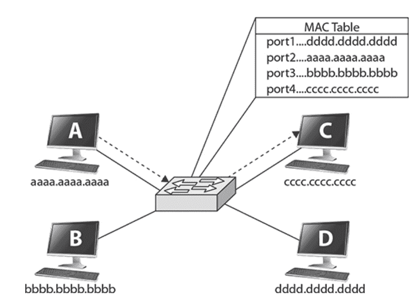

| MAC 表 |
|---|
| 端口1....dddd.dddd.dddd |
| 端口2....aaaa.aaaa.aaaa |
| 端口3....bbbb.bbbb.bbbb |
| 端口4....cccc.cccc.cccc |

图 1-1 交换机是网络上的中央连接设备。

您将在第 9 章中了解更多关于交换机的信息。

## 路由器

交换机用于将局域网环境中所有系统连接在一起，但如果您想将数据从您的网络发送到另一个网络或通过 Internet 发送，该怎么办？那就是路由器的任务。路由器将数据从一个网络发送（即路由）到另一个网络，直到数据到达最终目的地。请注意，虽然交换机查看 MAC 地址来决定将帧转发到哪里，但路由器使用 IP 地址来确定将数据发送到哪个网络。

路由器有一个路由表，其中列出了它知道如何到达的所有网络。路由器还包含一个最后选用网关（GWLR）设置，当路由器在其路由表中没有到达目的地的路由时，就会使用该设置。

查看图 1-2，您可以看到两个分别标记为 R1 和 R2 的路由器。请注意，R1 与 14.0.0.0 网络没有物理连接。如果计算机 A 想要向计算机 D 发送数据，将发生以下过程：

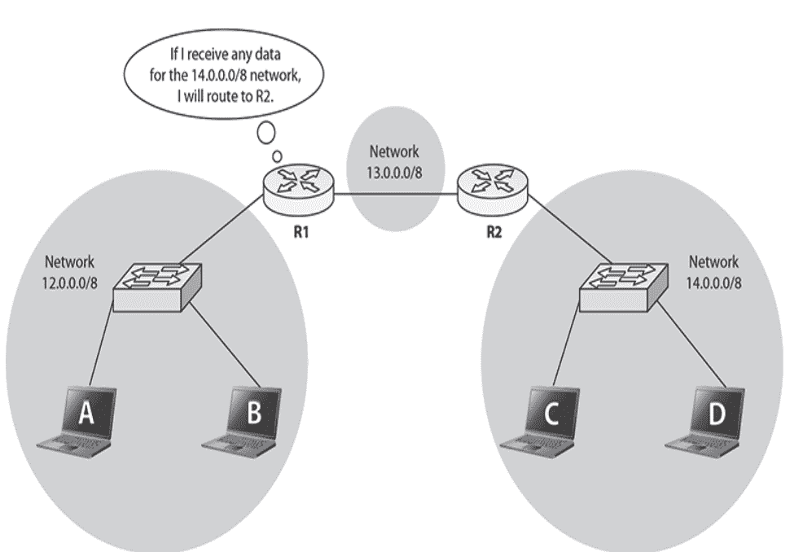

图 1-2 路由器将数据从一个网络发送到另一个网络。

1. 数据将从计算机 A 的网卡发出，并到达交换机。
2. 交换机将帧转发到 R1 路由器。
3. R1 路由器将查看数据的目的地址，并注意到数据的目的地是 14.0.0.0 网络上的计算机 D。
4. R1 路由器将查看其路由表，以确定它是否知道如何将数据发送到 14.0.0.0 网络。在这种情况下，它知道——R1 知道将数据路由（即发送）到路由器 R2。
5. 然后数据被发送到路由器 R2。
6. 当路由器 R2 收到数据时，它查看数据的目的地址，并确定需要将数据发送到局域网上的计算机 D。

随着我们逐步学习 Cisco 配置主题，您将了解更多关于交换机和路由器的知识，但此时我希望您明白，交换机通常用于局域网，而路由器是广域网设备。


另请注意，交换机是工作于 MAC 地址的第 2 层设备，而路由器是工作于 IP 地址的第 3 层设备。你将在下一章中了解更多关于 OSI 模型各层的信息。


**考试提示** 考试目标要求你理解第 2 层交换机和第 3 层交换机之间的区别。

## 第 3 层交换机

第 3 层交换机执行第 2 层交换机的所有功能，但它还具有 *作为路由器* 的额外功能。由于大多数公司购买交换机来连接其设备，然后购买路由器将数据发送到 WAN 或 Internet，Cisco 提供了可作为路由器和交换机合二为一的第 3 层交换机。正如你将在“网络设计模型”部分后面学到的，第 2 层交换机用于接入层，而第 3 层交换机用于核心层。

## 使用 CSU/DSU 连接到 WAN

*信道服务单元/数据服务单元* (CSU/DSU) 是一种设备，使组织能够从 ISP 连接高速数据链路到组织的路由器，以便访问 LAN 或 WAN 以及从 LAN 或 WAN 访问。这些高速连接通常是 T1 或 T3 连接，或其欧洲对应产品 E1 和 E3。所使用的 CSU/DSU 将特定于与服务提供商连接的线路速度。

CSU/DSU 设备处理 T1/T3 链路上的信号，在你的路由器和服务提供商之间发送数据。CSU/DSU 还执行其他功能，例如防止链路两侧的电气干扰。你可能有一个 *外部 CSU/DSU* 设备，它连接到组织路由器上的串行端口，并用于连接来自服务提供商的 T1 线路（见图 1-3）。

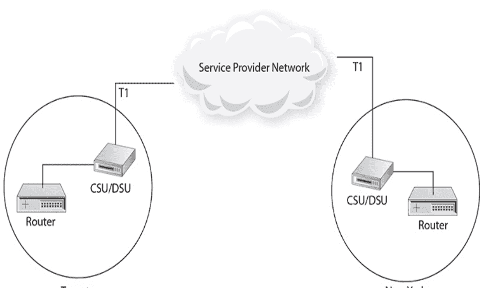

### 图 1-3 使用外部 CSU/DSU

当今许多路由器都内置了内部 CSU/DSU 模块，这使你无需使用外部 CSU/DSU 即可将路由器连接到 T1 线路。图 1-4 显示了集成在 Cisco 路由器中的 CSU/DSU。

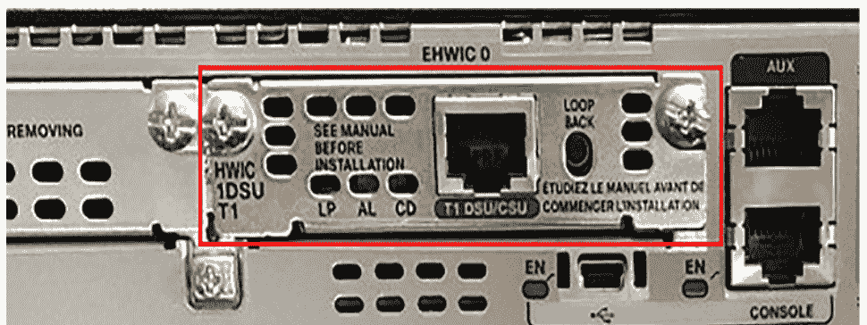

### 图 1-4 Cisco 路由器上的集成 CSU/DSU

你应该熟悉与将路由器连接到 WAN 相关的另外两个术语：*demarc* 和 *demarc extension*。

*demarc*，也称为 *demarcation point*（分界点），是服务提供商设备连接到你建筑物的点。该术语用于确定特定问题的责任方。例如，如果出现故障的设备在 demarc 点的公司一侧，则是公司的问题需要修复；如果问题在服务提供商一侧的 demarc 点，则解决问题的责任落在服务提供商身上。

*demarc extension*（图 1-5）一词指的是建筑物入口连接（来自服务提供商）与公司通信设备之间的区域。demarc extension 通常是一根连接服务提供商线路到公司网络设备的跳线。

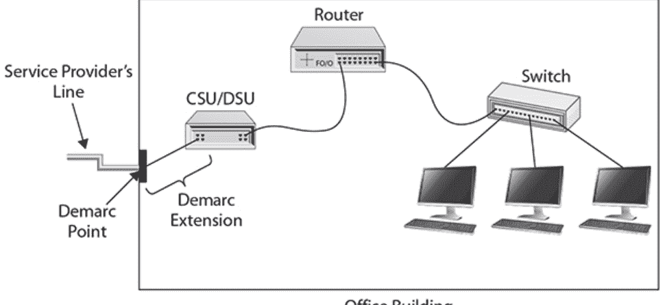

图 1-5 分界点和 demarc extension

## 防火墙

防火墙控制哪些流量允许进入网络或系统，哪些流量应被阻止。在配置防火墙时，你会根据协议、端口号和流量的方向创建允许和拒绝流量的规则。主要有三种类型的防火墙：

- **包过滤防火墙** 包过滤防火墙可以根据源 IP 地址和目标 IP 地址、源端口号和目标端口号以及所使用的协议来过滤流量。简单包过滤防火墙的缺点是它不理解对话的上下文，因此黑客很容易伪造数据包通过防火墙。
- **状态包检测防火墙** 与包过滤防火墙类似，状态包检测防火墙根据源 IP 地址和目标 IP 地址、源端口号和目标端口号以及所使用的协议来过滤流量，但它也理解对话的上下文，并且除非符合特定场景，否则不会允许数据包通过防火墙。例如，如果黑客向你的网络发送数据包并试图使其看起来像是有人访问的网站的响应，你的防火墙会知道没有人访问过该网站，因此不会允许该流量通过。
- **下一代防火墙** 下一代防火墙 (NGFW) 是一种第 7 层防火墙，可以检查应用数据并检测恶意数据包。普通防火墙根据流量是否为 HTTP 或 FTP 流量（使用端口号）来过滤流量，但无法确定 HTTP 或 FTP 数据包内部是否存在恶意数据。应用层 NGFW 可以检查数据包中存在的应用数据并确定其中是否存在可疑内容。

## 入侵防御系统

*入侵防御系统 (IPS)* 是一种安全设备，用于监控活动、记录任何可疑活动，然后采取某种形式的纠正措施。例如，如果有人在网络上进行端口扫描，IPS 将发现这种可疑活动，记录该活动，然后将执行端口扫描的系统从网络中断开。

## DHCP

DHCP 负责自动为网络上的系统分配 IP 地址信息。网络管理员通过配置 *作用域*（一组地址范围）来配置 DHCP 服务器，服务器可以从中分配地址。DHCP 服务可能会为客户端配置所有 TCP/IP 设置，包括子网掩码、默认网关和 DNS 服务器地址。

当客户端启动时，它会发送广播消息寻找 DHCP 服务器以接收 IP 地址。DHCP 服务器回复提供，客户端随后请求已提供的地址。最后，DHCP 服务确认客户端在一段时间内拥有该地址（称为租期）。

## 网络地址转换

NAT 使我们能够通过让 NAT 设备接收所有出站数据包，取出内部源地址并替换为 NAT 设备的公共 IP 地址，从而隐藏我们的内部网络结构。这是有益的，因为任何在 Internet 上拦截数据的人都会认为数据包来自 NAT 设备而不是 LAN 上的内部计算机。因此，任何决定攻击数据包源的人实际上是在攻击 NAT 设备，而 NAT 设备通常也是防火墙产品。你将在第 13 章了解更多关于 NAT 的信息。

## 无线接入点/接入点

*接入点* 是添加到你的网络中的设备，使无线客户端能够连接到网络。许多希望为客户端提供无线连接灵活性的组织会在建筑物内战略性地放置无线接入点，使无线客户端能够连接到网络。

## 无线局域网控制器

配置网络上的每个接入点可能是一项耗时的工作，并且存在很多出错的可能性。作为网络管理员，你可以集中管理设备，而无需到每个设备处进行配置。管理员可以使用无线局域网控制器 (WLC)，或简称为无线控制器，使用轻量级接入点协议 (LWAPP) 集中管理接入点。这消除了单独配置每个接入点的管理负担。你将在第 15 章了解更多关于无线配置的信息。

## Cisco DNA Center

Cisco DNA Center 是一种你可以购买的设备，使你能够集中且同时管理对网络设备的更改。DNA Center 的好处是你可以使用多种软件元素，例如脚本，一次性自动化对所有设备的更改。你将在第 18 章了解更多关于 Cisco DNA Center 的信息。

## 终端和服务器

你的网络可能包括终端，可能包括以下任意数量的设备：

- **客户端** 客户端系统，例如 Windows 或 Linux 机器，连接到网络以访问文件、打印机或 Internet 等资源。
- **服务器** 服务器系统为网络提供资源。服务器类型的示例包括文件服务器、Active Directory 服务器、数据库服务器和 Web 服务器。
- **打印机** 网络打印机可以连接到网络以使其他连接设备能够打印文档。
- **移动设备** 例如笔记本电脑、平板电脑或智能手机等设备可以连接到网络以访问资源。

## 碰撞域和广播域

CCT 和 CCNA 认证考试要求你熟悉 *碰撞域* 和 *广播域*。让我们先快速定义每个术语，然后我会稍作扩展：

- **碰撞域** 在这个系统组中，同时的数据传输可能会相互碰撞。
- **广播域** 在这个系统组中，每个系统都可以接收其他系统的广播消息。

## 碰撞域

在碰撞域中，可能会发生数据传输碰撞。例如，假设你使用集线器将五个系统连接到网络。因为

流量会被发送到集线器上的所有端口，因此如果多个系统同时发送数据，数据可能会在网络上发生冲突。因此，集线器上的所有网络端口（以及连接到这些端口的任何设备）都被视为 *单个冲突域* 的一部分。这也意味着当你将一个集线器级联到另一个集线器上时，所有集线器都属于同一个冲突域。

如果你使用交换机连接这五个系统，交换机上的每个端口都会创建自己的网络段（就像网桥将网络划分为不同的网络段）。当连接到交换机的系统发送数据时，交换机只将数据发送到目的系统所在的端口。因此，如果另一个系统同时发送数据，数据也不会发生冲突。因此，交换机上的每个端口都会创建一个 *单独的冲突域*。

## 广播域

广播域是一组可以接收彼此广播消息的系统。当使用集线器连接网络环境中的五个系统时，如果一个系统发送广播消息，该消息会被连接到集线器的所有其他系统接收。因此，集线器上的所有端口都创建一个 *单个广播域*。

同样，如果五个系统都连接到交换机并且其中一个系统发送了广播消息，广播消息将被网络上的所有其他系统接收。因此，使用交换机时，所有端口也是同一广播域的一部分。

如果你想控制哪些系统接收广播消息，就必须使用不将广播消息转发到其他网络的路由器。你还可以在交换机上使用虚拟局域网（VLAN），每个 VLAN 都是一个不同的广播域。


**考试提示** 请务必了解 CCT 和 CCNA 认证考试中广播域与冲突域之间的区别。此外，请记住路由器是用于创建多个广播域的设备。

## 练习 1-1：识别网络组件

在本练习中，你通过将右侧的组件与左侧的定义进行匹配来回顾不同的网络组件。

| 定义 | 组件 |
|---|---|
| ____ 负责将数据从一个网络发送到另一个网络的第 3 层设备 | A. Switch |
| ____ 一种检测可疑活动然后采取纠正措施的设备 | B. Collision domain |
| ____ 用于连接所有系统到网络的第 2 层设备 | C. DHCP |
| ____ 一组可以接收彼此广播消息的系统 | D. Firewall |
| ____ 一种为网络上的其他系统和设备分配 IP 地址的服务 | E. Router |
| ____ 服务提供商设备连接到你所在建筑物的点 | F. Hub |
| ____ 一组系统中单独的数据传输可能会发生冲突 | G. IPS |
| ____ 用于保护系统或设备免受不需要的流量 | H. Demarc |
| ____ 用于连接所有系统到网络的第 1 层设备 | I. Broadcast domain |

## 网络设计模型

一个设计良好的网络在结构上是分层的，其中层次中的每一层都专注于特定的工作职能。一个设计良好的网络也是模块化的，因为可以轻松地向网络添加组件，这样随着公司的增长，网络也可以增长。设计良好的网络还应具有灵活性和弹性，这意味着它始终可用并且包含某种形式的冗余。

在设计 Cisco 网络时，我们通常遵循两种常见的设计模型：*三层架构模型* 和 *折叠核心架构模型*。这里也讨论了其他网络架构。

## 三层架构

三层架构模型是 Cisco 网络专业人员常用的模型，用于设计性能良好的 Cisco 网络。以下是三个层：

- **接入层** 该层位于层次结构的底部；它使终端用户能够通过交换机连接到网络。接入层提供功能，使你能够在不同类型的用户之间隔离流量并划分广播域。位于建筑物每层楼的交换机代表这一层。
- **汇聚层** 从底部算起的第二层，或中间层，通过使用路由、访问控制列表（ACL）和网络访问策略等功能，使你能够控制谁可以访问网络的哪个部分。汇聚层可以是位于两个建筑物中的中央第 3 层交换机，其中每个交换机都可以访问另一个建筑物的第 3 层交换机以进行连接。
- **核心层** 该模型的顶层代表网络的骨干。该层通常用于连接不同建筑物的网络。它包括多个核心路由器，负责将流量传递到网络和从网络传递。

## 折叠核心（两层）架构

小型组织可能不需要使用三层模型，因此可以将汇聚层和核心层合并为一个称为 *折叠核心层* 的单一层。这使得折叠核心层成为一个两层模型，由 *接入层* 和 *折叠汇聚/核心层* 组成。在典型场景中，这可能用于在网络中使用建筑物中仅几层楼的小型公司。每层楼将有一个交换机（接入层），使该层楼的客户端能够连接到网络。

每层楼的交换机然后连接到建筑物中的中央交换机，该交换机连接到路由器以访问 WAN 或 Internet。

## 脊叶架构

另一种两层架构的例子是 *脊叶架构*，其中下层是叶层，包含使设备能够连接到网络的接入交换机。叶层交换机然后连接到脊层交换机，脊层交换机将所有交换机连接到网络的其余部分。脊叶模型如图 1-6 所示。请注意，叶层交换机是接入层交换机，具有全网状拓扑，连接到脊层交换机。

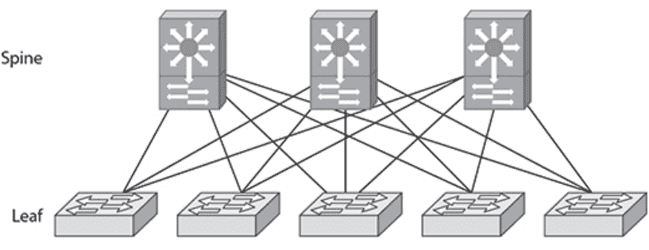

图 1-6 脊叶网络拓扑

## 小型办公/家庭办公

SOHO 网络是一种完全不同的网络拓扑，专为非常少量的需要访问网络和 Internet 的设备而设计。SOHO 网络通常涉及高速 Internet 连接到家庭或办公室，连接到 ISP 的调制解调器。ISP 的调制解调器连接到无线路由器的 WAN/Internet 端口，该路由器通常有四个交换机端口，你可以使用无屏蔽双绞线（UTP）布线连接客户端。SOHO 网络中的无线路由器还可以提供许多服务，例如充当 DHCP 服务器、NAT 设备、防火墙或无线接入点。

## 本地部署 vs. 云

在当今网络环境的大多数讨论中，你会听到 *本地部署* 与 *云端* 的术语。本地部署的网络功能或设备存在于你办公室位置的物理网络上。如果网络功能或设备位于云中，则发生在云提供商的网络中。例如，你可能有一个无线 LAN 控制器，用于从中央位置配置多个无线接入点作为本地部署设备（在你的办公室），或者你可能使用云服务，这意味着这些服务由云提供商提供给你。云解决方案的一个好处是提供商通常处理服务的高可用性等问题的处理，因此你无需处理。

## 网络拓扑

当你将设备连接到网络时，你需要决定使用哪种拓扑。网络的 *拓扑* 是网络的布局，你可以从少数网络拓扑中进行选择。图 1-7 显示了不同媒体类型使用的四种拓扑的示例。


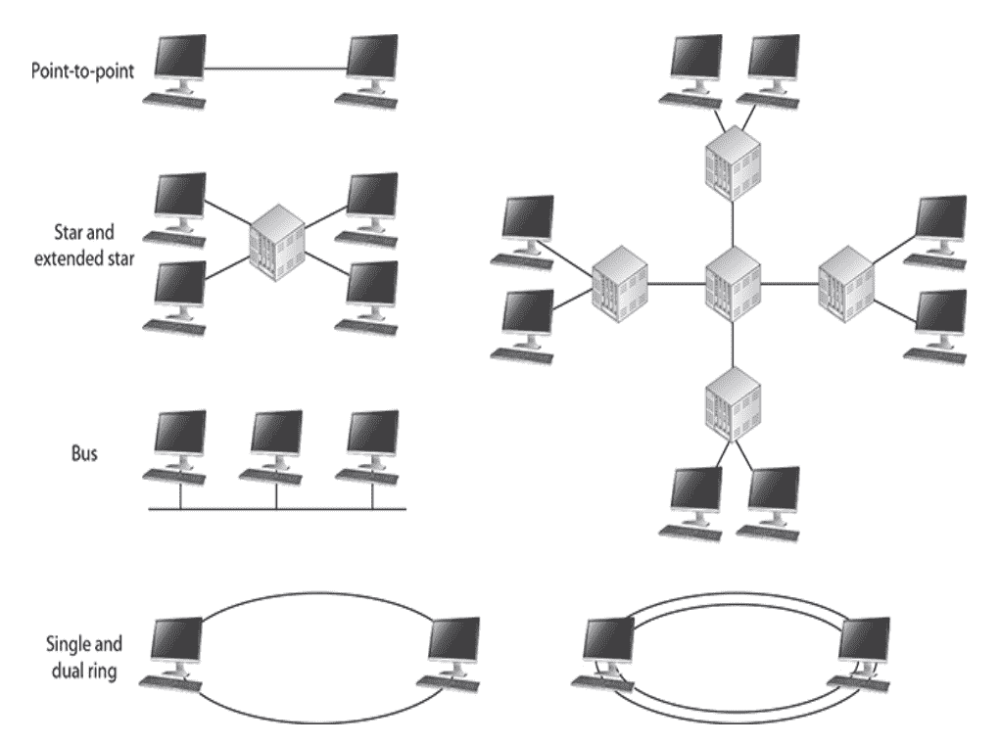

## 图 1-7 网络拓扑

点对点拓扑在两个组件之间只有一个连接。在此拓扑中，两个组件可以直接通信而不受其他组件的干扰。当需要连接大量组件时，这类连接并不常见。点对点拓扑的一个例子是两台路由器通过专用 WAN 链路连接。

在星型拓扑中，中央设备与其他组件有多条点对点连接。星型拓扑用于需要连接大量组件的环境。使用星型拓扑的一种介质类型示例是 1000BaseTx 以太网。连接组件时，你将所有设备，例如客户端和服务器，连接到中央交换机。星型拓扑的主要问题是，如果星的中心失效，没有组件可以与其他组件通信。为了解决这个问题，可以使用扩展星型拓扑。扩展星型拓扑基本上是多个互连的星型拓扑。

在 *总线* 拓扑中，所有组件都连接到并共享一根线缆。许多年前，总线拓扑在 10Base5 和 10Base2 以太网等网络架构中很常见。使用总线拓扑时，如果任何系统在电线上发送数据，数据会沿着电线的整个长度传输。用于将设备连接到总线布线的特殊类型的连接器，或收发器。 例如，在旧的 10Base5 中，每个设备都通过吸血鬼夹连接到同轴电缆。该设备接入单根同轴电缆，并提供从网络设备到单根电缆的物理连接。

在 *环* 拓扑中，设备一连接到设备二，设备二连接到设备三，依此类推，直到最后一个设备，它再连接到第一个设备。环形拓扑可以实现为单环或双环。双环通常在需要冗余时使用。例如，如果环中的某个组件失效，环可以自行环绕，如 图 1-8 所示，以提供一个单一、功能正常的环。FDDI 是使用双环拓扑将系统连接到网络的网络架构示例。单环拓扑缺乏这种冗余功能，因此，如果环中断，网络就会中断。

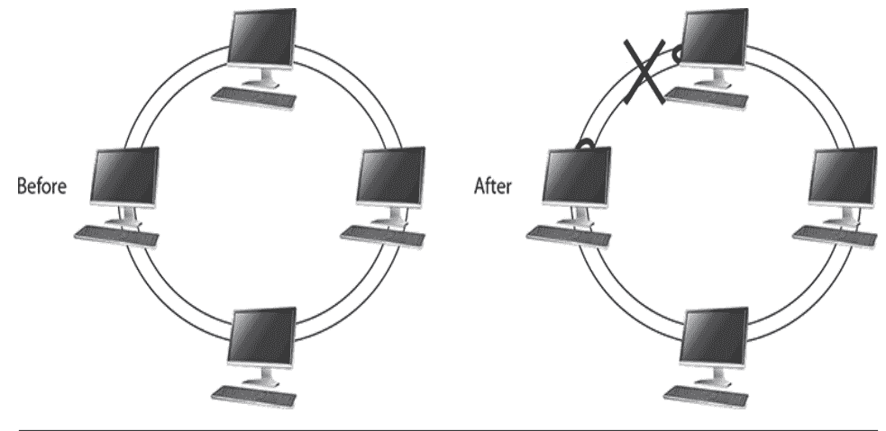

图 1-8 双环与冗余


**NOTE** Token Ring 和 FDDI 是使用环形拓扑的网络架构示例。今天在网络中很少使用它们。

## 物理与逻辑拓扑

*物理* 拓扑描述组件如何物理布线连接在一起。例如，1000BaseT 网络具有物理星型拓扑，而 FDDI 使用物理双环拓扑。*逻辑* 拓扑描述组件如何在物理拓扑上通信。物理和逻辑拓扑彼此独立。例如，任何类型的以太网在组件通信时都使用逻辑总线拓扑，而不论布线的物理布局如何。这意味着在以太网中，你可能使用具有物理星型拓扑的 1000BaseT 来连接组件；然而，这些组件使用逻辑总线拓扑进行通信。

Token Ring 是物理拓扑与其逻辑拓扑不同的网络架构的另一个良好示例。物理上，Token Ring 使用星型拓扑，与 1000BaseT 以太网类似。这意味着每个系统物理连接到中央设备，但逻辑上，Token Ring 组件使用环形拓扑在设备之间通信。这在你尝试确定组件如何连接在一起以及如何通信时会造成混淆。另一方面，FDDI 很直接。FDDI 的物理和逻辑拓扑相同：环。

表 1-2 显示了常见网络架构及其物理和逻辑拓扑。

| 网络架构 | 物理拓扑 | 逻辑拓扑 |
|---|---|---|
| 以太网 | 总线、星型或点对点 | 总线 |
| FDDI | 环 | 环 |
| Token Ring | 星型 | 环 |

表 1-2 物理和逻辑拓扑示例

## 全网状和部分网状拓扑

*网状* 通常描述组件如何连接在一起。使用了两种网状拓扑类型：*部分* 和 *全*。在部分网状环境中，每个设备 *不* 连接到每个其他设备。在全网状环境中，每个组件 *是* 连接到每个其他组件。图 1-9 显示了这两种拓扑的示例。

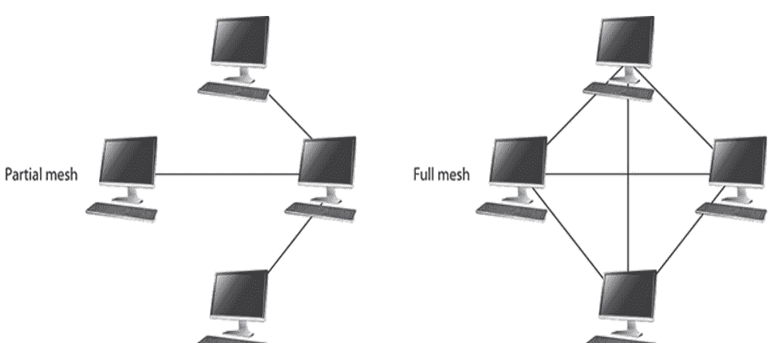

图 1-9 部分和全网状拓扑

请注意，像物理和逻辑拓扑一样，部分和全网状可以从物理视图和逻辑视图看到。例如，在物理总线拓扑中，所有组件都是全网状的，因为它们都连接到同一段线缆——这既是物理也是逻辑上的全网状拓扑，在 LAN 拓扑中很常见。另一方面，由于成本原因，WAN 通常使用部分网状拓扑来降低连接组件和位置的成本。例如，在图 1-3 左侧显示的部分网状网络中，上、左和下组件都可以通过右侧的设备通信。这种通信会引入传输延迟，但会降低成本，因为不需要那么多连接。


**TIP** 用于确定完全网状 WAN 所需链路数的公式是 N × (N − 1) / 2，其中 N 为位置数量。例如，如果你有 10 个位置，你需要 45 条链路 (10 × (10 − 1) / 2) 来完全网状化这些站点。除了成本是制约因素外，WAN 设备所需的接口数量以及这些连接的管理，随着连接越来越多，很快就会变得难以承受。

## 布线类型

LAN 通常使用铜缆或光纤布线。铜缆可以包括一根传输电电压的铜线，也可以是多根铜线。光纤布线使用发光二极管 (LEDs) 和激光通过玻璃芯传输数据。在这种传输中，光用于表示二进制 1 和 0：如果线上有光，表示为 1；如果没有光，表示为 0。

### 铜缆

在铜缆和光纤之间，实施铜缆成本更低。多年来网络中使用了三种铜缆类型：

- **Thicknet** 使用厚同轴电缆（不再用于当今网络）
- **Thinnet** 使用薄同轴电缆（不再用于当今网络）
- **Unshielded twisted pair (UTP)** 使用四对线在电缆中，每对线定期绞合

在三种铜缆类型中，UTP 今天最常见，主要是因为它比另外两种便宜，并且更容易安装和故障排除。尽管有其优势，铜缆（包括 UTP）有两个缺点：

- 它容易受到电磁干扰 (EMI) 和射频干扰 (RFI) 的影响。
- 电缆距离限制在短距离（100 米）。

UTP 内部铜缆直径为 22 或 24 号。以太网的 UTP 具有 100 欧姆阻抗，因此不能使用任何 UTP 布线，例如通常用于电话的电缆。电缆内部的八根线都有颜色：有些是纯色，有些是条纹。两对线承载真实电压，通常称为“tip”（T1–T4），另外四根线承载反向电压，通常称为“ring”（R1–R4）。今天，人们通常分别称它们为 *正* 和 *负* 线。一对由正线和负线组成，例如 T1 和 R1、T2 和 R2，等等，每对线沿电缆长度绞合。

### UTP 类别

为了区分不同种类的 UTP 布线，创建了不同的类别。表 1-3 显示了 UTP 布线的类别。


| 类别 | 描述 |
|---|---|
| Category 1 | 用于电话连接（不适合数据） |
| Category 2 | 用于最高 4 Mbps 的数据连接—令牌环 |
| Category 3 | 用于最高 10 Mbps 的数据连接—以太网 10BaseT |
| Category 4 | 用于最高 16 Mbps 的数据连接—令牌环 |
| Category 5 | 用于最高 100 Mbps 的数据连接—以太网 |
| Category 5E | 用于最高 1 Gbps（千兆每秒）的数据连接—以太网 |
| Category 6 | 用于最高 1 Gbps（24 号线规）的数据连接—以太网 |
| Category 6A | 用于最高 10 Gbps 的 10 千兆以太网网络 |
| Category 7 | 用于最高 10 Gbps 的 10 千兆以太网网络 |

表 1-3 UTP 类别

UTP 电缆的每个端点都有一个 RJ-45 连接器，它是一个公连接器，插入到母 RJ-45 插座中。RJ-45 连接器与电话连接器（RJ-11）上看到的相似，只是 RJ-45 大约大 50%，并且容纳八根线而不是四根线，就像 RJ-11 的情况一样。

## 布线设备

随着铜缆上以太网的实施，连接由两个组件组成：RJ-45 连接器和 Category 5、5E、6 或 6A UTP 电缆。如前所述，UTP 电缆内部有八根线（四对线）。布线两端的引脚排列使用两种类型的实现：*直通* 和 *交叉*。*引脚排列* 指的是导线顺序以及它们在 RJ-45 接口内连接的引脚。两种标准定义了布线引脚排列：568B 用于直通电缆和交叉电缆的一端。568B 布线颜色列于表 1-4 中。

| 引脚 | 颜色 |
|---|---|
| 1 | 白线 / 橙色条纹 |
| 2 | 橙色线 |
| 3 | 白线 / 绿色条纹 |
| 4 | 蓝色线 |
| 5 | 白线 / 蓝色条纹 |
| 6 | 绿色线 |
| 7 | 白线 / 棕色条纹 |
| 8 | 棕色线 |

表 1-4 UTP 引脚分配颜色

一根直通以太网 UTP 电缆在一端引脚 1 连接到另一端引脚 1，引脚 2 连接到引脚 2，依此类推。直通电缆用于连接不同的设备，例如计算机与交换机之间或交换机与路由器之间。

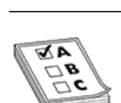

**考试提示** CCT 和 CCNA 认证考试会测试您何时使用直通电缆，这里是需要记住的黄金法则：使用直通电缆连接不同的设备，例如将计算机连接到交换机、计算机连接到集线器、交换机连接到路由器。

图 1-10 显示了不同设备之间直通连接的示例。

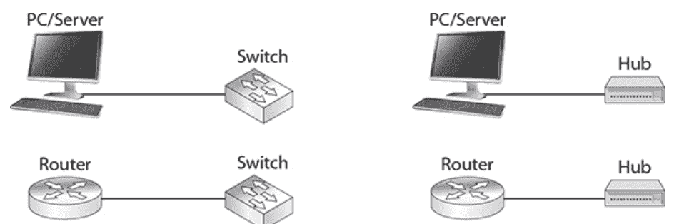

直通电缆：________

### 图 1-10 直通连接

一根交叉 UTP 以太网电缆交叉两组线：一侧引脚 1 连接到另一侧引脚 3，引脚 2 连接到引脚 6。对于 CCNA 考试，请记住交叉电缆用于连接相似的设备，例如两台计算机、两台交换机或集线器到交换机。当连接相似的设备时使用交叉电缆，例如以下情况（图 1-11 所示）：

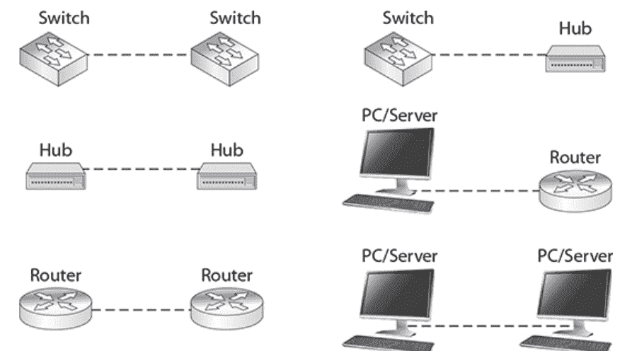

交叉电缆：------

### 图 1-11 交叉连接

- 计算机到计算机
- 集线器到另一个集线器
- 交换机到另一台交换机
- 集线器到交换机
- 路由器到计算机
- PC、路由器或文件服务器到另一台 PC、路由器或文件服务器


**考试提示** 请记住 CCNA 考试中何时使用直通电缆、何时使用交叉电缆。以太网交叉电缆在一端将引脚 1 和 3 与引脚 2 和 6 交叉。

有时以太网网络接口卡（NIC）母插座会提示您使用哪种类型的电缆。如果端口上出现 X 而另一个端口没有 X 标记，请使用直通电缆。如果两个设备都没有 X 或两个都有 X，请使用交叉电缆。在某些情况下，此设置可以通过命令在软件中更改，或通过使用双列直插式封装（DIP）开关在硬件中更改，从而使您能够使用当前可用的电缆类型。


**注意** 许多厂商的交换机和设备支持电缆类型的自动检测。例如，您可能可以在两台交换机之间使用直通以太网电缆。然而，为了考试目的，您仍应了解之前的考试提示中的信息。

## 光纤

光纤布线通常用于提供非常高的速度并跨越非常大的距离。例如，通过使用光纤可以实现 100 Gbps 的速度和超过 10 公里的距离——铜缆无法接近这些性能。然而，光纤布线也有其缺点：实施成本高、难以排除故障且难以安装。


**考试提示** 光纤布线不受 EMI 和 RFI 影响，而铜缆会受影响。由于在校园网中跨建筑布设铜缆的问题，光纤是推荐的布线类型。

用于数据连接的光纤有两种类型：多模光纤（MMF）和单模光纤（SMF）。MMF 传输 850 或 1300 纳米（nm）波长的光（红外光谱中的光，肉眼不可见）。MMF 的光纤厚度为 62.5/125 微米。MMF 的纤芯和包层直径（实际布线的厚度）在 50 至 100 微米范围内。850/1300 nm 波长相当于太赫兹（THz）范围的频率。光通过 LED 传输。在传输信号时，光源会反射到包围光纤的内包层（屏蔽层）上。MMF 相对较大的纤芯直径支持在给定波长下多个纵向模式（即不同的光路）的传播；因此使用术语 *多模*。这些多模式会导致色散（信号扩散），从而有效地将光纤传输的数据速率限制在数百 Mbps 范围内。一个很好的说明是当你靠近墙壁打开手电筒时：随着你远离墙壁，光的直径会越来越大，显示出色散。

SMF 传输 1300 或 1550 nm 的光并使用激光作为光源。由于激光的输出高于 LED，SMF 的传输距离可超过 10 公里，速度可达 100 Gbps。由于 SMF 的纤芯直径非常小，在给定波长下只传播单一纵向模式——因此称为 *单模*。

由于只传播单一模式，SMF 的色散（即信号扩散）比 MMF 小，因此可以支持比 MMF 高得多的传输速率（100+ Gbps）。

过去十年见证了光纤使用和部署的许多进步。一个主要改进是波分复用（WDM）和密集波分复用（DWDM）。WDM 允许在同一根光纤上使用两个以上的波长（信号），从而增加连接数。DWDM 允许更多波长，且间隔更紧密：在单根光纤上可将 200 多个波长复用到一束光流中。显然，DWDM 的优点之一是它提供了跨光纤传输的协议和流量的灵活性和透明性。例如，一个波长可用于点对点连接，另一个用于以太网连接，另一个用于 IP 连接，还有一个用于 ATM 连接。使用 DWDM 提供了可扩展性，并使运营商能够在 *无需* 安装新的光纤线路的情况下配置新连接，因此在您下单后可在很短时间内添加新连接。

让我们谈谈光纤中使用的一些术语以及它们如何影响距离和速度。*布线* 提供保护性外涂层以及内包层。内包层密度更大，以便光源能够反射。电缆中间是 *光纤* 本身，用于传输信号。折射率（IOR）影响光源的速度：它是真空中光速与光纤中光速之比。在真空中，没有变量会影响传输；然而，只要通过光纤或铜缆等介质传输，介质本身就会表现出影响传输的特性，导致可能的延迟。IOR 用于衡量这些差异。基本上，IOR 衡量光纤的密度；光纤越致密，光在其中传播越慢。

*损耗因子* 用于描述光源到达光纤末端之前光纤中的任何信号损失。*连接器损耗* 发生在连接器连接两段光纤时：预计会有轻微的信号损失。此外，光纤越长，信号强度在到达电缆末端时减弱的可能性就越大。这称为 *衰减*。

另外两个术语描述信号退化。*微弯* 发生在光纤出现褶皱时，通常在电缆轻微弯曲处，导致一

光源中的失真。*宏观弯曲* 发生在光源从光纤泄漏时，通常是由于光纤电缆的弯曲。为了克服长距离传输的衰减，可以使用 *光放大器*。它们类似于以太网中继器或集线器。好的放大器，例如掺铒光纤放大器（EDFA），可直接将光源转换为另一个光源，从而提供对原始信号的最佳再现。其他放大器将光转换为电信号然后再转换回光，这可能会导致信号质量下降。

两项主要标准用于描述光纤中信号的传输：SONET（同步光网络）和 SDH（同步数字体系结构）。SONET 由交换运营商标准协会（ECSA）和美国国家标准学会（ANSI）定义，通常用于北美。SDH 是一种国际标准，用于世界大部分地区（北美除外）。这两个标准都定义了用于传输光源的物理层帧结构，其中还包括传输开销。存在三种类型的开销：

- **段开销 (SOH)** 两个设备之间链路的开销，例如中继器
- **线路开销 (LOH)** 连接网络设备的一个或多个段的开销，例如集线器
- **路径开销 (POH)** 连接组装和拆卸帧的两个设备的开销，例如载波交换机或路由器的光纤接口

通常，使用环形或点对点拓扑来连接设备。对于运营商城域网（MAN），最常见的实现方式是通过使用环。自动保护倒换（APS）可用于提供线路冗余：在主线路发生故障的情况下，备用线路可以自动使用。表 1-5 提供了 SONET 和 SDH 的更常见连接类型的概述。请注意，SONET 使用同步传输信号（STS）来描述信号，而 SDH 使用同步传输模块（STM）来描述信号。

| 常用术语 | SONET 术语 | SDH 术语 | 连接速率 |
|---|---|---|---|
| OC-1 | STS-1 | n/a | 51.84 Mbps |
| OC-3 | STS-3 | STM-1 | 155.52 Mbps |
| OC-12 | STS-12 | STM-4 | 622.08 Mbps |
| OC-48 | STS-48 | STM-16 | 2488.32 Mbps |
| OC-192 | STS-192 | STM-64 | 9953.28 Mbps |

表 1-5 光纤连接类型

最常见的光纤连接器类型及其典型用途如下列出：

- **光纤通道 (FC)** 服务提供商在其配线面板中使用
- **本地连接器 (LC)** 用于企业设备并通常连接到小型封装可插拔（SFP）模块
- **标准连接器 (SC)** 用于企业设备
- **直头 (ST)** 由于其耐用性而用于配线面板

传统上，SC 是最常用的连接器类型；然而，LC 越来越常见。

表 1-6 简要比较了铜缆和光纤电缆类型。

| 电缆 | 距离 | 数据速率 | 比较 |
|---|---|---|---|
| UTP | 100 meters | 10 Mbps-10 Gbps | 易于安装但易受干扰 |
| Coaxial | 500 meters | 10-100 Mbps | 易于安装但难以排查故障（不再用于以太网） |
| Fiber | 10 kilometers | 10 Mbps-100 Gbps | 安装困难且昂贵，难以排查故障，但可以跨越很长距离且不受干扰 |

表 1-6 电缆类型比较

## 访问方法

你现在知道网络使用拓扑——即网络的布局——并且你知道某种形式的媒体例如电缆连接网络上的所有主机。我们讨论了三种主要类型的电缆：同轴电缆、双绞线和光纤电缆。

本节将介绍各种访问方法。访问方法决定主机如何将数据放置在传输线上：主机是否必须等待轮到它，还是可以随时将数据放置在传输线上？答案由三种主要访问方法决定：CSMA/CD、CSMA/CA 和令牌传递。让我们逐一查看这些访问方法。

### CSMA/CD

*载波侦听多路访问/冲突检测*（CSMA/CD）是目前使用最广泛的访问方法之一。在 CSMA/CD 中，每个主机对线路都有平等的访问权，并且可以在线路无流量时将数据放置在线路上。如果主机想要将数据放置在线路上，它会“侦听”线路并确定是否已有信号存在。如果有，主机将等待传输数据；如果线路空闲，主机将发送数据。

前面描述的过程的问题在于，如果两个系统同时“侦听”线路，当线路空闲时它们都会同时发送数据。当两段数据同时在线路上传输时，它们会相互碰撞，数据将被破坏。如果数据在传输中被破坏，数据需要重新传输。因此，在发生碰撞后，每个主机将在重新传输数据之前等待一段可变的时间（它们不想再次发生碰撞），从而防止第二次发生碰撞。当系统确定数据发生碰撞然后重新传输数据时，这被称为 *冲突检测*。

总之，在 CSMA/CD 中，在主机在网络上发送数据之前，它会“侦听”（CS）线路以确保线路无流量。多个系统对线路有平等的访问权（MA），如果发生碰撞，主机将检测到该碰撞（CD）并重新传输数据。

### CSMA/CA

*载波侦听多路访问/冲突避免*（CSMA/CA）不如 CSMA/CD 流行，有其原因。在 CSMA/CA 中，在主机在线路上发送数据之前，它会“侦听”线路以查看是否有信号。如果线路空闲，主机将尝试通过发送信号来“避免”碰撞，让所有其他主机知道在发送数据之前应等待。这有助于防止碰撞发生，但涉及在线路上传输更多数据。

### Token Passing

对于 CSMA/CD 和 CSMA/CA，碰撞的可能性始终存在，并且放置在线路上的主机越多，碰撞的可能性越大，因为你有更多系统“等待”线路空闲以便发送其数据。

令牌传递在确定系统如何将数据放置在线路上时采取了完全不同的方法。在令牌传递中，一个空数据包在线路上运行——“令牌”。要将数据放置在线路上，系统需要等待令牌；一旦系统获得令牌并且令牌无数据，系统就可以将数据放置在线路上。由于只有一个令牌并且主机需要拥有令牌才能“发言”，因此在令牌传递环境中不可能发生碰撞。

例如，如果工作站 1 想要在线路上发送数据，工作站将等待令牌，该令牌每秒在网络上循环数百万次。当令牌到达工作站 1 时，工作站将令牌从网络上取下，用数据填充它，将令牌标记为已使用以便没有其他系统尝试用数据填充令牌，然后将令牌放回线路上前往目标主机。

所有系统都会查看数据，但它们不会处理它，因为数据不是发给它们的。然而，预期目标系统将读取数据并将令牌作为确认发送回发送方。一旦令牌到达原始发送方，令牌将被取消标记为已使用并作为空令牌释放到网络上。

## 网络架构

现在你对电缆、拓扑和访问方法有了更好的理解，让我们检查这些如何用于创建不同的网络架构。以下各节讨论了多年来使用并存在于当今网络中的以太网架构的不同实现。

### Ethernet

许多物理层标准定义了以太网实现的物理特性。其中最常见的是 IEEE 802.3 10Mb。表 1-7 显示了一些 10-Mbps 标准。以太网最常见的铜缆是 UTP。

| 以太网类型 | 距离限制 | 电缆类型 | 接口类型 | 物理拓扑 | 逻辑拓扑 |
|---|---|---|---|---|---|
| 10Base5 | 500 meters | 厚同轴电缆—50 欧姆（thicknet） | AUI | Bus | Bus |
| 10Base2 | 185 meters | 薄同轴电缆（thinnet） | BNC | Bus | Bus |
| 10BaseT | 100 meters | UTP 电缆（CAT 3、4、5、5E、6 和 6A） | RJ-45 | Star (hub) | Bus |

表 1-7 10-Mbps 以太网特性

以太网支持总线拓扑——物理或逻辑。在总线拓扑中，每个设备都连接到同一段线路，所有设备都能看到每个帧。例如，10Base5 使用一段很长很厚的同轴电缆。网卡使用吸血鬼 tap 接入这根线路。对于 10Base2，设备通过使用 BNC 连接器连接在一起的许多段线路连接，通常称为 T-tap：T-tap 的一端连接到网卡，另外两端连接到总线的一部分的两根以太网电缆。电缆的两端必须用终端帽终止。对于 10BaseT，所有设备都连接到集线器，集线器提供逻辑总线拓扑。所有这些 10 Mbps 以太网解决方案仅支持半双工：它们可以发送或接收，但不能同时进行。


**EXAM TIP** 考试时，你应熟悉这些连接类型。半双工连接使设备能够在两个方向上发送或接收数据，但同一时间只能在一个方向上进行。此外，像集线器这样的半双工设备会经历高水平的冲突。全双工连接可以同时发送和接收，而不会发生任何冲突。交换机被视为全双工设备，这也是它们在网络上取代集线器的原因之一。

## 快速以太网
Ethernet 10Base2 和 10Base5 已多年未被使用，因为基于它们使用的布线进行网络问题故障排除的难度较大。而 10BaseT 网络已被更高速度的以太网解决方案所取代，例如快速以太网和千兆以太网。所有以太网标准均使用 CSMA/CD 作为访问方法，快速以太网运行速度为 100 Mbps（而旧的以太网运行速度为 10 Mbps）。旧的 10 Mbps 以太网为半双工，意味着你可以发送和接收数据，但同一时间只能在一个方向上进行。快速以太网为全双工（意味着你可以同时发送和接收数据）。

表 1-8 显示了快速以太网的不同实现。快速以太网支持半双工和全双工连接。使用全双工连接时，设备可以同时发送 *和* 接收，但需要不涉及集线器的点对点连接。

| 以太网类型 | 距离限制 | 电缆类型 | 布线 | 物理拓扑 | 逻辑拓扑 |
|---|---|---|---|---|---|
| 100BaseTX | 100 米 | UTP CAT 5, 5E, 6, 6A | RJ-45 | 星型 | 总线 |
| 100BaseFX | 400 米半双工，2000 米全双工 | MMF 62.5/125 micron with SC and ST connectors | RJ-45 | 星型 | 总线 |
| 100BaseT4 | 100 米 | UTP CAT 3, 4, 5 | RJ-45 | 星型 | 总线 |

表 1-8 快速（100 Mbps）以太网特性


**EXAM TIP** 考试时请熟悉快速以太网和千兆以太网标准。你无需担心 10Base2、10Base5 和 10BaseT 等旧标准。

## 千兆以太网
千兆以太网在 IEEE 802.3z 中定义。为了实现 1 Gbps 速度，IEEE 采用了 ANSI X3T11 Fiber Channel 标准作为物理层实现。与以太网和快速以太网不同，其物理层使用 8B/10B 编码方案在通过线路传输时对物理层信息进行编码。该 IEEE 标准已存在约十年。千兆以太网连接通常用于上行连接（交换机到交换机）和服务器应用。表 1-9 显示了千兆以太网的不同实现。

| 以太网类型 | 距离限制 | 电缆类型 |
|---|---|---|
| 1000BaseCX | 25 米 | STP copper |
| 1000BaseLX | 3-10 千米 | SMF |
| 1000BaseSX | 275 米 | MMF |
| 1000BaseT | 100 米 | CAT 5E and CAT 6 UTP (RJ-45) |
| 1000BaseZX | 100 米 | SMF |

表 1-9 1-Gbps 以太网特性

## 10-千兆以太网
已开发出使用光纤布线或 UTP 的 10-千兆以太网（10,000 Mbps）标准：

- **10GBaseSR** 以 10 Gbps 运行，并使用“短距离”MMF 电缆，其最大距离为 400 米（取决于使用的光纤类型）
- **10GBaseLR** 以 10 Gbps 运行，并使用“长距离”SMF 电缆，其最大距离为 10 千米
- **10GBaseER** 以 10 Gbps 运行，并使用“超长距离”SMF 电缆，其最大距离为 40 千米
- **10GBaseT** 使用 CAT 6a UTP 布线以 10 Gbps 运行，其最大距离为 100 米


**EXAM TIP** 请确保为 CCT 和 CCNA 考试熟悉快速以太网、千兆以太网和 10-千兆以太网架构。熟悉每种架构的速度、电缆类型、连接器和最大距离范围。

## 串行、光纤和其他架构
除了非常常见的以太网架构外，你还应熟悉其他网络技术，包括串行技术、光纤技术和 Power over Ethernet（PoE）。本节概述了这些不同的连接类型和架构。

### 串行
许多网络技术以串行方式传输数据，这意味着它们以一位接一位的位流方式传输数据（与并行技术一次传输多个位相比）。串行连接通常与 WAN 连接一起使用，使你的网络能够通过服务提供商连接到其他网络。

### 光纤
还有使用光纤布线连接到 SONET 网络的 10-千兆以太网特殊 WAN 版本：

- **10GBaseSW** 短距离 MMF 电缆的 10-千兆以太网标准，其最大距离为 100 米
- **10GBaseLW** 长距离 SMF 电缆的 10-千兆以太网标准，其最大距离为 10 千米
- **10GBaseEW** 扩展范围 SMF 电缆的 10-千兆以太网标准，其距离可达 40 千米

### PoE 概念
PoE 被称为 IEEE 802.af 标准，是一种使用以太网端口向设备供电的方法。PoE 随着时间的推移而改进，出现了被称为 PoE+ 的技术，即 802.at 标准。PoE 的好处是，支持 PoE 的设备不需要单独的电源线为设备供电；它可以通过插入的交换机的以太网端口接收电力。能够接收 PoE 的设备的常见示例有 IP 电话、无线接入点和网络摄像机。

要使 PoE 正常工作，交换机必须具有 PoE 支持的端口，设备将连接到该端口。设备还必须是 PoE 启用设备，能够接收 PoE 连接。

## GBICs
*gigabit interface converter*（GBIC）是一种输入/输出（I/O）设备，插入到千兆以太网接口（和 10 Gbps 连接器）中，并提供各种接口连接器类型，如表 1-9 所列。GBIC 的优点是，当你购买支持 GBIC 的设备时，你的设备带有千兆以太网端口，你可以根据将使用的布线购买适当的 GBIC 接口连接器。这意味着，如果你以后需要更改电缆要求，只需将当前 GBIC 更换为与新的布线需求相匹配的 GBIC 即可。大多数 GBIC 是 *hot-swappable* 的，但在插入或移除它们之前，你应始终检查设备制造商的说明。


**NOTE** 你不必使用一种以太网媒体类型和/或速度——根据具体需求看到混合的媒体类型和连接速度是很常见的。例如，常见的是用户连接使用 Category 5 或 5E 布线的 100BaseTX，服务器连接使用 Category 5E 布线的 1000BaseTX，以及交换机到交换机连接使用 1 或 10 Gbps 光纤连接。

GBIC 连接器在公司网络中很常见，尤其是在数据中心和校园网络的上行连接中。原始标准 802.3ak 于 2004 年定义了双轴电缆上的 10 Gbps，通常称为 InfiniBand。10-千兆以太网需要全双工连接。10 Gbps 有许多不同的标准，它们主要在连接器、布线和信息传输方式上有所不同。今天的标准是 802.3-2012，它涵盖了所有 10 Gbps、1 Gbps 和之前的以太网标准。请注意，GBIC 端口和连接器已被 *Small Form-factor Pluggable*（SFP）端口所取代，你将在第 6 章中看到它们。

## 接口和电缆问题故障排除
当你将设备连接到网络时，可能会出现一些常见问题，涉及网络连接和通信问题。以下是一些常见问题及其故障排除方法。

### 冲突
在以太网网络中，两个系统可能同时在网络上发送数据，导致数据发生冲突。当使用网络集线器时，这是一个常见问题，因为集线器会将数据发送到集线器的每个端口。使用网络交换机有助于防止冲突，因为交换机仅将数据发送到目标系统连接的端口。此外，如果线路因流量而繁忙，交换机可以存储数据包，直到线路信号清除。

### 错误
如果网络卡或电缆出现故障，可能会发生网络或数据包错误。如果接收到损坏的数据包，发送系统将需要重新传输数据，这最终会占用更多带宽。

### 双工不匹配
通信两端的双工设置应匹配。随着我们进入 Cisco 设备的接口配置，你将学习如何配置双工设置，但现在要知道通信两端应具有相同的双工设置，否则会发生网络错误。有三种双工类型：

- **Simplex** 数据仅在一个方向上传输，要么由接口发送，要么由接口接收。
- **Half duplex** 数据可以由接口发送或接收，但不能同时进行。
- **Full duplex** 数据可以由接口同时发送和接收。

### 速度


网络接口的速度必须与通信另一端的速度相匹配。例如，速度应设置为 100 Mbps 或 1000 Mbps，具体取决于要连接的设备的速度。Cisco 设备上的网卡和端口包括自动检测设置，可自动检测正在使用的速度。

## 虚拟化基础

虚拟化技术在过去几年中迅速发展，企业将许多现有服务器整合到一台物理服务器上，并在虚拟机中运行每台服务器。虚拟机使用实际物理服务器的资源，例如 RAM 和硬盘空间。

虚拟化技术的优势在于，总体而言，企业在所支付的实际物理服务器上使用的资源很少，例如内存、处理器和磁盘空间。例如，假设贵公司想要一台电子邮件服务器，因此您花费数千美元购买了这台服务器，但在电子邮件服务器安装并运行后，您仅使用了所购买 RAM 的 30% 和 20% 的处理能力。然后公司想要一台数据库服务器，并为其购买了一台新的物理服务器以安装数据库服务器软件。这没有意义，因为您最初购买的系统利用率不足。在当今时代，您可以使用虚拟化软件在同一台物理服务器上同时运行电子邮件服务器和数据库服务器。VMware 和 Microsoft Hyper-V 等产品使您能够在虚拟环境中运行机器。

## Hypervisor

系统的虚拟化由 hypervisor 提供。也称为虚拟机监视器（VMM），hypervisor 是使您能够在系统上创建和运行虚拟机的软件组件。当您在系统上安装 hypervisor 时，该系统称为主机系统，而每个虚拟机则称为客户系统。

有两种不同类型的 hypervisor：

- **Type I** 此类 hypervisor 是直接在硬件之上运行的软件，其上主机操作系统作为父虚拟机运行。这使 hypervisor 能够控制主机和客户系统对硬件的访问。这些也称为裸金属 hypervisor，因为它们直接在硬件之上运行。Microsoft Hyper-V 和 VMware ESXi 服务器是 Type I hypervisor 的示例。
- **Type II** Type II hypervisor 涉及在硬件之上安装操作系统，然后安装将创建 VM 的虚拟化软件。Type II hypervisor 的示例有 VMware Workstation 和 Oracle VM VirtualBox。

## 虚拟网络组件

使用虚拟化软件，您可以虚拟化多种不同的网络组件。以下是一个部分列表：

- **Virtual switches** 能够创建虚拟交换机使您能够将不同的虚拟机放置在不同的虚拟网络上。
- **Virtual routers** 您可以通过虚拟路由器连接不同的虚拟交换机，以在不同的虚拟交换机（网络）之间路由流量。Cisco 等公司提供其路由器和防火墙的虚拟版本，您可以像管理实际物理设备一样管理它们。
- **Virtual firewall** 您可以创建虚拟防火墙来控制哪些流量可以进入或离开不同的虚拟网络。
- **Virtual NICs** 虚拟化软件通常使您能够在每个 VM 中创建虚拟网卡，然后将这些虚拟网卡连接到虚拟交换机，或将其映射到物理网卡，以便 VM 可以参与真实网络。
- **Software-defined networking** 软件定义网络（SDN）是一种网络策略，将网络功能分离为控制平面（路由机制）或数据平面（不同目的地）。使用 SDN 可创建更动态且更易管理的网络，因为更改配置和在网络之间移动设备很容易。
- **Virtual desktops** 公司可以让用户运行虚拟桌面系统，这些系统是存储在中央服务器上的虚拟机，已为用户将使用的应用程序组进行了配置。虚拟桌面使用 Hyper-V 或 VMware 等虚拟化技术。
- **Virtual servers** 最常见的虚拟化技术之一是在一台物理服务器上运行多个服务器，这节省了硬件成本，并提供环境效益，例如由于物理机器数量减少而降低的功耗。虚拟服务器使用 Hyper-V 或 VMware 等虚拟化技术。

## 章节回顾

本章重点介绍了两个主题：网络简介和网络拓扑。网络通过距离连接组件以实现共享资源，例如应用程序和数据、打印机和网络存储。在实施和维护网络设计时需要考虑的特性包括成本、安全、速度、拓扑、可扩展性、可靠性和可用性。网络中常见的组件包括布线、计算机、交换机、路由器、防火墙、无线接入点等。网络有各种形状和大小：中央办公室、分支办公室、SOHO 和移动用户。

网络拓扑描述了网络组件如何物理布线以及网络组件在逻辑上如何相互通信。拓扑类型包括点对点、星型、总线和环型。网状结构描述了组件如何相互连接。在全网状拓扑中，每个组件都与其他每个组件直接通信。在部分网状拓扑中，并非每个组件都与其他每个组件直接通信；组件可能需要通过中间组件通信才能将信息传递给实际目的地。

## 快速回顾

### Introduction to Networks

- 网络包括用于在距离上连接计算机以提供信息易于访问并提高生产力的所有硬件和软件组件。要构建网络，您需要计算机、网络设备和介质（有线或无线连接）。
- SOHO（小型办公室/家庭办公室）是指只有少数人工作的中小型公司办公室或家庭办公室。分支办公室涉及一小群用户在小型区域（LAN）中连接，该区域在地理上与公司总部分离。移动用户可以从任何远程位置连接到网络。中央或公司总部是中央办公室、分支办公室、SOHO 和移动用户访问的关键服务和应用程序的所在地。

### Common Network Services and Devices

- 了解常见的网络服务：DHCP 是一项服务，用于为网络上的系统分配 IP 地址。DNS 服务器将 www.gleneclarke.com 等友好名称转换为 IP 地址。
- 基于网络的防火墙用于控制允许进入或离开网络的流量。防火墙通过分析数据包的头部并根据防火墙规则决定是否允许其进入来过滤流量。
- 接入点是连接到网络并使无线客户端能够连接并访问网络的设备。

### Network Topologies

- 点对点拓扑使用两个设备之间的单一连接，通常用于 WAN 环境。在星型拓扑中，中央设备与许多其他设备建立点对点连接。10BaseT 集线器是星型拓扑中中央设备的示例。总线拓扑使用所有设备之间的单一连接；Ethernet 10Base5 是此拓扑的示例。环型拓扑将一个设备连接到下一个设备，其中最后一个设备连接到第一个。FDDI 是环型拓扑的示例。
- 物理拓扑定义了计算设备如何物理布线在一起。逻辑拓扑描述了方法

设备通过物理拓扑进行通信的方式。两种拓扑会因所使用的网络技术/标准而有所不同。

- 网状连接通常描述设备如何连接。在部分网状网络中，并非每个设备都与其他每个设备相连。在全网状网络中，每个设备都与其他所有设备相连。

## Types of Cabling
- 铜缆在以太网中通常使用 UTP，即四对线。它使用成本低廉，易于安装和故障排除。然而，UTP 电缆只能跨越短距离，且易受 EMI 和 RFI 影响。UTP 电缆使用 RJ-45 连接器。
- 直通 UTP 电缆用于连接不同类型的设备，例如计算机到交换机或交换机到路由器。交叉 UTP 电缆用于连接相似设备（网络上的两个主机），例如计算机到计算机、交换机到交换机，或计算机到路由器。
- 在光纤电缆中，玻璃芯传输光脉冲且不受电气干扰影响。光纤电缆通常用作建筑物之间的骨干，但也可用于工作站。光纤的两种实现包括用于较短距离的 MMF 和用于较长距离的 SMF。

## Access Methods
- CSMA/CD 是所有以太网架构使用的访问方法，涉及系统在发送数据到线路上之前先感知线路。
- 在令牌传递中，系统需要在线路上传递令牌之前等待令牌；一旦系统获得令牌且令牌中无数据，系统即可将数据放置在线路上。系统在发送数据之前需要令牌。令牌环网络架构使用令牌传递作为其访问方法。

## Network Architectures
- 以太网架构有不同的分类：*Ethernet* 运行速度为 10 Mbps，*Fast Ethernet* 运行速度为 100 Mbps，*Gigabit Ethernet* 运行速度为 1000 Mbps（1 Gbps），而 *10-Gigabit Ethernet* 运行速度为 10 Gbps。
- 对于 CCT 和 CCNA 考试，应熟悉 Fast Ethernet，例如 100BaseTX，它使用 UTP CAT 5/6/6A 电缆，采用星型拓扑，运行速度为 100 Mbps。100BaseFX 使用 MMF 光纤电缆可达 400 米，传输速率为 100 Mbps。
- 一些常见的千兆以太网标准是 1000BaseT，它使用 UTP 电缆，最大距离为 100 米，传输速率为 1000 Mbps。1000BaseLX 的传输速率为 1000 Mbps，但使用 SMF 光纤电缆可达 10 km。1000BaseSX 使用 MMF 光纤电缆可达约 275 米的较短距离。

## Virtualization Fundamentals
- 虚拟化是一种方法，可让你更好地利用服务器上的资源，例如内存和处理能力，同时使用更少的电力，因为运行虚拟服务器所需的物理服务器更少。
- 了解不同类型的 hypervisor 以及虚拟组件的类型，例如虚拟网卡和虚拟交换机。

## Questions
以下自测题将帮助你衡量对本章所介绍材料的理解程度。请仔细阅读所有选项，因为可能存在多个正确答案。选择每个问题的正确答案。

1. 下列哪项网络特性是 MTBF 所关心的？
A. Cost
B. Security
C. Reliability
D. Availability

2. 哪种网络拓扑通常涉及单个网络设备，该设备充当交换机、路由器和接入点，同时提供 DHCP、NAT 和防火墙等功能？
A. SOHO
B. Spine-leaf
D. CSU/DSU

3. 将以下每项技术匹配到 (1) LAN 或 (2) WAN：
A. Switch
B. Router
C. 1000BaseT
D. CSU/DSU

4. ________ 拓扑使用中央连接设备将所有系统连接到网络。
A. Bus
B. Star
C. Point-to-point
D. Ring

5. 在 spine-leaf 设计模型中，哪一层涉及接入层交换机，以便客户端连接到网络？
A. Core
B. Spine
C. Distribution
D. Leaf

6. 哪种千兆以太网架构使用单模光纤电缆可达 10 km 的距离？
A. 1000BaseT
B. 1000BaseCX
C. 1000BaseSX
D. 1000BaseLX

7. 下列哪些是 UTP 电缆的特性？（选择两项。）
A. Carries pulses of light
B. Uses multiple two-pair wires
C. Is susceptible to EMI and RFI
D. Is used between two campus buildings

8. 你的交换机网络端口已用完。你购买了一台额外的网络交换机并希望将两台交换机连接在一起。你会使用什么类型的电缆？
A. Straight-through UTP
B. Crossover UTP
C. Serial
D. Rollover

9. 你需要将笔记本电脑连接到交换机，将同一交换机连接到另一台交换机，并将第二台交换机连接到路由器。你需要多少根电缆以及应使用什么类型的 UTP 电缆？
A. Two straight-through cables and one crossover cable
B. Three straight-through cables and zero crossover cables
C. One straight-through cable and two crossover cables
D. One straight-through cable and one crossover cable

10. 下列哪一项是与 1000BaseT 网络一起使用的连接器？
A. ST
B. DB-15
C. RJ-45
D. SC

11. 你的公司正在运行千兆以太网网络。关于网络上设备何时可以传输数据的以下陈述中哪些是正确的？
A. When no other device is sending
B. When the device has the token
C. When the access point grants permission
D. When the router is not busy

12. 下列哪一项代表所有以太网网络使用的访问方法？
A. CSMA/CA
B. CSMA/CD
C. Token Passing
D. CSMA/TA

13. 哪种千兆以太网标准使用 STP 电缆可达 25 米？
A. 1000BaseTX
B. 1000BaseCX
C. 1000BaseLX
D. 1000BaseSX

14. 下列哪项网络服务负责将私有 IP 翻译为公共 IP 地址？
A. DHCP
B. CSU/DSU
C. NAT
D. DNS

15. 哪项网络服务负责为网络上的终端设备分配 IP 地址？
A. DHCP
B. CSU/DSU
C. NAT
D. DNS

16. 网络上的用户抱怨她无法连接到 www.cisco.com 网站。在故障排除过程中，你可以 ping 该站点的 IP 地址，但无法 ping FQDN。可能是什么问题？
A. DHCP
B. CSU/DSU
C. NAT
D. DNS

## Performance-based Questions
思科考试有基于性能的问题，你必须将屏幕左侧的项目拖动到屏幕右侧的适当位置以回答问题。以下是一些基于性能的示例问题。

1. 你需要使用 568B 标准制作自己的以太网电缆。通过在框中写入来将导线按正确顺序放置。

白线 / 绿条纹
棕线
白线 / 棕条纹
白线 / 蓝条纹
白线 / 橙条纹
蓝线
绿线
橙线

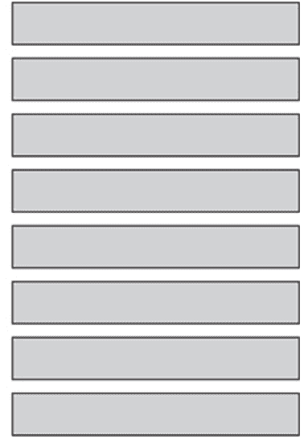

2. 查看每个场景，在线上方写明使用的是交叉电缆还是直通电缆。请注意，在真正的考试中，如果这是性能问题，你将需要拖动适当的电缆类型来连接设备。

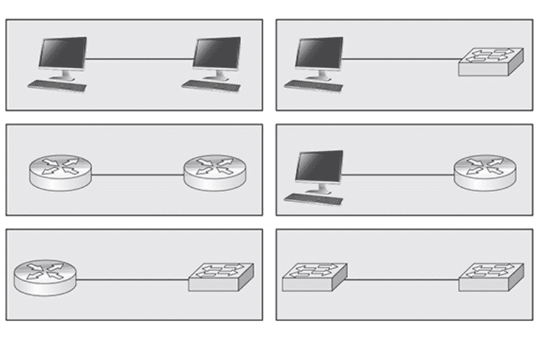

## Answers
- 1. **C.** 平均故障间隔时间（MTBF）通常用于衡量可靠性。
- 2. **A.** 小型办公室/家庭办公室（SOHO）网络涉及使用单个网络设备，例如家庭路由器，提供所有网络功能。
- 3. **A and C: 1 (LAN); B and D: 2 (WAN).** 以太网架构如 1000BaseT 和交换机是 LAN 技术，而路由器和 CSU/DSU 是用于连接到 WAN 的组件。
- 4. **B.** 星型拓扑使用中央连接设备将所有系统连接到网络。
- 5. **D.** spine-leaf 设计拓扑的 leaf 层涉及接入层交换机。该层使终端能够连接到网络。
- 6. **D.** 1000BaseLX 使用单模光纤电缆可达最长 10 km 的距离。
- 7. **B and C.** UTP 使用多对铜线，易受 EMI 和 RFI 干扰。
- 8. **B.** 交叉电缆用于连接相似设备。请记住，直通电缆用于连接不同类型的设备。
- 9. **A.** 笔记本电脑到交换机和交换机到路由器的连接需要两根直通电缆；交换机到交换机的连接需要一根交叉电缆。
- 10. **C.** 1000BaseT 使用 UTP 电缆，使用 RJ-45 连接器。
- 11. **A.** 以太网网络使用 CSMA/CD 作为其访问方法，这意味着设备只有在线路上没有信号（电缆未被使用）时才能发送数据。
- 12. **B.** 所有以太网架构都使用载波侦听多路访问/冲突检测（CSMA/CD）。该访问方法涉及系统在发送数据之前检查线路以确保其没有信号。如果数据与其他数据发生冲突，系统将检测到冲突并重新传输。
- 13. **B.** 1000BaseCX 使用 STP 电缆可达最大 25 米的距离。


14. C. 网络地址转换（NAT）负责将数据包中的私有 IP 地址转换为公共 IP 地址，以便其能够在互联网上传输。

15. A. DHCP 网络服务负责为网络设备分配 IP 地址信息，以便它们可以在网络上通信。

16. D. DNS 服务将 FQDN 转换为 IP 地址。如果您无法 ping FQDN，但可以 ping IP 地址，则可能意味着 DNS 将 FQDN 转换为 IP 地址时出现问题。这通常意味着 FQDN 在 DNS 中不存在，或者您配置为使用错误的 DNS 服务器。

## 性能型答案

以下是对思科考试中常见的性能型问题的答案。

1. 以下为 568B 标准的线序。
- 白线/橙色条纹
- 橙色线
- 白线/绿色条纹
- 蓝色线
- 白线/蓝色条纹
- 绿色线
- 白线/棕色条纹
- 棕色线

2. 下图显示了连接不同类型设备的正确布线类型。请记住，如果设备被视为相似设备，则使用交叉线（路由器连接到计算机的例外情况）。

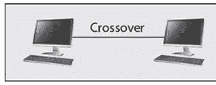

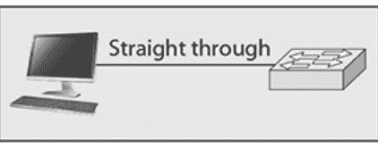

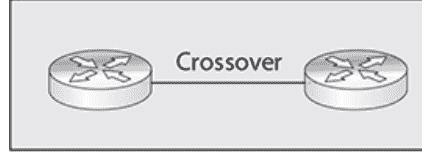

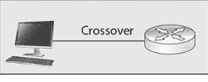

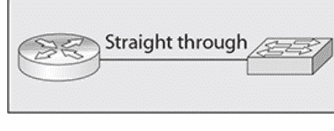

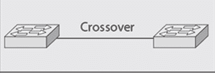

# OSI 参考模型

本章中，您将
- 了解 OSI 参考模型各层的功能
- 了解封装和解封装

在成功配置 Cisco 交换机和路由器之前，您必须了解本章概述的基本网络概念以及后续章节中讨论的高级概念。开放系统互连（OSI）参考模型是最好的起点，因为它将帮助您了解信息如何在网络组件之间传输。OSI 参考模型中的七层中，您应该了解 OSI 模型的底部四层的功能，因为大多数网络组件都在这些层上运行。本章介绍流量如何在网络组件之间一般性移动，并使用 OSI 参考模型来说明封装和解封装过程。

## OSI 参考模型的各层

在 20 世纪 80 年代初，国际标准化组织（ISO）为网络组件制造商定义了一项标准，使这些网络组件能够在不同的环境中通信。该标准的产物体现在 OSI 参考模型的七层中，如图 2-1 所示：应用层、表示层、会话层、传输层、网络层、数据链路层和物理层。每层负责执行特定的过程或角色。

|  |  |
|---|---|
| 第 7 层 | 应用层 |
| 第 6 层 | 表示层 |
| 第 5 层 | 会话层 |
| 第 4 层 | 传输层 |
| 第 3 层 | 网络层 |
| 第 2 层 | 数据链路层 |
| 第 1 层 | 物理层 |

图 2-1 OSI 参考模型的各层


**注意** 一个良好的助记符来记住 OSI 参考模型各层是 “All people seem to need data processing” （应用层，表示层，会话层，传输层，网络层，数据链路层和物理层）。

前三层——应用层、表示层和会话层——的功能被称为 OSI 模型的 *上层*，通常由应用程序软件控制。这些层通常不由网络管理员控制或修改。网络管理员可以利用对传输层、网络层、数据链路层和物理层的了解来帮助排除网络通信故障。这四层被称为 OSI 模型的 *下层*，作为网络专业人员，您应该对这些层感到熟悉。

OSI 模型的每一层都负责与直接在其上和下方的层进行通信，从相邻层接收数据或向相邻层传递数据。例如，表示层将从应用层接收信息，适当地格式化，然后传递给会话层。表示层永远不会直接处理传输层、网络层、数据链路层或物理层。所有层在与其他层的通信方面都遵循相同的原则。


**警告** 了解 OSI 参考模型每一层的功能对于排除网络组件和网络通信故障非常重要。一旦您了解这些功能以及在模型各个层可用的故障排除工具，排除网络相关问题将变得容易得多。

网络通信从 OSI 模型的应用程序层（在发送系统上）开始，并向下穿过各层到达物理层。然后信息沿通信介质传递到接收系统，接收系统从物理层开始向上穿过各层，如图 2-2 所示。（阅读本节时请务必经常参考此图。）

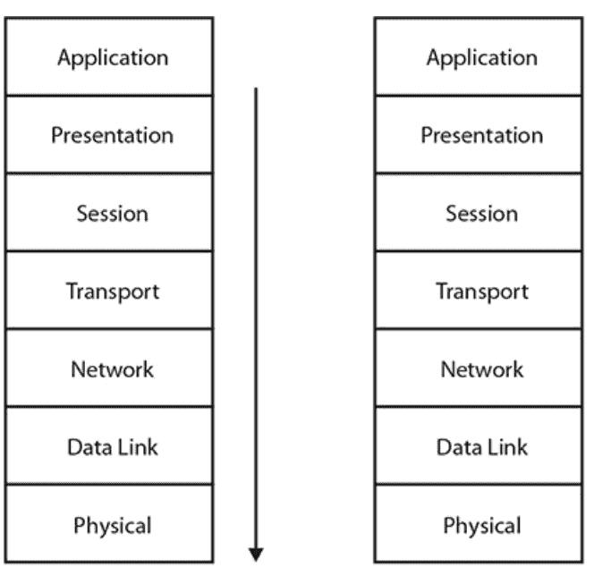

图 2-2 数据包如何在 OSI 模型的各层中移动

当您思考两个设备通信时，例如两台计算机，重要的是要了解在发送计算机的一层上执行的任何操作都会在接收计算机的同一层上撤销。例如，如果发送计算机的表示层压缩信息，则接收计算机上的数据将被解压缩。

让我们从两台在彼此之间发送数据的计算机的角度来看待各层。Computer1 和 Server1 在网络上交换数据。Computer1 是发送计算机，Server1 是接收计算机，如图 2-3 所示。数据交换始于 Computer1 在应用层向 Server1 发送请求。在 Server1，数据向上穿过各层回到应用层，然后将数据传递给系统上的适当应用程序或服务。

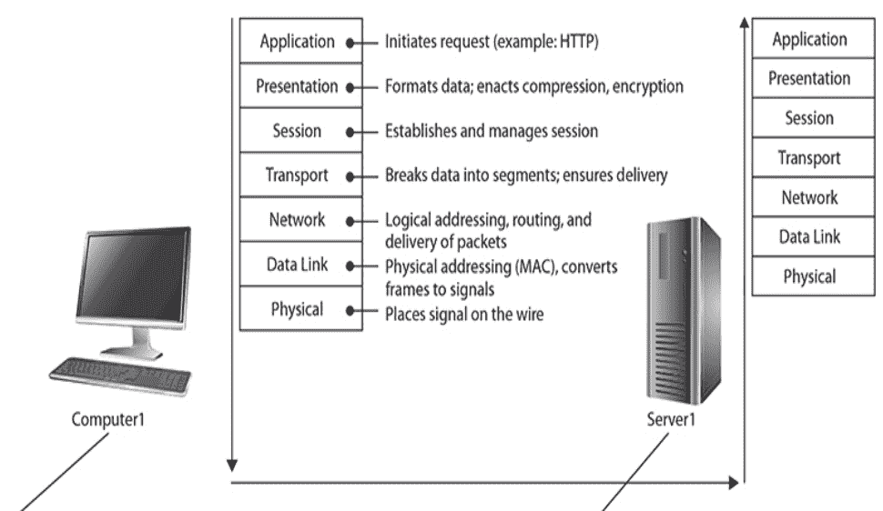

图 2-3 识别 OSI 模型每一层的功能


**考试提示** CCT 考试肯定会测试您对 OSI 模型及其每一层的了解，因此请为考试熟悉这一点！您还应注意，一旦数据到达不同层，就会分配特殊的术语——在第 4 层，数据称为 *段*；在第 3 层，数据称为 *数据包*；在第 2 层，数据称为 *帧*。

## 第 7 层：应用层

发送系统（Computer1）上运行的应用层负责发起实际请求。这可能是任何类型的网络请求——使用网络浏览器进行网络请求（HTTP）、使用简单邮件传输协议（SMTP）进行电子邮件投递请求，或使用网络客户端重定向软件进行文件系统请求。在接收系统上，应用层负责将请求传递给该系统上的适当应用程序或服务。在我们的示例中，我们假设您坐在 Computer1 前并已在网络浏览器中输入 Server1 的地址以创建 HTTP 请求。

有很多很多在应用层运行的协议示例。最常见的是 HTTP、telnet、Secure Shell（SSH）、文件传输协议（FTP）、邮局协议 3（POP3）和简单邮件传输协议（SMTP）。


EXAM TIP 对于考试，请记住 OSI 参考模型的顶层（第七层），应用层，提供使系统能够发起请求（发送系统）或服务请求（接收系统）的协议和服务。应用层协议示例包括 telnet、FTP、HTTP（用于网页浏览）、SSH、POP3 和 SMTP。

## 第 6 层：表示层

请求发出后，应用层将数据向下传递到表示层，在那里对其进行格式化，以便接收系统可以解释数据（或请求）。当表示层从应用层接收数据时，它确保数据处于适当格式——如果不是，表示层会相应地转换数据。在接收系统上，当表示层从会话层接收网络数据时，它确保数据处于适当格式并再次在需要时转换它。

在发送系统的表示层可能发生的格式化功能包括压缩、加密以及确保字符代码集可在另一端解释。例如，如果我们选择压缩我们正在使用的应用程序的数据，应用层将把该请求传递给表示层，但表示层执行压缩。在接收端，此数据

必须被解压缩才能被读取。当数据到达接收计算机的表示层时，它将解压缩数据并将其传递到应用层。

## 第 5 层：会话层

会话层通过建立、管理和终止它们之间的通信来管理计算机之间的对话。当会话建立时，涉及三个不同的阶段。在建立阶段，请求方启动服务以及两个系统之间通信的规则。这些规则可能包括诸如谁传输以及何时传输，以及一次可以发送多少数据之类的内容。两个系统必须就规则达成一致；规则就像对话的礼仪。一旦规则建立，数据传输阶段就开始。双方都知道如何相互交谈，使用什么最有效的方法，以及如何检测错误，所有这些都是由于第一阶段定义的规则。最后，当会话完成时终止发生，通信有序结束。

在我们的示例中，Computer1 在此时与 Server1 创建会话，并且它们就对话的规则达成一致。


考试提示 对于考试，请记住会话层负责设置、维护和拆除网络连接。会话层技术和协议的示例包括远程过程调用（RPCs）和网络文件系统（NFS）。

## 第 4 层：传输层

传输层处理诸如数据的可靠和不可靠交付等功能。对于可靠的传输协议，传输层努力确保数据可靠地交付到其目的地。在发送系统上，传输层负责将数据分解为较小的部分，称为 *段*，这样如果需要重传，只有丢失的段将被发送。丢失的段在传输层从远程系统接收到数据包的确认（ACKs）时被检测到。在接收系统上，传输层负责打开所有数据包并重建原始消息。

传输层的另一个功能是段排序。排序是一种面向连接的服务，它接收乱序接收的段并按正确顺序重新排序。例如，如果我向你发送五个数据包，而你按其序列号接收数据包的顺序为 3、1、4、2、5，传输层将读取序列号并按正确顺序组装它们。

传输层还提供指定“服务地址”的选项，被称为 *端口地址*。端口地址使在系统上运行的服务或应用程序能够通过让每个应用程序在系统上使用唯一的端口地址来指定请求来自哪个应用程序以及请求将前往哪个应用程序。所有现代操作系统同时运行许多程序，并且每个网络程序都有唯一的服务地址。由网络标准等定义的众所周知的服务地址称为 *众所周知的地址*。服务地址也由 TCP/IP 等协议称为 *套接字* 或 *端口*。


**考试提示** 请记住考试中 TCP 是负责可靠交付的传输层协议示例，而用户数据报协议（UDP）是负责不可靠交付的传输层协议示例。

此时，请求被分解为段以便在网络上传递，并且传输层信息（例如所使用的传输协议和任何其他传输信息）被附加到请求中。在本示例中，因为我们处理的是 TCP/IP 应用程序，所以源端口和目标端口被添加。

## 面向连接的通信与无连接通信

面向连接的通信确保数据从发送方到接收方的可靠交付。在建立连接服务时，这种形式的通信要求在通信会话开始时执行某种握手功能。在此过程中，两个计算机确定通信规则，例如一次发送多少数据以及使用哪些端口。握手还确定会话完成时正确终止会话的方式。这确保通信有序结束。

会话是两个计算机之间的可靠对话。会话就像电话呼叫：你通过拨号（握手）建立电话呼叫，然后与对方交谈（交换数据），说“再见”，最后完成后挂断。因为面向连接的服务可以提供可靠通信，所以在两个计算机需要在会话中通信时使用。会话一直保持到两个计算机决定完成通信。

无连接通信是一种通信形式，其中发送系统不会“介绍”自己——它只是发送数据。此外，目标计算机在信息被接收时不会通知源。这种类型的通信被认为不可靠，因为没有通知来保证交付。无连接通信可能比面向连接的通信更快，因为管理会话的开销不存在，并且在信息发送后，没有第二步来确保其被正确接收。

在传输层使用无连接协议意味着传输层协议不保证交付。然而，更高层协议，例如应用层协议，可能包含保证交付的功能。

对于 CCT/CCNA 考试，了解传输层的主要功能很重要：

- 它在两个设备或系统之间设置、维护和拆除连接。
- 它可以提供通过此连接可靠或不可靠地交付数据。
- 它将数据分解为更小、更易管理的段。
- 它复用连接，使多个应用程序能够在同一网络设备上同时发送和接收数据。
- 它可以通过就绪/未就绪信号或窗口实现流量控制，以确保一个组件不会用连接上的过多数据使另一个组件溢出。这两种方法都用于避免拥塞，通常使用缓冲。


**考试提示** 对于考试，你需要知道传输层的五个主要功能：连接管理、数据的可靠和不可靠交付、流量控制、复用和分段。

## 分段

传输层的另一个功能是为会话层设置、维护和拆除连接——也就是说，它处理连接的实际机制。传输层在网络设备之间传输的信息被划分为段。分段是必要的，以便将大量数据分解为网络可以容纳的更易管理的大小。这个过程的一个很好的类比是“通过管道倒鹅卵石比倒巨石更容易。”


**考试提示** 请记住数据在传输层被分解为段。

## 连接复用

由于可能从一个组件建立到另一个组件或多个组件的多个连接，需要某种类型的复用功能来区分穿过各种连接的数据。这确保传输层可以将数据从特定应用程序发送到正确目的地和应用程序，并且在从目的地接收数据时，传输层可以将数据发送到正确的本地应用程序。为了实现连接复用，为每个应用程序分配唯一的端口号。你将在第 3 章中了解更多关于端口号的信息。

## 流量控制

传输层的另一个功能是提供可选的流量控制。流量控制用于确保网络组件不会向目的地发送太多信息，使其接收缓冲区空间溢出并导致其丢弃部分传输的信息。溢出不好，因为源将不得不重新发送所有被丢弃的信息。传输层可以使用两种基本的流量控制方法：

- 就绪/未就绪信号
- 窗口


**考试提示** 对于考试，你应该知道流量控制的目的是确保目的地不会被太多

源发送的信息。

## Ready/Not Ready 信号

当接收方收到的流量超过其处理能力时，它可以向源发送 *未就绪* 信号，指示源应停止传输数据。当接收方有机会赶上并处理源的数据时，接收方会向源回传 *就绪* 信号。在收到就绪信号后，源可以恢复发送数据。

使用就绪/未就绪信号实现流量控制存在两个问题。首先，当其缓冲区填满时，接收方可能会向源发送未就绪信号。在此消息传往源的途中，源 *仍在发送* 信息到接收方，而接收方很可能不得不丢弃这些信息，因为其缓冲区已满。使用这些信号的第二个问题是，一旦接收方准备好接收更多信息，它必须先向源发送就绪信号，而源必须先收到它后才能发送更多信息。这会导致信息传输的延迟。由于就绪/未就绪信号存在这两种低效率，它们通常不用于实现流量控制。有时此过程被称为 *停止/启动*，即在一段时间内停止传输然后重新开始传输。

## Windowing

*窗口机制* 是比使用就绪/未就绪信号更复杂的高级流量控制方法。在窗口机制中，会定义一个窗口大小，指定在源必须等待接收方确认 (ACK) 之前可以发送多少数据（段）。一旦收到 ACK，源就可以发送下一批数据（最高达到窗口大小中定义的上限）。

窗口机制实现了两件事：首先，基于窗口大小强制执行流量控制。在许多协议实现中，窗口大小会在连接开始时动态协商，并且可以在连接生命周期内重新协商。这确保了使用最优的窗口大小来发送数据，而不会导致接收方丢弃任何数据。其次，通过窗口过程，接收方会告诉源收到了什么。这表明源在传输过程中是否丢失了任何数据，并使源能够重新发送任何缺失的信息。这为连接提供了可靠性，并且比就绪/未就绪信号更高效。由于这些优点，大多数面向连接的传输协议，例如 TCP/IP 的 TCP，都使用窗口机制来实现流量控制。

为连接选择的窗口大小会影响其效率和吞吐量，定义了在源必须等待 ACK 之前可以发送多少个段（或字节）。图 2-4 说明了窗口大小的重要性。图的上半部分显示了使用窗口大小为 1 的连接。在这种情况下，源发送一个带有序列号的段（此处为 1），然后等待接收方的确认。根据传输协议的不同，接收方可以以不同的方式发送 ACK：它可以发送回收到的段的序列号列表，也可以发送回它期望的下一个段的序列号。接收方的 ACK 中包含数字 2。这告诉源可以继续发送段 2。同样，当接收方收到此段时，由于窗口大小为 1，接收方会立即回复确认，表明已收到此段。在此示例中，接收方确认回 3，表明可以发送段 3，依此类推。

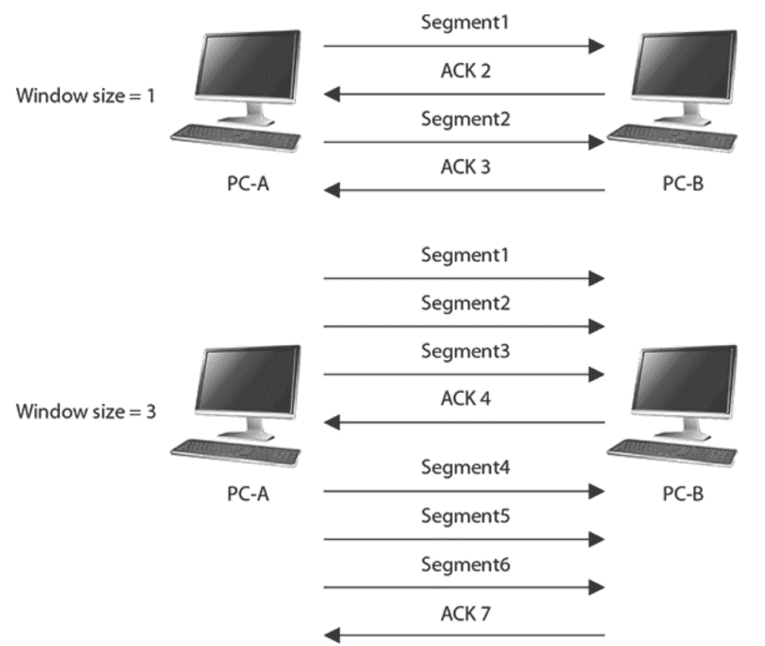

图 2-4 窗口大小影响效率。

正如你所见，使用窗口大小为 1 时，流量控制过程并不快速或高效。让我们看一个窗口大小为 3 的示例，如图 2-4 底部部分所示。使用窗口大小为 3，源可以在等待 ACK 之前一次性发送三个段。一旦段发送完毕（每个段都有其唯一的序列号：1、2 和 3），源必须等待 ACK。在这种情况下，接收方发送回包含数字 4 的 ACK，表明下一个期望的是第四个段。源随后可以继续发送段 4、5 和 6，然后等待接收方的 ACK。在这种情况下，更大的窗口大小更高效：每发送三个段只需要一个 ACK。因此，窗口大小越大，信息传输的效率就越高。

但这并不总是如此。例如，假设一个段在传输到接收方的途中丢失，如图 2-5 所示。在此示例中，协商的窗口大小为 3。PC-A 发送其前三个段，均被 PC-B 成功接收。PC-B 确认它期望的下一个段，即 4。当 PC-A 收到此 ACK 时，它发送段 4、5 和 6。出于某种原因，段 4 丢失且从未到达目的地，但段 5 和 6 却到达了。请记住，接收方正在跟踪收到的内容：1、2、3、5 和 6。在此示例中，接收方发送回 ACK 4，表明期望下一个是段 4。

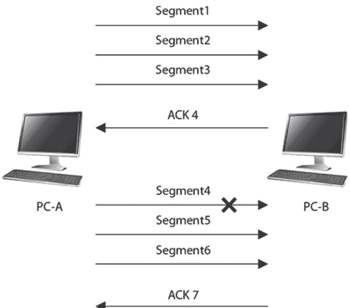

图 2-5 丢失的段和重传

此时，PC-A 的反应取决于所使用的传输层协议。以下是一些可能的选择：

- PC-A 理解只有段 4 丢失，因此重新发送段 4。然后它发送段 7 和 8，填满窗口大小。
- PC-A 不了解收到了什么或未收到什么，因此它发送从段 4 开始的三个段，由 PC-B 指示。

当然，如果丢失了两个段，除非接收方可以发送丢失段的列表，否则第一个选项将不起作用。因此，大多数使用窗口机制的协议栈将实现第二个选项。鉴于这种行为，窗口的大小会影响性能。你通常会认为窗口大小为 100 会非常高效；然而，如果第一个段丢失，一些协议会让 *全部* 100 个段都被重新发送！如前所述，大多数协议栈使用在开始时协商的窗口大小，并且可以随时重新协商。因此，如果连接遇到大量错误，窗口大小可以减小以提高效率。一旦这些错误消失或降至较低速率，窗口大小可以增大以最大化连接的吞吐量。

使情况更加复杂的是，源设备和接收方设备上的窗口大小可以 *不同*。例如，PC-A 的窗口大小可能为 3，而 PC-B 的窗口大小为 10。在此示例中，PC-A 在等待确认之前可以向 PC-B 发送十个段，而 PC-B 只能向 PC-A 发送三个段。


**注意** 就绪/未就绪信号和窗口机制用于在传输层实现流量控制。就绪/未就绪信号效率不高，会导致不必要的流量丢弃和传输延迟。窗口机制解决了这些问题。在窗口机制中，建立了一个窗口大小，定义了在等待接收方确认之前可以传输的段数。

## 第 3 层：网络层

网络层负责管理数据包中的逻辑寻址信息，并使用路由表中存储的信息对这些数据包进行交付或路由。路由表是存储在路由器内存中的可用目标列表。

网络层负责处理逻辑地址。逻辑地址唯一标识网络上的系统，同时标识系统所在的网络。这与媒体访问控制 (MAC) 地址（烧录在网卡上的物理地址）不同，因为 MAC 地址只为系统提供唯一地址，并不指定或暗示系统所在的网络。逻辑地址由网络层协议用来将数据包交付到正确的网络。

在我们的示例中，请求来自 Web 浏览器，目标是 Web 服务器，两者都是在 TCP/IP 上运行的应用程序。此时，网络层会向数据包添加源地址（发送系统的 IP 地址）和目标地址（目标系统的 IP 地址），以便接收系统知道数据包来自何处。


**考试提示** 对于考试，请记住 OSI 模型的第 3 层处理逻辑寻址和路由。逻辑地址的示例是 IP 地址，其形式为 192.168.3.24。IP 地址也称为第 3 层地址。

网络层负责四个主要功能：

- 定义第 3 层使用的逻辑地址
- 基于逻辑地址的网络号查找到达目标组件的路径
- 将不同数据链路层类型连接在一起，例如以太网、光纤分布式数据接口 (FDDI)、串行和令牌环
- 通过使用数据包来传输信息的方式定义分段


为了在具有不同网络号码的设备之间移动信息，需要使用路由器。路由器利用逻辑地址中的信息做出智能决策，以确定如何到达目的地。路由将在第 11 章和第 12 章中讨论，在那里你将学习路由的细节。基本上，当路由器接收到一个数据包时，它会将数据包中的目标地址（来自数据包的第 3 层头部，即目标 IP 地址）与路由表进行比较，以确定路由器是否知道如何将数据发送到该目标网络。


考试提示 考试时请记住，路由器被视为第 3 层设备（网络层），并使用第 3 层地址（IP 地址）工作。

## 第 2 层：数据链路层

在数据链路层，数据从数据包转换为电位信号模式，用于在通信介质上传输数据。在接收系统上，电信号将由数据链路层转换为数据包，然后传递给网络层进行进一步处理。数据链路层分为两个子层：

- **逻辑链路控制 (LLC)** 这负责错误校正和控制功能。
- **媒体访问控制 (MAC)** 这决定主机的物理寻址。它还决定主机如何将流量放置在介质上——例如，载波侦听多路访问/冲突检测（CSMA/CD）与令牌传递。

MAC 子层维护物理设备地址（通常称为 MAC 地址），用于与网络上的其他设备通信。这些物理地址被烧录到网卡中，构成了用于确定网络流量的源和目的地的低级地址。请注意，MAC 地址用于本地网络段上的通信，而 IP 地址用于不同网络上的通信。你将在第 4 章中了解更多关于 IP 地址的信息。


**考试提示** 对于 CCT/CCNA 考试，请记住 MAC 地址是分配给网卡的物理地址，被称为第 2 层地址。MAC 地址是一个 48 位值，以十六进制格式显示。MAC 地址的示例是 00-02-3F-6B-25-13。

在我们的示例中，一旦发送系统的网络层附加 IP 地址信息，数据链路层将为发送和接收系统附加 MAC 地址信息。该层还将通过将数据包转换为二进制信号来为线路准备数据。在接收系统上，数据链路层将把物理层传递给它的信号转换为数据，然后将数据包传递给网络层进行进一步处理。


**考试提示** 请记住考试中，第 1 章中你学到的网络访问方法和体系结构在 OSI 模型的第 2 层运行。例如，以太网和令牌环网络体系结构在 OSI 模型的第 2 层定义。

## 第 2 层帧

数据链路层定义网络组件如何访问其所连接的介质，并定义介质的帧类型和传输方法。帧包括数据链路层用于与同一线路或第 2 层拓扑上的设备通信的字段和组件。这种通信仅发生在同一数据链路层介质类型（或同一段线路）上的组件之间，在同一网络段内。例如，要跨越第 2 层协议，从以太网到令牌环，通常使用路由器。


**考试提示** 考试中的一些问题要求你知道大多数广域网（WAN）协议主要在数据链路层和物理层运行。

本地局域网（LAN）连接的第 2 层协议和标准的示例包括电气和电子工程师学会（IEEE）802.2、802.3 和 802.5；Ethernet II；以及 FDDI。第 2 层 WAN 协议和技术的示例包括异步传输模式（ATM）、帧中继、高级数据链路控制（HDLC）、点对点协议（PPP）、同步数据链路控制（SDLC）、串行线路互联网协议（SLIP）和 X.25。


**考试提示** 对于考试，请记住数据链路层定义硬件（MAC）地址以及在介质类型内发生的通信过程。交换机、网桥以及网络接口控制器或卡（NIC）是主要在数据链路层运行的网络组件。例如，交换机使用生成树协议（STP）或快速生成树协议（RSTP）防止网络环路，这些被认为是第 2 层协议。数据链路层协议和标准的示例包括 IEEE 的 802.2 和 802.3；Ethernet II；HDLC；PPP；和帧中继。这里也进行错误检测，但不进行纠正（不重传，只丢弃坏帧）。

数据链路层还负责定义第 2 层帧的格式以及设备如何在物理层上相互通信的机制。数据链路层负责以下内容：

- 定义 MAC 或硬件地址
- 定义连接的物理或硬件拓扑
- 定义网络层协议如何在数据链路层帧中封装
- 提供无连接和面向连接的服务
- 验证接收帧的校验和以确保其有效（如果无效，则丢弃）


考试提示 请记住，数据链路层的主要功能是规范连接到同一第 2 层协议的两个网络设备如何相互通信。它还验证接收帧的校验和以确保其有效。帧用于在数据链路层传输信息。如果设备位于不同的第 2 层协议或段上，网络层（第 3 层）通常在这些设备的通信中发挥作用。

## 数据链路层寻址

数据链路层使用 MAC 或硬件地址进行通信。对于 LAN 通信，同一网络段或拓扑上的每台机器都需要唯一的 MAC 地址。MAC 地址长度为 48 位，表示为十六进制数字，长度为 12 个字符。为了便于阅读，MAC 地址以点分十六进制格式表示，如下所示：FFFF.FFFF.FFFF。也常见以这种方式格式化的 MAC 地址：*FF:FF:FF:FF:FF:FF*。由于 MAC 地址使用十六进制数字，使用的值范围从 0 到 9 和 A 到 F，单个数字共有 16 个值。例如，十六进制值 A 在十进制中为 *10*。


**考试提示** 对于考试，你应该记住 MAC 地址在第 2 层唯一标识设备。MAC 地址只需在广播域内唯一，该广播域包括所有第 2 层连接的冲突域。MAC 地址使同一物理网络（第 2 层）上的不同设备之间能够通信。

每个网卡制造商都被分配一个唯一的 24 位厂商 ID，然后将其用作该厂商创建的任何网卡的 MAC 地址的前 24 位。每个厂商有一个或多个唯一的厂商 ID，每个厂商 ID 构成 MAC 地址的前半部分。这前六位数字通常称为 *组织唯一标识符 (OUI)*。例如，Cisco 的一个 OUI 值是 *0000.0C*。最后六位数字用于在 OUI 值内唯一表示网络接口卡（NIC）。理论上，每个 NIC 都有唯一的 MAC 地址。然而，实际上这可能并不正确。对你而言重要的是，在同一 *网络段* 内，你的每个设备的网卡上都有唯一的 MAC 地址。有些设备允许你更改此硬件地址，而有些则不允许。


**考试提示** 请记住，对于 CCT/CCNA 考试，MAC 地址的前 24 位称为 OUI，它是用于该厂商创建的所有接口卡的 MAC 地址第一部分的唯一值


供应商。你可以在不同的广播域或虚拟局域网中使用相同的 MAC 地址，但在同一网络段中不能使用。

## 通信类型

网络上可以发生不同类型的通信，每种通信都使用特定的寻址方法来识别消息的接收对象。每个数据链路层帧包含两个 MAC 地址：创建该帧的机器的源 MAC 地址，以及预期接收该帧的设备或设备的目的 MAC 地址。表 2-1 显示了三种一般的通信类型。以下各节将更深入地介绍这些通信类型。

| 通信类型 | 描述 |
|---|---|
| 单播 | 表示向段上的单个设备进行通信 |
| 广播 | 表示向段上的每个设备进行通信 |
| 组播 | 表示向段上的一组设备进行通信 |

表 2-1 数据链路地址类型

### 单播

具有目的 *unicast* MAC 地址的帧仅用于段上的一个网络组件。图 2-6 的上部显示了单播通信的一个示例。在此示例中，PC-A 创建了一个以太网帧，其目的 MAC 地址包含 PC-C 的地址。当 PC-A 将此数据链路层帧放到线路上时，段上的所有设备都会接收到它，但除 PC-C 之外的所有系统都会丢弃该帧，因为它不是发给它们的。这为我们提供了使用单播进行一对一通信。

### 单播

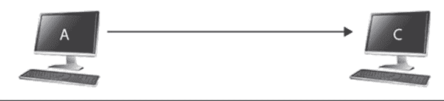

### 组播

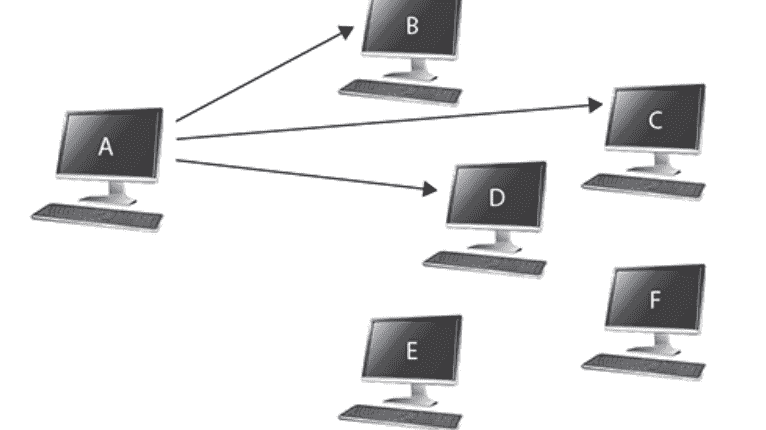

### 广播

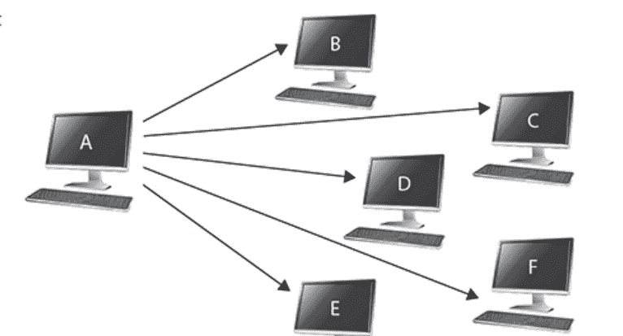

图 2-6 单播、组播和广播通信

### 组播

与单播地址不同，*multicast* 通信表示向段上的一组设备进行通信。组播组可以包含零个设备到段上的每个设备。组播的一个有趣之处在于组的成员资格是 *dynamic* 的——设备可以加入和离开组播组。（组播的详细过程超出了本书的范围。）

图 2-6 的中间部分显示了组播通信的一个示例。在此示例中，请注意通信发送给少数系统，但不是所有系统。

### 广播

*broadcast* 消息发送到网络上的所有系统。图 2-6 的底部部分显示了广播的一个示例。在此示例中，PC-A 将广播地址放在数据链路层帧的目的字段中。第 2 层表示的广播地址为 *FF:FF:FF:FF:FF:FF*。然后该帧被放到线路上。请注意，在此示例中，计算机 B、C、D、E 和 F 接收到广播消息，并且它们 *all* 都处理它。需要注意的是，网络上的设备将处理两种帧：发往其自身 MAC 地址的帧，或发往广播地址 (*FF:FF:FF:FF:FF:FF*) 的帧。

## 第 1 层：物理层

OSI 层次结构的最底层只关心在网络介质上移动数据位。这包括网络的物理拓扑（或结构）、所用介质的电气和物理方面，以及比特传输和接收的编码和时序。

在我们的示例中，一旦网络层附加了逻辑地址并将数据传递给数据链路层，在那里附加了 MAC 地址并将数据转换为电信号，数据随后会被传递给物理层，以便在通信介质上释放。在接收系统上，物理层会从线路上拾取数据并将其传递给数据链路层，在那里它将通过读取目的 MAC 地址来确保信号是发往该系统的。


**EXAM TIP** 请记住，对于 CCT/CCNA 考试，任何处理电信号的东西都在 OSI 模型的第 1 层运行。这包括网络电缆和连接器。

物理层负责网络连接的物理机制，包括以下内容：

- 网络设备上使用的接口类型
- 用于连接设备的电缆类型
- 电缆两端使用的连接器
- 电缆上每个连接使用的针脚排列
- 通过将二进制数字转换为基于介质类型的物理表示来对信号上的消息进行编码，例如铜线的电信号、光纤的光信号或无线电的无线电波

接口类型，或 NIC，可以是您插入计算机的物理卡，例如千兆以太网卡，或路由器上的固定接口，例如 Cisco 1921 路由器上的千兆以太网端口。

物理层还负责二进制信息如何转换为物理层信号以及反之亦然。例如，如果电缆使用铜作为传输介质，物理层定义了如何通过使用不同的电压电平将二进制 1 和 0 转换为电信号。如果电缆使用光纤，物理层定义了如何使用发光二极管（LED）或激光以不同的光频率表示 1 和 0。

## 设备

在排除网络组件故障时，网络技术人员了解技术在 OSI 模型的哪一层运行会很有用。表 2-2 提供了在 OSI 参考模型三个层上运行的设备的提醒。

| 层 | 层名称 | 设备 |
|---|---|---|
| 3 | 网络 | 路由器 |
| 2 | 数据链路 | 交换机、网桥、网卡 |
| 1 | 物理 | 集线器和中继器 |

表 2-2 设备及其所运行的层


**EXAM TIP** 请记住，对于考试而言，任何处理逻辑寻址或路由的技术都被认为在第 3 层运行，任何处理 MAC 地址的技术都在第 2 层运行，任何处理电信号的技术都在 OSI 模型的第 1 层运行。

现在您已经了解了七层 OSI 模型，让我们尝试一个练习来检验您新获得的知识。

## 练习 2-1：混合匹配 OSI 模型定义

在此练习中，您将术语与其适当的定义进行匹配。本练习旨在让您有机会识别 OSI 模型每一层的目的。

| 定义 | 层 |
|---|---|
| ____ 负责数据包的逻辑寻址和交付 | A. Session |
| ____ 负责格式化消息 | B. Physical |
| ____ 负责物理寻址并将数据包转换为电信号 | C. Application |
| ____ 负责创建、管理和结束对话 | D. Network |
| ____ 负责可靠交付、排序以及将消息分解为数据包 | E. Data link |
| ____ 负责将信号放置到线路上或从线路上移除 | F. Presentation |
| ____ 负责发起或接收网络请求 | G. Transport |

## 封装和解封装

术语 *data encapsulation* 指的是随着数据在 OSI 模型的七层中向下传递，报头信息会添加到消息中。例如，当信息到达 OSI 模型的第 4 层时，会添加第 4 层报头，其中包含该层的协议信息，例如端口号。在发送系统上，添加第 4 层报头，然后数据传递到第 3 层，在那里第 3 层报头被添加到数据和第 4 层报头的左侧。第 3 层报头包含第 3 层协议信息，例如第 3 层源地址和目的地址。一旦应用了第 3 层报头，消息随后传递到第 2 层，在那里分配第 2 层报头并包含源和目的 MAC 地址（第 2 层地址）。

在接收系统上，消息沿 OSI 模型向上传递。接收系统剥离第 2 层报头并读取目的 MAC 地址以确保该系统是消息的目的地。一旦读取了第 2 层报头，消息随后传递到第 3 层协议，该协议读取第 3 层报头（如图 2-7 所示）。这种 *de-encapsulation* 过程继续沿着 OSI 模型的七层向上进行。


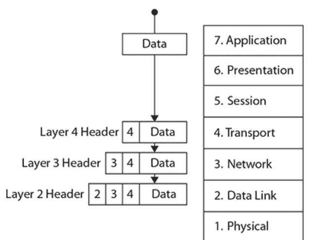

图 2-7 OSI 模型的每一层都添加一个头部。

一般来说，*协议数据单元*（PDU）描述数据在 OSI 模型每一层中传递时的情况。在每一层，都会向数据添加一个新的头部。表 2-3 描述了在各层使用的 PDU 术语。例如，当数据从会话层传递到传输层时，传输层通过添加第 4 层头部来*封装*数据 PDU。此时数据被称为段。随着 PDU 信息向下传递，每一层都会添加自己的头部，此时数据在模型中使用不同的术语。例如，一旦添加了第 3 层头部，数据就不再称为段；它现在被视为*packet*。同样，一旦添加了第 2 层头部信息，数据就被称为*frame*。这对你理解很重要，因为当你阅读第 9 章和第 10 章时，你会注意到我们不使用“分组包”一词——交换机运行在第 2 层，因此它处理的是帧而不是分组包。

| PDU 术语 | OSI 参考模型层 |
|---|---|
| 数据 | 应用层、表示层和会话层 |
| 段 | 传输层 |
| 分组包 | 网络层 |
| 帧 | 数据链路层 |
| 位 | 物理层 |

表 2-3 PDU 术语和层


考试提示 你需要知道表 2-3 中 PDU 术语的层级指定，并且应该记住计算机以二进制（位）处理数据。你可以用一个快速的助记法来记住 PDU 术语：“Do Sergeants Pay For Beer?”（data, segment, packet, frame, bits）。

一旦到达物理层，数据链路层帧的位将被转换为物理层信号——根据所采用的物理介质类型，转换为电压、光源、无线电波或其他信号。当目的地接收到信息时，它会经历一个反向的解封装过程——基本上在信息从 OSI 模型的层到层向上传递时，剥离每一层 PDU 信息的头部和尾部。

图 2-8 显示了数据在层间向下和向上传递时用于封装和解封装 PDU 的过程示例。在此示例中，你可以看到应用层、表示层和会话层如何创建数据 PDU。随着此信息从层到层向下传递，每一层都会添加自己的头部（并且可能添加尾部，如大多数第 2 层协议的情况）。

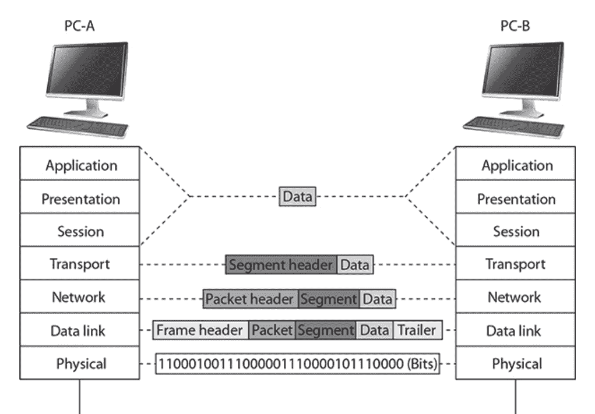

图 2-8 封装和解封装过程

接下来的几节将帮助你更好地理解设备在计算机之间传输信息时所经历的过程。下一节详细介绍了信息如何被封装并沿协议栈向下发送，然后放置在到目的地的线路上。随后的一节介绍了反向过程：信息如何在目的地被解封装并传递到应用层的应用程序。章节的最后一部分考察了一个更复杂的环境，其中网桥、路由器和集线器参与通信过程以将信息从源传递到目的地。

## 沿协议栈向下

本节介绍信息在计算机上沿协议栈向下发送时处理的基本机制。请参考前面图 2-8 中显示的图表，随着 PC-A 向 PC-B 发送数据来跟随此过程。在此示例中，假设数据链路层为 Ethernet，物理层为铜缆。

PC-A 上发生的第一个事情是，用户坐在计算机前创建某种信息或数据，然后将其发送到另一个位置（PC-B）。这包括实际的用户输入（应用层）以及任何格式信息（表示层）。会话层的应用程序（或操作系统）然后确定数据的预期目的地是本地于这台计算机（可能是磁盘驱动器）还是远程位置。在此实例中，用户将信息发送到 PC-B。我们假设用户正在执行 telnet 连接。

会话层确定该位置是远程的并让传输层传递信息。Telnet 连接使用 TCP/IP 和传输层的可靠连接（TCP），它将来自更高层的数据封装成段。使用 TCP，如你在第 3 章中将看到的，只添加头部。段包含诸如源端口号和目的端口号等信息。


**注意** 根据 RFC 标准，TCP 或 UDP 源端口号实际上应高于 49,151，但并非所有操作系统都严格遵循此标准——在许多情况下，源端口号将高于 1023。

传输层将段向下传递给网络层，后者将段封装成分组包。分组包仅添加头部，其中包含第 3 层逻辑寻址信息（源地址和目的地址）以及其他信息，例如创建此信息的上层协议。在此示例中，TCP 创建了此信息，因此该事实记录在分组包头部中，并且 PC-A 将其 IP 地址作为分组包中的源地址放置，PC-B 的 IP 地址作为目的地址。这有助于目的地在网络层确定分组包是否发给自己以及哪个上层进程应处理封装的段。在 TCP/IP 协议栈中，术语*packet*和*datagram*可互换使用来描述此 PDU。如你在第 3 章中将看到的，许多协议参与 TCP/IP 协议栈——地址解析协议（ARP）、TCP、UDP、互联网控制消息协议（ICMP）、开放最短路径优先（OSPF）、增强型内部网关路由协议（EIGRP）等。

网络层随后将分组包向下传递给数据链路层。数据链路层通过添加头部和尾部将分组包封装成帧。此示例使用 Ethernet 作为数据链路层介质，该介质在第 1 章中讨论过。放置在 Ethernet 帧头部中的重要组件是源和目的 MAC 地址，以及帧校验序列（FCS）值，以便目的地在接收时确定帧是否有效或已损坏。在此示例中，PC-A 将其 MAC 地址放置在帧的源字段中，并将 PC-B 的 MAC 地址放置在目的字段中。FCS 在第 1 章中有更深入的讨论。

数据链路层帧随后被传递到物理层。此时，请记住“PDU”的概念是我们为了使数据对我们更易读以及帮助将信息传递到目的地而放在数据上的一个人类概念。然而，从计算机的角度来看，数据只是一堆二进制值，1 和 0，或位。物理层根据电缆或连接类型将这些位转换为物理属性。在此示例中，电缆是铜缆，因此物理层会将位转换为电压：位值为 1 的一个电压电平，0 的另一个电压电平。

## 沿协议栈向上

为简单起见，假设 PC-A 和 PC-B 在同一段铜缆上。一旦目的 PC 接收到物理层信号，物理层就会将电压电平转换回其二进制表示，并将这些位值传递给数据链路层。

数据链路层将位值重新组装成原始数据链路帧（Ethernet）。网络适配器检查 FCS 以确保帧有效，并检查目的 MAC 地址以确保以太网帧是发给自己的。如果目的 MAC 地址不

与自身 MAC 地址匹配，或它不是多播或广播地址，网卡会丢弃该帧。否则，网卡会处理该帧。在这种情况下，网卡发现封装的数据包是 TCP/IP 数据包，因此它剥离（解封装）以太网帧信息并将数据包上交给网络层的 TCP/IP 协议栈。

网络层随后检查数据包头中的逻辑目的地址。如果目的逻辑地址与自身地址不匹配或不是多播或广播地址，网络层会丢弃该数据包。如果逻辑地址匹配，则目的地的网络层会检查数据包头中的协议信息以确定应由哪个协议处理该数据包。在此示例中，逻辑地址匹配且协议定义为 TCP。因此，网络层剥离数据包信息并将封装的分段上交给传输层的 TCP 协议。

接收到分段后，传输层可以根据这是可靠连接还是不可靠连接执行许多功能。本讨论重点关注传输层的复用功能。在此实例中，传输层检查分段头中的目的端口号。在我们的示例中，PC-A 的用户正在使用 telnet 将信息传输到 PC-B，因此目的端口号为 23。传输层检查该端口号并意识到封装的数据需要转发给 telnet 应用程序。如果 PC-B 不支持 telnet，传输层会丢弃该分段。如果支持，传输层会剥离分段信息并将封装的数据传递给 telnet 应用程序。如果这是新连接，操作系统会启动一个新的 telnet 进程。

请注意，逻辑通信发生在两个设备的两个层之间。例如，PC-A 与 PC-B 之间在传输层发生逻辑通信，网络层和数据链路层也是如此。


## 考试提示

参加考试时，您应熟悉在设备之间传输数据时沿协议栈向下（封装）和向上（解封装）的过程。

## 层与通信

正如封装和解封装过程所示，源计算机和目标计算机在传输和接收信息时都会发生许多过程。如果源和目标位于不同的网段，由集线器、交换机和路由器等其他网络设备分隔，则会变得更加复杂。图 2-9 显示了此过程的一个示例。

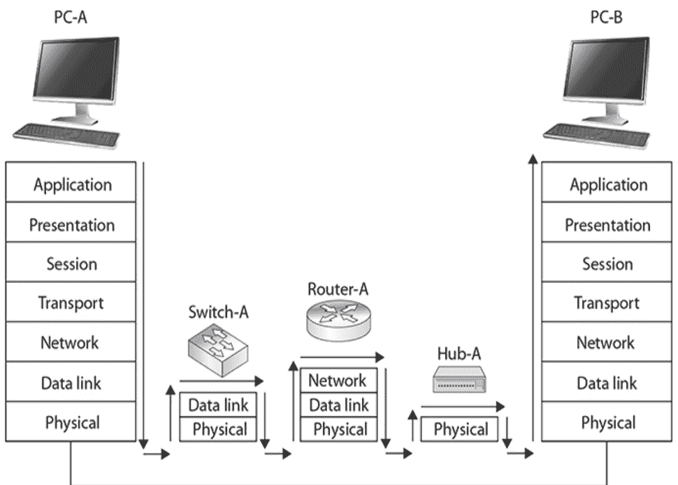

图 2-9 多段通信

让我们看看信息从 PC-A 传输到 PC-B 的路径。在此示例中，PC-A 想要向 PC-B 发送数据。请注意，每个设备都需要处理特定层的信息。例如，一旦 PC-A 将其信息放置在传输介质上，连接到 PC-A 的交换机就需要处理此信息。回想一下本章前面提到，交换机在 OSI 模型的第 2 层工作。而路由器基于目的第 3 层逻辑地址做出路径决策，交换机则基于帧中发现的第 2 层目的 MAC 地址做出路径决策。因此，交换机的物理层必须将物理层信号转换为比特并将这些比特上交给数据链路层，在那里它们被重新组装成帧。交换机检查帧的目的 MAC 地址并做出交换决策，找到帧需要退出的端口。交换机需要将数据转发给路由器，因此它随后将帧下传到物理层，在那里帧的比特被转换为物理层信号。 （交换将在第 9 章中更详细地讨论。）

下一个遇到的设备是路由器。回想一下本章前面提到，路由器在 OSI 模型的第 3 层（网络层）工作。路由器首先在物理层将数据（即在电线上行进的电信号）转换为比特。比特被上交给数据链路层并重新组装成帧。路由器随后检查帧中的目的 MAC 地址。如果 MAC 地址与自身 MAC 地址不匹配，路由器会丢弃该帧。如果 MAC 地址匹配，路由器会剥离数据链路层帧并将数据包上交给网络层。

在路由器的网络层，路由器的一个功能是将数据包路由到目的地。为此，路由器检查数据包中的目的逻辑地址并从该地址中提取网络号。路由器随后将网络号与路由表中的条目进行比较。如果路由器找不到匹配项，它会丢弃数据包；如果找到匹配项，它会将数据包转发到目的接口（由路由器路由表指定的本地接口）。

为了实现数据包转发，路由器将数据包下传到数据链路层，后者将数据包封装为正确的数据链路层帧格式。如果这是一个以太网帧，例如，源 MAC 地址将是路由器的，目的地将是 PC-B。在数据链路层，帧随后被下传到物理层，在那里比特再次被转换为物理层电信号。


## 考试提示

在不同网段的两个设备之间发送流量时，源设备具有以其自身 MAC 地址作为源、默认网关（路由器）MAC 地址作为目的的第 2 层帧；然而，在第 3 层数据包中，源第 3 层地址是源设备，目的第 3 层地址不是默认网关，而是源设备试图到达的实际目的地。对于考试，请记住第 2 层地址用于在同一物理或逻辑第 2 层网段/网络上与设备通信，而第 3 层地址用于跨网络（多个网段）与设备通信。另一种记忆方法是 MAC 地址可以从链路到链路发生变化，但默认情况下第 3 层逻辑地址不会发生变化。

请注意，路由器分隔物理或逻辑网段，而网桥和交换机则不会。因此，如果 PC-A 想要向 PC-B 发送流量，PC-A 使用路由器的 MAC（或第 2 层）地址将流量发送到网段的出口点，但它使用 PC-B 的逻辑（或第 3 层）地址告诉路由器此流量不是针对路由器，而是针对不同网段上的机器。

在图 2-9 中，接收这些物理层信号的下一个设备是集线器。请记住，在当今时代，这很可能是一个交换机，但我希望在图中加入一个集线器来讨论集线器如何处理数据。回想一下本章前面提到，集线器和中继器在物理层工作。基本上，集线器是一个多端口中继器：它会重复其接收到的任何物理层信号。因此，集线器一个接口上接收到的信号会被重复到其所有其他接口上。这些信号随后被 PC-B 接收，后者将此信息沿协议栈向上传递，如前一节所述。今天公司使用交换机而不是集线器，因为集线器会将数据（电信号）发送到所有端口，而交换机则会通过仅将数据发送到目的地址连接的端口来过滤流量。

## 针对 CCT/CCNA 考试：关于 OSI 参考模型的需要记住的内容

参加考试时，请确保您熟悉 OSI 参考模型及其最初开发的原因。

您应知道各层的名称和顺序：应用层、表示层、会话层、传输层、网络层、数据链路层和物理层。您还应知道在各个层工作的设备类型（路由器/网络层、交换机/数据链路层和集线器/物理层）以及这些设备执行的一些重要功能。例如，路由器在网络段之间交换数据包，它们阻止广播的传播，它们可以基于第 3 层逻辑地址进行过滤，并且它们确定到目的逻辑网络的路径。您还应能够命名在各个层工作的示例协议。例如，telnet 和 FTP 在应用层工作。

特别熟悉传输层、网络层和数据链路层及其功能。例如，传输层设置、维护和拆除连接。它可以提供数据的可靠或不可靠传输。它将数据分割成更小、更易管理的块。它可以通过就绪/未就绪信号或通过使用序列号和确认号的窗口来实现流量控制以避免拥塞。它使用缓冲区存储传入数据并通过使用端口号和第 3 层地址复用多个连接。TCP 和 UDP 是在传输层运行的示例协议。

网络层定义逻辑地址，通过路由器上的路由表找到到目的逻辑地址的最佳路径，并连接不同第 2 层链路类型。记住路由器提供的优势，例如通过使用分层网络设计和路由协议实现可扩展性、遏制广播、智能路径选择和流量过滤。

数据链路层定义设备如何连接到第 2 层介质类型以及这些设备如何通过使用物理地址（如以太网中的 MAC 地址）相互通信。了解 MAC 地址的格式：它长 48 位，以十六进制表示。


你还应熟悉 OSI 参考模型各层使用的 PDU 术语——段/传输层、包或数据报/网络层、帧/数据链路层以及位/物理层。你还应能够描述设备在各层如何与其他设备通信：从源到目的地的各个设备之间使用哪些第 2 层或第 3 层地址。请记住 MAC 地址可能会因链路而异，但第 3 层地址，例如 TCP/IP 地址，通常不会改变。

## Chapter Review

OSI 参考模型定义了连接两个网络功能层的过程。应用层提供用户界面。表示层决定数据如何向用户表示。会话层负责建立和拆除连接。传输层负责连接的机制，包括保证服务。网络层提供逻辑拓扑和第 3 层地址：路由器在此工作。数据链路层定义 MAC 地址以及在特定介质类型上如何进行通信：交换机、网桥和 NIC 在此工作。物理层定义连接和通信的物理属性：中继器和集线器在此工作。无线解决方案在物理层定义。

传输层建立并维护会话层连接，并提供可靠或不可靠的数据传输、流量控制和连接复用。可靠连接通常通过握手过程建立连接。确认用于提供可靠传输。端口或套接字号用于连接复用。就绪/未就绪信号和 windowing 用于实现流量控制。Windowing 比就绪/未就绪信号更高效。

网络层定义逻辑地址，根据地址的网络部分查找到目的地的路径，并将不同的第 2 层介质类型连接在一起。路由器用于限制广播。路由器使用其路由表，其中包含目的网络号列表，以帮助其查找目的地。如果在路由表中找不到目的地，路由器会丢弃该目的地的流量。

数据链路层定义硬件寻址。MAC 地址长度为 48 位，以十六进制表示。前 24 位（六位数字）是组织唯一标识符（OUI）。MAC 地址只需在逻辑段内唯一。在单播中，一个帧发送到段上的所有设备，但只有一个设备会处理它。在组播中，一个帧发送到一组设备。在广播中，一个帧发送到所有设备。

协议数据单元（PDU）描述数据及其开销。应用层的 PDU 称为数据，传输层的 PDU 称为段，网络层的 PDU 称为包或数据报，数据链路层的 PDU 称为帧，物理层的 PDU 称为位。随着流量向下经过协议栈，每一层都会对上层 PDU 进行封装。在目的地，随着流量向上经过协议栈，会发生解封装过程。

## Quick Review

### Introduction to the OSI Reference Model

- OSI 参考模型提供以下优势：它促进互操作性，定义如何连接相邻层，将组件分 compartmentalize，允许模块化设计，充当教学工具，并简化故障排除。

### Layers of the OSI Reference Model

- 应用层（第 7 层）负责发起网络请求，或为该网络请求提供服务。表示层（第 6 层）定义信息格式。会话层（第 5 层）负责对话的建立和拆除。传输层（第 4 层）处理可靠或不可靠服务的机制。网络层（第 3 层）负责逻辑寻址和路由。路由器在第 3 层工作。数据链路层（第 2 层）分配物理（MAC）地址并定义特定介质类型上设备如何相互通信。网桥、交换机和 NIC 在第 2 层工作。物理层（第 1 层）处理连接的所有物理属性。集线器和中继器在此工作。

- 数据链路层定义 MAC 地址、物理或硬件拓扑以及使用的帧格式；它提供面向连接和无连接服务。MAC 地址长度为 48 位，以十六进制表示。前六位数字是 OUI（厂商代码），后六位数字表示 OUI 内的 NIC。单播发送到段上的一个目的地，组播发送到一组设备，广播（FF:FF:FF:FF:FF:FF）发送到所有设备。

- 网络层定义逻辑地址，使用逻辑地址中的网络号查找到目的地的路径，并将不同介质类型连接在一起。路由器在网络层工作。路由表包含有关目的网络号及其如何到达的信息。路由器限制广播，通过分层设计实现可扩展性，比网桥做出更好的目的地到达决策，可使用 VLAN 在同一接口上切换数据包，并可实现 QoS 和过滤等高级功能。

- 传输层建立并维护会话连接，将数据分段为更小的负载，提供可靠或不可靠的数据传输，实现流量控制并复用连接。可靠连接使用序列号和确认。TCP 是示例。可靠传输协议使用握手过程建立连接。不可靠服务不使用连接建立过程。UDP 是示例。连接复用通过端口或套接字号完成。流量控制可通过就绪/未就绪信号或 windowing 实现。Windowing 更高效。窗口大小影响吞吐量。根据大小，源可以在等待确认之前发送 X 个段。

### Encapsulation and De-encapsulation

- 协议数据单元（PDU）描述数据及其开销。每一层都有唯一的 PDU：随着数据向下经过协议栈，每一层通过添加头部以及可能尾部进行封装。目的地在流量向上经过协议栈时对数据进行解封装。

- 传输层 PDU 是段，网络层 PDU 是包或数据报，数据链路层 PDU 是帧，物理层 PDU 是位。

## Questions

以下问题将帮助你衡量对本章材料理解程度。仔细阅读所有选项，因为可能有多个正确答案。选择每个问题的正确答案。

1. OSI 参考模型提供了以下所有内容，除了哪一项？
A. 定义连接两个层之间的过程，促进供应商之间的互操作性
B. 允许供应商将设计工作划分为模块化设计，从而简化实现并简化故障排除
C. 将复杂功能分离为更简单的组件
D. 定义所有网络协议共有的八层
E. 提供教学工具，帮助网络管理员理解网络组件之间使用的通信过程

2. 按从高到低的顺序排列以下 OSI 参考模型层：(a) 会话，(b) 表示，(c) 物理，(d) 数据链路，(e) 网络，(f) 应用，(g) 传输。
A. c, d, e, g, a, b, f
B. f, a, b, g, d, e, c
C. f, b, g, a, e, d, c
D. f, b, a, g, e, d, c

3. OSI 模型的 _________ 层提供物理寻址。
A. Transport
B. Network
C. Data link
D. Physical

4. Sue 注意到所有计算机上网卡的 MAC 地址前半部分（24 位）相同。MAC 地址的前 24 位代表什么？
A. AUI
B. NIA
C. RTP
D. OUI

5. 网络层处理以下所有问题，除了 ________。
A. Broadcast problems
B. Conversion between media types
C. Hierarchy through the use of physical addresses
D. Splitting collision domains into smaller ones

6. ________ 用于提供可靠连接。
A. Ready/not ready signals
B. Sequence numbers and acknowledgments
C. Windows
D. Ready/not ready signals and windowing

7. 连接复用是通过使用 ________ 号完成的。
A. Socket
B. Hardware
C. Network
D. Session

## Performance-based Questions

Cisco 考试有基于性能的问题，你必须将屏幕左侧的项目拖到屏幕右侧的正确位置以回答问题。以下是一些基于性能的示例问题。

1. 将设备与设备在 OSI 参考模型中工作的层进行匹配。


第一层

重复器

交换机

路由器

集线器

第二层

第三层

2. 将PDU名称与OSI参考模型中使用它的层进行匹配。

第一层

第二层

数据包

段

帧

位

第三层

第四层

## 答案
- 1. D. OSI参考模型是一个七层模型，而不是八层模型，它作为所有网络组件（包括网络硬件和软件）的标准。
- 2. D. 从上到下，OSI参考模型具有以下各层：应用层、表示层、会话层、传输层、网络层、数据链路层和物理层（f, b, a, g, e, d, c）。
- 3. C. 数据链路层提供物理寻址。
- 4. **D.** MAC地址的前24位标识网络卡制造商的厂商ID。该ID也称为组织唯一标识符（OUI）。
- 5. **C.** 网络层通过使用逻辑地址而不是物理地址来创建层次结构。逻辑地址的示例是IP地址。
- 6. **B.** 序列号和确认用于提供可靠的传输层连接。
- 7. **A.** 连接复用是通过使用套接字或端口号完成的。

## 基于绩效的答案
以下是对基于绩效问题的答案。

1. 以下是在每个设备上运行的OSI模型层。

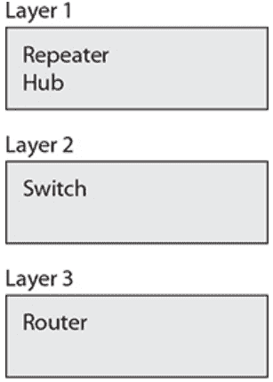

2. 以下标识OSI模型不同层数据的PDU名称。

第一层

位

第二层

帧

第三层

数据包

第四层

段

# TCP/IP协议套件
本章中，您将

- 了解TCP/IP模型的各层
- 了解传输层协议
- 使用互联网层协议

当前使用最广泛的协议套件是传输控制协议/互联网协议（TCP/IP）。由于其流行性、灵活性、兼容性以及在小型和大型网络实现中都能发挥作用的能力，互联网和大多数公司内联网目前都使用TCP/IP。TCP/IP可以连接从大型机到手持计算机的各种主机。CCT和CCNA认证考试会大量测试您对TCP/IP的了解。虽然TCP/IP是最常用的协议，但它并不是最容易配置的——甚至也不是最容易理解的。本章为您提供了对TCP/IP的深入理解，包括其使用涉及的架构、寻址问题和配置。CCT和CCNA考试将测试您对该协议的了解，但最重要的是，它们将测试您对不同规模网络的协议实际配置的了解。


**EXAM TIP** TCP/IP是一个协议套件——意味着其中包含多个协议。您需要为CCT认证考试了解其中若干协议，并作为CCNA考试的背景信息。

正如您将在本章中了解的那样，套件中的每个协议都有特定的目的和功能。对于CCT和CCNA考试来说，了解TCP/IP的演变并不重要，因此我们在此讨论您可能被测试的协议的细节。请务必花时间学习TCP/IP相关章节，因为这些知识将在您作为网络专业人员工作时帮助您。

## TCP/IP模型
TCP/IP模型，也称为TCP/IP模型，是一个与七层OSI参考模型概念相似的四层模型。TCP/IP模型的四层映射到OSI版本的七层，但TCP/IP模型合并了OSI模型的多个层，如图3-1所示。TCP/IP协议套件中有多个协议指导计算机如何使用TCP/IP连接和通信，并且每个协议都在TCP/IP模型的不同的层上运行。

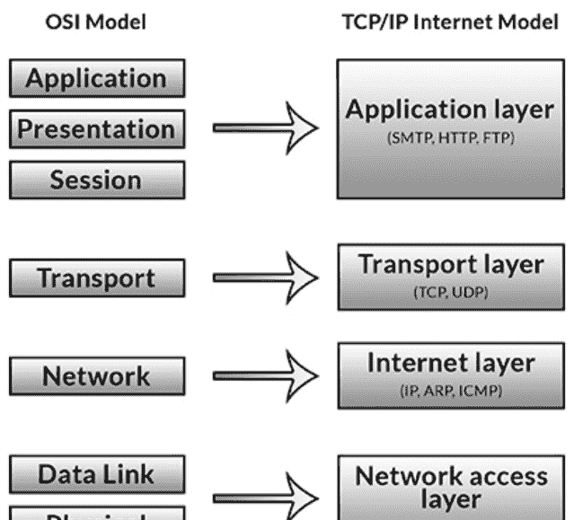

图3-1 OSI模型与TCP/IP模型（图形由Brendon Clarke设计和创建）

## 应用层
应用层位于TCP/IP模型的最顶层，对应于OSI模型的应用层、表示层和会话层。它负责发起网络请求（发送计算机）或处理请求（接收计算机）。因此，例如，当用户从Web浏览器提交请求时，负责提交请求的Web浏览器在应用层运行。当该Web请求到达Web服务器时，运行在应用层的Web服务器接受该请求。

以下是流行的应用层协议：

- **超文本传输协议（HTTP）** 在Web服务器和Web浏览器之间传输HTML页面
- **超文本传输协议安全（HTTPS）** 从Web服务器向Web浏览器传送加密的HTML页面
- **简单邮件传输协议（SMTP）** 发送Internet电子邮件
- **邮局协议（POP）** 读取或下载电子邮件到您的系统
- **文件传输协议（FTP）** 让您从网络或Internet上的系统下载文件
- **域名系统（DNS）** 将完全限定域名（FQDN）转换为IP地址
- **远程桌面协议（RDP）** 帮助您远程操作系统

## 传输层
下一层是传输层，它负责连接导向通信（建立会话）和无连接通信（不建立会话）。当请求从应用层向下传递时，会选择传输协议来处理它。TCP/IP中的两个传输协议是传输控制协议（TCP）和用户数据报协议（UDP）。当数据在TCP/IP模型的各层中向下传递时，如果需要连接导向通信，则使用TCP作为传输层协议，但如果需要无连接通信，则使用UDP。

## 互联网层
互联网层对应于OSI模型的网络层。它负责许多重要的网络活动，例如逻辑寻址、路由以及将逻辑地址转换为物理媒体访问控制（MAC）地址。

以下是在此层运行的协议示例：

- **互联网协议（IP）** 处理所有逻辑寻址（IP地址）和路由功能
- **地址解析协议（ARP）** 将逻辑地址（IP地址）转换为物理地址（MAC地址）
- **互联网控制消息协议（ICMP）** 报告TCP/IP协议套件的状态和任何错误

随着我们继续阅读本章，您将了解更多关于这些协议的信息。

## 网络访问层
网络访问层有时也称为网络接口层或链路层。网络访问层对应于OSI模型的数据链路层和物理层。网络访问层组件的示例包括网络架构、物理寻址、电缆、连接器、网络媒体以及任何其他第2层和第1层网络组件。由于网络访问层组件已在第1章中讨论过，因此本章将重点介绍TCP/IP的协议。

## 传输层协议
现在让我们更详细地了解一下传输层协议。请记住，传输层包括TCP和UDP协议。在本节中，您将了解每个协议的细节并检查协议头。

## 传输控制协议
TCP负责提供连接导向通信并确保数据交付（称为可靠交付）。连接导向通信首先在两个系统之间建立连接，然后确保跨连接发送的数据到达目的地。TCP将通过重新传输任何丢失或损坏的数据来确保数据到达目的地。TCP被应用程序使用，这些应用程序需要可靠的传输，但这种传输的开销比无连接协议更大，因为会话的构建以及跨该会话的任何数据的监控和重传。

关于TCP的另一个需要记住的因素是，该协议要求接收方确认成功接收数据。当然，所有确认或ACK都会在网络上产生额外的流量，从而减少在给定时间范围内可以传递的数据量。TCP会话的创建、监控和结束所涉及的额外开销是值得的，因为TCP可以确保数据到达目的地。

TCP通过使用序列号和确认号来确保数据交付。序列号是分配给发送的每块数据的数字。系统接收到一块数据后，通过向发送方发送确认消息来确认已接收数据，其中原始序列号成为回复消息的确认号。

## TCP三次握手
在系统可以通过TCP通信之前，它必须首先建立与远程系统的连接。它通过TCP三次握手来完成此操作（见图3-2）。

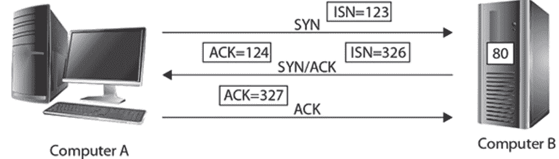


## 图 3-2 TCP 三次握手

TCP 三次握手涉及三个阶段：

- 1. **SYN** 发送系统向接收系统发送 SYN 消息。每个发送的数据包都被分配一个唯一的序列号。SYN 消息包含 *初始序列号*（ISN），即要使用的第一个序列号。在此示例中，计算机 A 正在连接到计算机 B 上的网站，因此 SYN 消息发送到计算机 B 的端口 80。
- 2. **SYN/ACK** 此阶段确认第一条消息，同时指示其初始序列号。在此示例中，计算机 B 发送回 SYN/ACK 消息，确认它已收到数据包 123（通过确认 124 是下一个序列号），但它也指定了其 ISN 为 326。
- 3. **ACK** 最后阶段是确认消息，确认第二阶段发送的数据包已收到。在此示例中，计算机 A 发送 ACK 以确认它已收到数据包 326，通过确认下一个数据包将是序列号 327。

## 从 TCP 会话断开连接

正如 TCP 使用三次握手过程在希望通信的两个系统之间创建连接一样，它也有一个参与者从对话中断开的过程。查看图 3-3，如果计算机 A 想从 TCP 会话断开，它必须首先向计算机 B 发送 FIN 标志以发出它想要结束对话的信号。

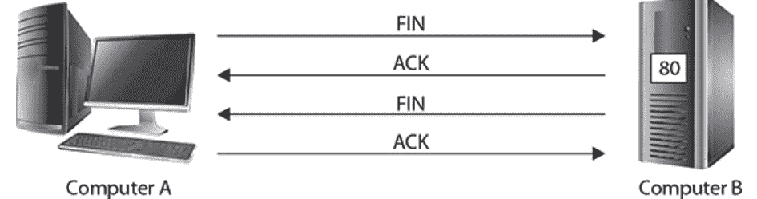

### 图 3-3 终止 TCP 连接

当计算机 B 收到 FIN 消息时，它会回复确认，然后向计算机 A 发送自己的 FIN 消息。作为此过程的最后一步，计算机 A 必须确认它已收到来自计算机 B 的 FIN 消息。这类似于与某人通过电话交谈——要结束对话，你说再见，然后等待对方说再见后再挂断。我将此描述为以“礼貌”的方式结束对话。

也有一种以“不礼貌”的方式结束对话的方法。回到电话类比：你可以通过在不说再见的情况下挂断电话来不礼貌地结束对话。在 TCP 世界中，你可以通过发送带有 RST（重置）标志设置的 TCP 消息来“挂断”。

## TCP 端口

当应用程序使用 TCP 或 UDP 在网络上通信时，每个应用程序必须由系统上的唯一端口号唯一标识。端口是分配给应用程序的地址。当客户端想要与其中一个应用程序（也称为服务）通信时，它必须将请求发送到系统上的适当端口号。

作为网络专业人员，你必须知道流行服务使用的一些端口号。表 3-1 标识了你在现实世界和 CCT/CCNA 认证考试中应该知道的常见 TCP 端口号。

| 端口 | 服务 | 描述 |
|------|---------|-------------|
| 20 | FTP 数据 | FTP 用于向客户端发送数据 |
| 21 | FTP 控制 | FTP 命令发送到服务器时使用 |
| 22 | SSH | 用作 telnet 的安全替代协议 |
| 23 | Telnet | Telnet 用于远程连接到系统，例如服务器或路由器 |
| 25 | SMTP | 用于发送 Internet 电子邮件 |
| 53 | DNS | 用于 DNS 区域传输 |
| 80 | HTTP | 用于向浏览器提供网页 |
| 110 | POP3 | POP3 用于读取电子邮件的 Internet 协议 |
| 143 | IMAP | IMAP 用于读取电子邮件的较新 Internet 协议 |
| 443 | HTTPS | 用于安全网页流量 |
| 3389 | RDP | 用于远程管理 Windows 系统的远程桌面的 TCP 端口 |

表 3-1 常用 TCP 端口

TCP 和 UDP 都支持多达 65,536 个端口号，范围从 0 到 65,535。端口号分为三个不同的类别：

- **众所周知** 这些端口号范围从 0 到 1023，由 Internet 分配号码管理局（IANA）分配给在 Internet 上常用的应用程序服务器，例如 HTTP、DNS 和 SMTP。
- **已注册** 这些端口号范围从 1024 到 49,151，由 IANA 为专有应用程序分配，例如 Microsoft SQL Server、Adobe Shockwave、Oracle 软件等。
- **动态分配** 这些端口号范围从 49,152 到 65,535，由系统动态分配，通常由客户端软件使用，例如你的网络浏览器、FTP 客户端或 telnet 客户端。

## TCP 标志

TCP 使用 TCP 标志来标识重要类型的数据包。图 3-4 显示了数据包捕获中的标志。请注意，显示的不是实际的标志，而是由 Network Monitor 解释的值并显示描述。例如，而不是看到 URG 标志设置为 0，你可以看到第一个标志设置为 0，描述为“无紧急数据”。

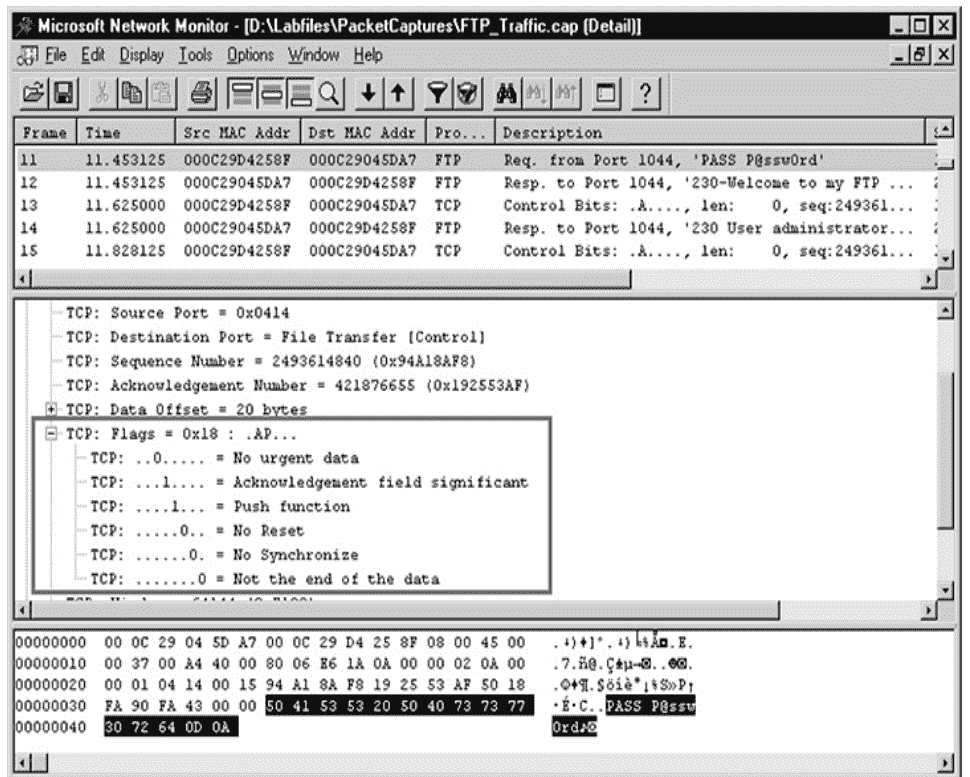

### 图 3-4 TCP 头部中的 TCP 标志

以下是你应为 CCT/CCNA 认证考试熟悉的常见 TCP 标志：

- **SYN** SYN 标志分配给三次握手 SYN 阶段的任何数据包。
- **ACK** 确认标志确认先前的数据包已收到。
- **PSH** 推送标志旨在强制数据到应用程序。
- **URG** 紧急标志指定数据包是紧急的。
- **FIN** 完成标志指定你希望完成或结束连接。这是礼貌地结束 TCP 连接的方式——就像说再见来结束电话对话一样。
- **RST** 重置标志用于不礼貌地结束 TCP 对话。这就像在不说再见的情况下挂断电话。

## TCP 头部

使用 TCP 发送的每个数据包都分配有一个 TCP 头部，其中包含 TCP 相关信息，例如源端口、目标端口和 TCP 标志。图 3-5 显示了 TCP 头部中的不同字段。

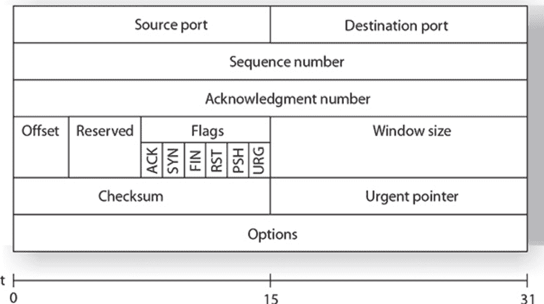

### 图 3-5 TCP 头部

以下是 TCP 头部中每个字段的简要描述：

- **源端口** 此 16 位字段标识发送系统的端口号。
- **目标端口** 此 16 位字段标识数据包在目标系统上的目标端口号。
- **序列号** 此 32 位字段标识数据包的序列号。
- **确认号** 此 32 位字段标识此数据包正在确认的数据包。
- **偏移** 此 4 位字段指示数据开始的位置。
- **保留** 此 6 位字段始终设置为 0，并为将来使用而设计。
- **标志** 此 6 位字段存储 TCP 标志。此处每个 TCP 标志都有一个 1 位字段，如本节前面所述。
- **窗口大小** 此 16 位字段确定在期望确认之前可以发送的信息量。
- **校验和** 此 16 位字段用于验证 TCP 头部的完整性。
- **紧急指针** 此 16 位字段仅在设置 URG 标志时使用，是对最后一段紧急信息的引用。
- **选项** 这是一个可变长度字段，指定 TCP 头部中可能需要的任何其他设置。


**考试提示** 请记住，对于 CCT 认证，TCP 和 UDP 被认为是 OSI 模型第 4 层（传输）协议。

## 用户数据报协议

UDP 由不关心数据是否到达目标系统的应用程序使用。UDP 用于无连接通信（不可靠），这意味着数据发送到目的地，并且不会做出任何努力来跟踪数据包的进度或确定它是否到达目的地。

## UDP 端口

与 TCP 类似，UDP 使用端口号来标识不同类型的 UDP 流量。表 3-2 标识了一些 UDP 流量示例及其使用的端口。

| 端口 | 服务 | 描述 |
|------|---------|-------------|
| 53 | DNS | UDP 端口 53 用于 DNS 查询。 |
| 67 和 68 | DHCP | UDP 端口 67 由 DHCP 服务使用，端口 68 由客户端请求使用。 |
| 69 | TFTP | Trivial File Transfer Protocol 用于在无需身份验证的情况下上传或下载文件。 |
| 137 和 138 | NetBIOS | UDP 端口 137 和 138 由 NetBIOS 名称服务和数据报服务使用。 |
| 161 | SNMP | UDP 端口 161 由简单网络管理协议使用。 |

表 3-2 常用 UDP 端口

## UDP 头部

由于 UDP 不需要确认数据包的接收，因此 UDP 头部的结构比 TCP 头部简单得多。例如，UDP 头部不需要序列号或确认号；它也不需要标志来指示特殊数据包，例如 SYN 消息，因为没有三次握手（UDP 是无连接的）。图 3-6 显示了 UDP 头部。

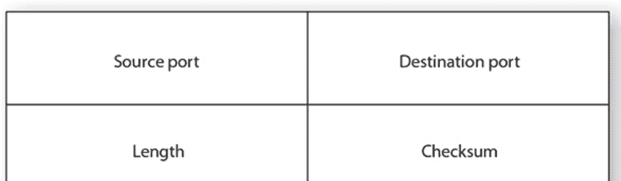

### 图 3-6 UDP 头部


UDP 头部包含以下字段：

- **源端口** 该 16 位字段指示发送系统上发送应用程序使用的端口。
- **目的端口** 该 16 位字段指示目的系统上应用程序使用的端口。
- **长度** 该 16 位字段指定 UDP 头部的大小（以字节为单位）。
- **校验和** 该 16 位字段用于验证 UDP 头部的完整性。

## 网际层协议

选择传输协议后，该协议基于通信应是有连接的还是无连接的，信息会传递到网际层以确定谁负责其交付。少数协议在网际层运行，例如 IP、ICMP 和 ARP。

### 网际协议

网际协议（IP）为模型中更高层的协议提供数据包传输。它是一种无连接的传输系统，会尽最大努力尝试将数据包传递到正确的目的地。IP 不保证数据包的传递——这是传输协议的责任；IP 只是发送数据。


**考试提示** 对于 CCT 和 CCNA 考试，你应该记住 IP 是 OSI 模型中的第 3 层协议，负责逻辑寻址和路由。

网际协议还负责 TCP/IP 的逻辑寻址和路由，因此被视为 OSI 模型中的第 3 层协议。路由器上的 IP 负责递减数据包的 TTL（生存时间，通常减 1），以防止其在“网络环路”中运行。一旦数据包的 TTL 递减到 0，路由器就会将数据包从网络中移除并向发送方发送状态消息（使用 ICMP）；这可以防止环路。Windows 操作系统默认 TTL 为 128，而大多数 Linux 操作系统默认 TTL 为 64。

### IP 头部

数据包中的 IP 头部包含有助于数据包从源到目的传输的信息。图 3-7 显示了 IP 头部结构。

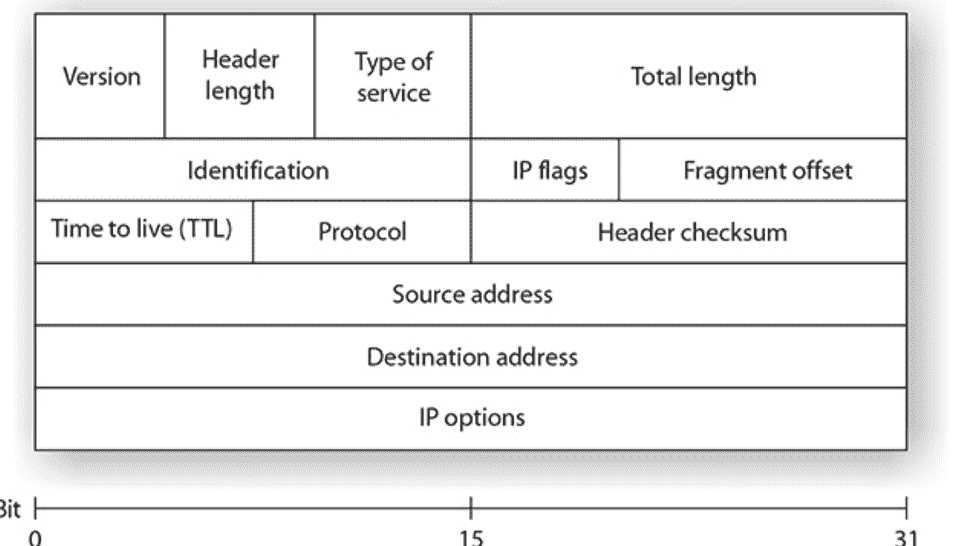

图 3-7 IP 头部

以下是 IP 头部字段及其含义的列表：

- **版本** 该 4 位字段标识正在使用的 IP 版本，例如版本 4 或 6。
- **头部长度** 该 4 位字段指示 IP 头部的大小。
- **服务类型** 该 8 位字段指示系统应如何处理数据包。例如，如果在此处指定低延迟选项，则意味着系统应立即处理数据包。
- **总长度** 该 16 位字段指示 IP 数据包的大小。
- **标识** 由于网络只能处理特定最大大小的数据包——称为 *最大传输单元*（MTU）——系统可能会将发送的数据拆分为多个片段。该 16 位字段唯一标识片段。
- **IP 标志** 该 3 位字段指定如何处理片段。例如，更多片段（MF）标志表示还有更多片段要传输。此外，一个称为禁止分片（DF）的位指定不分片数据包。
- **分片偏移** 该 13 位字段指定在组装数据包时如何重新组合片段的顺序。
- **生存时间（TTL）** 该 8 位字段指定数据包的过期时间。TTL 是随着数据包经过的每个路由器而递减的值。当 TTL 达到 0 时，数据包将被丢弃。
- **协议** 该 8 位字段指定数据包应使用哪种第 4 层协议（TCP 或 UDP）。
- **头部校验和** 该 16 位字段验证 IP 头部的完整性。
- **源地址** 该 32 位字段表示发送系统的 IP 地址。这就是接收系统知道将回复消息发送到何处的方式。
- **目的地址** 该 32 位字段表示数据包的目的系统 IP 地址。
- **IP 选项** 该可变长度字段用于指定 IP 头部中的其他设置。

## 网际控制报文协议

网际控制报文协议（ICMP）使 TCP/IP 网络上的系统能够共享状态和错误信息。你可以使用状态信息来检测网络故障。ICMP 消息封装在 IP 数据报中，以便它们可以在网络中路由。使用 ICMP 消息的两个程序是 ping 和 tracert。

你可以使用 ping 向 IP 地址发送 ICMP 回显请求并等待 ICMP 回显响应。Ping 报告发送请求和接收响应之间的时间间隔。使用 ping，你可以确定网络上特定 IP 系统是否正常运行。你可以使用 ping 实用程序的许多不同选项。


考试提示 请记住，对于 CCT 和 CCNA 考试，ICMP 是 TCP/IP 协议套件中负责错误和状态报告的协议。ping 和 tracert 等程序使用 ICMP。

Tracert 跟踪到特定主机的路径。该实用程序在排除互联网故障时很有用。Tracert 在递增 IP 头部中的 TTL 字段（从 1 开始，每次递增 1）时向 IP 地址发送 ICMP 回显请求，然后分析返回的 ICMP 错误。每个后续的回显请求应在 TTL 字段达到 0 之前再深入网络一个单位，然后尝试转发它的路由器会返回“ICMP 超时”错误消息。

### ICMP 类型和代码

ICMP 不使用端口号，而是使用 ICMP 类型和代码来标识不同类型的消息。例如，ping 请求使用的回显请求消息使用 ICMP 类型 8，而 ping 回复则返回 ICMP 类型 0 消息。

ICMP 的某些类型在类型中用不同的代码进一步细分为更精细的级别。例如，ICMP 类型 3 是“目标不可达”消息，但由于目标不可达的原因有很多，因此该类型被细分为不同的代码。每个代码代表该类型中的不同消息（见表 3-3）。

| 类型 | 代码 | 描述 |
|---|---|---|
| 0 - 回显应答 | 0 | 回显应答消息 |
| 3 - 目标不可达 | 0 | 目标网络 |
|  | 1 | 目标主机不可达 |
|  | 2 | 目标协议不可达 |
|  | 3 | 目标端口不可达 |
| 8 - 回显请求 | 0 | 回显请求消息 |

表 3-3 常见 ICMP 类型和代码

### ICMP 头部

与 IP 头部和 TCP 头部相比，ICMP 头部非常小。图 3-8 显示了 ICMP 头部，接下来是字段列表：

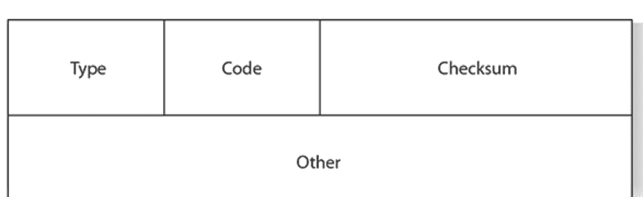

图 3-8 ICMP 头部

- **类型** 该 8 位字段指示正在使用的 ICMP 类型。
- **代码** 该 8 位字段指示正在使用的 ICMP 代码。
- **校验和** 该 16 位字段用于验证 ICMP 头部的完整性。
- **其他** 该字段存储 ICMP 头部中的任何数据。例如，Microsoft 操作系统在此字段中放置字母的一部分用于回显请求消息。

还请注意，网际组管理协议（IGMP）是另一个网际层协议，用于组播应用。

## 地址解析协议

地址解析协议（ARP）在 TCP/IP 网络上提供 IP 地址到物理地址的解析。为了实现这一功能，ARP 发送广播消息，其中包含 ARP 请求数据包，其中包含它试图查找的系统的 IP 地址。本地网络上的所有系统都会看到该消息，而拥有 ARP 正在查找的 IP 地址的系统会通过 ARP 回复数据包向源系统发送其物理地址进行回复。然后物理/IP 地址组合存储在源系统的 ARP 缓存中以供将来使用。


**考试提示** 对于 CCT 认证考试，请记住 ARP 负责将 IP 地址（第 3 层地址）转换为物理媒体访问控制（MAC）地址（第 2 层地址）。

所有系统都维护包含 IP 地址到物理地址映射的 ARP 缓存。在发起广播之前，始终会检查 ARP 缓存是否存在 IP 地址到物理地址的映射。让我们更详细地看看 ARP 的工作原理。

### 单段 ARP 示例

让我们开始讨论 ARP 在单段网络上的工作原理，在该网络中，每个人都存在于单个局域网中。图 3-9 显示了 ARP 用法的示例。


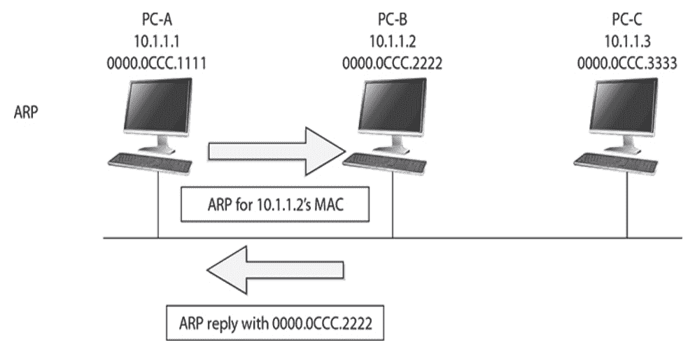

## 图 3-9 单段上的 ARP

在本例中，PC-A 想直接向 PC-B 发送信息。PC-A 知道 PC-B 的 IP 地址（或已通过 DNS 解析为 IP 地址）；然而，它不知道 PC-B 的以太网 MAC 地址。为了解析或转换 IP 地址为 MAC 地址，PC-A 生成一条 ARP 请求报文。在 ARP 请求报文中，源 IP 地址为 10.1.1.1，目的 IP 地址为 255.255.255.255（广播地址，表示数据发往网络上的每台设备）。PC-A 在 ARP 数据报的数据字段中包含 PC-B 的 IP 地址。这被封装到一个以太网帧中，源 MAC 地址为 0000.0CCC.1111（PC-A 的 MAC 地址），目的 MAC 地址为 FF:FF:FF:FF:FF:FF（本地广播地址），然后放置在以太网段上。PC-B 和 PC-C 都能看到此帧，因为它是发往所有系统（广播报文）。

两个设备的网络接口卡（NIC）注意到数据链路层广播地址并假定此帧是发给它们的，因为目的 MAC 地址是广播地址，因此它们剥离以太网帧并将带有 ARP 请求的 IP 数据报上交给互联网层。同样，目的 IP 地址字段中也有广播地址，因此两个设备的 TCP/IP 栈都会检查数据负载。PC-B 注意到这是一条 ARP 请求并且查询中的是其自身的 IP 地址，因此它直接向 PC-A 回复 PC-B 的 MAC 地址。

PC-C 然而，看到这不是针对其自身 MAC 地址的 ARP 请求，并忽略该请求的数据报广播。


**注意** 一个重要的事情是 PC-B 和 PC-C 在收到初始广播报文后都会将 PC-A 的 MAC 地址添加到其本地 ARP 表中。它们这样做是为了如果任一设备需要与 PC-A 通信，就不必像 PC-A 那样执行 ARP 请求。ARP 缓存表中的条目会在 MAC 地址一段时间内未使用后超时。此时间段取决于所使用的操作系统，但通常可以由用户或管理员更改。此外，设备可以生成一个 *gratuitous ARP*，即在没有对应的 ARP 请求的情况下生成的 ARP 回复。这通常在设备可能更改其 IP 地址或 MAC 地址并希望通知段上所有其他设备有关更改，以便其他设备在其本地 ARP 表中拥有正确信息时使用。

## 双段 ARP 示例

图 3-10 显示了 ARP 跨网络的工作方式。对于 CCT 和 CCNA 认证考试，你理解这一点非常重要。在本例中，PC-A 想使用 IP 连接到 PC-B。源 IP 地址为 1.1.1.1（PC-A），目的地址为 2.2.2.2（PC-B）。由于两个设备位于不同的网络，因此使用路由器在网络之间通信。因此，如果 PC-A 想向 PC-B 发送内容，必须通过中间路由器发送。然而，这种通信并非在网络层使用 IP 进行；相反，它发生在数据链路层。

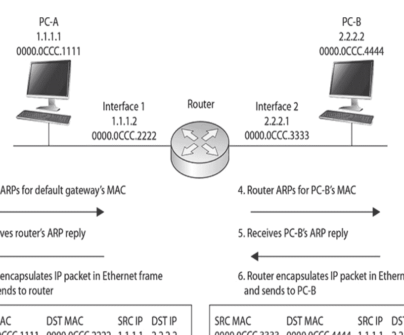

| SRC MAC | DST MAC | SRC IP | DST IP |
|---|---|---|---|
| 0000.0CCC.1111 | 0000.0CCC.2222 | 1.1.1.1 | 2.2.2.2 |

| SRC MAC | DST MAC | SRC IP | DST IP |
|---|---|---|---|
| 0000.0CCC.3333 | 0000.0CCC.4444 | 1.1.1.1 | 2.2.2.2 |

## 图 3-10 带路由器的 ARP 示例

PC-A 首先要做的是确定目的 IP 地址是在本地网络还是远程网络（你将在第 4 章学习这是如何发生的）。在本例中，确定目的位于远程网络，因此 PC-A 需要知道默认网关路由器的 MAC 地址才能将数据发送给路由器。如果路由器的 MAC 地址尚未在其本地 ARP 缓存中，PC-A 将为默认网关的 MAC 地址生成 ARP 请求。这在图 3-10 的步骤 1 中显示。在步骤 2 中，路由器用其连接到 PC-A 的以太网接口的 MAC 地址进行响应。在步骤 3 中，PC-A 创建一个具有源和目的 IP 地址的 IP 数据包（源为 1.1.1.1，目的为 2.2.2.2，即 PC-B），并将其封装在以太网帧中，源 MAC 地址为 PC-A，目的 MAC 地址为路由器。PC-A 然后将以太网帧发送给路由器。

当路由器接收到以太网帧时，路由器将帧与其实体以太网接口上的 MAC 地址进行比较，匹配成功。路由器剥离以太网帧并根据目的地址 2.2.2.2 做出路由决策。在这种情况下，网络直接连接到路由器的第二个接口。在步骤 4 中，如果路由器在其本地 ARP 缓存中没有 PC-B 的 MAC 地址，路由器将对 PC-B（2.2.2.2）的 MAC 地址执行 ARP，并在步骤 5 中收到响应。路由器然后在步骤 6 中将原始 IP 数据包封装到新的以太网帧中，将其第二个接口的 MAC 地址作为源帧放置在源 MAC 地址字段中，并将 PC-B 的 MAC 地址放置在目的字段中。当 PC-B 收到此帧时，它知道该帧是发给自己的（目的 MAC 地址匹配），并且根据第 3 层 IP 头中的源 IP 地址，PC-A 是封装的 IP 数据包的源。

请注意，在本例中，路由器并未更改数据包中的原始 IP 地址，但使用了两个以太网帧将 IP 数据包送达目的地。此外，每个设备都会在本地 ARP 缓存中保留 MAC 地址，因此下次 PC-A 需要向 PC-B 发送内容时，设备将不必再次对其他中间设备执行 ARP。


**考试提示** ARP 用于确定第 2 层地址，以便与同一广播域中的设备通信。对于考试，要熟悉第 2 层和第 3 层中哪个设备与哪个其他设备通信。当源和目的之间有路由器时，请注意第 2 层地址在通信路径的每一步都在变化，但源和目的 IP 地址保持不变。

## 练习 3-1：识别 TCP/IP 协议

在本练习中，你将通过将协议与正确描述匹配来复习 TCP/IP 协议。

| Protocol | Description |
|---|---|
| __ TCP | A. 将逻辑地址转换为物理地址 |
| __ SMTP | B. 负责逻辑寻址和路由 |
| __ ICMP | C. 负责可靠交付 |
| __ ARP | D. 用于下载文件的应用层协议 |
| __ UDP | E. 负责错误和状态报告 |
| __ HTTPS | F. 用于发送电子邮件的互联网协议 |
| __ FTP | G. 网页流量的安全传输 |
| __ IP | H. 不可靠交付 |

## 章节回顾

在本章中，你学习了 TCP/IP 的基础知识以及使其在当今网络市场中如此常见的因素。以下列表总结了你所学的内容：

- TCP/IP 是一个协议套件，其中最流行的是 TCP、UDP、IP 和 ARP。（CCT/CCNA 考试肯定会有几个问题测试你在现实世界情况下对这些协议的了解。）
- 应用层协议负责发起网络请求或为网络请求提供服务。示例应用层协议有 HTTP、FTP、DNS、SMTP 和 RDP。
- 传输层协议处理面向连接的通信（TCP）或无连接通信（UDP）。互联网层协议处理逻辑寻址和路由功能。IP 执行逻辑寻址，ARP 将逻辑地址转换为物理地址，而 ICMP 是状态和错误报告协议。

对本章所介绍内容有深入理解后，你将不会在任何 TCP/IP 协议相关问题上遇到困难


你的考试。不仅这里呈现的材料对考试很重要，而且在你通过考试后继续从事网络专业职业时也很重要。

## 快速复习

## TCP/IP 协议套件

- TCP/IP 是一个协议套件。套件中的每个协议都有其自身的职责。
- TCP 用于面向连接的、或可靠的通信。TCP 使用序列号和确认号来保证交付。
- UDP 用于无连接的、或不可靠的通信，并且不保证交付。
- 互联网协议（IP）处理逻辑寻址和路由。它负责数据包的路由和交付。
- ARP，地址解析协议，用于将逻辑地址转换为物理地址。
- ICMP 是 TCP/IP 协议套件中的错误报告或状态报告协议。

## 问题

以下问题将帮助你衡量你对本章所呈现材料理解的程度。请仔细阅读所有选项，因为可能有多个正确答案。选择每个问题的正确答案。

1. IP 在 OSI 模型中运行在哪一层？
A. 第 2 层
B. 第 3 层
C. 第 4 层
D. 第 5 层

2. 以下哪些协议是 OSI 模型的第 4 层协议？（选择所有适用项。）
A. TCP
B. IP
C. ARP
D. UDP

3. 哪个协议负责将 IP 地址转换为 MAC 地址？
A. IP
B. TCP
C. ARP
D. ICMP

4. 哪个协议负责面向连接的通信？
A. TCP
B. IP
C. UDP
D. ICMP

5. 哪个协议负责错误报告和状态信息？
A. ICMP
B. TCP
C. UDP
D. IP

6. 哪个协议负责逻辑寻址和数据包的交付？
A. ICMP
B. TCP
C. IP
D. UDP

7. TCP 使用哪两项来保证数据的交付？（选择两项。）
A. 源端口
B. 确认号
C. IP 地址
D. 目标端口
E. 序列号

8. IP 头中哪个字段标识数据包来自的系统？
A. 源 IP 地址
B. 协议
C. 目标 IP 地址
D. 源端口

9. TCP 头中哪个字段用于指定数据包的目标应用程序？
A. 源端口
B. 目标 IP 地址
C. 源 IP 地址
D. 目标端口

## 基于性能的问题

基于性能的问题是你在思科考试中会遇到的交互式问题，你必须将对象从屏幕的一个区域拖到另一个区域。以下基于本章内容的是基于性能的示例问题。

1. 使用以下示例，将左侧找到的协议写入右侧适当的框中，以标识协议运行的层。在真正的考试中，你需要将项目拖放到适当的框中。

- ARP
- SMTP
- ICMP
- TCP
- FTP
- IP
- Ethernet
- HTTP
- UDP

## 应用层

## 传输层

## 互联网层

## 网络访问层

2. 查看以下示例，通过将阶段名称写入框中来标识 TCP 三次握手的阶段。在真正的考试中，你需要将左侧找到的阶段拖到右侧适当的框中。

- SYN/ACK
- ACK
- SYN

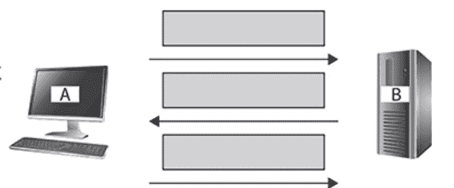

## 答案

1. B. 互联网协议负责逻辑寻址和路由，这是 OSI 模型第 3 层的功能。

2. A, D. TCP 和 UDP 是传输、第 4 层协议。TCP 负责面向连接的通信和无差错交付，而 UDP 负责无连接通信。

3. C. 地址解析协议（ARP）负责将 IP 地址转换为 MAC 地址，以便通信可以发生。
4. A. TCP 在 TCP/IP 协议套件中负责面向连接的通信。
5. A. ICMP 负责在通过 TCP/IP 通信时报告错误并发送回状态信息。
6. C. IP 负责数据包交付和逻辑寻址。
7. B, E. 序列号和确认号由 TCP 用于保证数据的交付。每个消息都被分配一个序列号，当它被目标接收时，会发送回一个带有确认号的 ACK 消息。
8. A. 数据包的源 IP 地址标识数据包发送自的系统。这很重要，因为接收系统知道要回复谁，因为发送者的 IP 地址位于源 IP 地址字段中。
9. D. 目标端口用于标识目标系统上消息要发送到的应用程序的端口号。

## 基于性能的答案

1. 以下示例显示了正确的应用层、传输层、互联网层和网络访问层协议。

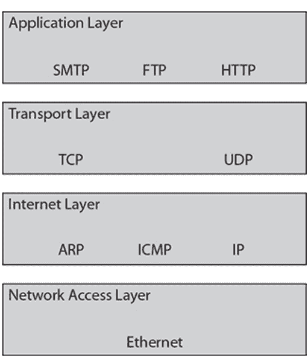

2. 以下示例显示了 TCP 三次握手的正确阶段。

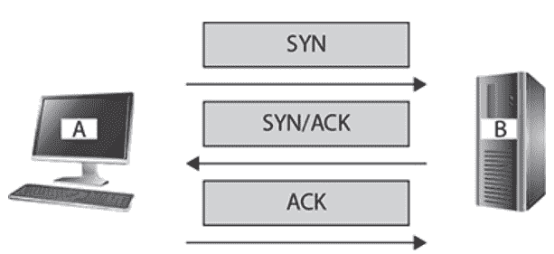

# IP 地址基础

在本章中，你将

- 复习 TCP/IP 基础知识
- 了解 TCP/IP 地址
- 了解如何配置 IP 地址设置
- 了解通信的路径

阅读本章将使你对 TCP/IP 地址有深入的理解，在你阅读第 5 章子网划分之前，你需要很好地了解这一点。CCT/CCNA 考试将测试你对不同规模网络的地址配置知识，从地址类开始，逐步深入到子网划分。在参加 CCT/CCNA 考试之前，你应该对本章和下一章所呈现的信息有深入的理解。

## 配置 TCP/IP

你已经了解了 TCP/IP 套件中存在的一些流行协议。本节将通过讨论寻址方案和为系统分配地址的规则来介绍 TCP/IP 的配置。要正确配置 TCP/IP，你必须知道 IP 地址、子网掩码和默认网关的设置。让我们从 IP 地址开始。

## IP 地址

IP 地址是一个 32 位值，用于唯一标识网络（或互联网）上的系统。IP 地址分为四个数字，每个数字由一个句点分隔（例如，192.168.1.15）。四个数字中的每一个由 8 位组成，有四个 8 位数字，共计 32 位。

每个 8 位值称为一个 *八位组*（例如，前述示例中的 192 或 168 是一个八位组）。IP 地址中有四个八位组。IP 地址中的四个八位组分为两部分：网络 ID 和主机 ID。IP 地址的网络 ID 部分是唯一标识特定网络的数字，而主机 ID 部分是唯一标识该网络上的计算机或设备的数字。子网掩码决定了网络 ID 的位数和主机 ID 的位数。让我们看看这是如何工作的。

## 子网掩码

子网掩码由 TCP/IP 用于确定主机是在本地网络还是远程网络上。当在八位组中使用 255 时，则 IP 地址中对应位置的八位组（同一位置的八位组）表示网络 ID。因此，如果我的 IP 地址是 192.168.1.15 而我的子网掩码是 255.255.255.0，则子网掩码的前三个八位组（255.255.255）将表示网络 ID（对应于 192.168.1），而最后一个八位组（0）将表示主机 ID（对应于 15）。同样，网络 ID 为网络本身分配唯一地址，而主机 ID 唯一标识网络上的系统。

使用另一个示例，如果子网掩码是 255.0.0.0，则意味着 IP 地址的第一个八位组（我们示例中的 192）用作网络 ID 部分，而最后三个八位组（168.1.15）是 IP 地址的主机 ID 部分。

表 4-1 总结了第一个示例。你可以看到网络 ID（在最下行用“N”表示）是 192.168.1，而主机 ID 是值为 15 的最后一个八位组。这意味着该系统位于 192.168.1 网络上，同一网络上的任何其他系统都将具有相同的网络 ID。


| | 八位组 1 | 八位组 2 | 八位组 3 | 八位组 4 |
|---|---|---|---|---|
| IP 地址 | 192 | 168 | 1 | 15 |
| 子网掩码 | 255 | 255 | 255 | 0 |
| 地址部分 | N | N | N | H |

表 4-1 识别 IP 地址的网络 ID 和主机 ID 部分

那么子网掩码的用途是什么？或者更确切地说，为什么我们要有子网掩码来将 IP 地址划分为网络 ID 和主机 ID？当像 192.168.1.15 这样具有 255.255.255.0 子网掩码的系统向系统 192.198.45.10 发送数据时，发送系统首先需要确定目标计算机是否存在于同一网络上。它通过比较网络 ID 来实现这一点（参见表 4-2）；如果网络 ID 相同，则两个系统都存在于同一网络上，一个系统可以在不使用路由器的情况下向另一个系统发送数据。如果系统存在于不同的网络上，则数据需要传递给路由器，以便路由器可以将数据发送到另一个网络。

| | 八位组 1 | 八位组 2 | 八位组 3 | 八位组 4 |
|---|---|---|---|---|
| IP 地址 1 | 192 | 168 | 1 | 15 |
| 子网掩码 | 255 | 255 | 255 | 0 |
| IP 地址 2 | 192 | 198 | 45 | 10 |

表 4-2 使用子网掩码识别位于不同网络上的两个系统

## 练习 4-1：识别远程系统

在本练习中，你将通过填写下表来确定两个系统是否存在于同一网络或不同网络上：

| 计算机 A（IP地址） | 计算机 A（子网掩码） | 计算机 B（IP地址） | 是否同一网络？ |
|---|---|---|---|
| 12.45.8.34 | 255.0.0.0 | 14.34.212.5 | |
| 131.107.4.78 | 255.255.0.0 | 131.108.45.112 | |
| 198.45.23.2 | 255.255.255.0 | 198.45.23.14 | |
| 26.45.78.5 | 255.0.0.0 | 28.45.78.15 | |
| 176.34.56.12 | 255.255.0.0 | 176.34.12.10 | |

## 默认网关

当你的系统想要向网络上的另一个系统发送数据时，它会查看自己的网络 ID 并将其与目标系统的网络 ID 进行比较。如果两者似乎具有相同的网络 ID，则数据会直接从你的系统发送到目标系统。如果两个系统位于不同的网络上，则你的系统必须将数据传递给路由器，以便路由器可以将数据发送到目标系统的路由器。你的系统如何知道路由器在哪里？默认网关是用于将数据从你的网络发送到另一个网络的路由器的 IP 地址。

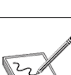

**注意** 简而言之，要在 Internet 上通信，你的系统需要配置 IP 地址、子网掩码和默认网关。如果你只需要与网络上的其他系统通信，则只需要 IP 地址和子网掩码。

## TCP/IP 地址

本节介绍 IP 地址的二进制表示，并确保在进入第 5 章之前，你能够熟练地将二进制值转换为十进制以及地址类。你还将了解地址类型、地址方案和 TCP/IP 端口。

## 理解二进制

你从之前的讨论中知道，IP 地址是一个 32 位地址，分为四个 8 位八位组。这四个八位组通常以十进制值显示，但它们也有如下所示的二进制表示：

```
11000000 10101000 00000001 00001111
```

请注意，有四组 8 位（1 或 0），它们构成了 IP 地址的 32 位（8 × 4 组）。让我们看看如何确定八位组的二进制表示。

每个八位组内 8 个位的数值如表 4-3 所示。你可以看到，八位组中的第一个位（最右边）十进制值为 1，第二个位十进制值为 2，第三个位十进制值为 4，每个附加位的数值都会翻倍。你还可以看到第八个位的十进制值为 128。

| 位 | 8 | 7 | 6 | 5 | 4 | 3 | 2 | 1 |
|---|---|---|---|---|---|---|---|---|
| 值 | 128 | 64 | 32 | 16 | 8 | 4 | 2 | 1 |

表 4-3 与八位组中每个位关联的值


注意 第一个位被称为最低有效位或低位，而第八个位被称为最高有效位或高位。

要计算像 192 这样的十进制数的八位组的二进制值，例如，你需要启用或打开那些加起来等于 192 的位，如表 4-4 所示。

| 位 | 8 | 7 | 6 | 5 | 4 | 3 | 2 | 1 |
| 值 | 128 | 64 | 32 | 16 | 8 | 4 | 2 | 1 |
| 状态 | 开启 | 开启 |  |  |  |  |  |  |

表 4-4 计算 192 的十进制值在二进制中的表示

在表中，注意位 8 和位 7 被打开以提供 128 + 64 的值，等于 192。剩余的位将处于“关闭”状态，这意味着它们不包含在计算中。处于开启状态的位取“1”，关闭状态取“0”。因此，组成数字 192 的 8 位组合为 11000000。

现在你已经知道如何将十进制值转换为二进制以及将二进制值转换为十进制，在进入地址类部分之前，请尝试练习 4-2 和练习 4-3。

## 练习 4-2：将十进制转换为二进制

在本练习中，你将通过填写下表来练习将十进制值转换为二进制：

| 十进制 | 二进制 |
|---|---|
| 127 |  |
| 131 |  |
| 198 |  |
| 224 |  |
| 96 |  |
| 192.168.1.100 |  |
| 216.83.11.78 |  |
| 202.14.45.0 |  |

## 练习 4-3：将二进制转换为十进制

在本练习中，你将通过填写下表来练习将二进制值转换为十进制值：

| 二进制 | 十进制 |
|---|---|
| 10110101 |  |
| 11000011 |  |
| 10000111 |  |
| 11111111 |  |
| 10101011 |  |
| 11000001.10000001.00001011.10100001 |  |
| 00000111.10101001.00110101.10110101 |  |
| 11000000.10100001.00000111.11111111 |  |

## 地址类

每个 IP 地址都属于一个不同的 *地址类*。互联网社区定义了这些类以适应各种规模的网络。IP 地址所属的类最初决定了地址的网络 ID 和主机 ID 部分，以及该网络支持的主机数量。不同的类地址有类 A、类 B、类 C、类 D 和类 E。

表 4-5 总结了你应为考试了解的地址类的重要方面。以下各节对每个类提供了更多详细信息。

|  | 第一个八位组值 | 子网掩码 | 每个网络的主机数 |
|---|---|---|---|
| 类 A | 1-127 | 255.0.0.0 | 16,777,214 |
| 类 B | 128-191 | 255.255.0.0 | 65,534 |
| 类 C | 192-223 | 255.255.255.0 | 254 |

表 4-5 地址类的重要方面

## 类 A 地址

类 A 地址的默认子网掩码为 255.0.0.0，这意味着第一个八位组是网络 ID，最后三个八位组代表地址的主机 ID 部分。每个八位组可以包含 256 个可能的值（0-255），因此类 A 地址在网络上支持 16,777,216 个主机（256 × 256 × 256）。实际上，只能使用 16,777,214 个有效地址分配给系统，因为每个 IP 网络上都有两个地址你不允许分配给系统，因为它们是保留的。这些是所有主机位设为 0s（网络 ID）的地址和所有主机位设为 1s（广播地址）的地址。因此，使用类 A 地址时，你将无法将 n.0.0.0 或 n.255.255.255（其中 n 是你的网络 ID）分配给网络上的任何主机。


考试提示 你需要知道如何为考试识别类 A 地址。类 A 地址的 IP 地址中第一个八位组在 1 到 127 之间。类 A 地址的默认子网掩码也为 255.0.0.0。你可以始终通过第一个八位组的值落在 1 到 127 之间来识别类 A 地址。虽然以 127 开头的地址在技术上是类 A 地址，但你不允许使用任何以 127 开头的地址，因为它保留用于环回地址（稍后将介绍环回地址）。类 A 地址的示例是 IP 地址 12.56.87.34：第一个八位组为 12，落在 1–127 的范围内。

## 类 B 地址

类 B 地址的默认子网掩码为 255.255.0.0，这意味着前两个八位组是网络 ID，最后两个八位组是主机 ID 部分。这意味着我们可以在网络上拥有 65,536 个主机（256 × 256）。哦，但等等！不要忘记减去两个保留地址，这样我们就有 65,534 个地址可以分配给网络上的主机。你可以通过第一个八位组开始的数字落在 128 到 191 之间来识别类 B 地址。由于类 B 地址支持的主机数量，中型公司使用类 B 地址。


考试提示 你需要知道如何为考试识别类 B 地址。类 B 地址的 IP 地址中第一个八位组的值在 128 到 191 之间。记住类 B 地址的默认子网掩码为 255.255.0.0。

## 类 C 地址

类 C 地址的子网掩码为 255.255.255.0，这意味着前三个八位组是网络 ID，最后一个八位组是主机 ID。


仅有一个八位组作为主机 ID 意味着 C 类地址在网络上只能支持 254 个主机（256 − 2）。

C 类地址的第一个八位组的值范围在 192 到 223 之间。例如，IP地址 202.45.8.6 是 C 类地址，因为 202 介于 192 和 223 之间。你也知道该系统具有子网掩码 255.255.255.0，因为它是 C 类地址。


**考试提示** 你需要在考试中知道如何识别 C 类地址。C 类地址的第一个八位组的值介于 192 和 223 之间。此外，请记住 C 类地址的默认子网掩码为 255.255.255.0。

## D 类地址

D 类地址用于网络上的特殊类型的应用——*多播应用*。多播应用通过向多播地址发送数据同时向多台系统发送数据，任何已注册该地址的系统都会接收到数据。由于 D 类地址用于多播地址，你不会将它们专门分配给网络上的主机用于正常网络通信。

D 类地址的第一个八位组的值范围为 224 到 239。拥有如此多的范围，D 类最多可支持 268,435,456 个唯一的组播组，用户可以从多播应用中订阅。

## E 类地址

有趣的是，E 类地址仅为实验目的而设计，因此你永远不会在网络上看到 E 类地址。E 类地址的第一个八位组的值介于 240 和 247 之间。


**考试提示** 可以保证你在两场考试中都会看到有关识别 A、B 和 C 类地址的问题。务必了解每个类别的特征，例如该类别中的地址范围、支持的主机数量以及默认子网掩码。

## 练习 4-4：识别地址类别

在本练习中，你将练习为不同的 IP 地址及其相关子网掩码识别地址类别。填写下表：

| IP 地址 | 子网掩码 | 地址类别 |
|---|---|---|
| 27.56.89.234 |  |  |
| 196.79.123.56 |  |  |
| 130.49.34.23 |  |  |
| 109.189.109.200 |  |  |
| 189.90.23.100 |  |  |
| 126.34.100.12 |  |  |
| 14.198.120.100 |  |  |

## 定义类别的规则

我经常被问到 IPv4 的设计者是如何为每个类别制定地址范围的。设计者通过以下规则定义每个类别的边界来确定类别：

- *A 类地址始终以 0 开头。* 这给出二进制值 **00000001** 到 **01111111**，换算为十进制为 1 到 127。请注意，你不能有地址 00000000，因此该范围从 1 开始。
- *B 类地址始终以 10 开头。* 这给出二进制值 **10**000000 到 **10**111111，换算为十进制为 128 到 191。
- *C 类地址始终以 110 开头。* 这给出二进制值 **110**00000 到 **110**11111，换算为十进制为 192 到 223。
- *D 类地址始终以 1110 开头。* 这给出二进制值 **1110**000 到 **1110**1111，换算为十进制为 224 到 239。
- *E 类地址始终以 11110 开头。* 这给出二进制值 **11110**000 到 **11110**111，换算为十进制为 240 到 247。

## 环回地址

你已了解到不允许将主机分配为第一个八位组值为 127 的 IP 地址。这是因为 A 类地址范围 127 已保留用于环回地址。

环回地址用于引用本地系统，也称为 *本地主机*。如果要验证 TCP/IP 软件是否已在本地系统上初始化，即使你可能没有 IP 地址，也可以 ping 环回地址，通常称为 127.0.0.1。


**注意** 你可以从命令行通过输入 **ping 127.0.0.1**、**ping localhost** 或 **ping loopback** 来测试你自己的本地系统，以验证 TCP/IP 协议栈在你的系统上是否正常运行。

## 私有地址

你需要了解的另一种地址类型是 *私有地址*。私有地址可以分配给系统，但不能用于任何类型的 Internet 连接。私有地址在 Internet 上是 *不可路由* 的，因此使用它们的任何系统都无法在 Internet 上路由数据。以下三个地址范围为私有：

- 10.0.0.0–10.255.255.255
- 172.16.0.0–172.31.255.255
- 192.168.0.0–192.168.255.255

由于 Internet 的增长，无法让每个需要 Internet 访问的设备都使用公共 IP 地址，因为地址已耗尽。因此私有地址在网络内部使用，因为它们不会被 Internet 上的其他系统看到；我们使用网络地址转换（NAT）设备将私有地址转换为公共地址。


**考试提示** 请记住，对于 CCT/CCNA 考试而言，今天网络的一个主要设计考虑是内部使用私有地址，并使用 NAT 设备将私有地址（在 Internet 上不可路由）转换为可在 Internet 上路由的公共地址。这本质上使大量运行私有地址的计算机可以共享 NAT 设备的公共地址以获得 Internet 访问。

## APIPA

今天的系统支持 *自动私有 IP 地址分配*（APIPA）功能。当客户端启动且无法联系 DHCP 服务器时，客户端将自动为自己配置一个 169.254.x.y 地址。如果 DHCP 服务器出现问题且网络上没有任何系统能够获取地址，所有客户端都将为自己分配 169.254 地址范围内的地址，然后能够相互通信（因为它们都在同一网络上）。

APIPA 不分配默认网关，因此你将无法访问远程网络和 Internet 上的资源——但仍可以与网络上的系统通信。在排除故障以确定机器为何无法在网络上通信时，请注意具有 169.254.x.y 地址范围的系统，因为这表明它们找不到 DHCP 服务器。

## 主机无效的 IP 地址

一些 IP 地址不能分配给网络上的主机。例如，你可能会想，为什么 C 类地址只能有 254 个主机，而不是 256 个主机，看起来更合理，因为 8 位数字可以有 256 个可能值。这种表面上的差异的原因是可用主机池中丢失了两个地址。第一个是主机 ID 中所有位都设置为 0 的地址，表示网络的网络 ID。第二个是主机 ID 中所有位都设置为 1 的地址，表示网络的广播地址。因此，例如，在 C 类网络 200.158.157.x 中，地址 200.158.157.0（网络 ID）和 200.158.157.255（广播地址）不可用于分配给网络上的主机，将可用主机数从 256 减少到 254。

另一个非法地址是第一个八位组为 127 的任何系统；请记住，这已保留为环回地址，你无法将该地址分配给任何主机。以下总结了非法地址：

- **以 127 开头的任何地址** 以 127 开头的 IP 地址保留用于环回地址，不能分配给系统。此非法地址的示例为 127.50.10.23。
- **所有主机位设为 0** 不允许将具有主机 ID 部分所有位都设为 0 的 IP 地址分配给系统，因为这是网络 ID。此非法地址的示例为 131.107.0.0。
- **所有主机位设为 1** 不允许将具有所有主机位都设为 1 的 IP 地址分配给系统，因为这对应于网络的广播地址。此类非法地址的示例为 131.107.255.255。
- **重复地址** 不允许将另一个系统正在使用的地址分配给系统，因为这会导致重复 IP 地址错误。

使用这些地址时无法在 Internet 上路由数据不会构成问题，因为实际上，这些私有地址将位于 NAT 服务器之后，NAT 服务器会将私有地址转换为可在 Internet 上路由的公共地址。第 13 章提供了有关 NAT 的更多信息。

## 练习 4-5：理解有效地址

在本练习中，你将通过记录以下每个地址是否有效来练习识别有效地址。有效地址可以分配给网络上的系统。如果地址无效，请说明原因。


| 地址 | 有效？ |
|---|---|
| 10.0.40.10 | |
| 127.54.67.89 | |
| 131.107.34.0 | |
| 45.12.0.0 | |
| 216.83.11.255 | |
| 63.256.4.78 | |
| 200.67.34.0 | |
| 131.107.23.255 | |

## 地址方案

在网络上，数据可以通过几种不同的方式发送到目的地：数据可以发送到单播地址、广播地址或组播地址。以下概述了单播、广播和组播之间的区别：

- **单播** 将信息发送到一台系统。使用 IP 时，这是通过将数据发送到目标系统的 IP 地址来实现的。
- **广播** 将信息发送到网络上的所有系统。发往所有系统的數據是通过使用网络的广播地址发送的。网络的广播地址示例为 192.168.2.255。广播地址是通过将所有主机位设为 1 然后将八位组转换为十进制数来确定的。还有一个网络间广播地址 255.255.255.255，用于要发送到所有网络的数据。
- **组播** 将信息发送到选定的系统组。通常，这是通过让系统订阅组播地址来实现的。发送到组播地址的任何数据随后都会被订阅该地址的所有系统接收。大多数组播地址以 224.x.y.z 开头，被视为 D 类地址。

## TCP/IP 端口

应用程序或进程使用 TCP/IP 端口作为在系统上运行的该应用程序/进程的标识符。当你从一台计算机向另一台计算机发送数据时，你将数据发送到该应用程序使用的端口。例如，当你在 Web 浏览器中输入网站的 IP 地址时，Web 浏览器通过将数据发送到端口 80（图 4-1 所示），连接到该系统上运行的 Web 服务器（或 Web 应用程序），这是 Web 服务器的默认端口。当 Web 服务器通过向浏览器发送网页来响应你的请求时，由于浏览器也在特定端口上运行，因此 Web 服务器将页面发送到 Web 浏览器的端口。

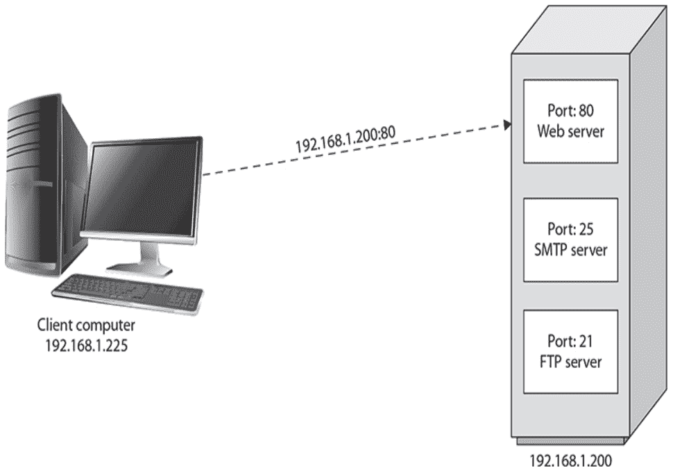

图 4-1 将数据发送到端口 80 的 Web 服务器


**考试提示** 对于考试，请记住 TCP 和 UDP 协议都使用端口号。

服务器应用程序通常使用 1024 以下的低端口号，而客户端应用程序通常在大于 1024 的端口号上运行。端口有三种类型：

- **众所周知的端口** 这些端口号由服务器使用，范围从 0 到 1023。
- **已注册端口** 这些端口分配给某些应用程序或协议。已注册端口范围从 1024 到 49151。
- **动态端口** 这些端口由应用程序临时使用，范围从 49152 到 65535。它们被称为动态端口，因为很多时候，端口是在运行时由应用程序选择的，并且每次程序运行时都不同。例如，当你启动 Internet Explorer 时，它每次启动程序时可能使用不同的端口号，而 Web 服务器每次都使用相同的端口（端口 80）。

表 4-6 列出了不同类型应用程序或协议使用的众所周知的端口号。务必为 CCNA 考试了解这些。

| 端口号 | 进程 | 描述 |
|---|---|---|
| 20 | FTP-DATA | 文件传输协议——用于从一台机器向另一台机器传输数据 |
| 21 | FTP | 文件传输协议——用于 FTP 会话的控制消息 |
| 22 | SSH | 安全 Shell——用于创建安全连接以管理设备，如服务器、交换机或路由器 |
| 23 | Telnet | Telnet——Telnet 用于远程连接到系统，如服务器、交换机或路由器 |
| 25 | SMTP | 简单邮件传输协议——用于通过 Internet 发送电子邮件 |
| 53 | DNS | 域名系统——用于查询 DNS 服务器以获取远程系统的 IP 地址 |
| 67 or 68 | DHCP | 由域名主机配置协议（DHCP）客户端和服务器使用，以自动配置客户端 |
| 69 | TFTP | 简单文件传输协议——一种快速的基于 UDP 的文件传输协议，不需要身份验证 |
| 80 | HTTP | 超文本传输协议——用于从 Web 服务器向 Web 客户端提供网页 |
| 110 | POP3 | 邮局协议，版本 3——用于通过 Internet 读取电子邮件 |
| 119 | NNTP | 网络新闻传输协议——用于从新闻服务器读取新闻文章 |
| 123 | NTP | 网络时间协议——用于同步系统的时间 |
| 137–139 | NetBIOS | Windows 系统用于 NetBIOS 会话 |
| 143 | IMAP4 | Internet 消息访问协议，版本 4——另一种用于读取电子邮件的 Internet 协议 |
| 443 | HTTPS | 安全超文本传输协议——用于在客户端和服务器之间加密 Web 流量 |
| 445 | SMB | 服务器消息块——微软文件共享协议 |
| 1720 | H.323 | 一种较旧的协议，用于通过计算机网络传输音频和视频数据 |
| 2427/2727 | MGCP | 媒体网关控制协议——用于控制媒体网关的 VoIP 协议 |
| 3389 | RDP | 远程桌面协议——用于远程连接和 |
| 5004/5005 | RTP | 实时传输协议——用于在 VoIP 通信中在电话之间发送语音数据 |
| 5060/5061 | SIP | 会话发起协议——用于设置语音 over IP（VoIP）呼叫 |

表 4-6 用于流行的 Internet 应用程序的端口

你将会经常听到另一个术语，即套接字，它是通信的端点，由三个组成部分：系统的 IP 地址、应用程序的端口号以及正在使用的协议，即 TCP 或 UDP。套接字是数据从一个系统发送到另一个系统的方式，更准确地说，是从一个应用程序发送到另一个应用程序。以下公式定义了套接字是什么：

*套接字 = IP 地址 + 端口号 + 协议（TCP 或 UDP）*

## 配置 IP 地址设置

新的 CCNA 考试要求你知道如何在包括 Windows、Linux 和 macOS 系统的主机系统上配置和验证 IP 地址。以下各节演示了如何在这些系统上配置和验证 TCP/IP 设置。

### 手动配置与 DHCP

在为工作站或路由器和交换机等网络设备配置 IP 地址设置时，你可以手动配置设置，也可以动态分配地址通过 DHCP。

### 手动配置

对工作站或路由器等设备进行手动配置涉及进入网络接口的配置并手动输入 IP 地址、子网掩码和默认网关设置。手动配置可能非常耗时，因此我们通常只手动配置服务器、路由器和交换机。网络上的客户端从 DHCP 服务器动态获取其 IP 地址。

### 动态配置

在大型基于 TCP/IP 的网络上配置 IP 地址可能是一场噩梦，尤其是在机器经常从一个网络移动到另一个网络时。DHCP 可以通过在启动时自动为系统分配地址来帮助配置网络上的系统的工作量。

动态分配 IP 地址的过程由 DHCP 服务器管理。DHCP 服务器可以是单独的设备、服务器上运行的服务，或加载在你的 Cisco 路由器上的服务。DHCP 服务配置有一组可用的 IP 地址，称为作用域。作用域还可以包括子网掩码、默认网关的 IP 地址、DNS 服务器和其他必要的地址。当 PC 开机并配置为使用 DHCP 服务器时，它使用以下步骤获取地址：

1. **DHCP Discover** 客户端发送 DHCP Discover 消息，这是一个广播请求数据包，查找网络上任何 DHCP 服务。
2. **DHCP Offer** DHCP 服务器响应 DHCP Offer 消息，其中包含客户端可以租用的 IP 地址。
3. **DHCP Request** 客户端随后通过向 DHCP 服务器发送 DHCP Request 消息来接受该地址的提议。
4. **DHCP Acknowledgment** DHCP 服务器通过向客户端发送 DHCP ACK 消息来响应，确认客户端正在租用该地址。DHCP ACK 消息还包含租用时间等其他 TCP/IP 设置。DHCP 服务器将其数据库中的 IP 地址标记为正在使用，以便不再分配。


**注意** 你将在第 13 章学习如何在 Cisco 路由器上配置 DHCP 服务。


## 在系统上配置 TCP/IP

你可以修改系统上的 TCP/IP 配置设置。步骤取决于你运行的操作系统，但以下各节显示了配置 Windows、Linux 和 macOS 系统的一般步骤。

### Windows 10

要更改 Windows 系统上的 TCP/IP 设置，请使用以下步骤：

- 1. 单击“开始”按钮，然后键入 **control**。在“开始”按钮的“最佳匹配”部分中你会看到控制面板。
- 2. 选择 控制面板 | 网络和 Internet | 网络和共享中心。
- 3. 单击左侧的“更改适配器设置”链接。
- 4. 右键单击以太网并选择属性。
- 5. 选择 Internet 协议版本 4 (TCP/IPv4) 并选择属性。
- 6. 在属性对话框中，注意默认情况下单选按钮“自动获得 IP 地址”处于选中状态，这意味着系统配置为 DHCP 客户端：

### Internet 协议版本 4 (TCP/IPv4) 属性

如果你的网络支持此功能，你可以自动获取 IP 设置。否则，你需要向网络管理员索取适当的 IP 设置。

自动获得 IP 地址

使用下面的 IP 地址：

自动获得 DNS 服务器地址

使用下面的 DNS 服务器地址：

退出时验证设置

- 7. 要静态配置 IP 地址，请选择“使用下面的 IP 地址”，然后输入系统的 IP 地址、子网掩码和默认网关设置。
- 8. 要配置系统使用特定的 DNS 服务器，请选择“使用下面的 DNS 服务器地址”，然后输入要使用的 DNS 服务器的 IP 地址。
- 9. 选择“确定”并关闭所有窗口。

### Linux

在 Linux 系统上，根据发行版的不同，有几种不同的方法可以修改 IP 地址。多年来，管理员使用 ifconfig 命令通过以下语法更改其 IP 地址：

```
ifconfig eth0 12.0.0.11 netmask 255.0.0.0
```

其中：

**eth0** 是你要修改的接口或网卡。
**12.0.0.11** 是你要使用的 IP 地址。
**netmask 255.0.0.0** 是子网掩码。

你也可以使用图形界面在 Linux 上更改 IP 地址。要执行此操作，请按照以下步骤操作：

- 1. 在你的 Linux 系统上，在右上角你会看到一个网络图标。右键单击网络图标并选择“编辑连接”：

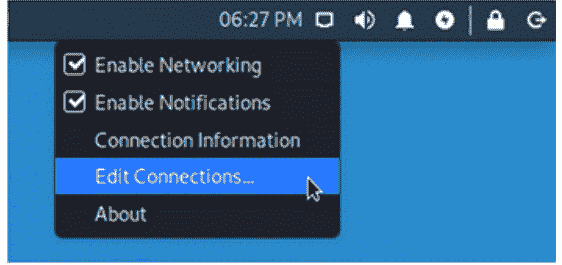

- 2. 选择你的连接，然后选择底部的设置图标（看起来像齿轮图标）。
- 3. 选择 IPv4 设置选项卡。
- 4. 在“方法”下拉列表中，选择“手动”。
- 5. 单击“添加”按钮以添加你要使用的 IP 地址、子网掩码和默认网关。

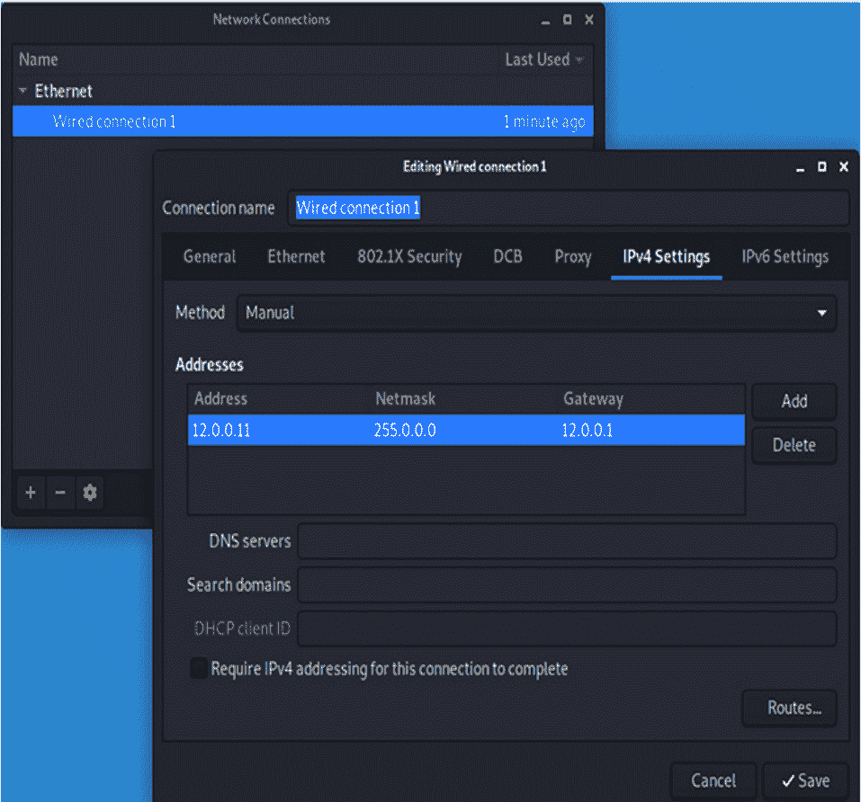

- 6. 输入 DNS 服务器的 IP 地址，然后单击“保存”。
- 7. 关闭所有窗口。

### macOS

使用以下步骤修改你的 macOS IP 地址：

- 1. 从 Apple 菜单中选择“系统偏好设置”。
- 2. 选择“网络”。
- 3. 在左侧选择你的网络接口。
- 4. 单击右下角的“高级”按钮。
- 5. 选择 TCP/IP 选项卡。

- 6. 要手动配置 IP 地址，从“配置 IPv4”下拉列表中选择“手动”。然后输入你的 IP 地址、子网掩码和路由器地址（默认网关）。

### 验证 IP 地址设置

配置 TCP/IP 设置后，最好验证 IP 地址设置是否已生效。你可以在每个操作系统中通过快速命令来完成此操作。

- **Windows** 打开命令提示符并键入 **ipconfig** 以查看基本的 TCP/IP 设置，例如 IP 地址、子网掩码和默认网关。如果要查看所有 TCP/IP 设置，包括 DHCP 租约时间和 DNS 服务器设置，请使用 **ipconfig /all** 命令。
- **Linux** 根据你运行的 Linux 版本，你可以使用 **ifconfig** 命令查看 TCP/IP 设置，或使用网络管理器命令 **nmcli** 检查 IP 设置。
- **macOS** 使用 **ifconfig** 命令验证你的 TCP/IP 设置。

### 理解通信路径

在我们完成 TCP/IP 基础知识之前，你应该了解 TCP/IP 网络上两个系统之间通信的通信路径。以下插图显示了当 ComputerB 向 ComputerD 发送数据时发生的步骤：


- 1. 在 ComputerB 输入命令 **ping 13.0.0.10** 以启动通信。
- 2. ComputerB 将其 IP 地址和子网掩码与正在 ping 的 IP 地址进行比较，以确定系统是否在同一网络上。由于网络 ID 不同，IP 确定系统位于不同的网络上（请注意，这实际上是在二进制级别使用称为 AND 的过程完成的），如下所示：
```
12.0.0.10
255.0.0.0
13.0.0.10
```
- 3. ComputerB 从 TCP/IP 设置中检索默认网关设置，因为这是它需要发送数据到的地址，以便向不同网络发送数据。
- 4. 然后 ComputerB 对默认网关的 IP 地址进行 ARP，以获取默认网关的 MAC 地址。
- 5. ARP 回复消息返回到 ComputerB，其中包含默认网关的 MAC 地址。
- 6. ComputerB 使用以下头部信息将数据发送到路由器：
- 7. 路由器接收到第 2 层帧，然后读取第 3 层头部以确定数据包的去向。路由器看到数据包的目标是 13.0.0.10，因此它检查路由表中是否有路由。它有，并且意识到它只需要通过 13.0.0.1 接口发送数据即可到达目的地。
- 8. 为了发送数据，路由器需要知道 13.0.0.10 的 MAC 地址，因此它发送 ARP 请求消息。
- 9. 路由器接收到包含 ComputerD MAC 地址的 ARP 回复。
- 10. 路由器使用以下头部信息将数据发送到 ComputerD：

```
Layer 2 Header:
    Source MAC: 2222.2222.2222
    Destination MAC: AAAA.5555.5555
Layer 3 Header:
    Source IP: 12.0.0.10
    Destination IP: 13.0.0.10
```

```
Layer 2 Header:
    Source MAC: BBBB.6666.6666
    Destination MAC: 4444.4444.4444
Layer 3 Header:
    Source IP: 12.0.0.10
    Destination IP: 13.0.0.10
```

这里的重要一点是注意到第 2 层头部在沿途的每一步都被修改，以便将帧移动到下一步。但第 3 层头部从未被修改，因为它包含将数据路由到正确网络的网络地址。

### 练习 4-6：分析通信路径

在本练习中，你将分析以下网络图并识别数据包从 ComputerA 到 ComputerD 传输时的特征。


- 1. 查看图表，记录数据包在用 1 圈出的点处将具有的第 2 层和第 3 层头部信息。
  Layer 2 源地址：_________________________
  Layer 2 目标地址：_________________________
  Layer 3 源地址：_________________________
  Layer 3 目标地址：_________________________
- 2. 查看图表，记录数据包在用 2 圈出的点处将具有的第 2 层和第 3 层头部信息。
  Layer 2 源地址：_________________________
  Layer 2 目标地址：_________________________
Layer 3 源地址：________________
Layer 3 目标地址：________________
- 3. 查看图表，记录数据包在用 3 圈出的点处将具有的第 2 层和第 3 层头部信息。
Layer 2 源地址：________________
Layer 2 目标地址：________________
Layer 3 源地址：________________
Layer 3 目标地址：________________

### 章节回顾

在本章中你学习了 TCP/IP 的基础知识以及该协议为何在当今网络市场中如此常见。以下列表总结了你所学的内容：

- IP 地址和子网掩码是最重要的配置设置，必须正确指定才能在基于 TCP/IP 的网络上进行通信。接下来重要的是默认网关，它指定在本地网络外通信时将数据包路由到的位置。
- 动态主机配置协议（DHCP）会自动为工作站配置正确的 TCP/IP 设置，使你免于手动配置每个工作站的负担。
- TCP/IP 地址涉及对 IP 地址、子网掩码、网络类别和特殊保留地址的深入了解。（你应该为考试记住每个网络类别。）
- 与你的 CCT 和 CCNA 考试相关的 TCP/IP 最重要部分是 TCP/IP 配置概念。你需要这些来配置 TCP/IP 工作站。这些概念包括 IP 地址、子网掩码和默认网关。

牢固掌握本章介绍的材料，你在考试中不会遇到任何 TCP/IP 相关问题的问题。不仅这里介绍的材料对每项考试都很重要，而且在你通过考试并继续从事网络专业人员职业后也很重要。


## 快速复习

### TCP/IP 基础
- TCP/IP 地址是 32 位地址。
- IP 地址是分配给系统的一个唯一值，用于在网络上标识该系统。
- 子网掩码用于确定 IP 地址的网络 ID 部分。
- 网络 ID 用于确定目标系统是否在同一网络上。如果两个系统的网络 ID 相同，则它们位于同一网络上。
- 主机 ID 在网络内标识系统。
- 默认网关指的是路由器的 IP 地址，用于将数据从本地网络发送出去。

### TCP/IP 地址
- A 类地址的首个八位组范围为 0 到 127，默认子网掩码为 255.0.0.0。
- B 类地址的首个八位组范围为 128 到 191，默认子网掩码为 255.255.0.0。
- C 类地址的首个八位组范围为 192 到 223，默认子网掩码为 255.255.255.0。
- D 类地址用于多播。
- 应用程序或进程使用 TCP/IP 端口在客户端和服务器计算机之间进行通信。
- 最流行，因此最有可能出现在考试中的选项是 FTP 端口（20 和 21）、SMTP 端口（25）、HTTP 端口（80）和 HTTPS 端口（443）。
- 配置 TCP/IP 有两种选择：手动配置或使用 DHCP 服务器。
- DHCP 负责自动为系统和设备分配 IP 地址，并减轻网络管理负担。

### 配置 IP 地址设置
- 你可以在 Windows 中使用 **ipconfig** 命令来验证你的 TCP/IP 设置。
- 你可以在 Linux 中使用 **ifconfig** 命令或 **nmcli** 命令来验证你的 TCP/IP 设置，具体取决于 Linux 的发行版和版本。
- 你可以在 macOS 上使用 **ifconfig** 命令来验证你的 TCP/IP 地址。

### 理解通信路径
- 请记住，在通信过程中，源 MAC 地址和目标 MAC 地址会在每一步发生变化。
- 请记住，在数据包被传递到其目标的整个过程中，源 IP 地址和目标 IP 地址保持不变。

## 问题

以下问题将帮助你衡量你对本章所介绍材料的理解程度。请仔细阅读所有选项，因为可能存在多个正确答案。选择每个问题的正确答案。

1. 你网络上的其中一名用户叫你到他的桌前，因为他无法访问互联网。你使用 **ipconfig** 命令验证他的设置，注意到 IP 地址是 169.254.34.10。用户无法访问互联网最可能的原因是什么？
   - A. 最可能存在 DNS 问题。
   - B. 未配置子网掩码。
   - C. 路由器已关闭。
   - D. 最可能存在 DHCP 问题。

2. IP 地址有多少位？
   - A. 8 位
   - B. 32 位
   - C. 48 位
   - D. 96 位

3. 哪个地址类始终以前 3 位 110 开头？
   - A. A 类
   - B. B 类
   - C. C 类
   - D. D 类

4. 子网掩码为 255.255.255.0 的计算机的网络 ID 有多少个八位组？
   - A. 1
   - B. 2
   - C. 3
   - D. 4

5. IP 地址为 134.67.89.12 且子网掩码为 255.255.0.0 的计算机与以下哪个系统在同一网络上？
   - A. 134.76.89.11
   - B. 134.67.112.23
   - C. 13.4.67.34
   - D. 109.67.45.10

6. 哪个网络地址类支持 65,534 个主机？
   - A. A 类
   - B. B 类
   - C. C 类
   - D. D 类

7. C 类网络的默认子网掩码是什么？
   - A. 255.0.0.0
   - B. 255.255.0.0
   - C. 255.255.255.0
   - D. 255.255.255.255

8. 哪个地址保留用于内部环回功能？
   - A. 0.0.0.0
   - B. 1.0.0.1
   - C. 121.0.0.1
   - D. 127.0.0.1

9. HTTP 服务的众所周知端口号是什么？
   - A. 20
   - B. 21
   - C. 80
   - D. 25

10. 以下哪个地址是私有 IP 地址？（可多选。）
    - A. 10.0.0.34
    - B. 191.167.34.5
    - C. 172.16.7.99
    - D. 12.108.56.7

11. SMTP 使用哪个端口？
    - A. 23
    - B. 25
    - C. 443
    - D. 110

12. 171.103.2.30 的默认子网掩码是什么？
    - A. 255.0.0.0
    - B. 255.255.0.0
    - C. 255.255.255.0
    - D. 255.255.255.255

13. 哪个网络服务负责在系统启动时为网络上的系统分配 IP 地址？
    - A. DNS
    - B. WINS
    - C. DHCP
    - D. 服务器

## 基于性能的问题

基于性能的问题是你在思科考试中会遇到的交互式问题，你必须将对象从屏幕的一个区域拖到另一个区域。以下基于本章内容提供的示例基于性能的问题。

1. 从展品左侧的地址画一条线，并将其连接到以下展品右侧的匹配地址类型。

**左侧地址：**
- 127.0.0.1
- 200.45.67.100
- 169.254.65.78
- 172.28.35.10
- 100.95.87.23

**右侧地址类型：**
- 一个 APIPA 地址
- 一个私有地址
- 环回地址
- A 类地址
- C 类地址

2. 使用左侧的端口号，将正确的端口号写入显示相关协议的适当框中。在真正的考试中，你会将端口号拖放到适当的框中。

**端口号：**
- TCP 22
- TCP 3389
- TCP 23
- TCP 80
- UDP 53
- TCP 21

**协议：**
- DNS
- SSH
- HTTP
- Telnet
- FTP
- RDP

## 答案

1. D. 在排查 TCP/IP 通信问题时，如果你注意到系统使用的是 169.254.x.y 的 IP 地址，你可以假设与 DHCP 服务器的通信存在问题。以 169.254.x.y 开头的地址是 APIPA 地址，当找不到 DHCP 服务器时会自动配置。

2. **B.** IP 地址，特别是本章讨论的 IPv4 地址，是一个 32 位地址。

3. **C.** C 类地址始终将地址的前 3 位设置为 110。这给出二进制值 **110**00000 到 **110**11111，换算成十进制为 192 到 223。

4. **C.** 子网掩码 255.255.255.0 表示前三个八位组是网络 ID 的一部分，最后一个八位组是地址的主机 ID 部分。

5. **B.** 因为子网掩码是 255.255.0.0，任何使用相同前两个八位组的系统都在同一网络上。IP 地址的网络 ID 为 134.67.*x.y*。

6. **B.** B 类网络支持 65,534 个主机，因为最后两个八位组是主机 ID，每个八位组支持 256 个可能值。256 × 256 = 65,536——但不要忘记有 2 个地址不可用（保留用于网络 ID 和广播地址）。

7. **C.** C 类网络的默认子网掩码是 255.255.255.0；前三个八位组表示网络 ID，最后一个八位组是主机 ID。

8. **D.** 环回地址通常被称为 127.0.0.1 地址，但它可以是任何以 127.*x.y.z* 开头的地址。

9. **C.** HTTP 使用的端口是 80 端口。

10. **A, C.** 10.0.0.34 和 172.16.7.99 是属于私有 IP 地址范围的地址示例，这些地址在互联网上不可路由。

11. **B.** 端口 25 用于 SMTP 在 TCP/IP 网络上发送电子邮件。

12. **B.** 171.103.2.30 是一个 B 类地址，因此它的子网掩码为 255.255.0.0。

13. **C.** DHCP 负责自动分配 IP 地址给系统，这样网络管理员就不必手动执行这项工作。

## 基于性能的答案

1. 以下展品将地址与其正确的地址类型对应。

127.0.0.1
200.45.67.100
169.254.65.78
172.28.35.10
100.95.87.23

一个 APIPA 地址
一个私有地址
环回地址
A 类地址
C 类地址

2. 以下展品显示正确的协议及其关联的端口号。

DNS
UDP 53

SSH
TCP 22

HTTP
TCP 80

Telnet
TCP 23

FTP
TCP 21

RDP
TCP 3389


