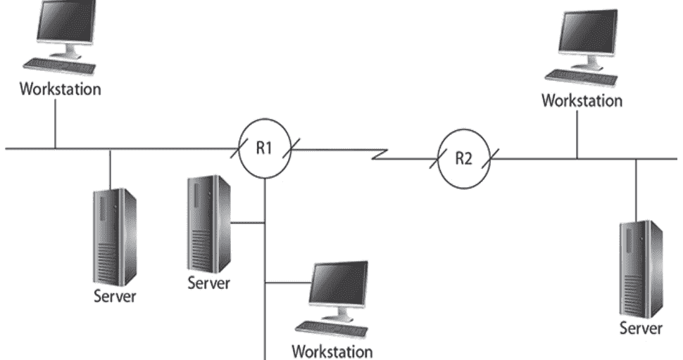
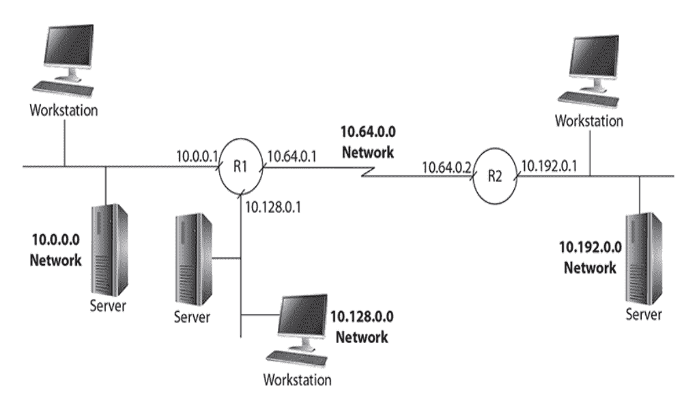
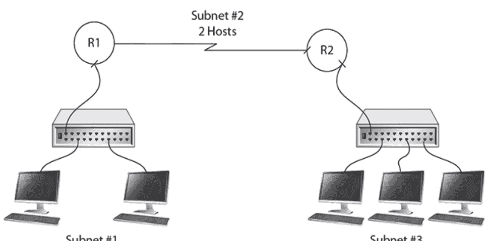
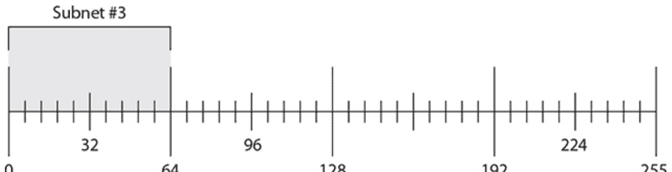
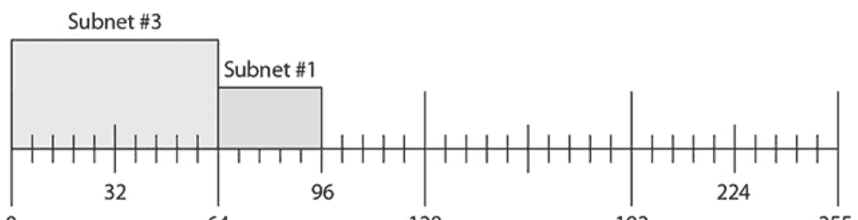
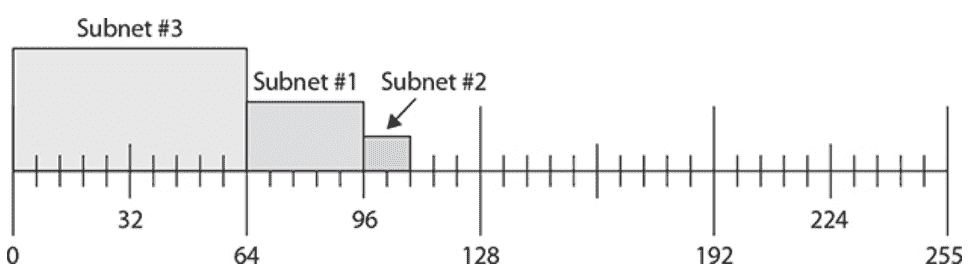
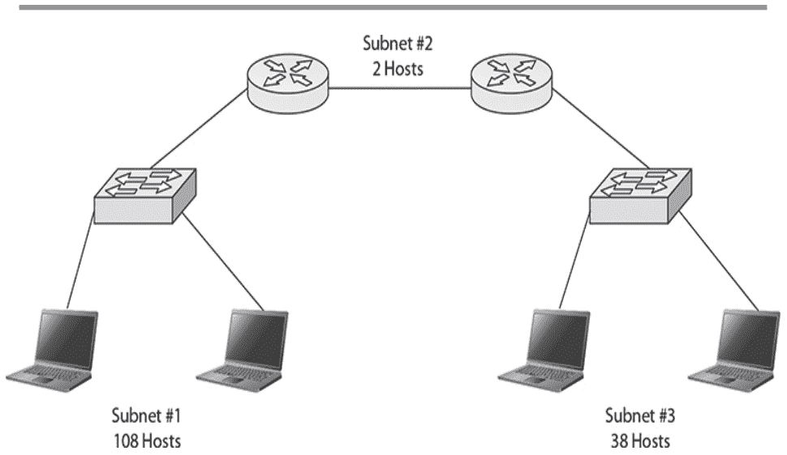
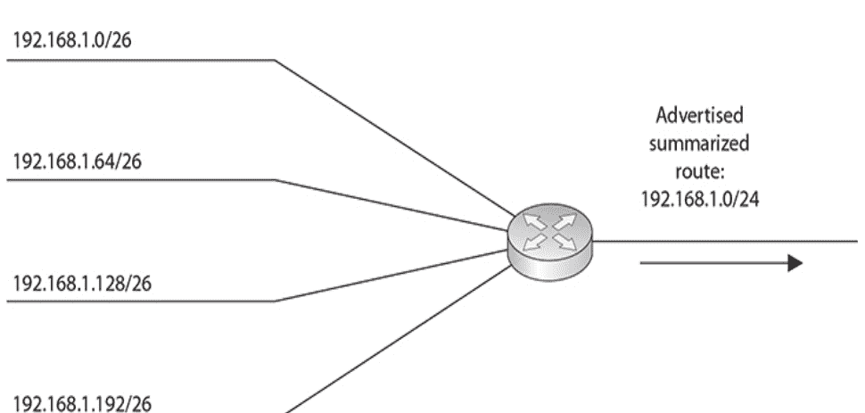
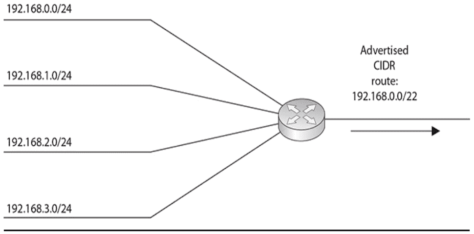

# 子网划分和 VLSM

本章中，您将

- 了解网络子网划分
- 学习一些子网划分快捷方式
- 理解有类寻址和无类寻址之间的区别
- 了解可变长子网掩码（VLSMs）

在第 4 章中，您学习了 TCP/IP 地址的基础知识。在本章中，您将学习如何将一个网络地址范围划分为多个网络范围，或 *子网*，以便您可以将每个地址范围分配给您互连网（由多个网络组成的网络）中的一个单独网络（子网）。

例如，由于您的业务在多个不同的物理位置运营，您可能需要使用多个网络。或者，如果您在同一地点工作，您可能希望通过将网络分割成多个段，并在每个网络段之间放置路由器，来减少在整个网络中发送的广播流量。

每个段都需要自己的网络地址范围，以便路由器可以将数据从一个网络路由（发送）到另一个网络。例如，如果您有两个物理网络，但保留了没有子网划分的单一 IP 范围，路由器在“逻辑上”会认为所有系统都在同一网络上，并且永远不会尝试从一侧路由数据到另一侧。


**警告** 如果您不对划分为多个物理网络段的网络范围进行子网划分，互联网协议（IP）将在逻辑上判定所有系统都在同一网络上，并且不会尝试通过分隔网络段的路由器路由数据。因此，您将能够与您所在段的主机通信，但不能与其他段通信。

### 了解子网划分

您对网络 ID 进行子网划分，以将单一逻辑网络地址拆分为多个逻辑网络地址，以便您可以为网络上的每个物理网络段分配逻辑网络 ID 和相关地址。为此，您必须在位级别操作子网掩码，本质上是取走主机位并将其转换为子网位。

在本节中，您将逐步了解如何对 A 类、B 类和 C 类网络地址进行子网划分。如果您是子网划分的新手，最好的学习方法是随我们逐步进行，在空白纸上执行每个计算。


**注意** 子网划分是大多数 IT 专业人员倾向于避免的主题之一，因为坐下来计算配置新创建子网所需的信息非常繁琐。

### 子网划分 A 类网络

在本节中，您将逐步进行 A 类网络地址的子网划分。在此示例中，您有一个地址范围 10.0.0.0，并且您将网络划分为四个子网络，或 *子网*。物理网络结构如图 5-1 所示。子网划分涉及从子网掩码中取出一些主机位并将其用作额外的网络位，从而获得更多网络。通过子网划分，您取走额外的主机位并“屏蔽”它们（将其标记为网络位），方法是将其设置为 1 状态，使其不再代表子网掩码的主机 ID 部分。这会创建额外的网络，但会导致每个网络上的主机数量减少。



图 5-1 与此物理网络结构相匹配的子网划分

首先，您需要知道需要多少主机位来创建所需数量的网络。要计算划分为四个网络（子网）所需的位数，您使用以下公式：

2^masked bits = number of subnets

例如，如果您需要四个子网，公式为 2^2 = 4 个网络，或子网。因此，您将窃取，或屏蔽，子网掩码中的两个主机位并将其设为网络位——这些称为子网位。

现在您知道必须屏蔽两个位才能创建四个子网，下一步是查看您的 IP 范围 10.0.0.0 并问自己，“此地址的默认子网掩码是什么？”您应该得出 255.0.0.0，因为它是一个 A 类地址。一旦您知道默认子网掩码，下一步就是将其分解为二进制。A 类默认十进制子网掩码的二进制形式如下：

| 十进制 | 255 | 0 | 0 | 0 |
| 二进制 | 11111111 | 00000000 | 00000000 | 00000000 |

一旦您在工作区域中以二进制形式写出子网掩码，您就可以开始计算四个子网的新地址。首先需要做的是从子网掩码的主机 ID 部分“窃取”，或“屏蔽”，两个位，并通过将其设置为 1 状态使其成为子网位。请记住，您取走两个位是因为之前的计算。因为此子网掩码的最后三个八位组代表 A 类地址的主机位，所以从左到右工作并屏蔽另外两个位，以得到以下新的二进制表：

| 十进制 | 255 | 0 | 0 | 0 |
| 二进制 | 11111111 | 11000000 | 00000000 | 00000000 |

请注意，现在启用的两个位位于第二个八位组中。还请注意，您始终从左到右在子网掩码中工作。

### 计算新的子网掩码

现在您可以计算所有四个网络的新子网掩码。为此，您将前表中新的二进制值 11111111.11000000.00000000.00000000 转换为其十进制表示法——您应该得到 255.192.0.0 作为四个新子网的新子网掩码。记下该数字，因为稍后您需要它。

下一步是计算四个不同网络的 IP 范围，但在那之前，在本演练完成之前，您需要了解有关您正在设计的每个新子网的五项信息：

- **新的子网掩码** 对网络进行子网划分后，您将拥有一个新子网掩码，该掩码由您创建的所有子网使用。
- **网络 ID** 要计算每个网络的网络 ID，所有主机位都设置为 0。
- **第一个有效地址** 要计算第一个有效地址，您将最低有效主机位置为 1；所有其他主机位为 0。
- **广播地址** 要计算每个子网的广播地址，您将所有主机位置为 1。
- **最后一个有效地址** 要计算最后一个有效地址，您将最低有效主机位置为 0；所有其他主机位为 1。

您知道新的子网掩码是 255.192.0.0，因此您可以开始计算四个子网的网络 ID。

### 计算网络 ID

要计算每个子网的网络 ID，您需要确定已从主机位转换为子网位的位数的所有开/关状态。例如，使用了两个位作为子网位来创建更多网络，因此两个位有四种可能的开/关状态：00、01、10 和 11。这些在您的二进制工作区域中列出，应如下表所示：

|  | 第一个八位组（十进制） | 第二个八位组（二进制） | 第三个八位组（二进制） | 第四个八位组（二进制） |
|---|---|---|---|---|
| 原始 IP | 10 | 0 | 0 | 0 |
|  | 10 | 00000000 | 00000000 | 00000000 |
|  | 10 | 01000000 | 00000000 | 00000000 |
|  | 10 | 10000000 | 00000000 | 00000000 |
|  | 10 | 11000000 | 00000000 | 00000000 |

接下来，您将剩余的 0 添加到代表主机 ID 部分的位中。请记住，原始网络 ID 为 10.0.0.0，因此第一个八位组将始终以 10 开头，无论您对二进制进行何种更改，因为您的工作从第二个八位组开始。

下一步是将 10 填入第一个八位组；每个网络 ID 将以 10 开头，因为这就是原来的。将 10 填入第一个八位组后，您然后通过将所有主机位保持为 0（非粗体位）来计算每个网络的网络 ID，如下表所示：

| | 第一八位组（十进制） | 第二八位组（二进制） | 第三八位组（二进制） | 第四八位组（二进制） | 计算 |
|---|---|---|---|---|---|
| 原始 IP | 10 | 0 | 0 | 0 | |
| 子网 #1 | 10 | 00000000 | 00000000 | 00000000 | 10.0.0.0 |
| 子网 #2 | 10 | 01000000 | 00000000 | 00000000 | 10.64.0.0 |
| 子网 #3 | 10 | 10000000 | 00000000 | 00000000 | 10.128.0.0 |
| 子网 #4 | 10 | 11000000 | 00000000 | 00000000 | 10.192.0.0 |

在此示例中，因为正在操作两个子网位，并且所有主机位都设置为 0，因此创建了四个新的网络 ID：10.0.0.0、10.64.0.0、10.128.0.0 和 10.192.0.0。要计算此值，只需在列出两个子网位可以具有的开/关状态后，将所有二进制转换为十进制即可。

## 计算第一个有效地址

现在你已经计算了每个子网的网络 ID，下一步要计算的是可以分配给这些网络中每个网络主机的第一个有效地址。要计算第一个有效地址，只需启用最低有效位，即网络 ID 最右侧的位。启用最低有效位后，然后将所有八位组转换为十进制，以确定每个网络的第一个有效 IP 地址。工作区域显示在下表中，你可以看到对于四个子网，每个网络的第一个有效地址分别为 10.0.0.1、10.64.0.1、10.128.0.1 和 10.192.0.1：

| | 第一八位组（十进制） | 第二八位组（二进制） | 第三八位组（二进制） | 第四八位组（二进制） | 计算 |
|---|---|---|---|---|---|
| 原始 IP | 10 | 0 | 0 | 0 | |
| 子网 #1 | 10 | 00000000 | 00000000 | 00000001 | 10.0.0.1 |
| 子网 #2 | 10 | 01000000 | 00000000 | 00000001 | 10.64.0.1 |
| 子网 #3 | 10 | 10000000 | 00000000 | 00000001 | 10.128.0.1 |
| 子网 #4 | 10 | 11000000 | 00000000 | 00000001 | 10.192.0.1 |

## 计算广播地址

现在你已经计算了四个网络中每个网络的第一个有效地址，你需要计算广播地址。广播地址是任何系统将发送数据到的地址，以确保网络上的每个系统都能接收到数据。要计算广播地址，你将启用所有主机位（设置为 1），然后将每个八位组从二进制转换为十进制。你在下表中得到结果：

|  | 第一八位组（十进制） | 第二八位组（二进制） | 第三八位组（二进制） | 第四八位组（二进制） | 计算 |
|---|---|---|---|---|---|
| 原始 IP | 10 | 0 | 0 | 0 |  |
| 子网 #1 | 10 | 00111111 | 11111111 | 11111111 | 10.63.255.255 |
| 子网 #2 | 10 | 01111111 | 11111111 | 11111111 | 10.127.255.255 |
| 子网 #3 | 10 | 10111111 | 11111111 | 11111111 | 10.191.255.255 |
| 子网 #4 | 10 | 11111111 | 11111111 | 11111111 | 10.255.255.255 |

正如你所见，如果启用所有主机位并将其转换为十进制，你将得到四个网络的广播地址分别为 10.63.255.255、10.127.255.255、10.191.255.255 和 10.255.255.255。请注意，在整个过程中，第二八位组最左侧的两个位未被更改，但它们用于将该八位组从二进制转换为十进制的转换。它们没有改变，因为它们不是主机位——它们是子网位。


**考试提示** 对于考试，请记住具有所有主机位都设置为 0 的主机地址（保留用于网络 ID）或所有主机位都设置为 1 的主机地址（保留用于广播地址）被视为无效地址，不能在系统或设备上使用。

## 计算最后一个有效地址

现在你已经计算了四个新子网的新子网掩码、网络 ID、第一个有效地址和广播地址，你唯一需要的信息是可分配给每个子网主机的最后一个有效地址。要计算每个子网的最后一个有效主机地址，只需从广播地址减去 1，通过禁用最低有效位（最右侧的主机位）。要查看我们每个网络的最后一个有效地址的二进制和十进制表示，请查看以下表格：

|  | 第一八位组（十进制） | 第二八位组（二进制） | 第三八位组（二进制） | 第四八位组（二进制） | 计算 |
|---|---|---|---|---|---|
| 原始 IP | 10 | 0 | 0 | 0 |  |
| 子网 #1 | 10 | 00111111 | 11111111 | 11111110 | 10.63.255.254 |
| 子网 #2 | 10 | 01111111 | 11111111 | 11111110 | 10.127.255.254 |
| 子网 #3 | 10 | 10111111 | 11111111 | 11111110 | 10.191.255.254 |
| 子网 #4 | 10 | 11111111 | 11111111 | 11111110 | 10.255.255.254 |

你现在已经计算了配置你创建的四个物理网络段所需的所有信息。下表总结了四个网络段中每个网络段的配置，图 5-2 显示了这四个网络段将如何配置。

|  | 网络 ID | 第一个有效地址 | 最后一个有效地址 | 广播地址 | 子网掩码 |
|---|---|---|---|---|---|
| 子网 1 | 10.0.0.0 | 10.0.0.1 | 10.63.255.254 | 10.63.255.255 | 255.192.0.0 |
| 子网 2 | 10.64.0.0 | 10.64.0.1 | 10.127.255.254 | 10.127.255.255 | 255.192.0.0 |
| 子网 3 | 10.128.0.0 | 10.128.0.1 | 10.191.255.254 | 10.191.255.255 | 255.192.0.0 |
| 子网 4 | 10.192.0.0 | 10.192.0.1 | 10.255.255.254 | 10.255.255.255 | 255.192.0.0 |



图 5-2 将 Class A 网络划分为四个网络段

## 验证网络大小

在考试当天，你将得到需要一定数量的子网并且每个子网可处理一定数量主机的场景。你可以通过执行一些简单的数学运算来验证你是否拥有正确的数字：

- **子网数量** 要验证子网数量，请使用公式 2^子网位 = *子网数量*。在我们的示例中，我们有 2² = 4 个子网。
- **每个子网的主机数量** 要验证你是否支持每个子网的正确主机数量，请使用公式 2^主机位 − 2 = *每个子网的主机数量*。在我们的示例中，我们有 2²² = 4,194,304 − 2 = 4,194,302 个主机/子网。

## 子网划分 Class B 网络

现在让我们看一下子网划分 class B 网络地址。假设你有网络 ID 190.45.0.0。请记住，class B 网络的默认子网掩码是 255.255.0.0。假设场景要求你将地址范围划分为六个子网，因为你已将网络划分为六个子网络。

## 设置工作区

第一步是在纸上设置你的工作区。你应该写下你已知的东西：

```
IP Range: 190.45.0.0
Subnet mask: 255.255.0.0
Subnet mask (binary): 11111111.11111111.00000000.00000000
```

## 要制作子网需要多少位？

下一步是决定你想从子网掩码的主机 ID 部分转换多少位为主网位。请记住这个公式：

2^{masked bits} = number of subnets

因此，2² = 四个子网，这不够，因为你需要六个子网。如果你尝试 2³，你会得到八个子网，这太多了，但你必须使用它，因为使用 2² 不会给你足够的子网。八个子网满足你的目标，多出两个子网供将来增长。现在你已经确定你想将子网掩码中的三个位从主机位转换为子网位，你得到以下内容：

```
IP Range: 190.45.0.0
Subnet mask (binary): 11111111.11111111.11100000.00000000
```

你现在知道六个子网中每个子网的新子网掩码（实际上是八个子网，但你只需要其中六个）。在二进制中对子网掩码进行更改后，如果将其转换回十进制，你将为每个子网得到一个新的子网掩码，即 255.255.224.0。

## 列出组合

下一步是列出三个子网位可以产生的全部开/关状态。你应该得出与三个位将创建的子网数量相同数量的组合（即八个）：


- 000
- 001
- 010
- 011
- 100
- 101
- 110
- 111

然后将这些组合分别放置在三个子网位的位置，每个组合都会创建一个网络 ID。由于这三个位位于第三个八位组，填写前两个八位组为原始 IP 地址，以便记住初始值。以下是你应得到的结果——请注意子网位已加粗以突出显示：

```
Subnet 1: 190.45.00000000.00000000
Subnet 2: 190.45.00100000.00000000
Subnet 3: 190.45.01000000.00000000
Subnet 4: 190.45.01100000.00000000
Subnet 5: 190.45.10000000.00000000
Subnet 6: 190.45.10100000.00000000
Subnet 7: 190.45.11000000.00000000
Subnet 8: 190.45.11100000.00000000
```

## 计算网络 ID

要计算每个子网的网络 ID，请记住所有主机位必须设为 0（在刚刚显示的子网中它们就是 0）。如果将所有二进制值转换为十进制，你将得到每个子网的网络 ID：

```
Subnet 1: 190.45.0.0
Subnet 2: 190.45.32.0
Subnet 3: 190.45.64.0
Subnet 4: 190.45.96.0
Subnet 5: 190.45.128.0
Subnet 6: 190.45.160.0
Subnet 7: 190.45.192.0
Subnet 8: 190.45.224.0
```

## 计算第一个有效地址

接下来，你需要计算每个子网的第一个有效地址。你应始终在二进制中进行此操作，然后转换为十进制。子网第一个有效地址的规则是：取最低有效主机位并将其打开；然后将所有二进制转换为十进制，得到以下结果：

```
Subnet 1: 190.45.00000000.00000001 = 190.45.0.1
Subnet 2: 190.45.00100000.00000001 = 190.45.32.1
Subnet 3: 190.45.01000000.00000001 = 190.45.64.1
Subnet 4: 190.45.01100000.00000001 = 190.45.96.1
Subnet 5: 190.45.10000000.00000001 = 190.45.128.1
Subnet 6: 190.45.10100000.00000001 = 190.45.160.1
Subnet 7: 190.45.11000000.00000001 = 190.45.192.1
Subnet 8: 190.45.11100000.00000001 = 190.45.224.1
```

## 计算广播地址

广播地址用于向网络上的所有系统发送消息。广播地址不应分配给网络上的系统，但你应熟悉该地址。要计算广播地址，将所有主机位（子网位右侧的位）设为 1，然后将整个地址转换为十进制：

```
Subnet 1: 190.45.00011111.11111111 = 190.45.31.255
Subnet 2: 190.45.00111111.11111111 = 190.45.63.255
Subnet 3: 190.45.01011111.11111111 = 190.45.95.255
Subnet 4: 190.45.01111111.11111111 = 190.45.127.255
Subnet 5: 190.45.10011111.11111111 = 190.45.159.255
Subnet 6: 190.45.10111111.11111111 = 190.45.191.255
Subnet 7: 190.45.11011111.11111111 = 190.45.223.255
Subnet 8: 190.45.11111111.11111111 = 190.45.255.255
```

## 计算最后一个有效地址

要确定每个子网的最后一个有效地址，只需将所有主机位设为 1，除了最右边的最右主机位（称为最低有效位）。然后将二进制转换为十进制即可得到最后一个有效地址：

```
Subnet 1: 190.45.00011111.11111110 = 190.45.31.254
Subnet 2: 190.45.00111111.11111110 = 190.45.63.254
Subnet 3: 190.45.01011111.11111110 = 190.45.95.254
Subnet 4: 190.45.01111111.11111110 = 190.45.127.254
Subnet 5: 190.45.10011111.11111110 = 190.45.159.254
Subnet 6: 190.45.10111111.11111110 = 190.45.191.254
Subnet 7: 190.45.11011111.11111110 = 190.45.223.254
Subnet 8: 190.45.11111111.11111110 = 190.45.255.254
```

## 子网划分 C 类网络

在对 C 类网络进行子网划分时，你遵循相同的步骤，但由于所有位操作都在最后一个八位组中进行，你会看到网络 ID 和广播地址等项目的数字有所不同。对于 A 类和 B 类，这些地址通常以 0 或 255 结尾。

在此场景中，你有一个 C 类网络地址 202.78.34.0，需要将其划分为 12 个子网。

## 设置工作区

第一步是在纸上设置你的工作区。写下你已知的东西：

```
IP Range: 202.78.34.0
Subnet mask: 255.255.255.0
Subnet mask (binary): 11111111.11111111.11111111.00000000
```

## 需要多少位来创建子网？

下一步是决定要从子网掩码的主机 ID 部分转换多少位为子网位。记住这个公式：

2^{masked bits} = number of subnets

因此，2² = 4 个子网，不够——你需要 12 个子网。如果尝试 2³，得到 8 个子网，仍然不够。使用 2⁴ 可得到 16 个子网，满足你的目标，但多出 4 个子网供未来扩展。

现在你已确定要在子网掩码中将四位主机位转换为子网位，得到以下结果：

IP 范围：202.78.34.0
子网掩码（二进制）：11111111.11111111.11111111.11110000

你现在知道了 12 个子网（共 16 个，但你只需要 12 个）的新子网掩码。在二进制中修改子网掩码后，你再将其转换回十进制，得到每个子网的新子网掩码。所有子网的新子网掩码为 255.255.240.0。

## 列出组合

下一步是列出四个子网位可能产生的所有开/关状态。你应得出的组合数应与四个位可创建的子网数相同（即 16 个）。

- 0000
- 0001
- 0010
- 0011
- 0100
- 0101
- 0110
- 0111
- 1000
- 1001
- 1010
- 1011
- 1100
- 1101
- 1110
- 1111

然后将这些组合分别放置在四个子网位的位置，创建每个网络 ID。由于这四个位位于第四个八位组，填写前三个八位组为原始 IP 地址，以便记住初始值。以下是你应得到的结果；请注意子网位已加粗，以便你不会将其与后面的四个主机位混淆：

```
Subnet 6: 202.78.34.01010000
Subnet 7: 202.78.34.01100000
Subnet 8: 202.78.34.01110000
Subnet 9: 202.78.34.10000000
Subnet 10: 202.78.34.10010000
Subnet 11: 202.78.34.10100000
Subnet 12: 202.78.34.10110000
Subnet 13: 202.78.34.11000000
Subnet 14: 202.78.34.11010000
Subnet 15: 202.78.34.11100000
Subnet 16: 202.78.34.11110000
```

## 计算网络 ID

要计算每个子网的网络 ID，请记住所有主机位必须设为 0（在刚刚显示的子网中它们就是 0）。如果将所有二进制值转换为十进制，你将得到每个子网的网络 ID：

```
Subnet 1: 202.78.34.00000000 = 202.78.34.0
Subnet 2: 202.78.34.00010000 = 202.78.34.16
Subnet 3: 202.78.34.00100000 = 202.78.34.32
Subnet 4: 202.78.34.00110000 = 202.78.34.48
Subnet 5: 202.78.34.01000000 = 202.78.34.64
Subnet 6: 202.78.34.01010000 = 202.78.34.80
Subnet 7: 202.78.34.01100000 = 202.78.34.96
Subnet 8: 202.78.34.01110000 = 202.78.34.112
Subnet 9: 202.78.34.10000000 = 202.78.34.128
Subnet 10: 202.78.34.10010000 = 202.78.34.144
Subnet 11: 202.78.34.10100000 = 202.78.34.160
Subnet 12: 202.78.34.10110000 = 202.78.34.176
Subnet 13: 202.78.34.11000000 = 202.78.34.192
Subnet 14: 202.78.34.11010000 = 202.78.34.208
Subnet 15: 202.78.34.11100000 = 202.78.34.224
Subnet 16: 202.78.34.11110000 = 202.78.34.240
```

## 计算第一个有效地址

接下来你需要计算每个子网的第一个有效地址。子网第一个有效地址的规则是：打开最低有效主机位（即最右边的位）。然后将所有二进制转换为十进制，得到以下结果：

```
Subnet 1: 202.78.34.00000001 = 202.78.34.1
Subnet 2: 202.78.34.00010001 = 202.78.34.17
Subnet 3: 202.78.34.00100001 = 202.78.34.33
Subnet 4: 202.78.34.00110001 = 202.78.34.49
Subnet 5: 202.78.34.01000001 = 202.78.34.65
Subnet 6: 202.78.34.01010001 = 202.78.34.81
Subnet 7: 202.78.34.01100001 = 202.78.34.97
Subnet 8: 202.78.34.01110001 = 202.78.34.113
Subnet 9: 202.78.34.10000001 = 202.78.34.129
Subnet 10: 202.78.34.10010001 = 202.78.34.145
Subnet 11: 202.78.34.10100001 = 202.78.34.161
Subnet 12: 202.78.34.10110001 = 202.78.34.177
Subnet 13: 202.78.34.11000001 = 202.78.34.193
Subnet 14: 202.78.34.11010001 = 202.78.34.209
Subnet 15: 202.78.34.11100001 = 202.78.34.225
Subnet 16: 202.78.34.11110001 = 202.78.34.241
```

## 计算广播地址

广播地址用于向网络上的所有系统发送消息。广播地址不应分配给网络上的系统，但你应熟悉该地址。要计算广播地址，将所有主机位（加粗子网位右侧的位）设为 1，然后将整个地址转换为十进制，如下所示：

```
Subnet 1: 202.78.34.00001111 = 202.78.34.15
Subnet 2: 202.78.34.00011111 = 202.78.34.31
Subnet 3: 202.78.34.00101111 = 202.78.34.47
Subnet 4: 202.78.34.00111111 = 202.78.34.63
Subnet 5: 202.78.34.01001111 = 202.78.34.79
Subnet 6: 202.78.34.01011111 = 202.78.34.95
Subnet 7: 202.78.34.01101111 = 202.78.34.111
Subnet 8: 202.78.34.01111111 = 202.78.34.127
Subnet 9: 202.78.34.10001111 = 202.78.34.143
Subnet 10: 202.78.34.10011111 = 202.78.34.159
Subnet 11: 202.78.34.10101111 = 202.78.34.175
Subnet 12: 202.78.34.10111111 = 202.78.34.191
Subnet 13: 202.78.34.11001111 = 202.78.34.207
Subnet 14: 202.78.34.11011111 = 202.78.34.223
Subnet 15: 202.78.34.11101111 = 202.78.34.239
Subnet 16: 202.78.34.11111111 = 202.78.34.255
```

## 计算最后一个有效地址


为了确定每个子网的最后一个有效地址，你只需将所有主机位设为 1，除了最右边的那个主机位（最低有效位）。然后将二进制转换为十进制即可得到你的最后一个有效地址：

```
Subnet 1: 202.78.34.00001110 = 202.78.34.14
Subnet 2: 202.78.34.00011110 = 202.78.34.30
Subnet 3: 202.78.34.00101110 = 202.78.34.46
Subnet 4: 202.78.34.00111110 = 202.78.34.62
Subnet 5: 202.78.34.01001110 = 202.78.34.78
Subnet 6: 202.78.34.01011110 = 202.78.34.94
Subnet 7: 202.78.34.01101110 = 202.78.34.110
Subnet 8: 202.78.34.01111110 = 202.78.34.126
Subnet 9: 202.78.34.10001110 = 202.78.34.142
Subnet 10: 202.78.34.10011110 = 202.78.34.158
Subnet 11: 202.78.34.10101110 = 202.78.34.174
Subnet 12: 202.78.34.10111110 = 202.78.34.190
Subnet 13: 202.78.34.11001110 = 202.78.34.206
Subnet 14: 202.78.34.11011110 = 202.78.34.222
Subnet 15: 202.78.34.11101110 = 202.78.34.238
Subnet 16: 202.78.34.11111110 = 202.78.34.254
```

## 练习 5-1：子网划分 IP 地址

在本练习中，你将确定一个被划分为六个网络段的 A 类网络所需的五项信息。你可以在本书配套内容中的实验答案文档中找到本实验的答案。

### 任务 1：子网划分 A 类地址

A 类地址的网络 ID 为 120.0.0.0。拿几张纸并计算新的子网掩码、网络 ID、第一个有效地址、最后一个有效地址以及四个子网的广播地址。计算出答案后，填写下面的表格。参考本章中的子网划分示例作为指南，帮助你计算本练习的答案。

|  | 网络 ID | 第一个有效地址 | 最后一个有效地址 | 广播地址 | 子网掩码 |
|---|---|---|---|---|---|
| 子网 1 |  |  |  |  |  |
| 子网 2 |  |  |  |  |  |
| 子网 3 |  |  |  |  |  |
| 子网 4 |  |  |  |  |  |
| 子网 5 |  |  |  |  |  |
| 子网 6 |  |  |  |  |  |
| 子网 7 |  |  |  |  |  |
| 子网 8 |  |  |  |  |  |

### 任务 2：子网划分 B 类地址

你负责将网络 ID 190.34.0.0 子网划分为四个子网。拿一些纸并逐步进行该 B 类网络划分为四个子网的二进制运算。计算完纸上的信息后，填写下面的表格：

|  | 网络 ID | 第一个有效地址 | 最后一个有效地址 | 广播地址 | 子网掩码 |
|---|---|---|---|---|---|
| 子网 1 |  |  |  |  |  |
| 子网 2 |  |  |  |  |  |
| 子网 3 |  |  |  |  |  |
| 子网 4 |  |  |  |  |  |

### 任务 3：子网划分 C 类地址

你的经理购买了一个 C 类网络范围，并要求你将此 C 类网络子网划分为两个子网，以构建两个网络段。一个网络段将托管客户用于在线订购的客户端机器，另一个段将托管员工使用的企业机器。你购买的 C 类网络 ID 为 216.83.11.0。再次拿一张纸，先写出该 C 类地址的默认子网掩码。然后开始操作主机位以获取网络 ID、第一个有效主机 ID、最后一个有效主机 ID、广播地址和新的子网掩码。计算完所有所需信息后，填写下面的表格：

| 网络 ID | 第一个有效地址 | 最后一个有效地址 | 广播地址 |
|---|---|---|---|
| 子网 1 |  |  |  |
| 子网 2 |  |  |  |

两个子网的新子网掩码是_______________。

本节已向你介绍了子网划分的概念，你需要在 CCT/CCNA 考试中非常熟练地掌握它。确保你熟悉如何识别各类地址，并且对如何将它们分解为多个子网有扎实的理解！


考试提示 在准备 CCT/CCNA 考试时，多练习子网划分。你需要在考试中非常快速地完成，否则可能时间不够！

## 子网划分快捷方式

CCT/CCNA 考试中你会发现的一个主要挑战是能够相当快速地进行子网划分，以免用完时间。为了帮助你相当快速地弄清楚子网划分，这里有一个称为增量快捷方式的技巧。

让我们再次使用快捷方式做一次 B 类网络示例 190.45.0.0。记住我们要将此网络划分为六个子网。第一步仍然相同：使用以下公式确定要从主机位转换为子网位的位数：

2³ = 8 个子网（我们只需要 6 个子网）

然后写出子网掩码的二进制形式，并将前三个主机位转换为子网位如下：

```
IP Range: 190.45.0.0
Subnet mask (binary): 11111111.11111111.11100000.00000000
```

注意，当你将新的二进制子网掩码转换为十进制时，所有子网的新子网掩码为 255.255.224.0。

这里就是快捷方式发挥作用的地方。查看最后一个子网位（最右边的子网位）的值，并将其用作增量。在此示例中，增量为 32，因为第一个子网位的值为 128，第二个子网位的值为 64，第三个也是最后一个子网位的值为 32。此增量成为每个子网的网络 ID。

首先写出你开始的网络 ID，然后在包含子网位的八位组中，按增量值递增以获取下一个网络 ID；然后继续如下过程：

```
Subnet 1: 190.45.0.0
Subnet 2: 190.45.32.0
Subnet 3: 190.45.64.0
Subnet 4: 190.45.96.0
Subnet 5: 190.45.128.0
Subnet 6: 190.45.160.0
Subnet 7: 190.45.192.0
Subnet 8: 190.45.224.0
```

获得网络 ID 后，你可以通过在每个网络 ID 上加 1 来计算每个子网的第一个有效地址：

```
First valid address (Subnet 1): 190.45.0.1
First valid address (Subnet 2): 190.45.32.1
First valid address (Subnet 3): 190.45.64.1
First valid address (Subnet 4): 190.45.96.1
First valid address (Subnet 5): 190.45.128.1
First valid address (Subnet 6): 190.45.160.1
First valid address (Subnet 7): 190.45.192.1
First valid address (Subnet 8): 190.45.224.1
```

接下来，你可以算出每个子网的广播地址。为此，只需从下一个网络 ID 中减去一个数字即可。例如，第二个子网的网络 ID 为 190.45.32.0。第一个子网的广播地址是第二个子网网络 ID 减一，即 190.45.31.255。记住，要算出子网的广播地址，你始终要查看下一个子网的网络 ID（两步前确定的）。以下是每个子网的广播地址：

```
Broadcast address (Subnet 1): 190.45.31.255
Broadcast address (Subnet 2): 190.45.63.255
Broadcast address (Subnet 3): 190.45.95.255
Broadcast address (Subnet 4): 190.45.127.255
Broadcast address (Subnet 5): 190.45.159.255
Broadcast address (Subnet 6): 190.45.191.255
Broadcast address (Subnet 7): 190.45.223.255
Broadcast address (Subnet 8): 190.45.255.255
```

此规则的例外是最后一个子网。因为没有下一个网络 ID 可用，最后一个子网始终以原本的网络广播地址结束。

算出广播地址后，你可以通过从广播地址中减去一个数字来算出最后一个有效地址，如下所示：

```
Last valid address (Subnet 1): 190.45.31.254
Last valid address (Subnet 2): 190.45.63.254
Last valid address (Subnet 3): 190.45.95.254
Last valid address (Subnet 4): 190.45.127.254
Last valid address (Subnet 5): 190.45.159.254
Last valid address (Subnet 6): 190.45.191.254
Last valid address (Subnet 7): 190.45.223.254
Last valid address (Subnet 8): 190.45.255.254
```

现在你已算出所有所需信息，可以将数据放入图表中，以清楚地识别每个子网的网络 ID、第一个有效地址、最后一个有效地址和广播地址。

务必花一些时间练习使用子网划分的快捷方法，以便你能快速回答子网划分问题。练习 5-2 是使用快捷方式的练习。

## 练习 5-2：使用快捷方法进行子网划分

在本练习中，你将使用快捷方法对三个不同的网络进行子网划分。

### 任务 1：子网划分 A 类地址

A 类地址的网络 ID 为 37.0.0.0。你需要使用快捷方法将此网络划分为四个子网。

| 网络 ID | 第一个有效地址 | 最后一个有效地址 | 广播地址 |
| 子网 1 |  |  |  |
| 子网 2 |  |  |  |
| 子网 3 |  |  |  |
| 子网 4 |  |  |  |

新子网掩码：________________

### 任务 2：子网划分 B 类地址

B 类地址的网络 ID 为 139.45.0.0。你需要使用快捷方法将此网络划分为八个子网。


| 网络 ID | 第一个有效地址 | 最后一个有效地址 | 广播地址 |
|---|---|---|---|
| 子网 1 |  |  |  |
| 子网 2 |  |  |  |
| 子网 3 |  |  |  |
| 子网 4 |  |  |  |
| 子网 5 |  |  |  |
| 子网 6 |  |  |  |
| 子网 7 |  |  |  |
| 子网 8 |  |  |  |

新子网掩码：________________

## 任务 3：对 C 类地址进行子网划分

类 B 地址的网络 ID 为 222.100.10.0。你需要使用快捷方法将此网络划分为四个子网。

| 网络 ID | 第一个有效地址 | 最后一个有效地址 | 广播地址 |
|---|---|---|---|
| 子网 1 |  |  |  |
| 子网 2 |  |  |  |
| 子网 3 |  |  |  |
| 子网 4 |  |  |  |

新子网掩码：________________

## 有类与无类寻址

第 4 章介绍了不同类别的 IP 地址。你在系统上使用的每个 IP 地址都属于三大主要类别之一：A 类、B 类或 C 类。这称为有类寻址。表 5-1 总结了三大主要地址类别。请注意，在 Octet Setup
列中，N 表示网络 ID，H 表示主机 ID，用于标识地址的网络 ID 部分和主机 ID 部分。

| 地址类别 | 第一个八位字节的值 | 八位字节设置 | 主机数 |
|---|---|---|---|
| A 类 | 1-127 | N.H.H.H | 16,777,214 |
| B 类 | 128-191 | N.N.H.H | 65,534 |
| C 类 | 192-223 | N.N.N.H | 254 |

表 5-1 复习有类 IP 地址

你所学到的关于不同地址类别的一切内容，包括网络 ID、主机 ID 和默认子网掩码，都基于有类寻址。


**考试提示** 对于考试，你需要记住有类 IP 寻址在八位字节处划分 IP 地址的网络 ID 部分和主机 ID 部分。例如，B 类地址使用前两个八位字节作为网络 ID，后两个八位字节作为主机 ID。

## IP 子网零

对于 Cisco CCT 和 CCNA 考试，你应该熟悉的另一个子网划分概念是 IP 子网零。几年前，一些网络设备和协议在将网络划分为多个子网时无法使用创建的第一个和最后一个子网。这是因为一些旧的路由协议在路由器共享网络信息时没有将子网掩码信息与网络 ID 一起发送。这意味着如果网络被子网划分，例如划分为四个子网，当路由器共享对 192.168.1.0 网络的了解时，接收路由器无法知道它是被子网划分的还是整个 192.168.1.0 网络。今天的路由协议会将子网掩码
信息与路由一起发送——例如 192.168.1.0/26——因此可以确定这是四个子网划分网络中的第一个。

Cisco 设备在对网络进行子网划分时可以使用第一个和最后一个子网，因为设备上配置的 **ip subnet-zero** 命令表示我们可以使用第一个和最后一个子网。如果命令更改为 **no ip subnet-zero**，我们将不允许在路由器上使用第一个和最后一个子网。


**注意** 你将在第 7 章学习一些 Cisco IOS 命令。

## 可变长子网掩码

我们迄今为止介绍的子网划分技术存在的一个问题是，我们创建的每个子网分配的 IP 地址数量相同。这有时会浪费地址，因为每个子网可能不需要相同数量的 IP 地址。例如，在图 5-3 中，你可以看到一个具有三个子网的网络。子网 1 有 21 个主机，子网 2 有 2 个主机，子网 3 有 56 个主机。每个子网上的每个主机都需要子网内的一个 IP 地址，我们希望在节约地址的同时将网络划分为三个子网。

网络 ID：216.83.11.0



## 图 5-3 VLSM 场景

为实现此目标，请查看你的网络 ID（216.83.11.0），并首先处理较大的子网——在本例中为子网 3。子网 3 需要 56 个主机，因此要计算子网信息，你需要确定需要多少个主机位来创建支持 56 个主机的子网。你可以使用以下公式：

2^{host bits} − 2 = 支持的主机数

根据该公式，我们需要 6 个主机位来支持子网 3 上的 56 个主机，如下所示：

2^6 = 64 − 2 = 子网 3 支持 62 个主机

请记住，使用 6 个主机位会给你比所需多一些的主机地址，但你无法再降低，因为五个主机位仅支持 30（32 − 2）个主机。你减去 2 是因为每个子网有两个保留地址——网络 ID 和广播地址。还请注意，虽然此子网支持 62 个主机，但
地址数量为 64——这称为块大小（或子网大小）。

请记住，如果主机位有 6 位（第四个八位字节下面有六个 0），则意味着剩下的两位是子网位（接下来以粗体突出显示）。有了这些信息，你现在可以按如下方式记录子网 3 的子网掩码：

```
11111111.11111111.11111111.11000000 = 255.255.255.192
```

现在要显示这是哪个地址范围，你可以在显示第四个八位字节中使用的不同 IP 地址的网格上绘制网络。请注意，子网 3 将使用 64 个地址的块，但你只能使用其中 62 个（2 个保留）。这意味着数字 0–63 是子网 3 的地址，如图 5-4 所示。请注意，这记录为 216.83.11.0/26。/26 表示子网掩码中有 26 位已启用，它控制此子网中使用的地址数量（64）。



## 图 5-4 为最大 VLSM 子网绘制地址

现在查看网络上主机数下一个最高的，你会看到子网 1 需要 21 个主机（或 21 个 IP 地址）。要计算此子网块，请使用以下公式：

```
2^5 = 32 − 2 = 30 hosts supported on subnet 1
```

30 个主机比所需的 21 个多一些，但这是可以的，如前例所述。有了这些信息，你现在可以按如下方式记录子网 1 的子网掩码：

```
11111111.11111111.11111111.11100000 = 255.255.255.224
```

现在在显示第四个八位字节中不同 IP 的网格上绘制子网 1，如图 5-5 所示。请记住，子网 1 将使用 32 个地址的块，但其中两个不可用。因为子网 3 使用地址 0–63，子网 1 将从 64 开始并持续 32 个地址，将达到 95（64 – 95 = 32 地址块大小）。



## 图 5-5 为下一个 VLSM 子网绘制地址

这意味着数字 64–95 是子网 1 的地址，如图 5-5 所示。请注意，这记录为 216.83.11.64/27。/27 表示子网掩码中有 27 位已启用，它控制此子网中使用的地址数量（32）。

我们规划网格要添加的最后一个子网是子网 2。因为我们只需要此子网上的两个 IP 地址（WAN 链路的两侧各一个），我们需要使用以下公式计算两个主机：

```
2² = 4 − 2 = 2 hosts supported on subnet 2
```

这意味着我们只需要两个主机位来支持只需要两个 IP 地址的子网。这给出了以下二进制 IP 配置：

```
11111111.11111111.11111111.11111100 = 255.255.255.252
```

请注意，块大小为四（即使只有两个可用地址）。这意味着我们将使用下一个地址 96–99 作为此子网第四个八位字节中的地址（见图 5-6）。



图 5-6 为 WAN 链路绘制 VLSM 地址

请注意，这记录为 216.83.11.96/30。/30 表示子网掩码中有 30 位已启用，它控制此子网中使用的地址数量，在本例中为四（块大小）。

好消息是我们已经为三个子网规划了 IP 地址方案，并且看看未来网络更改仍可用的地址有多少！地址 100–255 仍可用！现在这就是节约 IP 地址并完成工作！


提示 我已将块指定为连续地址以便于视觉展示。在现实世界中，你可能希望将其稍微分散一些，以便在无需更改所有地址块的情况下适应增长。

## 练习 5-3：在网络上使用 VLSM

在本练习中，你将根据图 5-7 所示的网络图计算每个不同网络段的 VLSM。你需要进行子网划分的网络地址是 200.45.6.0。

记录每个网络段的子网信息：

子网 #1：________________


子网 #2：________________

子网 #3：________________



图 5-7 VLSM 练习的网络图

## 路由汇总

路由汇总是指在路由表中将一组连续的网络号码作为单个汇总或聚合路由进行通告的能力。路由汇总使您能够将子网划分的路由汇总回类边界。例如，如果您使用网络 ID 192.168.1.0/24 并将其子网划分为 192.168.1.0/26，从而得到四个网络，您可以在路由表中汇总这些子网并将其作为单个 C 类网络号 192.168.1.0/24 进行通告，如图 5-8 所示。在此示例中，路由更新中的路由条目从四个减少到一个。请注意，在此示例中，同一个类网络 192.168.1.0 有两个关联的掩码：255.255.255.192（用 /26 标识）和 255.255.255.0（用 /24 标识）。



图 5-8 简单的路由汇总示例


注意 这不是关于路由汇总的完整讨论。我们尚未学习路由，但我想介绍路由汇总和 CIDR 的主题，以便您熟悉这些术语。您将在第 11 章和第 12 章学习路由。

### 汇总的优势

汇总使您能够通过提供以下优势来创建更高效的路由环境：

- 它减少路由表的大小，减少内存和处理需求。
- 它减少路由更新的大小，减少带宽需求。
- 它防止路由表不稳定。

路由汇总也有一些缺点：

- 汇总路由可能包含未使用的子网，并且路由器可能会收到针对未使用路由的数据包，尽管它们在数学上属于汇总路由。在这种情况下，路由器将丢弃这些数据包。
- 路由器可能会为路由选择不同的路径，因为该路径比汇总路由更具体。

目前不必太担心这些路由问题。我提出它们只是为了提供完整的优缺点讨论。本章更多地关注数字背后的设计，因此让我们谈谈路由汇总是如何执行的。

要计算汇总路由，您首先列出每个网络 ID，然后将其转换为二进制形式。我们的四个子网可以列出如下：

```
192.168.1.0/26      11000000.10101000.00000001.00000000
192.168.1.64/26     11000000.10101000.00000001.01000000
192.168.1.128/26    11000000.10101000.00000001.10000000
192.168.1.192/26    11000000.10101000.00000001.11000000
```

接下来，您从左到右识别这四个网络 ID 中有多少位是相同的。这就是您的汇总路由：

```
192.168.1.0/26      11000000.10101000.00000001.00000000
192.168.1.64/26     11000000.10101000.00000001.01000000
192.168.1.128/26    11000000.10101000.00000001.10000000
192.168.1.192/26    11000000.10101000.00000001.11000000
```

请注意，在第四个八位组的最初两位中，位开始为每个子网而变化。在该点之前的所有位都是创建汇总路由的公共位。当您将公共位转换回十进制时，您将得到汇总路由 192.168.1.0/24。

## 无类域间路由（CIDR）

无类域间路由（CIDR），在 RFC 2050 中指定，是 VLSM 和路由汇总的扩展。使用 VLSM，您可以将子网汇总回 A 类、B 类或 C 类网络边界。回顾我们的示例，如果您有一个 C 类网络 192.168.1.0/24 并使用 26 位掩码对其进行子网划分，您就创建了四个子网。使用路由汇总，您可以将这四个子网汇总回 192.168.1.0/24。CIDR 更进一步，使您能够汇总一组连续的 A 类、B 类和/或 C 类网络号。这种做法通常被称为 *超网*。当今的无类协议支持超网。然而，它最常由使用边界网关协议（BGP）进行路由的互联网服务提供商（ISP）配置。

图 5-9 显示了 CIDR 的一个示例。在此示例中，路由器连接到四个 C 类网络：192.168.0.0/24、192.168.1.0/24、192.168.2.0/24、192.168.3.0/24。它将这些路由汇总为 192.168.0.0/22。



图 5-9 CIDR 示例

让我们分解 CIDR 是如何执行的。如我所说，CIDR 是 VLSM 和路由汇总的扩展，因此汇总这些 C 类网络的技术与路由汇总相同。查看网络地址的二进制形式，您可以识别公共位以确定汇总网络。查看下面的二进制，您可以看到四个网络的前两个八位组中的所有位都是相同的。在第三个八位组中，前 6 位也是相同的，总共 22 位对所有网络都是公共的（因此这就是我们的汇总路由）。请注意此次汇总的子网掩码：255.255.252.0。该掩码连同起始网络 192.168.0.0 包括从 192.168.0.0 到 192.168.3.255 的地址，这些地址位于该路由器后面。

```
192.168.1.0/24      11000000.10101000.00000001.00000000
192.168.2.0/24      11000000.10101000.00000010.01000000
192.168.3.0/24      11000000.10101000.00000011.10000000
192.168.4.0/24      11000000.10101000.00000100.11000000
```


**考试提示** 对于考试请记住 CIDR 与 VLSM 相似，即 CIDR 使您能够将多个连续的类网络汇总在一起，例如多个 C 类网络。这也称为超网。

因为需要一种标准方法来指示 IP 地址中网络位有多少位，所以创建了 *CIDR 表示法*。使用 CIDR 表示法，您指定 IP 地址和正斜杠（/），后跟构成网络 ID 的位数。例如，10.0.0.0/8 指定网络 ID 是前八位（这意味着子网掩码为 255.0.0.0）。同样，131.107.64.0/18 表示该网络 ID 是对 B 类地址进行子网划分的结果。

需要注意的是，CIDR 表示法已在许多配置对话框和命令中变得司空见惯，在这些对话框和命令中您必须输入网络 ID 和子网掩码。

## 练习 5-4：额外的子网划分实践

因为子网划分是思科 CCNA 认证考试中如此重要的主题，所以尽可能多地练习它很重要。在本次额外练习中，您将练习子网划分 A 类、B 类和 C 类地址。

### 任务 1：子网划分一个 B 类网络

您有一个 B 类网络 ID 为 150.87.0.0，并且需要将此网络划分为 16 个子网。使用一些纸张计算 *16 个子网中的前六个* 的每个子网的网络 ID、第一个有效地址、最后一个有效地址和广播地址。不要忘记确定这些网络的新子网掩码。完成纸上工作后填写以下表格：

| 子网 | 网络 ID | 第一个有效地址 | 最后一个有效地址 | 广播地址 |
|---|---|---|---|---|
| 子网 1 |  |  |  |  |
| 子网 2 |  |  |  |  |
| 子网 3 |  |  |  |  |
| 子网 4 |  |  |  |  |
| 子网 5 |  |  |  |  |
| 子网 6 |  |  |  |  |

新子网掩码：________

### 任务 2：子网划分一个 A 类网络

您有一个 A 类网络 ID 为 14.0.0.0，并且需要将此网络划分为八个子网。使用一些纸张计算每个子网的网络 ID、第一个有效地址、最后一个有效地址和广播地址。不要忘记确定这些网络的新子网掩码。完成纸上工作后填写以下表格：

| 网络 ID | 第一个有效地址 | 最后一个有效地址 | 广播地址 |
|---|---|---|---|
| 子网 1 |  |  |  |
| 子网 2 |  |  |  |
| 子网 3 |  |  |  |
| 子网 4 |  |  |  |
| 子网 5 |  |  |  |
| 子网 6 |  |  |  |
| 子网 7 |  |  |  |
| 子网 8 |  |  |  |

新子网掩码：__________

## 任务 3：对 C 类网络进行子网划分

你有一个 C 类网络 ID 为 202.15.67.0，并且需要将此网络划分为四个子网。使用一些纸张并计算每个四个子网的网络 ID、第一个有效地址、最后一个有效地址和广播地址。不要忘记确定这些网络的新子网掩码。当你在纸上完成工作后，填写以下表格：

| 网络 ID | 第一个有效地址 | 最后一个有效地址 | 广播地址 |
|---|---|---|---|
| 子网 1 |  |  |  |
| 子网 2 |  |  |  |
| 子网 3 |  |  |  |
| 子网 4 |  |  |  |

新子网掩码：__________

## 章节回顾

在本章中，你了解到有时可能需要将一个网络范围划分为多个网络块（子网）以遵循网络的物理结构。因为思科 CCNA 认证考试会有许多依赖于你对子网划分知识的问题，所以务必认真学习本章。

要对网络进行子网划分，你需要知道需要多少个网络或每个网络的 hosts 数量。然后你可以将子网掩码中的主机位转换为子网位，本质上更改你的子网掩码并创建更多网络，同时支持每个网络更少的 hosts。

可变长度子网掩码（VLSM）功能使你能够为网络上的每个子网使用不同的子网掩码；这让你能更好地利用地址。

## 快速回顾

### 理解子网划分

- 子网划分的目的是将一个网络 ID 拆分为多个子网络（子网），以便你可以遵循网络的物理结构。
- 通过子网划分，你从子网掩码中取出主机位并将其转为网络位——从而创建更多网络但每个网络的机器更少。
- 要确定从子网掩码的主机 ID 部分取出多少位，请使用公式 2^{masked bits} − 2 = number of networks。
- 对于创建的每个子网，你必须计算网络 ID、第一个有效地址、最后一个有效地址、广播地址和新的子网掩码。

### 子网划分快捷方式

- 查看用于子网划分的最后一位的值并将其用作你的增量值。
- 使用增量值列出所有网络 ID，然后加一以得到每个网络的第一个有效地址。
- 要确定子网的广播地址，请使用下一个网络 ID 减一的数字。子网的最后一个有效地址将是广播地址减一的数字。

### 分类 vs 无分类寻址

- 在分类寻址中，网络 ID 属于 A 类、B 类或 C 类地址的默认网络 ID 之一。
- 在无分类寻址中，网络 ID 从正常的分类地址中更改。

### 可变长度子网掩码

- 为你的每个子网创建相同大小的子网会在设计网络时浪费地址。
- VLSM 使你能够为每个子网使用不同的子网掩码，以便你能更好地利用可用的地址。

## 问题

以下问题将帮助你衡量你对本章所呈现材料的理解。仔细阅读所有选项，因为可能有多个正确答案。选择每个问题的正确答案。

- 1. 你有一个网络 ID 为 131.107.0.0，并且你希望将你的网络划分为六个网络。你的新子网掩码是什么？
  A. 255.224.0.0
  B. 255.255.224.0
  C. 255.192.0.0
  D. 255.255.192.0
- 2. 你想将你的网络划分为八个网络。你需要从子网掩码的主机 ID 部分取出多少位？
  A. 2
  B. 3
  C. 4
  D. 6
- 3. 在二进制中，如何计算网络范围的广播地址？
  - A. 所有主机位设为 0
  - B. 所有主机位设为 0，除最低位外
  - C. 所有主机位设为 1，除最低位外
  - D. 所有主机位设为 1
- 4. 在二进制中，如何计算网络范围的网络 ID？
  - A. 所有主机位设为 0
  - B. 所有主机位设为 0，除最低位外
  - C. 所有主机位设为 1，除最低位外
  - D. 所有主机位设为 1
- 5. 子网的最后一个有效地址始终是
  - A. 比广播地址多一个
  - B. 比广播地址少一个
  - C. 比网络 ID 多一个
  - D. 比网络 ID 少一个
- 6. 你需要为使用 200.56.88.96/27 的第四个有效地址的路由器分配一个 IP 地址。你会使用哪个地址？
  - A. 200.56.88.68
  - B. 200.56.88.104
  - C. 200.56.88.97
  - D. 200.56.88.100
- 7. 你的系统有一个 IP 地址为 138.97.25.10/20。以下哪个是你的网络上的系统？
  - A. 138.97.56.8
  - B. 138.97.17.10
  - C. 138.97.15.77
  - D. 138.97.33.76
- 8. 以下哪个是 CIDR 记法的示例？
  - A. 16/10.34.56.78
  - B. 10.34.56.78
  - C. 10.34.56.0
  - D. 10.34.56.78/16
- 9. 你的路由器有一个 IP 地址为 216.83.11.65/27。你想连接网络上的一个新系统。你会为该新系统分配以下哪个地址？
  - A. 216.83.11.45
  - B. 216.83.11.87
  - C. 216.83.11.95
  - D. 216.83.11.96
- 10. 你正在为思科路由器上的千兆接口配置 131.107.48.0/20 网络的最后一个有效 IP 地址。你会使用哪个地址？
  - A. 131.107.48.254
  - B. 131.107.255.254
  - C. 131.107.64.254
  - D. 131.107.63.254

## 基于性能的问题

1. 你正在帮助一名初级管理员理解网络上使用的 IP 地址方案。你已将网络子网划分以支持 16 个子网，地址方案为 200.15.36.0/28。查看以下展品左侧列出的不同地址，识别该地址是广播地址、网络 ID 还是主机地址。

- 200.15.36.22
- 200.15.36.16
- 200.15.36.79
- 200.15.36.60
- 200.15.36.31
- 200.15.36.48

广播地址

网络 ID

主机地址

## 答案

- 1. B. 鉴于你处理的是 B 类地址，默认子网掩码是 255.255.0.0。因此，如果你从主机 ID 中取出三位（用于六个网络所需），你将得到新的子网掩码 255.255.224.0。
- 2. B. 你需要屏蔽三位以获得至少八个网络。计算需要从子网掩码的主机 ID 部分取出多少位的公式是 2^masked bits = number of networks。所以，在这种情况下，2^3 = 8 个网络。
- 3. D. 广播地址是通过将所有主机位转换为 1 计算的。
- 4. A. 网络 ID 是通过将所有主机位设为 0 确定的。
- 5. B. 最后一个有效地址始终比广播地址少一个。
- 6. D. 这是一个棘手的问题。当回答这类问题时（你在考试中会遇到），你应该首先查看给你的地址——200.56.88.96/27。首先关注 /27；这表示子网掩码中有 27 位启用。这是一个 C 类地址，通常只有 24 位启用，所以它告诉你这是一个已子网划分的网络。你知道有三位额外的位已被转换为子网位。使用快捷方法，你知道被子网划分的最后一位（第三个额外位）的值是 32。要回答这个问题，你应该在纸上列出该场景的所有网络 ID，使用增量：200.56.88.0、200.56.88.32、200.56.88.64、200.56.88.96，等等。你可以在看到适用于此问题的网络时停止——200.56.88.96 网络（或子网）。现在你可以回答关于该子网的第四个有效地址的问题：97 是第一个有效地址，98 是第二个，99 是第三个，100 是第四个有效地址。
- 7. B. 另一个棘手的问题，但你可以像问题 6 一样回答。查看地址，你可以看到它以 138 开头，这是一个 B 类地址。B 类地址的默认子网掩码是 255.255.0.0，这意味着子网掩码中有 16 位启用——这是 CIDR 记法中的 /16。因为给出的地址使用的是 /20 而不是 /16，你知道这个问题是一个子网划分的示例。有四个额外的位，这意味着增量是 16（四个被子网划分位的最后一个启用位的值），所以你列出

子网以确定您所处理的网络。子网为 138.97.0.0、138.97.16.0、138.97.32.0，等等。请注意，问题中给出的 IP 为 138.97.25.10，它位于 138.97.16.0 网络上。要回答这个问题，您需要选择一个介于 138.97.16.0 和 138.97.32.0 之间的地址。

8. D. CIDR 表示法用于标识 IP 地址中网络 ID 包含多少位比特。使用 CIDR 表示法，您通过在 IP 地址后放置正斜杠（/）然后是构成网络 ID 的比特数来指定构成网络 ID 的比特数：例如，10.34.56.78/16。

9. B. 因为使用 /27 来标识构成子网掩码的比特数，您知道网络已被子网划分（类 C 默认情况下为 /24）。在此示例中，路由器所在的网络是 216.83.11.64 网络，而 216.83.11.87 是在此列出的该网络上唯一的可用地址。

10. D. 因为使用 /20 来标识构成子网掩码的比特数，您知道网络已被子网划分（类 B 默认情况下为 /16）。使用快捷方法，您知道 /20 为子网掩码提供了四个额外的比特，增量为 16。您正在处理的网络范围是 131.107.48.0，您想知道该子网的最后一个有效地址。确定此地址的快速方法是使用增量来确定下一个网络 ID 131.107.64.0，然后从该地址向后推算，找到最后一个有效地址。131.107.64.0 之前的地址是 131.107.63.255，它是 131.107.48.0 网络的广播地址。其之前的地址 131.107.63.254 是最后一个有效地址。

## 基于绩效的解答

1. 这是一个棘手的问题，您肯定会在 Cisco 考试中看到类似的问题，需要您识别网络 ID、广播地址和主机地址。要回答这个问题，首先要关注给出的地址 200.15.36.0/28。这是一个具有 4 个子网比特的类 C 地址。接下来，识别 4 个比特中最后一位比特的值，即增量。在本例中，它是 16。然后，在纸上写出不同的网络 ID：

- 200.15.36.0
- 200.15.36.16
- 200.15.36.32
- 200.15.36.48
- 200.15.36.64
- 200.15.36.80

现在您知道了不同的网络 ID。这些网络 ID 之前的数字将是前一个网络的广播地址，中间的数字是主机地址。

| 广播地址 |  |
|---|---|
| 200.15.36.79 | 200.15.36.31 |

| 网络 ID |  |
|---|---|
| 200.15.36.16 | 200.15.36.48 |

| 主机地址 |  |
|---|---|
| 200.15.36.22 | 200.15.36.60 |
