# Cisco 设备基础

本章中，您将

- 查看 Cisco 硬件和软件
- 了解内存类型
- 连接到 Cisco 设备
- 启动 Cisco 设备
- 了解服务相关任务

现在您已经了解网络概念和 TCP/IP 地址分配，让我们深入 Cisco 设备操作的世界。本章您将了解更多关于 Cisco 设备的硬件方面和启动过程。然后，第 7 章将重点介绍如何通过操作系统进行导航并执行管理任务。

### 使用 Cisco 设备和软件

Cisco 提供多个设备系列，提供不同的功能和特性。例如，Catalyst 产品包括 Cisco 的第 2 层和第 3 层交换机的多个型号。在本节中，您将了解一些您可能正在使用的 Cisco 不同产品线。

### Cisco 设备类型

目前市场上存在多种 Cisco 设备，每种设备都支持特定的功能、硬件模块和接口。以下是您可能会遇到的一些设备的简要概述。

### Cisco Nexus 系列交换机

Cisco 的 Nexus 系列交换机专为数据中心设计，通过高可用性功能提高性能，使所有系统都能访问网络和存储资源。Nexus 系列交换机运行 NX-OS 网络操作系统。

- **Cisco Nexus 9000 系列** 这些交换机在数据中心提供 1、10、25、50、100 和 400 Gbps 的速度。许多功能有助于自动化网络，包括软件定义网络（SDN）。
- **Nexus 7000 系列** 这些模块化交换机提供 10、40 和 100 千兆网络性能。您可以添加 7000 系列模块，例如 Cisco 网络分析模块（NAM），它使您能够分析数据包并排除流量问题。
- **Nexus 3000 系列** 这些 Nexus 3000 系列交换机专为通用第 2 层和第 3 层交换而设计，支持 1、10、25、40、100 和 400 Gbps。某些型号支持可编程性和网络遥测功能。

### Cisco Catalyst 系列交换机

Cisco Catalyst 系列交换机设计为 LAN 接入交换机，并用于核心和汇聚层。

- **Catalyst 9000 系列** 这些交换机专为校园部署而设计，可以通过有线和无线功能提供对网络的访问。
- **Catalyst 6800 系列** 设计为校园骨干交换机，这些设备提供多个插槽用于插入不同的硬件模块，并支持小型型因子可插拔（SFP）和 SFP+ 收发器。
- **Catalyst 6500 E 系列** 这些增强型交换机每个插槽支持 80 Gbps。
- **Catalyst 3850、3650、2960 和 1000 系列** 这些交换机设计为接入层交换机型号，支持多种不同的模块和配置。例如，3650 模块支持 1、10 和 40 Gbps，并带有 SFP+ 上行端口以添加您选择的 SFP+ 收发器。

### Cisco ASR 系列路由器

Cisco Aggregation Services Router（ASR）系列路由器用于大型企业网络或服务提供商。它们最适合高带宽应用环境，因为它们处理 100 Gbps。ASR 系列路由器由 Cisco 的 IOS XR 和 IOS SE 操作系统驱动。以下是一些流行的 ASR 型号：

- **Cisco 8000 系列** 这些路由器专为性能而设计，吞吐量高达 400GB。它们是云增强型，能够集成到管理工具中。
- **Cisco ASR 9000 系列** 这些高端路由器通常用于核心层或网络边缘。ASR 9000 路由器由 IOS XR 操作系统驱动。
- **Cisco ASR 1000 系列** 这些路由器设计用于在网络边缘使用，并由 IOS XE 操作系统驱动。

### Cisco ISR 系列路由器

Integrated Services Router（ISR）系列专注于为中小型企业提供服务，其网络规模也为中小型。ISR 路由器设计为边缘路由器，为分支机构提供连接。它们由 Cisco IOS 操作系统驱动。

- **Cisco 4000 系列** 这些路由器通过支持千兆以太网、T1/E1 和 xDSL 接口等不同连接选项来结合网络、计算和 WAN 服务。
- **Cisco 1100 系列** 这些小型无风扇路由器提供连接和安全功能，将分支机构连接到其主网络。
- **Cisco 900 系列** 这些路由器专为小型办公室设计，具有四个 LAN 端口以及 WAN 端口和安全服务，例如虚拟专用网络（VPN）、动态多点 VPN（DMVPN）和防火墙。
- **Cisco 800 系列** 这些路由器将交换机和路由器结合在一起并增加无线功能。

### 其他 Cisco 设备

Cisco 设备的列表继续包括设计用于在云环境中运行的设备或为服务提供商提供大规模平台的设备。以下是您应为 Cisco CCT 考试熟悉的一些其他 Cisco 设备：

- **MDS 9000 系列** Cisco MDS 9000 系列交换机是用于连接存储环境的<|message|> 层交换机。它们旨在为网络设计人员提供构建高可用性、安全且可扩展的存储网络的能力。
- **Meraki 交换机** Meraki 交换机是 Cisco 专注于从云端管理交换机的产品线。从可在网络上访问的中央仪表板，管理员能够管理组织中的所有交换机。
- **NCS 5500 系列** Cisco *网络收敛系统*（NCS）专为大规模数据中心汇聚而设计，提供 100 Gbps 架构。它是一种使用 IOS XR 操作系统的路由器产品，提供多种服务，例如为大型企业或服务提供商提供应用托管。
- **NCS 5000 系列** 较旧的 NCS 路由解决方案，NCS 5000 系列是为企业网络和服务提供商设计的路由平台。这些路由设备使用 Cisco IOS XR 软件提供 10 Gbps 吞吐量。

### 识别设备型号和序列号

您可以通过查看通常位于设备机箱背面的贴纸（有时显示在前面）来识别 Cisco 设备的型号和序列号。在图 6-1 中，您可以看到我的设备（PID）是 WS-C3750G-24TS-S 型号。您还可以看到序列号（SN）：FDO1125Z6VQ。


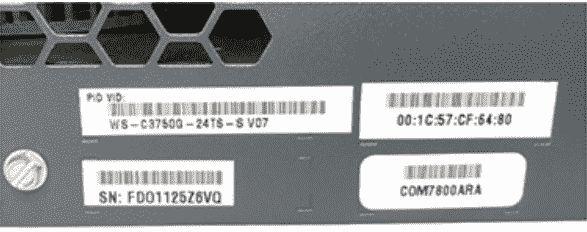

图 6-1 识别序列号和型号

你可以使用其他方法来识别正在使用的思科硬件的类型。思科路由器或交换机设备通常包含其他标记，例如显示设备型号的徽标。你也可能会找到以下设备的型号标识：

- **适配器** 这些是添加到思科设备的网络接口卡。
- **模块** 可以将许多不同类型的模块添加到思科设备上的插槽中。模块的常见示例是 WAN 接口卡（WIC），用于向路由器安装 T1 接口或串行端口。
- **线路卡** 这是一块电路板，为设计用于接受线路卡的高端路由器提供 LAN 或 WAN 端口。

这些设备中的每一个都可能带有指示设备类型或设备型号的标记。例如，如果你查看 WIC 模块设备上的金属铭牌，你会看到模块类型，例如 WIC 1DSU/T1，这是一块 T1 WAN 接口卡。

你还可以通过使用 **show version** 命令找到思科设备的型号和序列号。查看以下代码示例，我已突出显示了一些相关部分，用于识别思科设备的型号，你可以看到它是一款思科 1900 系列设备（在输出顶部），但更下方可以看到它是一款思科 1921 路由器。**show version** 命令还会在“Processor board ID”字段中显示设备的序列号。**show version** 命令的另一个优点是，你稍后会学到，它会显示设备中存在哪些接口。你可以看到该设备上有两个千兆接口和总共三个串行接口（稍后会详细介绍接口） 。重点是，**show version** 命令不仅显示软件版本，还显示与硬件相关的信息。

```
Router>enable
Router#show version
Cisco IOS Software, C1900 Software (C1900-UNIVERSALK9-M), Version 15.7(3)M2,
RELEASE SOFTWARE (fc2)
(output cut for briefness)
ROM: System Bootstrap, Version 15.0(1r)M12, RELEASE SOFTWARE (fc1)
Router uptime is 9 minutes
System returned to ROM by power-on
System image file is "usbflash0:c1900-universalk9-mz.SPA.157-3.M2.bin"
(output cut for briefness)
Cisco CISCO1921/K9 (revision 1.0) with 487424K/36864K bytes of memory.
Processor board ID FGL1551222Y
2 Gigabit Ethernet interfaces
1 Serial interface
2 Serial (sync/async) interfaces
(output cut for briefness)
```

## 思科设备上的常见组件

思科设备上通常使用许多组件，例如端口、接口、模块和收发器。你将在本章后面了解更多关于这些组件的信息，对于思科 CCT 考试来说，了解它们很重要。每个型号的设备在支持的模块类型方面各不相同。购买思科设备时，请务必查看设备的性能，以确保它满足你的需求。

## 使用思科软件

你需要熟悉思科设备的两个方面：设备上运行的软件（操作系统）和设备的硬件组件。我们将在本节中查看思科软件，并在下一节讨论硬件元素。

## 软件类型

每个思科设备都由思科操作系统驱动，该操作系统负责提供该设备的功能。对于思科 CCT 认证考试，你应该了解以下操作系统：

- **Cisco IOS** 思科互联网操作系统（IOS）是与思科设备一起使用的较为常见的操作系统之一，也是考试中需要了解的。IOS 提供设备的网络功能、协议和安全特性。Cisco IOS 直接在思科设备的硬件上运行。
- **Cisco IOS XE** 该操作系统最初随 ASR 1000 和 Catalyst 3850 系列路由器发布。它与 IOS 的不同之处在于 IOS XE 是一个 Linux 内核，其上运行着 IOS 的一个版本（这就是为什么你的 IOS 命令适用于 IOS XE）。通过以 Linux 内核作为操作系统的基础，你可以在设备上运行不同的应用程序。
- **Cisco IOS XR** 这种基于 Unix 的操作系统与思科 IOS 完全不同，但它使用许多与思科 IOS 上使用的命令类似的命令。需要注意的是，并非所有 IOS 命令都一定能在 IOS XR 上运行。该操作系统面向服务提供商，并用于思科 XR 12000 系列路由器等设备。
- **Cisco NX-OS** 该操作系统适用于思科 Nexus 系列交换机。它基于 Linux 内核构建，并支持 Python 作为用于自动化设备更改的脚本语言。虽然它与思科 IOS 不同，但所使用的命令非常相似，这使得技术人员很容易适应 NX-OS。

## 许可流程

当你购买思科设备时，必须为该设备购买许可证，如果你用更新的设备替换设备，则需要为新设备获取许可证。每个思科设备都包含许多软件功能。例如，思科防火墙产品包括恶意软件保护功能和 URL 过滤功能。每个软件功能，或 *附加组件*，都需要你获取软件许可证才能使用它。

许可的一部分与设备以及为设备许可的功能的支持合同有关。支持合同使你能够在硬件故障或操作系统出现问题时从思科获得技术支持。还有针对正在许可的功能的支持合同，例如更新。


**注意** 你将在第 8 章学习如何在思科设备上安装和查看许可证。

你可以为思科设备购买两种类型的支持合同：

- **SMARTnet (SNT)** 该支持协议涵盖硬件，并提供诸如次工作日更换故障硬件等服务。该协议还使你能够接收设备操作系统的更新。
- **Software Support Service (SWSS)** 该支持合同使你能够接收任何附加功能的更新和支持。


**注意** 确保两个支持合同始终处于激活状态，以便你能够为思科设备获得全面支持并持续更新其功能。例如，如果在续订时你续订了 SNT 合同但未续订 SWSS，你将不会收到有关附加功能的更新。

## 捆绑模式和安装模式

Cisco IOS XE 交换机，例如 3850 和 3650，支持两种操作模式：捆绑模式和安装模式。在捆绑模式下，思科操作系统以映像文件的形式存储在闪存中。设备在启动时将该映像加载到内存中。（你将在第 8 章了解更多关于 IOS 映像文件和闪存的信息。）安装模式是交换机上使用的默认模式，并包括用于启动思科交换机的配置文件 packages.conf。交换机还包含闪存中引用的多个 .pkg 文件，这些文件由 packages.conf 文件引用。如果使用大量交换机，安装模式最有益，因为你可以对所有交换机执行升级，而无需复制映像文件。

## 在思科设备上操作端口

你会在思科设备的背面或前面看到许多不同类型的端口。图 6-2 显示了思科 1921 ISR 路由器的背面，并标识了你在许多不同思科设备上都会看到的一些常见端口。

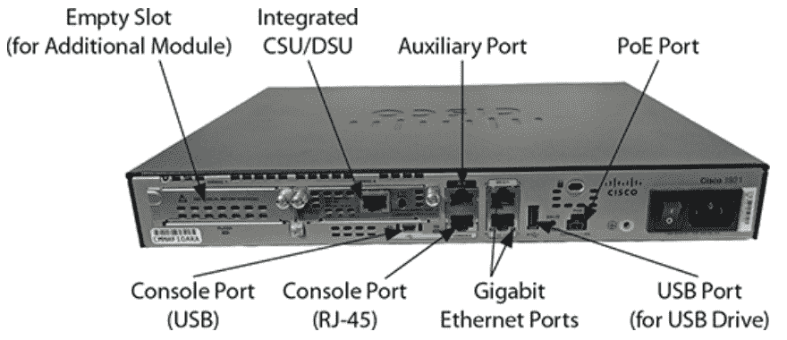

图 6-2 识别思科路由器的端口

### 控制端口

你将管理工作站连接到控制台端口以本地管理思科设备——这意味着你坐在设备旁执行管理任务。你会使用控制台电缆（通常为浅蓝色），又称翻转电缆，将计算机的串行端口连接到思科设备的控制台端口。然后你将启动终端仿真程序以从命令行界面（CLI）管理设备。


注意 你将在本章后面的“使用终端仿真软件”部分了解更多关于如何启动终端仿真软件的信息。

你应该知道如何在 Cisco 设备上识别控制台端口，它通常标记为“Console”或“Con0”。图 6-3 显示了控制台端口的特写。请注意控制台端口左侧的 USB 端口；这是一个 USB 串行端口，五针迷你 USB Type B 端口，你可以用它作为控制台连接，而不用传统的控制台端口（RJ-45 类型的控制台端口）。还请注意标记为“EN”，表示“已启用”的 LED 灯。你用于登录设备的端口对应的 LED 会亮起。

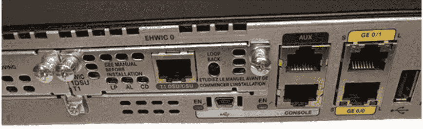


图 6-3 用于本地管理的控制台端口

如今的许多台式机和笔记本电脑都没有用于将控制台电缆连接到笔记本电脑的串行端口。但是，你可以购买一个 USB 转串行适配器连接到笔记本电脑的 USB 端口，然后将适配器连接到连接到 Cisco 设备的控制台电缆（见图 6-4）。

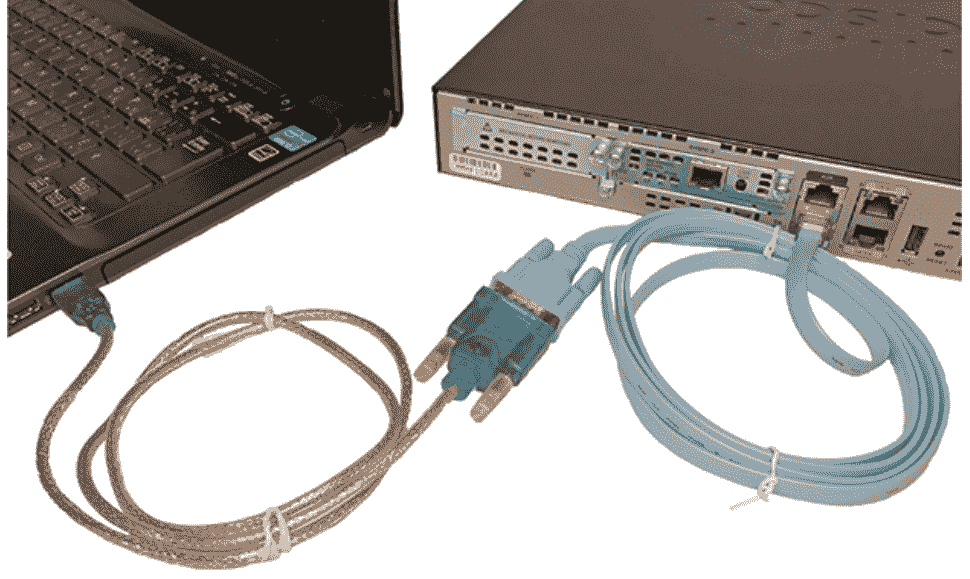

图 6-4 使用 USB 转串行适配器连接到 Cisco 设备

## 辅助端口

辅助端口，也称为 AUX 端口，也用于出于管理目的连接到你的 Cisco 路由器，但它设计为通过将调制解调器连接到 AUX 端口从而连接到墙上的电话插孔，来以替代方法远程管理你的设备。使用这种设置，如果路由器失去互联网连接，你可以拨号进入路由器。通常，如果设备有互联网连接，你可以使用 telnet 或安全外壳 Secure Shell（SSH）远程登录到设备。图 6-5 显示了 AUX 端口的典型设置。

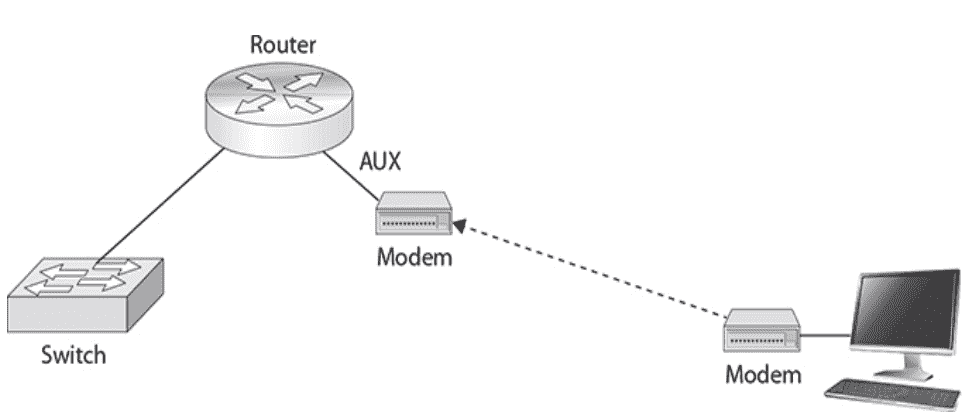

图 6-5 AUX 端口将调制解调器连接到路由器。


**注意** 尽管 AUX 端口的目的是连接调制解调器，你仍然可以将控制台电缆直接连接到该端口并像使用控制台端口一样本地管理设备。

## LAN 端口

Cisco 设备还包括一些用于连接到 LAN 的以太网端口——这些称为接口。以太网端口的类型取决于设备的年代。你可能会遇到较旧的 Cisco 设备，其以太网端口 Cisco 用作 10-Mbps 端口。快速以太网端口运行速度为 100 Mbps，千兆端口运行速度为 1000 Mbps（1 Gbps），而 10 千兆端口运行速度为 10 Gbps。图 6-6 显示了 Cisco 路由器上的两个千兆以太网端口。请注意它们标记为 GE0/0 和 GE0/1（千兆）。

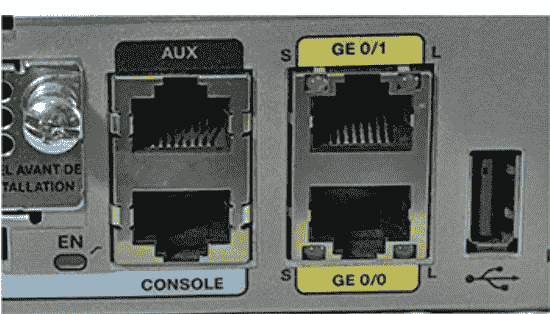

图 6-6 Cisco 路由器上的千兆以太网端口

了解你正在使用的以太网端口类型非常重要，因为管理端口的命令会根据类型而不同。例如，你将快速以太网端口引用为 FastEthernet0/0，而千兆端口引用为 GigabitEthernet0/0。在具有 10 Mbps 以太网端口的较旧设备上，你将端口引用为 Ethernet0。每个端口类型还有关联的缩写——例如，你可以使用 FE0/0 或 Gig0/0，具体取决于你想要引用的端口。

表 6-1 显示了不同端口类型的不同标签标识符列表。

| 端口类型 | 速度 | 标签标识符示例 |
|---|---|---|
| 以太网 | 10 Mbps | Ethernet0 or Eth0 |
| 快速以太网 | 100 Mbps | FastEthernet0/0 or FE0/0 |
| 千兆以太网 | 1000 Mbps / 1 Gbps | GigabitEthernet0/0 or Gig0/0 |
| 10 千兆以太网 | 10 Gbps | TenGigabitEthernet0/0 |

表 6-1 LAN 端口速度和标签标识符

关于接口的另一个重要点是，过去它们是通过使用形式为 <TypeOfPort><Index#> 的标识符来引用的。例如，Ethernet0 将是路由器上的第一个以太网端口，而 Ethernet1 将是第二个以太网端口。随着时间的推移，标识符发生了变化，以便索引号开始使用 0/0 类型的语法，因为 Cisco 设备现在具有模块，这些模块是包含不同类型端口的卡，添加到设备的插槽中。放置在插槽中的每个模块可以有多个接口。0/0 形式的语法引用插槽号，然后是斜杠，然后是插槽内接口的索引号。

查看图 6-7，你可以了解 Cisco 交换机上的插槽和接口 ID 的工作原理如何。Cisco 交换机上的 LAN 端口通常从插槽号 1 开始，插槽内的接口 ID 为 1，但在路由器上，端口通常从 0 开始编号。

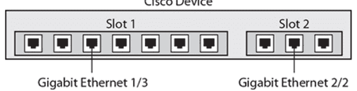

图 6-7 Cisco 设备上的插槽和接口

请注意，对于较新的 Cisco 设备，标识符引用为 <TypeOfPort> <DeviceIndex>/<Slot>/InterfaceID——例如，Gig0/1/0。你仍然包含端口类型——在这种情况下是千兆接口——然后包含引用设备的索引号。一些设备可以堆叠在一起作为一个单元工作；在这种情况下，第一个设备将具有设备索引 0，而第二个设备将是设备索引 1。识别设备后，如前所述包含插槽和接口号。

## WAN/串行端口

不同类型的以太网端口用于连接到你的 LAN 环境，但 Cisco 路由器还需要连接到 WAN 环境，以便在公司有多個地點時將流量从一个网络发送到另一个网络。Cisco 路由器上的串行接口使你能够在两种情况下将 Cisco 路由器连接到其他网络：

- **服务提供商的 WAN 链路** 连接到你的服务提供商或 ISP 网络
- **背靠背串行连接** 直接在两个路由器之间创建点对点链路。此链路通常用于测试环境或你的 CCNA 考试学习实验室。

## WAN 链路到服务提供商

要连接相隔一定距离的两个办公室网络，你将订阅来自当地电信公司或服务提供商的 T1 或 T3 链路等月度服务。电信公司提供 WAN 网络基础设施，你的路由器的串行端口连接到该基础设施，通过服务提供商的网络建立到另一地点的链路。

让我们看一下图 6-8 所示的示例。图左侧是温哥华办公室中的路由器、交换机和一些客户端计算机。路由器具有标识符为 s0/0/0 的串行接口，连接到外部通道服务单元/数据服务单元（CSU/DSU）。你还将来自服务提供商的 WAN 链路插入 CSU/DSU；该组件负责从服务提供商的网络发送和接收数据，本质上充当整个网络的调制解调器。CSU/DSU 从路由器接收数据，然后将其转换为 WAN 基础设施使用的信号格式，然后将数据发送到服务提供商的网络。数据随后通过许多不同的 WAN 交换机传输，然后到达洛杉矶的 CSU/DSU。洛杉矶的 CSU/DSU 负责将信号转换为路由器可以在其串行端口接收的用户数据。

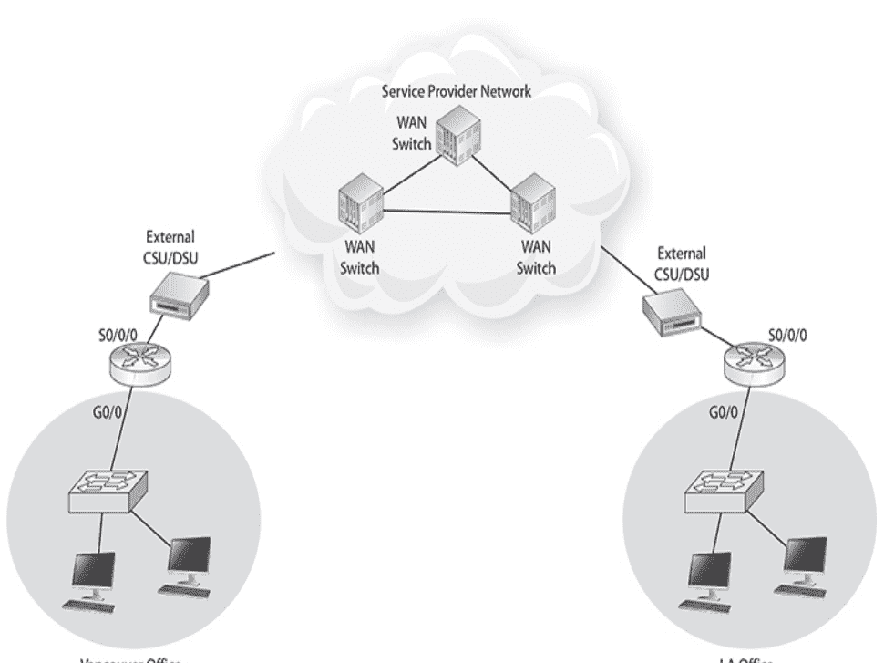

图 6-8 CSU/DSU 用于将路由器连接到 WAN。

路由器被视为数据终端设备（DTE）设备，它发送或接收原始数据，该数据由数据通信设备（DCE）转换为 WAN 的信号。在我们的示例中，CSU/DSU 是 DCE 设备，因为它负责将数据或信号转换为适当的传输格式。在此示例中，CSU/DSU 被视为外部 CSU/DSU，因为它未集成在路由器内。外部 CSU/DSU 连接到串行端口，通常放置在路由器顶部或旁边。

可以將內部 CSU/DSU 模組安裝到路由器中，然後將 WAN 链路連接到該模組。图 6-9 显示了直接集成到路由器中的内部 CSU/DSU 模块（请注意，该模块标记为 DSU/CSU）。


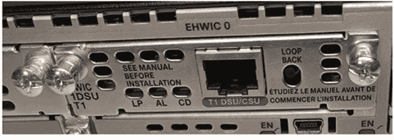

图 6-9 一个集成的 CSU/DSU

## 背靠背串行连接

你还可以使用串行端口在两台路由器之间创建背靠背连接，这需要一根背靠背串行电缆，如图 6-10 所示。使用背靠背串行电缆连接两台路由器可以在测试环境中模拟 WAN 链路。

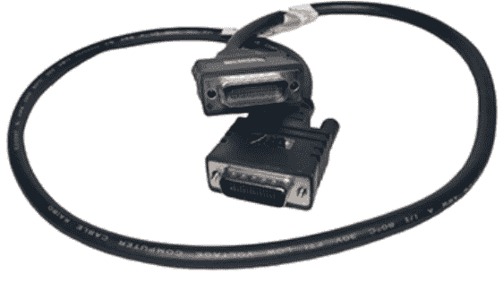

图 6-10 背靠背串行电缆


注意 使用背靠背串行电缆时，请确保电缆一端标记为“DTE”，另一端标记为“DCE”。连接到 DCE 端的路由器需要配置额外的命令，正如你在第 7 章中将学到的。

## 使用 Cisco 硬件

Cisco CCT 认证考试要求你了解将遇到的硬件组件类型以及如何操作它们。

### 了解收发器模块

收发器模块是当今 Cisco 设备的重要特性。Cisco 不为特定类型的接口对 Cisco 设备进行硬连线，而是在部分设备中安装收发器端口，这样你就可以购买带有所需布线端口类型的收发器模块。例如，而不是要求你为千兆接口将 RJ-45 端口插入设备，你的 Cisco 设备可能包含一个收发器端口，这样你就可以购买一个已经在其上包含 RJ-45 端口的收发器模块。这提供了灵活性，因为 Cisco 设备不是为一种特定类型的接口硬编码的。然后，如果你后来决定需要将光纤电缆连接到设备，只需购买该类型的收发器并将其插入 Cisco 设备上的收发器端口即可。

图 6-11 显示了两种用于千兆网络的收发器模块：左侧的 GLC-T 模块使用 RJ-45 连接器连接到非屏蔽双绞线（UTP）布线，以及连接到光纤电缆的 GLC-SX-MM 模块。

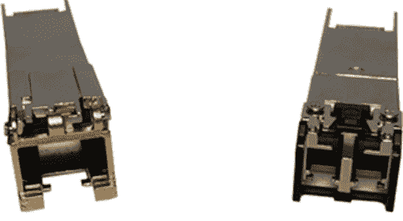

图 6-11 用于 UTP 的 GLC-T SFP 收发器模块（左侧），以及 GLC-SX-MM 光纤模块

安装收发器模块很简单：将模块滑入 Cisco 设备上的 SFP 端口并用夹具固定，如图 6-12 所示。

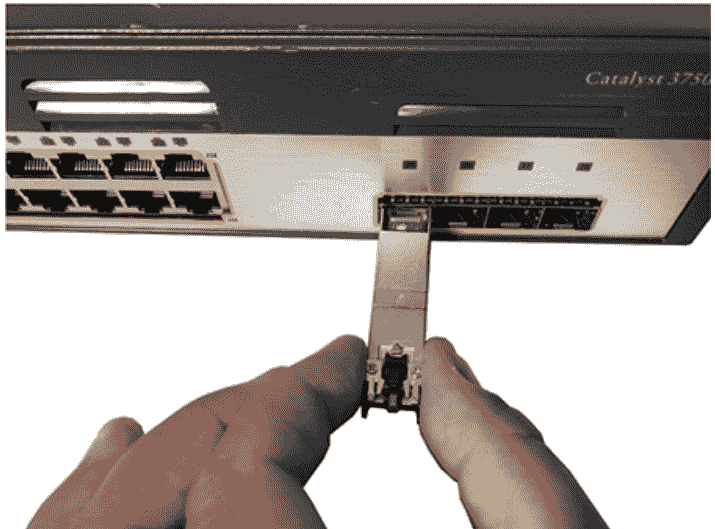

图 6-12 将收发器安装到 SFP 插槽

一些示例收发器类型、其传输速率以及它们使用的介质类型（连接器类型）列在表 6-2 中。

| OEM 零件编号 | 传输速率 | 介质类型 |
|---|---|---|
| GLC-T | 1 Gbps | UTP |
| GLC-SX-MM | 1 Gbps | 多模光纤 |
| GLC-LH-SM | 1 Gbps | 单模光纤 |
| SFP-10G-SR-S | 10 Gbps | 多模光纤 |
| SFP-10G-LR-S | 10 Gbps | 单模光纤 |
| QSFP-40G-SR-S | 40 Gbps | 多模光纤 |
| QSFP-40G-LR-W | 40 Gbps | 单模光纤 |

表 6-2 示例收发器模块

### 安装和更换硬件

购买 Cisco 设备后，你需要将其安装在位于服务器机房或通信机柜的机架中。以下是有关安装 Cisco 设备的一些常见指南：

- 确保设备安装在机架中时，能够看到设备前面板上的 LED，并且可以访问所有端口。
- 确保电源线能够到达设备安装位置，并确保网络布线远离电源线和荧光灯等电气噪声源。
- 确保 Cisco 设备周围有足够的空间，以便通风口的空气流通不受限制。
- 确保电缆长度不超过其规格规定的最大距离。例如，双绞线电缆的最大距离为 100m（328 英尺）。
- 确保设备周围的温度不超过 113°F（45°C）。

从包装盒取出设备后，安装安装支架，以便设备可以固定到通信机架中。使用十字螺丝刀将安装支架拧到设备侧面，然后将设备固定到机架中。

### 安装和更换模块

Cisco CCT 认证考试要求你知道如何在 Cisco 路由器或交换机上安装和更换模块。以下是可能安装在路由器上的一些常见模块示例（见图 6-13）：

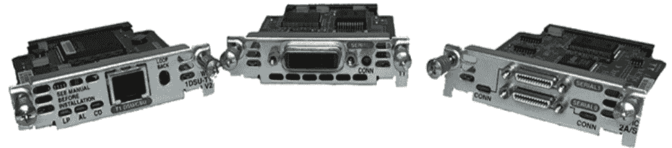

图 6-13 Cisco WAN 模块。WIC-1DSU-T1（左）、WIC-1T（中）、WIC 2A/S（右）

- **WIC-1T** 这种带有 DB-60 端口的 WAN 接口卡提供一个串行端口，用于连接到 WAN 环境。
- **WIC 1DSU/T1** 这种带有单个 RJ-45 端口的 WIC 卡是内部 CSU/DSU 卡，用于连接到 T1 线路。
- **WIC 2A/S** 这种带有两个 V.35 串行连接器的 WIC 模块可实现与 WAN 环境的连接。

请记住，每个 WIC 卡金属板上的标签列出了卡类型。每种模块类型都由特定设备支持，并且有最低 IOS 版本要求才能识别该模块。例如，WIC 1DSU/T1 模块在我的 Cisco 1921 路由器中无法识别，因为我的路由器需要该模块的 HWIC 版本。*高速 WAN 接口卡*（HWIC）是 Cisco WIC 卡的新版本，支持更高的速度和更好的吞吐量。

以下是安装或更换 WIC 或 HWIC 模块的方法：

- 1. 通过在 Cisco 网站上搜索模块型号，验证该模块是否受你的设备和操作系统版本支持。
- 2. 使用菲利普斯螺丝刀拧下要从插槽中移除的空白板或现有模块。然后从插槽中取出空白板或现有模块。
- 3. 将新模块滑入插槽，确保其完全推入。

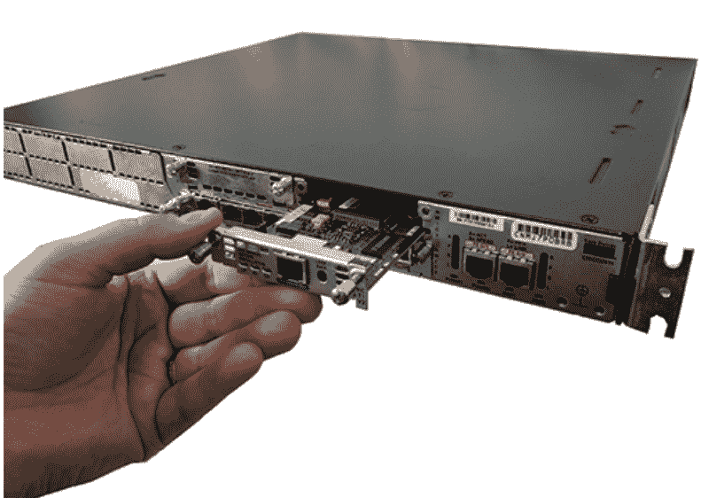

- 4. 拧紧模块以将其固定到位。

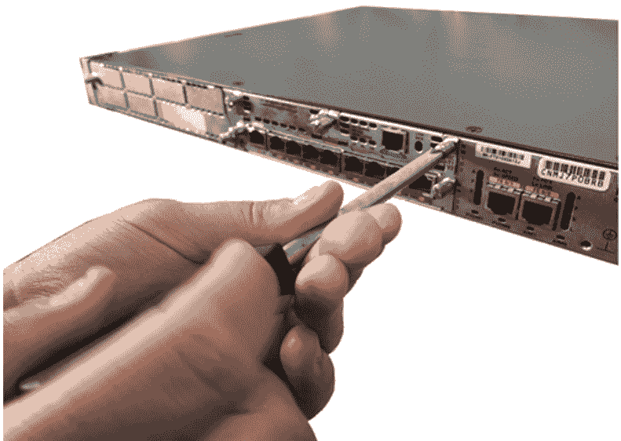

安装新硬件模块后，打开 Cisco 设备的电源，然后使用 **show inventory** 命令验证模块是否被检测到。通过以下代码示例，我们可以获得有关硬件的一些详细信息。首先，注意 **show inventory** 命令显示了 Cisco 设备的型号，仍然是 Cisco 1921 系列设备。此外，注意我们可以看到设备的序列号。

```
Router>enable
Router#show inventory
NAME: "CISCO1921/K9", DESCR: "CISCO1921/K9 chassis, Hw Serial#: FGL1551222Y,
Hw Revision: 1.0"
PID: CISCO1921/K9 , VID: V04 , SN: FGL1551222Y

NAME: "WAN Interface Card - HWIC CSU/DSU on Slot 0 SubSlot 0", DESCR: "WAN Interface Card - HWIC CSU/DSU"
PID: HWIC-1DSU-T1 , VID: V02 , SN: FOC19092U9T

NAME: "WAN Interface Card - HWIC Serial 2T on Slot 0 SubSlot 1", DESCR: "WAN Interface Card - HWIC Serial 2T"
PID: HWIC-2T , VID: V02 , SN: FOC14226262
```

查看此输出时，你还可以看到设备信息下方安装在设备插槽中的 WIC 卡信息。请注意，第一张 WIC 卡是插槽 0/0 中的 HWIC CSU/DSU，型号为 HWIC-1DSU-T1，卡上的序列号为 FOC19092U9T。请注意，第二张卡是位于插槽 0/1 中的 HWIC-2T，序列号为 FOC14226262。

如果运行 **show inventory** 命令后看不到新的硬件模块，可能是因为硬件模块不受设备支持或你未运行最低 IOS 版本。务必查看卡（硬件模块）的文档，以确保了解受支持的设备和最低 IOS 版本。


**考试提示** 请记住，对于 Cisco CCT 考试，**show version** 命令和 **show inventory** 命令可用于查看硬件设备的型号信息和序列号。


## 回环插头

回环插头可以连接到端口，以验证端口能够发送和接收信号，而信号不会离开系统。回环插头适用于不同类型的接口，例如 RJ-45 以太网接口、T1 链路和 56K 链路。回环插头是一种特殊设计的连接器，其连接器的发送引脚（UTP 布线中的引脚 1 和 2）连接到同一连接器上的双向引脚（UTP 布线中的引脚 4 和 5）。

让我们看一个用于 T1 接口的回环插头的创建示例。你需要一个压线钳、一个 RJ-45 连接器和一小段以太网电缆（长度约为 3 到 4 英寸）。然后按照以下步骤制作自己的 T1 回环插头：

- 1. 剪下一小段以太网电缆（约 3 或 4 英寸）。
- 2. 去除电缆的外层护套。
- 3. 将 RJ-45 连接器的卡扣朝向远离你的方向。左侧为引脚 1，右侧为连接器中的引脚 8。
- 4. 使用橙色线（可以用任何线），将线的一端插入 RJ-45 连接器的引脚 1，然后弯折电线，将电线的另一端连接到连接器的引脚 4。
- 5. 使用蓝色线（可以用任何线），将线的一端插入 RJ-45 连接器的引脚 2，然后弯折电线，将电线的另一端连接到连接器的引脚 5。
- 6. 线路就位后，将 RJ-45 连接器放入压线钳中并挤压以压接电线。

回环插头制作完成后，你可以将其连接到路由器上的 T1 端口，你应该会通过 LED 收到链路或回环的指示（取决于接口）。

## Cisco 设备电缆类型

你应该熟悉 Cisco CCT 认证考试中的几种不同类型的电缆。

### 控制台电缆

控制台电缆通常是一根浅蓝色电缆，一端带有串行端口（RS-232）连接器，另一端带有 RJ-45 连接器。该电缆用于将计算机连接到 Cisco 设备，以便你本地配置设备。如前所述，如果你的计算机没有串行端口（大多数笔记本电脑的情况），你将需要一个 USB 转串行适配器，以便将控制台电缆连接到 USB 端口。

### 以太网电缆

你将使用直通以太网电缆将工作站连接到交换机，或将路由器连接到交换机。你可能还需要交叉电缆来连接类似的设备，例如两台交换机。

### 串行电缆

使用背靠背串行电缆通过路由器的串行端口连接两台路由器。有多种不同类型的串行端口，因此请确保为这些端口配备正确的电缆类型。图 6-14 显示了路由器上的两种不同类型的串行接口以及相应的布线。

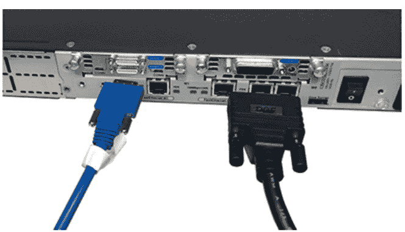

图 6-14 连接到串行端口的串行电缆

### 交换机堆叠电缆

许多企业级交换机支持 StackWise 功能，该功能使你能够将交换机连接为一个可管理的单元，以便从一个点集中配置所有交换机。要将交换机堆叠连接起来，你需要使用 StackWise 电缆，如图 6-15 所示。

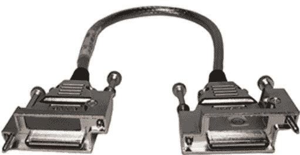

图 6-15 用于连接堆叠交换机的 StackWise 电缆

## 练习 6-1：识别 Cisco 设备组件

在本练习中，你将使用以下图表识别 Cisco 设备上的组件并找到以下部件（并非所有组件都一定存在）：

|  |  |
|---|---|
| 控制台端口 | 串行端口 |
| 以太网端口 | 辅助端口 |
| 集成 CSU/DSU |  |

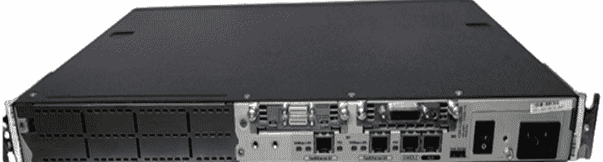

## 了解内存类型

现在让我们来看看 Cisco 软件组件，从 Cisco 设备上找到的不同类型的内存以及存储在该内存中的信息类型开始。这对于 Cisco CCT 考试来说是很重要的内容，请务必好好学习。

### 只读存储器 (ROM)

ROM 中的软件无法更改，除非你实际更换 Cisco 设备上的 ROM 芯片。ROM 是非易失性的——也就是说，当你关闭设备时，ROM 的内容不会被擦除。ROM 包含启动路由器所需的固件，通常具有以下三个组件：

- **开机自检 (POST)** 对设备的硬件组件执行测试。
- **引导程序** 启动路由器并确定如何找到和加载 IOS 映像和配置文件。
- **ROM 监视器 (ROMMON)** 一个迷你操作系统，使你能够执行低级测试和故障排除；例如，ROMMON 在密码恢复过程中使用。要中止路由器加载 IOS 的正常启动过程，请按 ctrl-break 进入 ROMMON 模式。ROMMON 模式下的提示符为 > 或 rommon>，具体取决于路由器型号。


**考试提示** POST 对硬件执行自检。引导程序启动路由器并找到 IOS 映像。ROMMON 包含一个用于低级测试和调试的迷你操作系统。Mini-IOS 是 IOS 的精简版本，用于路由器的紧急启动，被称为 RXBOOT 模式。所有这些组件都存储在 ROM 中。

### 闪存

Flash 是一种非易失性存储器，类似于 ROM，这意味着当你关闭路由器时，存储在闪存中的信息不会丢失。路由器将其 IOS 映像存储在闪存中，但也可以在此处存储其他信息，例如辅助配置文件。请注意，一些低端 Cisco 路由器实际上直接从闪存（而非 RAM）运行 IOS。闪存比 RAM 慢，这一事实可能会导致性能问题。图 6-16 显示了闪存被插入紧凑型闪存插槽。

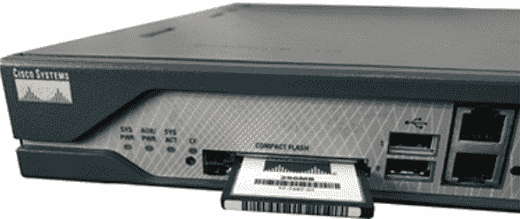

图 6-16 Cisco 路由器上的闪存

### 易失性 RAM (VRAM)

Cisco 设备上的易失性 RAM (VRAM) 与计算机中的 RAM 类似，因为在关闭系统时它会丢失其内容。在路由器上，易失性 RAM，有时仅称为 RAM，包含正在运行的 IOS 映像、活动配置文件（称为运行配置）、任何表（包括路由、ARP 和其他表），以及用于临时存储信息（如接口输入和输出缓冲区和日志消息）的内部缓冲区。当你关闭路由器时，RAM 中的所有内容都会被擦除，包括上面提到的项目，例如你的运行配置。

### 非易失性 RAM (NVRAM)

NVRAM 与闪存类似，因为在关闭路由器时其内容不会被擦除。不过，它略有不同，因为它使用电池在 Cisco 设备关闭时保持信息。路由器（和交换机）使用 NVRAM 存储配置文件，包括在 IOS 加载后启动过程中应用于设备的启动配置。

## 练习 6-2：识别内存类型

在本练习中，你将把内存术语与其描述的功能进行匹配。

| 术语 | 描述 |
|---|---|
| A. 闪存 | ___ 包含启动配置文件 |
| B. 易失性 RAM | ___ 包含运行配置文件 |
| C. ROM | ___ 包含 IOS 映像文件 |
| D. 非易失性 RAM | ___ 包含引导程序和 ROMMON 程序 |

## 管理 Cisco 设备

安装设备后，你可以启动并配置设备。在我们进入配置（见第 7 章）之前，你应该知道可以通过本节讨论的几种方式管理设备。

### 使用 CLI

管理 Cisco 设备最常用且最常用的方法之一是使用命令行界面（CLI）。CLI 是一个命令环境，类似于 Windows 命令提示符或 Linux 终端，你必须在其中输入命令以应用配置更改。Cisco CCT 和 CCNA 认证考试要求你知道如何使用 CLI 应用配置更改。

你可以使用 CLI 进行本地或远程管理。在本地管理中，你已将笔记本电脑连接到设备的控制台端口，并将使用 CLI 管理设备。这里的“本地”是指你与设备在物理上距离很近，可以连接到控制台端口。设备配置完毕并分配了 IP 地址后，你可以从

工作站连接到网络，可从网络的另一部分通过 telnet 或 SSH 进入设备。

## 基于 Web 的工具

对于某些 Cisco 设备，例如某些交换机和无线接入点，您可以使用 Web 界面对设备进行配置更改。通过使用 Web 界面，您无需学习配置设备的命令——只需在网页上选择适当的选项即可。

Web 界面在 CCNA 考试中不是重点，原因有两个：

- 并非所有配置选项都可通过 Web 界面使用，因此最终您仍需要使用 CLI。
- 并非所有 Cisco 设备都支持 Web 界面。

## 启动 Cisco 设备

Cisco CCT 考试要求您了解 Cisco 设备的启动过程。本节将介绍 Cisco 设备启动时发生的情况。

## 启动过程

路由器启动时通常会经历六个步骤：

- 1. 路由器加载并运行 POST（位于 ROM 中），测试其硬件组件，包括内存和接口。
- 2. 加载并执行引导程序。
- 3. 检查配置寄存器以确定如何启动（在哪里找到 IOS 映像和配置文件）。
- 4. 引导程序查找并加载 IOS 映像。IOS 映像可能位于 flash 或 TFTP 服务器中。
- 5. IOS 加载后，IOS 会尝试查找并加载配置文件，该文件通常存储在 NVRAM 中。如果 IOS 找不到配置文件，则会启动系统配置对话框。
- 6. 配置加载后，您将看到 CLI（请记住，您进入的第一个模式是用户 EXEC 模式）。


**考试提示** POST 完成后且引导程序加载后，将检查配置以确定下一步操作。

如果您已连接到控制台线路，路由器启动时您将看到以下输出：

System Bootstrap, Version 11.0(10c), SOFTWARE
Copyright (c) 1986-1996 by Cisco Systems
2500 processor with 6144 Kbytes of main memory

F3: 5593060+79544+421160 at 0x3000060

Cisco Internetwork Operating System Software
IOS (tm) 2500 Software (C2500-I-L), Version 12.0(5)
Copyright (c) 1986-1999 by Cisco Systems, Inc.
Compiled Tue 15-Jun-99 19:49 by phanguye Image text-base: 0x0302EC70, data-base: 0x00001000 . . .
.
.
.
Cisco 2504 (68030) processor (revision N) with
    6144K/2048K bytes of memory.
Processor board ID 18086269, with hardware revision
    00000003
Bridging software.
X.25 software, Version 3.0.0.
Basic Rate ISDN software, Version 1.1.
2 Ethernet/IEEE 802.3 interface(s)
2 Serial network interface(s)
32K bytes of non-volatile configuration memory.
16384K bytes of processor board System flash (Read ONLY)

00:00:22: %LINK-3-UPDOWN: Interface Ethernet0, changed
    state to up
00:00:22: %LINK-3-UPDOWN: Interface Ethernet1, changed
    state to up
.
.
.
Cisco Internetwork Operating System Software
IOS (tm) 2500 Software (C2500-I-L), Version 12.0(5)
Copyright (c) 1986-1999 by Cisco Systems, Inc.
Compiled Tue 15-Jun-99 19:49 by phanguye

Press RETURN to get started!


VIDEO 6.01. 本书附带的数字资源包含一个 Cisco 路由器启动的多媒体演示。

您应该注意此输出的几点。首先，注意路由器正在加载引导程序——“System Bootstrap, Version 11.0(10c)”——然后是 IOS 映像——“IOS (tm) 2500 Software (C2500-I-L), Version 12.0(5)”。在启动过程中，您看不到实际的 POST 过程（不像 Catalyst 交换机）。不过，您会看到有关接口上下状态的信息——这是 IOS 正在加载配置并启动您之前激活的那些接口的地方。有时，如果路由器有很多接口，“Press RETURN to get started!” 消息会与接口消息混在一起。一旦显示停止，只需按 Enter 即可访问用户 EXEC 模式。这完成了路由器的启动过程。


EXAM TIP 对于考试，请记住此过程：路由器启动时，它会运行 POST、加载引导程序、查找并加载 IOS，然后加载其配置文件——按此顺序。

## 引导程序

正如您在启动代码示例中所看到的，引导程序找到了 IOS 并加载了它。引导程序在尝试定位并加载 IOS 映像时会经历以下步骤：

- 1. 它检查配置寄存器值。该值是一组四个十六进制数字。最后一位会影响启动过程。如果最后一位在 0x2 到 0xF 之间，路由器将继续下一步。否则，路由器将使用表 6-3 中显示的值来确定应如何进行。

| 最后一位的值 | 启动过程 |
|---|---|
| 0x0 | 将路由器引导至 ROMMON 模式。 |
| 0x1 | 使用 flash 中的第一个 IOS 映像或 ROM 中的 Mini-IOS（RXBOOT 模式）引导路由器（如果后者存在）。 |
| 0x2-0xF | 使用默认启动序列引导路由器。 |

### 表 6-3 配置寄存器第四个十六进制字符的值

- 2. 它检查 NVRAM 中的配置文件中的 **boot system** 命令，这些命令告诉引导程序在哪里找到 IOS。这些命令稍后会显示。
- 3. 如果在 NVRAM 中的配置文件中找不到 **boot system** 命令，它将使用 flash 中找到的第一个有效 IOS 映像。
- 4. 如果 flash 中没有有效的 IOS 映像，它会生成 TFTP 本地广播以定位 TFTP 服务器（这称为 *netboot*，不建议使用，因为它非常慢且对于大型 IOS 映像不太可靠）。
- 5. 如果找不到 TFTP 服务器，它将加载 ROM 中的 Mini-IOS（RXBOOT 模式）。
- 6. 如果 ROM 中有 Mini-IOS，它将加载 Mini-IOS 并进入 RXBOOT 模式；否则，路由器将重试查找 IOS 映像或加载 ROMMON 并进入 ROMMON 模式。

表 6-3 显示了配置寄存器中用于影响启动过程的第四个十六进制字符中的三个常见配置寄存器值。配置寄存器中的值以十六进制表示，寄存器长度为 16 位。


**考试提示** 对于 CCT 和 CCNA 考试，要知道配置寄存器用于影响 IOS 如何启动。请记住表 6-3 中的值。

对于启动过程的第 2 步，您可以使用以下 **boot system** 命令来影响引导程序在尝试定位 IOS 映像时应使用的顺序：

```
Router(config)# boot system flash name_of_IOS_file_in_flash
Router(config)# boot system tftp IOS_image_name
               IP_address_of_server
Router(config)# boot system rom
```


**注意** 输入 **boot system** 命令的顺序很重要，因为引导程序会按您配置的顺序处理它们——一旦程序找到 IOS 映像，它就不会再处理配置文件中的任何其他 **boot system** 命令。这些命令也受 Catalyst IOS 交换机支持。

**boot system flash** 命令告诉引导程序在启动时加载 flash 中指定的 IOS 文件名。请注意，默认情况下，引导程序会加载 flash 中 *第一个* 有效的 IOS 映像。此命令告诉引导程序加载与第一个不同的映像。如果您执行升级并且 flash 中有两个 IOS 映像——旧的和新的——则可能需要这样做。默认情况下，旧的仍会先加载（因为它在 flash 中出现得更早），除非您使用 **boot system flash** 命令覆盖此行为或删除旧的 IOS flash 映像。


**VIDEO 6.02.** 本书附带的数字资源包含使用路由器上的 **boot system** 命令的多媒体演示。


你还可以让引导程序从 TFTP 服务器加载 IOS，但对于大镜像不推荐这样做，因为镜像是通过用户数据报协议（UDP）下载的，而 UDP 速度较慢。最后，你可以用 **boot system rom** 命令告诉引导程序从 ROM 中加载 Mini-IOS。要删除这些命令中的任何一个，只需在它们前面加上 **no** 参数即可。


**考试提示** **boot system** 命令可用于修改引导程序应从何处加载 IOS 的默认行为。当引导程序加载时，它会检查存储在 NVRAM 中的配置文件，查找 **boot system** 命令。如果找到这些命令，引导程序将使用这些命令来查找 IOS。如果未找到 **boot system** 命令，路由器将使用查找和加载 IOS 镜像的默认行为（首先是 flash 中的第一个镜像，然后向 TFTP 服务器广播，最后是 ROM 中的 IOS（如果存在））。当路由器启动时，如果你看到消息“boot: cannot open "flash:"”；这表明你错误配置了 **boot system** 命令，并且 flash 中对应的 IOS 镜像文件名不存在。

## 系统配置对话框

当路由器启动、运行硬件诊断并加载 IOS 软件后，IOS 随后会尝试在 NVRAM 中查找配置文件。如果找不到要加载的配置文件，IOS 就会运行系统配置对话框，通常称为 *设置* 模式，这是一个会提示你输入配置信息的脚本。该脚本的目的是向你提问，以便你能够在路由器上设置基本配置：它并非作为全功能配置工具而设计。换句话说，该脚本没有执行路由器所有配置任务的能力。相反，它被那些不太熟悉 IOS CLI 的新手使用。一旦你熟悉 CLI 以及路由器上的许多命令，你可能就再也不会使用此脚本了。


**考试提示** 请记住，如果在 NVRAM 中找不到启动配置，系统配置对话框脚本就会启动。

## 运行系统配置对话框

一种访问系统配置对话框的方法是在 NVRAM 中没有配置的情况下启动路由器。第二种方法是在特权 EXEC 模式下使用 **setup** 命令，如下所示：

```
Router# setup
    --- System Configuration Dialog ---
Continue with configuration dialog? [yes/no]: yes
At any point you may enter a question mark '?' for help.
Use ctrl-c to abort configuration dialog at any prompt.
Default settings are in square brackets '[ ]'.

Basic management setup configures only enough connectivity
for management of the system, extended setup will ask you
to configure each interface on the system

First, would you like to see the current interface summary? [yes]:
Interface IP-Address  OK? Method Status          Protocol
Ethernet0 unassigned  YES unset  administratively down down
Ethernet1 unassigned  YES unset  administratively down down
Serial0   unassigned  YES unset  administratively down down

Would you like to enter basic management setup? [yes/no]: no
Configuring global parameters:
  Enter hostname [Router]:
The enable secret is a password used to protect access to
privileged EXEC and configuration modes. This password, after
entered, becomes encrypted in the configuration.
Enter enable secret: dealgroup1
The enable password is used when you do not specify an
enable secret password, with some older software versions,
and some boot images.   Enter enable password: dealgroup2
The virtual terminal password is used to protect
access to the router over a network interface.
Enter virtual terminal password: cisco
Configure SNMP Network Management? [no]:
Configure LAT? [yes]: no
Configure AppleTalk? [no]:
Configure DECnet? [no]:
Configure IP? [yes]:
  Configure IGRP routing? [yes]: no
  Configure RIP routing? [no]:
.
.
.
Configuring interface parameters:
Do you want to configure Ethernet0 interface? [no]: yes
  Configure IP on this interface? [no]: yes
    IP address for this interface: 172.15.1.1
    Subnet mask for this interface [255.255.0.0] : 255.255.255.0
    Class B network is 172.15.0.0, 24 subnet bits; mask is /24
```

```
Do you want to configure Serial0 interface? [no]:
.
.
.
The following configuration command script was created:
hostname Router
enable secret 5 $1$/CCk$4r7zDwDNeqkxFO.kJxC3G0
enable password dealgroup2
line vty 0 4
  password cisco
.
.
end

[0] Go to IOS command prompt without saving this config.
[1] Return back to the setup without saving this config.
[2] Save this configuration to nvram and exit.
Enter your selection [2]: 2
```

方括号 ([ ]) 中包含的信息表示默认值——如果你按回车键，则使用方括号中的值。此脚本的一个问题是，如果你犯了错误，就无法返回到前一个问题。相反，你必须使用 ctrl-c 中断序列来中止脚本并重新开始。

以下各节将分解脚本的不同组件。


注 脚本向你提出的问题可能因路由器而异，具体取决于硬件型号、安装的接口以及运行在其上的软件。

## 状态和全局配置信息

脚本开始时，会询问你是否要继续。如果回答 yes，脚本将继续；否则，如果回答 no，脚本将被中止并返回到特权 EXEC 模式。接下来会询问你是否要查看路由器的接口状态。如果回答 yes，你将看到路由器上的所有接口、接口的 IP 地址以及接口的状态。

在状态信息之后，会显示实际配置。配置的第一部分处理路由器除接口之外的所有配置信息，接口是第二部分。在配置的这一部分中，会要求你提供诸如特权 EXEC 密码、虚拟类型终端（VTY）密码（telnet 和 SSH）、你希望全局激活的网络协议以及其他全局配置信息等内容。


**注** 请注意，脚本中会提示你输入两个特权 EXEC 密码：**enable secret** 和 **enable password**。尽管你通常只配置一个，但脚本要求你同时输入两者，并且要求两个密码不同。当设置了 secret 后，你需要使用 secret 进入特权 EXEC 模式。

## 协议和接口配置信息

在为路由器配置全局信息后，脚本会引导你回答有关要使用哪些接口以及应如何配置它们的问题。脚本足够智能，可以根据你对全局问题的回答来提问配置问题。例如，如果你激活了 IP，脚本会询问你每个已激活的接口是否要处理 IP，如果回答是，则询问该接口的 IP 地址信息。


**考试提示** 你应该记住，当路由器启动且 NVRAM 中没有配置时，或从特权 EXEC 模式使用 **setup** 命令时，系统配置对话框脚本会启动。此外，要了解 Setup 对话框脚本末尾的三个选项。并且请记住，你可以按 ctrl-c 来中止脚本。

## 退出设置模式

在你回答完脚本的所有配置问题后，会显示脚本根据你对脚本问题的回答创建的路由器配置。请注意，IOS 尚未激活配置文件。仔细检查配置，然后从表 6-4 中显示的三个选项中选择一个。此外，如果你输入 **1** 作为选项，当脚本重新开始时，你之前输入的信息会出现在方括号中，并在空行上按回车键时成为默认值。

| 选项 | 描述 |
|---|---|
| 0 | 丢弃脚本的配置并返回到特权 EXEC 模式。 |
| 1 | 返回脚本的开头。 |
| 2 | 激活脚本的配置，将配置保存到 NVRAM，并返回到特权 EXEC 模式。 |

表 6-4 系统配置对话框结束时的选项


**视频 6.03.** 本书附带的数字资源包含使用系统配置对话框的

一台思科路由器。

## 技术人员服务相关任务

作为思科认证技术员（CCT），在回答客户服务电话时，您将负责执行关键的管理任务。在本节中，您将学习如何执行考试所需了解的常见服务相关任务。

## 使用文本编辑器

尽管大部分管理操作都是在思科设备上执行的，但您应该知道如何在 Windows 或 Linux 中启动文本编辑器。您可以使用文本编辑器准备配置命令，然后将其粘贴到 CLI 中执行命令。

### 在 Windows 中启动文本编辑器

启动 Windows 中的文本编辑器，请按以下步骤操作：

- 1. 单击“开始”按钮。
- 2. 输入 **记事本**。
- 3. 在搜索结果的“最佳匹配”部分中，选择记事本。

### 在 Linux 中启动文本编辑器

根据 Linux 的发行版，您可以使用多种不同的方法启动文本编辑器。在 Kali Linux 中，您可以通过以下步骤启动文本编辑器：

- 1. 单击左上角的“应用程序”按钮（Kali Linux 图标）。
- 2. 选择“常用应用程序”。
- 3. 选择“文本编辑器”。

## 启动命令提示符

在排除连接问题时，您可能需要启动命令提示符并从那里运行一些故障排除命令。以下是一些示例故障排除命令：

- **ping** 使用 **ping** `<ip_address>` 命令来验证设备或系统是否在网络上处于运行状态。
- **traceroute** 在 Windows 中使用 **tracert** `<ip_address>` 命令或在 Linux 中使用 **traceroute** `<ip_address>` 命令来验证数据包到达目的地的路径。
- **nslookup** 使用 **nslookup** `<dns_name>` 命令向 DNS 发送查询以查找 *完全限定域名*（FQDN）的 IP 地址。
- **arp** 在您的笔记本电脑上使用 **arp -a** 命令查看系统的 ARP 缓存。
- **pathping** **pathping** 命令结合了 **ping** 和 **tracert** 命令，如下所示：**pathping** `<dns_name>`——例如，**pathping** www.dcatt.ca。

### 启动 Windows 命令提示符

要在 Windows 中启动命令提示符然后执行命令，请按以下步骤操作：

- 1. 单击“开始”按钮。
- 2. 在搜索框中输入 **cmd**。
- 3. 在搜索结果的“最佳匹配”部分中选择“命令提示符”。

### 启动 Linux 终端会话

Linux 管理员不像 Windows 管理员那样使用“提示符”一词；相反，Linux 中使用 *终端会话*。要在 Kali Linux 中启动终端会话，请按以下步骤操作：

- 1. 右键单击桌面。
- 2. 选择“在此处打开终端”。

## 配置 NIC 设置

作为服务技术员，当将笔记本电脑的以太网端口连接到思科设备（通常是交换机）时，您可能需要配置技术员笔记本电脑上的 TCP/IP 设置以访问客户网络。要将笔记本电脑连接到客户网络，请将一根直通以太网电缆连接到笔记本电脑上的以太网端口并连接到思科交换机上的端口。然后您需要验证并可能配置 TCP/IP 设置以访问网络。

要验证您的 IP 地址设置，请转到命令提示符并输入 **ipconfig** 命令。如果您需要在 Windows 10 中更改 TCP/IP 设置，请执行以下操作：

- 1. 单击“开始”按钮。
- 2. 在搜索框中输入 **control**。
- 3. 在搜索结果的“最佳匹配”部分中选择“控制面板”。
- 4. 选择“网络和 Internet | 网络和共享中心”。
- 5. 在左侧选择“更改适配器设置”。
- 6. 右键单击以太网适配器并选择“属性”。
- 7. 选择“Internet 协议版本 4 (TCP/IPv4)”然后单击“属性”按钮。
- 8. 输入 IP 地址、子网掩码和默认网关值。

## 连接到控制台端口

如果您想在不为笔记本电脑配置 IP 地址的情况下本地连接到思科设备，可以使用控制台电缆（也称为翻转电缆）连接到思科设备的控制台端口。要连接到控制台端口，请将控制台电缆连接到笔记本电脑上的串行端口，或如果笔记本电脑没有串行端口，则使用串行转 USB 适配器。连接控制台电缆到思科设备和笔记本电脑后，您就可以启动终端软件来管理设备。

## 使用终端仿真软件

在处理思科设备时，常见的服务相关任务是使用终端仿真软件连接到控制台端口（本地管理）、通过 telnet 进入设备（不安全的远程管理）或通过 SSH 进入设备（安全的远程管理）。有许多终端仿真软件示例，但思科 CCT 认证考试要求您熟悉 PuTTY 和 Tera Term。

### 使用 PuTTY 连接

在技术员笔记本电脑上下载并安装 PuTTY 后，请按以下步骤使用 PuTTY 连接到控制台端口：

- 1. 启动 PuTTY 以打开配置窗口：
- 2. 在“连接类型”下，选择“串行”单选按钮以使用串行端口和控制台电缆连接到设备。
- 3. 选择“串行”选项后，对话框会发生变化（“主机名”选项变为“串行线路”选项）。在“串行线路”设置中，您需要通过指定 COM1、COM2、COM3 或 COM4（取决于您的系统）来指定要使用的 COM 端口。您可以逐个尝试，直到建立连接。

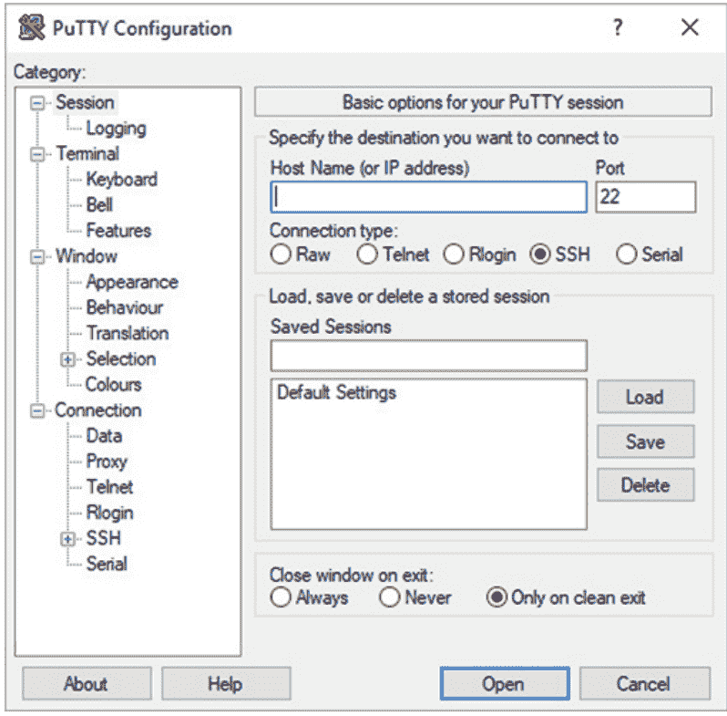

- 4. 设置 COM 编号作为串行线路后，单击“打开”
- 5. 在终端窗口内单击并按 Enter 键以打开提示符。

### 使用 Tera Term 连接

在技术员笔记本电脑上下载并安装 Tera Term 后，请按以下步骤使用 Tera Term 连接到控制台端口：

- 1. 启动 Tera Term。在“新建连接”窗口中，指定您希望如何连接到设备。请注意，在 TCP/IP 下，您可以选择远程访问协议，例如 Telnet 或 SSH。您也可以选择“串行”直接通过串行端口连接到设备的控制台。

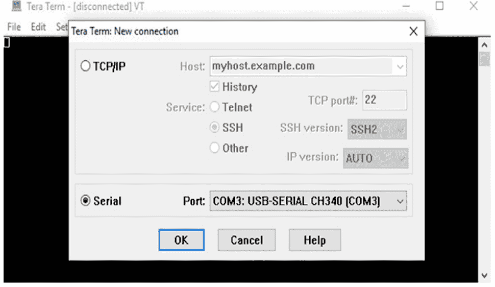

- 2. 在左下角选择“串行”单选按钮以使用串行端口（和控制台电缆）连接到设备。
- 3. 在“端口”字段中，选择要使用的串行端口。您可以逐个尝试，直到建立连接。
- 4. 选择 COM 端口号后，单击“确定”。
- 5. 在终端窗口中的任意位置单击并按 Enter 键以打开提示符。

## 复制和粘贴配置设置

思科 CCT 认证考试要求您了解如何使用您选择的终端程序将配置从路由器或交换机复制和粘贴，或从路由器或交换机复制和粘贴配置。

要将路由器配置复制到文件，请按以下步骤操作：

- 1. 打开 PuTTY 程序并连接到您的路由器。
- 2. 输入 **enable** 并按 ENTER。
- 3. 输入 **terminal length 0** 并按 ENTER。该命令可确保路由器显示所有命令时不会在全屏处暂停并出现 "--more--" 提示。
- 4. 右键单击并选择“更改设置”。
- 5. 选择“会话 | 日志记录 | 记录所有会话输出”。这将把您的命令输出记录到您指定的文件中。
- 6. 选择要写入的文件：选择“浏览”，然后选择位置和文件名。
- 7. 选择“应用”。
- 8. 返回思科设备，输入命令 **show running-config** 并按 ENTER。
- 9. 找到文本文件并打开它以查看配置命令。

将运行配置存储在文本文件中是备份配置的好方法。如果您需要将设备的配置恢复到配置文本文件中的内容，您可以随时将文本文件的内容复制并粘贴到终端程序中。

## 连接并验证设备接口状态

随着后续章节的进展，您将学习如何配置思科设备的许多不同功能。入门时，我将向您展示一些可用于验证接口的命令

设备正在工作。你将在第 7 章更详细地看到这些命令。

在此场景中，你已将一台计算机连接到交换机的接口 5，并且想要验证该接口是否正常工作。使用以下命令验证你的接口是否已启动并运行：

- **show ip interface brief** 使用这个很棒的 **show** 命令获取设备上所有接口的列表并快速查看其状态。你可以确定接口是否已启动并运行，并查看分配给接口的 IP 地址。
- **show interfaces** 使用此命令查看所有接口的列表以及接口的详细规范。
- **show interfaces g0/0** 使用此命令查看特定接口的详细信息。
- **show controllers s0/3/0** 在串行接口上使用 **show controllers** 命令查看诸如 DCE 和 DTE 详细信息等信息。

## 章节回顾

在本章中，你学习了 Cisco 路由器和交换机上可用的众多 Cisco 硬件和软件功能。你学习了不同系列的 Cisco 设备，例如 Cisco Nexus 和 Cisco Catalyst 系列设备。你还学习了如何识别你正在维护的 Cisco 设备的型号以及其序列号的位置。

你还学习了 Cisco 设备上包含的不同类型的端口，例如控制台端口、辅助端口、以太网端口以及用于 WAN 连接的串行端口。你学习了如何将 Cisco 设备安装到机架中并使用 SFP+ 端口连接你选择的收发器。

你学习了 Cisco 设备上存在的不同类型的内存，例如 ROM、VRAM、NVRAM 和闪存内存。最后，你学习了在为设备通电时 Cisco 设备的启动过程。

## 快速回顾

### 使用 Cisco 设备和软件

- Cisco 提供多个产品线，例如 Cisco Nexus 系列交换机和 Cisco Catalyst 系列交换机。
- 型号和序列号通常位于 Cisco 设备背面的标签上。
- 控制台端口用于本地管理，而辅助端口用于将调制解调器连接到路由器作为备份管理线路。
- 每个 LAN 端口由端口类型和索引号标识，例如 FE0/0 表示插槽 0 中的第一个快速以太网端口，或 G0/3 表示插槽 0 中的第三个千兆端口。

### 了解内存类型

- ROM 内存存储 POST 过程、引导程序以及在排除启动问题时使用的 ROMMON 程序。
- 闪存存储 IOS 映像。
- 易失性 RAM 存储运行配置和 RAM 中的不同表，例如路由表。
- 非易失性内存存储启动配置。

### 管理 Cisco 设备

- 你可以通过使用控制台电缆连接到设备的控制台端口来本地管理 Cisco 设备。
- 你可以通过网络使用 telnet 或 SSH 远程连接到设备以对设备进行管理。
- 在某些设备上，例如无线接入点，你可以使用 Web 界面进行管理。

### 启动 Cisco 设备

- 当你启动 Cisco 设备时，首先运行 POST，然后加载引导程序，该程序定位要加载的 IOS 映像。最后，在加载 IOS 后应用启动配置。
- 如果没有启动配置，设备将提示你运行系统配置对话框，这是一个向导式界面，会提示你输入配置信息。
- 使用 **boot system** 命令指定要启动的 IOS 映像。

## 技术人员的服务相关任务

- 作为服务技术人员，你必须知道如何通过控制台端口连接到 Cisco 设备以执行本地管理。
- 知道如何使用笔记本电脑上的程序，例如文本编辑器和终端仿真软件，来连接到 Cisco 设备。
- 知道常见的故障排除命令，例如 **ping**、**ipconfig** 和 **tracert**，以排除通信问题。

## 问题

以下问题将帮助你衡量你对本章所呈现材料的理解程度。仔细阅读所有选项，因为可能有多个正确答案。选择每个问题的正确答案。

1. Cisco 设备上哪种类型的内存存储 POST 过程？
   A. NVRAM
   B. VRAM
   C. Flash
   D. ROM
2. 你正在与客户一起检查路由器的端口，客户询问 AUX 端口的用途是什么。你会如何回答？
   A. 它用于 telnet 到路由器。
   B. 它用于将调制解调器连接到路由器。
   C. 它用于 SSH 到路由器。
   D. 它用作额外的以太网连接。
3. 你正在为客户管理一台交换机，需要引用交换机上的第三个千兆以太网端口。用于引用该端口的标签标识符是什么？
   A. Eth1/3
   B. FE1/3
   C. Gig1/3
   D. Ethernet1/3
4. Cisco 设备上的启动配置文件存储在哪里？
   A. ROM
   B. VRAM
   C. NVRAM
   D. Flash
5. 你的路由器有两个用于连接 WAN 的串行端口。你正在将外部 CSU/DSU 连接到第二个串行端口。引用该端口的标签标识符是什么？
   A. S0/1
   B. S0/0
   C. G0/0
   D. G0/1
6. 你需要对客户的交换机配置进行一些更改。你已将控制台电缆连接到交换机上的控制台端口和笔记本电脑上的串行端口。你会使用什么程序来管理该设备？（选择两个。）
   A. Notepad
   B. PuTTY
   C. Ping
   D. Tracert
   E. Tera Term
7. 你对 Cisco 设备进行了多次配置更改。哪种类型的内存用于存储运行配置？
   A. ROM
   B. Flash
   C. NVRAM
   D. VRAM
8. 你的客户来电称无法访问互联网。你到达客户现场并将笔记本电脑插入网络。你会使用什么命令来验证路由器是否已启动并运行？
   A. ipconfig
   B. ping
   C. arp
   D. netstat
9. Cisco 设备的 IOS 映像文件使用哪种类型的内存存储？
   A. Flash
   B. VRAM
   C. ROM
   D. NVRAM

## 绩效型问题

1. 使用以下示例，将不同的命令与其定义进行匹配。

- show inventory
- nslookup
- ping
- traceroute
- show version

- 用于验证系统或设备是否已启动并运行
- 用于查看 IOS 和接口信息
- 用于验证数据包到达目的地的路径
- 用于查看设备上安装的硬件组件
- 用于查询 DNS 服务器并查找 FQDN 的 IP 地址

2. 通过将左侧的步骤写入右侧的适当框中，按顺序排列 Cisco 设备在启动过程中所采取的步骤。

### 步骤


- 启动配置已应用
- IOS 从闪存加载
- 引导程序已加载并执行
- 读取配置寄存器值以确定 IOS 映像和配置文件的位置
- 设备加载并运行 POST

## 答案

1. D. 只读内存（ROM）用于存储 POST 过程、引导程序和 ROMMON 程序。
2. B. 你可以使用 AUX 端口连接调制解调器，以便在出现网络问题（如网络接口宕机）时拨号进入路由器。
3. C. 正确的标识符是 Gig1/3：千兆以太网接口以 Gig、G 或 GigabitEthernet 开头，后跟插槽的索引号，然后是接口的索引号。
4. C. 启动配置存储在非易失性 RAM（NVRAM）中，即使设备断电也能保留配置。
5. A. 串行端口以 S 或 Serial 开头，后跟插槽和端口号。路由器的插槽和端口号从 0 开始，因此在此示例中，第二个串行端口为 S0/1。
6. B, E. 你可以使用任何终端仿真器，例如 PuTTY 或 Tera Term。两个程序都可在网上免费下载。
7. D. 设备断电时运行配置会丢失，因此它存储在易失性 RAM（VRAM）中。
8. B. ping 命令可用于通过 IP 地址或 DNS 名称向设备发送测试消息并验证路由器是否已启动并

运行中。

9. A. IOS 映像文件存储在闪存中。

## 基于绩效的答案

1. 下列是命令与其定义的映射。
请记住，在真正的考试中，您需要将左侧的项目拖动并放置到右侧的匹配项目上。

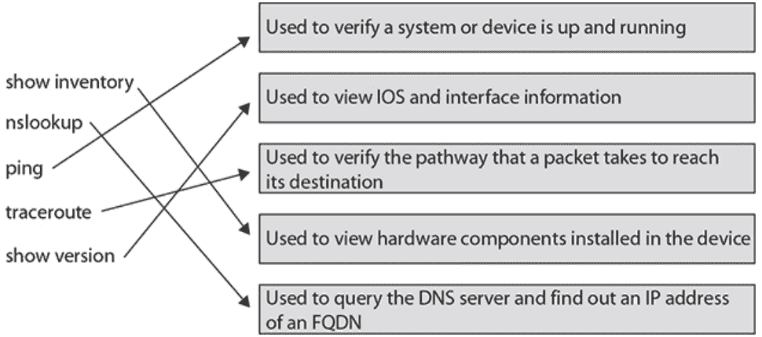

2. 下列是 Cisco 设备启动时的正确事件顺序。请记住，在真正的考试中，您需要将左侧找到的项目拖动并按顺序放置到右侧。

## 步骤

- 1. 设备加载并运行 POST
- 2. 加载并执行引导程序
- 3. 读取配置寄存器值以确定 IOS 映像和配置文件的位置
- 4. 从闪存加载 IOS
- 5. 应用启动配置
