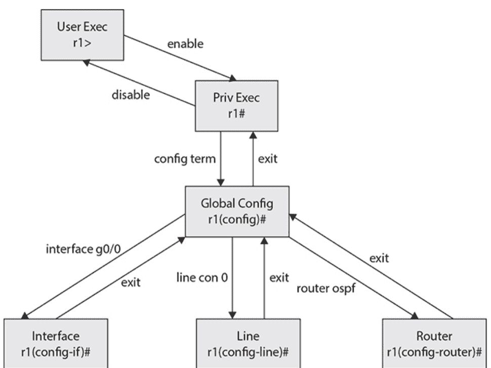
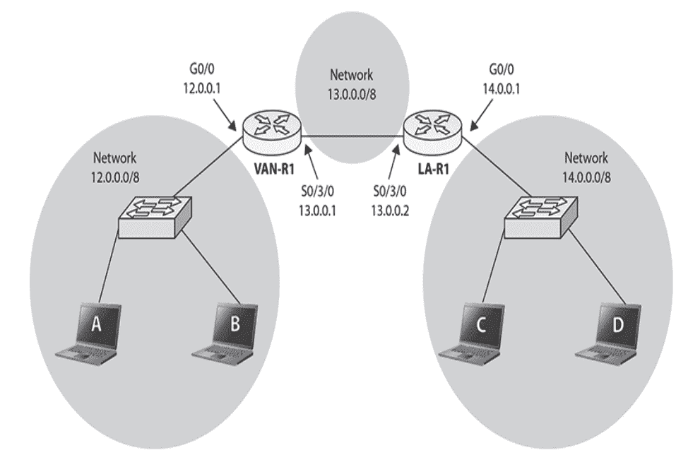
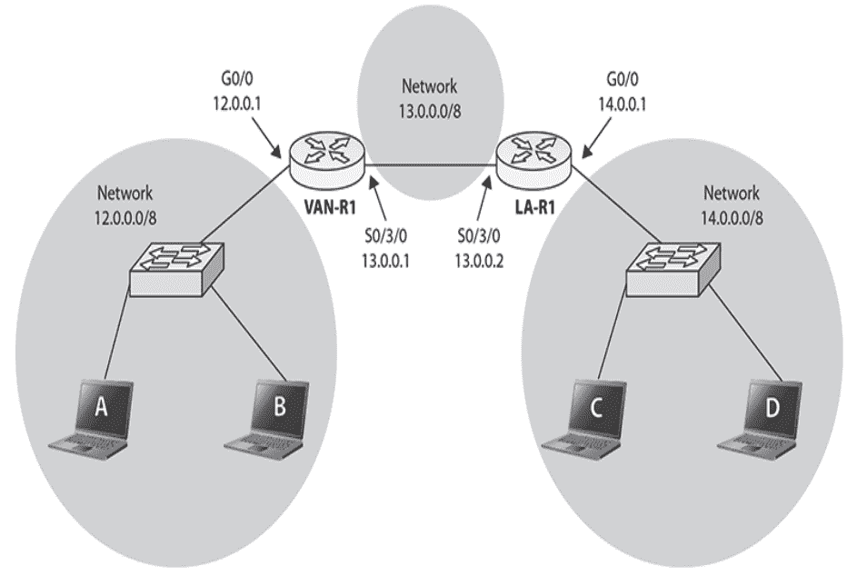
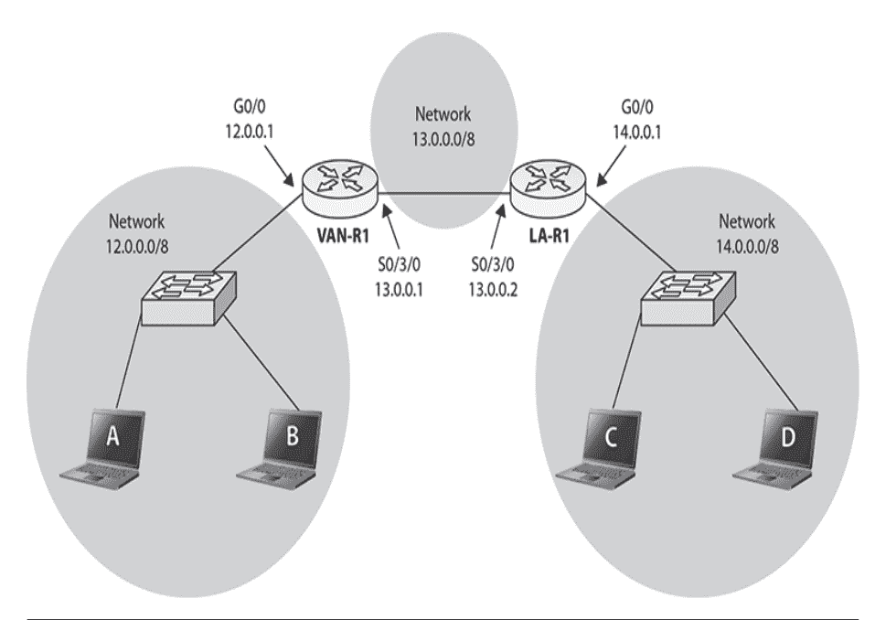
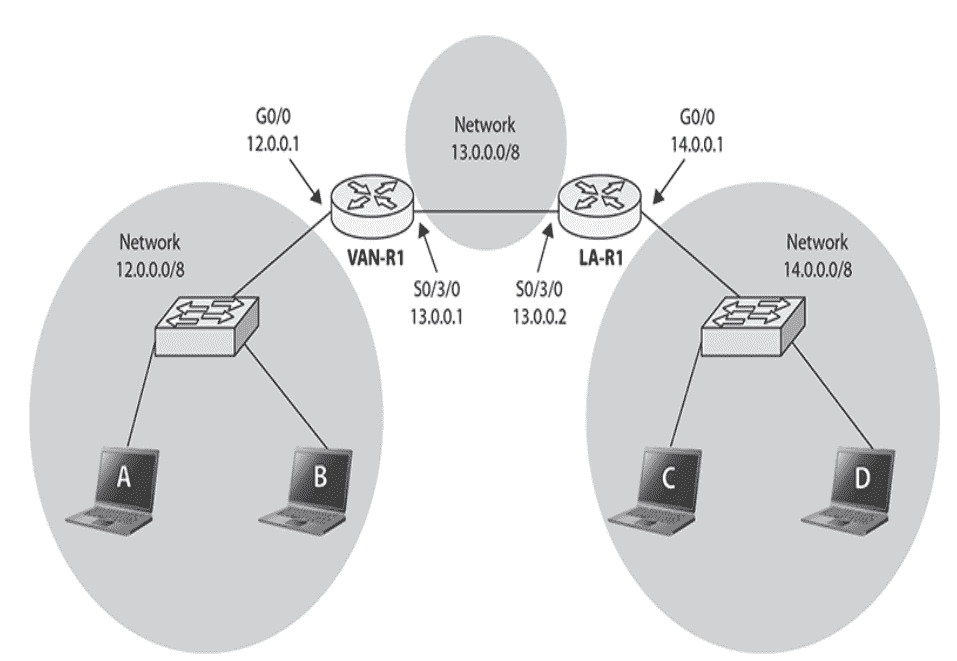

# Cisco IOS 基础

本章中，您将

- 了解如何与命令行界面 (CLI) 交互
- 熟悉 IOS 的基础知识
- 了解基本的 IOS 配置
- 了解基本的 IOS 安全配置
- 学习一些 IOS 操作和验证命令

本书强调通过命令行界面 (CLI) 和控制台端口访问、配置和管理 Cisco 路由器和交换机的基本且重要的概念。您将使用命令和控制台端口连接来执行 Cisco 路由器和交换机的基本配置。

这些讨论假设您从未配置过 Cisco 路由器或交换机；因此我们从基础开始——这些设备使用的操作系统 (OS)、Cisco 操作系统提供的优势以及使用命令配置 Cisco 设备的用法。后续章节将继续讨论，探讨 Cisco 交换机的配置、路由功能和安全功能。

## 命令行界面

您首次在 Cisco 设备上访问 IOS CLI 的方式取决于您正在配置的设备类型。在几乎所有情况下，您最初都会使用控制台接口与设备交互；然而，从控制台端口访问 CLI 的方式可能因设备而异。例如，在 Cisco 路由器上，您登录控制台端口后会直接进入 IOS CLI
当您从控制台端口登录时。如果 IOS 找不到路由器或交换机的配置文件，IOS 会引导您进入设置模式（通过系统配置对话框），这是一个基本的配置脚本，会提示您输入有关如何配置 IOS 设备的信息（在第 6 章中讨论）。

一旦您通过控制台端口配置了 Cisco 设备，您就可以使用其他方法来访问和更改其配置，例如 telnet 或 Secure Shell (SSH)—Cisco 将其称为 *虚拟类型终端* (VTY) 访问。或者您可以使用 Trivial File Transfer Protocol (TFTP)、File Transfer Protocol (FTP)、Simple Network Management Protocol (SNMP) 或基于 Web 的解决方案（用于路由器的 Cisco Configuration Professional，或 CCP）。各种 Cisco 管理产品可用于配置和管理您的 Cisco 设备，例如 Cisco Security Manager (CSM)；然而，本书主要关注 IOS CLI。

## IOS 差异

在本章及后续章节中，您会看到尽管 Cisco 路由器和交换机都运行 IOS，但这些产品使用的命令经常不同！换句话说，您在 Cisco 路由器上配置某个功能的方式可能与在 Catalyst 交换机上配置相同功能的方式不同。然而，如何访问 IOS 以及在 IOS 访问级别之间导航，以及如何使用许多管理命令，在 *所有* IOS 产品上是相同的。这可能会让 Cisco 新手感到困惑——某个特定功能的命令在所有 Cisco 产品上都相同，但另一个功能的配置在 Cisco 路由器和 Catalyst 交换机之间是不同的。

除了路由器和交换机等不同产品之间的命令差异外，产品线内部也可能存在命令差异，例如 Cisco 路由器。例如，Cisco 根据您需要的功能为路由器销售不同版本的 IOS 软件。由于硬件差异，某些命令在某些路由器上有效，而在其他路由器上无效。


**注意** 最近，IOS 实现的数量大大减少了。每个版本的 IOS 可能有 5、10 甚至 15 个或更多不同的软件包需要下载，具体取决于您购买的功能。今天，软件包的数量更少，通常为 3 个或更少。相反，Cisco 将大多数功能捆绑在 IOS 软件包中，但要求您购买许可证密钥来解锁这些功能。许可证在第 8 章中讨论。

## 与 IOS 交互

CLI 是一个字符或文本界面。要与 CLI 交互，您只需输入命令，就像在文本编辑器中输入文章或在电子邮件程序中输入消息一样。您甚至可以在 IOS CLI 中使用复制和粘贴等功能：例如，您可以使用终端仿真器的复制功能从路由器复制完整的配置，将其粘贴到文本编辑器中，对配置进行更改，选择并复制新的配置，然后将所有这些命令粘贴回 CLI。

CLI 支持命令解析器。每当您按下 ENTER 键时，IOS 都会解析您输入的命令和参数并检查正确的语法和选项。当您将多个命令粘贴到 CLI 中时，IOS 仍会对粘贴功能中包含的每个命令执行此过程。如果您在某个命令中犯了错误，CLI 解析器将显示错误消息，但它仍会继续执行粘贴列表中的下一个命令。


**提示** 在对 IOS 设备进行任何配置更改之前，您应先备份！您将在第 8 章中学习如何在网络上执行此操作，但您也可以通过执行 **show running-config** 命令、复制输出配置并将其粘贴到计算机上的备份文本文件中来轻松完成此操作。备份文本文件可以然后在配置更改出现问题时参考。您将在第 8 章中了解有关备份和恢复配置的更多信息。

## CLI 访问模式

每个 Cisco 设备都支持多种访问模式。对于 CLI 交互，支持四种模式：

- **用户 EXEC** 提供对 IOS 的基本访问权限，命令可用性有限（基本上是简单的监控和故障排除命令）
- **特权 EXEC** 提供对 IOS 的高级管理访问权限，包括用户 EXEC 模式下可用的所有命令
- **全局配置** 允许对设备进行配置更改
- **ROM 监视器 (ROMMON)** 加载引导程序，允许对 IOS 设备进行低级诊断测试、执行密码恢复程序以及执行紧急升级

在这四种模式中，前三种适用于 IOS。在 ROMMON 模式下，IOS 未加载，因此数据包不会在设备的接口之间移动。两种 EXEC 模式都可以受密码保护，使您能够限制可以访问设备以执行管理、配置和故障排除任务的人员。下两节介绍两种 EXEC 模式。

## 用户 EXEC 模式

您对 CLI 的初始访问是通过用户 EXEC 模式，该模式只有有限数量的 IOS 命令可供执行。根据 Cisco 设备的配置，您可能需要输入密码才能访问此模式。用户 EXEC 模式通常用于网络问题的基本故障排除。您可以通过检查屏幕左侧的提示来判断您是否处于用户 EXEC 模式：

```
IOS>
```

如果您在行尾看到 > 字符，您就知道您处于用户 EXEC 模式。> 前面的信息是 Cisco 设备的名称。例如，所有 Cisco 路由器的默认名称为 *Router*，而 2960 交换机的用户 EXEC 提示如下所示：**Switch>**。这些设备名称可以使用 **hostname** 命令更改，该命令将在本章后面讨论。在前面的示例中，我将设备重命名为 *IOS*。

## 特权 EXEC 模式

一旦您获得了对用户 EXEC 模式的访问权限，您可以使用 **enable** 命令访问特权 EXEC 模式：

```
IOS> enable
IOS#
```

一旦您输入 **enable** 命令，如果在 Cisco 设备上配置了特权 EXEC 密码，您将被提示输入密码。成功通过身份验证后，您将进入特权 EXEC 模式。您可以通过检查 CLI 提示来判断您是否处于此模式——在前面的代码示例中，注意 > 变成了 #。

当您处于特权 EXEC 模式时，您可以访问所有用户 EXEC 命令以及许多更高级的管理和故障排除命令。这些命令包括扩展 ping 和 trace 能力、管理配置文件和 IOS 映像的能力，以及使用 **debug** 命令进行详细故障排除的能力。唯一不能从此模式完成的事情是更改 Cisco 设备的配置——这只能从配置模式完成。

要从特权 EXEC 模式返回到用户 EXEC 模式，请使用 **disable** 命令：


```
IOS# disable
IOS>
```

再一次，通过检查提示，你可以知道你现在处于用户 EXEC 模式。


**考试提示** 对于 Cisco CCT 认证考试，要了解 IOS 中的三种不同模式——user EXEC、privileged EXEC 和配置模式，以及在每种模式下可以执行的操作。还要知道你使用 **enable** 命令从 user EXEC 模式进入 privileged EXEC 模式，使用 **disable** 命令从 privileged EXEC 模式返回 user EXEC 模式，并使用 **exit** 命令从这两种模式中的任何一种注销 IOS 设备。

图 7-1 显示了如何在不同模式之间导航的摘要。一旦进入全局配置模式，你就可以导航到多个子配置模式（我添加了三个作为示例）。



图 7-1 导航 Cisco 配置模式

## 从设备注销

你可以从用户 EXEC 模式或特权 EXEC 模式使用 logout 或 exit 命令注销你的 Cisco 设备：

```
IOS# logout
-or-
IOS# exit
```


VIDEO 7.01. 本书附带的数字资源包含有关导航配置模式的多媒体演示。

## IOS 基础

接下来的几节描述了内置于 CLI 中的一些功能，这些功能将使你的配置和管理任务更轻松。这些功能包括如何缩写命令、如何调出命令及其特定参数的详细帮助，以及如何解读命令输出、召回命令和编辑命令。

## 命令缩写和补全

IOS 的 CLI 使你能够将命令和参数缩写为其最独特的字符。此功能对于打字有困难的人很有用。例如，当你想从用户 EXEC 模式进入特权 EXEC 模式时，你可以输入 **en** 而不是 **enable**，如下所示：

```
IOS> en
IOS#
```

Cisco 设备在内部为你补全命令。但是，你输入的字符必须使命令唯一。例如，你不能仅为 **enable** 输入字母 e，因为还有其他以字母 e 开头的命令，例如 **exit**。

## 上下文相关帮助

IOS 的更强大的功能之一是上下文相关帮助。上下文相关帮助在 IOS 内的所有模式中都受支持，包括用户 EXEC、特权 EXEC 和配置模式。你可以以多种方式使用此功能。如果不确定需要执行什么命令，在提示符下输入 **help** 或 **?**。然后 Cisco 设备会显示在你当前所在级别可执行的命令列表，以及每个命令的简要描述。以下是路由器 CLI 在用户 EXEC 模式下的示例：

```
Router> ?
Exec commands:
  access-enable    Create a temporary Access-List entry
  cd               Change current device
  clear            Reset functions
  .
  .
  .
-- More --
```


**考试提示** 对于考试，请记住你可以使用 help 命令或 **?** 调出上下文相关帮助。还请记住，你可以将命令缩写为其最独特的字符。

如果你在屏幕底部看到 -- More --，这表示有比当前屏幕能容纳的更多的帮助信息。在 Cisco 设备上，如果你按下空格键，IOS 会翻页到下一屏帮助信息；如果你按下回车键，帮助信息会一次滚动一行。任何其他按键都会退出帮助文本。

为了获得更详细的帮助，你可以在命令或参数后跟一个空格和 **?**。这会导致 CLI 列出该命令包含的可用选项或参数。例如，你可以输入 **erase** 后跟一个空格和 **?** 来查看 **erase** 命令可用的所有参数：

```
Router# erase ?
  /all            Erase all files(in NVRAM)
  flash:          Filesystem to be erased
  nvram:          Filesystem to be erased
  pram:           Filesystem to be erased
  slot0:          Filesystem to be erased
  slot1:          Filesystem to be erased
  startup-config  Erase contents of configuration memory
Router# erase
```

在此示例中，你可以看到 **erase** 命令后至少需要的第一个参数。请注意，根据你输入的下一个参数，可能会在第一个参数之后出现其他参数。

如果你不确定如何拼写命令，可以输入前几个字符并立即跟上 **?**。例如，输入 **e?** 会列出当前模式下以 *e* 开头的所有命令：

```
Router# e?
enable  erase  exit
Router# e
```

此示例显示在特权 EXEC 模式下有三个命令以字母 *e* 开头。


**VIDEO 7.02.** 本书附带的数字资源包含有关在 IOS 中使用帮助的多媒体演示。

## 错误消息

输入命令时错误不可避免地会发生。如果你输入命令有误，IOS 在尝试执行命令后会告诉你它遇到了问题。例如，此消息表示 CLI 输入错误：

```
% Invalid input detected at '^'.
```

你应该检查你输入的命令和错误消息之间的行。在此行的某处，你会看到一个 ^ 字符。IOS 使用它来指示命令行在该位置存在错误。

以下是另一个 CLI 错误消息：

```
% Incomplete command.
```

此错误表示你尚未输入命令所需的所有必要参数。命令的语法是正确的，但需要更多参数。在这种情况下，你可以使用上下文相关帮助功能来帮助你找出忘记了哪些参数。

如果你输入的字符不足以使命令或参数唯一，你会看到类似以下内容的错误消息：

```
% Ambiguous command: "show i"
```

在此示例中，显然 **show** 命令的多个参数以字母 i 开头。同样，你可以使用上下文相关帮助来确定使用哪个参数：

```
Router# show i?
idb  interfaces  ip  ipv6
Router# show i
```

如果你输入 IOS 不理解的命令，你会看到此错误消息：

```
% Unknown command or computer name, or unable to find computer address
```

如果你看到此消息，请使用上下文相关帮助来确定正确的输入命令。


**考试提示** 在考试的模拟和 simlet 问题中，不要害怕利用上下文相关帮助功能。此功能可用于输入命令的帮助，并且在考试的路由器和交换机模拟及 simlet 问题中可用；请使用它。

## 输入命令

与输入命令相关的 IOS 中包含四个关键功能：

- Symbolic translation
- Command prompting
- Syntax checking
- Command recall

每当你在 CLI 中输入命令时，命令行解析器会拆解命令，确保它是具有有效参数的有效命令。在 Cisco IOS 的情况下，如果 CLI 解析器找不到实际命令，IOS 会假设你正尝试通过该名称 telnet 到一台机器，并尝试将名称通过域名系统 (DNS) 解析为 IP 地址。此过程称为 *符号转换*，有时会很烦人。但它确实使 telnet 到远程机器变得更容易，因为你只需输入机器的名称或 IP 地址，而无需使用 **telnet** 命令，如第 8 章所述。


**提示** 使用 **no ip domain-lookup** 配置模式命令禁用 IOS 设备上的 DNS 查找。这通常是我在路由器上配置的第一个命令之一。通过这样做，每当你输入无效命令时，IOS 不会执行 DNS 查找，而是会返回无效命令消息。此命令的缺点是 IOS 设备将不再执行任何类型的 DNS 查找，但在大多数情况下这通常不是问题。

你已经了解了 *命令提示* 功能——这在使用上下文相关帮助时最常见，例如以下内容：

```
Router# show ?
  aaa               Show AAA values
  aal2              Show commands for AAL2
  access-expression List access expression
  access-lists      List access lists
  accounting        Accounting data for active sessions
  .
  .
  .
Router# show
```

在此示例中，使用上下文相关帮助与 **show** 命令后，**show** 命令在显示输出后仍保留在命令行中。IOS 假定您正在输入该命令的参数之一，因此在 CLI 上重新输入该命令。如果您忘记路由器正在执行此功能并重新输入命令，这可能会很烦人，如下所示：

```
Router# show show
```

CLI 总是解析您的命令并使用 *语法检查* 功能检查其有效性。任何不存在的命令或输入不当的命令都会导致 IOS 生成带有适当错误描述的错误消息。


**提示** 只要您正确输入命令，很少会看到 IOS 的任何输出，除非您键入的命令以某种方式改变了路由器或其组件的状态，例如接口启动或关闭。因此，您主要应在输入命令后 IOS 显示消息时感到担忧——您应假定可能存在问题。

当然，在配置 IOS 设备时，您有时会输入错误或输入无效命令。如果您输入了一个 20 个参数的命令并且在最后一个字符上犯了错误，Cisco 要求您重新输入完整命令将是残忍的。*命令召回* 功能非常有用，因为它使您能够召回和编辑先前执行的命令。接下来两个部分将讨论如何召回和编辑之前的（或当前）命令。

## 命令行历史

在任何 IOS 设备上，您可以使用 **show history** 命令查看之前输入的命令：

```
IOS# show history
  enable
  show interface
  show version
  show history
IOS#
```

默认情况下，IOS 设备存储您执行的最后 10 条命令。您可以通过按 CTRL-P 或向上箭头键来召回这些命令。如果您不小心越过了想要编辑或重新执行的命令，请按 CTRL-N 或向下箭头键。

您可以使用 **terminal history size** 命令将历史记录缓冲区的大小从 10 条命令增加到 256 条：

```
IOS# terminal history size #_of_commands
```

## 编辑命令行

表 7-1 显示了您可用于在命令行上编辑信息的控制或命令序列。

| 控制序列 | 描述 |
|---|---|
| CTRL-A | 将光标移动到行首 |
| CTRL-E | 将光标移动到行尾 |
| ESC-B | 每次向后移动一个单词的光标 |
| ESC-F | 每次向前移动一个单词的光标 |
| CTRL-B or LEFT ARROW | 每次向后移动一个字符的光标 |
| CTRL-F or RIGHT ARROW | 每次向前移动一个字符的光标 |
| CTRL-P or UP ARROW | 召回上一个命令 |
| CTRL-N or DOWN ARROW | 召回最近执行的命令 |
| CTRL-D | 删除光标下的字符 |
| BACKSPACE | 删除光标前的字符 |
| CTRL-R | 重新显示当前行 |
| CTRL-U | 完全擦除该行 |
| CTRL-W | 擦除光标下的单词 |
| CTRL-Z | 将您从配置模式返回到特权 EXEC 模式 |
| TAB | 在您输入字符并按 TAB 后，IOS 设备会补全该词，前提是您输入的字符足以使命令或参数唯一 |
| $ | 在命令行开头，这表示 $ 右侧还有更多字符 |

表 7-1 IOS 设备的编辑控制序列


**考试提示** 请记住用于在 CLI 中编辑命令的基本编辑控制序列。默认情况下，IOS 存储最后 10 条执行的命令。您可以使用 TAB 键自动补全命令。

## IOS 功能示例

此示例使用 **clock** 命令来说明 IOS 命令行功能的实用性。该命令用于在路由器上设置当前日期和时间。例如，假设英语不是您的母语，并且您不确定如何拼写 *clock*，但您知道它以字母 *c* 和 *l* 开头。以下是示例：

```
IOS# cl?
clear      clock
IOS# cl
```

请注意此示例输出中的两点。首先，两个命令以 **cl** 开头：**clear** 和 **clock**。其次，请注意帮助输出后的 CLI —IOS 将 **cl** 保留在命令行上。一些管理员喜欢此功能，一些则讨厌它。我属于后者，因为我经常忘记 IOS 设备正在执行此操作，并且我从头开始输入，如下所示：

```
IOS# clclock
Translating "clclock"
% Unknown command or computer name, or unable to find computer address
IOS#
```

如果您已经猜到了，这是一个无效命令。

现在您知道如何拼写 *clock*，如果您不知道在 **clock** 命令后输入什么参数，可以使用上下文相关帮助：

```
IOS# clock ?
  set  Set the time and date
IOS# clock
```

第一列是参数的名称，第二列是其描述。在这种情况下，IOS 需要单词 *set*：

```
IOS# clock set ?
  hh:mm:ss  Current Time
IOS# clock set
```

下一个参数需要当前时间。这基于 UTC（除非您更改了设备的时区）并且采用 24 小时格式。例如，下午 3 点为 15:00:00。再次使用上下文相关帮助来确定是否需要更多参数：

```
IOS# clock set 15:00:00 ?
  <1-31>  Day of the month
  MONTH  Month of the year
IOS# clock set 15:00:00
```

每当您在尖括号内看到数字范围时，必须在此范围内选择一个值。如果您看到全大写的参数，例如 MONTH，则必须提供名称。在此时钟示例中，IOS 需要日期的数字或月份的名称，例如 May——对于此命令，路由器并不在意这两个参数的输入顺序，但许多情况下顺序很重要。再次使用上下文相关帮助，在月份名称后指定年份的数字：

```
IOS# clock set 15:00:00 23 May ?
  <1993-2035>  Year
IOS# clock set 15:00:00 23 May
```

再次使用上下文相关帮助查看接下来是什么：

```
IOS# clock set 15:00:00 23 May 2004 ?
  <cr>
IOS# clock set 15:00:00 23 May 2004
IOS#
```

<cr> 表示您可以按 ENTER 键，IOS 设备将接受该命令。在 IOS 路由器上，使用 show clock 命令查看当前时间和日期：

```
IOS# show clock
15:00:02.187 UTC Fri May 23 2003
IOS#
```

## 基本 IOS 配置

在这里，您将学习访问 IOS 软件和在 IOS 设备上创建简单配置的基础知识。许多配置命令在 Cisco 路由器和交换机上是相同的，简化了这些设备的基本设置；然而，正如您在后续章节中将看到的，某些功能特定于每种产品类型，因此每种产品都有独特的配置命令。

## 访问配置模式

IOS 中的所有系统/操作更改必须在配置模式下进行。要访问此模式，您必须首先处于特权 EXEC 模式并使用以下命令：

```
IOS# configure terminal
IOS(config)#
```


考试提示 在准备考试时，请注意哪些命令直接从全局配置模式配置。

请注意，提示符已从 # 更改为 (config)#，表示模式已更改。此模式通常称为配置模式或全局配置模式。您可以将 configure terminal 缩写为 conf t。在配置模式下，您可以执行更改路由器或交换机配置的命令；然而，您无法在此模式下实际查看更改，因为这是在特权 EXEC 模式下完成的。要退出配置模式并返回特权 EXEC 模式，请键入 end 或按 CTRL-Z。

## 设备标识

您的首要任务之一是更改 IOS 设备的名称。此名称仅具有本地意义，并用于管理目的。例如，Cisco Discovery Protocol（CDP）使用设备名称。（CDP

在第 8 章中进行了讨论。）在路由器和交换机上，您使用 **hostname** 命令来更改设备的名称。以下是将名称 *Router* 更改为名称 *Perimeter* 的简单示例：

```
Router(config)# hostname Perimeter
Perimeter(config)#
```

首先，注意设备的新的名称（*Perimeter*）放在 **hostname** 命令之后。一旦按下 ENTER，新的 CLI 提示符会立即更改——它包含设备的新的名称。

要撤消更改或否定 Cisco 设备上的命令，您可以在命令前加上 **no** 参数。例如，要将主机名改回出厂默认值，请使用以下命令：

```
Perimeter(config)# no hostname Perimeter
Router(config)#
```

在某些情况下，否定命令时不必包含命令的参数。在前面的示例中，您可以轻松输入 **no hostname** 来完成更改，但在其他情况下，您必须输入 **no** 并跟上整个配置命令。


**EXAM TIP** 对于 Cisco CCT 认证，请记住 **hostname** 命令为 IOS 设备分配一个本地有意义的标识符。在某些考试模拟问题中，您可能需要在配置中配置主机名。在考试中，名称区分大小写！


VIDEO 7.03. 本书附带的数字资源包含在 Cisco 设备上配置主机名的多媒体演示。

## 子配置模式

IOS 设备上的某些配置命令会进入特定的子配置模式，通常称为 *subcommand mode*。表 7-2 显示了您在 IOS 设备上可能会看到的几个子配置模式。

| IOS Prompt | Subconfiguration Mode |
|---|---|
| (config-if)# | 接口子配置模式 |
| (config-subif)# | 子接口子配置模式 |
| (config-line)# | 线路子配置模式 |
| (config-controller)# | 控制器子配置模式 |
| (config-router)# | IP 路由协议子配置模式 |

Table 7-2 Subconfiguration Modes on IOS Devices


**NOTE** 并非所有子配置模式都受所有 IOS 设备支持。当您在子配置模式下工作时，您输入的命令仅影响路由器或交换机的特定组件。

要离开子配置模式并返回到全局配置模式，请使用 **exit** 命令。使用 **end** 命令或按 CTRL-Z 始终会带您返回特权 EXEC 模式，无论您当前正在哪个配置模式下工作。以下是从子配置模式到全局配置模式的示例：

```
IOS(config)# line con 0
IOS(config-line)# exit
IOS(config)#
```

在许多情况下，当您在子配置模式下工作并输入全局配置模式命令时，IOS 会执行它并且模式会更改为全局配置模式，如下所示：

```
IOS(config)# line con 0
IOS(config-line)# hostname 2960
2960(config)#
```


**EXAM TIP** 请记住，许多全局配置模式命令会影响整个 IOS 设备，例如 hostname 命令：您只需输入一次命令，它就会影响整个设备。子配置模式命令仅影响 IOS 设备的特定组件，例如接口、线路或路由协议，仅举几例。使用 exit 命令返回一个配置级别。使用 end 命令或按 CTRL-Z 退出配置模式。

请注意，当在线路子配置模式下执行 hostname 命令时，交换机不仅更改了模式，还更改了其名称。有时，您会从路由器收到无效命令响应；在这种情况下，您必须先退出子配置模式，然后在全局配置中执行命令。

## 线路配置

IOS 设备上的线路提供对 EXEC shell 的访问；有时这称为字符模式访问，因为它涉及 CLI。表 7-3 显示了受支持的线路类型。line 命令用于在配置模式下引用线路。您必须指定要配置的线路类型以及线路号，其中线路号从 0 开始递增。请注意，控制台和辅助线路只有一个线路号：0。配置 VTY 和 TTY 时，您可以指定数字范围。执行 **line** 命令会进入子配置模式，您在其中输入的命令会影响该特定线路，或者使用 VTY 和电传终端（TTY）时可能影响多条线路。

| Line Type | Description | Command Nomenclature |
|---|---|---|
| Console | 提供初始 CLI 访问的物理端口；当无法远程访问 IOS 设备时用于故障排除。设备上仅支持一个。 | line con 0 |
| Auxiliary | 通常用于拨号进入 IOS 设备的备份物理端口；并非所有设备都有辅助端口，每个设备仅支持一个。 | line aux 0 |
| VTY | 允许通过 telnet 和 SSH 等远程访问连接访问 CLI 的逻辑端口。IOS 设备上支持多个 VTY，数量取决于设备、型号和软件版本。 | line vty 0 4 |
| TTY | 用于连接调制解调器以进行终端服务或访问其他设备的控制台端口的物理端口。这些端口仅在路由器上找到，支持的数量取决于路由器型号和安装的异步卡。 | line tty 0 31 |

Table 7-3 IOS Line Types

### 更改非活动超时

默认情况下，IOS 设备在 10 分钟不活动后会自动注销您。您可以使用 **exec-timeout** 线路子配置模式命令更改此设置：

```
IOS(config)# line line_type line_#
IOS(config-line)# exec-timeout minutes seconds
```

请记住，这仅更改您指定的线路（或线路）的配置——其他线路仍将使用默认空闲时间。如果您不希望特定线路超时，您可以将分钟和秒值设置为 **0**，如下所示：

```
IOS(config)# line console 0
IOS(config-line)# exec-timeout 0 0
```


**CAUTION** 在生产环境中禁用线路的超时是不推荐的，因为它会造成安全问题。但是，出于培训目的，例如学习 CCNA 考试，这是可以的。

如果您想完全禁用线路的使用，请使用以下配置：

```
IOS(config)# line line_type line_#
IOS(config-line)# no exec
```

要验证线路配置，请使用 **show line** 命令：

```
IOS# show line con 0
  Tty Typ  Tx/Rx A Modem Roty AccO AccI Uses Noise Overruns
* 0 CTY       -   -    -    -    -    0    0    0/0

Line 0, Location: "", Type: ""
Length: 24 lines, Width: 80 columns
Status: Ready, Active
Capabilities: none
Modem state: Ready
Special Chars: Escape Hold Stop Start Disconnect Activation
             ^^x   none  -    -      none
Timeouts: Idle EXEC Idle Session Modem Answer Session Dispatch
          never    never                     none    not set
Session limit is not set.
Time since activation: 0:04:49
Editing is enabled.
History is enabled, history size is 10.
Full user help is disabled
Allowed transports are pad telnet mop.  Preferred is telnet.
No output characters are padded
No special data dispatching characters
```

在此示例中，请注意超时值设置为 **never**。


**TIP** 请注意，**show** 命令不是从配置模式输入的。要在配置模式中输入用户和特权 EXEC 模式命令，请在命令前加上 **do** 字，如下所示：**do show line con 0**。这可以避免您每次都要退出以使用 **show** 命令并查看更改的效果。节省大量时间！

### 限制 VTY 协议访问

默认情况下，允许 VTY 的所有访问方法，包括 telnet 和 SSH（使用 telnet 和 SSH 在第 8 章中讨论）。控制 VTY 上允许的连接类型是通过 **transport input**

(可用于连接到路由器的协议) 和 **transport output** (可用于从路由器连接的协议) 命令：

```
IOS(config)# line vty line_# [line_#]
IOS(config-line)# transport input {all | telnet | ssh}
IOS(config-line)# transport output {all | telnet | ssh}
```

默认情况下，允许所有协议。

在下面的示例中，仅允许在 VTYs 上使用 SSH 协议（到路由器或从路由器）：

```
Router(config)# line vty 0 15
Router(config-line)# transport input ssh
Router(config-line)# transport output ssh
```

第 8 章更深入地讨论了 telnet 和 SSH 的设置。


**EXAM TIP** 对于 CCNA 考试，请熟悉限制对 VTY 的协议访问。

## CLI Output

IOS 设备的一个不错的功能是，当某些类型的事件发生时，例如接口 down 或 up、管理员进行配置更改或 **debug** 命令的输出，IOS 设备默认会在控制台行上打印一条信息消息。但是，如果你是通过 telnet 或 SSH 登录 IOS 设备，或通过辅助或 TTY 线路访问设备，则不会显示相同的消息。

如果是这种情况，你可以通过执行特权 EXEC **terminal monitor** 命令（如图所示）让 IOS 在你的屏幕上显示这些消息：

```
IOS# terminal monitor
```

你必须在从 VTY、TTY 或辅助线路登录 IOS 后执行此命令。但是，一旦你注销，此命令不适用于其他登录同一线路的 IOS 设备用户；每个单独的线路会话都必须重新执行此命令。

CLI 屏幕上显示的信息消息的一个令人烦恼的问题是，如果你在输入 IOS 命令时，设备显示消息时，会从光标所在的位置开始打印，使你难以弄清输入中断的位置。如果你记得，只需继续输入命令，或按 CTRL-C 中止命令。更好的方法是将 IOS 设置为在消息在窗口中打印后，在新的 CLI 提示符下重新显示你已输入的内容。logging synchronous 命令实现了这一点：

```
IOS(config)# line line_type line_#
IOS(config-line)# logging synchronous
```

请注意，此命令在线路子配置模式下执行。如果你想实现此功能，你需要在所有将用于访问 IOS 设备的线路下设置它，包括你的 VTY 和控制台端口。你也可以按 CTRL-R 刷新屏幕。

## Interface Configuration

Cisco CCT 认证考试要求你了解如何配置以太网接口和串行接口，以及如何排查接口的第 1 层和第 2 层问题。在本节中，你将学习如何在以太网和串行接口上配置常见设置，例如启用和禁用接口，以及配置速度和双工设置。本章后面你将学习用于排查接口第 1 层和第 2 层问题的 show 命令。

要配置接口，你必须首先进入接口子配置模式：

```
IOS(config)# interface type [slot_#/]port_#
IOS(config-if)#
```

你必须为 interface 命令指定两个组成部分：类型和位置。当你输入完整的 interface 命令时，请注意

提示符会发生变化，表示你已进入指定接口的接口子配置模式——**(config-if)#** 在此示例中。


**TIP** 你无法通过检查提示符来确定正在操作的接口。如果你不确定，请使用命令召回功能召回 **interface** 命令并重新执行它。

指定接口时，你可以使用以下任何命名法：

```
IOS(config)# interface GigabitEthernet 0/1
IOS(config)# interface GigabitEthernet0/1
IOS(config)# int g 0/1
IOS(config)# int g0/1
IOS(config)# int gig 0/1
IOS(config)# int gig0/1
```


**NOTE** 你可以用空格分隔类型和位置，或将两者连接在一起。同样，你也可以缩写命令和参数。

## Assign IP Address

导航到接口后，你可以执行多个命令来修改接口的特性。例如，在 Cisco 路由器上，你可能希望使用以下命令为接口分配 IP 地址：

```
IOS>enable
IOS#config term
Enter configuration commands, one per line. End with CNTL/Z.
IOS(config)#interface G0/0
IOS(config-if)#ip address 14.0.0.1 255.0.0.0
```

在此示例中，我首先导航到要配置的千兆以太网接口，然后为接口分配 IP 地址和子网掩码。

你也可以使用以下命令将接口配置为动态 IP 地址（从 DHCP 服务器接收 IP 地址）：

```
IOS(config-if)#ip address dhcp
```

## Enable and Disable the Interface

在 Catalyst 交换机上，接口默认启用；在 Cisco 路由器上，接口默认禁用。你可以在接口子配置提示符下使用 shutdown 命令禁用接口：

```
IOS(config)# interface type slot_#/port_#
IOS(config-if)# shutdown
```

要启用接口，请使用 no shutdown 命令。通常在为接口分配 IP 地址后，我会养成启用接口的习惯。


EXAM TIP 对于 Cisco CCT 和 CCNA 考试，请记住 IOS 交换机接口默认启用，但路由器接口默认禁用。还请记住如何在 IOS 设备上启用和禁用接口：no shutdown 和 shutdown。

无论何时接口状态发生变化，IOS 都会在屏幕上打印一条消息告知你。以下是一个路由器上接口被激活的示例

：

```
IOS(config)# interface gigabitethernet0/1
IOS(config-if)# no shutdown
1w0d: %LINK-3-UPDOWN: Interface GigabitEthernet0/1, changed state to up
1w0d: %LINEPROTO-5-UPDOWN: Line protocol on Interface
    GigabitEthernet0/1, changed state to up
IOS(config-if)#
```

在此示例中，第一条信息行表示物理层已激活。第二条信息行表示数据链路层协议已启用，在本例中为以太网——对于 WAN 端口，第 2 层协议为高级数据链路控制 (HDLC) 或点对点协议 (PPP)。


NOTE 当将配置文件复制并粘贴到路由器中，并且路由器接口已通过 shutdown 命令禁用时，粘贴的配置文件必须包含 no shutdown 命令才能激活接口。当从旧路由器复制并粘贴配置文件到新路由器时，这是一个常见问题，新路由器的接口默认禁用。

## Description

你可以使用 description 命令为任何接口添加描述：

```
IOS(config)# interface type [slot_#/]port_#
IOS(config-if)# description interface_description
```

description 命令提供接口所连接设备的单行描述，或你想要分配的任何描述。此描述会出现在本章后面讨论的 show interfaces 命令的输出中。

## Speed and Duplexing for Ethernet Interfaces

要设置基于以太网的接口的速度和双工速度，请使用以下配置：

```
IOS(config)# interface ethernet_type [slot_#]/port_#
IOS(config-if)# speed 10|100|1000|auto
IOS(config-if)# duplex full|half|auto
```


**NOTE** 对于 10/100/1000 以太网端口，不再建议使用 **speed** 和 **duplex** 命令硬编码速度和双工；相反，让接口从直接连接的设备自动感知这些设置。更改速度和双工设置的命令用于在自动协商无法工作且需要强制速度或双工设置时进行故障排除。

需要注意的是，如果你错误地设置了双工设置或速度，这可能会导致通信问题。这就是更改 **duplex** 和 **speed** 设置的原因之一；如果它们最初设置不正确，你可能需要更改它们以匹配网络环境。


**VIDEO 7.04.** 本书附带的数字资源包含在路由器上配置千兆接口的多媒体演示。

## Serial Interfaces on Routers


配置串行接口时情况会有些不同，因为你不仅需要配置 IP 地址，还必须指定要使用的第二层协议。首先让我们使用以下命令为串行接口分配 IP 地址和描述：

```
IOS(config)#interface s0/3/0
IOS(config-if)#ip address 13.0.0.2 255.0.0.0
IOS(config-if)#description LINK-TO-ISP
```

为串行接口分配 IP 地址后，您可以选择要用于在串行链路上承载流量的第二层协议。在局域网中，第二层协议是 Ethernet，但在我们的串行线路上不使用它。我们需要在将数据发送到串行端口之前指定要将 IP 数据包封装在其中的第二层帧类型。

在 Cisco 路由器上使用两种主要的串行链路协议：

- **HDLC** 该协议是 Cisco 专有协议，用于在串行链路上发送数据。HDLC 的优点在于它无需配置，如果未指定，则为默认封装协议。
- **PPP** 该行业标准协议受许多不同厂商和产品支持，如果网络中同时存在 Cisco 设备和非 Cisco 设备，则应使用它。

在本讨论中，我们将选择使用 HDLC 作为封装协议。请记住，如果您想查看串行接口支持哪些封装协议，始终可以使用 **help** 命令：

```
IOS(config-if)#encapsulation ?
  hdlc          Serial HDLC synchronous
  ppp           Point-to-Point protocol
IOS(config-if)#encapsulation hdlc
```

如果您想配置串行接口使用 PPP 作为封装协议，则应使用以下命令。

```
IOS(config-if)#encapsulation ppp
```


注意 为了使串行接口正常运行，您必须在链路的两端配置相同的封装协议。

PPP 的好处之一是可以配置身份验证——这意味着为了通过串行链路发送数据，其他路由器必须知道串行链路上的密码。要使用 PPP 配置身份验证：

- 在每台路由器上设置主机名。
- 在每台路由器上创建与另一台路由器名称匹配的用户名和密码。
- 使用 PAP 或 CHAP 身份验证协议启用身份验证。由于 PAP 以明文发送用户名和密码，因此更推荐使用 CHAP。

以下是每个步骤的命令：

```
VAN-R1#config term

VAN-R1(config)#username LA-R1 password wanpass

VAN-R1(config)#interface s0/3/0

VAN-R1(config-if)#encapsulation ppp

VAN-R1(config-if)#ppp authentication chap
```

查看前面的代码，您可以看到我正在为 VAN-R1 路由器配置 LA-R1 路由器的用户名。然后我启用 PPP 封装协议，最后将 PPP 身份验证协议配置为 CHAP。然后您将以类似方式配置 LA-R1 路由器。

现在我们已经在串行接口上配置了 IP 地址和封装协议，接下来需要做的就是确保接口接收到链路的时钟速度或定时。设置时钟速度是数据通信设备（DCE）的责任。当将路由器连接到 ISP 时，ISP 是链路的 DCE 端，因此 ISP 设置链路的时钟速度。在 ISP 示例中，您的路由器是数据终端设备（DTE），因此您不允许设置链路的时钟速度。

如果 ISP 设置了它，为什么我要提到这一点呢？好吧，如果您使用背靠背串行电缆通过串行端口将两台路由器连接在一起，电缆的一端通常标记为“DCE”，另一端标记为“DTE”。在具有电缆 DCE 端的路由器上，您需要使用以下命令设置时钟速率：

```
IOS(config-if)#clock rate 64000
```

如果您在配置 DTE 设备时尝试执行 **clock rate** 命令，您将收到一条消息，指出该命令仅在 DCE 设备上执行。尝试一下也没关系。

在串行接口上配置的最后一个命令是通过使用 **no shutdown** 命令启用接口（无论您是 DCE 还是 DTE 设备）：

```
IOS(config-if)#no shutdown
```


**视频 7.05。** 本书附带的数字资源包含有关在路由器上配置串行接口的多媒体演示。

如果您不确定哪台路由器具有电缆的 DTE 端，哪台具有 DCE 端，可以使用 **show controllers** 命令来确定：

```
Router> show controllers serial [slot_#]/port_#
```

这是在少数几个命令中，您不能将类型和端口号连接在一起——您必须用空格分隔。以下是此命令的使用示例：

```
Router> show controllers serial 0/3/0
HD unit 0, idb = 0x121C04, driver structure at 0x127078
buffer size 1524 HD unit 0, DTE V.35 serial cable attached
.
.
```

请注意，此示例的第二行包含两条重要信息：连接类型（DTE）和电缆类型（V.35）。

以下是连接到 DCE 电缆末端的接口的示例：

```
Router> show controllers serial 0/3/0
HD unit 0, idb = 0x1BA16C, driver structure at 0x1C04E0
buffer size 1524  HD unit 0, V.35 DCE cable, clockrate 64000
.
.
```

在此示例中，时钟已配置：64,000 bps。


**考试提示** 对于考试，请记住您可以使用 show controllers 命令来确定 DTE 和 DCE 连接，并使用 clock rate 命令为 DCE 连接配置速度。

## 练习 7-1：基本路由器配置

在本练习中，您需要两台 Cisco 路由器和两台 Cisco 交换机，或能够创建包含两台路由器和两台交换机的拓扑图的网络模拟器。图 7-2 显示了本示例中您将配置的网络。本练习侧重于配置

两台路由器；我们将在交换章节中重点关注交换机。

- 1. 确保所有物理组件（如路由器和交换机）已按照图 7-2 连接，然后打开电源。



图 7-2 练习网络拓扑

- 2. 将工作站连接到将成为 VAN-R1 的路由器的控制台端口。然后启动 PuTTY，选择串行连接，设置正确的 COM 端口，然后选择打开。
- 3. 在 PuTTY 窗口中按 ENTER 以在 Cisco 设备上获取提示符。
- 4. 使用以下命令将 Cisco 路由器的名称设置为 VAN-R1：

```
Router>enable
Router#config term
Router(config)#hostname VAN-R1
```

- 5. 使用以下命令配置千兆以太网 0/0 接口的 IP 地址：

```
VAN-R1(config)#interface g0/0
VAN-R1(config-if)#ip address 12.0.0.1 255.0.0.0
VAN-R1(config-if)#no shutdown
```

请注意，g0/0 接口状态变为 up（未处于 up and running 状态）。

- 6. 使用以下命令配置路由器上的串行 0/3/0 接口：

```
VAN-R1(config-if)#interface s0/3/0
VAN-R1(config-if)#ip address 13.0.0.1 255.0.0.0
VAN-R1(config-if)#encapsulation hdlc
VAN-R1(config-if)#clock rate 64000
VAN-R1(config-if)#no shutdown
```

请注意，即使已完全配置，串行接口状态消息仍指示其处于 down 状态。这是因为在链路启动之前，必须先配置串行链路的另一端（LA-R1 路由器）。

- 7. 请务必记住，您必须通过输入以下命令将这些更改保存到 NVRAM：

```
VAN-R1(config-if)#exit
VAN-R1(config)#exit
VAN-R1#copy running-config startup-config
Destination filename [startup-config]?
Building configuration...
[OK]
```

- 8. 连接到将成为 LA-R1 的路由器的控制台端口，然后在 PuTTY 屏幕中按 ENTER 刷新屏幕。现在您应该已连接到第二台路由器。
- 9. 将第二台路由器的主机名设置为 LA-R1。
- 10. 将千兆以太网 0/0 接口的 IP 地址配置为 14.0.0.1 并确保接口已启用。
- 11. 为路由器上的串行 0/3/0 接口配置 IP 地址 13.0.0.2 并设置封装协议；请注意，如果此

连接的 DTE 端，您无需设置时钟速率。

12. 将新的更改保存到 NVRAM。

13. 要验证 LA-R1 是否可以 ping 通 VAN-R1 的 IP 地址，请键入以下命令：

```
LA-R1#ping 13.0.0.1
Type escape sequence to abort.
Sending 5, 100-byte ICMP Echos to 13.0.0.1, timeout is 2 seconds:
!!!!!
Success rate is 100 percent (5/5), round-trip min/avg/max = 1/1/2 ms
```

14. 在 LA-R1 上，使用以下命令查看您的配置（花几分钟时间查看每个命令的输出）：

```
LA-R1#show interfaces
LA-R1#show interfaces g0/0
LA-R1#show ip interface brief
```

15. 在 VAN-R1 上，使用以下命令查看您的配置（花几分钟时间查看每个命令的输出）：

```
VAN-R1#show interfaces
VAN-R1#show interfaces g0/0
VAN-R1#show ip interface brief
```

16. 将路由器保持运行状态以供下一个练习使用。

## 基本 IOS 安全配置

计算机安全研究所（CSI）是一个提供网络安全基础教育和培训的组织。它定期对公司进行安全问题的市场研究。在一项研究中，超过 70% 的受访公司报告经历了某种安全漏洞。了解这些信息，作为网络管理员，您的一项职责将是确保对网络设备的访问得到严格控制。以下各节将介绍如何保护您的 IOS 设备。


**注意** 本章介绍的信息仅包括您将在 IOS 设备上设置的少数安全功能；本书中讨论了更多这些功能，例如第 9 章中交换机的端口安全和第 17 章中的访问控制列表（ACL），仅举几例。

## 物理和环境威胁

许多网络管理员忘记了，保护网络设备安全的首要防线包括防范物理和环境威胁，包括以下内容：

- **硬件** 通过物理措施限制对路由器的物理访问，例如锁门、门禁卡、摄像机等
- **电气** 确保设备免受浪涌/尖峰、欠压和断电的保护
- **环境** 保护设备免受过冷或过热的温度，或过高湿度的影响
- **维护** 确保在处理敏感电子部件时遵循静电放电程序，为关键部件备有备件，并正确标记设备和电缆

对这些问题的深入讨论超出了本书的范围；它们在思科的 CCNA 和 CCNP Security 课程中得到了更深入的介绍。

## 密码

限制对 IOS 设备物理访问的最常见方法是使用某种用户身份验证。例如，您可以配置密码来限制对 IOS 设备线路（用户 EXEC 模式）的访问以及对特权 EXEC 模式的访问。在 Catalyst IOS 交换机（如 2950 和 2960）上配置密码与在 IOS 路由器上配置密码相同。以下各节讨论在 IOS 设备上配置密码。

## 用户 EXEC 密码保护

控制对 IOS 设备用户 EXEC 模式的访问是按线路进行的：控制台、辅助、TTY 和 VTY。请记住，并非所有设备都支持辅助端口，只有路由器支持 TTY，并且 IOS 设备支持的 VTY 数量取决于产品，从五个 VTY（0–4）到近一千个不等。

要保护控制台端口，您必须首先使用 line console 0 命令进入控制台的线路子配置模式以配置线路密码：

```
IOS(config)# line console 0
IOS(config-line)# password console_password
IOS(config-line)# login
```

第一个命令中的 0 指定控制台端口。线路和接口从 0 开始编号。即使 IOS 设备只有一个控制台端口，它也被指定为 0（这适用于大多数，但不是全部思科产品）。接下来，注意第二行的提示已更改。一旦进入线路子配置模式，您可以使用 password 命令为控制台分配密码。最后的 login 命令是必需的，表示您希望思科设备强制人们使用该密码进行身份验证，如果他们连接到控制台 0 端口。IOS 设备上的密码区分大小写。请记住，当在 line console 0 下执行 password 命令时，它仅为尝试从控制台端口访问 IOS 设备的用户设置用户 EXEC 密码。

辅助端口通常用作带有调制解调器连接的远程访问端口，这使您可以在 Internet 连接出现问题且无法通过 telnet 或 SSH 远程连接时拨号进入路由器。以下代码显示了在辅助端口上设置密码身份验证的语法：

```
Router(config)# line aux 0
Router(config-line)# password aux_password
Router(config-line)# login
```

再次，**login** 命令是必需的；如果您忘记它，您将在端口上设置了密码，但不会要求思科设备在有人连接到该端口时提示输入该密码。

要为您的 VTY 设置 telnet 密码，请使用以下配置：

```
IOS(config)# line vty 0 15
IOS(config-line)# password telnet_password
IOS(config-line)# login
```

此命令中的 **vty** 参数指的是 *虚拟终端*，即 telnet 或 SSH 访问的专业名称。思科设备支持多个同时的 VTY（telnet）会话，其中每个连接在内部由一个数字跟踪：0–15。根据路由器型号和 IOS 软件版本，该数字可能从 5（0–4）到近 1000 不等。您可以为每个 VTY 分配不同的密码，但这样在 telnet 到 IOS 设备时您就不知道使用哪个密码。但是，IOS 允许您使用 **line** 命令指定多个 VTY 端口，从而简化配置，如前述配置所示：**line vty 0 15**。您需要在同一行上指定开始和结束的 VTY 编号。

一旦进入线路子配置模式，请使用 **password** 命令设置密码。您还需要在这些端口上输入 **login** 命令以强制身份验证，本质上是告诉设备如果有人尝试通过 telnet 连接，则提示输入密码。


**考试提示** 请记住，在 CCNA 考试中，如果您 telnet 到思科设备，并看到消息“Password required but none set”，则表示您尚未使用 **password** 命令在该线路上配置密码，直到您配置一个密码之前将无法登录。请记住，您应该使用密码和登录过程保护您的 VTY。另一种保护 VTY 端口的安全选项是应用 ACL。ACL 在第 17 章中讨论。

如果您在配置 VTY 时仅指定一个数字，例如以下内容，则您仅配置该 VTY：

```
IOS(config)# line vty 0
IOS(config-line)# password cisco123
IOS(config-line)# login
```

在此示例中，仅为 VTY 0 线路分配了密码，并且通过要求某人登录到该端口来强制身份验证。如果这是您在出厂默认的 IOS 设备上为 VTY 配置的唯一项目，则只有一个人可以通过 VTY 0 使用 telnet 或 SSH 远程访问 IOS 设备。


VIDEO 7.06. 随本书附带的数字资源包含有关在您的线路端口上配置密码的多媒体演示。

## 创建用户名和密码

还有其他验证访问的方法，例如本地用户名数据库或外部身份验证服务器。路由器上的本地用户名数据库使您能够指定用户名和密码以限制对 IOS 设备线路的访问。使用用户名和密码比仅在线路上使用密码更推荐：这种方法的优点是每个用户可以拥有自己的密码而不是共享密码，从而提供更大的问责制。以下命令说明了本地用户名数据库的设置及其在 VTY 上的使用：

```
IOS(config)# username name {secret | password} password
IOS(config)# line vty 0 15
IOS(config-line)# login local
```


The **username** command specifies the name and password for the user. The main difference between the **secret** and **password** parameters is that the **secret** parameter tells IOS to encrypt the password with an MD5 hash, and the **password** parameter doesn’t (the password is stored in clear text). This is true of the line subconfiguration mode **password** command: it also is stored in clear text.


**注意** The **login local** command can be used on any of the lines on Cisco device to tell the device to perform authentication using the local username and password database. You can use this on console, auxiliary, and VTY ports to force the Cisco device to require a username *和* password when someone connects.

## 特权 EXEC 密码保护

Along with protecting access to the lines on an IOS device, you can also control access to privileged EXEC mode by assigning a password to it. Two configuration options are shown here:

```
Switch(config)# enable password Privilege_EXEC_password
```

or

```
Switch(config)# enable secret Privilege_EXEC_password
```

Both of these commands configure the privileged EXEC password. The main difference between the two, as with the **username** command, is that the **secret** parameter encrypts the privileged EXEC password and the **password** parameter doesn’t. If you configure both of these commands, the password configured with the **enable secret** command always takes precedence over the password configured with the **enable password** command. The **enable password** command is still supported by Cisco for backward-compatibility purposes.


**考试提示** For the exam, you’ll need to remember that without user EXEC *和* privileged EXEC authentication (passwords), you will not be able to access IOS device remotely via telnet or SSH, by default.

## 密码加密

Passwords that are not encrypted can be encrypted by using the **service password-encryption** Global Configuration mode command. However, the **enable secret** command’s encryption is *非常* stronger than using the **service password-encryption** command to do the encryption.


**考试提示** Remember for the CCT and CCNA exam that you use the **enable password** or **enable secret** command to secure privileged EXEC access. Remember that the **enable secret** command creates an encrypted secret value that takes precedence over the password if both are configured. With VTY access, you should also configure a password on the VTY ports and you must also specify the **login** command to have the device prompt for the password. Use the **service password-encryption** command to encrypt all clear-text passwords within your configuration: this includes the **password** command for the VTYs and other lines, the **enable password** command, and other commands that have a clear-text password.

## 练习 7-2：配置密码

In this exercise you will continue with the configuration of the previous exercise and add passwords to the two routers. You will configure a console password, an auxiliary password (if you have an aux port), and VTY port passwords. See Figure 7-3.



图 7-3 练习的网络拓扑

- 1. 确保您已通过控制台连接到 VAN-R1。
- 2. 要在 VAN-R1 上配置控制台密码 conpass，请输入以下命令：
- 3. 要在 VAN-R1 上配置 aux 密码 auxpass，请输入以下命令：

```
VAN-R1>enable
VAN-R1#config term
VAN-R1(config)#line con 0
VAN-R1(config-line)#password conpass
VAN-R1(config-line)#login
```

```
VAN-R1(config-line)#line aux 0
VAN-R1(config-line)#password auxpass
VAN-R1(config-line)#login
```

4. 通过配置 VTY 端口来配置 telnet 密码 telnetpass，请输入以下命令：

```
VAN-R1(config-line)#line vty 0 4
VAN-R1(config-line)#password telnetpass
VAN-R1(config-line)#login
```

5. 创建 enable 密码 enablepass：

```
VAN-R1(config-line)#exit
VAN-R1(config)#enable password enablepass
```

6. 创建 enable secret 为 enablesecret：

```
VAN-R1(config)#enable secret enablesecret
VAN-R1(config)#exit
VAN-R1#
```

7. 通过输入以下命令将配置更改保存到 NVRAM：

```
VAN-R1# copy running-config startup-config
```

请注意，您也可以使用 write 命令，它不会提示您确认保存操作的目标。

8. 退出并在您连接到控制台端口时验证每个密码；然后进入特权 EXEC 模式。请注意，您输入的第一个密码将是控制台密码，您输入的第二个密码是 secret 密码，因为它优先于 enable 密码。只有在未设置 enable secret 时才会使用 enable 密码。

9. 现在在路由器 LA-R1 上配置密码。确保您已通过控制台连接到 LA-R1。

10. 在 LA-R1 上配置控制台密码 LAconpass。

11. 在 LA-R1 上配置 aux 密码 LAauxpass。

12. 在 LA-R1 上配置 VTY 密码 LAtelnetpass。

13. 创建 enable 密码 LAenablepass。

- 14. 创建 enable secret 为 *LAenablesecret*。
- 15. 使用 **write** 命令将配置更改保存到 NVRAM。
- 16. 退出并在您连接到控制台端口时验证每个密码；然后进入特权 EXEC 模式。请注意，您输入的第一个密码将是控制台密码，您输入的第二个密码是 secret 密码，因为它优先于 enable 密码。只有在未设置 enable secret 时才会使用 enable 密码。
- 17. 保持设备运行以进行下一次练习。


**视频 7.07。** The digital resources that accompany this book contain a multimedia demonstration of encrypting passwords within the configuration file.

## 配置横幅

Banners provide a way for you to display messages to administrators when they connect to your Cisco device. There are different types of banners, such as message-of-the-day (MOTD) and login banners, which differ in the timing of when they appear. The following is a list of some of the common types of banners that can be set:

- **MOTD banner** The MOTD banner appears before the administrator is asked to log in and is used to display a temporary message that may change from day to day.
- **Login banner** The login banner displays before the administrator logs in, but after the MOTD banner appears, and is used to display a more permanent message to the administrator.
- **Exec banner** The exec banner is used to display a message after the administrator authenticates to the system and after he enters user EXEC mode.

要查看 Cisco 设备上支持的横幅列表，请使用 **banner** 命令的帮助功能：

```
Switch(config)#banner ?
  LINE            c banner-text c, where 'c' is a delimiting character
  exec            Set EXEC process creation banner
  incoming        Set incoming terminal line banner
  login           Set login banner
  motd            Set Message of the Day banner
  prompt-timeout  Set Message for login authentication timeout
  slip-ppp        Set Message for SLIP/PPP
```

The setup of each of the banners is similar, so let’s take a look at setting a few of the common ones.

### MOTD 横幅

You can set up a MOTD banner on your IOS device that will display a message *之前* the administrator is asked to log in to the device (before the console, aux, or VTY passwords). Use the **banner motd** command to create the MOTD banner:

```
IOS(config)# banner motd delimiting_char your_banner end_with_delimiting_char
IOS(config)#
```

After the **banner motd** command, you must enter the delimiting character, which is used to signify the beginning and ending of the banner—it cannot appear in the actual banner. After you enter the delimiting character, when the IOS parser sees this character later in your message text, IOS terminates the banner and returns you to the CLI prompt. One nice feature of the banner is that when you press the ENTER key, it doesn’t terminate the banner, so you can have banners that span multiple lines of text. Whenever you have completed your banner, type the delimiting character to end the command.

以下是设置 MOTD 横幅的示例：

```
IOS(config)# banner motd $
Long weekend upcoming. We will be performing maintenance.
Back up all your configuration.
$
IOS(config)#
```

在此示例中，横幅跨越多行，且分隔字符为美元符号（$）。横幅不必跨越多行，但也可以放在单行中，如以下示例所示：

```
IOS(config)# banner motd 'Keep Out!'
IOS(config)#
```

在此示例中，单引号（'）是分隔字符。创建 MOTD 横幅后，通过断开与设备的连接然后重新连接来测试它。你应该会在被要求输入设备密码之前看到 MOTD 横幅出现。


考试提示 预计你需要知道 banner motd 命令会在管理员对设备进行身份验证之前显示横幅。

## 登录横幅

你也可以创建登录横幅。与 MOTD 横幅类似，登录横幅也在管理员登录之前出现，但它在 MOTD 横幅文本出现之后出现。登录横幅设计为更永久性的消息，通常不会经常更改。要创建登录横幅，请将 banner motd 命令中的 motd 参数替换为 login。以下是设置登录横幅的示例：

```
IOS(config)# banner login $
This is a private system and only authorized individuals
        are allowed!
All others will be prosecuted to the fullest extent of the law!
$
IOS(config)#
```


注意 不应在横幅中使用 *welcome* 或任何类型的欢迎问候语；使用此类词语可能被误解，并可能使攻击者通过引用登录横幅中的欢迎问候语来为其行为辩护。

## Exec 横幅

使用 exec 横幅在管理员使用其控制台或 aux 密码对设备进行身份验证后、但在进入用户 EXEC 模式之前显示一条消息。你使用 **exec** 关键字配置 exec 横幅：

```
IOS(config)# banner exec $
Remember to save your changes with the write command.
Please ensure all changes are authorized by your team lead.
$
IOS(config)#
```

## 练习 7-3：设置横幅

在本练习中，你将继续进行上一个练习的配置并为两个路由器添加横幅。你将配置 MOTD 横幅、登录横幅和 exec 横幅。参见图 7-4。



## 图 7-4 练习的网络拓扑

1. 确保你已通过控制台连接到 VAN-R1。

2. 要在 VAN-R1 上配置 MOTD 横幅，请输入以下命令：

```
VAN-R1>enable
VAN-R1#config term
VAN-R1(config)# banner motd $
Long weekend upcoming.  We will be performing maintenance.
Back up all your configuration.
$
VAN-R1(config)#
```

3. 要在 VAN-R1 上配置登录横幅，请输入以下命令：

```
VAN-R1(config)# banner login $
This is a private system and only authorized individuals
  are allowed!
All others will be prosecuted to the fullest extent of the law!
$
VAN-R1(config)#
```

4. 要在 VAN-R1 上配置 exec 横幅，请输入以下命令：
5. 使用 write 命令保存更改。
6. 要测试横幅，请退出并断开与设备的连接。重新连接并观察横幅出现的时机。
7. 连接到 LA-R1 并在 LA-R1 上配置三个横幅。
8. 使用 write 命令将 LA-R1 上的更改保存到 NVRAM。
9. 断开与 LA-R1 的连接并重新连接以测试横幅。
10. 保持路由器运行以进行下一个练习。

```
VAN-R1(config)# banner exec $
Remember to save your changes with the write command.
$
VAN-R1(config)#
```


视频 7.08. 随书附带的数字资源包含配置 MOTD 横幅的多媒体演示。

## IOS 操作和验证

配置完 IOS 设备后，有许多命令可用于检查和排除配置故障。本节介绍一些基本的 show 命令，可帮助你验证和排除 Cisco 设备的配置故障。后续章节将讨论可用于帮助排除更复杂问题的其他命令。

## Show 和 Debug 命令概述

你可以使用两个基本命令来排除 IOS 设备上的问题：

- **show** 对特定进程进行快照并显示其信息；显示的信息是静态的，除非重新执行命令，否则不会自行刷新（你可以使用命令行历史记录功能来实现）。
- **debug** 显示特定进程当前如何运行，显示信息基本实时发生。

## 常用 Show 命令

使用 **show** 命令可快速了解 IOS 设备的配置情况（RAM 中的配置、路由协议或生成树协议 [STP]）或进程的当前状态（如接口、路由表或端口地址表）。不幸的是，在某些情况下，**show** 命令可能无法提供足够的信息来正确诊断和修复问题。

以下是一些你应该尝试的常用 **show** 命令：

- **show ip interface brief** 列出设备上的所有接口并快速查看其状态；指示接口是否已启动并运行以及分配给接口的 IP 地址
- **show interfaces** 列出所有接口和接口的详细规范
- **show interfaces g0/0** 列出特定接口的详细信息
- **show controllers s0/3/0** 列出串行接口等信息，如 DCE 和 DTE 详细信息


**视频** 7.09. 随书附带的数字资源包含 Cisco 考试中应了解的常用 **show** 命令的多媒体演示。

## 常用 Debug 命令

另一方面，**debug** 命令显示进程当前如何运行或表现，例如邻居路由器接收到的路由更新内容，因此通常在排除困难问题时更有用。**debug** 命令的主要缺点是它们在 IOS 设备上占用资源较多，应谨慎使用。

## 运行和启动配置

配置 Cisco 设备时，配置设置存储在配置文件中。默认情况下，Cisco 设备上可能存在两种配置：

- **running-config** 该文件包含在 IOS 设备 RAM 中运行的实际配置（设备当前使用的设置）。
- **startup-config** 该文件包含 Cisco 设备非易失性 RAM（NVRAM）中保存的配置设置，并在启动时应用。

配置文件可以驻留在许多位置，包括 RAM、NVRAM 或简单文件传输协议（TFTP）或 FTP 服务器等。当你通过配置模式输入命令来更改 IOS 的配置时，这些更改会写入 RAM（running-config）。然后可以将这些更改保存到 NVRAM（startup-config），这是一种 *static* 形式的内存；当 Cisco 设备关闭时，NVRAM 的内容不会被擦除，并在加电时可用。IOS 设备不会自动将 RAM 中的配置文件保存到 NVRAM；必须 *manually* 执行。配置更改也可以使用 TFTP、FTP 和安全复制协议（SCP）保存到外部服务器——不过，这要求你配置 IP

以下各节讨论如何查看 IOS 设备的配置文件以及如何在 IOS 设备本地备份和恢复配置文件。

## 查看配置

要检查 IOS 设备上的活动或运行配置，请使用 **show running-config** 命令。你必须处于特权 EXEC 模式才能执行此命令。以下是 Cisco 路由器上此命令的示例：

```
Router# show running-config
Building configuration...
Current configuration:
!
version 12.0
no service udp-small-servers
no service tcp-small-servers
!
hostname Router
.
.
.
```

请注意此示例中对 **Building configuration...** 和 **Current configuration** 的引用。这两者都指的是 RAM 中的配置。

## 保存更改

启动配置文件存储在交换机和路由器的 NVRAM 中。当 IOS 设备启动时，IOS 会从 NVRAM 加载配置并将其置于 RAM 中。启动设备后，你可以进行配置更改，这些更改存储在 RAM（running-config）中。为了使该配置在设备重新启动期间保留，你需要将新更改保存到 NVRAM（startup-config）。要将活动配置保存到 NVRAM，必须从特权 EXEC 模式执行 **copy running-config startup-config** 命令。执行此命令后，IOS 设备会将 RAM 中的活动配置

saves it to NVRAM. In this process, the old configuration file in NVRAM is overwritten.

Here is an example of this command:

```
IOS# copy running-config startup-config
Destination filename [startup-config]?
Building configuration...
[OK]
IOS#
```

When executing this command, you are asked for a filename for the configuration file—the default is *startup-config*. This is the filename IOS looks for when booting up. You can change the name for backup revisioning purposes (different versions of the backed-up configuration), but make sure that your most current configuration is saved as startup-config. On the IOS device, you can view the saved configuration in NVRAM with the **show startup-config** privileged EXEC mode command.


**提示** A shortcut to save IOS’s configuration to NVRAM is the **write memory** command: you can abbreviate this to just **write**. I use **write** all the time to save my changes quickly to the startup configuration. Note that **write memory** is a deprecated command, so although it currently works, it will eventually be removed as a command in future versions of IOS.

To see the configuration file stored in NVRAM, use this command:

```
Router# show startup-config
Using 4224 out of 65536 bytes
!
version 11.3
no service udp-small-servers
no service tcp-small-servers
!
hostname Router
.
.
.
```

One difference between this output and that from the show running-config command is the first line of output: Using 4224 out of 65536 bytes refers to the amount of NVRAM currently used by the saved configuration file.


**考试提示** You should know that IOS devices do not automatically save configuration changes. You must manually enter the **copy running-config startup-config** command or the **write** command. This command backs up your configuration to NVRAM. Also remember that any time you want to examine or manipulate a configuration, you must be in privileged EXEC mode. If you make configuration changes to a Cisco router and forget to save the configuration to NVRAM, you will lose those changes when you reboot the device.

## 恢复您的配置

To revert your configuration from NVRAM to RAM, use the **copy startup-config running-config** command from privileged EXEC mode:

```
IOS# copy startup-config running-config
Destination filename [running-config]?
947 bytes copied in 0.320 secs (2959 bytes/sec)
IOS#
```

One important thing to note is that when you take a configuration file from any location and copy it to RAM, IOS uses a merge process to load in the configuration file from the source, overwriting matching commands in RAM and adding new commands that don’t exist in RAM, but not deleting commands that don’t exist in NVRAM but do exist in RAM.

## 设备版本信息

If you want to see general information about your IOS device—its model number, the types of interfaces, the different kinds and amounts of memory, its software version, where IOS is located and loaded and its configuration file, as well as the configuration settings—you can use the **show version** command.

Here is an example of this command on a Cisco router:

```
Router> show version
Cisco Internetwork Operating System Software
IOS (tm) 3600 Software (C3640-JS-M), Version 12.0(3c), RELEASE SOFTWARE (fc1)
Copyright (c) 1986-1999 by cisco Systems, Inc.
Compiled Tue 13-Apr-99 07:39 by phanguye
Image text-base: 0x60008918, data-base: 0x60BDC000

ROM: System Bootstrap, Version 11.1(20)AA2, EARLY DEPLOYMENT
RELEASE SOFTWARE (fc1)

Router uptime is 2 days, 11 hours, 40 minutes
System restarted by power-on
System image file is "flash:c3640-js-mz.120-3c.bin"

cisco 3640 (R4700) processor (revision 0x00) with 49152K/16384K
bytes of memory.
.
.
1 FastEthernet/IEEE 802.3 interface(s)
8 Low-speed serial(sync/async) network interface(s)
1 Channelized T1/PRI port(s)
DRAM configuration is 64 bits wide with parity disabled.
125K bytes of non-volatile configuration memory.
32768K bytes of processor board System flash (Read/Write)

Configuration register is 0x2102
```

In the middle of the output is **System restarted** followed by how the IOS device was last started. In this example, the device had its power turned on. The last line of this output is the configuration register value. This value determines how the router will boot up, including how it will find its IOS and its configuration file. The bootup process of the router is discussed in more depth in [第 6 章](#).


**考试提示** Be familiar with the output of the **show version** command, including what is displayed, such as IOS version; the uptime; the amount of RAM, NVRAM, and flash; the type and number of interfaces; and the configuration register value. You can also view the last method used to boot up the IOS device, such as someone executing the **reload** command or power-cycling the device.

## 接口信息

The CCT certification objectives include objective 4.11, which is to identify and correct common network problems at layer 1 and layer 2. Layer 1 problems would be related to identifying physical connection issues such as an unconnected device cable. Layer 2 issues would be related to the layer 2 protocol configuration such as a serial link having HDLC or PPP configured properly on the serial interfaces.

In this section you will learn a number of commands that you can use to identify layer 1 and layer 2 problems, to determine whether an interface is configured for full or half duplex, and to verify the speed of the interface.

You typically will notice any problems with an interface when you enable it, because a status message states whether the interface is up (enabled with no problems) or down (unable to enable due to configuration errors). In Ethernet, a status message could be issued if the wrong cable type (crossover versus straight-through) is used, there is a mismatch in the speed or duplex settings, or a bad cable is used. This section will discuss how to diagnose these problems with the **show interfaces** command.

## 查看接口信息

One of the most common commands that you will use on an IOS device is the show interfaces command. This command enables you to see the status and configuration of your interfaces, as well as some statistical information. Here is the syntax:

```
IOS> show interfaces [type [slot_#/]port_#]
```

If you don’t specify a specific interface, the IOS device displays all of its interfaces—those enabled as well as those disabled. Here is an example of the output of this command on a router:

```
LA-R1>show interfaces g0/0
GigabitEthernet0/0 is up, line protocol is up (connected)
  Hardware is CN Gigabit Ethernet, address is 0004.9ab9.5601 (bia 0004.9ab9.5601)
  Internet address is 14.0.0.1/8
  MTU 1500 bytes, BW 1000000 Kbit, DLY 10 usec,
    reliability 255/255, txload 1/255, rxload 1/255
  Encapsulation ARPA, loopback not set
  Keepalive set (10 sec)
  Full-duplex, 100Mb/s, media type is RJ45
  output flow-control is unsupported, input flow-control is unsupported
  ARP type: ARPA, ARP Timeout 04:00:00,
  Last input 00:00:08, output 00:00:05, output hang never
  Last clearing of "show interface" counters never
  Input queue: 0/75/0 (size/max/drops); Total output drops: 0
  Queueing strategy: fifo
  Output queue :0/40 (size/max)
  5 minute input rate 0 bits/sec, 0 packets/sec
  5 minute output rate 0 bits/sec, 0 packets/sec
    0 packets input, 0 bytes, 0 no buffer
  Received 0 broadcasts, 0 runts, 0 giants, 0 throttles
  0 input errors, 0 CRC, 0 frame, 0 overrun, 0 ignored, 0 abort
  0 watchdog, 1017 multicast, 0 pause input
  0 input packets with dribble condition detected
  0 packets output, 0 bytes, 0 underruns
  0 output errors, 0 collisions, 1 interface resets
  0 unknown protocol drops
  0 babbles, 0 late collision, 0 deferred
  0 lost carrier, 0 no carrier
  0 output buffer failures, 0 output buffers swapped out
```

在输出中，注意接口的相关信息，例如 MAC 地址（第 2 层地址）、IP 地址（第 3 层地址）、最大传输单元（MTU）、封装协议（ARPA 表示以太网），以及接口上的双工设置和速率。

## 接口问题故障排除

在此显示中，您首先要检查的就是接口的状态：**GigabitEthernet0/0 已启动，线路协议已启动** **（已连接）**。第一个 **启动** 指的是物理层的状态，第二个 **启动** 指的是数据链路层的状态。

以下是物理层状态的可能值：

- **启动** 设备在接口上感知到物理层信号。
- **关闭** 设备未在接口上感知到物理层信号，这种情况可能发生在连接的设备已关闭、无电缆连接或使用错误类型的电缆时。
- **管理性关闭** 使用 **shutdown** 命令禁用接口。

以下是数据链路层状态的可能值：

- **启动** 数据链路层运行正常。
- **关闭** 数据链路层未运行，这种情况可能是由于串行链路上的 keepalive 丢失、没有时钟、封装类型不正确或物理层被禁用所致。


**注意** 如果接口状态为“启动 且 启动”，则接口运行正常。如果状态为“启动 且 关闭”，这表明数据链路层（第 2 层）协议存在问题，例如第 2 层协议的配置错误。如果状态显示为“关闭 且 关闭”，则存在物理层问题（第 1 层），因为如果状态的第 1 层部分为关闭，则指示第 2 层状态的部分永远不会显示为启动。如果状态为“管理性关闭 且 关闭”，则接口已被其中一名管理员使用 **shutdown** 命令禁用。“Hardware is” 指的是接口的物理（第 1 层）属性，而“Encapsulation” 指的是接口的数据链路（第 2 层）属性。

**show interfaces** 命令的第二行输出显示硬件接口类型（在此示例中为千兆以太网控制器）。随后是接口上的 MAC 地址。第三行显示接口上配置的 IP 地址和子网掩码（您不会在第 2 层交换机的接口上看到此信息）。第四行显示 MTU 以太网帧大小以及路由协议度量。注意此行中的 **BW** 参数。称为链路的 *带宽*，这会被某些路由协议，例如开放最短路径优先 (OSPF) 和增强型内部网关路由协议 (EIGRP)，在进行路由决策时使用。对于千兆以太网，这为 1,000,000 Kbps。此后的行指的是使用的第 2 层封装（帧）类型；对于以太网，这可以是 ARPA，但在 WAN 接口上您可能会看到串行链路协议，例如 HDLC 或 PPP。

表 7-4 解释了您在使用 **show interfaces** 命令时可能会看到的一些元素。请注意，根据 IOS 设备类型和接口类型，**show interfaces** 命令中显示的输出可能会略有不同。

| 元素 | 描述 |
|---|---|
| 地址 | 接口的 MAC 地址；BIA（烧录地址）是烧录到以太网控制器的 MAC 地址——这可通过 Interface **mac-address** 命令覆盖。 |
| 最后输入/输出 | 数据包最后一次在接口上接收或发送出去的时间——可用于确定接口是否正在运行。 |
| 最后清除 | 最后一次在接口上执行 **clear counters** 命令的时间。 |
| 输出队列 | 等待从接口发送出去的数据包数量——斜杠（/）后面的数字是队列的最大大小，其后是因队列已满而被丢弃的数据包数量。 |
| 输入队列 | 在接口上接收并等待处理的数据包数量——斜杠（/）后面的数字是队列的最大大小，其后是因队列已满而被丢弃的数据包数量。 |
| 无缓冲区（输入） | 因输入缓冲区已满而被丢弃的接收数据包数量。 |
| 残帧（输入） | 接收到的数据包数量小于封装类型的最小值（以太网为 64 字节）。 |
| 巨帧（输入） | 接收到的数据包数量大于允许的最大尺寸（以太网为 1518 字节）。 |
| 输入错误 | 接口接收到的总输入错误数。 |
| CRC（输入） | 接收到的数据包中校验和错误的数量。 |
| 帧（输入） | 接收到的数据包中同时存在 CRC 错误且帧长度不在字节边界的情况的数量。 |
| 溢出（输入） | 入站数据包速率超过接口处理流量能力的情况次数。 |
| 忽略（输入） | 因缺乏输入缓冲区空间而被丢弃的入站数据包数量。 |
| 中断（输入） | 被中断的接收数据包数量。 |
| 碰撞（输出） | 接口尝试发送数据包但发生碰撞的次数——这应小于离开接口的总流量的 0.1%。 |
| 接口重置（输出） | 接口通过关闭然后重新启动而改变状态的次数。 |
| 重启（输出） | 因错误而导致控制器被重置的次数——使用 |

## 表 7-4 show interfaces 命令中元素的说明


**考试提示** 熟悉 **show interfaces** 命令的输出。MTU 大小表示最大数据包大小（不是帧或段）。

在以下示例中，注意 fa0/0 交换端口有大量输入和 CRC 错误：

```
Switch# show interfaces fa0/0
FastEthernet 0/1 is up, line protocol is up (connected)
  Hardware is MII Ethernet, address is 0000.0c00.1234
MTU 1500 bytes, BW 10000 Kbit, DLY 100000 usec, reliability 255/255,
                load 1/255
Encapsulation ARPA, loopback not set, keepalive set (10 sec)
Full-duplex, 100Mbps, media type is 10/100BaseTx
input flow-control is off, output flow-control is unsupported
Last input 0:00:00, output 0:00:00, output hang never
Last clearing of "show interfaces" counters 0:00:00
Output queue 0/40, 0 drops; input queue 0/75, 0 drops
Five minute input rate 354000 bits/sec, 335 packets/sec
Five minute output rate 357000 bits/sec, 328 packets/sec
  12375 packets input, 1900414 bytes, 0 no buffer
  Received 1133 broadcasts (0 multicasts)
  0 runts, 0 giants, 0 throttles
  735 input errors, 731 CRC, 0 frame, 0 overrun, 0 ignored, 0 abort
.
.
.
```

请注意，fa0/0 接口配置为全双工 100 Mbps。如果使用了速率/双工自动感应（这是默认值），则在双工行中会出现 *自动* 字样。罪魁祸首很可能是在另一端的双工不匹配。


**考试提示** 请记住，如果连接到同一子网的设备可以相互 ping 通，但设备无法 ping 通连接到同一子网的路由器，您可以使用 **show interfaces** 命令验证接口是否运行正常，并且路由器在其上配置了正确的 IP 地址。

## WAN 串行环回测试

在排查 WAN 上的连接性时，您可能需要在 Cisco 设备的串行端口上执行环回测试。环回测试是一种验证 WAN 链路问题发生位置的方法：是在您这边还是在服务提供商那边？

最好先通过执行 CSU/DSU 环回测试来测试到通道服务单元/数据服务单元（CSU/DSU）的连接，以验证您的 T1 链路或 56K 链路。如果成功，您可以然后通过与服务提供商执行电信协助环回测试来验证从 CSU/DSU 到服务提供商的连接。

可以在 CSU/DSU 上执行两种类型的环回测试：

- **软件** 使用 Cisco IOS 命令从路由器测试到 CSU/DSU 的功能。
- **硬件** 将环回插头/电缆连接到 CSU/DSU 以执行环回测试。

让我们逐步介绍一些可用于排查 WAN 接口并执行软件环回测试的命令。首先，您可以使用 **show inventory** 命令查看设备中存在的硬件，如下所示：


```
Router>enable
Router#show inventory
NAME: "2811 chassis", DESCR: "2811 chassis, Hw Serial#: FTX1022A1ZJ, Hw
Revision: 52.57"
PID: CISCO2811        , VID: V02 , SN: FTX1022A1ZJ

NAME: "c2811 Motherboard with 2FE and integrated VPN", DESCR: "c2811
Motherboard with 2FE and integrated VPN"
PID: CISCO2811        , VID: V02 , SN: FOC1020257J

NAME: "9 Port FE Switch", DESCR: "9 Port FE Switch"
PID: HWIC-D-9ESW      , VID: VN/A, SN: FOC100131K6

NAME: "WAN Interface Card - DSU/CSU T1 Fractional (V2)", DESCR: "WAN
Interface Card - DSU/CSU T1 Fractional (V2)"
PID:                  , VID: 1.2, SN: FOC10174ES5
```

请注意 **show inventory** 命令输出中，这是一台包含九个快速以太网端口的 2800 系列路由器。您还可以看到有一个 WAN 接口卡——一个内部 CSU/DSU 设备。要查看该卡是否创建了串行端口，请使用 **show ip interface brief** 命令，如下所示：

```
Router#show ip interface brief
Interface              IP-Address      OK? Method Status    Protocol
(output cut for briefness)
Serial0/2/0            13.0.0.1        YES manual up        up
Vlan1                  unassigned      YES NVRAM   up        down
```

注意 S0/2/0 的串行接口。如果您想查看该接口的详细信息，请使用 **show interface s0/2/0** 命令：

```
Router#show interface s0/2/0
Serial0/2/0 is up, line protocol is up
  Hardware is GT96K with integrated T1 CSU/DSU
  MTU 1500 bytes, BW 1544 Kbit, DLY 20000 usec,
    reliability 255/255, txload 1/255, rxload 1/255
  Encapsulation HDLC, loopback not set
  Keepalive set (10 sec)
(output cut for briefness)
```

在此输出中，您可以看到第 1 层和第 2 层组件正常（它们处于开启状态）。串行端口由于集成的 CSU/DSU 而存在，并且封装协议为 HDLC。最后需要注意的是，回环未设置。要在此接口上执行回环测试，您需要启用回环。为此，请使用以下命令：

```
Router#config term
Router(config)#interface s0/2/0
Router(config-if)#loopback ?
    dte      Loopback on the router side of the CSU/DSU
    line     Loopback on the line side of the CSU/DSU
    remote   Loopback on the remote side of the CSU/DSU
```

要启用回环，首先导航到接口。然后您可以使用 loopback 命令并指定要执行回环测试的对象。请注意，如果您使用 dte 参数，您正在测试 CSU/DSU 的路由器侧，但如果您设置 line 参数，您正在测试 CSU/DSU 的提供商侧。如果您将参数设置为 remote，您正在测试 WAN 链路另一端的连通性。对于本次讨论，我们从路由器（DTE 设备）到 CSU/DSU 进行测试：

```
Router(config-if)#loopback dte
Loopback in progress
```

要验证回环是否已启用，请再次对串行端口使用 show interface 命令。您应该看到消息“loopback is set”而不是“loopback not set。”

现在您可以使用 Cisco 设备的扩展 ping 功能来测试连通性。扩展 ping 是一种特殊的 ping 功能，可让您控制 Cisco 设备发送的 ping 消息，并提供多种高级选项。要使用扩展 ping，请进入特权 EXEC 模式并使用不带参数的 ping 命令。Cisco 设备将提示您输入多个设置，例如让您设置 ping 消息的源地址和目标地址、要发送的 ping 消息数量以及消息的大小：

```
Router#ping
Protocol [ip]:
Target IP address: 13.0.0.1
Repeat count [5]: 50
Datagram size [100]: 1500
Timeout in seconds [2]:
Extended commands [n]: y
Source address or interface: 13.0.0.1
Type of service [0]:
Set DF bit in IP header? [no]:
Validate reply data? [no]:
Data pattern [0xABCD]:
Loose, Strict, Record, Timestamp, Verbose [none]:
Sweep range of sizes [n]:
Type escape sequence to abort.
Sending 50, 1500-byte ICMP Echos to 13.0.0.1, timeout is 2 seconds:
Packet sent with a source address of 13.0.0.1
!!!!!!!!!!!!!!!!!!!!!!!!!!!!!!!!!!!!!!!!!!!!!!!
Success rate is 100 percent (50/50), round-trip min/avg/max = 31/39/47 ms
Router#
```

请注意，回环测试会干扰您的 WAN 链路，因此测试后应通过导航到接口并使用 **no loopback dte** 命令将其关闭。

## 练习 7-4：查看您的配置

在本练习中，您将继续进行前几次练习的配置，并通过使用多个 **show** 命令来验证配置。请参阅图 7-5。



### 图 7-5 练习的网络拓扑

- 1. 确保您已通过控制台连接到 VAN-R1。
- 2. 要查看接口的配置及其状态，请使用 **show ip interface brief** 命令。查看输出。
- 3. 要查看 g0/0 接口的状态，包括其 IP 地址以及其在第 1 层和第 2 层是否正常运行，请使用 **show interfaces g0/0** 命令。查看输出。
- 4. 要查看您的串行端口是 DCE 还是 DTE 设备，请使用 **show controllers s0/3/0** 命令。查看输出。
- 5. 将路由器的主机名更改为 *VAN-TEMP*。
- 6. 要查看 RAM 中的当前配置，请使用 **show running-config** 命令。查看输出。您应该看到主机名 VAN-TEMP 行。
- 7. 要查看 NVRAM 的配置，请使用 **show startup-config** 命令。查看输出。您应该会看到此配置仍然具有主机名 VAN-R1。这是因为您尚未将更改保存到 NVRAM。

- 8. 使用 **write** 命令将更改保存到 NVRAM。
- 9. 再次查看您的运行配置和启动配置。它们都应具有主机名 VAN-TEMP。
- 10. 将主机名改回 *VAN-R1*。
- 11. 使用 **write** 命令将更改保存到 NVRAM。


**VIDEO 7.10.** 随附本书的数字资源包含使用 Cisco 设备 ping 的多媒体演示。

## 章节回顾

本章向您介绍了 IOS CLI 以及如何在 Cisco 的交换机和路由器上进行基本配置。您的 PC 上的终端仿真器需要为控制台连接配置为 9600 bps、8 个数据位、1 个停止位、无奇偶校验和无流量控制。

交换机接口的命名方式如下：*type slot_#/port_#*。接口类型是媒体类型，例如 **Ethernet**、**FastEthernet** 或 **GigabitEthernet**。接下来是插槽号。对于 2960 交换机上的所有固定接口，插槽号始终为 *0*。所有交换机端口号从 *1* 开始递增。路由器接口的命名方式为 *type slot_#/port_#* 或 *type port_#*。接口类型是媒体类型，例如 **Ethernet**、**FastEthernet**、**GigabitEthernet** 和 **Serial**，以及许多其他类型。接下来是模块化路由器的插槽号。插槽号从 *0* 开始递增。同一插槽和类型内的所有路由器端口号从 *0* 开始递增，这与 Catalyst 交换机不同。

IOS 提供了一个 CLI，具有许多功能，包括通过使用 **help** 或 **?** 访问的上下文相关帮助、命令行历史记录和高级编辑功能，这些功能在所有模式下均可用，包括用户 EXEC、特权 EXEC 和配置模式。在配置模式下有子配置模式。要访问特权 EXEC 模式，请使用 **enable** 命令，要访问配置模式，请使用 **configure terminal。**

您可以通过分配用户 EXEC 和特权 EXEC 密码来保护对 Cisco 设备的访问。使用线路子配置模式 **password** 命令以及两个相应级别的 **enable secret** 或 **enable password** 命令。**service password-encryption** 命令在 IOS 设备上加密明文密码。**banner motd** 命令在任何用户名或密码提示之前显示登录横幅。

要查看活动配置，请使用 **show running-config** 命令。在 IOS 设备上，您必须使用 **copy running-config startup-config** 命令手动将配置保存到 NVRAM。

交换机接口默认启用，但路由器接口需要使用 **no shutdown** 命令启用。对于 DCE 串行接口，路由器需要使用 **clock rate** 命令应用时钟速率。使用 **show interfaces** 命令查看接口的状态和配置。

## 快速回顾

- 在您的终端仿真软件包中，将速度设置为 9600 bps，数据位设置为 8，停止位设置为 1，奇偶校验设置为无，流量控制设置为无。
- 接口具有名称，可能的插槽号和端口号。2960 的插槽号为 0；端口号从 1 开始。路由器插槽号从 0 开始；端口号从 0 开始，并在每个插槽内的每种类型中重新开始。

## 命令行界面 (CLI)

- 存在四种 CLI 访问模式：用户 EXEC (**IOS>**)、特权 EXEC (**IOS#**)、配置 (**IOS(config)#**) 和 ROMMON 模式 (>).
- **enable** 命令将您从用户 EXEC 移动到特权 EXEC 模式。**exit** 命令将您从 IOS 设备注销。

## IOS 基础


- 使用 **?** 在路由器的任何模式下显示上下文相关帮助；它列出可用的命令及其有效参数。
- 如果执行命令并看到命令的输出结果，请务必检查输出，以确保输入的命令中没有错误。
- 你可以使用键盘上的方向键来召回和编辑命令。
- 使用 TAB 键自动补全命令。

## 基本 IOS 配置
- 使用特权 EXEC **configure terminal** 命令进入配置模式。
- **hostname** 命令为路由器分配一个本地有意义的名称。**no** 参数否定/撤销配置更改。
- **no shutdown** 命令启用接口；交换机上的接口默认启用，但路由器接口默认禁用。**clock rate** 命令指定路由器上 DCE 串行接口的速度，当在不使用 CSU/DSU 等外部时钟设备的情况下背靠背连接两个串行接口时需要使用该命令。使用 **show controller** 命令验证串行接口是否为 DTE 或 DCE。

## 基本 IOS 安全配置
- 线路（访问用户 EXEC 模式）可通过 **password** 命令进行保护。特权 EXEC 模式的访问可以通过 **enable password** 或 **enable secret** 命令进行保护；前者未加密，后者加密强度高。
- 明文密码可通过 **service password-encryption** 命令进行加密。
- 你可以使用 **banner motd** 命令在用户名/密码提示之前显示登录横幅；在身份验证完成后、用户看到 EXEC 提示之前，可以使用 **banner exec** 命令显示横幅。

## IOS 操作和验证
- 必须处于特权 EXEC 模式才能操作配置文件。**show running-config** 命令显示 RAM 中的运行配置。**show startup-config** 命令显示 NVRAM 中的备份配置。
- IOS 设备不会自动将 RAM 中的配置保存到 NVRAM；使用 **copy running-config startup-config** 命令执行此操作。
- 使用 **show version** 命令查看设备的 IOS 版本及其硬件特性。
- **show interfaces** 命令用于查看 IOS 设备接口的物理层和数据链路层的运行状态。

## 问题
以下问题将帮助你衡量对本章所介绍内容的理解程度。请仔细阅读所有选项，因为可能存在多个正确答案。选择每个问题的正确答案。

1. A ________ 电缆用于连接到你的 IOS 设备的控制台端口。

2. 将设备模式与适当的命令或任务匹配。

| 设备模式 | 命令或任务 |
|---|---|
| A. 用户 EXEC | ____ **show running-config** |
| B. 特权 EXEC | ____ **enable** |
| C. 全局配置 | ____ 密码恢复 |
| D. ROMMON | ____ **line vty 0 4** |

3. 以下哪些可以让你使用上下文相关帮助？（选择两项。）
- A. **help**
- B. **show**
- C. **?**
- D. **verify**

4. 哪个控制序列会带你到 CLI 的开头？
- A. CTRL-E
- B. CTRL-A
- C. ESC-B
- D. CTRL-B

5. 输入将设备名称更改为 Perimeter 的 IOS 命令：________。

6. 将以下命令与其描述匹配。

| 命令 | 描述 |
|---|---|
| A. shutdown | ____ 显示接口是否为 DTE/DCE |
| B. show controller | ____ 指定用于身份验证的 IOS 数据库的使用 |
| C. login local | ____ 指定串行接口的速度 |
| D. clock rate | ____ 禁用接口 |

7. 你从配置模式执行 line console 0 命令。路由器的提示符会是什么？
- A. Router(config)#
- B. Router(config-line)#
- C. Router(config-interface)#
- D. Router#(config-if)

8. 输入将加密所有未加密密码的 IOS 命令：________。

9. 哪个 IOS 命令会在用户登录后显示“This is Router5”的消息？
- A. banner motd $
- B. login exec $
- C. banner exec $
- D. login motd $

10. 你检查接口，GigabitEthernet 0/0 接口状态显示“GigabitEthernet 0 is up, line protocol is down”。这表示什么？
- A. 物理层问题
- B. 数据链路层问题
- C. 网络层问题
- D. 没有问题

11. 哪个 IOS 命令将活动配置保存到 NVRAM？
- A. copy nvram startup-config
- B. copy startup-config running-config
- C. copy running-config nvram
- D. copy running-config startup-config

## 基于性能的问题
思科考试包括基于性能的问题，要求你将屏幕左侧的框拖动到屏幕右侧的适当位置来回答问题。以下是有关于本章的一些基于性能的示例问题。

1. 使用以下示例，从描述画一条线到该描述的适当命令。并非所有描述都被使用。

描述
- 手动为接口分配 IP 地址
- 配置接口从 DHCP 服务器接收 IP 地址
- 配置在点对点串行链路的 DCE 端
- 限制 VTY 端口仅接受 SSH 流量
- 配置 DHCP 服务器
- 配置控制台在 5 分钟不活动后超时

命令
- Router(config-line)# exec-timeout 5.0
- Router(config-line)# transport input ssh
- Router(config-if)#ip address 14.0.0.1 255.0.0.0
- Router(config-if)#ip address dhcp
- Router(config-if)#clock rate 64000

2. 使用以下示例，将左侧找到的每个命令写在标识该命令输出的框顶部。

VAN-R1# show running-config
VAN-R1#show interface g0/0
VAN-R1#show ip interface brief
VAN-R1# show controllers s0/3/0

```
Interface Serial0/3/0
Hardware is PowerQUICC MPC860
DCE V.35, clock rate 64000
idb at 0x61081AC4, driver data structure at 0x61084AC0
SCC Registers:
General [SCCMR]=0x1:0x00000000, Protocol-specific [PSMR]=0x8
Events [SCCE]=0x0000, Mask [SCM]=0x0000, Status [SCCS]=0x00
Transmit on Demand [TODR]=0x0, Data Sync [DSR]=0x7B7E
```

```
Building configuration...
Current configuration : 959 bytes
!
version 15.1
no service timestamps log datetime msec
no service timestamps debug datetime msec
no service password-encryption
!
hostname VAN-R1
!
```

| 接口 | IP 地址 | OK? 方法 状态 | 协议 |
|---|---|---|---|
| GigabitEthernet0/0 | 12.0.0.1 | YES manual up | up |
| Serial0/3/0 | 13.0.0.1 | YES manual up | up |
| Serial0/3/1 | unassigned | YES unset administratively down | down |
| Vlan1 | unassigned | YES unset administratively down | down |

```
GigabitEthernet0/0 is up, line protocol is up (connected)
Hardware is CN Gigabit Ethernet, address is 0009.7c04.ab01 (bia 0009.7c04.ab01)
Internet address is 12.0.0.1/8
MTU 1500 bytes, BW 100000 Kbit, DLY 10 usec,
reliability 255/255, txload 1/255, rxload 1/255
Encapsulation ARPA, loopback not set
Keepalive set (10 sec)
Full-duplex, 100Mb/s, media type is RJ45
output flow-control is unsupported, input flow-control is unsupported
```

## 答案
1. 使用滚转电缆连接到 IOS 设备的控制台端口。它通过控制台端口/线路提供对 IOS 设备的初始访问。

2. 以下显示了模式与命令或任务的匹配情况：

| 设备模式 | 命令或任务 |
|---|---|
| A. 用户 EXEC | B show running-config |
| B. 特权 EXEC | A enable |
| C. 全局配置 | D 密码恢复 |
| D. ROMMON | C line vty 0 4 |

3. A 和 C。**?** 和 **help** 命令可让你使用上下文相关帮助功能。

4. B。按下 CTRL-A 会带你到 CLI 的开头。

5. **hostname Perimeter** 命令将更改设备名称为 Perimeter。


6. **show controller** 命令显示接口是否为 DTE/DCE；**shutdown** 禁用接口；**login local** 指定使用 IOS 数据库进行身份验证；**clock rate** 指定串行接口的速度。以下是正确的命令及其定义：

| 命令 | 描述 |
|---|---|
| A. shutdown | B 显示接口是否为 DTE/DCE |
| B. show controller | C 指定使用 IOS 数据库进行身份验证 |
| C. login local | D 指定串行接口的速度 |
| D. clock rate | A 禁用接口 |

7. **B.** 当您执行 **line console 0** 命令时，您的提示符将更改为 **Router(config-line)#**。

8. **service password-encryption** 命令将加密未加密的密码。

9. **C.** **banner exec** 命令在用户通过身份验证后，但在显示 EXEC 提示符之前显示横幅。

10. **B.** “...line protocol is down” 消息指的是数据链路层的问题。

11. **D.** 使用 **copy running-config startup-config** 命令将配置从 RAM 备份到 NVRAM。

## 基于性能的答案

以下是对本章基于性能问题的答案。请注意，在真正的思科考试中，通常需要将屏幕左侧的项目拖动到屏幕右侧的匹配项目。

1. 以下是每个描述的匹配命令。

### 描述
手动为接口分配 IP 地址

配置接口从 DHCP 服务器接收 IP 地址

配置在点对点串行链路的 DCE 端

限制 VTY 端口仅接受 SSH 流量

配置 DHCP 服务器

配置控制台在 5 分钟不活动后超时

### 命令
```
Router(config-line)# exec-timeout 5.0
```
```
Router(config-line)# transport input ssh
```
```
Router(config-if)#ip address 14.0.0.1 255.0.0.0
```
```
Router(config-if)#ip address dhcp
```
```
Router(config-if)#clock rate 64000
```

2. 以下是与显示命令输出的每个框关联的命令。

```
VAN-R1# show controllers s0/3/0
Interface Serial0/3/0
Hardware is PowerQUICC MPC860
DCE V.35, clock rate 64000
idb at 0x81081AC4, driver data structure at 0x81084AC0
SCC Registers:
General [GSMR]=0x02:0x00000000, Protocol-specific [PSMR]=0x8
Events [SCCE]=0x0000, Mask [SCOM]=0x0000. Status [SCS]=0x00
Transmit on Demand [TODR]=0x0, Data Sync [DSR]=0x7E7E
```
```
VAN-R1# show running-config
Building configuration...
Current configuration : 959 bytes
!
version 15.1
no service timestamps log datetime msec
no service timestamps debug datetime msec
no service password-encryption
!
hostname VAN-R1
!
```
```
VAN-R1# show ip interface brief
Interface              IP-Address      OK? Method Status                Protocol
GigabitEthernet0/0     12.0.0.1        YES manual   up                    up
Serial0/3/0            13.0.0.1        YES manual   up                    up
Serial0/3/1            unassigned      YES unset    administratively down down
Vlan1                  unassigned      YES unset    administratively down down
```
```
VAN-R1# show interface g0/0
GigabitEthernet0/0 is up, line protocol is up (connected)
Hardware is CN Gigabit Ethernet, address is 0009.7c04.ab01 (bia 0009.7c04.ab01)
Internet address is 12.0.0.1/8
MTU 1500 bytes, BW 1000000 Kbit, DLY 10 usec,
reliability 255/255, txload 1/255, rxload 1/255
Encapsulation ARPA, loopback not set
Keepalive set (10 sec)
Full-duplex, 100Mb/s, media type is RJ45
output flow-control is unsupported, input flow-control is unsupported
```
