# 思科设备管理

在本章中，您将
- 了解路由器配置文件
- 了解如何在网络中进行更改
- 熟悉 IOS 映像文件
- 了解如何远程访问您的思科设备
- 了解如何执行配置寄存器更改和密码恢复
- 了解如何进行故障排除和调试
- 了解许可管理

本章涵盖了可用于管理 IOS 设备的重要的 IOS 功能。许多这些功能在所有 IOS 设备上都受支持，但有些仅在某些设备上受支持。本章对配置文件进行了深入讨论。它还讨论了如何升级您的 IOS 设备并通过安全外壳 SSH 远程访问它。您可以使用许多工具在 IOS 设备上进行连接问题的故障排除，包括思科发现协议 CDP、ping、traceroute、telnet 和 debug。这些工具将在本章末尾讨论。

### 路由器配置文件

您已在第 7 章中对配置文件进行了基本介绍。请记住，配置文件包含用于配置 IOS 设备的命令。配置文件通常位于三个位置之一：RAM、NVRAM 和/或外部服务器，例如 TFTP、FTP、HTTP 或安全复制协议 SCP 服务器。路由器当前使用的配置在 RAM 中。您可以将此配置备份或保存到 NVRAM 或外部服务器。

正如您可能从第 7 章中回忆的那样，与配置文件相关的命令，甚至 **show** 命令，要求您在特权 EXEC 模式下工作。此外，IOS 设备的运行配置不会自动保存到 NVRAM——您必须通过发出 **copy running-config startup-config** 命令手动执行此操作。以下各节向您展示如何操作您的配置文件。

### 保存配置文件

第 7 章解释了如何使用 **copy running-config startup-config** 命令将配置从 RAM 保存到 NVRAM。当您执行此命令时，您在 NVRAM 中复制到的任何文件名 默认是 *startup-config* 将被完全覆盖。如果您想在 NVRAM 中保留旧副本 *and* 新副本，您需要指定一个不同于 startup-config 的名称。请注意，**copy** 命令有两个参数：第一个参数指的是源信息所在的位置 从哪里复制，第二个参数指的是目标位置 想要复制到的位置。

您可以将 running-config 或 startup-config 配置文件复制到 flash，如下所示：

```
IOS# copy running-config flash:file_name
IOS# copy startup-config flash:file_name
```

这使您可以在 IOS 设备上本地存储多个配置文件；默认情况下，启动时，您的 IOS 设备将使用 NVRAM 中的 startup-config 文件加载其配置。


**提示** 将配置文件复制到 flash 并不是常见做法，对于考试目的而言，这不是您备份配置文件的地点。

然而，当 FTP 或 TFTP 服务器当前不可用时，我通常会这样做。

您也可以将配置备份到外部服务器。您必须在服务器或 PC 上拥有服务器软件，并且在 IOS 设备上正确配置 IP 以访问服务器。语法在您的 IOS 设备上如下所示：

```
IOS# copy running-config URL_location
```

因此，例如，要将配置文件备份到 TFTP 服务器，配置将如下所示：

```
IOS# copy running-config tftp://192.168.1.10/mybackupfile.txt
```

配置备份为 ASCII 文本文件。如果您不提供完整的 URL，只提供协议信息，您将被提示提供其他信息：

```
IOS# copy running-config tftp
Address or name of remote host []? 192.168.1.10
Destination filename [router-config]? mybackupfile.cfg
!!
781 bytes copied in 5.8 secs (156 bytes/sec)
IOS#
```

如果服务器上已存在该文件名，服务器将覆盖旧文件。输入此信息后，您应该会看到感叹号 ！ 表示 UDP 段成功传输到 TFTP 服务器。如果您看到句点 .，这表示传输不成功。此外，在成功传输后，您还应该看到复制到服务器的字节数。


视频 8.01. 本书附带的数字资源包含一个多媒体演示，展示如何将路由器配置备份到 TFTP 服务器。

## 恢复配置文件

可能出现路由器或交换机配置错误，需要将已保存的配置文件重新加载到 Cisco 设备中的情况。可以通过在 copy 命令中反转源和目标信息来实现：

```
IOS# copy URL_location running-config
IOS# copy URL_location startup-config
```

您可以使用三种变体的 copy 命令来恢复配置。本示例的前两种选项使用了 TFTP 服务器。在第一个示例中，配置文件从 TFTP 服务器复制到 NVRAM（startup-config 文件）；如果 NVRAM 中已存在该文件，则会被覆盖：

```
IOS# copy tftp startup-config
Address or name of remote host []? 192.168.1.10
Source filename []? mybackupfile.cfg
Destination filename [startup-config]?
Accessing tftp://192.168.1.10/mybackupfile.cfg...
Loading mybackupfile.cfg from 192.168.1.10 (via Ethernet0): !
[OK - 781/1024 bytes]
[OK]
781 bytes copied in 11.216 secs (71 bytes/sec)
```


视频 8.02. 本书附带的数字资源包含一个多媒体演示，展示如何恢复路由器配置。

您也可以从 TFTP 服务器恢复配置到活动内存：

```
IOS# copy tftp running-config
```

将配置从 TFTP 移动到 NVRAM 与将其从 TFTP 移动到 RAM 之间存在一个主要区别。前一种方法会用正在复制的文件替换 NVRAM 中的文件；后一种方法则使用合并过程。在合并过程中，IOS 会更新新文件和 RAM 中共有的命令。IOS 还会执行在上传的配置文件中找到的任何新命令并将其添加到 running-config 中。然而，IOS 不会删除 RAM 中在上传的配置文件中找不到的任何命令。换句话说，这不是一个替换过程。例如，假设 TFTP 服务器上的配置文件包含 Setting1 和 Setting2，而您的 RAM 配置包含 Setting2 和 Setting3。在此示例中，路由器会更新 Setting2，添加 Setting1，但保留 Setting3 命令不变。

如果您想使用此命令（第三个恢复选项）将配置从 NVRAM 恢复到 RAM，此过程也适用：

```
IOS# copy startup-config running-config
```

如果您的备份配置在 flash 中，请使用以下语法恢复它：

```
IOS# copy flash:file_name running-config|startup-config
```


**考试提示** 对于 Cisco CCT 考试，请记住 copy 命令用于保存配置以及备份和恢复配置文件。使用 copy running-config startup-config 将配置更改保存到 NVRAM，并使用 copy running-config tftp 将配置备份到 TFTP 服务器。copy startup-config running-config 以及 copy tftp running-config 或 copy tftp startup-config 命令用于恢复配置文件。erase startup-config 命令会删除配置文件。

## 创建和删除配置文件

除了知道如何备份和恢复配置文件外，您还需要知道如何创建和删除它们。实际上，您已经知道如何通过特权 EXEC configure terminal 命令进入配置模式来创建基本配置文件。当您在此模式下执行命令（无论是键入还是粘贴）时，IOS 正在使用合并过程（除非您使用 no 参数来删除或否定命令）。

您还可以使用以下命令删除 NVRAM 中 startup-config 文件中的配置文件：

```
IOS# erase startup-config
IOS# erase nvram
```

您还可以使用 write erase 命令删除启动配置。

要验证是否已擦除，请使用 show startup-config 命令。如果 startup-config 已被擦除，尝试显示 startup-config 时会收到以下消息：

```
IOS# show startup-config
%% Non-volatile configuration memory is not present
```

## 配置文件命名规范

从 IOS 12.0 及更高版本开始，Cisco 引入了遵循 Cisco IOS 文件系统（IFS）指南的命令和命名规范（与您在 Web 浏览器地址文本框中输入 URL 时所熟悉的相同）。因此，您无需再输入命令后让路由器提示您提供额外信息，例如 TFTP 服务器的 IP 地址和文件名，而是可以将所有这些信息放在单行命令中。引用配置文件和 IOS 映像的命令在文件类型前包含前缀，如表 8-1 所示。

| 位置 | 描述 |
|---|---|
| bootflash | Bootflash 内存 |
| flash | 主板上的 Flash 内存 |
| flh | Flash 加载助手日志文件 |
| ftp | FTP 服务器 |
| nvram | 非易失性 RAM（NVRAM） |
| rcp | 远程复制协议（RCP）服务器 |
| scp | 安全复制（SCP）服务器 – 通过 SSH 隧道使用 RCP |
| slot0 | PCMCIA 插槽 0 |
| slot1 | PCMCIA 插槽 1 |
| system | RAM |
| tftp | TFTP 服务器 |

表 8-1 文件位置

让我们看一个示例。假设您想将路由器的配置从 RAM 备份到 NVRAM。使用新语法，您可以使用以下命令：

```
IOS# copy system:running-config nvram:startup-config
```

您并不总是必须包含类型；例如，与前面的示例相比，您也可以使用以下命令：

```
IOS# copy running-config startup-config
```

在许多情况下，IOS 根据文件名可以知道您指的是哪个位置。例如，当您使用 running-config 时，IOS 假定您指的是 RAM，即 system:，作为位置。

要查看活动配置，您可以使用以下命令：

```
IOS# more system:running-config
```

如果您想删除 flash 中的文件，例如备份的配置文件，请使用以下命令：

```
IOS# delete flash:file_name
```

系统会要求您确认是否要删除该文件。您也可以使用此命令删除 flash 中的任何文件。


**注意** 旧式的输入配置和 IOS 命令的样式仍然得到支持，并且与新样式并存。我在生产环境中经常使用的一条命令是 **write memory** 命令，可缩写为 **wr**。它执行的功能等同于 **copy running-config startup-config** 命令，但只需两个击键即可完成！请注意，然而，旧的命令语法在 Cisco 考试中不受支持！

## 配置文件回顾

了解 IOS 在备份或恢复配置文件到特定位置时会采取什么操作非常重要。表 8-2 总结了路由器相关的此信息。

| 位置（源） | 位置（目标） | 命令 | IOS 过程 |
|---|---|---|---|
| RAM | NVRAM | copy running-config startup-config | 覆盖 |
| RAM | TFTP | copy running-config tftp | 覆盖 |
| NVRAM | RAM | copy startup-config running-config | 合并 |
| NVRAM | TFTP | copy startup-config tftp | 覆盖 |
| TFTP | RAM | copy tftp running-config | 合并 |
| TFTP | NVRAM | copy tftp startup-config | 覆盖 |
| CLI | RAM | configure terminal | 合并 |

表 8-2 处理配置文件时 IOS 过程概述


**考试提示** 这里有一个快速记忆 IOS 使用合并还是覆盖过程的方法。任何复制到 RAM 的内容都使用合并过程，而其他任何复制操作都使用覆盖过程。请熟悉表 8-2 中列出的命令及其作用，以备 Cisco CCT 考试。

## 练习 8-1：操作路由器的配置文件

在此练习中，您将操作 Cisco 设备的配置文件。您将首先查看配置文件，对配置进行更改，然后将更改保存到 NVRAM。以下是我们的实验室环境图：


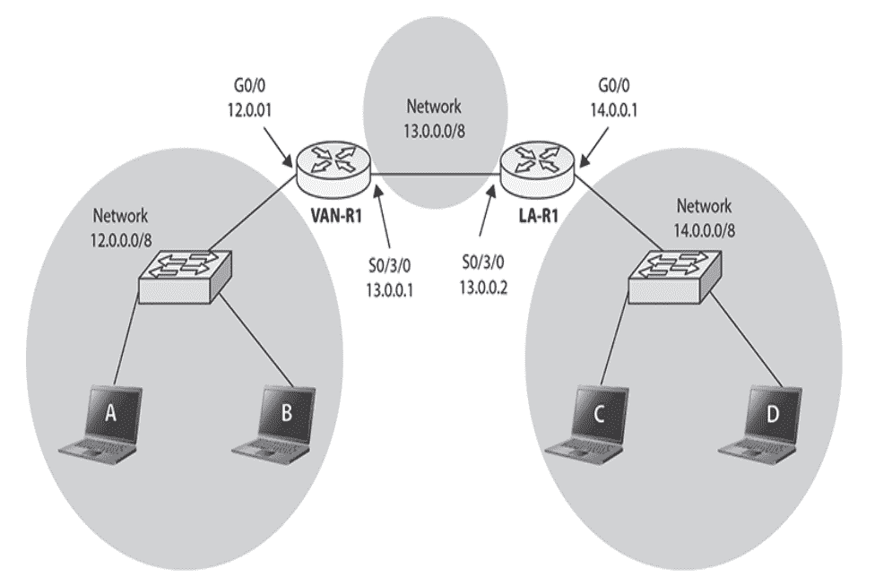

- 1. 确保所有物理组件（如路由器和交换机）按照网络图连接，然后打开设备电源。
- 2. 将工作站连接到将成为 VAN-R1 的路由器的控制台端口。然后启动 PuTTY，选择串行连接，设置正确的 COM 端口，然后选择打开。
- 3. 在 PuTTY 窗口中按 ENTER 以在 Cisco 设备上打开提示符。
- 4. 使用以下命令访问 VAN-R1 的特权 EXEC 模式并查看运行配置：
- 5. 使用 **show startup-config** 命令查看 NVRAM 的内容。

```
VAN-R1>enable
VAN-R1#show running-config
```

注意 running-config 中的主机名。

请注意，startup-config 中的主机名与 running-config 中的主机名设置相同。

- 6. 使用以下命令将主机名更改为 Test：
- 7. 再次比较 NVRAM 和 running-config 的内容，注意更改已在 running-config 中完成，但未在 startup-config 中完成。
- 主机名在运行配置中：________________
- 主机名在启动配置中：________________
- 8. 使用 copy running-config startup-config 命令将路由器的活动配置保存到 NVRAM。或者，您也可以使用 write 命令。
- 9. 使用 show startup-config 验证设置是否已保存到 NVRAM。
- 10. 将路由器上的主机名改回 VAN-R1。这会在 running-config 中更改，但不会在 startup-config 中更改，直到您再次使用 copy 命令为止。
- 11. 在将 running-config 复制到 startup-config 之前，练习擦除 startup-config。使用 erase startup-config 命令擦除 NVRAM 中的配置。系统提示确认擦除时按 ENTER。或者，您也可以使用 write erase 命令删除 NVRAM 的内容。
- 12. 使用 show startup-config 命令验证配置文件是否已删除。
- 13. 现在使用 copy running-config startup-config 命令将配置文件从 RAM（running-config）保存到 NVRAM（startup-config）。或者，您也可以使用 write 命令。
- 14. 使用 show startup-config 命令查看 NVRAM 中新保存的配置文件。

```
VAN-R1#config term
Enter configuration commands, one per line. End with CNTL/Z.
VAN-R1(config)#hostname Test
Test(config)#
```

将配置保存到 startup-config（NVRAM）意味着重新启动设备时，配置设置会保留。

## 网络中的更改

当您决定对网络进行更改（包括添加或删除设备）时，在进行更改之前应始终进行一些准备工作。更改可能会导致设备功能异常或完全无法运行，因此应始终提前准备。以下两个部分涵盖了处理更改的基础知识。


**提示** 请记住，从备份副本恢复要比从头重新创建容易得多。此外，每次进行更改时，务必测试更改，以确保您的 Cisco 设备按预期运行。

## 添加设备

在将 IOS 设备添加到网络之前，收集以下信息并执行以下任务：

- 1. 决定为设备管理目的分配哪个 IP 地址。
- 2. 配置设备的端口，包括控制台和虚拟类型终端（VTY）端口。
- 3. 设置用户和特权 EXEC 访问的密码。
- 4. 为设备的接口分配适当的 IP 地址。
- 5. 在设备上创建基本配置，以便它可以执行其工作。

## 更改设备

您将不断对网络进行配置更改以提高性能和安全性。*在*对网络进行任何更改之前，您应*始终*备份配置文件。同样，在对 Cisco 设备执行软件升级之前，您应始终备份旧的 IOS 映像。

在将新映像加载到 IOS 设备之前，您应检查一些事项。在继续加载新映像之前，请自问以下问题：首先，新映像是否包含以前映像的所有功能？或者至少包含您需要的功能？此外，您的 IOS 设备是否有足够的 flash *和* RAM 来存储和加载 IOS 映像？

有时，您可能需要升级硬件或向 Cisco 设备添加新模块。某些设备在升级前需要关闭电源，而其他设备可以保持通电状态。


**警告** 在执行安装之前，阅读随硬件提供的安装手册非常重要。如果您将硬件组件安装到需要关闭设备的设备中，而设备正在运行，您可能会损坏新组件，更糟糕的是，您可能会触电。

## IOS 映像文件

IOS 映像的默认位置在 flash 中。在某些 IOS 设备上，flash 内置于主板中，有些使用 PCMCIA 卡进行存储，有些则两者兼用。例如，在您想要执行升级时，有时需要处理设备的 flash。

要查看 flash 中的文件，请使用 **show flash** 命令：

```
IOS# show flash
-#- --length-- -----date/time----- path
1          0 Sep 18 2007 15:42:20 +00:00 .Trashes
2       4096 Sep 18 2007 15:42:20 +00:00 ._.Trashes
3      12292 Sep 18 2007 15:55:12 +00:00 .DS_Store
4       1159 Sep 9 2007 18:01:42 +00:00 udp.phdf
5    4787200 Oct 3 2007 14:33:50 +00:00 sdm.tar
6       2679 Sep 9 2007 18:01:28 +00:00 ip.phdf
7     113152 Oct 3 2007 14:34:02 +00:00 home.tar
8       2227 Dec 4 2007 16:02:28 +00:00 pre_autosec.cfg
.
.
.
16   23787192 Sep 9 2007 17:45:30 +00:00
                c1841-advipservicesk9-mz.124-6.T7.bin
.
.
.
31946752 bytes available (31922176 bytes used)
```

在此示例中，您可以看到路由器的 flash 包含许多文件。在文件列表下方，您可以看到 flash 的使用量（约 32MB）、可用量（约 32MB）以及路由器上的 flash 总量（64MB）。您也可以使用 show version 命令查看在 IOS 设备上安装的 flash 数量。


EXAM TIP 对于 Cisco CCT 考试，请记住您可以使用 show flash、show version 或 dir 命令查看 IOS 设备上安装的 flash 内存量。您还应了解如何验证 flash 中的可用空间量。

除了使用 show flash 命令外，您还可以使用 dir 命令查看 IOS 设备上可用的 flash 内存：

```
IOS# dir
Directory of flash:/
  1 drw-           0  Sep 18 2007 15:42:20 +00:00  .Trashes
  2 -rw-        4096  Sep 18 2007 15:42:20 +00:00  .__.Trashes
  .
  .
  .
 16 -rw-    23787192  Sep 9 2007 17:45:30 +00:00
                    c1841-advipservicesk9-mz.124-6.T7.bin
63868928 bytes total (31946752 bytes free)
```

在此示例中，可用 flash 量为 31,946,752 字节——在向 flash 添加文件之前，您需要确保有足够的 flash 可用。


**VIDEO 8.03.** 随本书附带的数字资源包含查看闪存内容的多媒体演示。

## IOS 映像的命名约定

Cisco 为其 IOS 映像实施了命名约定，您只需查看映像文件名即可了解平台、软件版本和映像中包含的功能。例如，考虑前述 show flash 命令中的映像名称 c1841-advipservicesk9-mz.124-6.T7.bin，它来自路由器。以下是 Cisco 对 IOS 映像文件名使用的命名法的解释：

- **c1841** 指映像将运行的平台名称。这很重要，因为不同路由器的处理器不同，并且为一个处理器或路由器型号编译的映像通常*不会*在不同型号上运行。因此，加载到设备上的映像必须非常正确。
- **advipservicesk9** 指此 IOS 版本中包含的功能，通常称为 *功能集*。在此示例中，IOS 是


高级 IP 服务和 *k9* 指的是包含加密支持。

- **mz 或 z** 表示该镜像已压缩，必须在加载/运行前解压。如果此处看到 *l*（字母 *l*，而非数字 1），则表示 IOS 镜像的运行位置。*l* 表示它是可重定位镜像，并且该镜像可以从 RAM 运行。请记住，某些镜像可以直接从 flash 运行，具体取决于路由器型号。
- **124-6.T7** 表示 IOS 的软件版本号。在此实例中，版本为 12.4(6)T7。带有 *T* 的镜像文件名表示新功能，而不带 *T* 的表示主线版本（仅对其进行 bug 修复）。
- **.bin** 文件名末尾表示这是一个二进制镜像。


**NOTE:** 此处讨论的命名规则适用于您从 Cisco 购买时随 IOS 设备提供的 IOS 镜像，或从 Cisco 网站下载时提供的 IOS 镜像。但是，名称本身对 IOS 加载到 IOS 设备后的实际运行没有影响。例如，您可以从 Cisco 下载镜像并将其重命名为 myciscoos.bin，这不会影响 IOS 设备的性能。

## 在升级 IOS 镜像之前

本节和下一节讨论如何升级和备份路由器上的 IOS 软件（而非配置）。在升级设备上的 IOS 之前，应首先将现有镜像备份到外部服务器，原因有二：首先，您的 flash 可能不够大，无法同时支持两个镜像——旧镜像和新镜像。如果加载了新镜像并遇到问题，您可能希望将旧镜像重新加载到设备上。其次，Cisco 并不会在其网站上保留所有软件版本。较旧版本的 IOS 难以找到，因此如果您要从旧版本的 IOS 升级，我强烈建议您先进行备份。

您可以将 Cisco IOS（及配置文件）备份到 TFTP 服务器或 FTP 服务器。虽然两者都是文件传输协议，但其底层用途有所不同。TFTP 使用 UDP 端口 69，连接到 TFTP 服务器不需要身份验证（用户名和密码）。FTP 使用 TCP 端口 21（命令通道）和 TCP 端口 20（数据通道），并且确实使用身份验证，即连接者需提供在服务器上配置的用户名和密码。


**考试提示：** 对于 Cisco 考试，请记住 TFTP 使用 UDP 端口 69 且不需要身份验证，而 FTP 使用 TCP 端口 21/20 且需要身份验证。

## 创建 TFTP 服务器

在将 IOS 或配置文件备份到 TFTP 服务器之前，必须先安装 TFTP 服务器！好消息是，您可以在台式机或笔记本电脑上下载并安装免费的 TFTP 服务器软件（您实际上不需要物理服务器）。市面上有许多免费版本的 TFTP 服务器软件，但我喜欢使用 SolarWinds TFTP 服务器软件，您可以从此 URL 下载：

https://www.solarwinds.com/free-tools/free-tftp-server

下载时需要填写表单进行注册，但完成后，您将看到下载软件的链接。

安装 TFTP 服务器软件的步骤如下：

1. 下载 TFTP 服务器软件。
2. 安装 TFTP 服务器软件。
3. 配置 TFTP 服务器上的主机防火墙，允许 UDP 端口 69 流量通过到系统（即 TFTP 使用的端口，您的防火墙可能默认会阻止该端口）。
4. 验证 TFTP 软件是否正在运行。

下载软件后，您可以将其安装在服务器、台式机或笔记本电脑等系统上——即您希望存储配置文件和 Cisco IOS 备份的任何位置。安装软件后，应确保配置主机防火墙，允许 UDP 端口 69 流量通过到系统。

在尝试将设备配置或 IOS 备份到新安装的 TFTP 服务器之前，请验证服务器软件是否正在运行。您可以单击“开始”按钮，然后键入 **TFTP** 来启动 SolarWinds TFTP 服务器软件。您应该会看到名为“TFTP Server”的程序。选择该程序以启动它。TFTP 服务器会在整个过程中显示通知。您可以通过图 8-1 所示窗口状态栏中的消息来查看服务器是否正在运行。

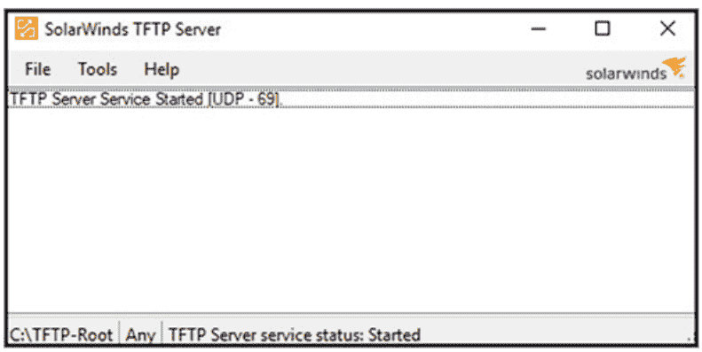

图 8-1 SolarWinds TFTP 服务器软件消息

## 验证服务器信息

在将 IOS 镜像备份到外部服务器之前，请提出以下问题以确定您是否已准备就绪：

- 服务器是否可达（使用 **ping** 命令测试）？
- 您能否连接到该端口？例如，使用 TFTP 时为 UDP 端口 69。
- 服务器上是否有足够的磁盘空间来存储 IOS 镜像？
- 服务器是否支持您想要使用的文件命名规则？

完成这些检查后，您即可继续备份过程。

## 练习 8-2：安装 TFTP 软件

在本练习中，您将下载 SolarWinds TFTP 软件并将其安装在 Windows 10 系统上以备份您的配置，随后备份您的 Cisco IOS。您将在 IP 地址为 12.0.0.100 的 Windows 10 系统上安装 TFTP 服务器，如以下网络图所示：

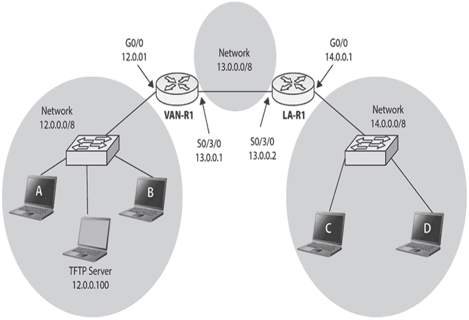

1. 确保您已将 IP 地址为 12.0.0.100 的 Windows 10 系统添加到温哥华办事处网络中。
2. 在 Windows 10 系统上，导航至 https://www.solarwinds.com/free-tools/free-tftp-server 并下载 SolarWinds 免费 TFTP 服务器软件。
3. 在 Windows 10 系统上安装 TFTP Server 软件。
4. 在 Windows 防火墙上创建防火墙规则以打开 UDP 端口 69。
5. 启动 TFTP 服务器软件，并确保状态栏显示它处于“Started”状态。
6. 在状态栏中注意，TFTP 服务器的文件夹为 c:\TFTP-Root。上传的 IOS 镜像和配置文件将保存到此文件夹。

## 使用 Tftpd32/Tftpd64 服务器软件

虽然我喜欢使用 SolarWinds TFTP 软件，但 Cisco CCT 考试目标明确提到使用 Tftpd32 或 Tftpd64 软件。您可以从 https://tftpd32.jounin.net/tftpd32.html 下载 Tftpd32/Tftpd64。Tftpd32 是 TFTP 软件的 32 位版本，而 Tftpd64 是该软件的 64 位版本。

Tftpd 有一些很酷的功能。首先，它不仅是 TFTP 服务器，还可以是 DHCP 服务器、DNS 服务器和 syslog 服务器。如果您还没有 TFTP 客户端，它还可以充当 TFTP 客户端。

下载 Tftpd64（我建议使用 64 位版本）后，您可以运行安装程序快速安装该软件。安装完成后，您将在桌面上看到一个 TFTP 图标，双击即可启动该软件。该软件界面简单，如图 8-2 所示。

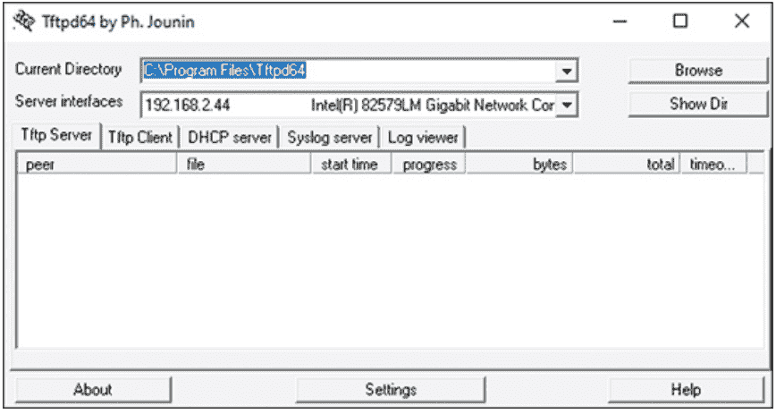

图 8-2 Tftpd64 服务器软件界面

请注意，您可以更改 Tftpd64 软件用于存储备份到服务的文件的目录，并可以选择软件要使用的系统网卡。如果单击“Settings”按钮，您可以更改每项服务的设置，例如 TFTP 服务使用的端口、如果您想使用 DHCP 服务则要使用的地址池，以及它所提供的所有服务相关的其他设置。

选择接口后，请注意接口旁边的 IP 地址，因为您将从 Cisco 设备使用该 IP 地址来备份配置文件或 IOS 镜像。

## 安装 FTP 服务器软件

虽然您可以使用任何 FTP 服务器软件来备份 Cisco 配置或 IOS 镜像文件，但 Cisco CCT 认证目标将 FileZilla 引用为示例软件。FileZilla 提供可从 https://filezilla-project.org/ 下载和安装的 FTP 服务器软件。请注意，FileZilla 也有 FTP 客户端软件，但我们感兴趣的是服务器软件，以便可以将我们的 Cisco IOS 复制到 FTP 服务器。（Cisco IOS 内置了 FTP 客户端软件，使我们能够与 FTP 服务器软件通信。）在执行


安装 FileZilla FTP 服务器软件时，安装过程中接受所有默认设置。

产品安装完成后，管理界面会自动启动（参见图 8-3）。输入 FTP 服务的 IP 地址（默认为 localhost）、管理站点的端口（默认为 14147）以及密码（尚未配置），然后单击 Connect。

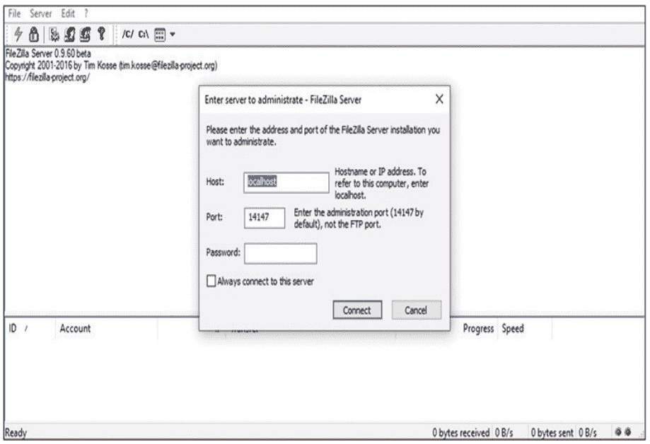

图 8-3 FileZilla FTP 服务器软件安装

软件启动后，可以通过选择“编辑 | 设置”来修改服务器软件的配置。在设置中，可以配置 FTP 使用的端口（默认为 TCP 端口 21），以及同时可连接的最大用户数、连接后显示的欢迎消息等信息。

还可以通过选择“编辑 | 用户”来管理授权连接到 FTP 服务器的用户名和密码列表。

安装 TFTP 服务器或 FTP 服务器软件后，即可从 Cisco 设备连接到它，并备份配置文件或 IOS 映像文件。

## 备份 IOS 映像

有多种方法可以备份 Cisco IOS，并在 IOS 损坏或需要更换时最终将其恢复到设备。例如，可以将其备份到 TFTP 服务器、FTP 服务器或 USB 驱动器，或使用 Xmodem 执行 IOS 的备份和恢复。让我们来看看备份 IOS 的方法。

备份设备配置或 IOS 的好处在于，这一切都属于 **copy** 命令的一部分；只需更改源和目标即可。如果要将 IOS 备份到 TFTP 服务器，请使用 **copy flash tftp**；如果要将其备份到 FTP 服务器，请使用 **copy flash ftp**。使用 **copy** 命令的帮助（**copy ?**）来查看源的可用选项（要复制的内容）：

```
R1#copy ?
    flash:            Copy from flash: file system
    ftp:              Copy from ftp: file system
    running-config    Copy from current system configuration
    scp:              Copy from scp: file system
    startup-config    Copy from startup configuration
    tftp:             Copy from tftp: file system
```

选择要复制的数据位置后（例如 **flash:**），可以再次使用帮助（**copy flash: ?**）来查看目标的可用选项：

```
R1#copy flash: ?
    ftp:              Copy to ftp: file system
    running-config    Update (merge with) current system configuration
    scp:              Copy to scp: file system
    startup-config    Copy to startup configuration
    tftp:             Copy to tftp: file system
```

## 使用 TFTP 服务器

要备份 IOS 映像，将使用 **copy flash** *URL* 命令。可选地，可以在命令行中指定 IOS 的文件名。*URL* 指定 URL 样式的语法，包括 TFTP 等协议、服务器的 IP 地址、可能的存储目录以及映像在服务器上将使用的名称。可选地，可以只在 URL 中指定协议，系统将提示输入其余信息，如下所示：

```
Router# copy flash tftp
Source filename []? c3640-js-mz.120-11
Address or name of remote host []? 192.168.1.10
Destination filename [c3640-js-mz.120-11]?
!!!!!!!!!!!!!!!!!!!!!!!!!!!!!!!!!!!!!!!!!!!!!!!!!!!!!!!!!!!!!!!
.
.
6754416 bytes copied in 64.452 secs (105537 bytes/sec)
```

当映像备份到 TFTP 服务器时（参见图 8-4），屏幕上应出现一大串感叹号。这表示数据包复制成功。如果看到一系列句号，则表示失败。成功复制操作后，应能看到复制的字节数以及所用时间。将复制的字节数与闪存中的文件长度进行比较，以验证复制是否确实成功。

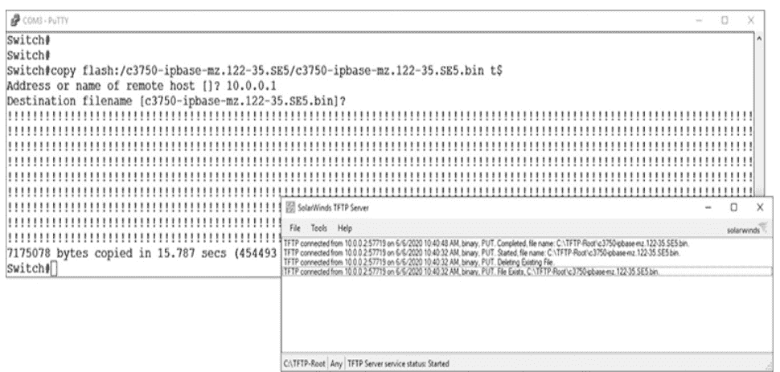

图 8-4 将 IOS 备份到 TFTP 服务器


**视频 8.04.** 随本书提供的数字资源包含将 IOS 映像文件备份到 TFTP 服务器的多媒体演示。

## 使用 FTP

如果有可用的 FTP 服务器，可以使用它来备份 Cisco IOS 的配置文件。第一步是为 Cisco 设备配置连接到目标 FTP 服务器所需的 FTP 用户名和密码。使用以下命令完成此操作：

```
R1#config terminal
R1(config)#ip ftp username ftpuser
R1(config)#ip ftp password ftppass
R1(config)#end
R1#
```

接下来，使用 **copy** 命令并指定 **ftp:** 作为源或目标，具体取决于是从 FTP 服务器复制还是向 FTP 服务器复制。需要注意的是，使用 **copy** 命令时，也可以复制设备的配置或 Cisco IOS。以下是将设备配置备份到 FTP 服务器的示例：

```
R1#copy running-config ftp:
Address or name of remote host []? 192.168.2.25
Destination filename []? R1_backup_config
Writing R1_backup_config !
1015 bytes copied in 3.554 secs (244 bytes/sec)
R1#
```

与 TFTP 类似，一旦配置保存到 FTP 服务器，就可以随时将配置恢复到替换设备。首先，确保按照前面的代码示例配置 FTP 用户名和密码。然后，可以使用以下命令将配置复制到新设备：

```
NewRouter#copy ftp: running-config
Address or name of remote host []? 192.168.2.25
Source filename []? R1_backup_config
Destination filename [running-config]?
Accessing ftp://192.168.2.25/R1_backup_config...
Loading R1_backup_config !
[OK - 1030/4096 bytes]
1015 bytes copied in 10.222 secs (67 bytes/sec)
R1#
```

这些代码示例是将配置备份到 FTP 服务器，但如果要将 Cisco IOS 备份到 FTP 服务器，则将使用 copy flash: ftp: 命令。

请记住，系统会提示输入相关信息，例如要从闪存复制的 IOS 文件以及 FTP 服务器的 IP 地址，因此在使用 copy 命令之前，最好先使用 dir flash: 命令获取闪存列表。例如，以下命令可用于在设备上配置 FTP 用户名和密码并获取闪存内容的列表。然后，可以使用 copy 命令将 IOS 文件复制到 FTP 服务器：

```
R1>enable
R1#config term
R1(config)#ip ftp username ftpuser
R1(config)#ip ftp password ftppass
R1(config)#exit
```

正如我所说，在使用 copy 命令之前，最好先查看闪存的内容。我喜欢使用 dir flash: 命令来完成此操作：

```
R1#dir flash:
Directory of flash0:/
    3  -rw-     33591768           <no date> c2900-universalk9-mz.SPA.151-4.M4.bin
    2  -rw-       28282           <no date> sigdef-category.xml
    1  -rw-      227537           <no date> sigdef-default.xml
255744000 bytes total (221896413 bytes free)
R1#copy flash: ftp:
Source filename []? c2900-universalk9-mz.SPA.151-4.M4.bin
Address or name of remote host []? 12.0.0.100
Destination filename [c2900-universalk9-mz.SPA.151-4.M4.bin]?
Writing c2900-universalk9-mz.SPA.151-4.M4.bin...
[OK - 33591768 bytes]
33591768 bytes copied in 56.293 secs (596000 bytes/sec)
R1#
```


**注意** 可以使用 **dir flash:** 命令或 **show flash** 命令显示闪存的内容。

## 使用 USB 存储

如果 Cisco 设备有 USB 端口，可以将配置或 Cisco IOS 备份到 USB 驱动器。首先将 USB 驱动器连接到 Cisco 设备上的 USB 端口。控制台上应会出现一条消息，指示已连接 USB 设备。该驱动器会被分配一个标识符，例如 usbflash0:，其中 0 是表示驱动器的索引号。

要将 Cisco 配置备份到 USB 驱动器，请使用 **copy current-config usbflash0:** 命令。之后可以通过反转参数将配置设置复制到 Cisco 设备，但在这样做之前，我建议使用 **dir** 命令获取闪存驱动器上的文件列表。以下命令可用于从 USB 闪存复制到 Cisco 设备：

```
R1# dir usbflash0:
R1# copy usbflash0:R1_config current-config
```

如果要将 IOS 复制到 USB 驱动器，也可以使用 **copy** 命令：

```
R1# copy flash:c2900-universalk9-mz.SPA.151-4.M4.bin usbflash0:
```

同样，最好先使用 **dir flash:** 或 **show flash** 命令，以便查看闪存中存在的文件名列表。

## 升级 IOS 映像

在升级 Cisco 设备上的 IOS 之前，首先需要通过提出以下问题来验证设备是否满足最低硬件要求：


- 您的路由器是否具有所需的最小 RAM 容量？
- 您的路由器是否具有所需的最小闪存容量？

您可以使用 **show version** 命令查看已安装的 RAM 和闪存容量（参见第 6 章）。同时请记得验证您的 IOS 设备是否有足够的空闲闪存来添加其他设备（**show flash** 或 **dir** 命令）；如果没有，您需要删除不需要的文件，为新映像腾出空间。


**提示** 在 Cisco 设备上升级 IOS 之前，您应验证新 IOS 的闪存和 RAM 要求：您的 IOS 设备是否支持新映像的要求？您可以使用 **show version** 命令验证 IOS 设备上已安装的 RAM 和闪存容量。您可以使用 **show flash** 或 **dir** 命令验证可用闪存容量。

如果您要升级 IOS 或加载先前保存的 IOS 映像，则需要将 IOS 映像放置在外部服务器上（例如 TFTP 或 FTP），并使用 **copy tftp flash** 命令。您将被提示输入与使用 **copy flash tftp** 命令时所需的相同信息；但是，输入信息后发生的过程不同。输入信息后，IOS 首先验证 TFTP 服务器上是否存在该映像。如果服务器上存在该文件，IOS 随后会询问您是否要擦除闪存。如果闪存空间不足以容纳旧映像和新映像，请回答 **y**。如果回答 **y**，则会擦除并重新编程闪存；在此步骤进行时，屏幕上会显示一行 e。

初始化闪存后，路由器会从 TFTP 服务器获取 IOS 映像。与配置文件的复制操作一样，一串感叹号表示复制成功，而句点表示复制失败。

以下是将 IOS 映像加载到路由器中的示例：

```
Router# copy tftp flash
Address or name of remote host []? 192.168.1.10
Source filename []? c3640-js-mz.120-7
Destination filename [c3640-js-mz.120-7]?
%Warning:There is a file already existing with this name
Do you want to over write? [confirm] y
Accessing tftp://192.168.1.10/c3640-js-mz.120-7...
Erase flash: before copying? [confirm] y
Erasing the flash filesystem will remove all files! Continue?
[confirm] y
Erasing device... eeeeeeeeeeeeeeeeeeeeeeeeeeeeee ...erased
Erase of flash: complete
Loading c3640-js-mz.120-7 from 192.168.1.10 (via FastEthernet0/0):
!!!!!!!!!!!!!!!!!!!!!!!!!!!!!!!!!!!!!!!!!!!!!!!!!!!!!!!!!!!!!!
.
.
.
[OK - 6754416/13508608 bytes]

Verifying checksum... OK (0xCAF2)
6754416 bytes copied in 66.968 secs (102339 bytes/sec)
Router#
```

在此示例中，路由器注意到 TFTP 服务器上存在的映像名称与闪存中的名称相同，并验证您是否要覆盖它。另请注意，路由器会提示您擦除闪存——这是 IOS 的默认行为，将删除所有文件。如果您不想完全擦除闪存，请回答 n。


**注意** 将文件复制到闪存时，请记住默认行为是在执行复制之前擦除闪存。

路由器将 IOS 映像复制到闪存后，必须重新启动路由器才能使用新映像。但是，默认情况下，Cisco 设备会加载闪存中的第一个有效 IOS 映像。要使用其他映像，您需要使用 **boot system** 命令在配置中定义此项，并将其保存为启动配置文件的一部分。**boot system** 命令会在启动配置文件中按顺序处理——如果其中有一个不再需要，您应该使用相应的 **no boot system** 命令将其删除，后跟旧的 IOS 映像名称。

您可以通过两种方式重新启动路由器：关闭路由器电源后再打开（硬重启），或使用特权 EXEC **reload** 命令（软重启）。以下命令指示 Cisco 设备从闪存中的 IOS 映像 c2900-universalk9-mz.SPA.151-4.M4.bin 启动：

```
boot system flash c2900-universalk9-mz.SPA.151-4.M4.bin
```

如果需要，您也可以使用 **boot system tftp <IOS_filename>** 命令从 TFTP 服务器上的 IOS 启动系统。请注意，启动过程会慢得多，因为设备需要通过网络读取 IOS。

如果在路由器上放置了错误的映像——例如，在 2800 系列路由器上放置 3600 系列映像——路由器将无法启动。您需要进入 ROM 监视器（ROMMON）模式，并执行 TFTP 启动或从 ROM 中的 Mini IOS 启动（如果存在）。


**注意** 要从 TFTP 复制，请使用 **copy flash tftp://*URL*** 命令备份 IOS 映像，并使用 **copy tftp://*URL* flash** 命令恢复或升级 IOS。**reload** 命令可重新启动路由器。在升级过程中，如果服务器不可达或 IP 地址或文件名配置错误，您将在 CLI 中收到错误消息。

在升级过程中，如果访问远程服务器时遇到问题，您将收到错误消息。这可能是因为您在复制命令中配置了错误的服务器 IP 地址，或输入了不存在的 IOS 映像名称。以下示例说明了此问题：

```
Router# copy tftp://192.168.101.66/iosimage.bin flash
Destination filename [iosimage.bin]?
Accessing tftp://192.168.101.66/iosimage.bin...
%Error opening tftp://192.168.101.66/iosimage.bin (Timed out)
```

## 使用 tftpdnld

如果 IOS 丢失或损坏，您可以使用 **tftpdnld** 命令选项将 IOS 加载到 Cisco 设备上。当 IOS 未启动且您已进入 ROMMON 模式时，会使用此方法。要使用 **tftpdnld**，需要先加载 ROMMON，并且需要网络连接才能通过 **tftpdnld** 加载 IOS。需要注意关于 ROMMON 模式下 **tftpdnld** 命令选项的两个关键点：

- 在下载指定的 IOS 映像之前，它会擦除闪存中存在的所有文件。
- 传输通过设备上的第一个端口进行。

启动到 ROMMON 模式后，在使用 **tftpdnld** 选项之前，必须先配置用于执行复制的几个环境变量：

```
rommon 1> IP_ADDRESS=12.0.0.50
rommon 2> IP_SUBNET_MASK=255.0.0.0
rommon 3> DEFAULT_GATEWAY=12.0.0.1
rommon 4> TFTP_SERVER=12.0.0.100
rommon 5> TFTP_FILE=c2900-universalk9-mz.SPA.151-4.M4.bin
```

设置环境变量后，可以使用 ROMMON 中的 **tftpdnld** 命令从 TFTP 服务器启动 IOS 下载：

```
rommon 6> tftpdnld
    IP_ADDRESS: 12.0.0.50
    IP_SUBNET_MASK: 255.0.0.0
    DEFAULT_GATEWAY: 12.0.0.1
    TFTP_SERVER: 12.0.0.100
    TFTP_FILE: c2900-universalk9-mz.SPA.151-4.M4.bin
Invoke this command for disaster recovery only.
WARNING: all existing data in all partitions on flash will be lost
Do you wish to continue? y/n: [n]: y
```

下载完成后，您将看到 ROMMON 提示符。然后可以使用 reset 命令重新启动 Cisco 设备。

## 使用 xmodem

要使用 ROMMON tftpdnld 命令，您必须具有网络连接，但如果 Cisco 设备未加载 IOS 且没有网络连接该怎么办？您可以启动到 ROMMON 提示符，然后使用 xmodem 命令，该命令将通过控制台端口将连接到控制台端口的计算机上的 Cisco IOS 复制到您的 Cisco 设备。如果没有网络连接，这非常方便，但使用计算机上的 COM 端口复制 Cisco IOS 也是一种非常慢的技术。

要使用 xmodem 命令，您需要一个允许通过 Xmodem 发送文件的终端程序，例如 Tera Term。您可以使用此开源终端模拟器连接到 Cisco 设备进行管理。

按照以下步骤在 Cisco 交换机上使用 xmodem 命令：

- 1. 通过拔掉交换机电源、按住模式按钮，然后重新插入电源，将交换机启动到 ROMMON 模式。按住模式按钮，直到设备启动到 switch: 提示符。
- 2. 启动 Tera Term 并选择通过串行连接进行连接。使用串行连接连接到连接到 Cisco 设备控制台端口的 COM 端口。
- 3. 如果您正在处理 Cisco 交换机，可能需要使用以下命令初始化闪存：

```
switch: flash_init
```


- 4. 一旦闪存已初始化，您可以从计算机（使用 Xmodem）复制到闪存（使用计算机上存储的 IOS 的区分大小写的文件名）：

```
switch: copy xmodem: flash:c3750-ipbase-mz.122-35.SE5.bin
```

您将看到提示开始 Xmodem 传输。

- 5. 在 Tera Term 中，选择 File | Transfer | Xmodem | Send 通过 Xmodem 发送文件。

- 6. 当系统提示输入文件名时，浏览到计算机上的文件夹并选择文件。传输将随即开始（参见图 8-5）。

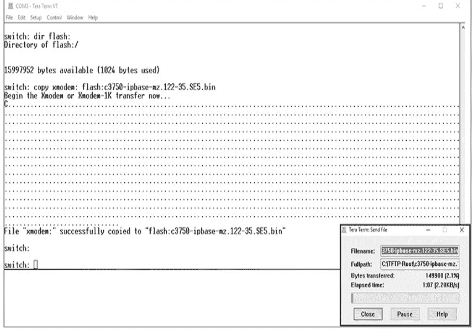

图 8-5 使用 Xmodem 恢复 IOS 映像

- 7. 传输完成后，您可以通过键入以下命令来测试新 IOS 的加载：

```
switch: boot flash:c3750-ipbase-mz.122-35.SE5.bin
```


提示 Xmodem 中的默认波特率为 9600，但您可以在启动文件传输之前在 ROMMON 或 Tera Term 中提高波特率以加快复制操作。ROMMON 中用于提高波特率的命令是 set BAUD 57600。

## 练习 8-3：备份和恢复设备配置和 IOS

在本练习中，您将把 VAN-R1 的设备配置备份到 TFTP 服务器，然后从 TFTP 服务器恢复它。您随后将把 IOS 备份到 TFTP 服务器，以便日后恢复。

- 1. 确保您已完成练习 8-2，并且 IP 地址为 12.0.0.100 的 TFTP 服务器可用。
- 2. 要将 VAN-R1 的运行配置备份到 TFTP 服务器，请输入以下命令：
- 3. 在恢复配置之前，对设备进行更改，例如更改主机名：

```
VAN-R1>enable
VAN-R1#copy running-config tftp
Address or name of remote host []? 12.0.0.100
Destination filename [VAN-R1-config]? VAN-R1-config
Writing running-config....!!
[OK - 882 bytes]
882 bytes copied in 3.015 secs (292 bytes/sec)
```

```
VAN-R1#config term
Enter configuration commands, one per line. End with CNTL/Z.
VAN-R1(config)#hostname Test
Test(config)#
```

4. 现在将配置从 TFTP 服务器恢复到 running-config，以验证旧主机名是否已恢复：

```
Test(config)#exit
Test#copy tftp running-config
Address or name of remote host []? 12.0.0.100
Source filename []? VAN-R1-config
Destination filename [running-config]? <<ENTER>>
Accessing tftp://12.0.0.100/VAN-R1-config...
Loading VAN-R1-config from 12.0.0.100: !
[OK - 882 bytes]
882 bytes copied in 0.001 secs (882000 bytes/sec)
VAN-R1#
```

注意 VAN-R1 的主机名已恢复。

5. 现在使用相同的策略备份 Cisco IOS，以防其损坏并需要恢复。要查看闪存的内容，请使用以下命令：

```
VAN-R1#show flash
```

| 文件 | 长度 | 名称/状态 |
|------|--------|-------------|
| 3 | 33591768 | c2900-universalk9-mz.SPA.151-4.M4.bin |
| 2 | 28282 | sigdef-category.xml |
| 1 | 227537 | sigdef-default.xml |

[33847587 字节已用，221896413 字节可用，255744000 字节总计]
249856K 字节的处理器板系统闪存（读/写）

6. 要将 Cisco IOS 文件备份到 TFTP 服务器，请使用以下命令：

```
VAN-R1#copy flash: tftp:
Source filename []? c2900-universalk9-mz.SPA.151-4.M4.bin
Address or name of remote host []? 12.0.0.100
Destination filename [c2900-universalk9-mz.SPA.151-4.M4.bin]? <<ENTER>>
Writing c2900-universalk9-mz.SPA.151-4.M4.bin...!!!!!!!!!!!!!!!!!!!!!!!!!!!!
!!!!!!!!!!!!!!!!!!!!!!!!!!!!!!!!!!!!!!!!!!!!!!!!!!!!!!!!!!!!!!!!!!!!!!!!!!!!
!!!!!!!!!!!!!!!!!!!!!!!!!!!!!!!!!!!!!!!!!!!!!!!!!!!!!!!!!!!!!!!!!!!!!!!!!!!!
!!!!!!!!!!!!!!!!!!!!!!!!!!!!!!!!!!!!!!!!!!!!!!!!!!!!!!!!!!!!!!!!!!!!!!!!!!!!
!!!!!!!!!!!!!!!!!!!!!!!!!!!!!!!!!!!!!!!!!!!!!!!!!!!!!!!!!!!!!!!!!!!!!!!!!!!!
!!!!!!!!!!!!!!!!!!!!!!!!!!!!!!!!!!!!!!!!!!!!!!!!!!!!!!!!!!!!!!!!!!!!!!!!!!!!
!!!!!!!!!!!!!!!!!!!!!!!!!!!!!!!!!!!!!!!!!!!!!!!!!!!!!!!!!!!!!!!!!!!!!!!!!!!!
!!!!!!!!!!!!!!!!!!!!!!!!!!!!!!!!!!!!!!!!!!!!!!!!!!!!!!!!!!!!!!!!!!!!!!!!!!!!
!!!!!!!!!!!!!!!!!!!!!!!!!!!!!!!!!!!!!!!!!!!!!!!!!!!!!!!!!!!!!!!!!!!!!!!!!!!!
!!!!!!!!!!!!!!!!!!!!!!!!!!!!!!!!!!!!!!!!!!!!!!!!!!!!!!!!!!!!!!!!!!!!!!!!!!!!
!!!!!!!!!!!!!!!!!!!!!!!!!!!!!!!!!!!!!!!!!!!!!!!!!!!!!!!!!!!!!!!!!!!!!!!!!!!!
[OK - 33591768 bytes]

33591768 bytes copied in 1.061 secs (3324219 bytes/sec)
VAN-R1#
```

如果您曾经需要将 IOS 从 TFTP 服务器恢复到闪存，可以使用 **copy tftp: flash:** 命令并按照提示操作。

## 远程访问您的 Cisco 设备

在许多情况下，您可能无法亲临 IOS 设备前进行管理。您可以选择通过 telnet 或 SSH 访问其 CLI 进行远程管理，也可以使用带有 Web 浏览器的 GUI 进行管理。要远程访问 IOS 设备的 CLI，必须先设置其 VTY（将在第 7 章讨论）。如果您要访问二层 IOS 交换机，需要将 IP 地址分配给 VLAN 接口（将在第 9 章讨论）；如果您要访问路由器，需要将 IP 地址分配给其接口之一并启用它（将在第 7 章讨论）。默认情况下，路由器上仅启用 telnet；本节将讨论如何启用 SSH。

### SSH 与 Telnet 访问

网络管理员用于远程管理设备的最常见工具之一是 telnet 应用程序。Telnet 使您能够访问设备的 CLI。然而，telnet 的问题在于，您与 Cisco 设备之间发送的所有信息均以明文形式发送，包括您的用户名和/或密码。由于您不希望有人窃听您的连接并看到您所做的一切——登录、查看设备操作、配置设备——您需要通过加密流量来保护自己。

实现此目的的最简单方法是使用 SSH（安全外壳协议）替代 telnet。SSH 使用 RSA 作为加密算法，加密您与网络设备之间发送的任何数据。SSH 在 IOS 设备上默认实际上是禁用的。


**考试提示** 考试将期望您了解 telnet 与 SSH 的基础知识。Telnet 以明文形式发送流量，包括身份验证流量，因此容易受到窃听攻击。要保护对 IOS 设备的远程访问并防止对您输入的命令和查看的配置进行窃听，请将 SSH 用作远程访问终端连接。SSH 加密所有流量，包括身份验证流量。要防止针对 IOS 设备的访问攻击，应将 SSH 与使用访问控制列表（指示哪些 IP 地址可以管理设备）对设备的管理访问进行过滤相结合。

让我们先来了解如何为通过 telnet 进行远程管理配置设备，然后了解如何在 Cisco 设备上配置 SSH 以支持更安全的远程管理。

## Telnet 配置

在本节中，您将学习如何在 Cisco 设备上配置 telnet。然后您将学习在配置 Cisco 设备后如何使用 telnet 建立连接。

### 配置 Telnet

在使用 telnet 远程连接到路由器之前，需要确保已为设备分配 IP 地址。对于 Cisco 路由器，这是接口上的 IP 地址；但对于 Cisco 交换机，您将把 IP 地址分配给管理 VLAN（通常是 VLAN 1）。请注意，如果您要从另一个网络 telnet 到交换机，需要在交换机上设置默认网关，以便交换机可以将数据发送到网络之外。

配置 IP 地址后，您将配置 VTY 密码以及进入特权 EXEC 模式的密码（或密钥值）。在 Cisco 设备上，如果未设置这些密码，则无法 telnet 到该设备。使用以下命令在 VTY 端口上配置密码：

```
VAN-R1>enable
VAN-R1#config term
Enter configuration commands, one per line. End with CNTL/Z.
VAN-R1(config)#line VTY 0 15
VAN-R1(config-line)#password telnetpass
VAN-R1(config-line)#login
```


视频 8.05。随本书提供的数字资源中包含在 Cisco 路由器上配置 telnet 的多媒体演示。

### 使用 Telnet

如果您已正确配置 Cisco 设备（包括 IP 寻址和路由信息以及 VTY 上的相应命令），则应该能够成功 telnet 到它们。但是，如果您遵循了稍后在“SSH 配置”部分中提到的建议，可能需要改用 SSH 测试连接。Cisco 路由器和交换机支持传入和传出的 telnet 和 SSH。这假设您已设置 VTY 并正确配置了 IP 寻址。


**注意** 这里我将演示如何从另一台 Cisco 设备 telnet 到一台 Cisco 设备，但如果你在系统中运行了 telnet 客户端，你也可以从笔记本电脑或台式电脑 telnet 到 Cisco 设备。telnet 客户端软件的示例包括 PuTTY 和 Tera Term。

要从你的 IOS 设备打开 telnet 会话，你可以使用以下三种方法中的任何一种：

```
IOS# 目标名称 | 目标 IP 地址
```

或

```
IOS# telnet 目标名称 | 目标 IP 地址
```

或

```
IOS# connect 目标名称 | 目标 IP 地址
```

这三种方法的工作方式相同：它们都会让 IOS 尝试 telnet 到指定的目标。


**提示** 如果你在 CLI 中输错了命令名称，IOS 会认为你试图 telnet 到具有该名称的系统，并尝试使用本地主机表或 DNS 服务器查询将该名称解析为 IP 地址。这会导致 CLI 冻结，直到查询尝试超时。要停止此行为，请使用 **no ip domain-lookup** 命令。

## 挂起 Telnet 会话

如果你正在使用 IOS 设备并 telnet 到远程目标，你可能希望返回到你的 IOS 设备。一种方法是退出远程设备；但是，你可能只想返回到源 Cisco 设备，进行快速调整，然后再返回远程设备。在这种情况下，注销并重新登录远程设备是一件很麻烦的事情。

然而，Cisco 通过允许你*挂起* telnet 会话、返回原始路由器或交换机、执行所需操作，然后再直接跳回远程设备解决了这个问题——所有这一切都无需注销并重新登录远程设备。要挂起 telnet 会话，请按 CTRL-SHIFT-6，X（同时按住 CTRL、SHIFT 和 6 键，松开，然后按 X 键）。

在你的源 IOS 上，如果你想查看当前处于挂起状态的打开 telnet 会话，请使用 **show sessions** 命令：

```
IOS# show sessions
Conn Host Address Byte Idle Conn Name
  1 10.1.1.1 10.1.1.1 0 1 10.1.1.1
* 2 10.1.1.2 10.1.1.2 0 2 10.1.1.2
```

此示例显示两个打开的 telnet 会话。前面带有星号（*）的会话是默认（最后访问的）会话。要恢复最后一个会话，你只需在空命令行上按 ENTER 键。

要恢复特定会话，请使用以下命令：

```
Router# resume connection_#
```

要输入的连接号是 **show sessions** 命令输出中 Conn 列中的编号。作为快捷方式，你可以只列出连接号而不包含 **resume**；这样也能达到同样的效果。如果你在源路由器或交换机上，想要终止一个挂起的 telnet 会话而不必先恢复然后注销该 telnet 会话，可以使用以下命令：

```
Router# disconnect connection_#
```

## 验证和清除连接

如果你登录到一个 IOS 设备，你可以使用以下命令查看其他也已登录的用户：

```
Router# show users
      Line        User     Host(s)    Idle     Location
        0     con 0                 idle
        2     vty 0     idle          0     10.1.1.1
*       3     vty 1     idle          0     10.1.1.2
```

第一列中的星号表示当前会话。

如果你想终止某个人的会话，请使用特权 EXEC 模式的 clear line 命令：

```
Router# clear line line_#
```

你在此处输入的行号应与 show users 命令输出中 Line 列中的相应编号匹配。


**考试提示** 考试中，你需要记住如何挂起、恢复和断开 telnet 会话。使用 CTRL-SHIFT-6，x 控制序列来挂起 telnet 会话。在空白命令行上按 ENTER 键可恢复最后一个挂起的 telnet 会话。使用 **resume** 命令恢复挂起的 telnet 连接。使用 **show sessions** 命令查看挂起的 telnet 会话。使用 **disconnect** 命令断开挂起的 telnet 会话。

## 练习 8-4：在 Cisco 设备上配置 Telnet

在此练习中，你将在 VAN-R1 路由器上配置 telnet，以便可以 telnet 到该路由器并执行远程管理。本练习假定网络配置与本章前面的练习相同。

1. 在远程管理 Cisco 设备之前，必须为特权 EXEC 模式配置密码：
   ```
   VAN-R1>enable
   VAN-R1#config term
   Enter configuration commands, one per line. End with CNTL/Z.
   VAN-R1(config)#enable password enablepass
   VAN-R1(config)#enable secret secretpass
   ```

2. 接下来，在 VTY 线路（telnet 端口）上配置密码：
   ```
   VAN-R1(config)#line vty 0 15
   VAN-R1(config-line)#password telnetpass
   VAN-R1(config-line)#login
   ```

3. 控制台登录到路由器 LA-R1，然后输入 **ping 12.0.0.1**。你应该会收到感叹号（!）的回复，这验证了你可以与 VAN-R1 通信。请注意，你的提示符是 LA-R1，因为这是你当前连接的路由器。

4. 要 telnet 到 VAN-R1，请输入 **telnet 12.0.0.1**。你应该会收到提示输入密码的提示符。请记住，这是 VTY 端口的密码。

5. 输入 **telnetpass** 作为密码，然后按 ENTER。

6. 你现在应该已连接到 VAN-R1（注意你的提示符已更改）。你现在可以输入任何你想要用于管理 VAN-R1 设备的命令。

7. 要暂时断开会话并返回 LA-R1，请按 CTRL-SHIFT-6，X。你应该会看到你现在处于 LA-R1 上，并且可以管理 LA-R1。

8. 如果你想查看打开的 telnet 会话，请使用 **show sessions** 命令：
   ```
   LA-R1>show sessions
   Conn Host              Address      Byte Idle Conn Name
   * 1 12.0.0.1            12.0.0.1      0    2   12.0.0.1
   ```

9. 在此示例中，只有一个 ID 为 1 的会话，连接到 12.0.0.1。要连接到该会话，请使用 **resume 1** 命令并按两次 ENTER 键。你将返回到 VAN-R1 设备。

10. 要永久断开 telnet 会话，请输入 **exit** 并按 ENTER。


**视频 8.05。** 随本书附带的数字资源包含使用 telnet 命令从一个设备远程连接到另一个设备的多媒体演示。

## SSH 配置

要在 Cisco 设备上设置 SSH，以便你可以使用 SSH 客户端访问它，你需要配置以下内容：

- **本地用户名和密码**：SSH 要求设备上同时配置用户名和密码（**username** 命令同时配置两者）。
- **主机名和域名**：主机名和域名是标识 IOS 设备上的 RSA 密钥对所必需的（**hostname** 和 **ip domain-name** 命令）。
- **要使用的 SSH 版本**：你应该配置要使用的特定 SSH 版本。默认值为版本 1，但推荐使用的版本是 2（**ip ssh version** 命令）。
- **RSA 公钥和私钥**：你需要生成加密密钥。这些密钥用于加密和解密通过远程访问连接传输的数据（**crypto key generate rsa** 命令）。
- **限制 VTY 访问**：最后，你将确保只能通过 SSH 进行远程访问，而不能通过 telnet，因为 telnet 不加密通信。默认情况下，VTY 上允许 telnet——你应该确保只允许 SSH 访问（**login local** 和 **transport input** 线路子配置命令）。

以下是设置 SSH 的示例配置：

```
IOS(config)# username glen secret mypassword
IOS(config)# hostname R1
R1(config)# ip domain-name gleneclarke.com
R1(config)# ip ssh version 2
Please create RSA keys to enable SSH. R1(config)# crypto key generate rsa
The name for the keys will be: R1.gleneclarke.com
Choose the size of the key modulus in the range of 360 to 2048 for
your General Purpose Keys. Choosing a key modulus greater than 512
may take a few minutes. How many bits in the modulus [512]: 1024
% Generating 1024 bit RSA keys, keys will be non-exportable...[OK]
*Oct  5 16:48:23.455: %SSH-5-ENABLED: SSH 2.0 has been enabled
R1(config)# line vty 0 15
R1(config-line)# login local
R1(config-line)# transport input ssh
R1(config-line)# exit
```


注意 线路上的 **transport input** 命令通过你指定的协议限制对设备的远程访问连接。

请注意，在此示例中，当你执行 **crypto key generate rsa** 命令时，系统会提示你输入 RSA 密钥的长度。密钥越长，你的连接就越安全，2048 位密钥最强。然而，选择更高的值将导致 IOS 设备生成密钥的时间更长。在当今出厂的一些 IOS 设备上，这应该不会花费太长时间：我在 1841 路由器上生成 2048 位密钥大约花了 30 秒。


**视频** 8.06 本书随附的数字资源中包含一个关于在 Cisco 路由器上配置 SSH 的多媒体演示。

关于此配置，还有一点需要指出，那就是 VTY 上的两条命令。**login local** 命令指定使用本地数据库（**username** 命令）进行身份验证；这会使 IOS 设备同时提示输入用户名*和*密码进行身份验证。如果没有 **local** 参数，IOS 设备只会提示输入密码，并使用线路上的 **password** 命令进行身份验证（此过程已在第 7 章讨论过）。SSH 要求同时使用用户名和密码。**transport input ssh** 命令将 VTY 的访问限制为仅允许 SSH 使用；默认情况下，允许所有形式的远程访问，包括 Telnet。


**提示** 如果你将使用 SSH 访问 IOS 设备，则必须使用本地用户名数据库（如此处所述）用于 VTY，或者使用身份验证服务器（AAA）。此外，我通常使用 PuTTY 作为控制台访问程序、Telnet 客户端和 SSH 客户端。这是一个很棒的小程序，可以完成所有这些功能，而且是免费的！

## 配置寄存器和密码恢复

在现实世界和 Cisco 考试中，你需要执行的常见任务之一是密码恢复。当你忘记 Cisco 设备的密码，需要绕过密码以便管理设备并重置密码时，你将使用密码恢复程序。在本节中，你将了解配置寄存器，它是密码恢复的关键概念。

### 配置寄存器

*配置寄存器*设置由引导程序用于确定应从何处加载 IOS 映像和配置文件。配置寄存器是一个 16 位字段（如图 8-6 所示），存储在 NVRAM 中，可以通过修改来控制设备的启动方式。例如，如果你忘记了 Cisco 设备上的密码，你可以修改配置寄存器，使其在启动时不加载启动配置，从而绕过密码。你将在下一节中学习如何实施密码恢复。

**启动字段**

| 值 | 描述 |
|---|---|
| 0 | 启动到 ROMMON |
| 1 | 启动 RX-boot |
| 2 到 F | 从闪存加载文件 |

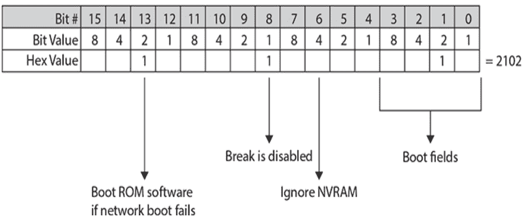

图 8-6 计算配置寄存器

16 位被分成四个 4 位块，每个 4 位块称为一个*半字节*。还记得 8 位组成一个字节吗？那么，只有 4 位就组成一个半字节（半个字节）。

请注意，半字节中 4 位的值从右侧开始依次为 1、2、4 和 8。这些值在 16 位寄存器字段中存在的四个半字节中重复。

启用配置寄存器中的某一位是在启动期间启用某项功能的一种方法。例如，如果启用第 6 位，则 NVRAM 的内容将被忽略，并且在启动期间不会应用。表 8-3 概述了配置寄存器中一些常见位的含义。

| 位号 | 说明 |
|---|---|
| 0-3 | 称为启动字段，将在下一节讨论 |
| 6 | 忽略 NVRAM 的内容 |
| 7 | 禁用启动消息的显示 |
| 8 | 禁用 Break |
| 10 | IP 广播全零 |
| 13 | 如果网络启动失败，则加载默认 ROM 软件 |

**表 8-3 配置寄存器字段**

例如，如果你希望启动设备并让其加载 IOS 和启动配置，则应将配置寄存器值设置为 2102（默认设置）。但如果你希望重新启动 Cisco 设备并让其加载 IOS，但不加载启动配置，则应将配置寄存器设置为 2142（这会启用第 13 位、第 8 位、第 6 位和第 1 位）。

### 启动字段

右侧的第一个 4 位半字节称为启动字段，它控制 Cisco 设备的启动方式。如果启动字段等于特定的十进制值，则设备的启动会以特定方式进行。以下是启动字段结果的细分：

- **0** 如果启动字段等于 0（未启用任何位），Cisco 设备将启动到 ROMMON 模式。此启动模式通常用于排查启动问题或需要下载或安装新的 IOS 映像文件时。启动到 ROMMON 模式时，会显示 **rommon>** 提示符。要启动到 ROMMON 模式，配置寄存器值应为 2100。
- **1** 如果启动字段的十进制值为 1，设备将启动到位于 ROM 上且称为 RXBOOT 的 Mini IOS。当设备启动进入 RXBOOT 时，提示符为 **router (boot)>**。在这种情况下，配置寄存器将设置为 2101。
- **2 到 F** 将启动字段设置为 2 到 F 之间的值，表示应从闪存加载的 IOS 映像。要从闪存启动 IOS 映像，配置寄存器的值应为 2102 到 210F。

### 查看配置寄存器值

路由器启动后，你可以使用 **show version** 命令查看当前的配置寄存器值：

```
Router> show version
Cisco IOS Software, 1841 Software (C1841-ADVIPSERVICESK9-M),
    Version 12.4(6)T7, RELEASE SOFTWARE (fc5)
Technical Support: http://www.cisco.com/techsupport
Copyright (c) 1986-2007 by Cisco Systems, Inc.
Compiled Thu 29-Mar-07 03:28 by khuie

ROM: System Bootstrap, Version 12.4(13r)T, RELEASE SOFTWARE (fc1)

Router1 uptime is 3 days, 22 hours, 5 minutes
System returned to ROM by reload at 19:06:33 UTC Fri Dec 7 2007
System image file is "flash:c1841-advipservicesk9-mz.124-6.T7.bin"
.
.
.
125K bytes of non-volatile configuration memory.
32768K bytes of processor board System flash (Read/Write)
Configuration register is 0x2102
```

在 **show version** 输出的最底部，显示了配置寄存器的当前值——在本例中为 *0x2102*。


**考试提示** 对于 Cisco 考试，请记住你可以使用 **show version** 命令查看路由器在启动时使用的系统映像。还要知道，如果你错误配置了 **boot system** 命令，路由器可能无法找到并加载 IOS 映像。

### 从配置模式更改配置寄存器

你可以在配置模式或 ROMMON 模式下更改配置寄存器值。如果你已经拥有路由器的特权 EXEC 访问权限并想更改寄存器值，请使用以下命令：

```
Router(config)# config-register 0x十六进制值
```


**提示** 如果你配置了路由器，重新启动后出现了 System Configuration 对话框提示，那么你要么在重新启动前忘记保存运行配置，要么错误配置了配置寄存器。

寄存器值长度为四个十六进制数字，即 16 位。但是，寄存器中的每个位位置都表示引导程序应执行的一项功能。因此，在路由器上配置此值时应非常小心。

输入寄存器值时，必须始终在其前面加上 0x，表示这是一个十六进制值。如果不这样做，路由器会假定该值是十进制并将其转换为十六进制。在 Cisco 路由器上，默认的配置寄存器值是 0x2102，这会使路由器使用默认的启动过程来查找和定位 IOS 映像和配置文件。如果将此值更改为 0x2142，则告诉引导程序在下次重新启动时使用默认行为定位 IOS，但不应加载 NVRAM 中的配置文件；相反，你将直接进入 System Configuration 对话框。你将使用此值来执行密码恢复过程。


**考试提示** 对于 Cisco CCT 考试，请记住默认配置寄存器值为 *0x2102*，这会使路由器使用其默认启动过程启动。（查找启动配置中的 **boot system** 命令，如果没有找到，则加载 flash 中的第一个 IOS，然后加载默认启动配置文件。）您可以使用 **show version** 命令查看配置寄存器值。如果您已更改此值，您将看到现有值和路由器重启时将使用的值。如果路由器启动时没有配置，但 NVRAM 中存在配置，请检查路由器的配置寄存器，看是否设置为 *0x2142*：此寄存器设置会使 IOS 在启动时忽略 NVRAM 中的任何配置文件。

## 从 ROM Monitor 更改配置寄存器

当然，使用配置模式更改寄存器值的一个问题是，您必须首先获得特权 EXEC 模式的访问权限。如果您不知道路由器上的密码，这可能是个问题。不过，还有第二种方法，使您无需登录路由器即可更改寄存器值。要使用此方法，您需要能够通过控制台访问路由器——您无法从辅助线路或 VTY 会话中执行此操作。接下来，您将关闭路由器，然后重新打开。当路由器开始启动时，您将通过路由器的中断序列进入 ROMMON 模式。要中断进入路由器，一旦您看到引导程序已加载，在大多数情况下，您可以使用 `CTRL-BREAK` 控制序列进入 ROMMON 模式。请注意，此控制序列可能有所不同，具体取决于您在 PC 上使用的终端仿真程序。

一旦进入 ROMMON 模式，您就可以根据您的路由器型号，使用两种方法之一开始更改寄存器值的过程。Cisco 设备通常使用 **confreg** 命令从 ROMMON 修改配置寄存器。您可以在命令后跟上想要更改为的配置寄存器值，如下所示：

```
rommon 4 > confreg 0x2142
```

或者您可以在脚本模式中使用它，它会提示您希望如何设置该设置。此脚本会询问您有关路由器功能和启动过程的基本问题。该脚本的优点是您不需要知道配置寄存器的十六进制值，因为当您回答这些问题时，路由器会为您创建它们。以下是使用此脚本的示例：

```
rommon 5 > confreg
    Configuration Summary
enabled are:
load rom after netboot fails
console baud: 9600
boot: image specified by the boot system commands
    or default to: cisco2-C3600

do you wish to change the configuration? y/n  [n]:  y
enable  "diagnostic mode"? y/n  [n]:
enable  "use net in IP bcast address"? y/n  [n]:
disable "load rom after netboot fails"? y/n  [n]:
enable  "use all zero broadcast"? y/n  [n]:
enable  "break/abort has effect"? y/n  [n]:
enable  "ignore system config info"? y/n  [n]:
change console baud rate? y/n  [n]:
change the boot characteristics? y/n  [n]:

    Configuration Summary enabled are:
load rom after netboot fails
console baud: 9600
boot: image specified by the boot system commands
    or default to: cisco2-C3600
do you wish to change the configuration? y/n  [n]:  n
rommon 6 >
```


**提示** 作为快捷方式，您也可以执行 **confreg 0x2142** 命令。

就像在系统配置对话框中一样，方括号（[ ]）中的任何信息都代表默认值。第一个问题是您是否要更改配置，这意味着更改寄存器：回答 y 以继续。如果您对“忽略系统配置信息？”回答 y，则第三个十六进制数字变为 4，使路由器的寄存器值显示为 0x2142。当您想执行密码恢复过程时，会使用此选项。对于倒数第二个问题“更改启动特性？”，如果您回答 y，它将重复这些问题。回答 n 以退出脚本。如果您进行了任何更改，系统会询问您是否要保存它们（您是否要更改配置？）——回答 y 以保存您的新寄存器值。完成更改寄存器后，重新启动路由器。在许多路由器上，只需在 ROMMON 模式下键入 i 或 b 即可启动它。

## 密码恢复

您可能需要操作配置寄存器的情形之一是，当您忘记了 Cisco 设备的密码，并且需要绕过密码以便能够管理设备时。密码存储在您的启动配置中，该配置存储在 NVRAM 中。要绕过密码，您需要修改配置寄存器，以便您的设备启动时不加载启动配置（忽略 NVRAM）。一旦设备在没有启动配置的情况下启动，您就可以在没有密码的情况下获得访问权限，然后可以将密码设置为新值。

要将您的 Cisco 设备配置为忽略 NVRAM，您需要启用第 6 位，其值为 4，从而得到配置寄存器值 0x2142，而不是默认的 0x2102。

以下是在您的 Cisco 设备上恢复密码的步骤：

1. 使用 **show version** 命令查看当前配置寄存器值。它很可能是 0x2102。

2. 开启 Cisco 路由器电源后，按 CTRL-BREAK 中断启动过程并进入 ROMMON 模式。您应该会看到 rommon> 提示符。

3. 键入以下命令，将设备配置为启动时跳过启动配置：

   ```
   rommon>confreg 0x2142
   ```

4. 使用 **reset** 命令重新启动路由器。

5. 路由器重新启动时，它将不会加载启动配置，并询问您是否要使用系统配置对话框。键入 **No** 并按 ENTER。

6. 在 **router>** 提示符下，输入 **enable** 命令进入特权 EXEC 模式。注意，系统不会要求您输入密码：

   ```
   Router>enable
   Router#
   ```

7. 使用 **copy startup-config running-config** 命令，将启动时未读取的启动配置复制为当前配置。这样您就不会丢失任何设置。

8. 使用 **show running-config** 命令查看配置。

9. 在全局配置模式下，使用 **enable password <newpass>** 或 **enable secret <newsecret>** 命令更改密码。您也可以通过 **no enable password** 或 **no enable secret** 命令删除密码。

10. 使用 **copy running-config startup-config** 命令（或使用 **write** 命令）将当前配置复制到启动配置中。

11. 使用 **config-register 0x2102** 命令将配置寄存器更改回默认值 *0x2102*，以便在启动时读取 NVRAM。

12. 使用 **reload** 命令重新启动路由器。


**考试提示** 记住 CCT 考试中如何执行密码恢复过程。您需要进入 ROMMON 模式，将配置寄存器值更改为 *0x2142*，然后重新启动路由器。

## 练习 8-5：使用密码恢复过程

在此练习中，您将假设您忘记了 VAN-R1 路由器的密码。请注意，在上一练习中，启用的密码配置为 *enablepass*，密钥设置为 *secretpass*。本练习假定网络配置与本章前面的练习相同。

1. 通过控制台进入 VAN-R1 并导航到特权 EXEC 模式。

2. 使用 **show version** 命令查看当前配置寄存器值。在此记录：______________。

3. 关闭 Cisco 路由器电源。

4. 开启 Cisco 路由器电源，按 CTRL-BREAK 中断启动过程，并进入 ROMMON 模式。您应该会看到 **rommon>** 提示符。

5. 键入以下命令，将设备配置为启动时跳过启动配置：

   ```
   rommon>confreg 0x2142
   ```

6. 使用 **reset** 命令重新启动路由器。

7. 路由器重新启动时，它将不会加载启动配置，并询问您是否使用系统配置对话框。键入 **No** 并按 ENTER。

8. 在 **router>** 提示符下，输入 **enable** 命令进入特权 EXEC 模式。注意，系统不会要求您输入密码：

   ```
   Router>enable
   Router#
   ```

9. 使用 **copy startup-config running-config** 命令，将启动时未读取的启动配置复制为当前配置。这样您就不会丢失任何设置。

10. 使用 **show running-config** 命令查看配置。

11. 使用全局配置命令 **enable password labpass** 更改启用的密码。


- 12. 使用 **enable secret labsecret** 全局配置命令更改保密密码。
- 13. 使用 **copy running-config startup-config** 命令（或使用 **write** 命令）将当前配置中的密码和保密密码复制到启动配置。
- 14. 使用 **config-register 0x2102** 命令将配置寄存器更改回默认值 0x2102，以便在启动期间读取 NVRAM。
- 15. 使用 **reload** 命令重新启动路由器。
- 16. 当路由器重新启动时，使用密码 **labsecret** 进入特权 EXEC 模式。

## 故障排除和调试

本节重点介绍可在路由器和交换机上使用的故障排除工具。您的首要故障排除任务之一是确定问题出在 OSI 参考模型的哪一层。通过将问题缩小到特定层，您可以大大缩短修复问题所需的时间。

在从用户桌面排查问题时，思科始终建议您从最低层开始，逐层向上排查。请按照以下步骤操作：

- 1. 验证以太网电缆连接。
- 2. 验证网卡的操作（**ipconfig**）。
- 3. 验证网卡的 IP 配置（**ipconfig**）。
- 4. 验证应用程序信息。


**考试提示** 熟悉这些步骤以应对考试。当然，许多管理员会按相反顺序（4 到 1）执行验证步骤；但是，考试考查的是思科的故障排除偏好。

思科提供了多种可供使用的故障排除工具。表 8-4 列出了常见的 IOS 命令，并指出每个命令可在 OSI 模型的哪一层用于故障排除。后续章节将深入介绍其中的大部分命令。

| OSI 参考模型层 | 命令 |
|---|---|
| 第 2 层 | show ip arp |
| 第 2 层 | show interfaces（第 9 章中介绍） |
| 第 2 层 | show cdp neighbors |
| 第 3 层 | ping |
| 第 3 层 | traceroute |
| 第 7 层 | telnet |
| 第 2-7 层 | debug |

表 8-4 IOS 故障排除命令


**考试提示** 考试中，您需要记住表 8-4 中显示的命令在 OSI 模型的哪一层运行。

## 本地 ARP 表

回顾第 3 章中的内容，地址解析协议（ARP）用于将第 3 层 IP 地址解析为第 2 层 MAC 地址。当子网中的 LAN 设备需要访问子网之外的资源时，它必须将帧转发到默认网关（路由器）的 MAC 地址，并使用 ARP 进行解析。路由器在接口上接收流量时会构建本地 ARP 表，跟踪 IP 到 MAC 地址的映射。您可以使用 **show arp** 或 **show ip arp** 命令查看这些映射：

```
IOS# show ip arp
Protocol  Address          Age (min)  Hardware Addr   Type   Interface
Internet  10.0.6.2         -          0007.0e46.4070  ARPA   FastEthernet0/0
Internet  172.30.6.2       -          0007.0e46.4071  ARPA   FastEthernet0/1
Internet  172.30.6.7       0          0050.5480.7e01  ARPA   FastEthernet0/1
```

(min) 列中的短划线（–）表示该地址是路由器本地的；时间值表示路由器动态学习了 IP/MAC 地址映射。本示例中的最后一条记录是在过去一分钟内动态学习的。如果某个 MAC 地址在一段时间内未显示，则它会从 ARP 表中老化。同样，当帧与表中的现有条目匹配时，其老化时间会在表中重置为 0。Type 列表示帧中使用的以太网封装类型（ARPA、SNAP 或 SAP）：TCP/IP 对于以太网使用 ARPA。


**视频 8.07.** 随本书提供的数字资源包含使用 **show ip arp** 命令的多媒体演示。

**show ip arp** 命令非常重要，因为如果您在接口的表中至少看到路由器自身的映射，并且看到表中的条目正在被学习和更新，那么您就知道这些接口上存在第 2 层连接。

## 思科发现协议

思科发现协议（CDP）是一种思科专有的数据链路层协议，自路由器 IOS 10.3 版本起提供。许多（但并非所有）思科设备支持 CDP，包括思科路由器和 Catalyst 交换机。对于支持 CDP 的设备，默认情况下该协议处于启用状态。默认情况下，从一台思科设备接收到的 CDP 消息不会转发到其后面的任何其他设备。换句话说，您只能看到与您的设备直接连接的 *其他思科设备* 的 CDP 信息。大多数人对此存在误解，因为 CDP 使用多播来传播其信息。您可能会认为思科交换机会泛洪此类流量；但是，在思科设备网络中，CDP 是这条规则的例外。


**考试提示** 关于 CDP，您应该记住，如果您正在从直接连接的思科邻居接收 CDP 帧，那么至少数据链路层正常工作。CDP 信息不会传播到直接连接的相邻思科设备后面的其他思科设备。

## CDP 信息

如前所述，CDP 工作在数据链路层。但是，由于 CDP 使用子网接入协议（SNAP）帧类型，并非所有数据链路层介质类型都受支持。支持的介质类型包括以太网、令牌环、分布式数据接口光纤（FDDI）、点对点协议（PPP）、高级别数据链路控制（HDLC）、异步传输模式（ATM）和中继接入。

CDP 数据包中关于思科设备的共享信息包括以下内容：

- 使用 **hostname** 命令配置的设备名称
- IOS 软件版本
- 硬件功能，例如路由、交换和/或桥接
- 您的设备的硬件平台
- 设备的第 3 层地址
- 生成 CDP 更新的接口

## CDP 配置

如前一节所述，当您从思科接收产品时，CDP 在所有支持 CDP 的思科设备上默认处于启用状态。在思科路由器和交换机上，您可以使用以下命令全局禁用或启用 CDP：

```
IOS(config)# [no] cdp run
```

您还可以按接口启用或禁用 CDP：

```
IOS(config)# interface type [slot_#/]port_#
IOS(config-if)# [no] cdp enable
```

由于 CDP 不占用大量 IOS 资源（每分钟生成一个小帧），因此建议您保持其启用状态，除非您的路由器连接到 Internet 或不可信设备；在这种情况下，您至少应在这些接口上禁用 CDP。至少，该信息的长度仅为 80 字节。其他可选命令与 CDP 相关，例如更改更新和保持定时器，但这些命令超出了本书的范围。


**考试提示** 对于思科 CCNA 考试，您应该知道如何使用 **no cdp run** 命令在设备上全局禁用 CDP，以及使用 **no cdp enable** 命令在特定接口上禁用 CDP。

## CDP 状态

要查看思科设备上 CDP 的状态，请使用以下命令：

```
IOS# show cdp
Global CDP information:
Sending CDP packets every 60 seconds
Sending a holdtime value of 180 seconds
Sending CDPv2 advertisements is enabled
```

从此输出可以看出，CDP 已启用且每 60 秒生成一次更新。保持定时器设置为 180 秒。此定时器决定在未从该邻居看到 CDP 更新的情况下，CDP 邻居的信息将在本地 CDP 表中保留多长时间。这些是 CDP 的默认定时器。


**视频 8.08.** 随本书提供的数字资源包含使用 **show cdp** 命令的多媒体演示。

您还可以通过向 **show cdp** 命令添加 **interface** 参数，按接口查看 CDP 配置：

```
Router# show cdp interface
Serial0 is up, line protocol is up, encapsulation is HDLC
  Sending CDP packets every 60 seconds
  Holdtime is 180 seconds
Ethernet0 is up, line protocol is up, encapsulation is ARPA
  Sending CDP packets every 60 seconds
  Holdtime is 180 seconds
```

## CDP 邻居

要查看思科设备连接的 CDP 邻居的摘要列表，请使用 **show cdp neighbors** 命令：

```
IOS# show cdp neighbors
Capability Codes: R - Router, T - Trans Bridge, B - Source Route
                Bridge S - Switch, H - Host, I - IGMP,
                r - Repeater

Device ID    Local Interface  Holdtime  Capability  Platform  Port ID
Router-A     Eth 0/0          176       R           2621      Fas 0/1
```

在此示例中，一台设备通过设备 ID *Router-A* 连接，它是一台 2621 路由器。如果您在设备 ID 中看到 MAC 地址，这表明连接的思科设备未使用“the”分配名称。


**hostname**命令。该更新于4秒前通过本设备的Ethernet0/0接口接收（180秒的保持时间减去176秒的保持时间）。Port ID指的是对端设备通告CDP消息所用的端口。

可以在上述命令后添加可选的**detail**参数，以查看所连接的思科设备的详细信息。也可以使用`show cdp entry *`命令。下面是CDP详细列出的示例：

```
Router# show cdp neighbor detail
--------------------------
Device ID: Router-A
Entry address(es):
  IP address: 192.168.1.1
Platform: cisco 2621,  Capabilities: Router
Interface: Ethernet0/0,  Port ID (outgoing port): FastEthernet0/1
Holdtime : 127 sec

Version :
Cisco Internetwork Operating System Software
IOS (tm) C2600 Software (C2600-IK903S3-M), Version 12.2(15)T9,
        RELEASE SOFTWARE (fc2)
TAC Support: http://www.cisco.com/tac
Copyright (c) 1986-2003 by cisco Systems, Inc.
Compiled Sat 01-Nov-03 04:43 by ccai

advertisement version: 2
Duplex: half
```

在此示例中，可以看到所连接的设备是一台运行IOS 12.2(15)T9的2621系列路由器，并在所连接的接口上配置了IP地址192.168.1.1。

要列出特定邻居的详细信息，请使用以下命令：

```
Router# show cdp entry neighbor's_name
```

这种方法与前面示例中的方法相比，其优点在于此命令仅列出指定邻居的信息。可以使用星号（*）作为通配符来显示所有邻居。以下是此命令的示例：

```
Router1# show cdp entry Router2
-----------------------------
Device ID: Router2
Entry address(es):
  IP address: 10.1.2.1
Platform: Cisco 2610, Capabilities: Router
Interface: Serial0/0, Port ID (outgoing port): Serial0/1
Holdtime: 125 sec
```

在此示例中，Router2的IP地址为10.1.2.1，Router1的serial0/0接口连接到Router2的serial0/1接口。

IOS设备还支持另一个CDP命令，可用于查看CDP流量统计信息：

```
IOS# show cdp traffic
Total packets output: 350, Input: 223
Hdr syntax: 0, Chksum error: 0, Encaps failed: 0
No memory: 0, Invalid: 0, Fragmented: 0
```

如果你正在接收CDP流量（每次执行命令时Input参数都会递增，每分钟执行一次），则说明数据链路层运行正常。


**考试提示** 请记住，CDP默认在所有思科设备上启用。CDP更新每60秒以组播方式生成一次，对于缺失的邻居，保持时间为180秒。**no cdp run**命令全局禁用CDP，而**no cdp enable**命令在接口上禁用CDP（应在连接到Internet或不可信设备的设备接口上执行此操作）。使用**show cdp neighbors**列出直连的思科邻居设备。添加**detail**参数将显示第3层寻址、设备型号、软件版本以及邻居上配置的其他信息。考试中要熟悉**show cdp**命令的输出。

## 使用LLDP

CDP的缺点之一是它是思科专有协议。如果你的环境中混合了思科设备和非思科设备，CDP将无法为你发现非思科设备。IEEE已为设备发现创建了行业标准协议，即链路层发现协议（LLDP），也称为IEEE 802.1ab标准。

当思科设备上运行LLDP时，你可以像使用CDP一样，用它来发现任何其他运行LLDP的设备。LLDP默认不在思科设备上启用，但可以通过以下命令启用：

```
Router(config)# lldp run
```

启用后，LLDP将应用于所有接口。可以使用全局配置命令`no lldp run`禁用LLDP。如果希望在特定接口上禁用LLDP，可以进入该接口并禁用LLDP的发送和接收：

```
Router(config-if)# no lldp transmit
Router(config-if)# no lldp receive
```

当然，你可以使用`lldp transmit`命令和`lldp receive`命令在接口上启用LLDP通信。但请记住，当你使用`lldp run`命令启用LLDP后，LLDP流量在所有接口上默认同时启用发送和接收。

你可以使用`show lldp`命令来验证思科设备上是否运行LLDP，如下例所示。请注意，可以看到LLDP已激活，并且默认每30秒发送一次通告消息。

```
Router# show lldp
Global LLDP Information:
  Status: ACTIVE
  LLDP advertisements are sent every 30 seconds
  LLDP hold time advertised is 120 seconds
  LLDP interface reinitialisation delay is 2 seconds
```


**考试提示** 对于CCNA考试，请记住LLDP是用于多供应商环境的行业标准发现协议，而CDP是仅用于思科设备环境的思科专有协议。

## 第3层连通性测试

CDP在确定数据链路层是否与另一台直连的思科设备正常工作时非常有用，或者通常用于通过发现网络上的不同设备来创建网络拓扑图。你甚至可以看到邻居设备上配置的第3层地址，并使用它来测试第3层连通性。除了使用CDP之外，你还可以使用**show interfaces**命令进行数据链路层测试（参见第9章）。

然而，这两个工具的主要局限性在于它们不测试第3层问题，尽管思科确实提供了用于测试第3层连通性的工具。本节重点介绍两个命令：**ping**和**traceroute**。这两个命令都有两个版本：一个用于用户EXEC模式，一个用于特权EXEC模式。特权EXEC版本提供了额外的选项和参数，可帮助你进行故障排除。以下各节将更深入地介绍这些工具。

## 使用Ping

Ping（分组网间探测器）是一种命令实用程序，可用于验证思科设备上的第3层连通性。Ping使用ICMP作为状态报告协议，以识别系统是否已启动并运行。你可以通过在思科设备上输入`ping <ip_address>`来使用**ping**命令。

用户也可以从Windows桌面使用**ping**命令来检查连通性。以下是一些指示问题及可能原因的消息：

- **目标主机不可达** 连接到远程主机的路由器无法在连接的网段上联系到该主机。
- **目标网络不可达** 源和目标之间的某台路由器没有用于确定如何到达目标的路由表条目。


**考试提示** 请记住，对于Cisco CCT和CCNA考试，Cisco IOS的**ping**和**traceroute**命令都测试第3层连通性。

使用**ping**命令执行通信测试时，如果目标可达，目标会为源发送的每个回显请求回复一个回显应答消息。如果目标不可达，则中间路由器（如果存在）将回复目标网络不可达消息，指示问题开始的位置。如果路由器连接到目标主机所在的远程网段，而该路由器无法到达目标主机，则会导致“目标主机不可达”消息。另请注意，如果ICMP被防火墙阻止，你可能不会收到应答。

### 简单ping命令

要在用户EXEC模式或特权EXEC模式下执行简单的**ping**，请在CLI上输入**ping**命令，后面跟上目标的IP地址或主机名：

```
IOS> ping destination_IP_address_or_host_name
```

以下是使用此命令的简单示例：


```
Router> ping 192.168.1.10
Type escape sequence to abort.
Sending 5, 100-byte ICMP Echos to 192.168.1.10,
    timeout is 2 seconds:
!!!!!
Success rate is 100 percent (5/5),
    round-trip min/avg/max = 2/4/6 ms.
```

在此示例中，向目标发送了五个测试数据包，目标响应了所有五个数据包，这由感叹号（!）显示。接收目标响应的默认超时时间为 2 秒——如果在此时间段内未收到来自目标对于某个数据包的响应，则会显示句点（.）。

表 8-5 显示了你可能在显示输出中看到的 ping 消息示例。输出底部显示成功率——即收到的回复数量，以及发送的 ping 数据包的最小、平均和最大往返时间（以毫秒为单位）。你可以使用这些信息来检测你与目标之间是否存在延迟。

表 8-5 ping 命令的输出代码

| ping 输出 | 说明 |
|---|---|
| . | 在超时期限过期前未收到响应。 |
| ! | 在超时期限内收到响应。 |
| U | 远程路由器响应目标不可达——网络段可达，但主机不可达。 |
| N | 远程路由器响应网络不可达——路由表中找不到该网络。 |
| P | 远程设备响应不支持该协议。 |
| Q | 源抑制告知源降低其输出速率。 |
| M | ping 数据包需要分片，但远程路由器无法执行分片操作。 |
| A | ping 数据包被带有访问控制列表（管理上禁止）的设备过滤。 |
| ? | 远程设备无法理解 ping 数据包类型。 |
| & | ping 超过了路由协议支持的最大跳数。 |


**考试提示** 请熟悉表 8-5 中 ping 命令使用的输出描述符，以应对 Cisco CCT 和 CCNA 考试。


**注意** 出现以下两种情况时，输出中可能会显示句点（.）：一是超时期限过后收到响应；二是根本未收到任何响应。如果在超时期限过后收到响应，可能是因为需要进行 ARP 以了解连接设备的 MAC 地址，或者是因为网络拥塞——并且此过程可能在多个网段上发生。考虑两个示例：.!!!! 和 !!..!。如果设备需要执行 ARP 以获取下一跳设备的 MAC 地址，你通常会在输出中看到 .!!!!。但是，如果你的输出是 !!..!，你可能正在经历拥塞或性能问题。

## 扩展 ping 命令

IOS 设备支持扩展 ping 命令，该命令只能在特权 EXEC 模式下执行。

要执行此命令，请在命令行上单独输入 ping：

```
Router# ping
  Protocol [ip]:
  Target IP address: 192.168.1.10
  Repeat count [5]:
  Datagram size [100]:
  Timeout in seconds [2]:
  Extended commands [n]: y
  Source address:
  Type of service [0]:
  Set DF bit in IP header? [no]:
  Data pattern [0xABCD]:
  Loose, Strict, Record, Timestamp, Verbose[none]:
  Number of hops [9]:
  Loose, Strict, Record, Timestamp, Verbose[RV]:
  Sweep range of sizes [n]:
Type escape sequence to abort.
Sending 5, 100-byte ICMP Echos to 192.168.1.10,
    timeout is 2 seconds:
.
.
.
```

以下是执行此命令时可能需要的参数说明：

- **协议** 用于 ping 的协议（默认为 IP）。
- **目标 IP 地址** 要测试的目标 IP 地址或主机名。
- **重复次数** 测试应生成的回显请求数量（默认为 5）。
- **数据报大小** ping 数据包的大小，以字节为单位（默认为 100）。
- **超时（秒）** 在指示回显超时前等待的时间量（默认为 2 秒）。当在显示输出中看到句点和感叹号（!）混合出现时，增加此值有助于确定你是否正在 IOS 设备与目标之间经历响应缓慢的拥塞问题。
- **扩展命令** 是否也应询问其余问题（默认为否）。
- **源地址** IP 标头中应显示为源地址的 IP 地址（默认为 ping 将用于退出 IOS 设备的接口的 IP 地址）。
- **服务类型** QoS 的 IP 层级（默认为 0）。
- **在 IP 标头中设置 DF 位？** ping 在到达支持较小 MTU 大小的网段时是否可以分片（默认为否——不要设置此位）。有时，配置错误的 MTU 可能会导致性能问题。你可以使用此参数来定位问题，因为 MTU 大小较小的设备将无法处理较大的数据包。
- **数据模式** 放置在 ping 中的数据模式。它是一个十六进制四位数（16 位）数字（默认为 0xABCD），用于解决电缆问题和电缆串扰。
- **松散、严格、记录、时间戳、详细** IP 标头选项（默认均不选中）。记录参数记录 ping 所走的路由——这在某种程度上类似于 traceroute。如果选择记录，系统会要求你输入 ping 允许记录的最大跳数（默认为 9，范围为 1 到 9）。
- **大小扫描范围** 发送大小不一的 ping。在排查与 MTU 大小较小的网段相关的问题（且你不知道该数值是多少）时，这很有帮助。默认值为 n（否）。


**考试提示** Cisco CCT 和 CCNA 考试还要求你了解如何排查计算机的通信问题。在排查 PC 问题时，首先确定用户是否可以 ping 通其 PC 的环回地址：**ping 127.0.0.1**。如果失败，则说明 PC 上的 TCP/IP 协议栈安装存在问题。接下来，让用户尝试 ping 通配置的 IP 地址。如果失败，则说明其 IP 地址配置存在问题。接下来，让用户 ping 通默认网关。如果失败，则可能是配置的默认网关地址、默认网关本身、用户 PC 上配置的子网掩码值，或者将它们连接在一起的第 2 层交换机出了问题（可能是路由器和 PC 接口交换机上的 VLAN 不匹配）。

## 使用 traceroute

**ping** 的一个局限性是，它不会告诉你在你与目标之间，第 3 层连接在哪个位置中断。另一方面，**traceroute** 命令会列出沿途的每个路由器，包括最终目标。因此，如果存在第 3 层连接问题，**traceroute** 至少会告诉你问题从哪里开始。与 **ping** 命令一样，**traceroute** 也有两个版本：一个用于用户 EXEC 模式，另一个用于特权 EXEC 模式。以下两个部分介绍了这两个不同的版本。

### 简单 traceroute 命令

简单 **traceroute** 命令适用于用户和特权 EXEC 模式，其语法如下：

```
Router> traceroute destination_IP_address_or_host_name
```

此命令示例如下：

```
Router> traceroute 65.32.13.33
Type escape sequence to abort.
Tracing the route to 65.32.13.33
  1 10.98.240.1 20 msec 24 msec 16 msec
  2 65.32.15.254 16 msec 16 msec 12 msec
  3 65.32.13.33 12 msec 12 msec 12 msec
```

在此示例中，目标距离为三跳——每跳单独列在一行。对于每个目标，将执行三次测试，并显示每次测试的往返时间。如果未看到往返时间（通常由星号表示），则表示响应可能存在问题或超时（例如，如果防火墙阻止了 ICMP 流量）。表 8-6 显示了你可能看到的其他值，用于替代往返时间。

表 8-6 traceroute 消息

| traceroute 输出 | 说明 |
|---|---|
| * | 等待响应时等待定时器已过期，或者设备根本未响应（可能是因为防火墙阻止了 ICMP 流量）。 |
| A | 远程设备过滤了跟踪数据包（管理上禁止）。 |
| U | 设备端口不可达（目标接收了跟踪数据包但将其丢弃）。 |
| H | 目标不可达（目标网段可达，但主机不可达）。 |
| I | 用户中断了 traceroute 进程。 |
| N | 网络不可达（目标网段不可达）。 |
| P | 协议不可达（设备不支持 traceroute）。 |
| Q | 源抑制告知源降低其输出速率。 |
| T | 跟踪数据包超过了配置的超时值。 |
| ? | 设备无法识别跟踪数据包中的特定跟踪类型。 |


**视频 8.08.** 随本书附带的数字资源包含在 Cisco 设备上使用 **ping** 和 **traceroute** 命令的多媒体演示。

在某些情况下，针对特定目标，输出中可能会显示三个星号（***）。如果看到这种情况，请不要惊慌，因为这可能由多种原因导致：例如，源设备和目标设备对 traceroute 的实现可能不一致，或者目标设备可能被配置为不回复这些消息。但是，如果您在输出中反复发现相同的目标及其回复消息，这表明从本设备或其前一设备开始存在第 3 层问题。


**提示** 如果在 IOS 设备上启用了 DNS 查找（即 **ip domain-lookup** 命令），IOS 会在为该设备打印输出行之前尝试将 IP 地址解析为域名。如果您的追踪似乎花费很长时间，DNS 查找通常是元凶。您可以使用 **no ip domain-lookup** 命令在 IOS 设备上禁用 DNS 查找。

# 扩展 traceroute 命令

扩展 **traceroute** 命令与扩展 **ping** 命令类似，执行它需要特权 EXEC 模式访问权限：

```
Router# traceroute
Protocol [ip]:
Target IP address: IP_address_of_the_destination
Source address:
Numeric display [n]:
Timeout in seconds [3]:
Probe count [3]:
Minimum Time to Live [1]:
Maximum Time to Live [30]:
Port number [33434]:
Loose, Strict, Record, Timestamp, Verbose [none]:
.
.
.
```

其中一些选项与 **ping** 使用的相同。以下是其他选项的说明：

- **数字显示** 关闭对路由器和目标名称的 DNS 查找
- **生存时间** 指定追踪允许经过的跳数
- **宽松** 告诉路由器您指定的跳点必须出现在追踪路径中，但也可以出现其他路由器
- **严格** 将追踪路径仅限于您指定的路由器
- **记录** 指定在追踪数据包中预留的跳点数量
- **时间戳** 允许您指定在追踪数据包中为时序信息预留的空间大小
- **详细** 每当您选择此问题中的任何选项时会自动选中；打印追踪数据包的全部内容

关于 **traceroute** 命令需要指出的一项重要事项是：如果存在多条路径可到达目标，则该命令会测试 *每条* 路径，这会使追踪过程耗时更长。与扩展 **ping** 命令类似，您无需使用脚本来执行测试，可以在单个命令行中输入命令及其所有参数。


考试提示 对于考试，请记住，**ping** 命令使用 ICMP 来测试到设备的第 3 层连通性。**traceroute** 命令列出通往目标沿途的每个路由设备（即第 3 层跳点列表），通常用于排查路由问题。Windows 设备可以通过使用 **tracert** 命令执行 traceroute。

# 第 7 层连通性测试

**ping** 和 **traceroute** 命令只能测试第 3 层连通性。如果使用这两个命令中的任何一个都能到达目标，则表示第 3 层及以下层正常工作。您可以使用其他工具（例如 telnet）来测试应用层。如果可以 telnet 到目标，则 OSI 模型的所有七层都正常工作。例如，如果可以 telnet 到某台机器但无法向其发送电子邮件，那么问题 *不* 是网络问题，而是应用程序问题（电子邮件程序）。当然，如果您正在使用访问控制列表（在第 17 章中讨论）过滤流量，这也可能是元凶。


考试提示 CCT 认证考试要求您了解如何使用 telnet。**telnet** 命令可用于测试第 7 层（应用层）连通性。要测试 telnet，远程目标必须配置并启用 telnet。如果远程设备是 IOS 设备，则必须在 VTY 上最低限度配置 **login** 和 **password** 命令。

# 调试概述

使用 **show** 命令的一个问题是，它们仅显示当前存储在路由器 RAM 某处的内容，并且此显示是 *静态* 的。您必须重新执行命令才能获得刷新的更新。遗憾的是，**show** 命令并不总是显示详细的故障排除信息。例如，您可能希望路由器在发生特定事件时通知您，并显示该事件的部分数据包内容。**show** 命令无法做到这一点；但是，**debug** 命令可以。**debug** 命令是 IOS 最强大的故障排除工具之一，它使您可以在 Cisco 设备上实时查看事件和问题。

然而，**debug** 命令有一个缺点：由于启用此功能时，路由器需要检查和显示许多不同的内容，IOS 的性能将会下降。例如，如果您想查看通过路由器的每个 IP 数据包，路由器必须检查每个数据包，确定它是否为 IP 数据包，然后在屏幕上显示数据包或部分数据包内容。在非常繁忙的路由器上，此调试过程可能导致严重的性能下降。因此，在路由器上启用调试过程时应非常小心；您可以在下班后或活动较少的时段再使用此工具。


**注意** 决不要使用 **debug all** 命令——这将为路由器上启用的 IOS 功能相关的每个进程启用调试。在这种情况下，您将看到关于各种事项的大页输出消息，在繁忙的 IOS 设备上，这可能会导致设备崩溃。

通常，您将使用 **debug** 命令进行详细故障排除。例如，您可能尝试使用 **show** 命令来发现特定问题的原因，但未取得任何成功。然后，您应转而使用特定的 **debug** 命令来查明问题的根源。此命令有许多选项和参数——使用上下文相关帮助来查看它们。本书其余章节将介绍特定的 **debug** 命令及其用途。要启用 **debug**，您必须处于特权 EXEC 模式。如果在启用 **debug** 时不在控制台上，您还需要执行特权 EXEC **terminal monitor** 命令，以便在非控制台线上查看 **debug** 输出。

修复问题后或不再需要查看 **debug** 输出时，应始终禁用 **debug** 进程。您可以通过在 **debug** 命令前加上 **no** 参数，或执行以下两个命令之一来禁用它：

```
IOS# no debug all
```

或

```
IOS# undebug all
```

这两个命令禁用路由器上运行的所有 **debug** 命令。您可以先使用 **show debug** 命令查看已启用哪些事件或进程。


**考试提示** 对于考试，请记住，可以使用 **undebug all** 或 **no debug all** 命令禁用所有调试功能。

如果希望在 debug 输出中显示时间戳，请输入以下命令：

```
Router(config)# service timestamps debug datetime msec
```

**datetime** 参数显示当前日期和时间，**msec** 参数显示一个额外的计时参数：毫秒。


**提示** 如果您认为 **debug** 命令正在导致性能问题，请使用 **show processes cpu** 命令检查设备各进程（包括 **debug。**）的 CPU 利用率。

# 练习 8-6：使用路由器的故障排除工具

在本练习中，您将练习使用 Cisco IOS 中可用的一些故障排除工具。请注意，本练习使用的网络拓扑与上一个练习相同。

1. 控制台连接到路由器 VAN-R1 并使用 **show cdp neighbors** 命令查看连接到 VAN-R1 的相邻设备。在此处记录它们：
    - 设备 ID：________________
    - 本地接口：________________
    - 平台：________________
    - 功能：________________
    - 远程端口：________________
    - 请注意，您无法查看相邻设备的 IP 地址。

2. 要使用 CDP 查看相邻设备的 IP 地址，请使用 **show cdp neighbors detail** 命令。在此处记录信息：
    - 设备 ID：________________
    - IP 地址：________________
    - IOS 版本：________________

3. 现在您知道了相邻设备的 IP 地址，您可以 telnet 到它，然后从那里发现其他设备


设备（如果已配置 Telnet 并且你知道密码）。这是你可以使用 CDP 记录网络拓扑的方法。

## 为 Cisco 设备授权

为许多 Cisco 平台上的 Cisco ISR G2 路由器授权变得越来越普遍；甚至 Cisco 的交换机也开始支持对功能和使用进行授权。

在 Cisco 路由器使用 Cisco IOS 15 之前的版本中，Cisco 针对特定设备型号和软件版本最多有 12 种不同的映像类型。为简化这一点，Cisco 现在只有四种映像类型：

- IP Base
- Data (MPLS 和 ATM)
- 统一通信 (VoIP 和 IP 电话)
- 安全 (防火墙、IPS 和 VPN)

你可以使用 **show license feature** 命令查看路由器支持的技术包许可证和功能许可证。以下是使用此命令的示例：

```
Router# show license feature
Feature name  Enforcement Evaluation Subscription Enabled RightToUse
ipbasek9      no          no          no           yes      no
securityk9    yes         yes         no           yes      yes
uck9          yes         yes         no           yes      yes
datak9        yes         yes         no           no       yes
LI            yes         no          no           no       no
ios-ips-update yes        yes         yes          no       yes
```

许可证强制执行从 Cisco ISR G2 路由器（1900、2900 和 3900 系列）开始。许可证解锁 IOS 代码中的功能。许可证有两种类型：

- **评估** 此许可证是一种临时许可证，在特定时期内有效，例如 60 天或一年。
- **永久** 此许可证在产品生命周期内有效。

许可证与 Cisco ISR G2 路由器的两个值相关联，称为通用设备标识符 (UDI)：

- 产品 ID（平台类型）
- 序列号（位于主板 ROM 中）

UDI 的重要性在于，你从 Cisco 获得的许可证与此值绑定。换句话说，你不能从一个路由器获取许可证并将其复制到另一个路由器：许可证与你的 Cisco ISR G2 路由器的 UDI 值绑定。以下是在 3925 ISR G2 路由器上查看用于许可证用途的 UDI 信息的示例：

```
Router# show license udi
Device#   PID            SN            UDI
------------------------------------------------------------
*0        C3900-SPE100/K9  FHH13030044   C3900-SPE100/K9:FHH13030044
```

使用 **show license feature** 命令查看安装在路由器上的包和功能许可证。

## 安装许可证

你的路由器随附大多数支持的包和功能的评估许可证（也称为临时许可证）。如果你想尝试新的软件包或功能，可以为该包或功能激活评估许可证。

要安装永久许可证，请使用以下特权 EXEC 命令：

```
Router# license install URL-location
```

许可证文件是你从 Cisco 下载的 XML 文件。通常你会将其放置在路由器的 flash 中，但也可以通过 TFTP 或 FTP 从远程服务器获取。以下是在 3950 路由器上安装许可证的示例：

```
Router# license install flash0:uck9-C3900-SPE150_K9-FHH12250057.xml
Installing licenses from "uck9-C3900-SPE150_K9-FHH12250057.xml"
Installing...Feature:uck9...Successful: Supported
1/1 licenses were successfully installed
0/1 licenses were existing licenses
0/1 licenses were failed to install
```

安装许可证后，在路由器重新启动之前不会使用它。

你可以执行 **reload** 命令来重新启动路由器。

要激活评估许可证以试用技术包，请使用此命令：

```
Router(config)# license boot module module_name
                technology-package package_name
```

*module_name* 是产品型号，例如 3950 路由器的 **c3900**。

技术 *package_name* 是四个包中的一个。例如，安全包参数是 **securityk9**。与永久许可证一样，你必须重新启动路由器才能使许可证生效。

## 许可证验证

你可以用来验证许可证的第一个命令之一是 **show version** 命令（在第 6 章中介绍）。以下是基于前面许可证安装示例的示例：

```
Router# show version
Cisco IOS Software, C3900 Software (C3900-UNIVERSALK9-M), Version 12.4(24.6)
P11k P11 ENGINEERING WEEKLY BUILD, synced to V124_24_6_T9
.
.
.
Cisco C3945 (revision 1.0) with 2025472K/71680K bytes of memory.
Processor board ID FHH1226P01E
3 Gigabit Ethernet interfaces
4 Serial(sync/async) interfaces
2 ISDN Basic Rate interfaces
1 ATM interface
25 terminal lines
1 Virtual Private Network (VPN) Module
DRAM configuration is 72 bits wide with parity enabled.
255K bytes of non-volatile configuration memory.
2000880K bytes of ATA System CompactFlash 0 (Read/Write)
License Info:
License UDI:
---------------------------------------------
Device#    PID                 SN
---------------------------------------------
*0         C3900-SPE150/K9     FHH12250057
Technology Package License Information for Module:'c3900'
------------------------------------------------------------
Technology    Technology-package    Technology-package
              Current              Type               Next reboot
------------------------------------------------------------
ipbase        ipbasek9            Permanent          ipbasek9
security      None                None               None
uc            uck9                Permanent          uck9
data          None                None               None
```

请注意，在此示例中，路由器已安装 IP Base 和 统一通信 (UC) 永久许可证。

你也可以使用 **show license** 命令查看已安装的许可证，如以下示例所示：

```
Router# show license
Index 1 Feature: ipbasek9
  Period left: Life time
  License Type: Permanent
  License State: Active, In Use
  License Count: Non-Counted
  License Priority: Medium
Index 2 Feature: securityk9
  Period left: 8 weeks, 3 days
  Period Used: 15 minute 38 second
  License Type: EvalRightToUse
  License State: Active, In Use
  License Count: Non-Counted
  License Priority: Low
Index 3 Feature: uck9
  Period left: Not Activated
  Period Used: 0 minute 0 second
  License Type: EvalRightToUse
  License State: Not in Use, EULA not accepted
  License Count: Non-Counted
  License Priority: None
.
.
.
```

在此示例中，IP Base 包已安装永久许可证，安全包已安装激活的评估许可证，而统一通信包未安装许可证。

## 管理许可证

本节将介绍如何备份许可证以及如何卸载许可证。要备份许可证，请使用 license save 命令：

```
Router# license save URL
```

你可以将许可证文件保存到本地文件系统或远程服务器。以下是使用此命令的示例：

```
Router# license save flash:/licenses.lic
license lines saved.....to flash:licenses.lic
```

要从路由器卸载（删除）许可证，需要执行两个操作：

1. 禁用技术包。
2. 清除许可证。

要禁用技术包，请使用 **license boot module** 命令。以下是在 3900 系列路由器上禁用统一通信包的示例：

```
Router(config)# license boot module c3900 technology-package uck9 disable
Router(config)# exit
Router# copy running-config startup-config
Router# reload
```

路由器重新启动后，你需要使用 **license clear** 命令清除许可证。以下是示例：

```
Router# license clear uck9
*Jul  7 00:34:23.691: %SYS-5-CONFIG_I: Configured from console by console
clear uck9
Feature: uck9
  1   License Type: Permanent
      License State: Active, Not in Use
      License Addition: Exclusive
      License Count: Non-Counted
      Comment:
      Store Index: 15
      Store Name: Primary License Storage
Are you sure you want to clear? (yes/[no]) : yes
*Jul  7 00:34:31.223: %LICENSE-6-REMOVE: Feature uck9 1.0 was removed
from this device.
UDI=C3900-SPB150/K9:FHH12250057; StoreIndex=15:Primary License Storage
```

完成后，你可以重新启用技术包：

```
Router(config)# no license boot module c3900 technology uck9 disable
Router(config)# exit
Router# reload
```

重新启动后，使用 **show version** 命令验证许可证更改。


## 本章回顾

使用 **copy** 命令操作文件，包括配置文件和 IOS 镜像。每当将内容复制到 RAM 时，IOS 都会使用合并过程。对于任何其他位置，IOS 都会使用覆盖过程。在 IOS 设备上，使用 **erase startup-config** 命令删除 NVRAM 中的 startup-config 文件。SSH 应代替 telnet 用于对路由器进行远程终端（CLI）访问，因为 SSH 会加密桌面与 IOS 设备之间的流量。

CDP 是一种思科专有协议，工作在数据链路层。每隔 60 秒，思科设备会在其每个接口上生成一个组播，其中包含有关其自身的基本信息，包括设备类型、运行的软件版本及其 IP 地址。要全局禁用 CDP，请使用 **no cdp run** 命令。要查看邻居列表，请使用 **show cdp neighbors** 命令。

**ping** 和 **traceroute** 命令在特权 EXEC 模式下支持扩展版本。如果要挂起活动的 telnet 会话，请使用 CTRL-SHIFT-6, x 控制序列。在空命令行上按 ENTER 键会恢复上一次挂起的 telnet 会话。使用 **resume** 命令恢复 telnet 连接。使用 **show sessions** 命令查看打开的 telnet 会话。使用 **disconnect** 命令断开挂起的 telnet 会话。要在 IOS 设备上禁用 debug，请使用 **undebug all** 或 **no debug all**。Debug 仅在特权 EXEC 模式下运行。

从 IOS 版本 15.0 开始，ISR G2 路器现在需要许可证才能合法运行。许可证分为两种类型：评估版和永久版。要安装永久许可证，请使用 **license install** 命令。要验证路由器上的许可，请使用 **show version** 和 **show license** 命令。

## 快速复习

### 路由器配置文件

- 以下命令执行合并过程：**copy startup-config running-config**、**copy tftp running-config** 和 **configure terminal**。
- 以下命令执行覆盖过程：**copy running-config startup-config** 和 **copy running-config tftp**。
- IOS 设备不会自动将配置保存在 RAM 中：必须执行 **copy running-config startup-config** 命令，将当前配置文件保存到 NVRAM。

### 网络中的更改

- 在对配置进行任何更改之前，请务必备份配置 — 最好使用加密的 SCP 将其备份到远程服务器。

### IOS 镜像文件

- 升级 IOS 时，请确保下载的思科 IOS 版本包含您购买的功能，并验证路由器有足够的 flash 和 RAM 来容纳新镜像。
- 使用 **copy tftp: flash:** 命令将 IOS 镜像文件从 TFTP 服务器复制到设备上的 flash 存储中。
- 在 ROMMON 模式下，使用 **tftpdnld** 命令从 TFTP 服务器下载 IOS 镜像文件。
- 当没有网络功能时，使用 **xmodem** 命令通过控制台电缆将 IOS 镜像文件从计算机复制到思科设备。
- 使用 **reload** 命令重新启动路由器。

### 远程访问思科设备

- 若要 telnet 到设备，必须配置带有密码的 VTY 端口，且特权 EXEC 模式下必须设置密码。
- 使用 SSH 建立与路由器的加密远程访问终端会话。使用 **transport input** 命令限制 VTY 上允许的管理协议。

### 故障排除与调试

- 对第 2 层进行故障排除，请使用 **show interfaces** 命令和 **show cdp** 命令。对第 3 层进行故障排除，请使用 **ping** 和 **traceroute**。对第 7 层进行故障排除，请使用 **telnet**。进行详细故障排除，请使用 **debug**。
- CDP 是一种思科专有协议，用于了解直连思科设备的基本信息。它每隔 60 秒生成一个组播，并且默认在思科设备上启用。
- *链路层发现协议*（LLDP）是一种 IEEE 标准协议，用于发现网络上的设备。
- 要执行扩展的 **ping** 或 **traceroute**，必须处于特权 EXEC 模式。**ping** 命令仅测试目标是否可达，而 **traceroute** 列出通往目标的途中每个第 3 层设备。
- 要挂起 telnet 会话，请使用 `CTRL-SHIFT-6`, x。
- **debug** 命令需要特权 EXEC 访问权限。要禁用所有 **debug** 命令，请使用 **no debug all** 或 **undebug all**。

### 为思科设备授权

使用 **license install** 命令安装新许可证。使用 **show version** 和 **show license** 命令查看已安装的许可证。

## 问题

以下问题将帮助您衡量对本章所学内容的理解程度。请仔细阅读所有选项，因为可能不止一个正确答案。为每个问题选择正确的答案。

**1.** 哪些路由器命令执行覆盖过程？（选择两个。）

- A. **copy running-config startup-config**
- B. **copy startup-config running-config**
- C. **copy tftp running-config**
- D. **copy running-config tftp**

**2.** 输入路由器命令以删除 NVRAM 中的配置文件：______。

**3.** 已执行 **show startup-config** 命令并看到以下消息：“%Non-volatile configuration memory is not present.”关于此命令和消息，以下哪些答案是正确的？（选择两个。）

- A. 此命令显示 NVRAM 中的运行配置。
- B. 此命令显示 NVRAM 中的保存配置。
- C. 此命令显示 flash 中的保存配置。
- D. 该消息表示 flash 需要重新格式化。
- E. 该消息表示 NVRAM 需要重新格式化。
- F. 该消息表示该内存位置中没有存储任何内容。

**4.** 从 flash 备份 IOS 镜像时，**copy flash tftp** 命令会提示您输入以下哪些内容？（选择三个。）

- A. TFTP 服务器 IP 地址
- B. 复制确认
- C. 源文件名
- D. 目标文件名

**5.** 哪个 IOS 命令将显示设备正在运行的软件版本？

- A. **show startup-config**
- B. **show flash**
- C. **show version**
- D. **dir** 和 **show version**

**6.** 输入前五个 VTY 的 IOS 配置，以仅允许 SSH 访问，并针对行身份验证提示输入用户名和密码：______。

**7.** 输入 IOS 命令以创建 RSA 公钥和私钥来加密和解密 SSH 会话的流量：______。

**8.** 关于 CDP，以下哪项正确？

- A. **show cdp neighbors** 命令显示邻居运行的软件版本。
- B. **no cdp run** 命令在接口上禁用 CDP。
- C. CDP 每隔 60 秒发送广播。
- D. CDP 可用于验证第 2 层连接性。

**9.** 您将使用哪个路由器命令来仅测试第 3 层连接性？

- A. **telnet**
- B. **show cdp traffic**
- C. **show interfaces**
- D. **traceroute**

**10.** 您将如何挂起 telnet 会话？

- A. CTRL-SHIFT-X, 6
- B. CTRL-SHIFT-6, X
- C. CTRL-ALT-INS
- D. CTRL-C

**11.** 哪个 IOS 命令用于验证思科路由器上安装的许可证？

- A. **show installed-licenses**
- B. **show flash:licenses**
- C. **license view**
- D. **show version**

**12.** 使用了什么命令生成以下输出？

功能代码：R - 路由器，T - 透明网桥，B - 源路由网桥  
S - 交换机，H - 主机，I - IGMP，r - 中继器，P - 电话

| 设备 ID | 本地接口 | 保持时间 | 功能 | 平台 | 端口 ID |
| --- | --- | --- | --- | --- | --- |
| LA-R1 | Ser 0/3/0 | 155 | R | C2900 | Ser 0/3/0 |

- A. **show cdp neighbors detail**
- B. **show interfaces**
- C. **show cdp neighbors**
- D. **show ip interface brief**

**13.** 使用了什么命令生成以下输出？

```
Device ID: LA-R1
Entry address(es):
  IP address : 13.0.0.2
Platform: cisco C2900, Capabilities: Router
Interface: Serial0/3/0, Port ID (outgoing port): Serial0/3/0
(output cut for briefness)
```

- A. **show cdp neighbors detail**
- B. **show interfaces**
- C. **show cdp neighbors**
- D. **show ip interface brief**


14. 作为公司的网络管理员，你需要创建一张网络图，其中包含所有网络设备，包括 Cisco 设备、Juniper 设备以及其他供应商的设备。你会在 Cisco 设备上使用哪条命令？

- A. cdp run
- B. lldp run
- C. show cdp neighbor
- D. cdp enable

## 实操题

Cisco 考试包含实操题，在这类题目中，你必须将屏幕左侧的项目拖拽到屏幕右侧的正确位置来回答问题。以下是一些与安全相关的实操题示例。

1. 你已配置了一条扩展访问列表，规则如下：

```
access-list 120 deny tcp 145.13.45.100 0.0.7.255 any eq 23
access-list 120 deny tcp 145.13.45.100 0.0.7.255 any eq http
access-list 120 permit ip any any
```

使用以下图示，通过将数据包信息写入右侧的方框中，指出哪些数据包会被拒绝、哪些数据包会被允许。在实际考试中，你需要将代表数据包的方框拖拽到右侧相应的类别中。

- 基于 TCP
- 端口 21 和 20
- 端口 69
- 不支持认证
- 基于 UDP
- 支持认证

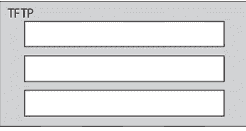


2. 将左侧的命令与右侧相应的描述连线。并非所有描述都会被用到。

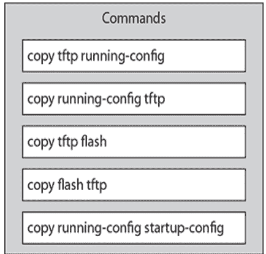

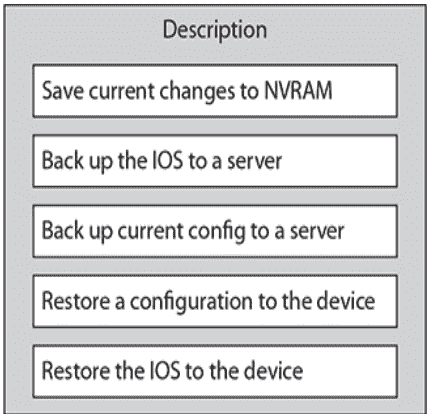

## 答案

- **1.** A 和 D。使用路由器命令 copy running-config startup-config 和 copy running-config tftp 来执行覆盖。复制到除 RAM（running-config）以外的任何位置都会导致覆盖。

- **2.** 使用 **erase startup-config** 命令删除 NVRAM 中的配置文件。

- **3.** **B 和 F。** **show startup-config** 命令显示 NVRAM 中保存的配置。如果该内存位置未存储配置，你会看到“%Non-volatile configuration memory is not present”消息。

- **4.** **A、C 和 D。** 当你使用 **copy flash tftp** 命令时，系统会提示你输入 TFTP 服务器的 IP 地址、flash 中 IOS 的源文件名，以及你希望在 TFTP 服务器上为 IOS 映像使用的名称。

- **5.** **C。** **show version** 命令将显示你的 IOS 设备当前运行的软件版本。

- **6.**

  ```
  line vty 0 4
    transport input ssh
    login local
  ```

- **7.** **crypto key generate rsa**

- **8.** **D。** CDP 可用于验证你与所连接设备之间是否具有第 2 层连通性。

- **9.** **D。** **traceroute** 命令测试第 3 层。

- **10.** **B。** 使用 CTRL-SHIFT-6、x 挂起 telnet 会话。

- **11.** **D。** 使用 **show version** 或 **show licenses** 命令显示 IOS 设备上已激活的许可证。

- **12.** **C。** **show cdp neighbor** 命令用于显示通过 CDP 检测到的相邻设备列表及其特征，例如用于连接到该设备的端口以及该设备的能力。

- **13.** **A。** **show cdp neighbor detail** 命令用于列出相邻设备的特征，包括设备的 IP 地址、平台、能力和 IOS 版本。

- **14.** **B。** LLDP 是一种行业标准发现协议，受到许多网络设备供应商支持（CDP 仅适用于 Cisco 设备）。要在你的 Cisco 设备上使用 LLDP 发现其他设备，必须先使用 **lldp run** 全局配置命令启用 LLDP。

## 实操题答案

- **1.** 下图显示了分别与 FTP 和 TFTP 正确对应的特征：

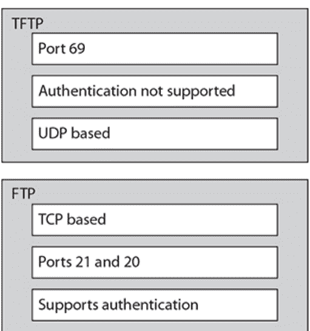

- **2.** 下图显示了 **copy** 命令与其设计用途描述的正确匹配。

| 命令 | 描述 |
|---|---|
| copy tftp running-config | 将当前更改保存到 NVRAM |
| copy running-config tftp | 将 IOS 备份到服务器 |
| copy tftp flash | 将当前配置备份到服务器 |
| copy flash tftp | 将配置恢复到设备 |
| copy running-config startup-config | 将 IOS 恢复到设备 |
