# 交换基础

在本章中，你将

- 了解交换机特性
- 熟悉交换机组件
- 学习如何在交换机上配置设置
- 理解接口配置设置
- 学习如何使用 VLAN

Cisco CCT 和 CCNA 认证考试期望你对交换机操作以及如何在 Cisco 交换机上配置基本设置有一个基本了解。在本章中，你将学习交换机的核心特性、交换机上的基本配置设置，以及如何在交换机接口上配置特性。

### 了解交换机特性

在第 1 章中，已经向你介绍了交换机。快速回顾一下，*交换机*是一种中心连接设备，所有系统都连接到它上面，以便彼此通信。在第 1 章中，你还了解到交换机已经取代了集线器，因为交换机提供了更高级的能力，例如能够通过只将数据发送到目标端口来过滤流量（而集线器总是将数据发送到所有端口）。交换机还支持其他特性，例如全双工通信，这意味着设备可以同时发送和接收；在集线器时代，通信设备只能半双工（设备可以发送和接收，但不能同时进行）。交换机还有一个优点，就是可以划分为多个虚拟局域网（VLAN）。你将在本章后面学习 VLAN。

打开交换机包装后，你会体会到它无需任何配置即可执行其职责，即充当网络中所有设备的连接点。交换机开箱即可执行该任务；只需为其供电，然后将系统连接到交换机，它就会根据需要将流量转发到每个已连接的设备。

与路由器不同，交换机默认不要求你应用配置设置。不过，你可以在交换机上配置许多特性，以调整交换机的运行方式，并使用默认情况下未配置的高级特性。

### 交换机功能

交换机是第 2 层设备——也就是说，它们工作在开放系统互连（OSI）模型的数据链路层。尽管交换机有许多能力，但它们确实具有核心功能：学习、转发和避免环路（稍后将进一步介绍这三项功能）。交换机的所有交换决策都基于所接收帧头中的目标介质访问控制（MAC）地址，并且所有处理都通过使用专用集成电路（ASIC）在硬件中执行。ASIC 是专为执行极少数特定任务而构建的专用处理器。由于它们只做少量事情，ASIC 比通用处理器（例如你 PC 中的处理器）更具成本效益。与大多数网络供应商一样，Cisco 在其交换产品中广泛使用 ASIC。

交换机具有以下三项主要功能：

- **地址学习/MAC 学习** 当一台计算机向另一台计算机发送帧并且该帧到达交换机时，交换机会将发送方 MAC 地址以及该系统所连接的端口记录在交换机的 MAC 表中。每当交换机收到帧时，它都会检查 MAC 表，以查看目标系统连接在哪个端口上。
- **过滤/转发** 交换机通过仅将帧转发到目标系统的端口来过滤流量——同样利用交换机记录在其 MAC 表中的信息。
- **环路避免** 交换机通过使用诸如生成树协议（STP）之类的环路防止协议来防止网络上的第 2 层环路。

### 地址学习/MAC 学习

交换机的三项功能之一是学习哪些设备连接到交换机的哪些端口。交换机利用此信息智能地转发帧。当交换机收到帧时，它会读取帧中的源 MAC 地址，并将其与本地 MAC 地址表（称为 *MAC 地址表*或*内容可寻址存储器*（CAM）表）进行比较。如果该地址尚未出现在此表中，交换机就会添加该地址以及接收该帧的端口号。例如，在图 9-1 中，你可以看到 MAC 地址为 bbbbb.bbbb.2222 的 ComputerB 正在发送数据。当交换机收到此数据时，它将记录地址 bbbbb.bbbb.2222 位于交换机上的端口 2。

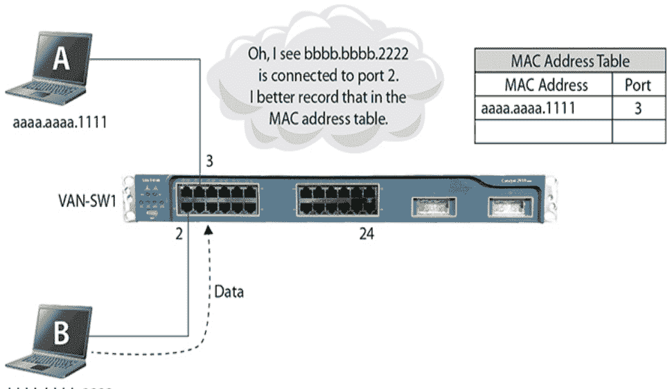

图 9-1 交换机通过发送系统学习 MAC 地址。

如果该地址已经在 CAM 表中，交换机会将传入端口与表中已有端口进行比较。如果两者不同，则

交换机使用新的端口信息更新 CAM 表。这很重要，因为您可能已将设备从一个端口移动到另一个端口，并且希望交换机确定新位置。如果端口未更改，交换机会重置该条目的老化计时器。由于此 MAC 地址表存储在交换机的内存中，并且基于流量动态生成（默认情况下），如果条目未被系统发送流量来更新，条目将在默认情况下经过 300 秒后老化。

CAM 表可以静态或动态构建。默认情况下，当您打开交换机时，CAM 表为空，除非您在其中配置了静态条目。当流量流过交换机时，交换机将开始根据帧的源 MAC 地址学习地址位置并构建其 CAM 表。这种动态构建过程是一个非常好的功能，因为使地址出现在 MAC 地址表中的另一种方法是使用静态地址手动构建它们。使用静态条目时，您必须手动将每个设备的 MAC 地址及其连接的端口添加到 CAM 表中。


**考试技巧** 对于思科 CCNA 考试，请记住，交换机通过分析帧的 *源 MAC 地址* 并将其与接收帧的端口一起放入 CAM 表中来学习设备连接的端口。

## 过滤和转发

交换机的第二个功能称为 *帧交换*，即过滤和转发，交换机以此智能转发流量。为此，交换机使用 MAC 地址表来帮助其查找目的地位置。当在端口上接收到帧时，交换机会检查帧头中的目的 MAC 地址，并在 MAC 地址表中查找相应条目。如果交换机找到匹配条目，它会从指定端口转发帧。如果端口与接收帧的端口相同（源和目的地连接到同一端口），交换机会丢弃帧。如果交换机在 MAC 地址表中找不到该条目，交换机会 *泛洪* 帧到所有剩余端口。


**考试技巧** 对于思科 CCNA 考试，请记住，如果交换机不知道发送帧的目标位置，它会将帧泛洪到交换机的所有端口；这称为 *帧泛洪*。但这不是广播消息。帧泛洪与广播之间的区别在于，泛洪帧在帧头中具有特定的目的 MAC 地址，而广播帧的目的 MAC 地址为 FF-FF-FF-FF-FF-FF。

## 环路避免

交换机的第三个功能是避免第 2 层环路。网络上的第 2 层环路可能会对网络造成严重问题，甚至导致网络瘫痪。我们希望在交换机之间建立多个链路，以便交换机之间有容错路径。第 2 层环路可能会引起许多问题，包括 MAC 地址表不稳定，这会让交换机感到困惑，并最终导致交换机不信任其 MAC 地址表并泛洪所有帧（本质上充当集线器）。有关环路如何引起混淆的示例，请参见图 9-2。在图中，ComputerA 正在向 ComputerB 发送数据（目的 MAC 地址 bbbb.bbbb.2222）。当数据离开 ComputerA 时，它会被发送到端口 3 上的 VAN-SW1 交换机。VAN-SW1 检查其 MAC 地址表中是否有目的 MAC 地址 bbbb.bbbb.2222，发现没有，因此它会将帧泛洪到所有端口。这会导致帧从端口 2 和 24 发向 VAN-SW2。当 VAN-SW2 接收到帧时，它会在 MAC 地址表中记录，发送方 ComputerA 可以通过 VAN-SW2 交换机的端口 1 和端口 23 到达。这就是第 2 层环路引起的问题之一：交换机会困惑于是否可以信任 MAC 地址表中的数据，因为同一系统似乎可以通过两个不同的端口到达。

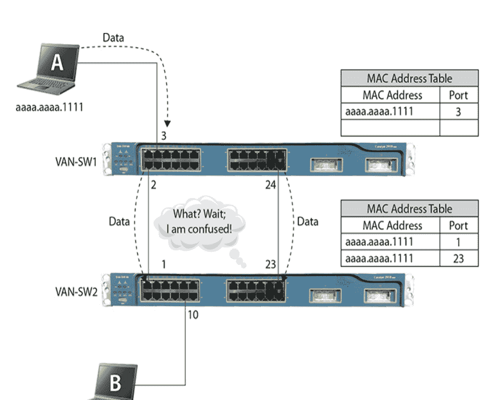

**MAC 地址表**

| MAC 地址 | 端口 |
|---|---|
| aaaa.aaaa.1111 | 3 |
|  |  |

**MAC 地址表**

| MAC 地址 | 端口 |
|---|---|
| aaaa.aaaa.1111 | 1 |
| aaaa.aaaa.1111 | 23 |

图 9-2 第 2 层环路会导致 MAC 地址表不稳定。

为纠正此问题，思科交换机使用 STP，这是一种环路预防协议，会将引起环路的某个端口置于阻塞状态。如果端口处于阻塞状态，它无法发送或接收任何数据，直到其重新置于转发状态。STP 会自动检测到另一链路故障，并将原先被阻塞的链路状态更改为转发。您将在第 10 章了解有关 STP 的更多信息。

## 练习 9-1：验证环路避免功能

在本练习中，您将使用冗余链路连接两台交换机。使用冗余链路连接后，您将目睹交换机将其中一条链路置于阻塞状态。下图表示此场景的网络图：

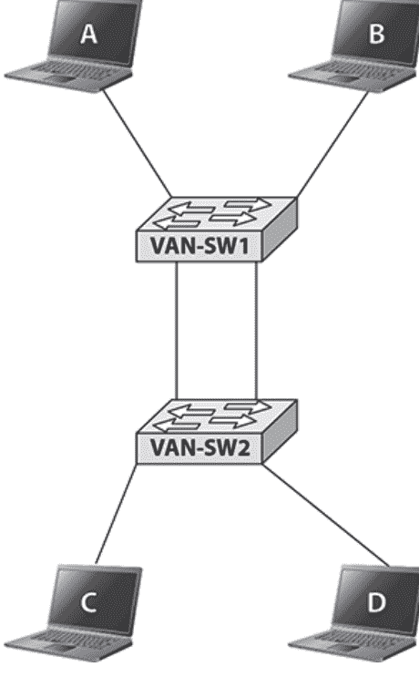

- 1. 使用交叉电缆将 VAN-SW1 的端口 1 连接到 VAN-SW2 的端口 1。
- 2. 为了在两台交换机之间创建容错链路，请使用交叉电缆将 VAN-SW1 的端口 24 连接到 VAN-SW2 的端口 24。
  - 这将创建容错链路，但也会在网络上创建一个环路。环路是不好的，因此您会注意到，过一分钟左右，一条链路会变为绿色，而另一条保持琥珀色，因为它被置于阻塞状态。
- 3. 一分钟后，通过在每个端口旁输入“是”或“否”值，注意哪个端口被置于阻塞状态（您可以根据琥珀色链路灯的位置来判断）：
VAN-SW1 – 端口 1: ________________
VAN-SW2 – 端口 1: ________________
VAN-SW1 – 端口 24: ________________
VAN-SW2 – 端口 24: ________________

- 4. 现在断开两端链路灯均为绿色的交叉电缆，以查看另一条链路是否变得完全活跃。等待 30 秒，查看两个链路灯是否都变为绿色。它们是吗？

您的答案应该是肯定的。这证明交换机正在自动防止网络上的第 2 层环路。

## 操作模式

所使用的交换方式会影响第 2 层设备接收、处理和转发帧的方式。网桥仅支持一种交换方式，即存储转发，而交换机可能支持一、两或三种不同的交换方式。第 2 层设备支持以下三种交换方式：

- 存储转发
- 直通交换
- 无碎片转发

## 存储转发交换

*存储转发*交换是最基本的交换形式。使用存储转发交换时，第 2 层设备必须将整个帧接收到入站端口的缓冲区中，并在交换机对帧执行任何其他处理之前检查帧是否存在错误（帧上的 FCS 校验和字段）。在检查 FCS（通常称为 *循环冗余校验*（CRC））时，交换机将计算一个 CRC 值，就像源设备所做的那样，并将该值与帧 FCS 中包含的值进行比较。如果两者相同，则帧被视为良好，交换机可以将帧从交换机的正确目标端口转发出去。如果帧中的 FCS 值与计算出的 CRC 值不同，交换机将丢弃帧。

存储转发的优点是交换机在转发帧之前可以检查帧是否存在错误。缺点是交换机读取整个帧的等待时间，这比其他方法的等待时间更长。

### 直通交换

直通交换机旨在提高交换机在处理帧方面的性能。使用直通交换时，交换机只需等待读取目的 MAC 地址即可开始转发帧。直通交换比存储转发交换更快。不过，它最大的问题是交换机可能会转发错误的帧——虽然标头可能可读，但帧的其余部分可能因晚期冲突而损坏。

### 无碎片转发

无碎片转发是切换直通交换的一种修改形式。切换直通交换在做出交换决策前会读取帧中直到目的 MAC 地址字段的内容，而无碎片转发会确保帧至少 64 字节长后再进行交换（64 字节是以太网帧的最小合法大小）。无碎片转发的目标是减少被交换的以太网残帧（小于 64 字节的帧）数量。无碎片转发有时也称为修改的直切或无残帧交换。使用无碎片转发时，交换机仍可能会转发损坏的帧，因为交换机只检查前 64 字节。


**考试技巧** 对于 CCNA 考试，请记住交换机操作模式的要点。存储转发交换读取整个帧，检查 FCS，然后转发帧。这会增加交换延迟，但减少了网络上的错误帧数量。直通交换在看到帧中的目的 MAC 地址后立即转发帧。无碎片转发将


交换机至少看到 64 字节后才开始转发帧，这样可以防止转发残帧。

## 识别交换机组件

在开始将任何电缆连接到 Cisco 交换机之前，您应该熟悉交换机上的不同 LED 及其含义，以及交换机上的不同端口和接口。

### 机箱和物理端口

每种交换机型号在现有接口类型方面都会略有不同。较旧的交换机可能只有快速以太网（FE）接口；有些可能主要是 FE，并带有千兆以太网（GE）接口作为上行链路端口；而当前的交换机至少会具备所有 GE 接口。

图 9-3 显示了一台交换机，其左侧包含显示状态 LED（将在下一节介绍）。显示状态 LED 的右侧是用于将设备连接到交换机的交换机（以太网）端口或接口。（在此示例中，交换机有 24 个端口，但其他交换机可能有 8 个端口、12 个端口、24 个端口或 48 个端口。）交换机端口的右侧是两个基于固定千兆位接口转换器（GBIC）的端口，用于插入 GBIC 模块作为上行链路端口。基于 GBIC 的端口的好处在于，它可以接受您想插入到该端口的任何类型的模块，例如用于连接 UTP 电缆的 RJ-45 端口，或者您可以插入支持使用光纤电缆的 GBIC 模块。

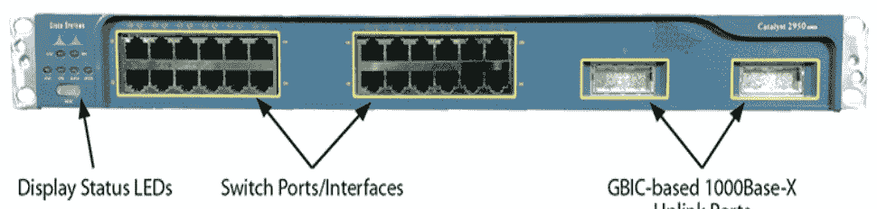

图 9-3 交换机正面的显示和端口

交换机背面会有连接电源线和控制台端口的位置，以便您可以管理设备。请注意，在某些交换机上，控制台端口位于交换机正面而不是背面。

### LED 和显示模式

许多 Cisco 交换机的正面都有显示模式 LED，您可以使用它们来监控交换机的活动和性能。图 9-4 展示了 Cisco 交换机上的 LED。

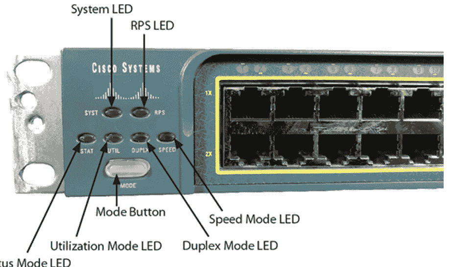

图 9-4 Cisco Catalyst 交换机上的 LED

如图所示，交换机左上角是 System 和 RPS（冗余电源）LED。当您打开交换机电源时，System 和 RPS LED 会亮起以指示以下内容：System LED 指示交换机的整体运行状况，而 RPS LED 指示 RPS 的状态。这些 LED 显示的颜色及其含义如表 9-1 所示。

表 9-1 Cisco 交换机上的 System 和 RPS LED

| LED | 颜色 | 描述 |
|---|---|---|
| System | 绿色 | 系统已通电并正常运行。 |
|  | 琥珀色 | 系统发生故障。 |
|  | 关闭 | 系统已断电。 |
| RPS | 绿色 | RPS 已连接并正常运行。 |
|  | 琥珀色 | RPS 已安装但未运行。请检查 RPS 以确保其没有发生故障。 |
|  | 闪烁琥珀色 | 内部电源和外部 RPS 均已安装，但由 RPS 供电。 |
|  | 关闭 | RPS 未安装。 |


**考试提示** 在准备 Cisco CCNA 考试时，请记住，如果 System LED 呈琥珀色，则交换机发生故障。

### 模式按钮

交换机正面每个端口上方的 LED 含义取决于显示模式设置。您可以通过按下 Mode 按钮（参见图 9-4）来更改显示模式。Mode 按钮正上方有四个端口模式 LED：STAT（状态模式）、UTIL（利用率模式）、DUPLX（双工模式）和 SPEED（速度模式）。默认情况下，STAT LED 亮起，表示以太网端口上方的 LED 指示端口的状态。以下内容概述了 STAT 模式下每种 LED 颜色的含义：

- **绿色** 端口连接的设备存在物理层连接。
- **闪烁绿色** 流量正在进入和/或离开端口。
- **琥珀色** 该端口已被管理员手动禁用（关闭）、因 STP 而处于阻塞状态，或因端口安全而被禁用。
- **关闭** 端口上不存在物理连接。

如果您按下 Mode 按钮，STAT 模式 LED 将关闭，UTIL LED 将亮起。这意味着每个端口上方的 LED 都在显示有关每个端口利用率的信息。

让我们看一个示例，展示端口上的所有 LED 如何协同工作，向您显示交换机上的带宽利用率。对于此型号的交换机，利用率模式下的 LED 工作方式如下：

- 如果所有端口都有绿色 LED，则带宽利用率高于 50%。
- 如果除最后一个端口外的所有端口均为绿色，则交换机的带宽利用率在 25% 到 49% 之间。
- 如果除最后两个端口外的所有端口均为绿色，则交换机的带宽利用率低于 25%。

如果您按一次 Mode 按钮，显示模式 LED 将从 STAT 更改为 DUPLX。切换到 DUPLX 模式后，每个端口上方的 LED 将反映相关端口的双工设置。以下内容概述了双工 LED：

- **关闭** 如果端口上方的 LED 关闭，则该端口设置为半双工。
- **绿色** 如果 LED 为绿色，则该端口设置为全双工。

再次按下 Mode 按钮，显示模式 LED 将从 DUPLX 更改为 SPEED。当显示模式设置为 SPEED 时，端口上方的 LED 指示端口运行的速度：

- **关闭** 如果 LED 关闭，则端口以 10 Mbps 运行。
- **绿色** 如果 LED 呈稳定绿色，则端口以 100 Mbps 运行。
- **闪烁绿色** 如果 LED 呈闪烁绿色，则端口以 1 Gbps 运行。

如果您再次按下 Mode 按钮，STAT LED 将亮起。如您所见，您可以使用 Mode 按钮循环切换不同的显示模式，以获取有关每个端口的信息。如果显示模式 LED 为 DUPLX 或 SPEED，它将在 1 分钟后自动更改回 STAT。


**提示** 如果您无法通过交换机进行连接，并且交换机端口 LED 全部关闭，请确保交换机已通电。将电缆连接器重新插入各自的端口。同时检查电缆，确保类型正确：直通线还是交叉线。

## 基本交换机配置

在本节中，您将学习如何在交换机上进行基本配置设置。您在 Cisco 路由器上学到的有关配置模式和密码的概念同样适用于交换机。本节将演示一些交换机独有的命令。

### 初始配置对话框

如果在交换机启动前尚未进行任何配置，互联网操作系统（IOS）将运行设置脚本，通常称为初始配置对话框。此脚本会向您提问，以帮助您创建交换机上的基本配置。提问时，设置脚本使用方括号（[ ]）表示默认值。将答案留空（即不提供答案）会导致脚本接受配置组件方括号中指示的值。在脚本中，您可以配置交换机的主机名、设置特权 EXEC 密码、为虚拟类型终端（VTY）分配密码，并为 VLAN 接口设置 IP 地址以远程管理交换机。


**注意** 如果交换机在非易失性 RAM（NVRAM）中没有配置的情况下启动，设置脚本或初始配置对话框将呈现给管理员。

以下是此脚本的示例，其中答案以粗体显示：

```
Would you like to enter the initial configuration dialog? [yes/no] : yes
At any point you may enter a question mark '?' for help.
Use ctrl-c to abort configuration dialog at any prompt.
Default settings are in square brackets '[]'.

Basic management setup configures only enough connectivity for management of the system, extended setup will ask you to configure each interface on the system

Would you like to enter basic management setup? [yes/no] : yes
Configuring global parameters:
Enter host name [Switch] :
The enable secret is a password used to protect access to privileged EXEC and configuration modes. This password, after entered, becomes encrypted in the configuration.
Enter enable secret: cisco
The enable password is used when you do not specify an enable secret password, with some older software versions, and some boot images.
Enter enable password: enable
The virtual terminal password is used to protect access to the router over a network interface.
Enter virtual terminal password: remotepass
Configure SNMP Network Management? [no] :

Current interface summary
Interface IP-Address OK? Method Status Protocol
Vlan1 unassigned YES unset up down
FastEthernet0/1 unassigned YES unset down down
FastEthernet0/2 unassigned YES unset down down
.
.
.
GigabitEthernet0/1 unassigned YES unset down down
GigabitEthernet0/2 unassigned YES unset down down

Enter interface name used to connect to the management network from the above interface summary: vlan1

Configuring interface Vlan1:
Configure IP on this interface? [no] : yes
IP address for this interface: 12.0.0.2
Subnet mask for this interface [255.0.0.0] :
Class A network is 12.0.0.0, 8 subnet bits; mask is /8
Would you like to enable as a cluster command switch? [yes/no] : no
The following configuration command script was created:
```


```text
hostname Switch
enable secret 5 $1$.N.L$t4q9Jw5DTffPTPE.KkKNX/
enable password enable
line vty 0 15
  password remotepass
no snmp-server

interface Vlan1
  no shutdown
  ip address 12.0.0.2 255.0.0.0
!
interface FastEthernet0/1
  .
  .
  .
interface GigabitEthernet0/1
!
interface GigabitEthernet0/2
end
[0] Go to IOS command prompt without saving this config.
[1] Return back to the setup without saving this config.
[2] Save this configuration to nvram and exit.
Enter your selection [2]: 2
```

在脚本末尾，输入 2 以接受并激活您的更改，并将配置保存到 NVRAM。（输入 0 中止脚本，输入 1 重新开始脚本，并将您刚刚输入的内容作为刚才被问到的问题的默认值。）


**提示** 此脚本的一个问题是，一旦您回答了问题——无论正确或错误——都无法回到该问题。要中止脚本，请按 CTRL-C 并重新开始。要在不重启交换机的情况下从命令行界面 (CLI) 运行脚本，请进入特权 EXEC 模式并执行 **setup** 命令。

## 基本设置

您可以随时使用 IOS 命令更改 Cisco 交换机的配置设置。在本节中，您将学习如何更改设备名称，并在交换机上设置 IP 地址和默认网关。

### 为设备命名

我通常对交换机进行的第一个配置更改是修改主机名。如果更改主机名，CLI 中的提示符将更改为主机名，从而方便您知道正在配置哪个设备。使用 hostname 全局配置命令修改设备的名称，如下所示：

```text
Switch>enable
Switch#config term
Enter configuration commands, one per line.  End with CNTL/Z.
Switch(config)#hostname VAN-SW1
VAN-SW1(config)#
```

### 分配 IP 地址

更改主机名后，您可能希望为交换机分配 IP 地址。请注意，交换机是第 2 层设备，不需要 IP 地址即可在网络上执行学习和转发帧的工作。但是，通过为交换机分配 IP 地址，您可以使用 HTTP、telnet 或 SSH 远程连接到交换机。您可以远程管理它，而不必依赖通过本地控制台端口连接。

交换机与路由器的工作方式略有不同，即您不会向交换机的端口分配 IP 地址。连接到端口的设备（例如计算机或 IP 电话）会被分配 IP 地址。要为交换机分配 IP 地址，您首先需要导航到特殊的 VLAN 接口，然后将 IP 地址分配给交换机的 VLAN，如下所示：

```text
VAN-SW1>enable
VAN-SW1#config term
Enter configuration commands, one per line.  End with CNTL/Z.
VAN-SW1(config)#interface vlan1
VAN-SW1(config-if)#ip address 12.0.0.2 255.0.0.0
VAN-SW1(config-if)#no shutdown
%LINK-5-CHANGED: Interface Vlan1, changed state to up
%LINEPROTO-5-UPDOWN: Line protocol on Interface Vlan1, changed state to up
VAN-SW1(config-if)#
```

请注意，在此代码示例中，从全局配置模式，您使用 **interface** 命令导航到 vlan1（默认 VLAN）。到达接口提示符后，您使用 **ip address** 命令为交换机分配 IP 地址和子网掩码。然后必须通过使用 **no shutdown** 命令启用接口。您将在下一章中了解有关 VLAN 的更多信息。

### 设置默认网关

分配 IP 地址和子网掩码后，只要您与交换机在同一网络上，就可以远程管理交换机。如果您想从不同网络管理交换机，则必须配置默认网关，以便交换机知道如何将数据发送到网络外部。要在交换机上配置默认网关，请使用以下命令：

```text
VAN-SW1>enable
VAN-SW1#config term
Enter configuration commands, one per line.  End with CNTL/Z.
VAN-SW1(config)#ip default-gateway 12.0.0.1
```

请注意，我们进入全局配置模式，然后使用 **ip default-gateway** 命令设置默认网关。

### 练习 9-2：配置交换机

在本练习中，您将对分别位于温哥华办事处和洛杉矶办事处的 VAN-SW1 和 LA-SW1 应用基本配置设置。本练习及其余练习的网络图显示在下一幅插图中。请注意，这是一个基本网络拓扑，包含三个网络——我们用于大多数练习的 12.0.0.0、13.0.0.0 和 14.0.0.0 网络。由于我们使用的是公共 IP 地址，最好确保实验环境未连接到任何生产网络并且是隔离的。

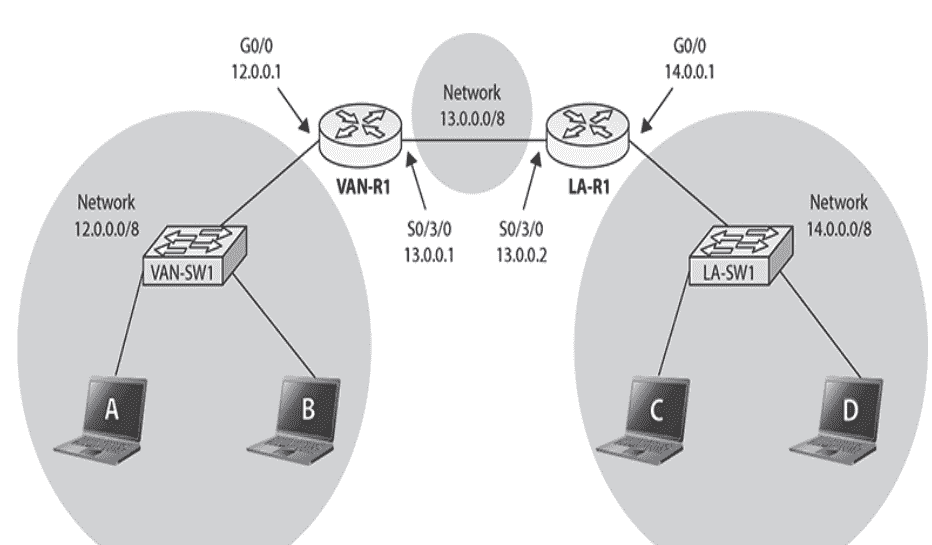

请注意，ComputerA 连接到 VAN-SW1 的端口 5，而 ComputerB 连接到 VAN-SW1 的端口 15。ComputerC 连接到 LA-SW1 的端口 5，而 ComputerD 连接到 LA-SW1 的端口 15。

- 1. 确保所有路由器和交换机都已启动。

#### 配置 VAN-SW1

- 2. 使用 PuTTY 连接到 VAN-SW1 的控制台端口。
- 3. 使用以下命令更改交换机的名称：

```text
Switch>enable
Switch#config term
Enter configuration commands, one per line. End with CNTL/Z.
Switch(config)#hostname VAN-SW1
VAN-SW1(config)#
```

- 4. 使用以下命令为交换机分配 IP 地址：

```text
VAN-SW1(config)#interface vlan1
VAN-SW1(config-if)#ip address 12.0.0.2 255.0.0.0
VAN-SW1(config-if)#no shutdown
```

- 5. 使用以下命令为交换机分配默认网关设置：

```text
VAN-SW1(config-if)#exit
VAN-SW1(config)#ip default-gateway 12.0.0.1
```

- 6. 通过查看 VLAN1 接口上的状态来验证 IP 地址是否已配置：

```text
VAN-SW1(config)#exit
%SYS-5-CONFIG_I: Configured from console by console
VAN-SW1#show interface vlan1
Vlan1 is up, line protocol is up
  Hardware is CPU Interface, address is 00d0.ff58.9cde (bia 00d0.ff58.9cde)
  Internet address is 12.0.0.2/8
  MTU 1500 bytes, BW 100000 Kbit, DLY 1000000 usec,
  reliability 255/255, txload 1/255, rxload 1/255
  Encapsulation ARPA, loopback not set
(output cut for briefness)
VAN-SW1#
```

#### 配置 LA-SW1

使用您为 VAN-SW1 输入的命令作为指南，按照以下步骤配置 LA-SW1 交换机：

- 7. 连接到 LA-SW1 上的控制台端口，并在 PuTTY 中按 ENTER 刷新提示符。
- 8. 将交换机名称更改为 LA-SW1。
- 9. 将 IP 地址 14.0.0.2 分配给交换机。
- 10. 将默认网关设置 14.0.0.1 分配给交换机。
- 11. 通过查看 VLAN1 接口上的状态来验证 IP 地址是否已配置。

## MAC 地址表

您可能还记得，交换机的三个主要功能之一是学习哪些设备（即 MAC 地址）与交换机上的哪个接口或端口相关联。您还了解到，此信息存储在 MAC 地址表（或 CAM 表）中。在较新的交换机上，您可以使用 **show mac address-table** 命令查看 MAC 地址表：

```text
VAN-SW1>enable
VAN-SW1#show mac address-table
```

MAC 地址表：

| VLAN | MAC 地址 | 类型 | 端口 |
|------|----------|------|------|
| 1 | 0050.0fdd.d03a | DYNAMIC | Gig1/0/1 |
| 1 | 0090.0c9e.76a8 | DYNAMIC | Gig1/0/5 |

在此示例中，您可以看到 CAM 表中存储了两个 MAC 地址：一个与 Fa0/1 关联，另一个与 Fa0/5 关联。请记住，这些条目是根据交换机通过这些端口接收流量自动创建的。


**考试提示** 有些考试题目要求您熟悉 **show mac address-table** 命令的输出。还要记住，如果目标 MAC 地址不在表中（未知），交换机会将帧泛洪到交换机上的所有端口。

要从 CAM 表中清除动态学习的条目，请从特权 EXEC 模式使用 **clear mac address-table** 命令。


注意：在较旧的 Cisco 交换机上，例如 2960，请使用 **show mac-address-table** 和 **clear mac-address-table** 命令。

## 静态 MAC 地址

除了让交换机动态学习 MAC 地址外，您还可以手动创建静态条目。静态条目的优点在于它们属于交换机配置的一部分，因此即使交换机重新启动，这些条目也会保留（而动态条目在重新启动后会丢失，需要重新学习）。

要在 MAC 地址表中添加静态条目，请使用以下语法：

```
Switch(config)# mac address-table static MAC_address
                vlan VLAN_#
                interface type module/port_#
```

例如，您可以使用以下命令为端口 8 添加静态条目：

```
Switch(config)# mac address-table static 0000.1111.2222 vlan 1 int g1/0/8
```

除了指定设备的 MAC 地址和设备所在的接口外，还必须指定设备所在的 VLAN（有关 VLAN 的更多信息，请参见第 10 章）。使用 **show mac-address-table** 命令查看新条目。要从 CAM 表中移除静态条目，请在命令前加上 **no** 参数：**no show mac-address-table**。


注意：在交换机上静态配置 MAC 地址当前并不常见。如果已配置，静态条目通常用于网络设备，例如服务器和路由器。如果您担心控制哪些设备连接到交换机的特定端口，请使用端口安全功能。

## 练习 9-3：使用 MAC 地址表

在本练习中，您将查看 Cisco 交换机上的 MAC 地址表（也称为 CAM 表），并向 MAC 地址表添加静态 MAC 地址。

1. 连接到 VAN-SW1 的控制台端口，并在 PuTTY 中按 ENTER 刷新提示符。
2. 要查看包含交换机已学习的所有地址列表的 MAC 地址表，请输入以下命令：

```
VAN-SW1>enable
VAN-SW1#show mac address-table
```

   请注意，交换机端口 1 上仅学习了一个地址（即连接到路由器的端口）。要验证交换机是否会动态学习 MAC 地址，请从 ComputerA 对路由器执行 ping 操作，然后再次检查 MAC 地址表。

3. 打开 ComputerA 上的命令提示符，并输入 **ping 12.0.0.1** 对路由器执行 ping 操作。您应该会收到响应。
4. 返回 VAN-SW1 交换机的控制台窗口。
5. 再次执行 **show mac address-table** 命令。注意连接到交换机端口 5 的设备的 MAC 地址。还请注意，这两个条目都是动态条目，因为它们是基于网络流量学习的。
6. 要创建静态条目并将其与端口 3 关联，请输入以下命令：

```
VAN-SW1#config term
VAN-SW1(config)# mac address-table static 0000.1111.2222 vlan 1 int g1/0/3
```

7. 查看 MAC 地址表，验证静态地址是否已添加。

## 接口配置

现在我们已经介绍了交换机的基本配置设置，接下来将介绍如何配置交换机上的端口。在以下部分中，您将学习如何在端口上配置基本设置，然后学习如何使用端口安全功能限制哪些系统可以连接到端口。

### 配置端口

您将使用几个常用命令来配置交换机上的端口。在这里，您将学习添加端口描述、配置交换机速率、配置双工设置、启用和禁用端口以及验证端口设置的命令。

### 添加端口描述

有时，您可能希望向端口添加描述，以指明端口的用途。例如，如果 Web 服务器连接到某个端口，您可能希望添加“Web Server”描述标签。以下代码示例将端口标记为“UpLink Port”，因为它连接到另一台交换机：

```
VAN-SW1>enable
VAN-SW1#config term
Enter configuration commands, one per line.  End with CNTL/Z.
VAN-SW1(config)#interface GigabitEthernet1/0/1
VAN-SW1(config-if)#description UpLink Port
```

向端口添加描述后，使用 **show interface g1/0/1** 命令查看接口状态时，您将看到该标签。

### 配置交换机速率

当今大多数交换机的端口都支持 10 Mbps（以太网）、100 Mbps（快速以太网）和 1000 Mbps（千兆以太网）。交换机会检测连接到它的设备的速率，并以该速率运行端口。例如，如果您连接一台支持 100 Mbps 的网络接口卡（NIC）的计算机，交换机会检测到这一点并将端口配置为 100 Mbps。这个 *自动检测功能* 设置了端口的速率。要手动配置端口速率，可以使用接口全局配置命令导航到该端口：

```
VAN-SW1>enable
VAN-SW1#config term
Enter configuration commands, one per line. End with CNTL/Z.
VAN-SW1(config)#interface g1/0/1
```

如果您不确定接口支持哪些速率，可以在 **speed** 命令上使用帮助功能，如下所示：

```
VAN-SW1(config-if)#speed ?
  10    Force 10 Mbps operation
  100   Force 100 Mbps operation
  1000  Force 1000 Mbps operation
  auto  Enable AUTO speed configuration
```

请注意，支持 10/100/1000 速率，如果您希望交换机自动检测速率（默认值），可以将速率设置为 auto。因此，要将端口配置为以 1000 Mbps 运行，请使用以下命令：

```
VAN-SW1(config-if)#speed 1000
```

要一次性在多个端口上配置这些设置，请使用 **interface range** 命令选择多个端口，然后更改设置。在本示例中，我设置了所有 24 个千兆端口的速率：

```
VAN-SW1(config)#interface range g1/0/1 - 24
VAN-SW1(config-if-range)#speed 1000
```

### 配置双工设置

您可以使用接口上的 **duplex** 命令配置端口的双工设置。此设置也具有自动检测功能，可检测连接设备的双工设置，并将端口的双工设置设置为匹配。请注意，您可以将双工设置设置为 **全双工** 以在端口上同时发送和接收数据，或将其设置为 **半双工** 以发送和接收数据，但不能同时进行：

```
VAN-SW1>enable
VAN-SW1#config term
Enter configuration commands, one per line. End with CNTL/Z.
VAN-SW1(config)#interface g1/0/1
VAN-SW1(config-if)#duplex ?
  auto  Enable AUTO duplex configuration
  full  Force full duplex operation
  half  Force half-duplex operation
VAN-SW1(config-if)#duplex full
```

### 启用和禁用端口

您会不时想要在交换机上禁用或启用端口。例如，您可能出于安全原因决定禁用端口，以便在启用它之前没有人可以使用该端口。本节将向您展示如何在交换机上禁用和启用端口。

### 禁用接口

要禁用端口，请导航到要禁用的端口的接口，然后使用 **shutdown** 命令。执行此命令后，您将收到反馈，指示端口的状态已更改为“administratively down”。这意味着管理员已禁用该端口；当端口显示状态为“down”时，表示端口因配置或协议错误而无法工作。以下是示例：

```
VAN-SW1>enable
VAN-SW1#config term
```

同样，请不要忘记，您可以使用 **interface range** 命令一次配置多个端口。在本示例中，我要禁用交换机上的千兆端口 1 和 2，因此可以先使用 **interface range** 命令选择它们，然后使用 **shutdown** 命令：

```
VAN-SW1(config-if)#interface range g1/0/1 - 2
VAN-SW1(config-if-range)#shutdown
%LINK-5-CHANGED: Interface GigabitEthernet1/0/1, changed state to administratively down
%LINK-5-CHANGED: Interface GigabitEthernet1/0/2, changed state to administratively down
```

### 启用接口

如果端口已被禁用（administratively down），可以使用 **no shutdown** 命令将其启用。请记住，在 Cisco 交换机上，通常通过在命令前放置 **no** 单词来撤销某项设置：

```
VAN-SW1(config-if)#interface g1/0/1
VAN-SW1(config-if)#no shutdown
```

同样，要启用多个接口，可以使用 **interface range** 命令选择接口，然后使用 **no shutdown** 命令：

```
VAN-SW1(config-if)#interface range g1/0/1 - 2
VAN-SW1(config-if-range)#no shutdown
%LINK-5-CHANGED: Interface GigabitEthernet1/0/1, changed state to up
%LINK-5-CHANGED: Interface GigabitEthernet1/0/2, changed state to up
```

### 验证端口设置

在接口上配置所需设置后，必须验证设置是否正确。在排查通信问题时，通常希望使用 **show interfaces** 命令检查接口状态，然后指定要检查的接口（否则，您将获得所有接口及其设置的列表）。以下是示例：


```
VAN-SW2#show interfaces g1/0/1
GigabitEthernet1/0/1 is administratively down, line protocol is down (disabled)
  Hardware is Lance, address is 0002.1653.0701 (bia 0002.1653.0701)
  Description: UpLink Port
  MTU 1500 bytes, BW 1000000 Kbit, DLY 1000 usec,
    reliability 255/255, txload 1/255, rxload 1/255
  Encapsulation ARPA, loopback not set
  Keepalive set (10 sec)
  Full-duplex, 1000Mb/s
(output cut for briefness)
```

在此代码中，请注意该接口处于 administratively down 状态，即您已将其禁用。请注意描述信息、全双工以及已配置 1000 Mbps。同时请注意 Encapsulation ARPA——这是正在使用的第 2 层协议。在此示例中，这意味着 Ethernet 是第 2 层协议。

## 练习 9-4：在交换机上配置接口

在本练习中，您将通过更改描述、速度和双工设置来练习在交换机上配置接口。

- 1. 确保实验环境中所有路由器和交换机都已启动。
- 2. 使用 PuTTY 连接到 VAN-SW1 的控制台端口。
- 3. 导航到交换机上的端口 8：
  ```
  VAN-SW1>enable
  VAN-SW1#config term
  Enter configuration commands, one per line. End with CNTL/Z.
  VAN-SW1(config)#interface g1/0/8
  VAN-SW1(config-if)#
  ```
- 4. 若要查看受支持速度列表，请键入 speed ? 命令并按 ENTER。
- 5. 通过输入 speed 100 将接口速度设置为 100 Mbps。然后按 ENTER。
- 6. 若要将此端口的描述设置为“Web Server”，请键入 description Web Server 然后按 ENTER。
- 7. 若要禁用端口，请输入 **shutdown** 并按 ENTER。
- 8. 输入以下命令以查看端口 8 的状态：
  ```
  VAN-SW1(config-if)#exit
  VAN-SW1(config)#exit
  VAN-SW1#show interface g1/0/8
  GigabitEthernet1/0/8 is administratively down, line protocol is down (disabled)
    Hardware is Lance, address is 00d0.ba2a.9508 (bia 00d0.ba2a.9508)
    Description: Web Server
    MTU 1500 bytes, BW 100000 Kbit, DLY 1000 usec,
    reliability 255/255, txload 1/255, rxload 1/255
    Encapsulation ARPA, loopback not set
    Keepalive set (10 sec)
    Half-duplex, 100Mb/s
  (output cut for briefness)
  ```
请注意，该接口处于 administratively down 状态，已分配有描述，速度为 100 Mbps，且为半双工。

- 9. 导航回该接口并将其速度设置为 1000。
- 10. 使用 **no shutdown** 命令启用接口。

## 理解端口安全

*端口安全* 是交换机的一项功能，可让您根据与接口关联的 MAC 地址或地址锁定交换机端口；这可防止未经授权访问 LAN。例如，您可以为端口 g0/5 的 MAC 地址 aaaa.aaaa.1111 配置端口安全，指定具有该 MAC 地址的系统是该端口的唯一授权设备。如果有其他系统连接到该端口，将导致安全违规。作为管理员，您可以控制发生违规时应采取的措施，无论是生成有关该问题的通知，丢弃导致违规的 MAC 地址的流量，还是完全禁用发生违规的端口。

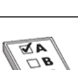

**考试提示** 请记住，对于 CCNA 考试，端口安全是一项可用于锁定交换机端口、防止未经授权访问您 LAN 的功能。

端口安全功能不适用于中继端口、交换机端口分析器（SPAN）端口和 EtherChannel 端口。但是，它与 802.1X 和语音 VLAN 兼容。您将在 [第 10 章](Chapter 10) 中了解更多有关这些主题的信息。

### 端口安全配置

端口安全功能是每个接口使用多条 **switchport** 命令进行配置的。以下 **switchport** 命令用于在接口上配置端口安全：

```
switch(config)# interface fastethernet|gigabit 0/port_#
switch(config-if)# switchport mode access
switch(config-if)# switchport port-security
switch(config-if)# switchport port-security maximum value
switch(config-if)# switchport port-security violation
                protect|restrict|shutdown
switch(config-if)# switchport port-security mac-address MAC_address
```


**考试提示** 对于考试，请熟悉使用 **switchport port-security** 命令配置端口安全（启用它、限制 MAC 地址、设置违规模式）。您将在 CCNA 考试中回答有关端口安全的问题。

让我们回顾一下命令。首先，您必须进入要在其中设置端口安全的相应接口。第二条命令，**switchport mode access**，将接口置于访问模式，该模式由主机使用，而不是用作中继端口。（中继在 [第 10 章](Chapter 10) 中解释。）接口上的第三条命令，**switchport port-security**，启用端口安全（默认情况下处于禁用状态）。第四条命令，**switchport port-security maximum**，指定可以与接口关联的设备最大数量。默认值为 1，范围可从 1 到 132。


**提示** 配置端口安全时，请将接口的 maximum 参数设置为 1 个地址，以便只有一个 MAC 地址与端口关联。结果是，当有其他系统连接到端口时，不会学习任何其他地址。

接口上的第五条命令指定发生安全违规（即有其他 MAC 地址连接到端口）时应采取什么措施。有三种可能的选项：

- **保护命令** 当有未授权设备连接到端口时，此命令会向管理员发送警报。
- **限制命令** **限制** 设置会导致端口仅能转发授权设备的帧。如果未授权设备连接到端口，交换机将丢弃这些帧。
- **停用命令** 使用此命令，一旦未授权设备连接到端口，端口将立即被禁用。端口将保持禁用状态，直到管理员发出 **no shutdown** 命令。如果您未指定模式，这是默认违规模式。

最后一条命令允许您指定允许与该接口关联的确切 MAC 地址——这相当于静态定义允许通过端口的 MAC 地址。以下是在端口 4 上配置端口安全的完整代码示例：

```
switch(config)# interface g1/0/4
switch(config-if)# switchport mode access
switch(config-if)# switchport port-security
switch(config-if)# switchport port-security maximum 1
switch(config-if)# switchport port-security violation shutdown
switch(config-if)# switchport port-security mac-address cccc.cccc.3333
```

### 粘性学习

端口安全是一项非常出色的功能，在网络中非常常见，用于防止未经授权的设备连接到交换机上的启用端口。然而，问题在于它的设置会造成巨大的管理负担，因为您必须在每个端口上指定授权设备的 MAC 地址。有一种方法可以减少管理负担：使用 **sticky** 选项而非 MAC 地址。当您使用 **sticky** 选项时，交换机将动态学习已连接到端口的系统的 MAC 地址，然后使用该 MAC 地址配置端口安全功能。当您使用 **interface range** 命令一次性为多个端口配置端口安全时，这非常有用。以下示例展示了如何使用 **sticky** 选项：

```
switch(config)# interface gigabitethernet0/4
switch(config-if)# switchport mode access
switch(config-if)# switchport port-security
switch(config-if)# switchport port-security maximum 1
switch(config-if)# switchport port-security violation shutdown
switch(config-if)# switchport port-security mac-address sticky
```


**考试提示** 对于考试，请确保您熟悉如何将 **sticky** 选项与端口安全一起使用。

### 端口安全验证

要查看您在哪些端口上配置了端口安全，以及查看安全操作和违规计数，请按如下所示使用 **show port-security** 命令：


```
Switch#show port-security
```

| 安全端口 | 最大安全地址数（计数） | 当前地址数（计数） | 安全违规数（计数） | 安全操作 |
|---|---|---|---|---|
| Gig1/0/4 | 1 | 1 | 0 | Shutdown |

```
Switch#
```

要查看通过端口安全静态定义或动态学习到的 MAC 地址，请使用 **show port-security address** 命令：

```
Switch#show port-security address
                Secure Mac Address Table
```

| VLAN | MAC 地址 | 类型 | 端口 | 剩余老化时间（分钟） |
|---|---|---|---|---|
| 1 | CCCC.CCCC.3333 | SecureConfigured | GigabitEthernet1/0/4 | - |

```
Total Addresses in System (excluding one mac per port)     : 0
Max Addresses limit in System (excluding one mac per port) : 1024
Switch#
```

在此示例中，请注意端口 G1/0/4 关联了一个 MAC 地址。

如果你想查看特定端口上更详细的端口安全信息，请使用 **show port-security interface** 命令，如下所示：

```
Switch#show port-security interface g1/0/4
Port Security               : Enabled
Port Status                 : Secure-down
Violation Mode              : Shutdown
Aging Time                  : 0 mins
Aging Type                  : Absolute
SecureStatic Address Aging  : Disabled
Maximum MAC Addresses       : 1
Total MAC Addresses         : 1
Configured MAC Addresses    : 1
Sticky MAC Addresses        : 0
Last Source Address:Vlan    : 0000.0000.0000:0
Security Violation Count    : 0
```

在此示例中，你可以看到端口安全已启用，违规模式为关闭（shutdown），可以连接到该端口的 MAC 地址最大数量为 1，并且必须为该端口静态配置一个 MAC 地址。在输出底部，请注意该端口未发生任何安全违规。


**考试提示** 熟悉 **show port-security interface** 命令，以便应对考试。请记住，如果端口安全值设置为 **Disabled**，则必须在接口上执行 **switchport port-security** 命令来启用它。此外，你还需要能够确定已配置（允许）的 MAC 地址数量。

## 练习 9-5：在 Cisco 交换机上配置端口安全

在本练习中，你将练习在 Cisco 交换机上配置端口安全，然后验证端口安全是否正常工作。

- 1. 确保所有路由器和交换机都已运行。
- 2. 在 ComputerA 上打开命令提示符。
- 3. 要验证 ComputerA 可以在网络上通信，请键入 **ping 12.0.0.1** 并按回车。
  - 你应该会收到四个 ping 回复，这证明 ComputerA 可以在网络上通信。
  - 接下来，你将在交换机的端口 5 上配置端口安全，使用一个虚假的 MAC 地址，该地址不是 ComputerA 的 MAC 地址。这将导致端口 5 关闭，不再允许 ComputerA 在网络上通信。
- 4. 使用 PuTTY 连接到 VAN-SW1 的控制台端口。
- 5. 导航到交换机上的端口 5：

  ```
  VAN-SW1>enable
  VAN-SW1#config term
  Enter configuration commands, one per line. End with CNTL/Z.
  VAN-SW1(config)#interface g1/0/5
  VAN-SW1(config-if)#
  ```

- 6. 要将端口置于访问模式，然后在端口 5 上启用端口安全功能，请使用以下命令：

  ```
  switch(config-if)# switchport mode access
  switch(config-if)# switchport port-security
  ```

- 7. 要指定最多只能有一个 MAC 地址与该端口关联，请使用以下命令：

  ```
  switch(config-if)# switchport port-security maximum 1
  ```

- 8. 如果未授权设备尝试使用该端口，则关闭端口，直到管理员重新启用它，请输入以下命令：

  ```
  switch(config-if)# switchport port-security violation shutdown
  ```

- 9. 要指定授权连接到该端口的设备的 MAC 地址，请键入以下命令：

  ```
  switch(config-if)# switchport port-security mac-address cccc.cccc.3333
  ```

- 10. 切换回 ComputerA 上的命令提示符，并尝试 ping 12.0.0.1。

  请注意，你无法再 ping 通。这是因为该端口已配置为仅允许 MAC 地址为 cccc.cccc.3333 的设备使用该端口。端口现在应已禁用，在管理员重新启用之前无法使用。

- 11. 切换回 VAN-SW1 交换机，键入以下命令：

  ```
  VAN-SW1#show port-security
  ```

  请注意，端口 5 有一个安全违规，安全操作为关闭。

  | 安全端口 | 最大安全地址数（计数） | 当前地址数（计数） | 安全违规数（计数） | 安全操作 |
  |---|---|---|---|---|
  | Gig1/0/5 | 1 | 1 | 1 | Shutdown |

- 12. 要查看该端口的端口安全详细信息，请键入以下内容：

  ```
  VAN-SW1#show port-security interface g1/0/5
  Port Security              : Enabled
  Port Status                : Secure-shutdown
  Violation Mode             : Shutdown
  Aging Time                 : 0 mins
  Aging Type                 : Absolute
  SecureStatic Address Aging : Disabled
  Maximum MAC Addresses      : 1
  Total MAC Addresses        : 1
  Configured MAC Addresses   : 1
  Sticky MAC Addresses       : 0
  Last Source Address:Vlan   : 0030.F2E8.4203:1
  Security Violation Count   : 1
  ```

  请注意，端口状态为 Secure-shutdown，表示端口因安全违规而被关闭。

- 13. 使用 show interfaces g1/0/5 命令查看该端口的接口统计信息。注意第一行中的 err-disabled，表明该端口因错误而被禁用。
- 14. 要重新启用该端口，请使用以下命令：

  ```
  VAN-SW1#config term
  VAN-SW1(config)#interface g1/0/5
  VAN-SW1(config-if)#shutdown
  %LINK-5-CHANGED: Interface GigabitEthernet1/0/5, changed state to administratively down
  VAN-SW1(config-if)#no shutdown
  %LINK-5-CHANGED: Interface GigabitEthernet1/0/5, changed state to up
  ```

- 15. 使用 show interface g1/0/5 命令查看接口是否已启动。请注意，你无法从 ComputerA 使用该端口，因为端口安全仍然配置着，所以该端口将再次被禁用。

## 使用 VLAN

虚拟局域网（VLAN）是同一广播域中网络设备的逻辑分组，可以跨越多个交换机。图 9-5 的上半部分显示了一个简单 VLAN 的示例，其中每个设备都处于相同的冲突域和广播域中。在此示例中，集线器提供连接，对于连接到它的设备而言，该网段是一个逻辑网段。

图 9-5 的下半部分显示了一个连接了四台 PC 的交换机示例。交换机与集线器的一个主要区别是，连接到集线器的所有设备位于同一冲突域中，而在交换机示例中，交换机的每个端口都是一个独立的冲突域。默认情况下，交换机上的所有端口都处于同一广播域中。但在本示例中，交换机的配置将 PC-E 和 PC-F 置于一个广播域（VLAN）中，将 PC-G 和 PC-H 置于另一个广播域中。

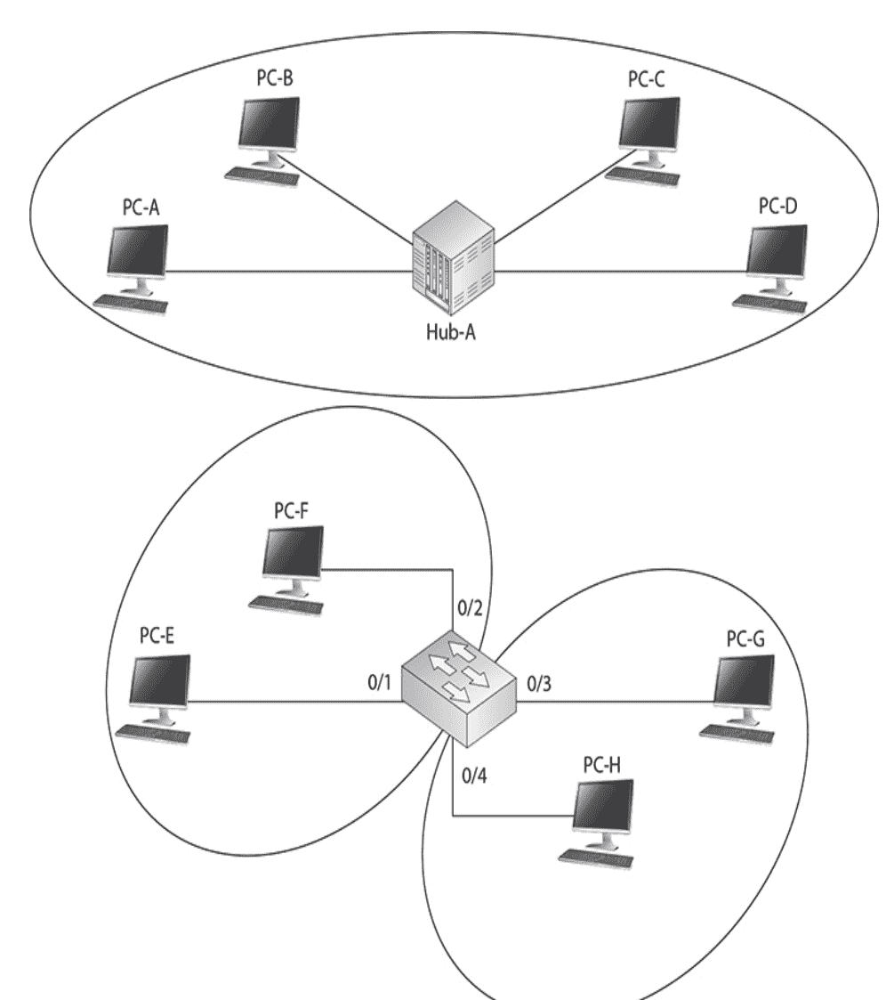

**图 9-5 VLAN 示例**

交换机用于创建 VLAN，即独立的广播域。假设所有设备都通过交换机互连，并且没有中间的第 3 层设备，则 VLAN 不受交换网络中任何物理边界的限制。例如，一个 VLAN 可以分布在多个交换机上，也可以包含在同一台交换机中，如图 9-6 所示。此示例显示了三个 VLAN。请注意，VLAN 不局限于任何物理位置：PC-A、PC-B、PC-E 和 PC-F 位于同一 VLAN 中，但连接到不同交换机的不同端口。不过，VLAN 也可以只包含在一台交换机中，例如 PC-C 和 PC-D 连接到 SwitchA。

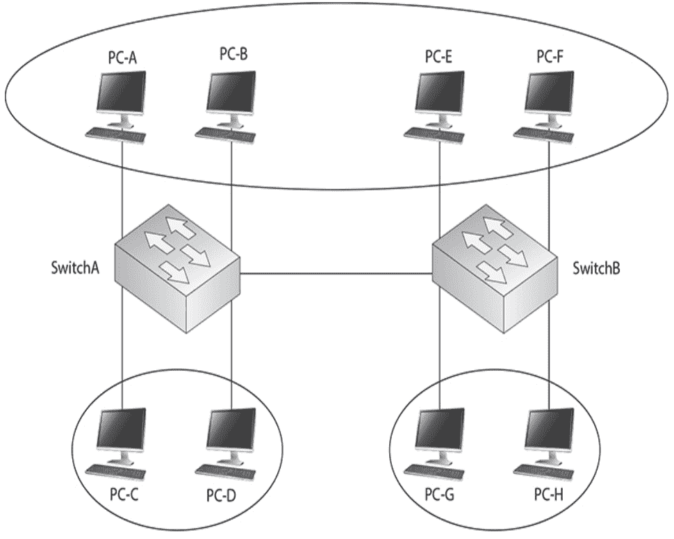

**图 9-6 使用 VLAN 的物理交换拓扑**

网络中的交换机维护 VLAN 的完整性。例如，如果 PC-A 生成广播，SwitchA 和 SwitchB 将确保只有该 VLAN 中的其他设备（PC-B、PC-E 和 PC-F）会收到该广播，而其他设备不会收到，即使跨交换机也是如此，如图 9-6 所示。


**考试提示** 记住，对于 CCNA 考试而言，VLAN 是同一广播域或子网中的一组设备。VLAN 擅长在逻辑上分隔/划分不同用户组之间的流量。VLAN 包含/隔离广播流量，而要在 VLAN 之间转发流量则需要路由器。VLAN 创建独立的广播域；它们增加广播域的数量，但减小广播域的规模。

## 子网与 VLAN

从逻辑上讲，VLAN 也是子网。子网或网络是一个有边界的广播域。在一个子网中发生的广播默认不会被转发到另一个子网。路由器（即三层设备）提供这种边界功能。这些子网中的每一个都需要一个唯一的网络号。而要从一个网络号移动到另一个网络号，你需要路由器。在广播域和交换机的情况下，每个独立的广播域都是一个独立的 VLAN；因此，你仍然需要路由功能来在不同 VLAN 之间转发流量。

从用户的角度看，图 9-6 所示的物理拓扑实际上看起来会像图 9-7。而从用户的角度看，设备知道要到达另一个 VLAN（子网），必须将其流量转发到其所在 VLAN 中的默认网关地址——即路由器接口上的 IP 地址。

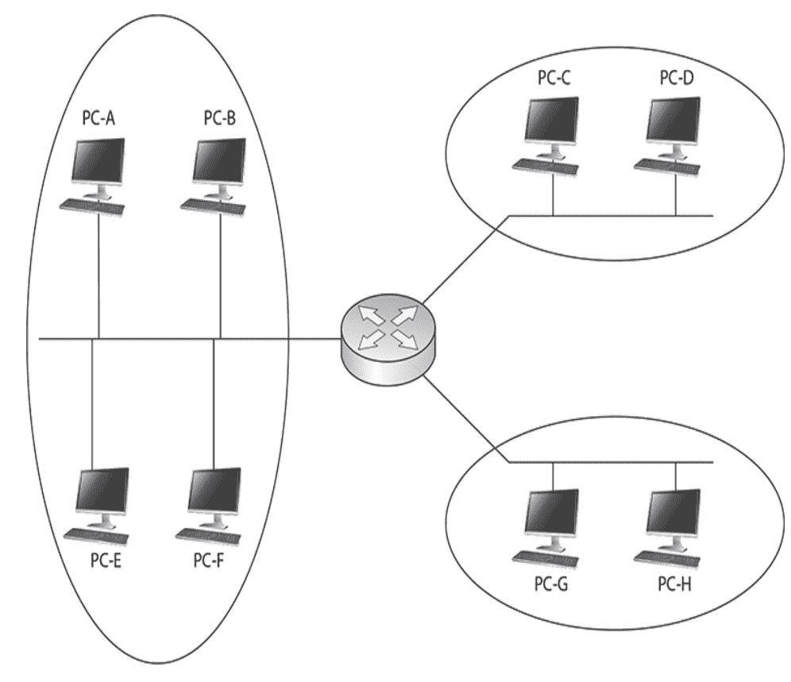

图 9-7 使用 VLAN 的逻辑拓扑


**考试提示** 有些考试题会要求你记住，每个 VLAN 必须与一个唯一的子网或网络号相关联。

关于 VLAN 和交换机，要记住两件重要的事：第一，交换机可以在单个端口上处理多个 VLAN，而如果该端口被指定为 *中继* 端口，路由器也可以在同一单个端口上在这些 VLAN 之间进行路由（本章后文将详细介绍中继端口）。第二，记住 VLAN 是一个广播域，因此如果要优化流量，建议一个 VLAN 不要超过 500 台设备。

## 可扩展性

通过划分广播域，VLAN 提高了网络的可扩展性。由于 VLAN 是一种逻辑构造，用户可以位于交换网络中的任何位置，并且仍属于同一个广播域。如果你将用户从同一交换网络中的一台交换机移动到另一台交换机，你仍然可以让该用户保留在其原来的 VLAN 中。这包括从建筑物的一层移动到另一层，或从园区的一个区域移动到另一个区域。限制在于，用户移动后仍必须连接到同一个二层网络。


**注意** VLAN 在交换网络中提供位置独立性：许多逻辑网络可以使用相同的网络基础设施。这种灵活性使添加、更改和移动网络设备成为一个简单的过程。它还使你能够将人员分组，例如按工作职能分组，从而使实施安全策略更加容易。使用 VLAN 在逻辑上分隔人员可提供额外的安全性，因为流量从一个 VLAN 到另一个 VLAN 必须经过三层设备，在那里你可以使用访问控制列表来过滤流量。

## VLAN 与流量类型

许多网络管理员使用 VLAN，不仅是为了分隔不同类型的用户流量（通常按工作职能分隔），还根据流量类型进行分隔，将网络管理、组播和 IP 语音（VoIP）流量放入各自独立的 VLAN 中。

网络管理流量是由网络设备的不同协议和功能生成的流量，用于帮助发现、监控和维护网络上的设备。网络管理流量的一些示例可能包括 SNMP 流量、NTP 流量、CDP 流量和 syslog 流量。网络管理流量还可能涉及设备配置备份和网络升级流量。作为网络设计人员，你可能会决定将其中一些流量放在其自己的网段上。

组播流量通常由视频应用使用，以将视频流智能地从服务器传输到一个或多个有兴趣观看的客户端，其中 UDP 用作视频流的传输协议。使用组播的视频解决方案的一个示例是 Cisco 的 IP/TV 服务器。视频流量对延迟敏感——延迟过大最终用户会察觉到，因为实际视频画面看起来跳动且不流畅。通过 VLAN 将此流量与其他类型流量分隔开，并为该 VLAN 流量设置必要的服务质量（QoS），你可以帮助最小化或防止延迟问题。

VoIP 流量包括两类流量：从 VoIP 电话发送到 VoIP 网关产品（如 Cisco Unified Communications Manager，原名 Cisco CallManager）的信令信息，以及实际语音对话，后者使用 UDP 作为 VoIP 电话和/或连接到 VoIP PBX 的数字电话之间的传输协议。VoIP 流量的一个问题是它对延迟敏感，因此将这类流量与其他数据类型混合可能导致性能问题，而这些问题在语音连接上非常明显。因此，将这类流量分离到其自己的 VLAN 中，并使用 QoS 确保这类流量获得比其他类型更高的优先级，是一项重要的设计考虑。某些 Cisco Catalyst 交换机支持一种特殊类型的 VLAN，称为语音 VLAN。借助语音 VLAN 功能，一旦 Cisco VoIP 电话插入交换机，交换机就会自动将该电话放入语音 VLAN。这种方法的优点是，当 VoIP 电话添加到网络时，作为管理员，你不再需要担心配置交换机以将电话放入正确的 VLAN。


**提示** 不同类型的流量，例如对延迟敏感的语音或视频流量（组播）、网络管理流量和数据应用流量，应通过所连接的交换机分隔到不同的 VLAN 中，以防止一种流量类型影响其他类型流量的性能。QoS 可用于为 VoIP 和视频等流量类型设置优先级，以确保它们获得必要的带宽，并优先于其他类型的数据流量。

## VLAN 成员资格

设备在 VLAN 中的成员资格可以通过以下三种方法之一确定：静态、动态或语音。这些方法会影响交换机如何将其机箱中的端口与特定 VLAN 关联。处理静态 VLAN 时，你必须使用 *接口子配置* 模式命令手动将交换机上的端口分配给 VLAN。以这种方式配置的 VLAN 通常称为 *基于端口的 VLAN*。

对于动态 VLAN，交换机使用来自用户设备的信息自动将端口分配给 VLAN，例如其 MAC 地址、IP 地址，甚至目录信息（例如用户或组名）。然后，交换机查询一台策略服务器，称为 *VLAN 成员资格策略服务器*（VMPS），该服务器是 Cisco 专有的，并包含设备信息到 VLAN 的映射。你网络中的一台交换机必须配置为此服务器。低端 Cisco 交换机不能充当 VMPS 服务器交换机，但其他交换机（例如 Catalyst 6500）可以。在这种情况下，低端交换机充当客户端，并使用 6500 来存储动态 VLAN 成员资格信息。

另一种选择是使用 802.1X 身份验证，它用于验证设备对交换机或无线接入点的访问。身份验证凭据存储在身份验证服务器上。你可以在身份验证服务器上为用户账户（与正在验证的设备关联）分配的一项策略是该设备所属的 VLAN——服务器可以将此信息传递给二层设备，而二层设备反过来又可以


将 VLAN 与已验证设备关联的端口相关联。

动态 VLAN 相比静态 VLAN 有一个主要优势：它们支持即插即用的可移动性。例如，如果您将一台 PC 从一个交换机的端口移动到另一个交换机的端口，并且使用的是动态 VLAN，则新交换机端口会自动配置为用户所属的 VLAN。使用动态 VLAN 时，唯一需要配置信息的情况是当您雇佣新员工，或员工离开公司或更换职能时。

如果您使用静态 VLAN，不仅必须手动用这些更新信息配置交换机端口，而且如果将用户从一个交换机移动到另一个交换机，您也需要执行这种手动配置以反映用户的新端口。不过，静态 VLAN 相比动态 VLAN 有一个优势，即配置过程简单直观。动态 VLAN 需要大量的初始准备工作，涉及将用户与 VLAN 匹配。（本书仅关注静态 VLAN，因为动态 VLAN 超出了本书的范围。）

语音 VLAN 独具特色。它们与连接有 VoIP 电话的端口相关联。某些 VoIP 电话可能连接了多端口交换机，以便其他设备可以通过电话连接到交换机。在这种情况下，电话可以对帧进行打标，以指示哪个设备正在发送流量——电话或计算机——以便交换机随后能正确处理流量。

## VLAN 连接

在处理 VLAN 时，交换机支持两种类型的交换机端口：访问端口和中继端口。设置交换机时，您需要知道接口应使用哪种类型的连接，并相应地进行配置。正如您将看到的，每种类型接口的配置过程不同。本节讨论这两种类型的连接。

## 访问端口

访问端口提供与设备的连接，该设备拥有只理解标准以太网帧的标准以太网 NIC，换言之，就是理解 IEEE 802.3 和以太网 II 帧的普通 NIC。访问端口连接只能与单个 VLAN 关联（语音 VLAN 端口是例外）。这意味着连接到此端口的任何设备或多个设备都将处于同一广播域中。

例如，如果十个用户连接到一个集线器，并且您将集线器插入交换机上的访问端口接口，那么所有这些用户都将属于与交换机端口关联的同一 VLAN。如果您希望集线器上的五个用户属于一个 VLAN，而另外五个用户属于不同的 VLAN，您需要购买额外的集线器，并将每个集线器插入不同的交换机端口。然后，在交换机上，您需要为每个端口配置正确的 VLAN 标识符。


考试提示 考试时请记住，访问端口用于通过该端口将服务器、工作站或笔记本电脑等终端设备连接到网络。访问端口通常与单个 VLAN 关联。

## 用于交换机互连的中继端口

与访问端口不同，中继端口能够承载多个 VLAN 的流量，并配置在连接到其他交换机的端口上。为了支持中继，原始以太网帧必须经过修改以承载 VLAN 信息，通常称为 VLAN 标识符或编号。这可确保保持广播完整性。例如，如果 VLAN 1 中的设备生成了广播，且连接的交换机已接收该广播，当该交换机将其转发到其他交换机时，这些交换机需要知道 VLAN 源，以便仅将该帧转发到 VLAN 1 端口，而不转发到其他 VLAN 端口。

Cisco 支持两种以太网中继方法：

-   适用于以太网的 Cisco 专有 InterSwitch Link (ISL) 协议
-   IEEE 802.1Q，通常称为 dot1q（适用于以太网）


考试提示 考试时请记住，中继会修改原始帧以承载 VLAN 信息，包括帧中的 VLAN 标识符。IEEE 802.1Q 定义了 VLAN 中继的标准方法。两个交换机之间的中继连接使得两个交换机上的相同 VLAN 可以相互通信（例如，两个交换机上的 VLAN 2 设备）。

Cisco 的高端交换机（如 Catalyst 6500 系列）支持这两种方法；然而，Cisco 的低端交换机仅支持 802.1Q：ISL 正在被 Cisco 逐步淘汰。本书专注于后一种中继方法，即 dot1q。

## 中继打标

中继方法营造了一种错觉，即并非两个中继设备之间只有一个物理连接，而是在它们之间为每个 VLAN 存在一个单独的逻辑连接。进行中继时，交换机会将源端口的 VLAN 标识符添加到帧中，以便中继另一端的设备（通常是交换机）了解哪个 VLAN 源生成了该帧，并且目标交换机可以基于目的 MAC 地址和源 VLAN 标识符做出智能转发决策。

由于原始以太网帧中添加了信息，普通 NIC 将无法理解此信息，通常会丢弃该帧。因此，您需要确保在交换机的接口上设置中继连接时，另一端的设备也支持相同的中继协议并进行了配置。如果另一端的设备不理解这些修改后的帧或未设置中继，在大多数情况下，它会丢弃这些帧。

对这些帧的修改通常称为*打标*，由专用集成电路（ASICs）在硬件中完成。ASICs 是专用处理器。由于打标在硬件中以线速以上的速度完成，实际打标过程不涉及延迟。为了确保与访问端口设备的兼容性，交换机会剥离打标信息，并将原始以太网帧转发到连接到访问端口连接的设备或多个设备。从用户的角度来看，源生成一个正常的以太网帧，目标接收该帧，该帧是进来的以太网 802.3 或 II 帧，出去的也是相同的。实际上，该帧在进入交换基础设施时被打标，并在退出基础设施时去除打标；打标和去除帧打标的过程对连接到访问端口的用户是隐藏的。

中继功能设备

中继链路在某些类型的设备之间很常见，包括交换机到交换机、交换机到路由器以及交换机到文件服务器的连接。在路由器上使用中继链路是降低第 3 层基础设施成本的绝佳方式。例如，在早期的桥接时代，为了在不同广播域之间路由，您需要为每个广播域配置一个*单独*的物理路由器接口。因此，如果您有两个广播域，就需要两个路由器端口；如果您有 20 个广播域，就需要 20 个路由器端口。由此可见，使用桥接时，广播域越多，路由器就越昂贵。

如今，随着 VLAN 和中继连接的出现，您可以使用路由器上的一个端口在多个广播域之间进行路由。无论您有 2 个还是 20 个广播域，都可以只使用路由器上的一个端口来完成这些不同子网之间的路由。当然，您需要一个支持中继的路由器和接口。并非每台 Cisco 路由器都支持中继；您至少需要一台 Cisco 1751 或更高级别的路由器，并配备正确类型的以太网接口。如果您的路由器不支持中继，您将需要为创建的每个 VLAN 配备一个单独的路由器接口，以便在 VLAN 之间进行路由。因此，如果您有大量 VLAN，则购买支持中继的路由器和正确类型的接口以节省成本是合理的。


**提示** VLAN 间路由是三层交换机（同时具备路由功能的交换机）的一大绝佳用途。你可以部署一台三层核心交换机，配置所有 VLAN，由它在内部执行路由任务。

你还可以为 PC 或服务器（例如文件服务器或虚拟化服务器）购买支持 trunk 的专用网卡。例如，假设你希望多个 VLAN 都能访问一台文件服务器。你可以使用普通网卡，并将其设置为通过接入端口连接到交换机。由于这是接入端口连接，该服务器只能属于一个 VLAN。同一 VLAN 中的用户访问该服务器时，其所有流量都会经由二层设备交换到达服务器。然而，其他 VLAN 中的用户则必须通过路由器将其流量路由到该服务器，因为该文件服务器位于不同的广播域中。


**提示** 如果两台相连的交换机上存在相同的 VLAN，请在交换机之间使用 trunk 连接，以使两侧关联的 VLAN 能够相互通信。Trunk 连接通常用于路由器，这样路由器就能通过子接口在各 VLAN 之间进行路由。不过，两台 trunk 设备上的 trunk 封装必须匹配（例如两侧都使用 802.1Q，或两侧都使用 Cisco 专有的 ISL）。

如果吞吐量是重要考量，你可能需要为文件服务器购买一块 trunk 网卡。配置这块网卡与配置文件服务器上的普通网卡不同。对于你希望文件服务器参与的每个 VLAN，你都要创建一个虚拟网卡，为该特定 VLAN 的虚拟网卡分配 VLAN 标识符和三层编址，然后将其与物理网卡关联。在文件服务器上创建完所有这些逻辑网卡后，你需要在交换机上配置到该服务器的 trunk 连接。完成这些配置后，交换网络中各 VLAN 的成员将能够直接访问文件服务器，而无需经过路由器。如今，这类支持 trunk 的网卡已经足够常见，你甚至可能在某些 PC 中见到它们，因为这些网卡通常用于支持虚拟化。


**提示** 可能需要支持 trunk 网卡的设备的一个典型例子是 DHCP 服务器，因为它可能需要跨多个 VLAN 为用户分配 IP 地址。如果你没有支持 trunk 的网卡，但用户分布在多个 VLAN 中，你可以在一台连接到用户 VLAN 的 Cisco 路由器上使用 IP helper 功能，让该路由器将 DHCP 广播转发到位于不同 VLAN 的 DHCP 服务器。另一个可能需要支持 trunk 网卡的设备示例是数据中心中的服务器：通常需要用它来支持服务器上运行的许多虚拟机（VM）。

## Trunk 示例

图 9-8 展示了一个包含三个 VLAN 的网络中，SwitchA 与 SwitchB 之间 trunk 连接的示例。在此示例中，PC-A、PC-F 和 PC-H 属于一个 VLAN；PC-B 和 PC-G 属于第二个 VLAN；PC-C、PC-D 和 PC-E 属于第三个 VLAN。两台交换机之间的 trunk 还会标记 VLAN 信息，以便远端交换机能够理解发起方所属的源 VLAN。

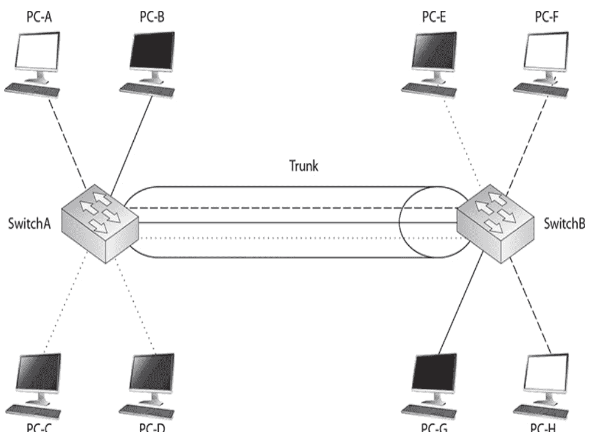

*图 9-8 Trunk 示例*

让我们使用图 9-9 所示的网络，来看一个使用 VLAN 和两种不同类型连接的示例。在此示例中，PC-C 生成一个本地广播。当 SwitchA 收到该广播时，它会检查入站端口，并知道源设备来自灰色 VLAN（接入端口连接用圆点标记）。据此，交换机会知道只应将该帧从属于同一 VLAN 的端口转发出去：这包括具有相同 VLAN 标识符的接入端口连接和 trunk 连接。在该交换机上，有一个接入端口连接属于同一 VLAN，即 PC-D，因此交换机直接将帧从该接口转发出去。

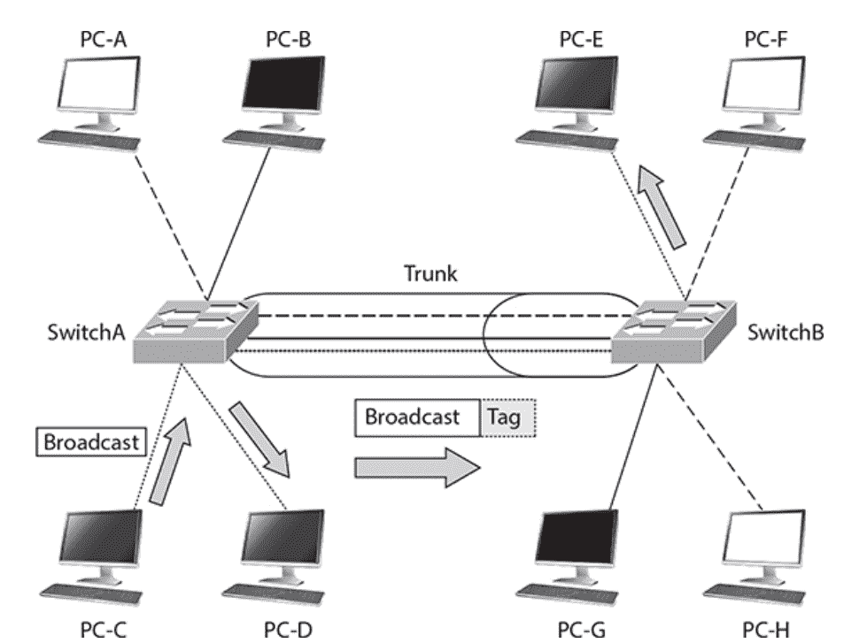

*图 9-9 广播流量示例*

SwitchA 与 SwitchB 之间的 trunk 连接处理多个 VLAN 的流量。在交换机之间传输流量时，需要使用 VLAN 标记机制来区分流量来源。例如，假设交换机之间没有采用标记机制。PC-C 生成一个广播帧，SwitchA 将其原样转发给 PC-D，然后通过 trunk 转发给 SwitchB。这个过程的问题在于，当 SwitchB 收到原始以太网帧时，它不知道应该将广播转发到哪个或哪些端口，因为它不知道源 VLAN。

如图 9-9 所示，SwitchA 会标记该广播帧，将源 VLAN 添加到原始以太网帧中（该广播帧被标记）。当 SwitchB 收到该帧时，它会检查标记，并知道该帧仅用于 PC-E 所属的 VLAN。当然，由于 PC-E 通过接入端口连接，SwitchB 会先剥离标记，然后将原始以太网帧转发给 PC-E。这是必要的，因为 PC-E 使用的是标准网卡，无法理解 VLAN 标记。通过这一过程，两台交换机都维护了广播域的完整性。

## IEEE 802.1Q

交换机间链路（ISL）是一种 Cisco 专有协议，正在 Cisco 产品中逐步淘汰，并被 1998 年引入的 IEEE 802.1Q trunk 标准所取代。IEEE 标准提供的优势之一是允许在不同厂商的设备之间建立 trunk，而 ISL 仅在特定 Cisco 设备上受支持。因此，使用 802.1Q 时，你应该能够实现多厂商 trunk 解决方案，而无需担心是否支持某种特定类型的 trunk 连接。2960 及更高型号的交换机，以及 Cisco 的高端交换机（如 6500 系列），都支持 802.1Q。实际上，新的交换机型号仅支持 802.1Q trunk——完全不支持 ISL。802.1Q trunk 在支持快速以太网或千兆以太网速度的交换机端口上受支持。

802.1Q trunk 支持两种类型的帧：带标记帧和不带标记帧。不带标记帧不携带任何 VLAN 标识信息——基本上，它就是标准、未修改的以太网帧。该帧的 VLAN 归属由交换机的端口配置决定：如果端口配置在 VLAN 1 中，则该不带标记帧属于 VLAN 1。这个 VLAN 通常称为本征 VLAN（native VLAN）。带标记帧包含 VLAN 信息，并且只有 trunk 上其他能识别 802.1Q 的设备才能处理该帧。

802.1Q trunk 的一个独特之处在于，你可以在一条 trunk 连接上同时传输带标记帧和不带标记帧，如图 9-10 所示。在此示例中，白色 VLAN（PC-A、PC-B、PC-E 和 PC-F）在 SwitchA 与 SwitchB 之间的 trunk 上使用带标记帧。任何连接到该 trunk 线路上的其他设备都需要启用 802.1Q trunk，才能看到帧内部的标记，从而确定该帧的源 VLAN。在此网络中，第三台设备连接到了该 trunk 连接：PC-G。此示例假设一台集线器将两台交换机和该 PC 连接在一起。

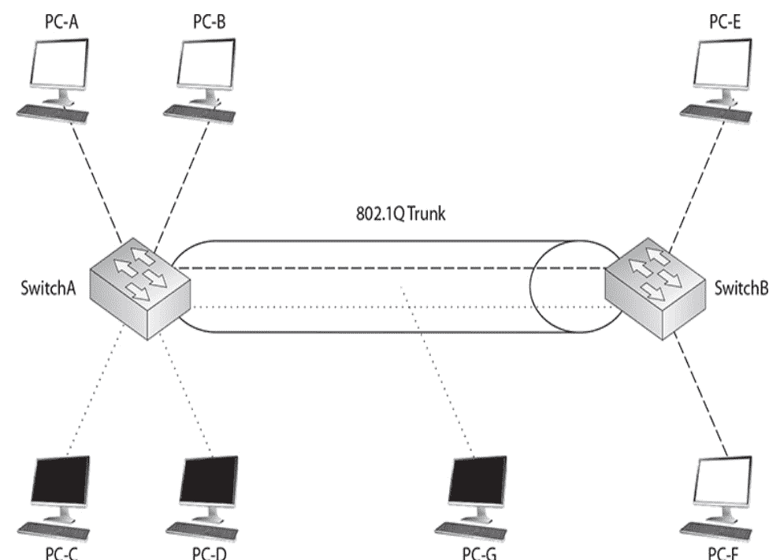

*图 9-10 802.1Q trunk 与本征 VLAN*

PC-G 使用的是普通以太网网卡，显然无法理解标记，因此会丢弃这些帧。然而，这带来了一个问题：PC-G 属于深色 VLAN，而 PC-C 和 PC-D 也是该 VLAN 的成员。因此，为了在这三个成员之间转发帧，trunk 还必须支持不带标记帧，以便 PC-G 能够处理它们。要进行此设置，你应将交换机到交换机的连接配置为 802.1Q trunk，但将本征 VLAN 设置为深色 VLAN，这样来自该 VLAN 的帧在通过 trunk 时将不带标记，从而允许 PC-G 处理它们。

对 802.1Q trunk 配置有一项限制：两侧配置必须相同。换句话说，如果深色 VLAN 是一台交换机上的本征 VLAN，那么另一端的交换机也必须将本征 VLAN 设置为深色 VLAN。同样，如果白色 VLAN 的帧在一台交换机上被标记，另一台交换机也必须用 802.1Q 信息标记白色 VLAN 的帧。


使用 802.1Q 标记方法时，原始以太网帧会被修改。4 字节 *标签* 字段被 *插入* 到原始以太网帧的头部，且原始帧的 FCS（校验和）会基于此更改重新计算。标签的前 2 字节是协议标识符。例如，以太网类型帧的协议标识符值为 0x8100，指示这是一个以太网标记帧。接下来的 3 位用于对帧进行优先级排序，定义于 IEEE 802.1p 标准。第 4 位指示这是否是封装的令牌环帧（思科不再销售令牌环产品），最后 12 位用于 VLAN 标识符（编号）。

图 9-11 显示了将 802.1Q 字段插入以太网帧头部时标记以太网帧的过程。如本图所示，步骤 1 是普通的未标记以太网帧。步骤 2 插入标签并重新计算新的 FCS 值。步骤 2 下方是实际 TAG 字段的放大图。如图所示，标签直接插入以太网头部的源 MAC 地址和目的 MAC 地址之后。

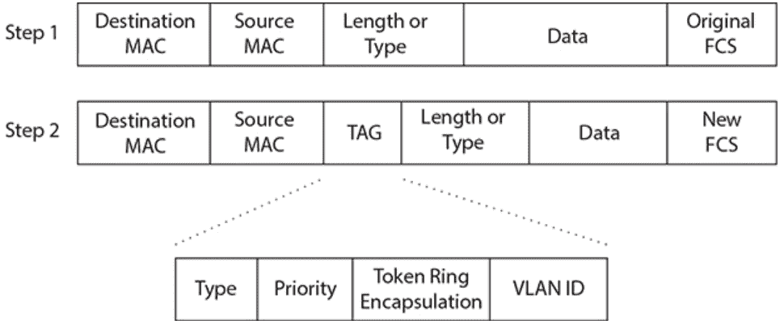

图 9-11 802.1Q 帧封装过程


**注意** 802.1Q 是一种标准化的中继方法，它在原始以太网帧中插入 4 字节字段并重新计算 FCS。较新的思科交换机仅支持 802.1Q 中继，不支持较旧的 ISL 协议。原生 VLAN 包含未标记帧，即使在中继连接上也是如此。

使用此标记机制的一个优势是，由于只添加了 4 字节，帧大小不会超过 1518 字节，因此您实际上可以通过交换机的访问端口连接转发 802.1Q 帧，因为这些交换机会将帧作为普通以太网帧转发。

## 配置中继

本节介绍了使用 802.1Q 中继协议在交换机上设置中继端口。将端口配置为中继端口可使其通过中继端口在一个交换机向另一个交换机传输 VLAN 流量。不过，在进行配置之前，您首先应了解用于在两台设备之间形成中继的一种协议：动态中继协议。

### 动态中继协议

思科专有的 *动态中继协议* (DTP) 用于在两台使用中继连接的思科交换机之间动态形成和验证中继连接。它支持五种中继模式，如表 9-2 所示。

| DTP 模式 | 生成 DTP 消息 | 默认帧标记 |
|---|---|---|
| 开启或中继 | 是 | 是 |
| 期望 | 是 | 否 |
| 自动 | 否 | 否 |
| 不协商 | 否 | 是 |
| 关闭 | 否 | 否 |

表 9-2 DTP 模式和操作

如果将接口的中继模式设置为开启或中继，则会导致接口基于中继类型（802.1Q）在接口上生成 DTP 消息并对接口上的帧进行标记。当设置为开启时，中继接口始终假设连接是中继，即使远端不支持中继。大多数较新的思科交换机使用中继术语而不是开启。

如果将中继模式设置为 *期望*，接口将在接口上生成 DTP 消息，但会假设另一端不支持中继，并等待远端发送的 DTP 回复消息。在此状态下，接口最初作为访问端口连接。如果远端发送 DTP 消息，且该消息指示两台交换机之间的中继兼容，则将形成中继，交换机将开始在接口上对帧进行标记。如果另一端不支持中继，接口将保持为访问端口连接。

如果将中继模式设置为 *自动*，接口将被动监听来自远端的 DTP 消息，并将接口保持为访问端口连接。如果接口收到 DTP 消息，且消息与接口的中继功能匹配，则接口将从访问端口连接切换为中继连接并开始对帧进行标记。这是思科交换机中继功能接口的默认 DTP 模式。

如果将接口设置为不协商，则接口设置为中继连接并会自动使用 VLAN 信息对帧进行标记；但是，接口不会生成 DTP 消息：DTP 已禁用。此模式通常用于将中继连接连接到不理解思科专有中继协议且因此不会理解这些消息内容的非思科设备。

如果将接口设置为关闭，则接口配置为访问端口。此模式下不会生成 DTP 消息，也不对帧进行标记。

表 9-3 显示了交换机连接何时会形成中继。在此表中，一侧需要配置为开启或 *期望*，另一侧配置为开启、*期望* 或 *自动*，或者两台交换机都需要配置为不协商。请注意，如果使用不协商模式，则会形成中继但不使用 DTP，而如果使用开启、*期望* 或 *自动*，则使用 DTP。DTP 相对于不协商的一个优势是 DTP 检查中继的特性：如果两侧不匹配（例如，关于中继类型或原生 VLAN 不匹配），则中继不会建立，接口将保持为访问端口连接。使用不协商时，如果两侧的中继特性不匹配，中继连接可能会失败。

| 本端交换机 | 远端交换机 |
|---|---|
| 开启 | 开启、期望、自动 |
| 期望 | 开启、期望、自动 |
| 自动 | 开启、期望 |
| 不协商 | 不协商 |

表 9-3 形成中继


**考试提示** 请记住表 9-2 和表 9-3 中的 DTP 信息以备考试之用。成功完成 DTP 的结果是形成 802.1Q 中继。在使用 DTP 自动感应时，如果原生 VLAN 不匹配，将发生原生 VLAN 不匹配错误。

## 交换机中继配置

在思科交换机上设置中继涉及导航到接口，在该接口上配置中继协议，启用中继，然后指定原生 VLAN：

```
switch(config)# interface type slot_#/port_#
switch(config-if)# switchport trunk encapsulation dot1q
switch(config-if)# switchport mode trunk|dynamic desirable|
                dynamic auto|nonegotiate
switch(config-if)# switchport trunk native vlan VLAN_#
```

例如，我可以使用以下命令将思科 3650 交换机的端口 24 配置为中继端口：

```
VAN-SW1(config-if)#interface g1/0/24
VAN-SW1(config-if)#switchport trunk encapsulation dot1q
VAN-SW1(config-if)#switchport mode trunk
```

请记住，较新的思科交换机仅支持 802.1Q 中继（不支持较旧的 ISL 中继协议），因此您只能与其他 802.1Q 中继设备建立中继连接。如果希望中继处于开启状态，请使用 **中继** 参数。对于 *期望* DTP 状态，请使用 **动态期望**；对于 *自动* 状态，请使用 **动态自动**。默认模式为自动。如果不想使用 DTP 但仍要执行中继，请使用 **不协商** 参数。对于 802.1Q 中继，原生 VLAN 是 VLAN 1。您可以使用 **switchport trunk native vlan** 命令更改此设置，但随后需要使第 2 层网络中所有交换机上的原生 VLAN 匹配。如果两台互连交换机在连接中继上具有不同的原生 VLAN，则一台交换机上一个 VLAN 的流量最终会出现在远端交换机的另一个 VLAN 中，这可能会引发各种问题。


**考试提示** 对于思科 CCNA 考试，请记住使用 **switchport 模式** 命令在交换机上启用中继。使用 **switchport trunk native vlan** 命令指定未标记流量。默认情况下，这是 VLAN 1。还要记住，交换机之间原生 VLAN 不匹配可能会导致连接问题。

配置中继连接后，可以使用此命令对其进行验证：

```
switch# show interfaces type 0/port_# switchport|trunk
```

以下是使用 **switchport** 参数的示例：


```switch# show interfaces fastEthernet0/1 switchport
Name: Fa0/1
Switchport: Enabled
Administrative mode: trunk
Operational Mode: trunk
Administrative Trunking Encapsulation: dot1q
Operational Trunking Encapsulation: dot1q
Negotiation of Trunking: Disabled
Access Mode VLAN: 0 ((Inactive))
Trunking Native Mode VLAN: 1 (default)
Trunking VLANs Enabled: ALL
Trunking VLANs Active: 1,2
Pruning VLANs Enabled: 2-1001
Priority for untagged frames: 0
Override vlan tag priority: FALSE
Voice VLAN: none
```

在此示例中，Fa0/1 的 trunk 模式设置为 trunk (on)，本机 VLAN 设置为 1。以下是使用 trunk 参数的示例：

```switch# show interfaces trunk
Port        Mode        Encapsulation  Status      Native vlan
Fa0/1       on          802.1q         trunking    1
Port        Vlans allowed on trunk
Fa0/1       1-4094
Port        Vlans allowed and active in management domain
Fa0/1       1-2
Port        Vlans in spanning tree forwarding state and not pruned
Fa0/1       1-2
```


**考试提示** 对于 CCNA 考试，请记住使用 `show interfaces switchport | trunk` 命令来验证 trunk。熟悉此命令的输出。

在此示例中，一个接口正在 trunking——Fa0/1：trunk 模式为 on，trunk 协议为 802.1Q，本机 VLAN 为 1。


**注意** 执行 `show mac address-table` 命令时，如果看到多个 MAC 地址与单个接口关联，这可能表明该接口是 trunk 连接，或者该接口是连接到另一个交换机或集线器的访问端口。

## 创建 VLAN

本节介绍如何在交换机上创建 VLAN，然后将接口静态分配给新创建的 VLAN。创建 VLAN 时，请记住以下一些准则：

- 可创建的 VLAN 数量取决于交换机型号和 IOS 软件。
- 每台交换机上都预配置了一些 VLAN，包括 VLAN 1 和 1002–1005（1002–1005 仅用于令牌环网和 FDDI 网络）。这些 VLAN 不可删除！
- 要添加或删除 VLAN，交换机必须使用 VTP 服务器模式或透明模式。
- VLAN 名称可以更改，但 VLAN 编号不能；若要重新编号，必须删除 VLAN 然后重新添加。
- 默认情况下，所有接口都属于 VLAN 1。
- 默认情况下，CDP、DTP 和 VTP 通告在本机 VLAN（即 VLAN 1）中发送。
- 在删除 VLAN 之前，将当前 VLAN 中的任何端口重新分配到另一个 VLAN；否则，删除的 VLAN 中的任何端口都将无法使用。
- 未知目标 MAC 地址仅在源 MAC 地址所在的 VLAN 中泛洪。


**考试提示** 考试时请记住上述要点。

可以在全局配置模式下使用 `vlan` 命令创建 VLAN，如下所示：

```switch(config)# vlan VLAN_#
switch(config-vlan)# name VLAN_name
```

执行 `vlan` 命令后，将进入 VLAN 子配置模式，可在其中输入 VLAN 的配置参数（例如名称）。可在 `vlan` 命令前使用 `no` 参数随时删除 VLAN。


**考试提示** CCNA 考试请记住，交换机必须是 VTP 服务器或透明交换机才能在其上创建或删除 VLAN。另外，在删除 VLAN 之前，请将 VLAN 中的所有端口移至其他 VLAN；否则，与已删除 VLAN 关联的端口将无法与其他端口通信，直到重新添加 VLAN 编号或将端口移至现有 VLAN。发生这种情况时，端口 LED 将呈常量琥珀色。

创建 VLAN 后，需要将希望加入该 VLAN 的接口分配给它。要将端口分配给 VLAN，请进入该端口，确保其作为访问端口运行，然后将其分配给 VLAN：

```switch(config)# interface type 0/port_#
switch(config-if)# switchport mode access
switch(config-if)# switchport access vlan VLAN_#
switch(config-if)# switchport voice vlan VLAN_#
```

在此代码示例中，进入接口后，我使用 `switchport mode access` 命令将端口配置为访问端口。`switchport access vlan` 命令将端口分配给 VLAN，而 `switchport voice vlan` 命令用于指定连接到该端口的 VoIP 设备所使用的 VLAN。此配置允许将 VoIP 电话连接到端口，再将计算机连接到电话——所有数据都通过交换机的同一端口发送，但不同类型的流量将发送到不同的端口。请注意，语音 VLAN 行代码是可选的；如果只想将端口分配给数据 VLAN，只需使用前面代码清单中的前三行代码。


**注意** 如果使用 `switchport access vlan` 命令将不存在的 VLAN 关联到交换机端口，IOS 将自动创建该 VLAN。

创建并分配 VLAN 后，可以使用各种 `show` 命令来查看和验证配置。`show vlan` 命令显示 VLAN 列表以及分配给每个 VLAN 的端口：

```switch# show vlan
VLAN Name       Status          Ports
----            ------------    ----------
1               default         active      Fa0/1, Fa0/2, Fa0/3, Fa0/4
                                        Fa0/5, Fa0/6, Fa0/7, Fa0/8
                                        Fa0/9, Fa0/10, Fa0/11, Fa0/12
                                        Fa0/13, Fa0/14, Fa0/15, Fa0/16
                                        Fa0/17, Fa0/18, Fa0/19, Fa0/20
                                        Fa0/21, Fa0/22, Fa0/23, Fa0/24
                                        Gi0/1, Gi0/2
1002 fddi-default                       act/unsup
.
.
.
```

在此示例中，所有端口都分配给了 VLAN 1。向此命令添加 `brief` 参数后，它将不在显示底部列出每个 VLAN 的详细信息。还可以使用 `show interface switchport` 命令查看特定接口的 VLAN 成员身份信息。本章前面“Switch Trunk Configuration”部分中已展示过此命令。


**考试提示** 对于 CCNA 考试，请记住可以使用 `vlan` 命令创建 VLAN。使用 `switchport mode access` 和 `switchport access vlan` 命令将 VLAN 分配给接口。还要记住，如果接口配置为访问端口，则无法形成 trunk。`show vlan` 命令显示 VLAN 信息：如果同一个接口显示在多个 VLAN 下，则该接口可能是 trunk 端口。

## VLAN 和 trunk 的基本故障排除

了解如何设置基于 VLAN 的网络后，您可能最终会遇到与 VLAN 配置相关的问题。基本上，应按以下顺序检查，以确定问题的原因：

1. 检查接口状态，以确定是否存在物理层问题。
2. 检查交换机和路由器的配置，确保没有添加或更改任何内容。
3. 验证 trunk 是否正常运行。
4. 验证 VLAN 配置正确且 STP 正常运行。

以下各部分介绍在遇到交换问题时应检查的一些基本事项。

### 性能问题

如果遇到性能缓慢或断断续续的连接问题，应首先使用 `show interfaces` 命令检查交换机接口的统计信息。是否看到大量错误，例如冲突？

多种因素可能导致这些问题。最常见的是连接的双工模式或速度不匹配。检查连接两端的设置。此外，请确保使用正确的电缆类型：DTE 到 DCE 连接使用直连线，DTE 到 DTE 或 DCE 到 DCE 连接使用交叉线（如第 1 章所述）。还要确保电缆不超过最大法定长度。另外，请确保连接的网卡没有硬件问题或故障。

### 本地连接问题

如果尝试访问交换机或路由器的控制台端口，在终端会话中只看到乱码，这可能表明终端设置不正确。通常原因是波特率设置不正确。某些设备允许通过控制台端口进行操作系统升级，管理员可能将其更改为最高可能值，但忘记将其改回 9600 bps。如果您怀疑这种情况，请不断更改波特率，直到找到正确的速度。


如果在访问交换网络中的设备时遇到问题，可以查看几个选项。首先，您尝试访问的设备是否在同一 VLAN 中？如果是，请确保在 VLAN 中使用正确的 IP 寻址方案，并且尝试共享信息的两台设备的端口位于同一 VLAN 中。如果这两台设备是 Cisco 设备，可以使用 CDP 获取一些这些信息（例如 IP 地址），方法是使用 **show cdp** 命令（第 8 章中讨论）。交换机是否了解您网络中的设备？您可能需要检查 CAM 表，并确保端口安全违规没有导致连接问题。

有关 VLAN 信息，请在交换机上使用 **show** 命令检查 VLAN 配置。还要检查每个交换机上的 VLAN 配置，并确保使用 **show vlan** 命令配置的 VLAN 参数相同。如果端口 LED 为常亮琥珀色，问题可能是端口的 VLAN 被删除了且端口未重新分配。其他问题也会导致端口 LED 变为琥珀色，例如 STP 将端口置于阻塞状态，或端口安全因安全违规禁用端口。实际上，如果看到很多端口 LED 为琥珀色，那么被删除的 VLAN 很可能是问题所在。使用 **show interface switchport** 命令来确定是否是被删除的 VLAN 导致了问题：如果看到分配给端口的 VLAN 处于非活动状态，如下所示，那么您就找到了罪魁祸首：

```
switch# show interface fastEthernet0/1 switchport
Name: Fa0/1
Switchport: Enabled
Administrative mode: static access
Operational Mode: static access
Administrative Trunking Encapsulation: dot1q
Operational Trunking Encapsulation: native
Negotiation of Trunking: Off
Access Mode VLAN: 5 (Inactive)
Trunking Native Mode VLAN: 1 (default)
.
.
.
```

注意在此示例中，VLAN 5 处于非活动状态，这表明接口已分配给该 VLAN，但 VLAN 已被删除，导致接口无法使用。

如果在交换机之间使用干线，请确保干线配置正确：**show interface trunk**。确保干线两端的本机 VLAN 编号匹配：如果不匹配，干线将不会形成。

还要通过执行 **show vtp** 命令检查 VTP（如果正在使用它）。确保交换机之间有干线连接，因为 VTP 消息仅通过干线传输。使用服务器/客户端实现时，请确保 VTP 交换机之间的域名以及（如果使用密码选项）密码匹配。此外，所有交换机必须运行相同的 VTP 版本（默认为版本 1）。

## VLAN 间连接问题

如果在访问其他 VLAN 中的设备时遇到问题，请首先确保能够 ping 通作为 VLAN 出口的默认网关（路由器）。用户 PC 上常见的配置错误是默认网关配置错误。如果无法 ping 通默认网关，请返回上一节并检查本地 VLAN 连接问题。如果可以 ping 通网关，请检查路由器的配置及其接口。还要确保路由器到目标 VLAN 有路由（**show ip route**）。如果确实有到达目标的路由，请确保目标 VLAN 配置正确，并且该 VLAN 中的默认网关能够访问目标设备。

## 练习 9-6：配置 VLAN

在此练习中，您将练习跨两台 Cisco 交换机配置 VLAN。创建 VLAN 后，需要创建干线端口，以便 VLAN 流量可以在两台交换机之间传输。本练习中，温哥华办公室的两台交换机配置如下图所示：

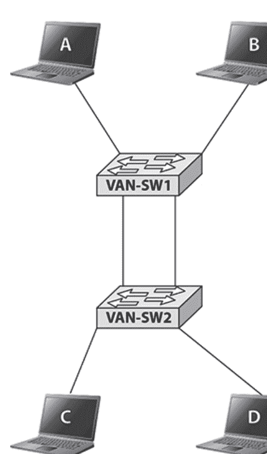

请注意，ComputerA 连接到 VAN-SW1 的端口 5，而 ComputerB 连接到 VAN-SW1 的端口 15。ComputerC 连接到 VAN-SW2 的端口 5，而 ComputerD 连接到 VAN-SW2 的端口 15。

1. 确保两台交换机都已通电。

2. 确保 ComputerA 和 ComputerD 的 IP 地址分别为 12.0.0.5 和 12.0.0.15，ComputerB 和 ComputerC 的 IP 地址分别为 14.0.0.5 和 14.0.0.15。

3. 使用交叉电缆将 VAN-SW1 的端口 1 连接到 VAN-SW2 的端口 1。

4. 使用交叉电缆将 VAN-SW1 的端口 24 连接到 VAN-SW2 的端口 24。等待一分钟，直到绿色链路指示灯亮起。请注意，由于交换机的环路防止功能，一个链路指示灯将保持琥珀色（下一章将详细介绍）。

5. 在 VAN-SW1 上，创建 VLAN ID 为 2 的 MKT VLAN 和 VLAN ID 为 3 的 SALES VLAN。请使用以下命令作为指南：

```
VAN-SW1>enable
VAN-SW1#config term
Enter configuration commands, one per line. End with CNTL/Z.
VAN-SW1(config)#vlan 2
VAN-SW1(config-vlan)#name MKT
VAN-SW1(config-vlan)#vlan 3
VAN-SW1(config-vlan)#name SALES
VAN-SW1(config-vlan)#exit
VAN-SW1(config)#exit
VAN-SW1#
```

6. 使用 show vlan 命令查看 VLAN 列表。请注意，VLAN 2 和 VLAN 3 现在已存在，但未向 VLAN 分配任何端口。

7. 使用以下命令将 ComputerA（端口 5）放入 MKT VLAN：

```
VAN-SW1#config term
Enter configuration commands, one per line. End with CNTL/Z.
VAN-SW1(config)#interface g1/0/5
VAN-SW1(config-if)#switchport mode access
VAN-SW1(config-if)#switchport access vlan 2
```

8. 使用以下命令将 ComputerB（端口 15）放入 SALES VLAN：

```
VAN-SW1(config-if)#interface g1/0/15
VAN-SW1(config-if)#switchport mode access
VAN-SW1(config-if)#switchport access vlan 3
VAN-SW1(config-if)#exit
VAN-SW1(config)#exit
VAN-SW1#
```

9. 查看 VLAN 列表，并注意 VLAN 2 和 VLAN 3 现在已有端口。

10. 连接到 VAN-SW2 的控制台端口，并在 PuTTY 中按 Enter 刷新屏幕。

11. 在 VAN-SW2 上，执行相同的任务。创建 VLAN ID 为 2 的 MKT VLAN，并创建 VLAN ID 为 3 的 SALES VLAN。

12. 在 VAN-SW2 上，将端口 15 放入 MKT VLAN，将端口 5 放入 SALES VLAN。

13. 查看 VLAN，并确保端口 15 在 MKT VLAN 中，端口 5 在 SALES VLAN 中。

14. 转到 ComputerA 的命令提示符。您可以 ping 通 12.0.0.15 (ComputerD) 吗？________
    您不应该能够 ping 通 ComputerD，因为需要将两台交换机之间的链路设置为干线端口，以便它们在两台交换机之间传输所有 VLAN 流量。

15. 在 VAN-SW1 上，使用以下命令将端口 1 配置为干线端口：

```
VAN-SW1>enable
VAN-SW1#config term
Enter configuration commands, one per line. End with CNTL/Z.
VAN-SW1(config)#interface g1/0/1
VAN-SW1(config-if)#switchport trunk encapsulation dot1q
VAN-SW1(config-if)#switchport mode trunk
```

16. 在 VAN-SW1 上，还要将端口 24 配置为干线端口：

```
VAN-SW1(config-if)#interface g1/0/24
VAN-SW1(config-if)#switchport trunk encapsulation dot1q
VAN-SW1(config-if)#switchport mode trunk
```

17. 要查看干线端口的状态，请使用 show interfaces trunk 命令并回答以下问题：
    端口 1 和端口 24 的状态是什么？________________
    哪些 VLAN 流量被允许通过干线端口传输？________________

18. 关闭 VAN-SW1 选项卡。

19. 转到 ComputerA 并 ping 12.0.0.15 (ComputerD)。您能够 ping 通吗？________
    现在允许 VLAN 流量穿越干线端口，因此 ping 消息应发送到另一台交换机上的 ComputerD。

20. 从 ComputerA，您能够 ping 通 14.0.0.15 (ComputerB) 吗？________
    请注意，ComputerB 位于同一交换机上，但您无法 ping 通它，因为它位于不同的 VLAN。VLAN 是一个通信边界。

## 章节回顾

本章侧重于特定于 Cisco 交换机的基本配置任务。回顾了交换机的物理特征，包括 LED 的含义和 Mode 按钮的使用。

您了解了交换机的核心功能和交换机操作模式。然后，您了解了交换机上的基本配置设置，例如更改交换机名称以及在交换机上配置 IP 地址和默认网关。随后是交换机端口的配置。

然后，您了解了端口安全功能，这是一种防止未经授权的设备连接到网络的方法。您了解了不同的端口违规模式以及配置端口安全的命令。

作为本章的最后一个主题，您了解了 VLAN 作为在设备之间创建广播域和通信边界的方法。您了解到 VLAN 可以跨连接的交换机，并且需要配置干线端口来在交换机之间传输 VLAN 流量。

## 快速回顾

### 了解交换机功能

- 交换机有三个核心功能：地址学习、过滤/转发和环路避免。
- 二层交换机有三种操作模式：存储转发、直通和无碎片转发。Cisco 交换机使用无碎片转发。

### 识别交换机组件

- 如果交换机在启动期间发生故障，系统 LED 将显示琥珀色。
- 使用 Mode 按钮在交换机上切换显示模式。
- 在 STAT 显示模式下，如果端口 LED 为琥珀色，则端口已因关闭、STP 阻塞或端口安全而被禁用。


违规。如果端口为绿色，则表示已连接到设备；如果呈绿色闪烁，则表示该端口上有网络活动。

- 在 DUPLX（双工）显示模式下，如果端口 LED 显示稳定的绿色，则该端口正在全双工模式下运行。如果端口 LED 熄灭，则表示该端口处于半双工模式。

## 基本交换机配置

- 可以给交换机上的 VLAN 接口分配 IP 地址，以便通过 telnet 或 SSH 远程访问该交换机。
- **ip default-gateway** 命令为交换机指定一个用于访问其他子网的路由器地址。
- **show mac address-table** 命令显示交换机的 MAC 地址表以及所有已学习的地址。

## 接口配置

- 端口安全用于在接入接口（非中继连接）上防止对 LAN 的未授权访问。
- **switchport port-security** 命令用于配置端口安全。
- 端口安全的默认配置是在接口上学习一个 MAC 地址，违规模式为 shutdown（关闭）。
- 粘性学习使交换机能够动态学习连接到某个接口的 MAC 地址，然后将这些地址配置为被授权访问该端口的端口安全地址。

## 使用 VLAN

- VLAN 是处于同一广播域中、具有相同网络号或子网号的一组设备。VLAN 不受物理位置限制，因此用户可以在交换网络中的任何物理位置。
- 静态 VLAN（即基于端口的 VLAN）成员身份由管理员手动分配。动态 VLAN 成员身份由用户设备的信息（如 MAC 地址或 802.1x 身份验证凭据）决定。
- 接入端口是连接其他设备的端口，支持标准以太网帧，并且仅支持单个 VLAN。中继端口是对帧打标签并允许多个 VLAN 的端口。只有具备中继能力的端口才支持中继；并非所有以太网端口都支持中继。
- IEEE 802.1Q 是一种标准化的中继方法。较新的 Cisco 交换机仅支持这种中继协议。802.1Q 方法在帧中间插入一个 VLAN 标签，并重新计算帧的校验和。它支持本征 VLAN（native VLAN）——即中继链路上不打标签的 VLAN。在 Cisco 交换机上，其默认值为 VLAN 1。
- DTP 是 Cisco 专有协议，用于确定两个连接的接口是否可以成为中继链路。它有五种模式：on（开启）、desirable（期望）、auto-negotiate（自动协商）、off（关闭）和 no-negotiate（不协商）。如果一侧模式为 on、desirable 或 auto，另一侧模式为 on 或 desirable，则会形成中继。no-negotiate 模式启用中继但禁用 DTP。
- 要在交换机接口上启用中继，请使用 **switchport trunk encapsulation dot1q** 命令，然后使用 **switchport mode trunk**。要验证中继，请使用 **show interfaces switchport|trunk** 命令。
- 交换机上的所有端口都会自动置于 VLAN 1 中。要在交换机上添加 VLAN，请使用 **vlan** 命令。要将接口分配给某个 VLAN，请使用 **switchport mode access** 和 **switchport access vlan**。要查看 VLAN 以及分配到的端口，请使用 **show vlan**。

## 问题

以下问题将帮助你衡量对本章节内容的理解。请仔细阅读所有选项，因为可能不止一个正确答案。请为每个问题选择正确的答案。

1. 如果交换机在启动过程中出现故障，系统 LED 将 ________。
A. 绿色
B. 熄灭
C. 琥珀色
D. 红色

2. 你使用 Mode 按钮切换到双工显示模式。你注意到除一个端口外，所有端口都显示绿色 LED。绿色 LED 表示什么？
A. 该端口运行在半双工模式。
B. 全双工被禁用。
C. 该端口运行在单工模式。
D. 该端口运行在全双工模式。

3. 在系统配置对话框脚本中，不会询问以下哪项？
A. 启用接口
B. 默认网关地址
C. 用于管理功能的 VLAN 接口
D. Enable secret 密码

4. 交换机的默认网关地址在哪种配置模式下配置？
A. 接口
B. 线路
C. 全局
D. 端口

5. 默认情况下，IP 地址不会分配给交换机。在什么情况下你可能需要给交换机分配 IP 地址？
A. 为了让交换机转发帧
B. 为了远程管理交换机
C. 为了让交换机泛洪帧
D. 为了让交换机路由 IP 数据包

6. 输入使你能够查看 CAM 表内容的交换机命令：________________。

7. 检查交换机上的以下 MAC 地址表。如果交换机看到目的 MAC 地址为 0000.1111.DDDD 的帧，会发生什么？

```
Switch> show mac address-table
```

| VLAN | MAC 地址 | 类型 | 端口 |
| --- | --- | --- | --- |
| 1 | 0000.1111.AAAA | 动态 | Gig0/1 |
| 1 | 0000.1111.CCCC | 动态 | Gig0/2 |
| 1 | 0000.1111.BBBB | 动态 | Gig0/3 |

A. 向所有端口泛洪
B. 丢弃该帧
C. 从 Gig0/1 转发出去
D. 从 Gig0/1 和 Gig0/2 转发出去

8. 哪种交换机功能用于防止对 LAN 的未授权访问？
A. 端口安全
B. 端口安全和 802.1Q
C. VTY 密码
D. Enable 密码

9. 你正在接口 Gig0/6 上配置端口安全。你希望交换机为当前正在使用该端口的任何 MAC 地址配置端口安全。你会使用什么命令？
A. port-security mac-address dynamic
B. switchport port-security mac-address cccc.cccc.3333
C. switchport port-security mac-address sticky
D. switchport port-security violation shutdown

10. 你周一早上来上班，收到一个用户的投诉，她说她无法访问网络。你使用以下命令查看她工作站所连接的接口状态。问题是什么？

```
VAN-SW2#show int g0/9
GigabitEthernet0/9 is administratively down, line protocol is down (disabled)
  Hardware is Lance, address is 0002.1653.0701 (bia 0002.1653.0701)
  Description:
  MTU 1500 bytes, BW 1000000 Kbit, DLY 1000 usec,
     reliability 255/255, txload 1/255, rxload 1/255
  Encapsulation ARPA, loopback not set
  Keepalive set (10 sec)
  Full-duplex, 1000Mb/s
```

A. 该端口因安全违规已被禁用。
B. 线路协议有问题。
C. 该端口缺少描述。
D. 该端口已被管理员禁用。

11. 你会使用哪条 Cisco 交换机命令在接口上启用中继？
A. switchport mode trunk
B. trunking on
C. trunking enable
D. switchport trunk on

12. 你会使用哪条 Cisco 交换机命令将端口 10 分配给 VLAN ID 5？
A. vlan-membership static 10
B. vlan 5
C. switchport access vlan 5
D. switchport mode access

## 基于性能的考题

Cisco 考试包含基于性能的考题，你必须将屏幕左侧的项目拖到屏幕右侧的正确位置才能回答问题。以下是本章相关的一些基于性能的考题示例。

1. 你负责配置 LA 办公室中的 LA-SW1 交换机，以便可以从其他网络远程管理它。将适当的一组命令拖到用于配置该交换机的交换机配置部分。

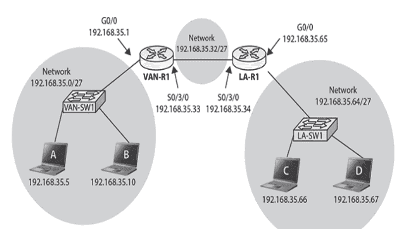

```
VAN-SW1(config)#interface vlan1
VAN-SW1(config-if)#ip address 192.168.35.98 255.255.255.224
VAN-SW1(config-if)#no shutdown
VAN-SW1(config-if)#exit
VAN-SW1(config)#ip default-gateway 192.168.35.65
```

```
VAN-SW1(config)#interface vlan1
VAN-SW1(config-if)#ip address 192.168.35.92 255.255.255.224
VAN-SW1(config-if)#no shutdown
VAN-SW1(config-if)#exit
VAN-SW1(config)#ip default-gateway 192.168.35.65
```

```
VAN-SW1(config)#interface g0/0
VAN-SW1(config-if)#ip address 192.168.35.92 255.255.255.224
VAN-SW1(config-if)#no shutdown
VAN-SW1(config-if)#exit
VAN-SW1(config)#ip default-gateway 192.168.35.65
```

```
VAN-SW1(config)#interface vlan1
VAN-SW1(config-if)#ip address 192.168.35.98 255.255.255.224
VAN-SW1(config)#ip default-gateway 192.168.35.65
```

### LA-SW1 配置命令

2. 查看以下图示左侧的命令，画一条线将其连接到该命令功能的描述。


| Command | Description |
|---|---|
| hostname VAN-SW1 | 显示与每个端口关联的 MAC 地址。 |
| no shutdown | 将端口安全配置为仅为端口学习一个 MAC 地址。 |
| ip default-gateway 12.0.0.1 | 设置设备名称。 |
| show mac address-table | 为当前连接设备的 MAC 地址配置端口安全。 |
| switchport port-security mac-address sticky | 启用接口。 |
| switchport port-security maximum 1 | 在设备上设置默认网关。 |

## 答案

- 1. C. 如果交换机在启动过程中发生故障，系统 LED 将显示琥珀色。如果系统无错误启动，系统 LED 将显示绿色。
- 2. D. 当处于双工显示模式时，如果端口以全双工模式运行，每个端口 LED 将显示绿色；但如果端口以半双工模式运行，LED 将关闭。
- 3. A. 在系统配置对话框脚本中不要求启用接口。思科交换机上默认启用接口。
- 4. C. ip default-gateway 命令是全局配置模式命令。
- 5. B. 为交换机分配 IP 地址，以便您可以使用 Telnet 或 SSH 远程管理交换机。
- 6. 若要查看 CAM 表（也称为 MAC 地址表），请使用 show mac address-table 命令。
- 7. A. 如果交换机收到一个帧，其中包含的目标地址不在 MAC 地址表中，交换机将向交换机上的所有端口泛洪该帧。
- 8. A. 端口安全用于防止未经授权访问 LAN。
- 9. **C.** 配置端口安全时，您可以配置端口安全功能，使用 sticky 选项（**switchport port-security mac-address sticky**）来授权使用该端口的系统的 MAC 地址。这样就无需在每个端口上输入每个 MAC 地址。
- 10. **D.** 端口的状态为管理关闭；这意味着该端口已被管理员禁用。
- 11. **A.** **switchport mode trunk** 命令在思科交换机上启用中继。请记住，您应在使用 **switchport trunk encapsulation dot1q** 设置封装模式后运行此命令。
- 12. **C.** **switchport access vlan** 命令将接口分配给 VLAN。您应在将接口置于访问模式后运行此命令。

## 基于性能的答案

以下是本章中基于性能的问题的答案。

- 1. 此问题颇具棘手之处，因为它实际上包含两个问题。首先，它测试您为交换机分配 IP 地址和默认网关的知识。其次，这是一个 IP 子网划分问题，因为您还需要确保所使用的命令采用正确的 IP 地址范围内的 IP 地址。

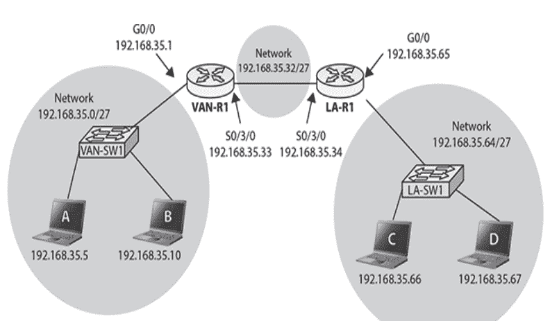

```text
VAN-SW1(config)#interface vlan 1
VAN-SW1(config-if)#ip address 192.168.35.98 255.255.255.224
VAN-SW1(config-if)#no shutdown
VAN-SW1(config-if)#exit
VAN-SW1(config)#ip default-gateway 192.168.35.65
```

```text
VAN-SW1(config)#interface g0/0
VAN-SW1(config-if)#ip address 192.168.35.92 255.255.255.224
VAN-SW1(config-if)#no shutdown
VAN-SW1(config-if)#exit
VAN-SW1(config)#ip default-gateway 192.168.35.65
```

```text
VAN-SW1(config)#interface vlan 1
VAN-SW1(config-if)#ip address 192.168.35.98 255.255.255.224
VAN-SW1(config-if)#ip default-gateway 192.168.35.65
```

## LA-SW1 配置命令

```text
VAN-SW1(config)#interface vlan 1
VAN-SW1(config-if)#ip address 192.168.35.92 255.255.255.224
VAN-SW1(config-if)#no shutdown
VAN-SW1(config-if)#exit
VAN-SW1(config)#ip default-gateway 192.168.35.65
```

- 2. 在实际思科考试中，您需要将左侧的项目拖动到右侧匹配的项目上。在本题中，您需要将交换机命令与其描述匹配。以下是此性能题的正确答案。

| Command | Description |
|---|---|
| hostname VAN-SW1 | 设置设备名称。 |
| no shutdown | 启用接口。 |
| ip default-gateway 12.0.0.1 | 在设备上设置默认网关。 |
| show mac address-table | 显示与每个端口关联的 MAC 地址。 |
| switchport port-security mac-address sticky | 为当前连接设备的 MAC 地址配置端口安全。 |
| switchport port-security maximum 1 | 将端口安全配置为仅为端口学习一个 MAC 地址。 |
