# 高级交换功能

在本章中，您将

- 了解如何设置和管理 VLAN 中继协议
- 了解生成树协议
- 了解快速生成树协议
- 了解如何管理 EtherChannel

本章是关于第 2 层功能的最后一章。大多数较大的网络实现冗余以在发生故障时保护数据；冗余可以涉及多个广域网 (WAN) 连接、第 3 层网络中的多个路径和/或第 2 层网络中的多个路径。本章侧重于第 2 层冗余以及与第 2 层环路相关的问题，包括两种通常用于解决这些问题的功能：生成树协议和 EtherChannel。

## VLAN 中继协议

VLAN 中继协议 (VTP) 是一种思科专有协议，用于在中继连接上共享思科交换机之间的虚拟局域网 (VLAN) 配置信息。VTP 使交换机能够共享并同步其 VLAN 信息，从而确保您的网络具有一致的 VLAN 配置。

假设，例如，您的网络有两台交换机，并且您需要添加一个新 VLAN。您可以通过在两台交换机上手动添加 VLAN 来轻松完成此操作。但是，如果您需要处理 30 台交换机，此过程会变得更加困难和繁琐。在这种情况下，您可能会在其中一台交换机上配置新 VLAN 时出错，例如为其分配错误的 VLAN 标识符，或者您可能会忘记将新 VLAN 添加到 30 台交换机中的某一台上。VTP 可以解决这些问题。使用 VTP，您可以在一台交换机上添加 VLAN，并让该交换机通过 VTP 消息将新 VLAN 传播到第 2 层网络中的所有其他交换机，从而导致它们也添加新 VLAN。

如果修改 VLAN 的配置或删除 VLAN，情况也是如此——VTP 可以验证您的 VLAN 配置在所有交换机上是否一致。VTP 甚至可以对 VLAN 执行一致性检查，以确保所有 VLAN 的配置完全相同。

VLAN 的组件可以包括 VLAN 编号、名称和类型。因此，例如，如果一台交换机上有一个 VLAN 编号为 1 且名称为“admin”的 VLAN，而第二台交换机上使用的名称为“administrator”用于相同的 VLAN 1，VTP 会检查并修复配置不匹配。

VTP 消息仅通过中继连接传播，因此您需要在交换机之间设置中继才能通过 VTP 共享 VLAN 信息。VTP 消息由第 2 层设备作为第 2 层组播帧传播。因此，如果路由器分隔了您的两台交换机，路由器不会将 VTP 消息从其中一个接口转发到另一个接口，因为它是第 3 层设备。

要使 VTP 正常工作，您必须将交换机与 VTP 域关联。域是一组对其应用相同 VLAN 信息的交换机。基本上，VTP 域类似于自治系统，某些路由协议使用自治系统（自治系统和路由协议在第 11 章中介绍）。交换机只能属于单个 VTP 域。VTP 域有名称，当交换机生成 VTP 消息时，它们会在消息中包含 VTP 域名。当交换机接收 VTP 消息时，仅当消息中的 VTP 域与交换机上配置的 VTP 域名相同时，才会处理 VTP 消息。换句话说，一个 VTP 域中的交换机将忽略来自其他 VTP 域中交换机的 VTP 消息。以下部分介绍 VTP 使用的组件和消息，以及它提供的一些优势，例如修剪。


**提示** VTP 是 Cisco 专有协议，可穿越中继链路。它用于在同一域内的所有交换机上创建一致的 VLAN 配置。可以在一台交换机上添加 VLAN 并将其传播到其他交换机；但是，交换机会忽略来自其他 VTP 域的 VTP 消息。

## VTP 模式

在设置 VTP 时，可以为交换机的配置选择三种不同的模式：

- 客户端
- 服务器
- 透明

表 10-1 VTP 模式描述

| 描述 | 服务器 | 客户端 | 透明 |
|---|---|---|---|
| 可以添加、修改和删除 VLAN | 是 | 否 | 是 |
| 可以生成 VTP 消息 | 是 | 否 | 否 |
| 可以传播 VTP 消息 | 是 | 是 | 是 |
| 可以接受 VTP 消息中的更改 | 是 | 是 | 否 |
| 默认 VTP 模式 | 是 | 否 | 否 |
| 将 VLAN 保存到 NVRAM | 是 | 否 | 是 |

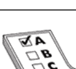

**考试提示** 新 CCNA 考试未将 VTP 列为考试主题，但你可能在现有网络中遇到 VTP。出于这个原因，本章将向你介绍 VTP。

配置为 VTP 服务器或透明模式的交换机可以添加、修改和删除 VLAN。这两种模式的主要区别在于，对透明交换机所做的配置更改仅影响 *该* 交换机，而不影响网络中的其他交换机。但是，VTP 服务器交换机会进行更改，然后将有关更改的 VTP 消息传播到其所有中继端口。如果服务器交换机接收到 VTP 消息，它将合并该更新并将消息转发出其剩余的中继端口。另一方面，透明交换机会忽略 VTP 消息——它会在中继端口上接受这些消息并将其转发出其剩余的中继端口，但不会将 VTP 消息中的更改合并到其本地 VLAN 配置中。从这个意义上说，透明交换机就像小岛，透明交换机上的更改只影响透明交换机本身，而对其他交换机的更改不会影响透明交换机。

VTP 客户端交换机本身无法更改其 VLAN 配置——它需要服务器交换机告知 VLAN 更改。当客户端交换机从服务器交换机接收到 VTP 消息时，它会合并这些更改，然后将 VTP 消息泛洪到其剩余的中继端口。

通常，你会将一台交换机设置为服务器模式，将所有其他交换机设置为客户端模式。然后，你将控制谁可以在服务器交换机上进行更改。但是，你应该牢记，如果在服务器交换机上犯了 VLAN 配置错误，此错误会 *自动传播* 到网络中的所有客户端交换机。想象一下，如果你不小心在服务器交换机上删除了一个 VLAN，并且该 VLAN 中有 500 台设备。如果发生这种情况，所有交换机都将从其配置中删除该 VLAN。

鉴于此及类似问题，一些管理员不喜欢使用 VTP 服务器和客户端模式；他们更倾向于将所有交换机配置为透明模式。但是，透明模式的问题在于其可扩展性不高；如果你需要向网络添加一个 VLAN，而你的网络有 20 台交换机，则需要手动将 VLAN 添加到每个交换机，这是一个耗时的过程。当然，这种方法的优势在于，如果在透明交换机上犯了错误，该问题 *不会* 传播到其他交换机：它是局部化的。

你也可以将所有交换机设置为服务器模式，这是 VTP 的默认设置。你甚至可以混合使用这些选项——设置几台服务器交换机，其余交换机作为客户端，或者最初将交换机设置为服务器和客户端，在服务器交换机上添加所有 VLAN，允许客户端获取此信息，然后将所有交换机更改为透明模式。此过程允许你在设置过程中轻松地以一致的 VLAN 配置填充交换机的配置。请注意，如果未为交换机指定 VTP 模式，它将默认为 *服务器*。如你所见，有多种 VTP 配置选项可供选择。

## VTP 消息

如果为 VTP 使用客户端/服务器配置，这些交换机可以生成三种类型的 VTP 消息：

- 通告请求
- 子集通告
- 摘要通告

*通告请求* 消息是客户端生成的一种 VTP 消息，用于获取 VLAN 信息，服务器会对此作出响应。当服务器响应客户端的请求时，它会生成一个 *子集通告*。此子集通告包含详细的 VLAN 配置信息，包括 VLAN 编号、名称、类型及其他信息。然后客户端会相应地配置自身。

*摘要通告* 也由处于 VTP 服务器模式的交换机生成。默认情况下，摘要通告每 5 分钟（300 秒）生成一次，或者在服务器交换机上发生配置更改时生成。与子集通告不同，摘要通告仅包含汇总的 VLAN 信息。

当服务器交换机生成 VTP 通告时，可以包含以下信息：

- VLAN 的编号和名称
- VLAN 使用的最大传输单元 (MTU) 大小
- VLAN 使用的帧格式
- VLAN 的安全关联标识符 (SAID) 值（如果是 802.10 VLAN，则需要；该 VLAN 在使用光纤分布式数据接口 [FDDI] 的网络中实现）
- 配置修订号
- VTP 域名

此列表包含几个需要进一步讨论的重要项目。如果处于同一 VTP 域中，服务器或客户端模式的交换机都会处理 VTP 消息；但是，对交换机是否应合并更改有一些限制。例如，VTP 摘要通告的一个功能是确保所有交换机都拥有最新更改。如果你在五分钟更新间隔内未对服务器交换机进行更改，当倒计时计时器到期时，服务器交换机仍会发送带有相同汇总信息的摘要通告。让拥有最新信息的其他交换机将相同信息合并到其配置中，这没有意义。

为了使此过程更高效，*配置修订号* 用于跟踪哪台服务器交换机拥有最新更改。初始时，此号码设置为零 (0)。如果你在服务器交换机上进行更改，它会递增其修订号，并通过其中继链路将此信息通告给其他交换机。当客户端或服务器交换机接收到此信息时，它会将消息中的修订号与上次接收到的消息进行比较。如果新到达的消息编号更高，则该服务器交换机必定进行了更改。如果 VTP 摘要通告中不包含所需的 VLAN 信息，则所有客户端和服务器交换机都会生成通告请求，服务器将在子集通告中响应详细信息。


**注释** VTP 服务器每五分钟生成一次 VTP 组播。*配置修订号* 用于确定哪台服务器拥有最新的 VLAN 信息：编号最高的最新。请记住，在将现有服务器交换机连接到现有服务器/客户端 VTP 网络时，修订号最高的服务器交换机将获胜，其 VLAN 将被使用。其他交换机的 VLAN 将被删除。

如果服务器交换机从另一台服务器接收到 VTP 消息，且通告服务器的修订号较低，则接收服务器交换机将使用带有其当前配置修订号的 VTP 消息响应通告服务器。这将告诉通告服务器交换机，它没有最新的 VLAN 信息，并应从拥有该信息的服务器请求。从这个意义上说，VTP 消息中使用的修订号在某些方面类似于 TCP 中使用的序列号。还要记住，透明交换机不处理这些 VTP 通告——它们只是被动地将这些消息转发到其上中继端口的其他交换机。

## VTP 修剪

VTP 修剪是一项 Cisco 功能，可使你的交换机动态地将 VLAN 添加到中继链路或从中删除 VLAN，从而创建更高效的交换网络。默认情况下，所有 VLAN 都与中继连接相关联。这意味着，如果任何 VLAN 中的设备生成广播、组播或未知单播，交换机会将此帧泛洪到与源 VLAN 端口关联的所有端口，包括中继链路。在许多情况下，这种泛洪是必要的，尤其是当 VLAN 跨越多台交换机时。但是，如果相邻交换机在源 VLAN 中没有任何活动端口，则向其泛洪帧没有意义。

### 未启用修剪的中继

在图 10-1 所示的示例中，未启用 VTP 修剪。PC-A、PC-B、PC-E 和 PC-F 位于同一 VLAN 中。如果 PC-A 生成广播，SwitchA 将此帧转发到 PC-B 连接的访问链路以及中继链路（因为中继链路是所有 VLAN 的成员，由


默认情况下）。这是合理的，因为连接到SwitchB的PC-E和PC-F位于同一VLAN中。

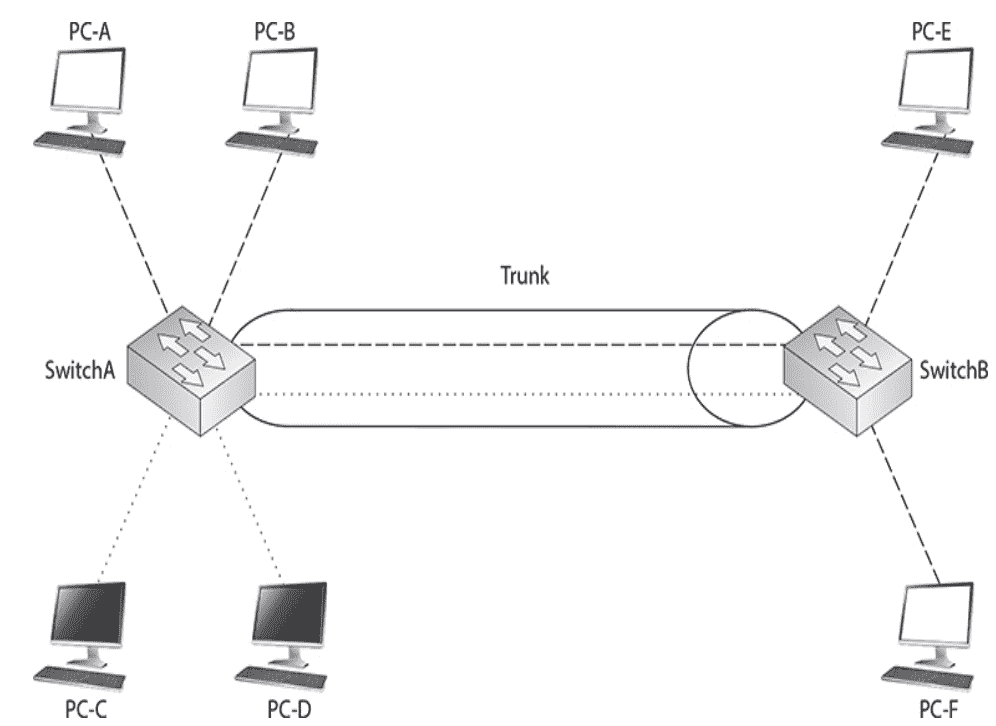

图10-1 无VTP剪枝的中继

图10-1展示了一个包含两个成员的第二个VLAN：PC-C和PC-D。如果PC-C产生本地广播，SwitchA显然会将其发送到PC-D的端口。不合理的是，SwitchA会将该广播从中继端口泛洪到SwitchB，尽管SwitchB上没有设备属于该VLAN。这是浪费带宽和资源的一个例子。在示例中，单个广播不是什么大问题；然而，如果来自PC-A的视频组播流为5 Mbps，网络在中继上可能会遇到吞吐量问题，因为交换机对待组播就像对待广播一样——它会将其泛洪到与源端口VLAN关联的所有端口。

你可以使用两种方法之一来解决这个问题：静态VLAN剪枝或动态VLAN剪枝。通过静态配置，你可以手动将非活动VLAN从两台交换机的中继上剪除，如图10-2所示。请注意，在此图中，深色VLAN（用虚线表示）已从中继上被剪除。手动剪枝的问题在于，如果你向SwitchB添加一个深色VLAN成员，你将不得不登录到两台交换机，并手动将该被剪除的VLAN添加回中继。在具有多个VLAN的多交换机网络中，这可能会变得非常混乱，因为并非每个VLAN在每台交换机上都处于活动状态。很容易意外地从一个不应被剪除的中继上剪除某个VLAN，从而造成连通性问题。

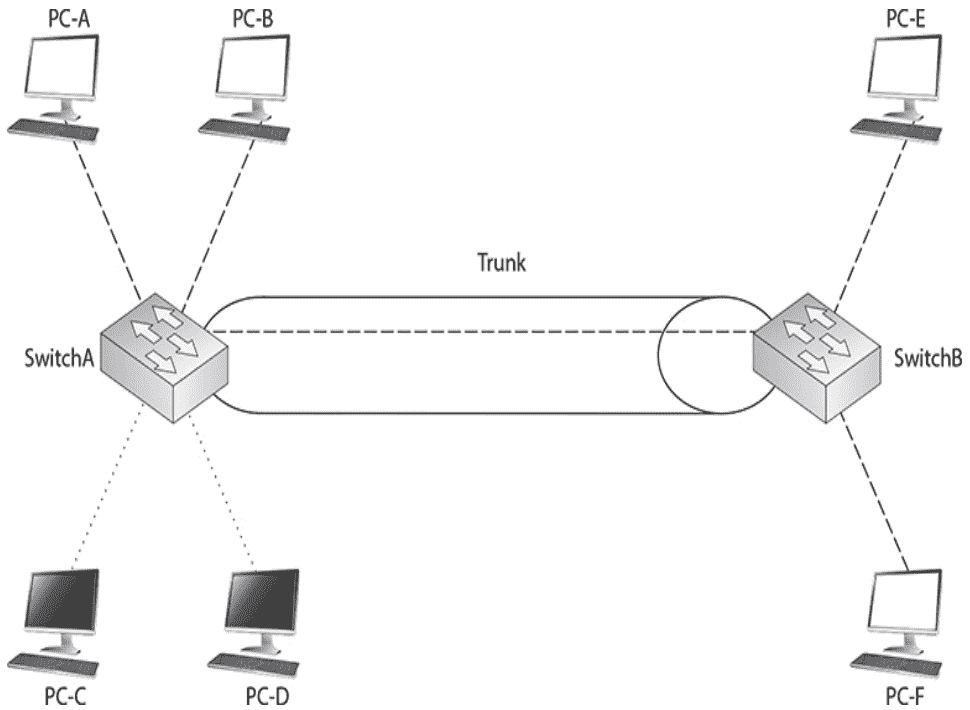

图10-2 VLAN剪枝

## 带剪枝的中继

VTP剪枝功能使交换机能够共享额外的VLAN信息，并动态地从中继连接中剪除非活动VLAN。在这种情况下，交换机之间会共享哪些VLAN处于活动状态。例如，SwitchA告诉SwitchB它有两个活动VLAN（白色VLAN和深色VLAN）。另一方面，SwitchB只有一个活动VLAN，并将这一事实告知SwitchA。基于共享的信息，SwitchA和SwitchB都意识到深色VLAN在它们的中继连接上不活动，因此深色VLAN应被动态地从中继配置中移除。

此功能的好处在于，如果你碰巧通过将设备连接到SwitchB的某个端口并将该端口分配给深色VLAN来激活SwitchB上的深色VLAN，SwitchB将通知SwitchA这一新激活的VLAN，并且两台交换机会动态地将该VLAN添加回中继配置中。这将使PC-C、PC-D和新设备能够相互发送帧，如图10-3所示。

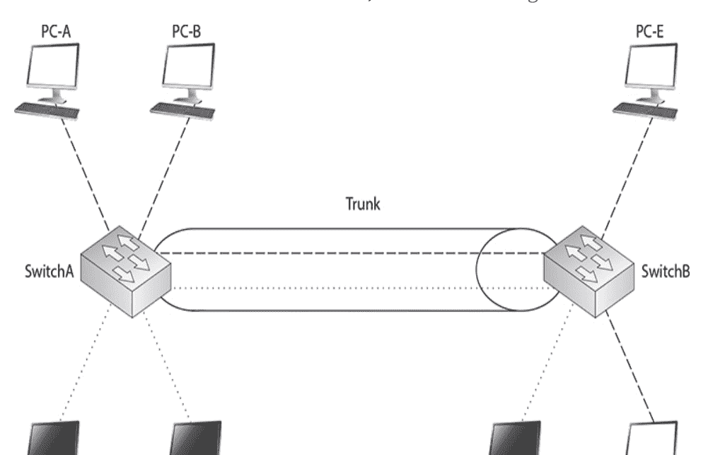

图10-3 VTP剪枝在中继上激活VLAN


**注意** 默认情况下，所有VLAN都可以通过中继传输。VTP剪枝用于在中继连接上动态删除两台交换机之间不活动的VLAN。它必须在VTP服务器交换机上启用，并且其他交换机必须是服务器或客户端。

只有处于*服务器*模式的VTP交换机才能启用VTP剪枝，域中的其余交换机必须处于VTP服务器或客户端模式。如果你有透明模式交换机，则必须手动从其中继链路上剪除VLAN。

## 管理VLAN

与Cisco路由器不同，每台Cisco交换机都带有默认配置。例如，交换机上已经存在一些预配置的VLAN，包括VLAN 1。在配置过程中，所有VLAN命令都引用VLAN编号，尽管你可以为VLAN配置可选名称。默认情况下，交换机上的每个端口都与VLAN 1关联。并且来自交换机本身的所有通信——VTP消息、Cisco发现协议（CDP）组播以及交换机产生的其他流量——都发生在VLAN 1中。回顾第9章可知，Cisco交换机的IP配置基于你为其配置IP地址的VLAN接口。

VLAN 1有时被称为*管理VLAN*，尽管你也可以使用不同的VLAN。通常的做法是将所有管理设备——交换机和网管工作站——放在它们自己的VLAN中。如果你决定将交换机放在不同于VLAN 1的VLAN中，建议你在所有管理设备上更改此配置，以便更容易地保护它们，因为其他VLAN必须通过三层设备才能访问它们；并且在这个三层设备上，你可以设置访问控制列表来过滤不需要的流量。

所有交换机都应处于同一管理VLAN中，这一点很重要，因为交换机的许多管理协议（如CDP、VTP和动态中继协议（DTP））都发生在交换机的管理VLAN内。如果一台交换机的管理VLAN设置为1，而另一台连接的交换机的管理VLAN设置为2，则这两台交换机会失去很多交换机间功能。

## 配置VTP

无论是排查现有网络设置的问题，还是自行配置VTP，了解常见的VTP参数及其值都很重要。表10-2显示了Cisco交换机的默认VTP配置。以下各节将介绍这些VTP参数的配置。

| VTP组件 | VTP默认值 |
|---|---|
| 域名 | 无 |
| 模式 | 服务器 |
| 密码 | 无 |
| 剪枝 | 禁用 |
| 版本 | 1 |

表10-2 VTP默认配置值

你在Cisco交换机的全局配置模式下配置VTP：

```
switch(config)# vtp domain VTP_domain_name
switch(config)# vtp mode server|client|transparent
switch(config)# vtp password VTP_password
switch(config)# vtp pruning
```

vtp domain 命令为你的交换机定义域名。请记住，为了使交换机共享VTP信息，它们必须位于同一域中。从其他域接收的消息将被忽略。如果你没有配置域名，交换机将从服务器通告中学习到该域名。

配置中的其余命令是可选的。第二条 vtp 命令定义交换机的VTP模式。如果你不配置此命令，默认模式为服务器模式。你可以为交换机配置VTP MD5密码，该密码必须与域中每台交换机上配置的密码匹配。交换机将使用此密码来验证来自其他交换机的VTP消息；如果VTP消息中携带的哈希值（通过将VTP消息和密码运行MD5生成哈希签名）无法通过验证，交换机将忽略这些VTP消息。在大多数交换机上，剪枝默认是禁用的，但你可以使用**vtp pruning**命令来禁用或启用它。需要注意的是，如果在服务器交换机上启用了剪枝，该服务器交换机会将此信息传播到同一域中的所有其他服务器和客户端交换机。

完成VTP配置后，使用**show vtp status**命令检查你的配置：

```
switch# show vtp status
VTP Version : 1
Configuration Revision : 17
Maximum VLANs supported locally : 255
Number of existing VLANs : 7
VTP Operating Mode : Server
VTP Domain Name : dealgroup
VTP Pruning Mode : Enabled
VTP V2 Mode : Disabled
VTP Traps Generation : Disabled
MD5 digest : 0x95 0xAB 0x29 0x44 0x32 0xA1 0x2C 0x31
Configuration last modified by 0.0.0.0 at 3-1-03 15:18:37
Local updater ID is 192.168.1.4 on interface Vlan1
(lowest numbered VLAN interface found)
```

在此示例中，已经发生了17次配置更改（请参阅配置修订号字段）。该交换机正在dealgroup域中以服务器模式运行。


**注意** **vtp password**命令用于验证交换机之间的VTP消息。**show vtp status**命令将显示


交换机正在运行的 VTP 模式、配置修订号，以及该交换机所属的 VTP 域。

使用 **show vtp counters** 命令显示有关已发送和已接收 VTP 消息的 VTP 统计信息：

```
switch# show vtp counters
VTP statistics:
    Summary advertisements received: 12
    Subset advertisements received: 0
    Request advertisements received: 0
    Summary advertisements transmitted: 7
    Subset advertisements transmitted: 0
    Request advertisements transmitted: 0
    Number of config revision errors: 0
    Number of config digest errors: 0
    Number of V1 summary errors: 0
```

在此示例中，可以看到该交换机已发送并接收了 VTP 汇总通告。

## 练习 10-1：使用 VTP

在本练习中，你将使用 VTP 将 VLAN 列表从一台交换机发送到另一台交换机，以便在所有交换机上具有一致的 VLAN 列表。使用以下网络图表示温哥华办公室中的两台交换机：

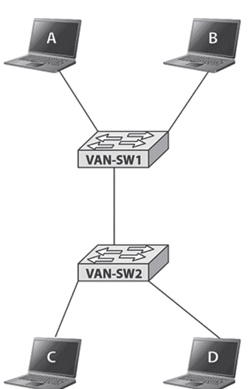

- 1. 打开两台交换机的电源。
- 2. 确保使用两台交换机上的端口 1，通过交叉线连接两台交换机。
- 3. 通过控制台登录 VAN-SW1，并使用以下命令将端口 1 配置为中继端口：
- 4. 要将 VAN-SW1 配置为 VTP 服务器，请输入以下命令：

  ```
  VAN-SW1>enable
  VAN-SW1#config term
  Enter configuration commands, one per line. End with CNTL/Z.
  VAN-SW1(config)#interface g1/0/1
  VAN-SW1(config-if)#switchport trunk encapsulation dot1q
  VAN-SW1(config-if)#switchport mode trunk
  VAN-SW1(config-if)#exit
  VAN-SW1(config)#vtp domain Lab101
  Changing VTP domain name from NULL to Lab101
  VAN-SW1(config)#vtp mode server
  Device mode already VTP SERVER.
  VAN-SW1(config)#vtp password vtppass
  Setting device VLAN database password to vtppass
  ```

- 5. 要验证 VTP 设置，请键入以下命令：

  ```
  VAN-SW1(config)#exit
  VAN-SW1#show vtp status
  ```

- 6. 使用 show vlan 命令显示 VLAN 列表。请注意，只有默认 VLAN。
- 7. 使用以下命令创建两个 VLAN：

  ```
  VAN-SW1#config term
  Enter configuration commands, one per line. End with CNTL/Z.
  VAN-SW1(config)#vlan 2
  VAN-SW1(config-vlan)#name Sales
  VAN-SW1(config-vlan)#vlan 3
  VAN-SW1(config-vlan)#name Mkt
  VAN-SW1(config-vlan)#exit
  ```

- 8. 使用 do show vlan 命令显示 VLAN 列表。注意这两个额外的 VLAN。
- 9. 通过控制台登录 VAN-SW2。
- 10. 使用 show vlan 命令显示 VLAN。请注意，只有默认 VLAN，没有 Sales 或 Mkt VLAN。
- 11. 使用 show vtp status 命令显示 VTP 信息。请注意，VTP 域已设置，但模式为 server。你需要将其更改为 client，以便 VLAN 不在该交换机上配置，但可以从服务器（VAN-SW1）接收。
- 12. 使用以下命令将 VAN-SW2 配置为 VTP client 模式，以便它可以从 VAN-SW1 接收 VLAN 列表：

  ```
  VAN-SW2#config term
  VAN-SW2(config)#vtp mode client
  VAN-SW2(config)#vtp password vtppass
  ```

- 13. 使用 show vtp status 命令验证模式已更改为 client。
- 14. 使用 show vlan 命令验证已从 VAN-SW1 交换机接收到 VLAN 列表。
- 15. 现在可以将不同接口放入 VAN-SW2 上的 Sales 和 Mkt VLAN 中。


**视频 10.01.** 本书附带的数字资源包含在两台交换机上配置 VTP 的多媒体演示。

## 生成树协议

STP 的主要功能（从逻辑上讲）是从拓扑中消除二层环路。数字设备公司（DEC，现为惠普（HP）的一部分）最初开发了 STP。电气与电子工程师协会（IEEE）增强了 STP 的初始实现，形成了 IEEE 802.1d 标准。由于 STP 的两种不同实现（DEC STP 和 802.1d）彼此不兼容，你需要确保所有设备支持其中一种。802.1d 中增加了 Rapid STP（RSTP）和 Multiple STP（MSTP）。基于这些增补，IEEE 当前的实现被称为 802.1D。Cisco 的所有交换机都支持 IEEE 802.1D 协议，并且在其交换机上默认启用；发送无标记帧（本征 VLAN）时会启用该协议。如果你的环境是混合厂商环境，其中一些设备运行 802.1D，另一些运行 DEC 的 STP，则可能会遇到二层环路问题。


**注意** 通常，IEEE 使用小写字母（例如 d）表示草案或仍在开发的状态，使用大写字母（例如 D）表示最终确定的标准。在本书中，提到 802.1d 时，指的是 IEEE 对 STP 的原始实现，不包括 RSTP 和 MSTP。RSTP 将在本章后面介绍，但 MSTP 超出了本书的范围。

## 桥协议数据单元

为使 STP 正常工作，交换机需要共享有关自身及其连接的信息。它们共享的是桥协议数据单元（BPDU），这些单元以*组播*帧的形式发送，只有其他二层交换机或网桥会侦听这些帧。交换机将使用 BPDU 来学习网络拓扑：哪台交换机连接到其他交换机，以及基于该拓扑是否存在任何二层环路。

为防止网络中出现环路，交换机会在逻辑上禁用拓扑中的一个或多个端口，以确保不存在环路。请注意，交换机实际上并不会关闭端口，而是将端口置于一种特殊的禁用状态以处理用户流量，本章后面的“端口状态”部分将对此进行讨论。当端口被置于这种特殊禁用状态时，网络中的环路就被阻止，数据在交换机之间只能沿一条路径传输。如果二层网络发生任何变化——链路断开、新增链路、新增交换机或交换机故障——交换机将共享此信息，导致 STP 算法重新执行，然后创建新的无环拓扑。

默认情况下，BPDU 每两秒发送一次。这有助于加快收敛。*收敛*是网络中的一个术语，用于描述处理变化并使网络恢复运行所需的时间。发现并解决问题的时间越短，网络恢复在线的速度就越快。将 BPDU 通告时间设置为两秒，可以使变化快速与网络中所有其他交换机共享，从而减少任何中断造成的时间。

BPDU 包含大量信息，可帮助交换机确定拓扑以及该拓扑导致的任何环路。例如，每个网桥都有一个唯一标识符，称为*网桥*或*交换机* ID。这通常是交换机的优先级和交换机本身的 MAC 地址。当交换机通告 BPDU 时，它会将自己的交换机 ID 放入 BPDU 中，以便接收交换机能够判断它正从哪台交换机接收拓扑信息。

以下各节介绍在二层网络中执行 STP 时发生的步骤。


**考试提示** 请记住，STP 是一种二层协议，用于防止网络中的环路。STP 实现 IEEE 802.1d 标准，其中涉及让交换机交换 BPDU，以帮助检测网络中的环路。*桥协议数据单元*（BPDU）消息是在交换机之间发送的特殊帧，用于共享配置和维护无环生成树网络所需的信息。BPDU 消息每两秒以组播形式发送。BPDU 包含有关网络中端口和交换机的信息。

## 根交换机

如你所知，STP 用于发现并消除二层网络中的环路。STP 算法的工作方式类似于链路状态路由协议（例如开放最短路径优先（OSPF））确保不创建三层环路的方式；当然，STP 只处理二层环路。

首先创建生成树。基本上，生成树是一棵倒置的树。树的顶部是根，在 STP 中称为*根交换机或根网桥*。从根交换机开始，分支（物理以太网连接）延伸并连接到其他交换机，然后这些交换机的分支又连接到其他交换机，依此类推。

看一下图 10-4 所示的网络物理拓扑，它展示了一棵生成树。运行 STP 时，会构建一个逻辑树结构，类似于图 10-5 所示。如图 10-5 所示，Switch-A 是根交换机，位于树的顶部。它的下方有两个分支，分别连接到 Switch-B 和 Switch-C。这两台交换机连接到 Switch-E，从而形成环路。Switch-B 还连接到 Switch-D。此时，STP 仍在运行，环路仍然存在。当 STP 运行时，交换机将确定，在四个

交换机—Switch-A、Switch-B、Switch-C、和 Switch-E—哪个端口会在逻辑上被禁用以移除环路。这确保从网络中的一台设备到任何其他设备，只会使用一条路径来连接设备。

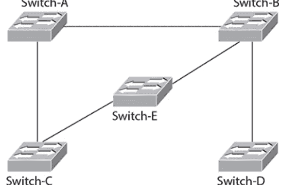

图 10-4 第二层物理环路拓扑

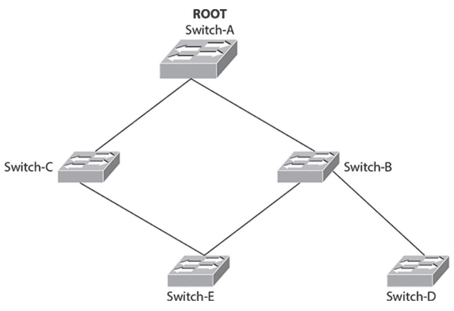

图 10-5 第二层 STP 逻辑拓扑

实际上，STP 的第一步是选举根交换机。BPDU 用于选举过程。如前所述，当设备通告 BPDU 时，交换机会将其交换机 ID 放入 BPDU 中。交换机 ID 用于选举根交换机。拥有 *最低* 交换机 ID 的交换机被选为根。交换机 ID 由两个组件组成：

- 交换机的优先级，在 Cisco 交换机上默认为 32,768（长度为 2 字节）
- 交换机的 MAC 地址（长度为 6 字节）

在 Cisco 交换机上，默认优先级为 32,768，由 IEEE 802.1d 定义。假设所有交换机均为 Cisco 交换机且未更改默认优先级，则 MAC 地址 *最低* 的交换机将被选为根交换机。您可以通过更改分配给交换机的优先级值来覆盖选举过程。如果希望某台交换机成为根，请为其分配低于 32,768 的优先级值。通过共享 BPDU，交换机将确定哪台交换机的交换机 ID 最低，并选出该交换机作为根交换机。请注意，此选举过程在每台交换机上几乎同时进行，每台交换机都会得出相同的结果。

实现 VLAN 的 Cisco Catalyst 交换机（第 9 章中讨论）会为每个 VLAN 具有不同的交换机 ID *per* VLAN 和 *单独* 的每个 VLAN STP 实例。每个 VLAN 都有自己的根交换机（可以是所有 VLAN 的同一交换机，也可以是每个 VLAN 不同的交换机）。在每个 VLAN 内，STP 将运行并移除该特定 VLAN 中的环路。Cisco 将此概念称为 *每 VLAN STP* (PVST)。此主题将在“每 VLAN 生成树+ (PVST+)”部分中稍后讨论。


**考试提示** 考试题目将要求您记住，交换机（网桥）ID 最低的交换机会被选为根交换机。

每当网络中发生拓扑变化（例如根交换机故障或添加新交换机）时，根交换机的选举过程就会发生。第 2 层拓扑中的所有其他交换机都期望在 *最大老化时间* 内收到来自根交换机的 BPDU，默认值为 20 秒。如果交换机在此期间未收到来自根的 BPDU 消息，则会假设根交换机已失败，并将启动新的选举过程以选择新的根交换机。

## 根端口

选举根交换机后，网络中的每台其他交换机都需要选择自身的一个端口，用于到达根。每台交换机上的此端口称为 *根端口*。对于某些交换机（例如图 10-4 中的 Switch-D），这非常简单——它只有一个端口可用于访问交换拓扑。但是，其他每台交换机（例如图 10-4 中的 Switch-B、Switch-C 或 Switch-E）可能有两个或多个端口可用于到达根交换机。如果有多个端口选项，需要使用智能方法来选择最佳端口。在 STP 中，选择根端口时会考虑几个因素。需要注意的是，根交换机本身永远不会有根端口——它是根，因此不需要端口来到达自身！

## 端口代价和优先级

首先，每个端口都会分配一个 *端口代价*。代价越低，端口越优，如表 10-3 中 802.1d 的代价列表所示。代价是端口带宽的反向映射。交换机始终优先选择代价较低的端口，而非代价较高的端口。每个端口也会分配一个优先级，称为 *端口优先级* 值，默认值为 32。同样，交换机会优先选择较低的优先级值，而非较高的值。

**表 10-3 STP 的端口代价**

| 连接类型 | 新代价值 |
|---|---|
| 10 Gbps | 2 |
| 1 Gbps | 4 |
| 100 Mbps | 19 |
| 10 Mbps | 100 |

## 路径代价

*路径代价* 从根交换机开始计算。路径代价基本上是从根交换机到拓扑中其他交换机的累积端口代价。当根从其接口通告 BPDU 时，BPDU 帧中的默认路径代价值为 0。当连接的交换机接收此 BPDU 时，它会将本地入站端口的代价加到路径代价上。如果该端口是 Fast Ethernet 端口，则路径代价计算如下：0（根的路径代价）+ 19（交换机的端口代价）= 19。当该交换机向其后面的交换机通告 BPDU 时，将包含更新后的路径代价。随着 BPDU 从根交换机越来越远地传播，累积路径代价值会越来越高。


**考试提示** 请记住，路径代价是在 BPDU 进入端口时递增，而不是在通告 BPDU 时。

## 根端口选择

如果交换机有两个或多个路径可选以到达根，则需要选择一条路径，因此只有一个根端口。交换机在选择根端口时将经历以下 STP 步骤：

- 1. 在两个或多个可选路径中，选择到达根的累积路径代价 *最低* 的路径。
- 2. 如果存在多个累积路径代价相同的可达根的路径，交换机将选择 *交换机 ID 值最低* 的相邻交换机（即交换机将通过该交换机到达根）。
- 3. 如果多条路径均通过同一相邻交换机，则选择优先级值最低的本地端口。
- 4. 如果端口之间的优先级值相同，交换机将选择交换机上物理编号最低的端口。例如，在 2960 上，这将是 FastEthernet 0/1 或 Gigabit 0/1。

经过此选择过程后，交换机将只有一个、且只有一个端口将成为其根端口。


**考试提示** 您将被测试在交换机上选择根端口所使用的四个步骤。

## 指定端口

您现在知道，每台交换机都有一个用于到达根交换机的根端口。除了每台交换机有一个根端口之外，每个网段也有一个用于到达根的端口，此端口称为指定端口。例如，假设一个网段连接了两台交换机，其中一台交换机将把此网段的流量转发到网络的其余部分。

运行 STP 的第三步是为网络中的每个网段在单台交换机上选举一个指定端口。选定的交换机（及其端口）应具有到达根交换机的最佳路径。以下是交换机在确定哪台交换机上的哪个端口将被选为特定 LAN 网段的指定端口时所采取的步骤：

- 1. 将使用网段中累积路径代价到根交换机 *最低* 的连接交换机。
- 2. 如果两台交换机之间的累积路径代价相同，则选择交换机 ID 最低的交换机。
- 3. 如果碰巧是同一台交换机，但与 LAN 网段有两个单独连接，则选择优先级最低的交换机端口。
- 4. 如果仍然平局（该交换机上的端口优先级相同），则选择交换机上物理编号最低的端口。

在对每个网段执行这些步骤后，每个网段将有一个连接交换机上的单一指定端口，用于到达根交换机。有时包含指定端口的交换机被称为 *指定交换机*。然而，此术语具有误导性，因为负责转发流量的是交换机上的端口。交换机可能连接到两个网段，但可能仅是其中一个网段的指定交换机；另一台交换机可能为第二个网段提供指定端口。


**考试提示** 请记住为 CCNA 考试为网段选择指定端口的四个步骤。

有趣的是，根交换机上 *每个* 活动端口都是指定端口。这很合理，因为连接网段到达根的代价为 0，即最低的累积代价值。换句话说，这些 LAN 网段中的每一个都直接连接到根交换机，因此实际上，网段到达根交换机本身不需要任何代价。

## 端口状态

参与 STP 时，端口可以处于以下五种状态之一：

- 阻塞
- 监听
- 学习
- 转发
- 禁用

在五种状态中，算法运行时仅使用前四种。以下部分将介绍 STP 的这些端口状态。


**视频** 10.02. 本书附带的数字资源中包含一个多媒体演示，展示了如何使用STP防止二层环路。

## 阻塞状态

端口在以下三种情况之一会进入*阻塞*状态：

- 在选举根交换机期间（例如，当您打开网络中的所有交换机时）
- 当交换机在某个端口上收到BPDU，表明存在一条比该交换机当前用于到达根的端口更好的路径时
- 如果端口不是根端口或指定端口

处于阻塞状态的端口默认将保持该状态20秒（最大老化计时器）。在此状态下，端口仅监听和处理其接口上的BPDU。交换机在阻塞端口上收到的任何其他帧都将被丢弃。在阻塞状态下，交换机试图确定哪个端口将成为根端口，交换机上哪些端口需要成为指定端口，以及哪些端口将保持阻塞状态以断开任何环路。

## 监听状态

20秒计时器到期后，根端口或指定端口将进入*监听*状态。任何其他端口将保持阻塞状态。在监听状态下，端口仍在监听BPDU并再次检查二层拓扑。同样，在此状态下端口处理的唯一流量由BPDU组成；所有其他流量都被丢弃。端口将在此状态下保持*转发延迟计时器*的时长。此值的默认值为15秒。

## 学习状态

从监听状态，根端口和指定端口进入*学习*状态。在*学习*状态下，端口仍在监听和处理端口上的BPDU；但是，与监听状态不同，端口开始处理用户帧。在处理用户帧时，交换机检查帧中的源地址并更新其MAC或端口地址表，但交换机仍不将这些帧从目标端口转发出去。端口在此状态下保持转发延迟时间（默认15秒）的时长。

## 转发状态

最后，在转发延迟计时器到期后，处于学习状态的端口进入*转发*状态。在转发状态下，端口将处理BPDU，使用收到的帧更新其MAC地址表，并通过端口*转发*用户流量。

## 禁用状态

*禁用*状态是一种特殊的端口状态。处于禁用状态的端口不参与STP。这可能是因为端口已被管理员手动关闭、手动从STP中移除、因安全问题被禁用，或因缺少物理层信号（例如跳线被拔出）而无法正常工作。


**考试提示** 记住STP（802.1d）中使用的四个主要端口状态：阻塞（20秒）、监听（15秒）、学习（15秒）和转发。STP收敛可能需要30到50秒。如果发现新的根或网络中出现拓扑变化（添加新交换机或交换机上端口状态发生变化），STP必须重新计算。还要记住以下几点：在阻塞和监听状态下，只处理BPDU。在学习状态下，正在构建MAC地址表。在转发状态下，用户帧在端口之间移动。STP将端口置于阻塞状态以消除环路。

## 二层收敛

正如您在上一节中应该注意到的，STP经历一个分阶段的过程，这会*减慢*收敛速度。对于交换机，一旦STP完成，收敛即发生：根交换机被选举，根端口和指定端口被选定，根端口和指定端口处于转发状态，所有其他端口处于阻塞状态。

如果端口必须经历所有四个状态，收敛需要50秒：阻塞20秒，监听15秒，学习15秒。如果端口不必经历阻塞状态而从监听状态开始，收敛只需要30秒。这通常发生在根端口仍然有效但发生了另一个拓扑变化时。请记住，在此期间（直到端口达到转发状态），没有用户流量通过端口转发。因此，如果用户正在进行telnet会话，而STP正在重新计算，那么从用户的角度来看，telnet会话会显得停滞或连接似乎已丢失。显然，用户会注意到这种中断。


**考试提示** 记住，对于CCNA考试，当所有根端口和指定端口处于转发状态且所有其他端口处于阻塞状态时，STP收敛已完成。

## PortFast概述

收敛发生得越快，对用户造成的中断就越少。您可以减少这两个计时器以加速收敛时间，但如果您在更改它们时不清楚自己在做什么，这可能会产生更多问题。对于用户端口，您可以使用*PortFast*功能来加速收敛。PortFast应仅用于不会产生二层环路的端口，例如连接到PC、服务器和路由器的端口（有时称为用户端口或边缘端口）。

启用PortFast的端口始终处于转发状态——即使STP正在运行且根端口和指定端口正在经历其不同状态，也是如此。因此，当STP运行时，同一交换机上的PortFast端口仍然可以在彼此之间转发流量，从而在一定程度上限制STP中断。但是，如果这些设备想与其他交换机上连接的设备通信，它们必须等到STP完成且根端口和指定端口已进入转发状态。

当您想在工作站上使用预启动执行环境（PXE）引导时，PortFast是一个很好的配置选项，因为引导设备在启动时会立即尝试联系DHCP服务器。如果在此场景中不使用PortFast，工作站将无法在STP的50秒计时器到期之前联系到DHCP服务器。PortFast就是解决方案！


**警告** 连接到非交换机设备（如PC、服务器和路由器）的端口应配置PortFast。但是，请确保不要在连接到另一台二层交换机的端口上启用PortFast，因为您可能无意中创建二层环路，从而导致网络瘫痪。

## PortFast配置

PortFast适用于Cisco交换机支持的所有STP版本。配置PortFast功能很简单，您可以在全局或逐接口的基础上启用它。要在全局启用它，请使用以下命令：

```
Switch(config)# spanning-tree portfast default
```

此命令在交换机上的所有非中继端口上启用PortFast。

要在接口上启用PortFast，请使用以下配置：

```
Switch(config)# interface type [slot_#]/port_#
Switch(config-if)# spanning-tree portfast [trunk]
```

可选的**trunk**参数可在到非交换机设备（例如带有中继卡的路由器或服务器）的中继连接上启用PortFast。

## BPDU Guard功能

BPDU Guard用于配置了PortFast功能的端口。在这种情况下，如果PortFast端口收到BPDU，交换机会立即禁用该端口。请记住，PortFast用于非交换机端口以使其保持转发状态；其假设是PortFast端口未连接到交换机，因此不应接收BPDU。

要启用BPDU Guard，请使用以下全局配置命令：

```
Switch(config)# spanning-tree portfast bpduguard default
```

使用 **show spanning-tree summary totals** 命令验证您的配置：

```
Switch# show spanning-tree summary totals
Root bridge for: none.
PortFast BPDU Guard is enabled
UplinkFast is disabled
BackboneFast is disabled
Spanning tree default pathcost method used is short
```

| 名称 | 阻塞 | 监听 | 学习 | 转发 | STP活动 |
|------|----------|-----------|----------|------------|------------|
| 1个VLAN | 0 | 0 | 0 | 1 | 1 |

在收到BPDU时，BPDU Guard操作会禁用配置了PortFast的端口。BPDU Guard将端口转换为errdisable（错误禁用）状态，并在控制台上显示一条消息。以下是此消息的示例：

```
2001 May 23 18:13:12 %SPANTREE-2-RX_PORTFAST:Received BPDU on PortFast enable port. Disabling 1/0/4
```

当端口处于错误禁用状态时，使用 **errdisable recovery cause bpduguard** 命令移除错误禁用状态：


```
Switch(config)# errdisable recovery cause bpduguard
```

请注意，执行此命令时，您处于全局配置模式。

或者，您可以通过配置带有间隔（以秒为单位）的命令，让交换机定期执行此操作：

```
Switch(config)# errdisable recovery interval seconds
```

此命令将每隔 x 秒自动清除所有端口上的所有 errdisable 状态，包括 BPDU 违规。但是，如果再次发生 BPDU 违规，端口将重新进入 errdisable 状态。


**考试提示** 对于 CCNA 考试，请记住：当在配置了 PortFast 的端口上收到 BPDU 时，BPDU Guard 会通过将该端口置于错误禁用状态来立即禁用该端口。

## 每 VLAN 生成树增强版（PVST+）

STP 并不能保证优化、无环的网络。例如，看一下图 10-6 所示的网络，这是一个设计不佳的网络示例。在此示例中，网络有两个 VLAN，根交换机是 Switch-8。X 标记的是被置于阻塞状态以消除环路的端口。如果查看 VLAN 2 的此配置，它显然不是最优的。例如，Switch-1 上的 VLAN 2 设备如果要访问 Switch-4 上的 VLAN 2 设备，必须经过 Switch-2、3、6、9、8，然后到 4。同样，Switch-5 或 Switch-7 上的 VLAN 1 设备如果要访问 Switch-4 上的 VLAN 1 设备，必须先将流量转发到 Switch-8，然后再转发到 Switch-4。

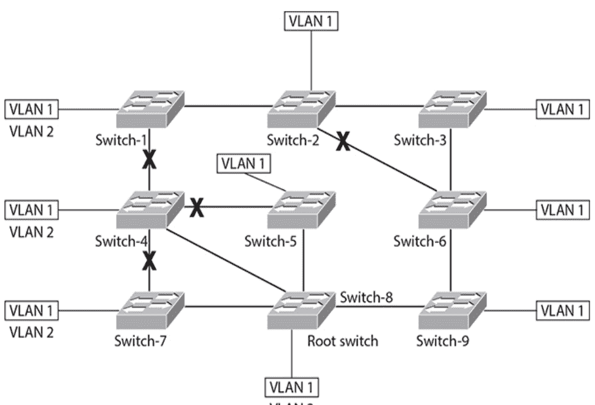

**图 10-6 STP 与 VLAN**

当只运行一个 STP 实例时，这被称为*公共生成树（CST）*。Cisco 还支持一种称为*每 VLAN 生成树增强版（PVST+）*的进程。使用 PVST+ 时，*每个* VLAN 都有自己的 STP 实例，拥有自己的根交换机、自己的优先级组和自己的 BPDU 组。在此场景中，BPDU 有一个附加字段，该字段是交换机或网桥 ID 的组成部分，包含以下三个子字段：交换机优先级、扩展系统 ID 和交换机的 MAC 地址。扩展系统 ID 是一个新字段，携带该 STP 实例的 VLAN ID（VID）。

添加此字段后，可以在不同 VLAN 中的交换机上设置不同的优先级；因此，您就可以拥有多个根交换机——每个 VLAN 一个。默认情况下，PVST+ 中的每个 VLAN 都会形成自己的无环拓扑。当然，PVST+ 和 CST 一样，不会自动创建优化的无环网络；但是，您可以在*每个* VLAN 中更改 STP 设置，以优化每个单独 VLAN 的流量模式。强烈建议您为每个 VLAN 调整 STP 以进行优化。PVST+ 的另一个优点是，如果一个 VLAN 中发生 STP 更改，不会影响其他 VLAN 的其他 STP 实例，从而使拓扑更加稳定。鉴于此，强烈建议您实施 VTP 剪枝，以从未使用这些 VLAN 的交换机中继上修剪掉这些 VLAN。本章前面的“VTP 剪枝”一节已讨论过剪枝。


**考试提示** 请记住，对于 CCNA 考试，PVST+ 支持每个 VLAN 一个 STP 实例，使您能够为每个 VLAN 调整出最优路径。CST 为*所有* VLAN 仅支持一个 STP 实例。

## 简单的 STP 示例

为了帮助您更熟悉 802.1d STP 的工作原理，让我们看一个 STP 实际运行的示例。以图 10-7 所示的网络为起点，并假设这些交换机不支持本章后面讨论的快速生成树（RSTP），仅支持 802.1d STP。我还假设只有一个 VLAN。每台交换机上的端口都用字母和数字标记。字母是端口标识符，数字是 BPDU 进入该端口时该端口的开销。

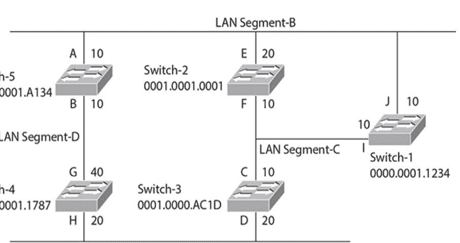

**图 10-7 STP 示例网络**

### 选举根交换机

所有这些交换机启动后，发生的第一件事就是选举根交换机。交换机之间相互共享 BPDU 以选举根交换机。在此示例中，所有交换机均使用默认优先级（32,768）。请记住，交换机 ID 最低的交换机将被选举为根交换机。由于所有交换机具有相同的优先级，因此 MAC 地址最低的交换机（即 Switch-1）被选为根交换机。根据选举过程，新的网络拓扑如图 10-8 所示。

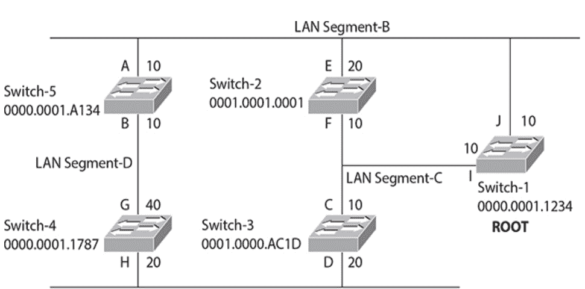

**图 10-8 根交换机选举**

### 为每台交换机选择根端口

选举出根交换机后，每台非根交换机必须选择一个用于到达根交换机的根端口。让我们逐台交换机来看，以便您详细了解决策过程。对于 Switch-1（即根交换机），没有根端口——如果您还记得的话，根交换机上的所有端口都是指定端口。

Switch-2 有两个端口可用于到达根交换机：E 和 F。当 Switch-1 在端口 I 和 J 上生成 BPDU 时，原始路径开销设置为 0。当这些 BPDU 被其他交换机接收时，接收交换机会将路径开销增加接收该 BPDU 的端口开销。当 BPDU 进入端口 E 时，Switch-2 将路径开销增加到 20；对于端口 F，开销为 10。Switch-2 首先要做的检查是比较路径开销。端口 F 的路径开销最优，因此被选为根端口，如图 10-9 中的 RP 所示。Switch-3 也有两条到达根交换机的路径：通过端口 C 和 D。端口 C 的累计路径开销为 10，而端口 D 的开销为 70。因此，端口 C 被选为根端口。Switch-4 也有两个可用于访问根交换机的端口：H 和 G。端口 H 的累计路径开销为 30，而端口 G 的开销为 50，这导致 Switch-4 选择端口 H 作为根端口。Switch-5 的两个端口 A 和 B 的累计路径开销分别为 10 和 40，这导致 Switch-5 选择端口 A 作为根端口。请注意，网络中的所有交换机同时运行 STP，并自行确定根交换机的位置以及自己的哪个端口应为根端口。下一节讨论的为网段选择指定端口也是如此。

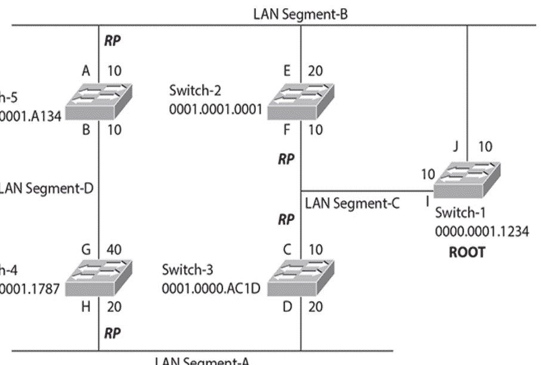

**图 10-9 根端口**

### 为每个网段选择指定端口

选择根端口后，每台交换机将逐段确定其连接到该网段的端口是否应为指定端口。请记住，网段上的指定端口负责在该网段与第 2 层网络的其余部分之间来回传输流量。当然，网段本身完全不知道选择指定端口的这一过程——这是交换机在自行确定的。

在选择指定端口时，首先要检查的是（连接到该网段的）交换机到达根交换机的累计路径开销。对于连接到同一网段的两台交换机，累计路径开销最低的交换机将成为该网段的指定交换机，其连接到该网段的端口将成为指定端口。

回到我们的网络示例，让我们从最简单的网段开始：B 和 C。对于 LAN 网段 B，Switch-1 的累计路径开销为 0，Switch-2 为 20，Switch-5 为 10。由于根交换机（Switch-1）的累计路径开销最低，其本地端口（J）成为 LAN 网段 B 的指定端口。LAN 网段 C 也是如此——根交换机的累计路径开销最低（0），使 Switch-1 上的端口 I 成为 LAN 网段 C 的指定端口。

LAN 网段 A 有两个候选端口：Switch-3 的端口 D 和 Switch-4 的端口 H。Switch-3 的累计路径开销较低：10，而 Switch-4 为 50。因此，Switch-3 的端口 D 成为 LAN 网段 A 的指定端口。

LAN 网段 D 也有两个指定端口候选：Switch-5 的端口 B 和 Switch-4 的端口 G。Switch-5 的累计路径开销为 10，Switch-4 为 30。因此，Switch-5 的端口 B 成为 LAN 网段 D 的指定端口。

图 10-10 显示了我们的网络更新后的 STP 拓扑，其中 DP 代表各 LAN 网段的指定端口。

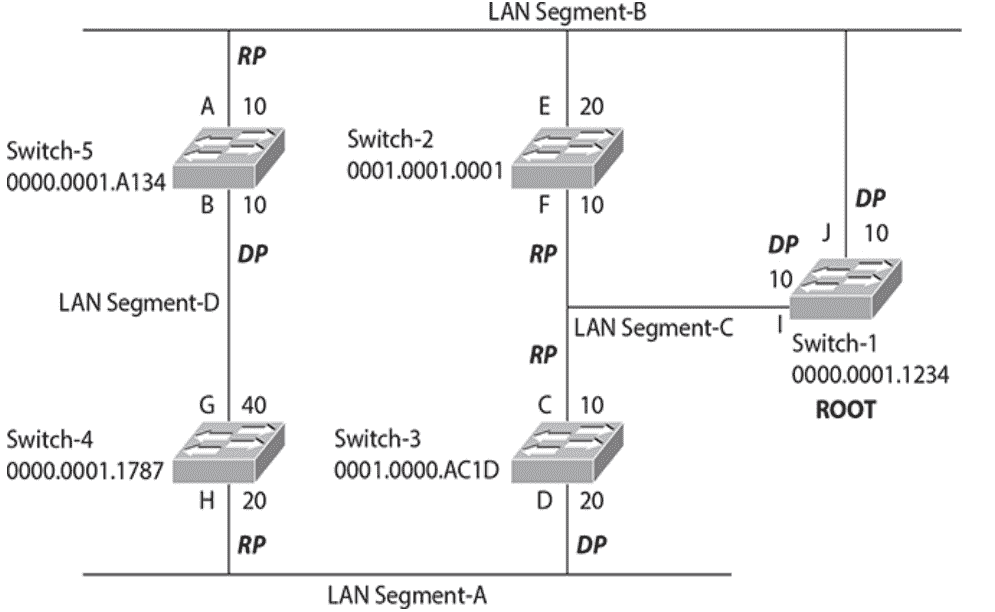


## 更改端口状态

图10-10 根端口和指定端口

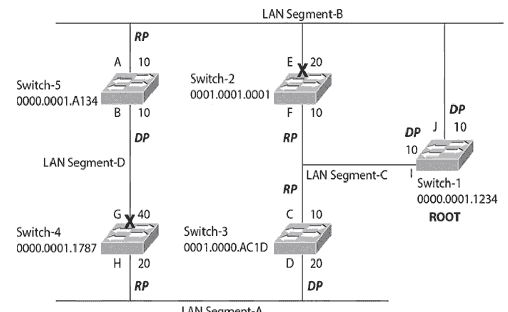

指定端口选定后，交换机将使其根端口和指定端口经历各种状态——阻塞、侦听、学习和转发——而任何其他端口将保持阻塞状态。图10-11显示了处于阻塞状态的端口，用X标示。请记住，在Switch-2上，只有端口F（根端口）处于转发状态：端口E将保持阻塞状态。在此示例中，有两个端口留在阻塞状态：Switch-2的端口E和Switch-4的端口G。

图10-11 处于阻塞状态的端口


**注意** STP仅保证二层无环拓扑——它并不保证最优拓扑！例如，在图10-10所示的网络中，LAN网段A上的网络设备必须经过Switch-3、Switch-1和Switch-5才能到达LAN网段D，因为Switch-4的端口G处于阻塞状态。

## 快速生成树协议

802.1d标准设计时，等待30到50秒以实现二层收敛并不是问题。然而，在当今的网络中，对于使用实时应用（如IP语音（VoIP）或视频）的网络，这可能会导致严重的性能问题。为克服这些问题，思科开发了名为PortFast（前面已讨论）、UplinkFast和BackboneFast的专有桥接特性。然而，这些特性的问题在于它们是思科专有的。

RSTP是IEEE标准，定义于802.1w，可与802.1d互操作，并且是对802.1d的扩展。在RSTP中，只有三种端口状态：

- 丢弃
- 学习
- 转发

处于丢弃状态的端口基本上是802.1d中阻塞、侦听和禁用状态的合并。以下各节介绍RSTP中包含的一些增强功能。


**注意** RSTP向后兼容802.1d。

### 额外的端口角色

在RSTP中，仍然有根交换机，也仍然有根端口和指定端口，它们承担与802.1d中相同的角色。但是，RSTP增加了两种额外的端口类型：*替代*端口和*备份*端口。这两种端口类似于802.1d中处于阻塞状态的端口。替代端口具有一条或多条通往根的替代路径，但当前处于丢弃状态。备份端口位于可用于到达根交换机的网段上，但该网段已经指定了一个活动端口。可以这样理解：替代端口是备用且未使用的根端口，备份端口是备用且未使用的指定端口。RSTP中第三个端口角色变化是：不再有阻塞状态；它已被*丢弃*状态取代。所有端口要么处于转发状态，要么处于丢弃状态：根端口和指定端口处于转发状态——所有其他端口处于丢弃状态。

鉴于这些新的端口角色，RSTP计算最终生成树拓扑的方式与802.1d相同。一些术语被更改和扩展，用于缩短收敛时间，正如你将在后面的“RSTP收敛特性”一节中看到的那样。


**考试提示** 对于CCNA考试，要知道RSTP引入的新端口状态包括替代端口、备份端口和丢弃端口。RSTP中所有活动端口要么处于转发、学习，要么处于丢弃状态。一旦所有端口都处于转发或丢弃（阻塞）状态，RSTP就已收敛。

### RSTP BPDU

802.1w标准对BPDU引入了一项变化。BPDU中增加了一些额外的标志，以便交换机能够共享关于BPDU发出或离开的端口角色的信息。当网络中发生变更时，这可以帮助相邻交换机更快收敛。

在802.1d中，如果交换机在最大老化时间（20秒）内没有看到根BPDU，STP就会运行，选出新的根交换机，并创建新的无环拓扑。这是一个耗时的过程。在802.1w中，如果在三个预期的hello周期（6秒）内未收到BPDU，STP信息可以立即老化，交换机认为其邻居已丢失，并应采取措施。这与802.1d不同，在802.1d中交换机必须错过来自根的BPDU。在802.1w中，如果交换机连续错过邻居的三个hello报文，就会立即采取措施。

### RSTP收敛特性

802.1w标准包含新的收敛特性，与思科专有的UplinkFast和BackboneFast特性非常相似。第一个特性类似于思科的BackboneFast特性，允许交换机接受劣质BPDU。

请查看图10-12以理解劣质BPDU特性。在此示例中，根桥是Switch-A。Switch-B和Switch-C上直接连接到根的端口都是根端口。对于Switch-B和Switch-C之间的网段，Switch-B提供指定端口，Switch-C提供备份端口（该网段到达根的辅助方式）。Switch-B还通过Switch-C的BPDU得知，其指定端口是替代端口（该交换机到达根的辅助方式）。

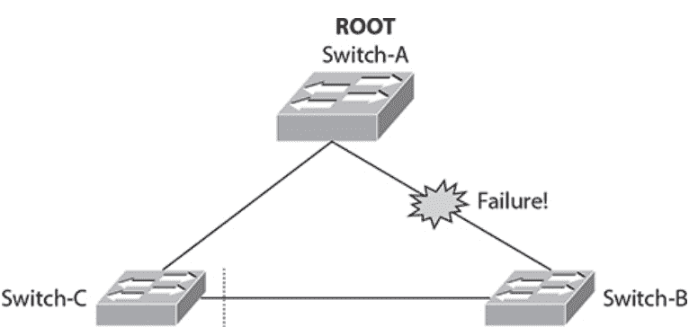

图10-12 接受劣质BPDU

继续图10-12的示例，根与Switch-B之间的链路发生故障。Switch-B可以通过以下方式检测到这一点：要么错过来自根端口的三个hello报文，要么检测到物理层故障。如果运行的是802.1d，Switch-B会看到经由Switch-C传来的劣质根BPDU（更差的开销值），因此所有端口都必须经过阻塞、侦听和学习状态，默认情况下需要50秒才能收敛。借助劣质BPDU特性，假设Switch-B知道Switch-C为其直接连接的网段有一个替代端口，Switch-B可以通知Switch-C使用其替代端口并将其改为指定端口，而Switch-B会将其指定端口改为根端口。这个过程只需几秒钟，甚至可能更短。

802.1w引入的第二个收敛特性是*快速过渡*。快速过渡包括两个新组件：边缘端口和链路类型。边缘端口是连接到非二层设备（例如PC、服务器或路由器）的端口。RSTP使边缘端口快速过渡到转发状态，这与思科专有的PortFast相同。这些端口状态的变化不会影响RSTP而导致重新计算，而其他端口类型的变化会使这些端口保持转发状态。

在RSTP中，快速过渡只能发生在边缘端口和点对点（P2P）链路上。链路类型根据连接的双工方式自动确定。交换机假设：如果两个交换机之间的端口配置为全双工，则该端口可以快速过渡到不同状态，而无需等待任何计时器到期。如果是半双工，此特性默认不会生效，但你可以为P2P半双工交换机链路手动启用它。

让我们使用图10-13中的拓扑来看一个P2P链路快速过渡的示例。图10-13中的拓扑与图10-12所示的拓扑相同，不同之处在于图10-13中Switch-A（根）与Switch-C之间的链路发生故障。发生这种情况时，Switch-C无法再通过其根端口到达Switch-A。但是，查看其从Switch-A和Switch-B收到的BPDU，Switch-C知道可以通过Switch-B到达根，并且Switch-B为Switch-B和Switch-C之间的网段提供指定端口（该端口处于转发状态）。Switch-C知道这一点后，将备份端口的状态改为根端口，并立即将其置为转发状态，同时通知Switch-B这一变更。此更新通常不到一秒，


假设根交换机与Switch-C之间的链路故障是物理链路故障，而不是连续丢失三个Hello BPDU。

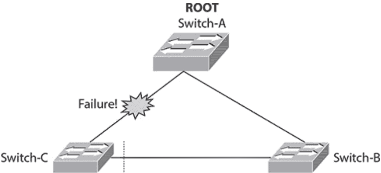

图10-13 快速迁移示例


**考试提示** 请记住，在CCNA考试中，RSTP在点对点（P2P）链路上的收敛速度远快于原始IEEE STP（802.1d）。

## RSTP 配置

思科交换机支持三种STP类型，如表10-4所示。思科交换机的默认配置是每个VLAN单独运行一个STP实例，所有VLAN共享一个根交换机，并且没有负载分担。

**表10-4 STP类型**

| STP | 描述 |
|---|---|
| PVST+ | 802.1d 每VLAN，带有思科专有扩展（PortFast、UplinkFast、BackboneFast） |
| PVRST+ | 802.1w (RSTP) 每VLAN |
| 多生成树协议（MSTP） | 802.1s，称为多生成树，将思科PVST+与IEEE标准相结合 |

本书仅关注PVRST+，而且只是简要介绍。要启用PVRST+，请使用以下命令：

```
Switch(config)# spanning-tree mode rapid-pvst
```

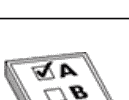

**考试提示** 请记住，在CCNA考试中，**spanning-tree mode rapid-pvst** 命令可在IOS交换机上启用RSTP。

启用后，可以使用以下命令按VLAN查看STP：

```
Switch# show spanning-tree vlan VLAN_# [detail]
```

以下是该命令的示例：

```
Switch# show spanning-tree vlan 10
VLAN0010
Spanning tree enabled protocol rstp
Root ID Priority 32768
This bridge is root
Hello Time 2 sec Max Age 20 sec Forward Delay 15 sec
Bridge ID Priority 32768 (priority 32768 sys-id-ext 10)
Address 0000.01c1.1111
Hello Time 2 sec Max Age 20 sec Forward Delay 15 sec
Aging Time 300
Interface Role Sts Cost Prio.Nbr Type
-------- ---- --- ---- -------- ----
Fa0/1 Desg FWD 19 128.1 P2p
Fa0/2 Desg FWD 19 128.2 P2p
Fa0/3 Desg FWD 19 128.3 P2p
. 
. 
.
```

在此示例中，该交换机是VLAN 10的根交换机，并且正在使用RSTP。请注意，其所有端口都是指定端口（Desg）并处于转发状态（FWD）——如果所有活动端口都如此，那么该交换机就是根交换机，此处确实如此，如输出的第四行（This bridge is root）所示。


**考试提示** 请熟悉考试中 **show spanning-tree vlan** 和 **show spanning-tree interface** 命令的输出。

你还可以使用 **show spanning-tree interface** 命令按端口检查STP。以下是一个示例：

```
Switch# show spanning-tree interface fastethernet 1/0/5
Vlan Role Sts Cost Prio.Nbr Type
----- ---- --- ---- -------- ----
VLAN0001 Root FWD 19 128.1 P2P
VLAN0002 Altn DIS 19 128.2 P2P
VLAN0003 Root FWD 19 128.2 P2P
```

在此示例中，F1/0/5是VLAN 2中的备用端口，原因可能是它到根桥的路径开销更高，或者存在平局且该邻居的桥ID更大。


**提示** 要排除PVRST+的问题，请使用 **debug spanning-tree pvst+** 命令；要排除STP中端口状态变化的问题，请使用 **debug spanning-tree switch state**。

## PVST+ 和 RSTP 优化

为了理解PVST+和RSTP提供的优势，请查看图10-14。此示例显示了编号为1和2的两个VLAN。思科交换机的默认行为是，根据交换机ID最低的交换机，所有VLAN共用一台根交换机。在此例中，就是Switch-A。请注意，根据RSTP的计算，Switch-C为其两个VLAN都禁用了到Switch-B的端口。这种设计的缺点是，在到分布层的两条连接中，接入交换机上只有一条被使用。

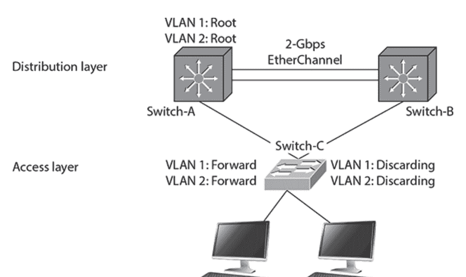

**图10-14 PVST+ 和 RSTP 非优化**

一个更好的设计如图10-15所示。然而，要获得这种拓扑，你必须调整你的网络，确保Switch-A是VLAN 1的根交换机，Switch-B是VLAN 2的根交换机。通过这种设计，你实际上可以同时利用接入层交换机到分布层交换机的两条上行链路。在图10-15中，VLAN 1将使用左侧上行链路连接，VLAN 2使用右侧上行链路连接。

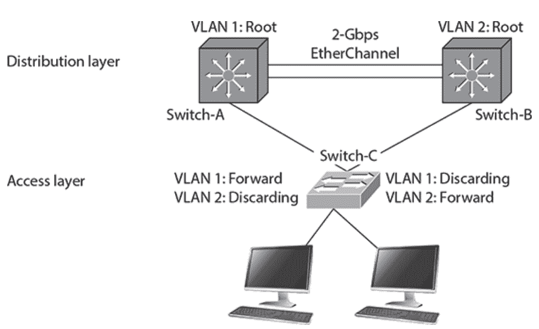

**图10-15 PVST+ 和 RSTP 优化**


**注意** 基于图10-15的设计，你应该确保VLAN 1的默认网关是Switch-A（假设它是三层交换机），VLAN 2的默认网关是Switch-B（假设它是三层交换机）。如果你没有这样配置，而是将默认网关关联到Switch-A，那么VLAN 2的流量将不得不从接入层交换机发送到Switch-B，然后通过EtherChannel跨接到Switch-A，才能离开子网。你可以在思科的CCNP交换课程中了解更多相关信息。

请记住，图10-15中的拓扑是由你创建的：你必须手动更改每台交换机的优先级，以创建所需的拓扑。用于实现此目标的命令包括以下内容：

```
Switch(config)# spanning-tree vlan VLAN_# root primary
Switch(config)# spanning-tree vlan VLAN_# root secondary
Switch(config)# spanning-tree vlan VLAN_# priority priority_#
```

请记住，交换机的默认优先级是32,768。第一条命令将指定VLAN的交换机优先级更改为4096。第二条命令将指定VLAN的交换机优先级更改为8192。第三条命令允许你为指定的VLAN自定义优先级。

基于图10-15中的示例，Switch-A的配置如下所示：

```
Switch-A(config)# spanning-tree mode rapid-pvst
Switch-A(config)# spanning-tree vlan 1 root primary
Switch-A(config)# spanning-tree vlan 2 root secondary
```

Switch-B的配置如下所示：

```
Switch-B(config)# spanning-tree mode rapid-pvst
Switch-B(config)# spanning-tree vlan 2 root primary
Switch-B(config)# spanning-tree vlan 1 root secondary
```

这两个配置之间唯一的区别是，主备根优先级在两个VLAN上进行了互换，以便能够使用来自接入层交换机Switch-C的两条上行链路。

**注意** 你在交换机上所做的任何STP配置更改都会立即生效，这意味着二层网络必须重新收敛，从而导致二层网络出现短暂中断。

## STP 故障排除

排查环网引起的问题可能是一项困难的任务。本节介绍一些简单的步骤，你可以据此识别并修复二层环路问题。

在讨论不同的二层环路问题之前，我想先定义一下*广播风暴*。交换机会将广播消息发送到交换机上的所有端口（接收该消息的端口除外）。如果存在二层环路，这意味着交换机之间存在多条路径，广播消息会从一台交换机转发到另一台交换机，耗尽交换机的带宽和处理能力——这就是广播风暴。广播风暴是有害的，因为它们最终会使网络瘫痪。

### 环路识别

广播风暴的一个迹象是交换机上的CPU和端口利用率非常高。如本章开头所述，你可以使用 **show processes** 和 **show process cpu** 命令检查一台或多台交换机的CPU利用率。持续的高CPU利用率可能表明存在环路。为了确认二层环路导致了问题，请使用协议分析器捕获并分析流量，以确定同一数据包是否多次出现。这通常通过将协议分析器连接到交换机，并使用交换机上的交换机端口分析器（SPAN）功能来完成，该功能会将来自接口或VLAN的帧复制到SPAN端口。一个好的协议分析器应该能够检测到环路的存在，并通知你此问题。

一旦识别出环路，为了快速恢复连通性，你应该开始禁用属于环路一部分的端口；然后诊断问题，以确定是您这边的配置问题，还是新增了二层设备导致了问题。如果你无法确定环路原因，请打开STP的调试功能（**debug spanning-tree events**）。

### 配置补救措施

为了简化故障排除过程，请根据需要禁用尽可能多的功能。例如，如果你启用了EtherChannel，禁用该通道将有助于确定通道本身是否工作不正常，并可能造成二层环路。


如果不确定哪个交换机是根交换机，请登录逻辑上应该是根的交换机，并通过使用 **spanning-tree vlan *VLAN_#* priority** 命令将其优先级更改为 1，强制其成为根。


**TIP** 一个很好的步骤是将网络拓扑图中每个交换机的 MAC 地址包括在内。然后，在排查环路问题时，您会发现更容易确定是否有非法交换机被引入拓扑并可能正在创建环路。

确保所有交换机都运行 802.1d 或 802.1w（RSTP），最好是后者。使用 **show spanning-tree** 命令验证这一点，以及交换机是否正在为 VLAN 扮演根角色。

## 练习 10-2：监控 STP

在本练习中，您将连接两台交换机并验证端口是否已通过 STP 被置于阻塞状态。您将使用本章前一练习中的网络配置。

- 1. 确保两台交换机都已通电。
- 2. 确保两台交换机上的每个端口 1 都通过交叉电缆相互连接。
- 3. 等待一分钟，并注意链路两端都变绿。
- 4. 使用每台交换机上的端口 24 和交叉电缆在 VAN-SW1 和 VAN-SW2 之间创建链路。等待一分钟，并注意其中一个链路将保持琥珀色，因为它被置于阻塞状态以防止环路。
- 5. 通过控制台登录 VAN-SW1 并运行 **show spanning-tree vlan 1** 命令以查看生成树设置。记录桥 ID 优先级和地址，并将其与输出顶部的根 ID 进行比较。如果值相同，则说明这是根交换机；如果不相同，则说明该交换机不是根交换机。请记住，根交换机中参与环路的所有端口都将处于转发状态。

- 6. 记录 VAN-SW1 的以下信息：
  - 根 ID 优先级：________________
  - 根 ID 地址：________________
  - 桥 ID 优先级：________________
  - 桥 ID 地址：________________
- 7. VAN-SW1 是否为根桥（如果是，则之前记录的值相同）？________________
- 8. 查看输出底部的接口状态，并记录每个接口的角色：
  - VAN-SW1 – 端口 1：________________
  - VAN-SW1 – 端口 24：________________
- 9. 通过控制台登录 VAN-SW2 并运行 **show spanning-tree vlan 1** 命令。
- 10. 记录 VAN-SW2 的以下信息：
  - 根 ID 优先级：________________
  - 根 ID 地址：________________
  - 桥 ID 优先级：________________
  - 桥 ID 地址：________________
- 11. VAN-SW2 是否为根桥（如果是，则之前记录的值相同）？________________
- 12. 查看输出底部的接口状态，并记录每个接口的角色：
  - VAN-SW2 – 端口 1：________________
  - VAN-SW2 – 端口 24：________________
- 13. 查看两台交换机上每个已连接接口的 LED 指示灯。您记录的处于阻塞状态的接口应显示琥珀色灯光，表明它处于阻塞状态。
- 14. 通过控制台登录端口处于阻塞状态的交换机。您将通过更改优先级强制该交换机成为根桥（这将导致该交换机上的所有端口处于转发状态，而阻塞状态的端口将移动到另一台交换机）。要更改交换机的优先级，请输入以下命令（此代码示例假设为 VAN-SW1，但您可能会遇到 VAN-SW2）：

```
VAN-SW1>enable
VAN-SW1#config term
VAN-SW1(config)#spanning-tree vlan 1 root primary
VAN-SW1(config)#exit
VAN-SW1#show spanning-tree vlan 1
```

- 15. 查看另一台交换机上的生成树状态，以验证阻塞端口是否已移动到另一台交换机。

## EtherChannels

在您的网络中，通常需要为某些类型的连接提供更高的带宽速度，例如从接入层到分发层的连接、分发层交换机之间、分发层和核心层交换机之间，以及某些服务器或路由器与其连接交换机之间的连接。例如，回顾图 10-15，您可以看到两台分发层交换机之间以及分发层和核心层交换机之间存在双重第 2 层连接。然而，这种设计的问题是它会创建第 2 层环路；并且在运行 STP 时，STP 将确保两台设备之间只有一条路径处于活动状态，这会将您限制在可能存在的多个连接中的一条连接的带宽上。

## EtherChannel 概述

EtherChannel 是一种第 2 层解决方案，使您可以聚合直接连接设备之间的多个基于以太网的第 2 层连接。基本上，EtherChannel 将设备之间的多个以太网端口捆绑在一起，提供看似单个逻辑接口。从 STP 的角度来看，它将 EtherChannel 视为连接设备之间的单个逻辑连接，这意味着您可以在创建的信道中同时使用所有单独的连接。

EtherChannel 提供以下优势：

- **冗余** 如果信道中的一个连接失败，您可以使用信道中的其他连接。
- **更高带宽** 每个连接都可以同时用于发送帧。
- **管理简化** 配置是在逻辑接口上进行的，而不是在信道中的每个单独连接上进行的。

## EtherChannel 限制

EtherChannel 中的接口必须配置相同：速度、双工模式和 VLAN 设置（如果它们是访问端口，则必须在同一 VLAN 中；如果是干线端口，则必须具有相同的干线属性）必须相同。设置 EtherChannel 时，最多可以将八个接口捆绑在一起：

- 最多八个快速以太网连接，提供高达 800 Mbps
- 最多八个千兆以太网连接，提供高达 8 Gbps
- 最多八个万兆以太网连接，提供高达 80 Gbps

通常，交换机上最多可有六个 EtherChannel，但在高端 IOS 交换机上此数量更大。


**考试提示** 为 CCNA 考试请记住，在形成 EtherChannel 时，所有端口都必须配置为相同的速度、干线封装类型（访问、802.1Q 或 ISL）和双工设置。

## EtherChannel 操作

可以通过使用两种协议之一（端口聚合协议 (PAgP) 或链路聚合控制协议 (LACP)）在设备之间动态形成信道，如表 10-5 所示。请记住，参与信道的端口必须配置相同。

| 协议 | 描述 |
|---|---|
| PAgP | 思科专有协议。它使连接的设备能够将配置相似的端口动态分组到单个信道中。 |
| LACP | 定义于 IEEE 802.3ad 标准。与 PAgP 类似，它从连接的设备中了解哪两个端口配置相同，并在它们之间动态形成信道。 |

表 10-5 EtherChannel 协议

信道形成后，连接的设备可以使用负载均衡来利用信道中的所有端口。负载均衡通过将帧或数据包中的部分二进制地址缩减为数值，然后将数值关联到信道中的一个端口来执行。负载均衡可以使用 MAC 或 IP 地址、源地址或目的地址，或源地址和目的地址对。使用负载均衡，可以保证信道中的所有链路都会被利用；但是，不能保证所有端口都会被同等利用。

例如，如果基于源地址进行负载均衡，可以保证不同的源 MAC 地址将使用信道中的不同端口。但是，来自单个源 MAC 地址的所有流量将始终使用信道中的同一端口。在这种情况下，如果一个设备产生大量流量，该链路可能会比信道中的其他链路被更多地利用。在这种情况下，您可能希望基于目的地址或源地址和目的地址两者进行负载均衡。


**注意** 要正确配置信道的负载均衡，必须了解网络中的流量模式。一旦了解流量模式，就可以通过选择正确的负载均衡类型来充分利用信道。


## EtherChannel 配置

如前文所述，你应确保通道中的所有接口配置相同（接口属性的配置在第 9 章中已讨论）；否则，通道可能无法形成。下面是设置 EtherChannel 的配置：

```
Switch(config)# interface type [slot_#]/port_#
Switch(config-if)# channel-group group_# mode mode
Switch(config-if)# port-channel load-balance {dst-ip | dst-mac | src-dst-ip | src-dst-mac | src-ip | src-mac}
```

group_# 指定接口所属的通道组，范围为 1 到 6（请记住，交换机上最多可配置六个 EtherChannel）。mode 可以是表 10-6 中列出的模式之一。使用 PAgP 时，一侧需要配置为 desirable，另一侧配置为 desirable 或 auto；或者可以将两侧都配置为 on。使用 LACP 时，一侧需要配置为 active，另一侧可以是 active 或 passive。

| 模式 | 协议 | 描述 |
|---|---|---|
| auto | PAgP | 被动监听来自配置为 desirable 或 on 的 Cisco 设备的 PAgP 查询。默认情况下，接口不属于通道。 |
| desirable | PAgP | 生成 PAgP 查询以形成通道，但默认情况下不属于通道。 |
| on | PAgP | 生成 PAgP 查询并假设端口属于通道。 |
| active | LACP | 如果另一侧响应其 LACP 消息，则启用通道。 |
| passive | LACP | 被动监听 LACP 消息，以便从 active 端口形成通道。 |

表 10-6 EtherChannel 模式


**注意** 如果要将其视为第 3 层接口（例如在路由器上），并为其分配 IP 地址，则端口通道必须指定为 **interface port-channel** *group_#*。


**考试提示** CCNA 考试中请记住，如果 PAgP EtherChannel 的一侧模式设置为 auto，则另一侧需要设置为 on 或 desirable。active 和 passive 模式仅用于使用 LACP 建立 EtherChannel。

以下是 SwitchA 使用 PAgP 与 SwitchB 形成 EtherChannel 的配置示例：

```
SwitchA(config)# interface g1/0/1
SwitchA(config-if)# channel-group 1 mode auto
SwitchA(config-if)# exit
SwitchA(config)# interface g1/0/2
SwitchA(config-if)# channel-group 1 mode auto
SwitchA(config-if)# exit
```

因为 SwitchA 上的 PAgP 使用 auto 模式，所以 SwitchB 必须使用 on 或 desirable 模式，如下所示：

```
SwitchB(config)# interface g1/0/4
SwitchB(config-if)# channel-group 1 mode on
SwitchB(config-if)# exit
SwitchB(config)# interface g1/0/5
SwitchB(config-if)# channel-group 1 mode on
SwitchB(config-if)# exit
```

## 练习 10-3：使用 EtherChannel

在本练习中，您将在温哥华办公室的 VAN-SW1 和 VAN-SW2 交换机之间配置 EtherChannel 连接。

1. 确保两台交换机已通电。
2. 如果上一练习的交叉线缆仍然连接，请将其移除。
3. 使用交叉线缆将两台交换机的端口 1 和 2 相互连接。
4. 通过控制台登录 VAN-SW1 并输入以下命令：
5. 运行 **show etherchannel summary** 命令查看 EtherChannel 摘要信息。记录以下信息：

    组：________________
    协议：________________
    端口：________________

6. 使用 **show interfaces port-channel 1** 命令查看 port-channel 1 接口的状态。请注意，该命令也可缩写为 **show interfaces po1**。
7. 切换到 VAN-SW2 并输入以下命令，将接口 1 和 2 放入 EtherChannel：

    ```
    VAN-SW1>enable
    VAN-SW1#config term
    Enter configuration commands, one per line. End with CNTL/Z.
    VAN-SW1(config)#interface g1/0/1
    VAN-SW1(config-if)#channel-group 1 mode auto

    VAN-SW1(config-if)#interface g1/0/2
    VAN-SW1(config-if)#channel-group 1 mode auto
    ```

    ```
    VAN-SW2>enable
    VAN-SW2#config term
    VAN-SW2(config)#interface g1/0/1
    VAN-SW2(config-if)#channel-group 1 mode on

    VAN-SW2(config-if)#interface g1/0/2
    VAN-SW2(config-if)#channel-group 1 mode on
    ```

8. 运行 **show etherchannel summary** 命令查看 EtherChannel 摘要信息。记录以下信息：

    组：________________
    协议：________________
    端口：________________

9. 使用 **show interfaces port-channel 1** 命令查看 port-channel 1 接口的状态。


**视频 10.03。** 随本书提供的数字资源包含在交换机上配置 EtherChannel 的多媒体演示。

## 章节复习

VTP 是一种 Cisco 私有协议，用于在中继端口之间传输 VLAN 信息。交换机必须在同一域中才能共享消息。VTP 有三种模式：client、server 和 transparent。server 和 transparent 交换机可以添加、更改和删除 VLAN，但 server 交换机会通告这些更改。client 只能接受来自 server 交换机的更新。VTP 有三种消息：advertisement request、subset advertisement 和 summary advertisement。server 每五分钟在中继连接上生成一次 summary advertisement。配置修订版本号用于确定哪个 server 交换机拥有最新的 VLAN 信息。VTP pruning 用于修剪两个交换机之间未激活的 VLAN，但它要求交换机处于 server 和/或 client 模式。

在 Cisco 交换机上，使用 **vtp domain** 命令和 **vtp server|client|transparent** 命令配置 VTP。默认模式为 server。要配置 VTP 密码，请使用 **vtp password** 命令。

STP 使用 BPDU 来了解其他相邻交换机。这些 BPDU 每两秒生成一次，作为多播发送。运行 STP 时，会选举出根交换机——即交换机 ID 或网桥 ID 最低的交换机。交换机 ID 由优先级和交换机的 MAC 地址组成。每个交换机选择一个根端口来到达根交换机——即累积路径代价最低的端口。每个网段在一个交换机上有一个端口成为指定端口，用于转发来自和发往该网段的流量。通常，这是累积路径代价最低的交换机上的端口。共有五种端口状态：阻塞（20 秒）、监听（15 秒）、学习（15 秒）、转发和禁用。PortFast 会将端口立即置于转发模式，且应仅用于非交换机端口。PVST+ 为每个 VLAN 运行一个 STP 实例——这是 Cisco 的私有协议，但已通过 IEEE 与 MSTP 标准化。

RSTP 通过让交换机确定有效的备用根端口和备用指定端口（以便在拓扑变化发生时使用），将收敛时间缩短至几秒钟。使用 **spanning-tree mode rapid-pvst** 命令启用带 RSTP 的 PVST+。

EtherChannel 将设备之间的第 2 层连接捆绑起来，从 STP 的角度看形成一个单一逻辑端口。然后可以在通道中的端口上执行负载均衡。PAgP 或 LACP 用于形成通道。一个通道中最多可包含八个接口。

如果 CPU 和/或端口利用率较高，可能存在第 2 层环路。通常，您应该使用协议分析器，并在帧捕获中查找多个相同帧的副本。

### 快速复习

### VLAN 中继协议

- VTP 用于共享 VLAN 信息，以确保交换机具有统一的 VLAN 配置。
- VTP 有三种模式：server（可以做出并接受更改并传播更改）、transparent（可以做出更改，忽略 VTP 消息）和 client（接受来自 server 的更改，并不将其存储在 NVRAM 中）。默认模式为 server。
- VTP 消息仅通过中继传播。要使交换机接受 VTP 消息，域名和可选密码必须匹配。共有三种 VTP 消息：advertisement request（client 或 server 请求）、subset advertisement（server 响应 an


广告)，以及汇总广告（服务器每五分钟发送一次）。配置修订号用于 VTP 消息中，以确定是否应对其进行处理。

- VTP 修剪允许根据交换机上是否有活动 VLAN，动态添加和移除中继上的 VLAN。要求交换机处于服务器和/或客户端模式。

## 生成树协议

- STP 在 802.1d 中定义。它可消除网络中的环路。
- 交换机 ID（优先级 + MAC 地址）最低的交换机被选举为根交换机。
- 每台交换机都会选择通往根的最佳路径，该端口称为根端口。每个网段都需要一个交换机端口来访问网络的其余部分——该端口称为指定端口。
- BPDU 用于选举根交换机并共享拓扑信息。BPDU 是每两秒发布一次的组播。
- STP 端口共有五种状态：阻塞（仅处理 BPDU——20 秒）、侦听（仅处理 BPDU——15 秒）、学习（处理 BPDU 并构建 CAM 表——15 秒）、转发（处理 BPDU、构建 CAM 表并转发用户流量）和禁用（端口未启用）。根端口和指定端口最终会进入转发状态，这个过程可能需要 30 到 50 秒。
- 当 STP 正在重新计算时，PortFast 可使端口保持在转发状态；不应在交换机到交换机的连接上使用，因为这可能会导致意外环路。
- PVST+ 是 Cisco 的专有技术，允许每个 VLAN 有一个单独的 STP 实例。

## 快速生成树协议

- RSTP 有三种端口状态：丢弃、学习和转发。
- RSTP 支持两种额外的端口类型：备用（根端口的辅助端口）和备份（指定端口的辅助端口）。

## EtherChannel

- 从 STP 的角度来看，EtherChannel（设备之间第 2 层物理连接的捆绑）被视为单个逻辑连接。
- EtherChannel 中的端口必须配置相同。可以使用 PAgP 或 LACP 来形成信道。

## 问题

以下问题可帮助您衡量对本章内容的理解程度。请仔细阅读所有选项，因为可能存在多个正确答案。为每个问题选择正确的答案。

1. 哪种 VTP 模式可以创建和删除 VLAN？
A. 客户端和服务器
B. 服务器
C. 客户端和透明
D. 透明
E. 服务器和透明

2. 根交换机是根据 ________ 选举出来的。
A. 最低 MAC 地址
B. 最高 MAC 地址
C. 最低交换机 ID
D. 最高交换机 ID

3. 被选用于转发网段流量的交换机端口称为 ________。
A. 根端口
B. 备用端口
C. 备份端口
D. 指定端口

4. 在 STP 中，关于处于侦听状态的端口，以下哪些描述正确？（选择两项。）
A. 它将保持该状态 15 秒。
B. 它会转发 BPDU 并构建 CAM 表。
C. 它将保持该状态 20 秒。
D. 它会转发 BPDU。

5. RSTP 中有多少种端口状态？
A. 3
B. 4
C. 5
D. 6

6. 具有通往根交换机的第二条最佳路径的端口将被分配什么端口角色？
A. 根
B. 指定
C. 备用
D. 备份

7. 哪个命令在 Cisco 交换机上启用带 PVST+ 的 RSTP？
A. spanning-tree mode rapid-pvst
B. spanning-tree state rapid-pvst
C. stp state rapid-pvst
D. spanning-tree mode rstp

8. 关于 EtherChannel，以下哪些描述正确？
A. 一个信道最多可以有六个端口。
B. 一台交换机上最多可以有八个信道。
C. 端口必须配置相同才能形成信道。
D. RSTP 会动态将端口分组到信道中。

9. 应寻找哪种症状来确定是否存在第 2 层环路？
A. 大量广播和/或组播帧
B. 高端口利用率
C. 用户交换机接口断开连接并重新连接
D. 端口地址表未更新

10. 您会使用哪种工具来确定是否存在由第 2 层环路引起的广播风暴？
A. show interface 命令
B. 协议分析器
C. debug broadcast 命令
D. traceroute 命令

11. 您有两台配置了 VTP 但未互连的交换机。第一台交换机正在服务器模式下运行，配置了 VLANs Accounting、HR 和 Executives，配置修订值为 55。第二台交换机也在服务器模式下运行，配置了 VLANs Engineering、Sales 和 Marketing，配置修订值为 57。您使用交叉电缆将两台交换机连接在一起。会发生什么情况？（选择两项。）

A. 如果域名不匹配，则不会发生任何情况。
B. 如果域名不匹配，则使用修订值较高的交换机上的 VLAN，并删除其他 VLAN。
C. 如果域名匹配，则会删除 Engineering、Sales 和 Marketing VLAN。
D. 如果域名匹配，则会删除 Accounting、HR 和 Executives VLAN。

## 性能测试题

Cisco 考试包含性能测试题，您需要将屏幕左侧的项目拖动到右侧的正确位置才能回答问题。以下是与本章相关的示例性能测试题。

1. 使用下图，通过将图左侧的描述放入右侧的适当类别中，来识别 STP 和 EtherChannel 的特征。左侧的描述不一定全部会被使用。

- 合并多个快速以太网或千兆以太网端口的带宽
- 用于防止第 2 层环路
- 允许链路上的冗余
- 将冗余链路置于阻塞状态
- 用于防止第 3 层环路

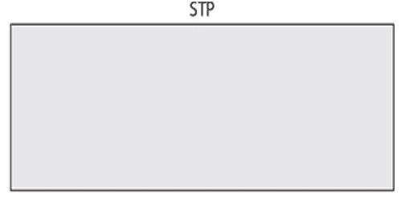


## 答案

1. **E.** 运行在服务器模式或透明模式 VTP 模式下的交换机可以管理 VLAN。服务器模式交换机会将 VLAN 更新发送到其他交换机，而透明模式交换机不会将其 VLAN 更新发送到其他交换机。
2. **C.** 交换机 ID 最低的交换机被选举为根交换机。交换机 ID 基于交换机的优先级和 MAC 地址。
3. **D.** 被选用于转发网段流量的交换机端口称为指定端口。
4. **A, D.** 在 STP 中，处于侦听状态的端口会处理并转发 BPDU。端口在侦听状态中保留 15 秒。
5. **A.** RSTP 中有三种端口状态：丢弃、学习和转发。
6. **C.** 备用端口具有通往根交换机的第二条最佳路径。
7. **A.** **spanning-tree mode rapid-pvst** 命令在 Cisco 交换机上启用带 PVST+ 的 RSTP。
8. **C.** 端口必须配置相同才能形成信道。例如，端口应配置相同的速度和双工设置。
9. B. 如果存在第 2 层环路，交换机的 CPU 和/或端口利用率将非常高。
10. B. 使用协议分析器排查第 2 层环路问题时，请查找不断重复的相同帧。
11. A, D. 如果域名不匹配，它们会忽略彼此的 VTP 消息。如果域名匹配，则使用修订值最高的交换机的配置；修订值最低的交换机将删除其 VLAN。

## 性能测试答案

以下是本章性能测试题的答案。

1. 在真正的 Cisco 考试中，您需要将左侧的框拖动到右侧的适当类别中。以下是对 STP 和 EtherChannel 特征的识别。

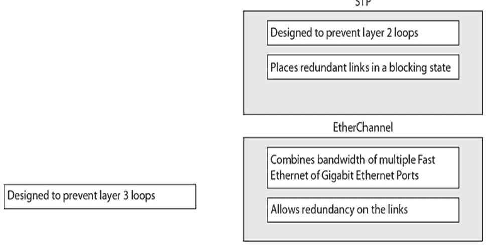
