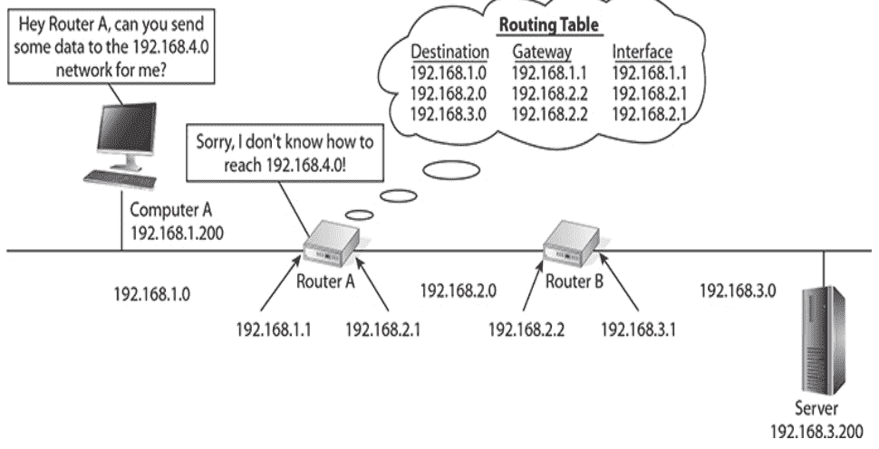
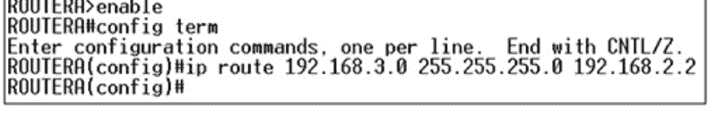
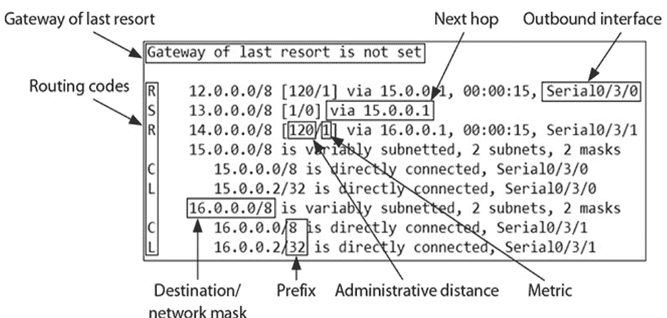
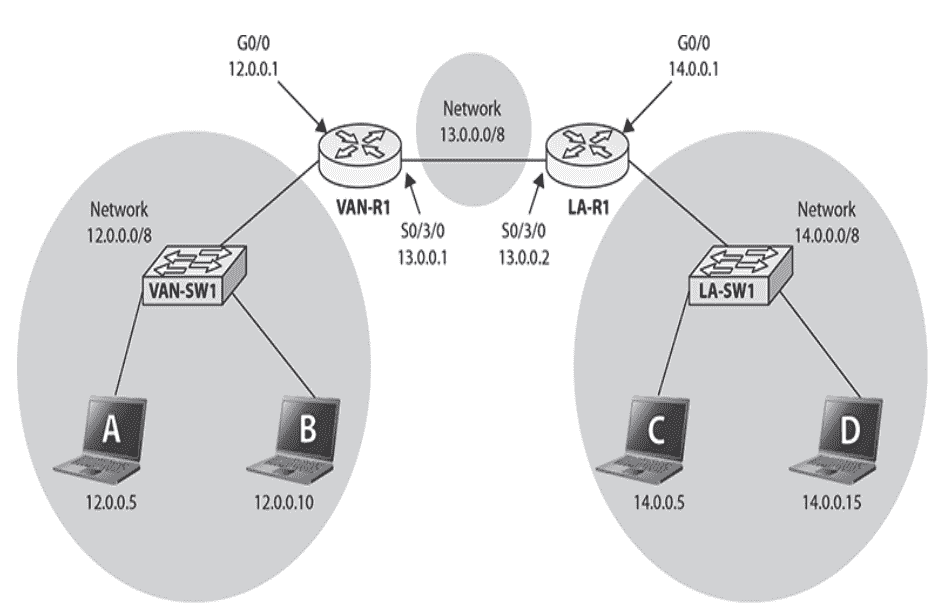
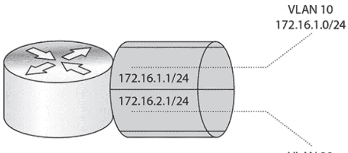
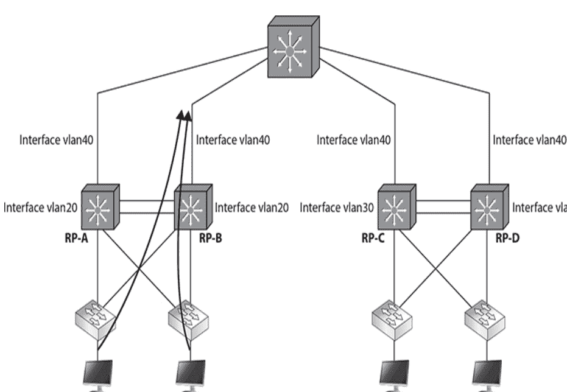
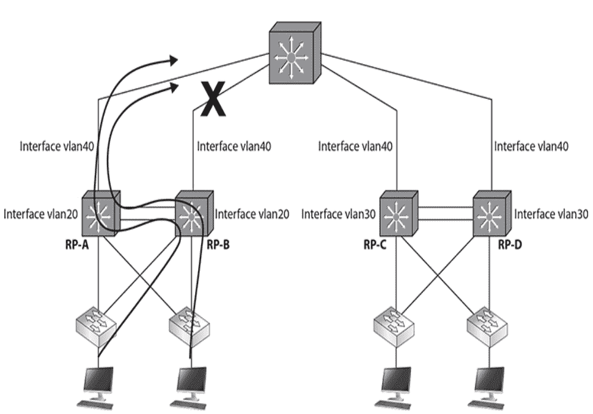
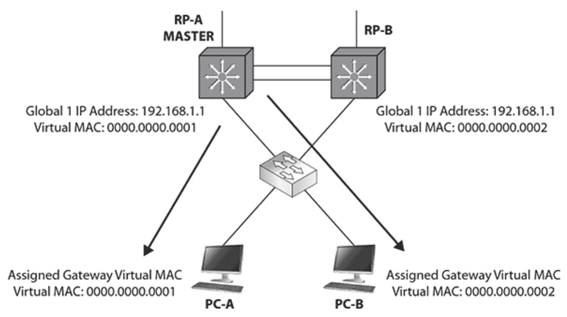
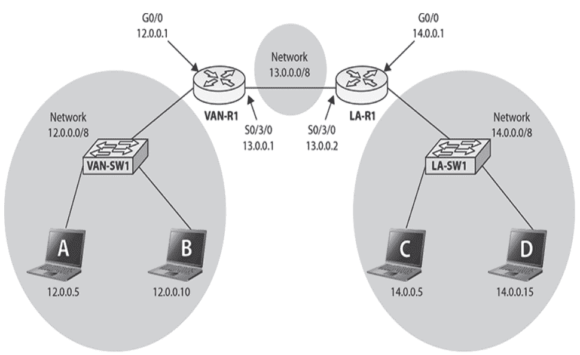

# 路由简介

在本章中，您将

- 了解路由基础知识
- 了解动态路由
- 阅读路由过程
- 了解一些路由故障排除命令
- 了解如何设置和使用单臂路由器
- 阅读路由器高可用性

本章将向您介绍路由和路由过程。您将了解路由器为选择通往目的地的路由所采取的步骤，包括*管理距离*这一重要概念，这是路由器用于对路由进行排名和选择最佳路由的功能；对于 CCNA 考试来说，这一点非常重要。

您还将学习如何向路由表添加静态路由以及动态路由协议的目的。对于考试，您只需了解开放最短路径优先（OSPF）是几种路由协议之一；您还应该熟悉存在其他路由协议的事实，并需要知道每种协议的管理距离。

本章介绍了路由、静态路由、动态路由和浮动静态路由的概念，这些概念对 Cisco CCNA 考试非常重要，但本章仅提供 IPv4 路由示例。在第 14 章中，您将学习使用 IPv6 配置静态路由和动态路由的命令。概念是相同的，但您将使用 IPv6 中的不同类型地址。


## 了解路由

*路由*是沿所选路径将数据从一个网络发送到另一个网络的过程。将网络划分为多个段后，路由器负责将数据从一个网络段移动到另一个网络段，如图 11-1 所示。



图 11-1 路由器依赖其路由表来了解目标网络

路由器负责将信息路由到目标网络，它通过使用存储在 *路由表* 中的信息来实现这一点。路由表是存储在路由器内存中的目标网络列表；路由器使用这些信息来识别将数据发送到何处才能到达目标。如果目标未包含在路由表中，路由器将无法将信息发送到目标。

在图 11-1 中，计算机 A 正尝试通过先将数据发送到路由器 A 来将数据发送到网络外。路由器 A 查看其路由表，以查看是否列出了目标 192.168.4.0，如您在图中所见，路由器不知道如何到达该目标，因此返回错误。

查看路由表中的第三项：您可以看到，路由器 A 在其路由表中包含了 192.168.3.0 网络目标。因此，如果 192.168.1.0 网络上的任何系统向 192.168.3.0 网络发送数据，路由器会将信息发送到该项的下一跳值（在表中显示为“网关”列）。跳值决定路由器需要将数据发送到何处才能到达特定目标。在此示例中，它将把数据发送到 192.168.2.2 跳值，并通过将数据从路由器 A 的 192.168.2.1 接口发送出去来到达 192.168.2.2，如“接口”列所示。此列很重要，因为它让路由器知道如何从路由器 A 到达网关。

### 路由概念

在查看如何在路由器上配置路由之前，让我们先回顾一些路由概念和术语。以下是您应该为 CCNA 认证考试熟悉的一些关键路由术语：

- **环回接口** 路由器上安装了网络接口卡，以提供网络连接，从而使数据可以从一个网络发送（路由）到另一个网络。路由器还可以包含一个环回接口，这是配置在路由器上的虚拟网络接口卡。您可能会出于测试目的或因为路由器功能可能需要使用环回接口（例如，路由协议 OSPF 使用环回接口的 IP 地址作为其路由器 ID）而配置环回接口。要控制路由器 ID，您可以配置一个环回接口，然后向其分配一个 IP 地址。
- **路由环路** 当两个路由器相互来回发送数据包时，就会发生路由环路，因为每个路由器都认为该数据包属于另一个路由器的网络（这是由于数据包的目标 IP 和路由器上的路由造成的）。路由器使用生存时间 (TTL) 字段作为防止无限路由环路的方法，每当数据包到达路由器时都会降低 TTL 值。一旦 TTL 达到 0，数据包就会从网络中移除。
- **路由表** 路由表是路由器所知道的目标列表（存储在路由器内存中的目标）。它指示数据应走哪条路由才能到达目标。路由器将数据包的目标 IP 地址与其路由表中的目标网络进行比较。如果匹配，路由器会将数据包发送到路由表中该项指定的 IP 地址。如果目标网络未包含在路由表中，路由器会发送错误消息。
- **静态路由与动态路由** 路由要么由网络管理员手动添加到路由表中（*静态路由*），要么通过路由协议从其他路由器自动学习（*动态路由*）。随着章节的推进，您将了解更多关于静态路由和动态路由的内容。

在讨论网络流量、网络流量属性甚至网络流量路由时，网络专业人员通常使用以下术语：

- **PDU** *协议数据单元* 是正在传递的单个数据通信单元，通常包含寻址信息或来自应用程序的数据等控制信息。第 1 层的 PDU 称为 *比特*，第 2 层的 PDU 为 *帧*，第 3 层的 PDU 为 *数据包*，第 4 层的 PDU 为 *段*。
- **MTU** *最大传输单元* 是网络上数据包的最大尺寸。在以太网中，MTU 通常为 1514 字节。

### 接口配置

路由器用于连接网络并在这些网络之间路由数据。路由器通过内置的 *接口*（即网络卡）连接到不同的网络。每个接口都分配了一个 IP 地址，并连接到一个网络（如图 11-1 所示）。

请参考图 11-1。假设路由器 A 和路由器 B 是思科路由器。假设在路由器 A 上，分配了 IP 地址 192.168.1.1 的接口是以太网接口（它连接到以太网络）。假设分配了 IP 地址 192.168.2.1 的接口是串行接口。串行接口用于连接到广域网 (WAN) 或作为点对点链路（两个路由器之间的直接连接）。

#### 配置以太网接口

让我们回顾一些思科路由器命令。要为路由器 A（下面代码示例中的 ROUTERA）上的以太网接口分配 IP 地址，请键入以下命令（不包括 > 或 # 之前出现的内容——那些是提示符）：

```
ROUTERA> enable
ROUTERA# configure terminal
ROUTERA(config)# interface fastethernet0/0
ROUTERA(config-if)# ip address 192.168.1.1 255.255.255.0
ROUTERA(config-if)# no shutdown
```

让我们来看看这些命令分别有什么作用。

1. 第一个命令 **enable** 用于从路由器的用户 EXEC 模式切换到特权 EXEC 模式。在用户 EXEC 模式下，您无法进行更改；进行更改需要特权 EXEC 模式。
2. 若要更改以太网接口的设置，请从接口提示符开始，该提示符位于全局配置模式下，大部分更改均在此模式下完成。要进入全局配置模式，请键入 **configure terminal**。然后，要进入接口提示符，请键入 **interface fastethernet0/0**。这里，**fastethernet0/0** 是路由器上的第一个快速以太网接口。（如果您有第二个以太网接口，它将是 **fastethernet0/1**。）
3. 一旦进入以太网接口提示符，您就可以使用 **ip address** 命令分配 IP 地址。
4. 最后一个命令 **no shutdown** 启用接口。（您也可以随时使用 **shutdown** 命令禁用接口。）


视频 11.01。随本书提供的数字资源包含配置路由器上以太网接口的多媒体演示。

#### 配置串行接口

要为 ROUTERA 上的串行 0 端口分配 IP 地址，请键入以下命令：

```
ROUTERA> enable
ROUTERA# configure terminal
ROUTERA(config)# interface serial0
ROUTERA(config-if)# ip address 192.168.2.1 255.255.255.0
ROUTERA(config-if)# encapsulation hdlc
ROUTERA(config-if)# no shutdown
```

请注意，此处的命令与配置以太网接口使用的命令基本相同，只不过我们导航到的是 serial0 接口，而不是 fastethernet0/0 接口。使用 ip address 命令分配 IP 地址后，您需要为串行链路设置封装协议。串行链路上常用的封装协议是高级数据链路控制 (HDLC) 和点对点协议 (PPP)。您需要确保使用的协议与串行链路另一端使用的协议相同。


视频 11.02。随本书提供的数字资源包含配置路由器上串行接口的多媒体演示。

#### 配置带宽参数

每个接口都分配了一个带宽值。在做出路由决策时，某些路由协议（例如 OSPF 和增强内部网关路由协议 (EIGRP)）会使用带宽值。（您将在第 12 章了解 OSPF。）


对于基于 LAN 的接口，接口的速度即为带宽值，带宽以千比特每秒（Kbps）为单位进行度量。然而，对于串行接口，带宽默认为 1544 Kbps，即 T1 链路的速度。无论接口上的物理时钟速率如何（你在第 7 章中了解过），此规则均适用。要更改接口的带宽值，请使用 **bandwidth** 命令：

```
Router(config)# interface serial [slot_#/port_#]
Router(config-if)# bandwidth rate_in_Kbps
```

以下是一个示例：时钟速率为 56,000 bps 的串行接口应将其带宽值更改为 56 Kbps：

```
Router(config)# interface serial 0
Router(config-if)# bandwidth 56
```


**考试提示** 考试时请记住，**bandwidth** 命令不会更改接口上的时钟速率；**clock rate** 命令才会执行此操作。**bandwidth** 命令仅影响使用带宽作为度量值的路由协议。

## 查看路由表

为每个接口分配 IP 地址后，需要通过键入以下命令来确保路由器上已启用路由：

```
ROUTERA> enable
ROUTERA# configure terminal
ROUTERA(config)# ip routing
```


**注意** **ip routing** 命令用于启用路由。要禁用路由，请键入 **no ip routing**。

启用路由后，路由器将自动为其直接连接的每个网络添加一条路由。要查看路由表并验证路由是否已添加，请使用以下命令：

```
ROUTERA> show ip route
```

如图 11-2 所示，请注意已键入 **show ip route** 命令并显示了路由表。请注意，到 192.168.1.0 和 192.168.2.0 网络的路由已自动添加，因为路由器已连接到这些网络。另请注意每条路由条目左侧的字母 C；这表示路由已包含，因为路由器已直接连接到该网络。

```
ROUTERA>show ip route
Codes: C - connected, S - static, I - IGRP, R - RIP, M - mobile, B - BGP
      D - EIGRP, EX - EIGRP external, O - OSPF, IA - OSPF inter area
      N1 - OSPF NSSA external type 1, N2 - OSPF NSSA external type 2
      E1 - OSPF external type 1, E2 - OSPF external type 2, E - EGP
      i - IS-IS, L1 - IS-IS level-1, L2 - IS-IS level-2, ia - IS-IS inter area
      * - candidate default, U - per-user static route, o - ODR
      P - periodic downloaded static route

Gateway of last resort is not set

C       192.168.1.0/24 is directly connected, Ethernet0
C       192.168.2.0/24 is directly connected, Serial0
ROUTERA>_
```

**图 11-2** 查看 Cisco 路由器的路由表


视频 11.03. 本书附带的数字资源包含使用 show ip route 命令查看路由表的多媒体演示。

## 配置静态路由

在管理 Cisco 路由器时，您需要添加路由表中不存在的任何所需路由。例如，回顾图 11-1，Router A 默认知道 192.168.1.0 和 192.168.2.0 网络，但不知道 192.168.3.0 网络。如果您希望 Router A 知道 192.168.3.0 网络，则需要通过创建静态路由或使用动态路由协议手动添加该路由。以下命令将添加到 192.168.3.0 网络的静态路由：

```
ROUTERA> enable
ROUTERA# configure terminal
ROUTERA(config)# ip route 192.168.3.0 255.255.255.0 192.168.2.2
```

在此代码清单中，ip route 命令（如图 11-3 所示）将路由添加到路由表。192.168.3.0 是您要添加的目标网络地址，其子网掩码 192.168.2.2 是下一跳——即 Router A 将发送数据以到达 192.168.3.0 网络的地址。请注意，192.168.2.2 是 Router B 上 Router A 可以直接通信的接口地址。其思想是，为了让 Router A 向 192.168.3.0 网络发送数据，它会通过 192.168.2.2 处的接口将数据传递给 Router B，随后由 Router B 将数据转发到 192.168.3.0 网络。



图 11-3 将静态路由添加到 Cisco 路由器


**考试提示** 考试时需要知道，**ip route** 命令用于在 Cisco 路由器上添加静态路由，**show ip route** 命令用于显示路由器的路由表。

如果使用 **show ip route** 命令查看路由表，您会注意到路由表中的某些路由已包含在内，因为路由器已连接到该网络，这由字母 C 指示。图 11-4 显示了添加静态路由后的新路由表，该路由由字母 S 指示。

```
ROUTERA>show ip route
Codes:  C - connected, S - static, I - IGRP, R - RIP, M - mobile, B - BGP
        D - EIGRP, EX - EIGRP external, O - OSPF, IA - OSPF inter area
        N1 - OSPF NSSA external type 1, N2 - OSPF NSSA external type 2
        E1 - OSPF external type 1, E2 - OSPF external type 2, E - EGP
        i - IS-IS, L1 - IS-IS level-1, L2 - IS-IS level-2, ia - IS-IS inter area
        * - candidate default, U - per-user static route, o - ODR
        P - periodic downloaded static route

Gateway of last resort is not set
C       192.168.1.0/24 is directly connected, Ethernet0
C       192.168.2.0/24 is directly connected, Serial0
S       192.168.3.0/24 [1/0] via 192.168.2.2
ROUTERA>
```

**图 11-4** 添加静态路由后显示路由表


**视频** 11.04. 本书附带的数字资源包含如何添加静态路由的多媒体演示。

## 在 Cisco 路由器上删除静态路由

使用 **ip route** 命令将路由添加到 Cisco 路由器的路由表中非常简单，使用 **no ip route** 命令删除路由也同样简单。要从路由表中删除路由，请使用以下语法：

```
ROUTERA> enable
ROUTERA# configure terminal
ROUTERA(config)# no ip route 192.168.3.0 255.255.255.0
```


**视频 11.05.** 本书附带的数字资源包含如何删除静态路由的多媒体演示。

## 路由表的组件

图 11-5 显示了另一个示例，并标识了查看路由表时需要识别的关键组件。



**图 11-5** 路由表的组件


**考试提示** Cisco CCNA 认证考试要求您了解路由表的组件；您肯定会遇到考查 **show ip route** 输出内容的问题。

随着本章的深入，您将了解这些组件的更多信息，但我想在继续之前先指出路由表的这些组件。您应该能够识别路由表的以下组件：

- **路由代码** 路由代码（或路由协议代码）指示路由知识是如何获得的——是本地连接路由、静态路由，还是通过 RIP (R) 或 OSPF (O) 等路由协议学习到的路由。（RIP 是路由信息协议。）
- **前缀** 网络前缀指示构成网络 ID 的位数。
- **目标/网络掩码** 这标识目标网络中的网络 ID。
- **下一跳** 这标识为了到达特定网络目标而应将数据发送到的位置。例如，在图 11-5 中，您可以看到一条到目标网络 13.0.0.0/8 的静态路由 (S)。因此，如果数据包的目的地是 13.0.0.0/8 网络，路由器会将数据包转发到 15.0.0.1（下一跳）。
- **管理距离** 管理距离标识路由是如何学习到的——直接连接、通过 RIP、通过 OSPF 或静态路由。每种类型的路由都有不同的管理距离，这表示路由知识的可信度。管理距离数字越低，信息越可信。您将在本章后续部分了解更多关于管理距离的内容；这是 CCNA 认证需要理解的一个非常重要的概念。


- **度量** 当存在多条可到达相同目的地且管理距离相同的路由时，路由器将基于*度量*选择路由。度量值用于指示哪些路由比其他路由更高效。例如，在图 11-5 中，14.0.0.0 网络的 RIP 路由（*R*）的度量为 1。使用 RIP 时，这将是跳数。如果存在另一条到 14.0.0.0 网络且跳数（度量）为 5 的 RIP 路由，路由器将使用度量最低的路径。请注意，度量并不总是基于跳数；它也可能基于路由的带宽。所使用的度量类型取决于路由的类型。（此内容将在本章稍后的“路由类型”部分中讨论。）

- **最后希望网关（GWLR）** GWLR 引用一个 IP 地址，路由器将向该地址发送所有其没有路由的流量。本质上，此功能类似于 Windows 计算机上的默认网关设置。在图 11-5 的示例中，未设置 GWLR。

- **出方向接口** 出方向接口是路由器上的本地接口，路由器通过该接口发送数据以到达目的地。

## 练习 11-1：配置 Cisco 路由器

在此练习中，您将配置以下网络图中两台 Cisco 路由器接口上的 IP 地址：



1. 确保所有物理组件（如路由器和交换机）均已按网络图连接。然后为设备通电。
2. 将工作站连接到 VAN-R1 的控制台端口。然后启动 PuTTY，选择串行连接，设置正确的 COM 端口，并单击“打开”。
3. 在 PuTTY 窗口中按 ENTER 以在 Cisco 设备上打开提示符。
4. 进入 VAN-R1 的特权 EXEC 模式，并将 IP 地址 12.0.0.1 分配给连接到 LAN 的千兆以太网接口；然后启用该接口：
```
VAN-R1>enable
VAN-R1#config term
VAN-R1(config)#interface g0/0
VAN-R1(config-if)#ip address 12.0.0.1 255.0.0.0
VAN-R1(config-if)#no shutdown
```
5. 要配置串行接口，请将 IP 地址 13.0.0.1 分配给连接到 LA-R1 路由器的串行接口：
```
VAN-R1(config-if)#interface s0/3/0
VAN-R1(config-if)#ip address 13.0.0.1 255.0.0.0
```
6. 将串行接口的封装协议设置为 HDLC：
```
VAN-R1(config-if)#encapsulation hdlc
```
7. 如果 VAN-R1 上的串行接口是数据通信设备（DCE），请将时钟速率设置为 64000：
```
VAN-R1(config-if)#clock rate 64000
VAN-R1(config-if)#no shutdown
```
8. 控制台登录到路由器 LA-R1，并将 G0/0 接口配置为 IP 地址 14.0.0.1/8；然后启用该接口：
```
LA-R1>enable
LA-R1#config term
Enter configuration commands, one per line. End with CNTL/Z.
LA-R1(config)#interface g0/0
LA-R1(config-if)#ip address 14.0.0.1 255.0.0.0
LA-R1(config-if)#no shutdown
```
9. 在 LA-R1 上，将 s0/3/0 接口配置为 IP 地址 13.0.0.2/8，封装协议为 hdlc；然后启用该接口：
```
LA-R1(config-if)#interface s0/3/0
LA-R1(config-if)#ip address 13.0.0.2 255.0.0.0
LA-R1(config-if)#encapsulation hdlc
LA-R1(config-if)#no shutdown
LA-R1(config-if)#exit
LA-R1(config)#exit
LA-R1#
```
10. 再次通过控制台登录到路由器 VAN-R1。使用 **显示 IP 路由** 命令显示路由表。您是否看到 14.0.0.0/8 网络的路由？__________
11. 再次通过控制台登录到路由器 LA-R1。使用 **显示 IP 路由** 命令显示路由表。您是否看到 12.0.0.0/8 网络的路由？__________
12. 再次通过控制台登录到 VAN-R1。要添加静态路由，请使用以下命令：
```
VAN-R1#config term
Enter configuration commands, one per line. End with CNTL/Z.
VAN-R1(config)#ip route 14.0.0.0 255.0.0.0 13.0.0.2
```
13. 要查看路由表中的路由，请使用 **显示 IP 路由** 命令。您应该能看到新添加的路由：
```
VAN-R1(config)#do show ip route
```
14. 控制台登录到 LA-R1 并向 12.0.0.0/8 网络添加静态路由。然后查看路由表以验证静态路由已添加：
```
LA-R1#config term
LA-R1(config)#ip route 12.0.0.0 255.0.0.0 13.0.0.1
LA-R1(config)#do show ip route
```
15. 在 VAN-R1 路由器上，验证您可以 ping 通 IP 地址 14.0.0.1。

## 了解动态路由

动态路由协议用于在路由器之间共享路由，以便管理员无需手动添加路由。对于 CCNA 考试，您需要了解 OSPF，但您也需要知道不同路由协议相关的管理距离。因此，我将在此向您介绍一些其他路由协议。

在大型互连网络中管理路由表条目可能是一项耗时的任务。为帮助管理员完成此工作，会启用动态路由协议。这些协议使路由器能够相互共享其路由表中包含的信息。因此，一个路由器所知的路由将共享给其他路由器，从而使管理员无需手动添加所有路由！收敛（也称为稳态）发生在所有路由表（路由）已与所有其他路由器共享，并且所有路由器都已使用该新信息更新其路由表时。

路由协议有两大类：

- 内部网关协议（IGP）IGP 与位于您网络内（称为自治系统（AS））的其他路由器共享路由表信息。IGP 的示例是路由信息协议（RIP）或增强内部网关路由协议（EIGRP）。
- 外部网关协议（EGP）加载在路由器上的 EGP 将向您网络外的其他路由器共享路由表信息。EGP 的示例是边界网关协议（BGP）。


**考试提示** CCNA 考试期望您熟悉*收敛*一词。收敛（也称为稳态）发生在所有路由表（路由）已与所有其他路由器共享，并且所有路由器都已使用该新信息更新其路由表时。

## 路由度量

路由协议通过分析路由表并选择度量值最低的路由，来确定到达网络的最佳路由。确定“最佳路由”度量值可能涉及不同的因素，具体取决于路由协议。以下是用于衡量路由度量值的常见值：

- **跳数** 某些路由协议使用跳数作为度量值，这意味着最佳路由是根据网络有多少跳远来确定的。数据必须经过的每个路由器都被视为一跳，使用此度量时，跳数最低的是最佳路由。
- **MTU 或带宽** 某些路由协议根据链路的 MTU 或带宽来确定要采用的最佳路由。带宽更高的路由会优先于带宽较低的路由。
- **开销** 某些路由协议根据最低开销来选择最佳路由。开销值被视为链路上的首选值，开销值最低的链路将被选为到达目的地的路由。例如，到达某目的地且开销为三的链路会被选中，而另一条到达同一目的地且开销值为五的链路则不会。
- **延迟** 某些路由协议使用链路延迟作为度量值。延迟是指数据包从一个位置传输到另一个位置所需的时间。使用此度量标准时，较低延迟的路由优先于较高延迟的路由。
- **管理距离** 管理距离是路由表中路由的“可信度”。向路由表添加路由的每种不同方法都有一个管理距离值——如果路由器通过两种或多种不同方式了解到某条路由，则路由器将使用管理距离较低的那条路由。例如，静态路由的管理距离为 0，而通过 RIP 学习到的路由的管理距离为 120。在此情况下，如果路由针对相同的目标网络，路由器将使用静态路由，因为其被认为更可信。

需要注意的是，某些路由协议会结合多种不同的度量值来确定尽可能好的路由。

在讨论不同路由协议时，需要注意的是存在两大类：距离向量和链路状态。每种路由协议要么是距离向量协议，要么是链路状态协议。

## 配置路由协议

在讨论如何配置诸如 RIP 之类的动态路由协议之前，让我们先考虑一下无论运行什么动态路由协议都需要执行的某些基本配置任务。在路由器上设置 IP 路由时，您需要执行两个基本步骤：

- 启用路由协议。
- 为路由器的接口分配 IP 地址。

请注意，这些任务的顺序并不重要。您已经知道如何在路由器接口上配置 IP 地址：此内容已在第 7 章中讨论过。以下各部分将更深入地介绍第一个要点。

### router 命令

启用 IP 路由协议是一个两步过程。首先，您必须进入路由器子配置模式。该模式决定您将运行的路由协议。在此模式中，您将配置


路由协议的特性。要进入路由协议的配置模式，请使用以下命令：

```
Router(config)# router name_of_the_IP_routing_protocol
Router(config-router)#
```

**router** 命令用于访问您要配置的路由协议；它不会启用该协议。如果您不确定要启用的路由协议的名称，请使用上下文相关的帮助功能：

```
Router(config)# router ?
  bgp               Border Gateway Protocol (BGP)
  eigrp             Enhanced Interior Gateway Routing Protocol (EIGRP)
  isis              ISO IS-IS
  iso-igrp          IGRP for OSI networks
  mobile            Mobile routes
  odr               On Demand stub Routes
  ospf              Open Shortest Path First (OSPF)
  rip               Routing Information Protocol (RIP)
Router(config)#
```

从上下文相关的帮助输出中可以看出，您可以使用大量的 IP 路由协议。

## network 命令

启用路由协议后，您需要指定哪些接口参与路由过程。默认情况下，没有接口参与路由过程。要指定参与的接口，请使用 **network** 模式命令：

```
Router(config-router)# network IP_network_#
```

一旦输入网络号，路由过程即变为 *活跃*。

## 距离矢量协议

*距离矢量* 路由协议基于最低跳数来衡量要使用的最佳路由。源和目的地之间的每个路由器会使跳数增加 1。使用距离矢量路由协议时，通常选择跳数最低的路由作为数据的目标路径。


**考试提示** 请记住，距离矢量路由协议包括 RIP 和 IGRP。

## RIP/RIPv2

RIP 是一种距离矢量协议，负责通过每 30 秒在用户数据报协议 (UDP) 上广播信息，与相邻路由器共享其路由表信息。这种与相邻路由器共享路由表信息的广播或 *宣告*，使网络管理员无需手动添加路由。

RIP 是一种行业标准路由协议，这意味着它受到许多不同供应商的支持，因此您可以将其用作路由协议来在不同制造商的路由器之间共享路由表信息。RIP 会选择跳数最低的路由，但如果两条不同的路由具有相同的跳数，RIP 会在这两条路由之间进行流量负载均衡。请注意，RIP 限制为 15 跳，因此仅用于小型网络。

RIPv1 仅适用于有类地址，因为它不随路由表一起发送子网掩码信息。RIPv2 是对 RIPv1 的更新，并支持无类地址和可变长度子网掩码，因为它随路由表一起发送子网掩码信息。

让我们回到图 11-1 看另一个示例。假设您是路由器 A 的管理员。默认情况下，路由器 A 将拥有到 192.168.1.0 和 192.168.2.0 网络的路由。如果您想在路由器 A 上配置 RIP 来宣告对这两个网络的了解，请在路由器 A 上输入以下命令：

```
ROUTERA> enable
ROUTERA# configure terminal
ROUTERA(config)# router rip
ROUTERA(config-router)# version 2
ROUTERA(config-router)# network 192.168.1.0
ROUTERA(config-router)# network 192.168.2.0
```

一旦 RIP 或任何其他路由协议在路由器 A 和路由器 B 上都已启用，两台路由器将共享它们所知道的任何网络的信息。路由器 A 接收有关 192.168.3.0 网络的信息，并将新网络构建到其路由表中；这称为收敛。图 11-6 显示了在两台路由器上都启用 RIP 后路由器 A 上的路由表。请注意 192.168.3.0 路由旁边的字母 R，表示该路由是通过 RIP 学习的。

```
ROUTERA>show ip route
Codes: C - connected, S - static, I - IGRP, R - RIP, M - mobile, B - BGP
  D - EIGRP, EX - EIGRP external, O - OSPF, IA - OSPF inter area
  N1 - OSPF NSSA external type 1, N2 - OSPF NSSA external type 2
  E1 - OSPF external type 1, E2 - OSPF external type 2, E - EGP
  i - IS-IS, L1 - IS-IS level-1, L2 - IS-IS level-2, ia - IS-IS inter area
  * - candidate default, U - per-user static route, o - ODR
  P - periodic downloaded static route

Gateway of last resort is not set

C       192.168.1.0/24 is directly connected, Ethernet0
C       192.168.2.0/24 is directly connected, Serial0
R       192.168.3.0/24 [120/1] via 192.168.2.2, 00:00:14, Serial0
ROUTERA>_
```

图 11-6 路由表显示了通过 RIP 学习的新路由。


**视频 11.06。** 随本书附带的数字资源包含有关如何配置 RIP 的多媒体演示。

## IGRP

IGRP 是由 Cisco 构建的一种有类路由协议，因此您仅在仅使用 Cisco 路由器的网络上使用它。IGRP 旨在改进 RIP 的局限性；其最大跳数为 255，并使用 *自治系统* (AS) 的概念。自治系统是共享路由表信息的路由器组。使用 IGRP 的路由器只会与 AS 中的其他路由器共享路由。另一项改进是，完整的路由表每 90 秒宣告一次，而不是像 RIP 那样每 30 秒一次。

要在 Cisco 路由器上启用 IGRP，请输入以下命令：

```
ROUTERA> enable
ROUTERA# configure terminal
ROUTERA(config)# router igrp 10
ROUTERA(config-router)# network 192.168.1.0
ROUTERA(config-router)# network 192.168.2.0
```

在此代码清单中，请注意，在 Cisco 路由器上启用 IGRP 与启用 RIP 类似。然而，区别在于，当您启用 IGRP 时，您要为路由器指定 AS 号。在此示例中，我将 10 用作 AS 号，因此任何其他具有 10 AS 号的路由器都将接收有关 192.168.1.0 和 192.168.2.0 网络的路由信息。

## 链路状态协议

链路状态路由协议比距离矢量路由协议稍微高级一些，因为链路状态路由协议了解整个网络拓扑。链路状态协议负责监控路由器之间链路的状态。然后使用这些链路状态信息来确定到目标网络的最佳路由。尽管像 RIP 这样的协议了解相邻路由器，但链路状态协议了解整个网络拓扑，并将路由表信息多播到整个网络。

链路状态路由协议的好处之一是，如果链路断开，该信息将存储在路由表中，并且不会使用该路径。因为距离矢量路由协议不存储链路状态信息，所以它可能在一段时间内不知道链路不可用，并且可能仍然通过该路径发送流量。

## OSPF

*开放最短路径优先 (OSPF)* 是链路状态协议的一个示例。OSPF 是一种行业标准协议，这意味着它可用于不同制造商构建的路由器，并且您可以使用它在不同的路由器之间共享路由信息。

与 IGRP 类似，OSPF 使用自治系统，但它还具有将 AS 划分为称为 *区域* 的逻辑组的功能。OSPF 支持可变长度子网掩码 (VLSM)，并且跳数无限。


**注意** 因为 OSPF 是 CCNA 考试需要知道的重要路由协议，第 12 章全部专门介绍了它。

## IS-IS

*中间系统-中间系统 (IS-IS)* 路由协议作为一种用于网络内部（内部网关）的链路状态路由协议，与 OSPF 竞争。IS-IS 由数字设备公司 (DEC) 开发，已成为一种行业标准协议，尽管它不如 OSPF 流行。与 OSPF 类似，IS-IS 使用链路状态算法来维护网络上所有链路和路由的状态信息，以便每台运行 IS-IS 协议的路由器都了解整个网络拓扑。

## 混合协议

混合路由协议结合了距离矢量和链路状态的特性。Cisco 使用两种混合协议：EIGRP 和 BGP。


**考试提示** 对于思科 CCNA 考试，你只需要“关于”不同的路由协议。不过，你应该了解距离向量协议和链路状态协议之间的区别，并且你需要知道 OSPF 的详细内容（将在下一章介绍）。此外，请记住 EIGRP 是混合路由协议的一个示例。

## EIGRP

作为思科构建的一种流行混合路由协议，EIGRP 通过成为一个 *无类别* 路由协议来改进 IGRP，该协议支持 VLSM 以及 IPv4 和 IPv6。EIGRP 的最大跳数也为 255 跳。

在思科路由器上配置 EIGRP，请使用以下命令：

```
ROUTERA> enable
ROUTERA# configure terminal
ROUTERA(config)# router eigrp 10
ROUTERA(config-router)# network 192.168.1.0
ROUTERA(config-router)# network 192.168.2.0
```


**视频 11.07.** 随本书提供的数字资源包含一个多媒体演示，展示如何配置 EIGRP。

## BGP

BGP 是一种 EGP，负责与你自治系统 *外部* 的路由器共享路由表信息。先前讨论的 RIP、EIGRP 和 OSPF 等协议被称为内部网关协议，负责共享你自治系统（或网络）*内部* 的路由表。

BGP 设计为在路由表发生更改时立即发送更新，而不是像 RIP 那样以固定间隔发送。BGP 只发送更改内容，而像 RIP 这样的其他路由协议则会发送整个路由表。BGP 也是一种支持无类别域间路由（CIDR）的无类别路由协议。


**注意** BGP 是 EGP 的较新版本。

## 路由过程

思科路由器上可能存在几种不同类型的路由。确定最佳路由需要考虑多个标准。

### 路由类型

思科路由器的路由表中可能存在多种不同类型的路由。对于 CCNA 考试，你需要熟悉静态路由、网络路由、默认路由、主机路由和浮动静态路由。本章主要介绍 IPv4，但 CCNA 考试要求你了解 IPv4 和 IPv6 的这些概念。请注意，此处所学知识适用于 IPv6，但处理 IPv4 地址时需要了解的信息是相同的。（你将在第 14 章了解 IPv6。）你所使用的地址类型不会改变静态路由、浮动静态路由或动态路由等内容的目的。让我们先来看看几个 IPv4 路由概念。

### 网络路由

网络路由指向网络或子网的网络 ID。例如，为了将数据发送到 IP 地址为 14.0.0.10 的服务器，路由器会在其路由表中查找通往 14.0.0.0/8 网络的路由。网络路由可能出现在路由表中，因为该网络已连接到路由器——即连接路由——或者是因为管理员手动添加了它——即静态路由。

### 连接路由

要确定连接或直接连接的路由，路由器会查看其活动接口，检查接口上配置的地址并确定相应的网络号，然后使用此信息填充路由表。

### 静态路由

静态路由是在路由器上手动配置的路由。静态路由通常用于较小的网络，或网络或子网较少的情况，或用于可用带宽较少的 WAN 链路。对于拥有数百条路由的网络，静态路由不具备可扩展性，因为你需要在每台路由器上为每条路由配置该路由及其任何冗余路径。本节介绍静态路由的配置以及与之相关的一些问题。

要为 IP 配置静态路由，请使用以下两个命令之一：

```
Router(config)# ip route destination_network_# [subnet_mask]
    IP_address_of_next_hop_neighbor
    [administrative_distance] [permanent]
```

或

```
Router(config)# ip route destination_network_# [subnet_mask]
    exit_interface_name
    [administrative_distance] [permanent]
```

必须指定的第一个参数是目标网络号。如果你省略网络号的子网掩码，则它将默认为目标网络号对应的类 A（255.0.0.0）、B（255.255.0.0）或 C（255.255.255.0）默认子网掩码。

在子网掩码参数之后，你可以用两种方式之一指定如何到达目标网络：可以告诉路由器下一跳邻居的 IP 地址，或者指示路由器应使用哪个接口来到达目标网络。对于多路访问链路（该链路上有多于两台设备，例如三台路由器），请使用前一种方法。对于点到点链路，请使用后一种方法。在此情况下，你必须指定路由器上的接口名称，例如：serial0。

可选地，你可以更改静态路由的管理距离。如果你省略此值，则它将根据前一个参数的配置使用两个默认值之一：如果你指定了下一跳邻居的 IP 地址，则管理距离默认为 1。如果你指定了路由器应使用的接口来到达目标，则路由器将该路由视为连接路由，并为其分配管理距离 0。

请注意，你可以创建多条指向 *相同* 目标的静态路由。例如，你可能有指向目标的主路径和备份路径。对于主路径，可以使用默认的管理距离值。对于备份路径，可以使用比该值更大的数字，例如 2。配置备份路径后，路由器将使用主路径；如果主路径的路由器接口发生故障，路由器将使用备份路由。

**永久** 参数即使在路由器用于静态路由的接口发生故障时，也会将静态路由保留在路由表中。如果你省略此参数，并且静态路由使用的接口发生故障，路由器将从其路由表中删除此路由，并尝试寻找替代路径放入路由表中。如果你不希望数据包使用到达目标的其他路径（可能出于安全原因），则可能需要使用 **永久** 参数。


**考试提示** 请记住使用 **ip route** 命令创建静态 IP 路由的语法，你可以指定下一跳地址或本地接口来到达远程目标。请记住，如果你省略管理距离，它将默认为 0 或 1，具体取决于静态路由的配置方式。

### 默认路由

一种特殊的静态路由是 *默认路由*，通常称为 *最后希望网关*（GWLR）。如果指定的目标未列在路由表中，则可以使用默认路由来路由数据包。默认路由的 IP 地址为 0.0.0.0，子网掩码为 0.0.0.0，通常表示为 0.0.0.0/0。默认路由通常用于小型网络上的边缘路由器，指向直接连接的 ISP 路由器。

要设置默认路由，请使用静态路由的以下语法：

```
Router(config)# ip route 0.0.0.0 0.0.0.0
    IP_address_of_next_hop_neighbor
    [administrative_distance] [permanent]
```

或

```
Router(config)# ip route 0.0.0.0 0.0.0.0
    exit_interface_name
    [administrative_distance] [permanent]
```


**视频 11.08.** 随本书提供的数字资源包含一个多媒体演示，展示如何配置默认路由。

### 默认网络配置

配置默认路由的替代方法是定义默认网络。当你配置 ip default-network 命令时，路由器会考虑将指向该网络的路由安装为路由器上的 GWLR。当路由表中不存在其他路由（连接路由、静态路由或动态路由）时，使用此命令。使用 show ip route 命令验证默认路由是否已设置：


```
Router# show ip route
Codes: C - connected, S - static, I - IGRP, R - RIP, M - mobile,
      B - BGP, D - EIGRP, EX - EIGRP external, O - OSPF,
      IA - OSPF inter area, N1 - OSPF NSSA external type 1,
      N2 - OSPF NSSA external type 2, E1 - OSPF external type 1,
      E2 - OSPF external type 2, E - EGP, i - IS-IS, su - IS-IS summary,
      L1 - IS-IS level-1, L2 - IS-IS level-2, ia - IS-IS inter area,
      * - candidate default, U - per-user static route, o - ODR,
      P - periodic downloaded static route
Gateway of last resort is not set
      161.44.0.0/24 is subnetted, 1 subnets
C       161.44.192.0 is directly connected, Ethernet0
      131.108.0.0/24 is subnetted, 1 subnets
C       131.108.99.0 is directly connected, Serial0
S       198.10.1.0/24 [1/0] via 161.44.192.2
```

在输出顶部的代码说明表和底部的路由之间，有一行“最后手段网关未设置”。这是默认配置。要定义 GWLR，请使用此命令：

```
Router(config)# ip default-network network_number_to_use
```

您定义的网络号是路由器应作为最后手段访问的网络。请注意，您的路由表需要一个条目，指示如何到达此默认网络，例如下一跳地址。这通常通过静态路由完成。


**考试提示** 创建默认路由时，如果路由表中没有通往目标的其他特定路由，请使用地址和子网掩码 0.0.0.0 0.0.0.0。GWLR 通过 **ip default-network** 命令定义。

## 主机路由

主机路由引用网络上计算机的完整 IP 地址。您可能会看到路由表中出现带有 /32 的条目，这意味着所有位都是网络位——您应将整个地址视为网络 ID。

## 浮动静态路由

浮动静态路由是通往您已有主路由的目标的备份路由。浮动静态路由在主路由失败之前不会出现在路由表中，主路由失败后，浮动静态路由将出现。您可以通过创建一条管理距离高于您要备份的路由（无论是另一条静态路由还是通过动态路由协议学习到的路由）的静态路由来配置浮动静态路由。以下示例通过将管理距离设置为 10 来添加浮动静态路由：

```
VAN-R1#config term
VAN-R1(config)#ip route 14.0.0.0 255.0.0.0 12.0.0.100 10
```


视频 11.09。随本书提供的数字资源包含配置浮动静态路由的多媒体演示。

## 选择路由

当 Cisco 设备为特定目标选择要使用的路由时，它会使用多个标准：首先检查最长匹配的网络前缀，然后根据管理距离选择路由，最后，如果多个路由的网络前缀和管理距离相等，则可能会查看度量值。让我们逐一查看这些标准。

### 最长匹配

路由器使用的首个路由标准是最长匹配前缀。它基本上会选择通往目标网络且具有最长网络 ID 或子网 ID 的路由。这样可以确保，如果网络已分子网，则使用更具体的路由。

### 管理距离

每台路由器都需要为目标选择一条*最佳*路径。如果路由器从多个来源（例如直连、静态和 IGP 路由协议）接收到同一网络的路由更新信息，并且必须从中选择*一*个作为最佳源并将其放入路由器的路由表中，则此过程可能会变得有些复杂。在根据网络 ID 匹配选择路由后，路由器会查看管理距离以确定路由知识的可信度——管理距离越低，路由越可信。例如，假设直连路由的管理距离为 0，而静态路由的管理距离为 1。如果您为一个已存在的网络 ID（因为路由器已连接到该网络）添加了一条静态路由，则路由器会使用直连路由而非您的静态路由。（从可信度角度来看，您的静态路由可能存在拼写错误，因此路由器更信任其直连网络，而非管理员输入的内容。）

另一个示例是，RIP 的管理距离为 120，因此如果 RIP 在共享一个网络 ID，而您已配置通往同一目标的静态路由，路由器将选择您的静态路由，而非通过 RIP 学习到的路由，因为静态路由的管理距离值更低（1）。


**考试提示** 在考试中，您会看到此类场景：路由器同时从 RIP 和 EIGRP 学习到网络 10.0.0.0/8 的目标，您需要知道哪条路由会被添加到路由表中。由于 RIP 的管理距离值为 120，而 EIGRP 的值为 90，路由器将使用 EIGRP 路由。

| 管理距离 | 路由类型 |
|---|---|
| 0 | 直连接口路由 |
| 1 | 静态路由 |
| 90 | 内部 EIGRP 路由（同一 AS 内） |
| 110 | OSPF 路由 |
| 120 | RIPv1 和 v2 路由 |
| 170 | 外部 EIGRP 路由（来自另一 AS） |
| 255 | 未知路由（被视为无效路由，不会使用） |

表 11-1 管理距离值


**考试提示** 考试中您需要知道这些管理距离（AD）：直连路由的 AD 为 0，静态路由的 AD 为 1，EIGRP 的 AD 为 90，OSPF 的 AD 为 110，RIP 的 AD 为 120。管理距离较低的路由优先于管理距离较高的路由。

### 路由协议度量值

迄今为止的路由选择过程首先根据网络目标 ID 选择路由，然后根据管理距离选择。但是，如果存在多条具有相同管理距离的路由——假设有两条路由通过 OSPF 共享到您的路由器呢？如果存在通往目标网络的两条路径，并且使用相同的路由协议将该知识共享到您的路由器，路由器将使用一种称为*度量值*的测量值来确定要放入路由表的最佳路径。

| 度量值 | 路由协议 | 描述 |
|---|---|---|
| 带宽 | EIGRP | 链路容量，单位 Kbps（T1 = 1544） |
| 开销 | OSPF | 链路带宽的倒数测量值 |
| 延迟 | EIGRP | 到达目标所需的时间 |
| 跳数 | RIP | 距离目标有多少个第 3 层跳数 |
| 负载 | EIGRP | 利用率最低的路径 |
| MTU | EIGRP | 支持最大帧大小的路径 |
| 可靠性 | EIGRP | 错误或停机时间最少的路径 |

表 11-2 路由协议度量值

## 路由故障排除命令

配置路由协议后，您可以使用多种命令来验证和排查路由配置及运行情况。以下是一些示例命令：

- clear ip route
- show ip protocols
- show ip route
- debug ip rip

### clear ip route 命令


**clear ip route \*** 命令是特权 EXEC 模式命令。该命令会清除并重建 IP 路由表。每当你对路由协议做出更改时，都应使用此命令清除并重建路由表。你可以将星号（*）替换为特定的网络号；如果这样做，则只会从路由表中清除指定的路由。请注意，**clear** 命令只清除从路由协议学习到的路由（动态路由）；使用 **clear** 命令无法从路由表中清除静态路由和直连路由。静态路由必须使用 **no ip route** 命令手动清除，而直连路由是持久的，除非与其关联的接口未运行，否则无法从路由表中删除。

## show ip protocols 命令

show ip protocols 命令显示已配置并在路由器上运行的所有 IP 路由协议，包括 RIP。以下是该命令的示例：

```
Router# show ip protocols
Routing Protocol is "rip"
  Sending updates every 30 seconds, next due in 5 seconds
  Invalid after 180 seconds, hold down 180, flushed after 240
  Outgoing update filter list for all interfaces is not set
  Incoming update filter list for all interfaces is not set
  Redistributing: rip
  Default version control: send version 2, receive version 2
    Interface      Send  Recv  Triggered  RIP  Key-chain
    Ethernet0      2     2
    Ethernet1      2     2
  Automatic network summarization is in effect
  Maximum path: 4     Routing for Networks:
    192.168.1.0
    192.168.2.0     Routing Information Sources:
    Gateway         Distance      Last Update
    192.168.2.2     120           00:00:22
    192.168.3.2     120           00:03:30
  Distance: (default is 120)
```

在此示例中，路由器上运行的是 RIPv2。路由更新间隔为 30 秒，下一次更新将在 5 秒后发送。可以看到有两个接口参与：Ethernet0 和 Ethernet1。这两个接口使用 RIPv2 生成和接收更新。可以看到使用 **network** 命令指定的两个网络：192.168.1.0 和 192.168.2.0。在此示例中，该路由器 22 秒前从邻居路由器 192.168.2.2 收到了一次更新。对于第二个网关 192.168.3.2，路由器已有 210 秒未收到来自它的更新。鉴于刷新计时器为 240 秒，如果本地路由器在 30 秒内未收到来自 192.168.3.2 的更新，则 192.168.3.2 及其关联路由将从本地路由器中移除（刷新）。最后，RIP 的默认管理距离为 120。


**视频** 11.10。本书配套的数字资源包含在路由器上针对 RIP 使用 show ip protocols 命令的多媒体演示。

## show ip route 命令

要查看路由表，请使用 **show ip route** 命令。以下是一个包含两条 RIP 路由的路由表示例：

```
Router# show ip route
Codes: C - connected, S - static, I - IGRP, R - RIP,
  M - mobile, B - BGP, D - EIGRP, EX - EIGRP external,
  O - OSPF, IA - OSPF inter area, N1 - OSPF NSSA external type 1, N2 - OSPF NSSA external type 2,
  E1 - OSPF external type 1, E2 - OSPF external type 2,
  E - EGP, i - IS-IS, L1 - IS-IS level-1,
  L2 - IS-IS level-2, * - candidate default,
  U - per-user static route, o - ODR,
  T - traffic engineered route

Gateway of last resort is not set
    172.16.0.0/24 is subnetted, 2 subnets
C       172.16.1.0 is directly connected, Ethernet0
R       172.16.2.0 [120/1] via 172.16.1.2, 00:00:21, Ethernet0
    192.168.1.0/24 is subnetted, 2 subnets
C       192.168.1.0 is directly connected, Serial0
R   192.168.2.0/24 [120/2] via 192.168.1.2, 00:00:02, Serial2
```


**考试提示** 对于 CCNA 考试，你需要非常熟悉 **show ip route** 命令的输出，尤其是识别管理距离和度量值。

在此示例中，可以看到路由表中有两种类型的路由：*R* 表示 RIP，*C* 表示直连路由。对于 RIP 条目，可以看到方括号中有两个数字：该路由的管理距离和度量值。例如，172.16.2.0 的管理距离为 120，跳数为 1（本示例中的度量值）。紧接其后的是通告该路由的相邻 RIP 路由器（172.16.1.2）、从该邻居收到此路由更新的时间（21 秒前），以及该更新是从哪个接口学习到的（Ethernet0）。


**视频** 11.11。本书配套的数字资源包含在路由器上针对 RIP 使用 **show ip route** 命令的多媒体演示。

## debug ip \<protocol\> 命令

请记住，**show** 命令显示的是路由器已知信息的静态显示，有时它们不会显示关于特定问题或故障的足够信息。例如，你可能使用 **show ip route** 命令查看路由表，并期望从某个已连接邻居出现某条 RIP 路由，但该网络并未显示。遗憾的是，**show ip route** 命令不会告诉你某条路由为何在或不在路由表中。不过，你可以借助 **debug** 命令来协助故障排除。我们将使用该命令对 RIP 进行故障排除（因为你将在下一章学习 OSPF）。

要获取有关路由协议发送或接收的事件和数据包的更详细信息（可用于排查路由协议问题），你可以使用 **debug ip \<protocol\>** 命令，其中 \<protocol\> 可以是 RIP、EIGRP 或 OSPF。以下是一个 RIP 示例：

```
Router# debug ip rip
RIP protocol debugging is on
Router#
00:12:16: RIP: received v1 update from 192.168.1.2 on Serial0
00:12:16:         192.168.2.0 in 1 hops
00:12:25: RIP: sending v1 update to 255.255.255.255 via Ethernet0 (172.16.1.1)
00:12:26:         network 192.168.1.0, metric 0
00:12:26:         network 192.168.2.0, metric 1
```

该命令显示路由器接口上发送和接收的路由更新。在此代码示例中，路由器在 Serial0 上从 192.168.1.2 收到了一个 V1 更新。此更新包含一个网络 192.168.2.0，表明该网络可从本路由器和通告路由器到达。在此更新之后，可以看到你的路由器在其 Ethernet0 接口上生成了一个 RIP 更新（本地广播——255.255.255.255）。此更新包含两个网络：192.168.1.0 和 192.168.2.0。另请注意与这些路由关联的度量值：192.168.1.0 直连到本路由器，而 192.168.2.0 相距一跳。当连接到 Ethernet0 的邻居路由器收到此更新时，它会将该更新中每条路由的跳数加 1。


**提示** 使用 **debug** 命令时，必须处于特权 EXEC 模式。要禁用特定的 **debug** 命令，可用 **no** 参数取消它。要关闭所有 **debug** 命令的调试，可使用 **undebug all** 或 **no debug all** 命令。

## 单臂路由

你在第 9 章和第 10 章学习了交换机，以及可以使用 VLAN 在网络中配置通信边界这一事实。要启用 VLAN 之间的通信，你可以将路由器接口连接到每个 VLAN，或使用单臂路由方法。

通常，我们把路由理解为流量从一个物理接口进入并从另一个物理接口离开。然而，正如你在第 10 章所学，中继可用于支持多个 VLAN，其中每个 VLAN 都有唯一的第 3 层网络或子网号。某些路由器型号和接口组合（例如 1800 系列）支持中继连接。*单臂路由* 是指通过一条中继连接连接到交换机，并在该中继连接上的 VLAN 之间进行路由的路由器。你完全可以在不使用中继（接入链路连接）的情况下做到这一点，但每个 VLAN 都需要路由器上单独的接入链路（物理）接口，这会增加路由器解决方案的成本。


例如，如果你有五个 VLAN，且路由器不支持干线，则需要在路由器上配置五个物理 LAN 接口，并在交换机上配置相应接口，以实现五个 VLAN 之间的路由。但是，使用干线连接，你可以在*单个*接口上在所有五个 VLAN 之间进行路由。出于成本和可扩展性考虑，大多数管理员倾向于使用路由器旁路方法来解决交换网络中的路由问题。


**注意** 路由器旁路是指具有一个到交换机的干线连接，并通过该干线在多个 VLAN 之间进行路由的路由器。子接口用于路由器上，以指定其关联的 VLAN。每个 VLAN 都需要不同的 IP 子网配置。

## 子接口配置

要设置路由器旁路，你需要将路由器的物理接口拆分为多个逻辑接口，即*子接口*。Cisco 路由器最多支持 1000 个接口，包括物理接口和逻辑接口。创建子接口后，路由器会将此逻辑接口视作物理接口：你可以为其分配第 3 层地址、启用它、禁用它，并执行许多其他操作。

要创建子接口，请使用以下命令：

```
Router(config)# interface type port_#.subinterface_#
                 [point|multipoint]
Router(config-subif)#
```

输入物理接口类型和端口标识符后，加上一个点（.）和子接口编号。子接口编号范围为 0 到 4,294,967,295。你用于子接口编号的编号仅在 IOS 内用于引用目的，唯一要求是创建子接口时使用唯一的子接口编号。许多管理员倾向于使用子接口将要处理的 VLAN 编号作为子接口编号；不过，这不是要求，且两个编号之间毫无关联。

在语句末尾，如果接口类型为串行，则必须指定连接类型；否则，可以省略。**point**（点对点）参数用于点对点串行连接，**multipoint**（多点）用于多点连接（许多设备连接到该接口）。**multipoint**（多点）参数用于连接到多个设备（物理上或逻辑上）的连接。对于路由器旁路配置，可以省略连接类型，因为 LAN 接口的默认值为 **multipoint**（多点）。

## 接口封装

创建子接口后，你会发现 CLI 提示符已更改，并且现在处于子接口配置模式。如果在 VLAN 之间进行路由，则需要一个支持干线的接口。某些配置在主接口上进行，某些配置在子接口上进行。双工和速度等配置在主（或物理）接口上完成。大多数其他任务在子接口（逻辑接口）上完成，包括子接口所属的 VLAN 及其 IP 地址信息。

为路由器旁路设置子接口时，必须配置干线类型（Inter-Switch Link (ISL) 或 802.1Q）以及子接口关联的 VLAN，如下所示：

```
Router(config)# interface type port_#.subinterface_#
Router(config-subif)# encapsulation isl|dot1q VLAN_#
```

使用 **encapsulation**（封装）命令指定干线类型和子接口关联的 VLAN。此处指定的 VLAN 编号 *必须* 与交换网络中的正确 VLAN 编号对应。还必须在交换机上为路由器连接的端口设置干线连接。这样做后，交换机会向路由器发送带标签的帧，路由器使用你的封装方式将能够读取标签。路由器能够查看帧来自哪个 VLAN，并将其与将处理它的适当子接口匹配。请记住，当今只有少数 Cisco 交换机支持 ISL：所有交换机都支持 802.1Q，这由 **dot1q** 参数表示。


**考试提示** 要熟悉如何使用 **interface**（接口）命令创建子接口。路由器和交换机必须使用相同的 VLAN 封装类型：802.1Q 或 ISL。

## 路由器旁路示例配置

让我们来看一个示例，了解如何配置路由器旁路。图 11-7 显示了此配置。假设路由器上的快速以太网接口是第一个插槽中的第一个接口，并且交换机在连接的接口上使用 802.1Q 干线。



**图 11-7** 路由器旁路示例

此路由器的代码示例如下：

```
Router(config)# interface fastethernet0/0
Router(config-if)# duplex full
Router(config-if)# no shutdown
Router(config-if)# exit
Router(config)# interface fastethernet0/0.1
Router(config-subif)# encapsulation dot1q 10
Router(config-subif)# ip address 172.16.1.1 255.255.255.0
Router(config-subif)# exit
Router(config)# interface fastethernet0/0.2
Router(config-subif)# encapsulation dot1q 20
Router(config-subif)# ip address 172.16.2.1 255.255.255.0
Router(config-subif)# exit
```

请注意，在此示例中，**interface**（接口）命令中的子接口编号（1 和 2）与 **encapsulation**（封装）命令中的 VLAN 编号（10 和 20）不匹配；请记住，子接口编号仅由 IOS 用于引用特定子接口，不必与子接口上的任何配置匹配。


**提示** 如果正在配置静态路由并希望将流量路由出特定子接口，请指定主接口及子接口编号，例如 fastethernet0/0.2。

## 路由器高可用性

本章余下内容专注于第 3 层冗余问题。使用第 3 层冗余时，通常涉及到有多条通往目的地的路径，并使用动态路由协议来查找最佳或备用路径。然而，本节讨论的是另一种第 3 层冗余：默认网关和服务器负载均衡。这些问题通常出现在接入层和分发层（参见第 1 章）。我将首先讨论默认网关冗余的一些问题以及一些可用但效果不佳的解决方案。本节的主要部分涉及 Cisco 的热备用路由器协议（HSRP）以及其他解决方案，如虚拟路由器冗余协议（VRRP）和网关负载均衡协议（GLBP）。

### 传统默认网关冗余解决方案的问题

你可以轻松在每个交换块的分发层放置两台路由设备，为终端设备离开其 VLAN 提供冗余。然而，这可能无法提供真正的容错解决方案。对于终端设备不支持路由器发现协议来了解可使用哪些路由器，或无法配置为使用多个默认网关地址的情况尤其如此。

### Proxy ARP 问题

某些终端设备可以使用 Proxy ARP 来发现默认网关的 IP 地址。在这种情况下，终端设备会动态获取默认网关的 IP 地址和 MAC 地址，并将其所有跨 VLAN 流量发送到该路由设备。起初，终端设备不知道如何到达目标，并为目标生成 ARP 请求。显然，如果目标不在同一 VLAN 中，则没有设备响应，终端设备会假设目标不可达。但是，Cisco 路由器可以通过向终端设备发送其自身 MAC 地址来代理此 ARP，随后终端设备可以使用路由器将流量发送到子网外部。从终端设备的角度来看，它认为自己正在将流量直接发送到目标，但实际上是由路由器中继的。在启用路由的 Cisco IOS 设备上，路由接口默认启用 Proxy ARP。

然而，当默认网关失败时会出现问题。在这种情况下，终端设备仍然将其信息发送到失败的默认网关，流量被丢弃。有时，客户端会在经过一段较长时间后重新执行 ARP 以验证目标（默认网关）的存在。（此时，它会发现默认网关已失败，随后另一台路由设备可以执行代理。）然而，在大多数 ARP 实现中，终端设备会继续使用相同的失败默认网关 MAC 地址，除非重新启动。


## ICMP 路由器发现协议问题

Internet 控制消息协议路由器发现协议（IRDP）并不是像 OSPF 或 RIP 那样的路由协议；相反，它是 ICMP 的一种扩展，使终端站能够自动发现连接到同一 VLAN 的默认网关。IRDP 在 RFC 1256 中有相关说明。在这种环境中，路由设备会周期性地生成特殊的组播数据包，向客户端通告路由器的存在。这个时间间隔通常为 5 到 10 分钟。如果客户端不再从通告路由设备收到 IRDP 消息，学习到的信息在客户端上的最大生存时间通常为 30 分钟。组播数据包中包含路由设备的地址和生存时间值。

借助 IRDP，当主默认网关发生故障时，终端站可以动态发现其他路由设备。然而，根据路由设备发出的原始组播数据包中的生存时间值，这可能需要长达 30 分钟。而且，即使您可能考虑在接入层设备上使用 IRDP，大多数终端站 IP 协议栈也不支持 IRDP。

## 路由协议问题

为了克服上述两个问题，您或许可以在终端站上运行路由协议——前提是客户端支持此类功能。对于 IP，大多数终端站可能支持的唯一路由协议是 RIP 或 OSPF。在 RIP 或 OSPF 中，终端站可以智能地决定使用哪台第 3 层路由设备来访问其他子网。然而，RIP 的问题在于其收敛速度非常慢——当当前主路由设备发生故障时，可能需要长达 180 秒才会选择备用路由设备。对于 TCP 会话，这会导致超时。正因为如此，再加上 RIP 产生的所有额外开销，此解决方案对您的终端站来说并不理想——而且这还假设您的终端站和其他网络设备支持 RIP 这类路由协议。

## 用户设备问题

在大多数园区环境中，终端站会被分配一个 IP 地址作为默认网关（通常通过 DHCP 完成）。在这种环境中，如果路由设备（默认网关）发生故障，终端站将失去访问其 VLAN 之外其他网络设备的能力。不幸的是，这种实现方式中没有冗余，因为终端站只能配置一个默认网关地址（无论该地址是通过 DHCP 分配还是静态配置的）。

## 热备份路由协议

HSRP 是 Cisco 专有协议，它在终端站上提供默认网关的单一定义，并提供第 3 层冗余，以克服 IRDP、代理 ARP 和终端站路由协议的问题。与前面四种解决方案不同，HSRP 对终端站完全透明——您无需在终端站本身上执行任何额外配置。HSRP 使 Cisco 路由设备能够互相监视状态，从而在主默认网关发生故障时提供非常快速的故障切换。这是通过建立 HSRP 组来实现的。

使用 HSRP 时，一组路由设备代表一个虚拟默认网关。该虚拟默认网关具有一个虚拟 IP 地址和一个虚拟 MAC 地址。如果主路由设备发生故障，HSRP 组中的另一台路由设备将接管并处理终端站发送到虚拟 MAC 地址的帧。

HSRP 组的一个优点是，不同子网（VLAN）可以有不同的默认网关，从而实现负载均衡。此外，每个 HSRP 组内都有一个主默认网关，并具备使用多台路由器来执行备份功能的能力。每台路由设备最多可以拥有 256 个备用组，提供最多 255 个默认网关。路由设备可以为多个主默认网关提供备份。每个备用组都会跟踪当前正在转发发往虚拟 MAC 地址流量的活动路由设备。请注意，使用 HSRP 时，实际上只有一台路由设备在转发流量。

HSRP 的另一个优点是，您可以根据网络规模对其进行定制。例如，如果某个 VLAN 中有 1000 台设备，您可以设置两个 HSRP 组：一个组用于 500 台设备，另一个组用于其余 500 台设备。然后您可以将路由设备分配到每个组。例如，如果您只有两台路由设备，您可以让第一台路由设备作为组 1 的活动路由设备，同时作为组 2 的备用路由设备；第二台路由设备则正好相反。通过这种方式，您可以同时让两台路由设备转发流量，同时仍然提供冗余——如果任一组的活动路由设备发生故障，另一台路由设备会将自身提升为活动状态。

## HSRP 操作

如前一节所述，对于一个 HSRP 组，实际上只有一台路由设备转发流量。通过优先级方案，一台路由设备被选举为转发路由器，其他路由设备则充当该组的备份。每台路由设备的默认优先级为 100，您可以对此进行调整。组中优先级最高的路由设备被选举为活动路由器，其他路由设备则处于备用模式。活动路由设备响应来自终端站的任何 ARP 数据包，并使用该组的虚拟 MAC 地址进行回复。

每个 HSRP 组都必须具有唯一的虚拟 IP 地址和虚拟 MAC 地址，这意味着这些地址在不同组之间必须唯一。该 MAC 地址为 0000.0c07.acXX。0000.0c 是思科的厂商代码。07-ac 是 HSRP 的知名地址。XX 是 HSRP 组的组号（十六进制）。因此，每个 HSRP 组都必须具有唯一的地址，以确保 MAC 地址在 VLAN 中唯一。


**考试提示** 在考试中，您需要知道 HSRP 虚拟 MAC 地址以 0000.0c07.acXX 开头，其中最后两位数字以十六进制表示 HSRP 组号。VLAN 的活动/主路由设备负责处理发送到子网/VLAN 中虚拟 MAC 和虚拟 IP 地址的流量。

使用 HSRP 时，终端站会对虚拟 IP 地址执行 ARP，请求默认网关路由设备的虚拟 MAC 地址。请注意，在此设置中，终端站完全不知道实际处理发往虚拟路由器流量的路由设备。即使主设备发生故障，备用路由设备开始处理广播域的流量，终端站仍然认为它们在与同一台路由设备通信。

## 路由设备类型

每个 HSRP 组都包含以下类型的路由设备，它们执行特定角色：

- 虚拟路由设备
- 活动路由设备
- 备用路由设备
- 其他 HSRP 路由设备

虚拟路由设备的作用是提供一个始终可供终端站使用的单一路由器。它不是真实路由器，因为虚拟路由器的 IP 和 MAC 地址并未实际分配给广播域中任何路由设备的任何接口。

活动路由设备和备用路由设备的角色基于 HSRP 组中路由设备的优先级。优先级*最高*的路由设备被选举为活动路由设备，优先级第二高的被选举为备用路由设备。如果优先级相同，则使用路由设备的 IP 地址作为决胜条件。在这种情况下，IP 地址*较高*的路由设备将被选举担任该角色。

活动路由设备负责转发所有发往虚拟路由设备 MAC 地址的流量，而备用路由设备通过查找称为 *HSRP 问候消息* 的 HSRP 组播消息来监视活动路由设备。活动路由设备每 3 秒生成一次问候消息。如果备用路由设备在 10 秒内没有看到来自活动路由设备的任何问候消息，备用设备将提升自身，开始执行活动设备的功能。与活动设备一样，备用设备也每 3 秒通告自己一次，这样如果它发生故障，备用组中的其他 HSRP 路由器之一可以承担备用路由设备的角色。

HSRP 组中的其他路由设备（如果存在）会侦听从备用路由设备和活动路由设备发出的问候组播，以确保它们履行各自的角色。当活动路由设备


失败，从端站的角度来看，视图是相同的——它们仍在将帧转发到虚拟 MAC 地址。发生这种情况时，备用路由设备开始处理发送到虚拟 MAC 地址的帧，组中的其他 HSRP 路由器之一被选举为备用角色。


**注意** 如果任何端站使用广播域中某个路由设备的真实 MAC 地址，则该特定路由设备——无论它是活动、备用还是其他路由设备——都会处理并转发该帧。

## HSRP 组播消息

要声明哪些路由设备将成为活动和备用路由设备，HSRP 组中的所有路由设备最初会发送 HSRP 组播消息。这些 UDP 消息使用端口号 1985，发送到所有路由器组播地址（224.0.0.2），其生存时间（TTL）值为 1。TTL 为 1 可确保任何正在运行的组播路由协议都不会将消息转发到不同的子网。HSRP 消息包含以下信息：

- HSRP 版本号
- 操作码（opcode）消息类型：
  - **Hello 消息** 路由设备用于选举过程，以及活动和备用路由设备在当选后使用
  - **Resign 消息** 当 RP 停止执行活动 RP 的功能时使用
  - **Coup 消息** 想要成为活动 RP 的 RP 使用
- 当前 HSRP 状态（参见下一节）
- HSRP 消息的 Hello 时间间隔（默认为 3 秒）——即生成 HSRP 消息的频率
- Hold-down 时间间隔（默认为 10 秒）——Hello 消息被视为有效的时长
- RP 的优先级——用于选举活动和备用路由设备
- 备用组编号（0–255）
- 身份验证密码（如果已配置）
- HSRP 组的虚拟 IP 地址——您的端站应使用的默认网关 IP 地址

## HSRP 状态

HSRP 支持六种不同的状态。路由设备可能会经历所有这些状态，也可能只经历其中几个，具体取决于它是否成为活动或备用路由设备：

- 初始
- 学习
- 监听
- 通告
- 备用
- 活动

启用路由设备后，它们从初始状态开始。请注意，在初始状态下，它们尚未开始 HSRP 进程——仅激活了路由设备本身及其关联接口。在学习状态下，路由设备监听活动路由设备。最初，路由设备不知道任何其他 HSRP 路由器。在此状态下，其目的是发现当前的活动和备用路由设备以及组的虚拟 IP 地址。

路由设备看到来自活动/备用路由设备的组播后，会了解虚拟 IP 地址。这称为监听状态。在此状态下，路由设备既不是活动路由设备也不是备用路由设备。如果已经存在备用和活动路由设备，则监听路由设备将保持在此状态，不会进入接下来的三个状态中的任何一个。例外情况是，如果您已配置抢占。使用抢占时，优先级更高的新路由设备可以篡夺现有的活动或备用路由设备。

如果路由设备进入 *通告状态*，则设备会传播组播消息，以便参与备用或活动角色的选举过程。这些 Hello 消息会定期发送，以便组中的其他路由设备了解每个人的存在。请注意，路由设备要进入此状态，必须在其上配置虚拟 IP 地址。

基于路由设备的优先级，它将成为 *备用* 或 *活动* 路由设备。在备用状态下，如果活动路由设备失败，路由设备是下一个承担活动路由设备角色的设备。在活动状态下，路由设备负责转发发送到广播域虚拟 MAC 地址的所有流量。只能有一个活动路由设备和一个备用路由设备。这两个路由设备都会向组中的其他路由设备定期生成 Hello 消息，以保证端站始终拥有一个默认网关，以便在其中任一设备失败时转发其流量。

需要指出的是，如果未配置抢占，则首先启动的路由设备将承担活动角色，第二个路由设备将承担备用角色。因此，如果您正在路由设备之间设置负载均衡，以便某些路由设备处理特定 VLAN 的流量，而其他路由设备处理其他 VLAN 的流量，那么您将希望使用抢占，以便每当失败的路由设备重新上线时，它都能恢复以前的角色。

## HSRP 配置

HSRP 的配置是一个简单的过程。以下部分将讨论其配置以及如何针对更大的网络进行优化。

### 基本配置

启用 HSRP 只需要一个命令，**standby**。在路由设备的接口上执行以下 **standby** 命令之一。对于中继端口，请使用子接口；对于内部路由设备（例如第 3 层交换机），请使用 VLAN 接口。

```
Router(config)# interface type [slot_#/]port_#
Router(config-if)# standby [group_#] ip IP_address
```

或者

```
Switch(config)# interface vlan VLAN_#
Switch(config-if)# standby [group_#] ip IP_address
```

每个接口支持 256 个 HSRP 组。在活动接口上执行 standby 命令后，路由设备将进入学习状态。在此命令中，group_# 是可选的。如果省略，则默认为 0。请注意，如果您有多个备用组，则需要 group_#。请记住，在 standby 命令中指定的 IP 地址不是接口上的实际 IP 地址，而是虚拟 IP 地址。您需要获取虚拟 IP 地址，并将其硬编码为端站上的默认网关地址，或将其放入 DHCP 服务器配置中。

为确保端站不会发现路由设备 LAN 接口的真实 MAC 地址，启用 HSRP 会禁用 ICMP 重定向。您将在路由设备的接口上看到 no ip redirects 命令。

### 负载均衡

要影响哪些路由设备执行活动和备用角色，可以提高路由设备的优先级。为此，请在路由设备的接口上执行以下 standby 命令：

```
IOS(config-if)# standby [group-number] priority new_priority
```

请记住，优先级越高，路由设备成为备用或活动路由设备的可能性就越大。优先级默认为 100，但可以设置为 0 到 255 之间的值。要配置路由设备，使其可以抢占当前的备用或活动路由设备，请使用 preempt 参数：

```
Switch(config-if)# standby [group-number] preempt [delay delay_value]
```

默认延迟为 0 秒，这会导致路由设备立即开始抢占进程。您可以通过输入 0 到 3600 秒（1 小时）的延迟值来延迟此过程。然而，抢占的一个问题是，它会导致轻微的流量中断，因为当前活动路由设备会降级，而新路由设备会升级。

要修改 Hello 和 Hold-down 时间，请执行以下 **standby** 命令：

```
Switch(config-if)# standby [group_#] timers hello_time holddown_time
```

此处，**hello_time** 默认为 3 秒，范围可从 0 到 255 秒，**holddown_time** 默认为 10 秒，具有相同的有效值范围。请注意，**holddown_time** 值应至少是 **hello_time** 值的三倍，以确保 HSRP 正常工作。


**提示** 将这些计时器调整为较小值以加快 HSRP 收敛是一种常见做法。但是，如果您这样做，必须小心不要将这些值设置得太小，否则可能导致意外的倒换。

如果要在接口上配置身份验证，请执行以下 **standby** 命令：

```
Router(config-if)# standby [group-number] authentication password
```

密码最多可以包含八个字符；如果省略，密码默认为 *cisco*。密码需要在同一组的所有 HSRP 路由器上匹配。

### 接口跟踪

在某些情况下，活动路由设备可能需要退出其角色，并让另一个路由设备承担该角色。请考虑图 11-8 中所示的示例。在此示例中，RP-B 是活动 RP


针对 VLAN 20。如果 RP-B 失败，RP-A 在错过来自 RP-B 的 hello 消息后察觉到这一点。然后 RP-A 提升自身并开始转发发往虚拟 MAC 地址的帧。



图 11-8 HSRP 示例

不过，让我们假设 RP-B 没有失败，而是其接口 vlan40 失败（连接到核心），如图 11-9 所示。如果未运行 HSRP，RP-B 将检测到故障并向 RP-A 生成 ICMP 重定向消息。这将使 RP-A 能够处理重定向的流量。但是，如果 RP-A 和 RP-B 都在参与一个 HSRP 组，ICMP 重定向被禁用。这意味着 RP-B 仍然充当活动路由设备并处理所有发往虚拟 MAC 地址的流量。然而，问题是在第 3 层路由协议收敛后，流量仍然到达其目的地。但要到达目的地，流量必须同时经过 RP-B 和 RP-A，从而引入不必要的延迟。



## 图 11-9 未启用接口跟踪的 HSRP 示例

为了克服此问题并仍能部署 HSRP，您可以使用 HSRP 接口跟踪功能。接口跟踪使活动路由设备在其跟踪的某个接口失败时降低其优先级。这将使另一个 RP 能够承担活动角色。在图 11-9 所示的示例中，配置了接口跟踪的 RP-B 将降低其优先级，本质上是在告诉其他路由设备它不再希望充当活动路由设备。当 RP-A 发现 RP-B 正在发布低于其自身的优先级时，RP-A 将提升自身并处理所有发往虚拟 MAC 地址的流量。这种方法的优势在于，来自用户的流量将仅经过一个 RP：RP-A。

要配置接口跟踪，请在 HSRP 组接口上执行以下命令：

```
Switch(config-if)# standby [group_#] track interface_type interface_#
[decrement_value]
```

**track** 参数用于输入您希望 HSRP RP 跟踪的接口。如果该接口因任何原因失败，活动路由设备将按配置的值递减其 HSRP 优先级。请注意，*decrement_value* 是可选的，如果省略，则默认将优先级递减 10。

## HSRP 验证

要验证 HSRP 的整体运行情况，请在 RP 上使用 **show standby** 命令：

```
Switch# show standby
Vlan 1 - Group 1
    Local state is Active, priority 110, may preempt
    Hellotime 3 holdtime 10
    Next hello sent in 0:00:01
    Hot standby IP address is 172.16.10.1 configured
    Active router is local
    Standby router is 172.16.10.2 expires in 0:00:07
    Standby virtual mac address is 0000.0c07.ac01
Tracking interface states for 3 interfaces, 3 up:
    Up  Vlan1 Priority decrement: 10
```

在输出中，您可以看到活动路由设备是 172.16.10.1，备用 RP 是 172.16.10.2。

要获取更简短的描述，请向前面的命令添加 **brief** 参数：

```
Router# show standby brief
                Active          Standby Group
Interface Grp Prio P State    addr            addr        addr
Vlan1     1   100     Standby 172.17.10.2 local        172.16.10.254
```

在此示例中，VLAN1 的路由器处于备用状态，备用组的虚拟 IP 地址是 172.16.10.254。

为进行更多故障排除，您可以从特权 EXEC 模式使用 **debug standby** 命令。该命令显示 RP 发送和接收的所有 HSRP 消息。

## 其他协议

您可以使用以下两种其他协议来替代 HSRP：

- 虚拟路由冗余协议 (VRRP)
- 网关负载均衡协议 (GLBP)

## VRRP

VRRP 执行与 Cisco 专有 HSRP 类似的功能。HSRP 的一个主要缺点是它是一种专有协议。但是，VRRP 是一个开放标准，并在 IETF RFC 2338 中定义。与 HSRP 类似，VRRP 有使用虚拟路由器作为默认网关的终端设备。VRRP 支持以太网介质类型，以及 VLAN 和多协议标签交换 (MPLS) VPN。


**注意** HSRP 和 VRRP 非常相似，并实现相同的目标：默认网关冗余。HSRP 是 Cisco 的专有协议，而 VRRP 是一个开放标准。

VRRP 和 HSRP 是非常相似的协议。然而，VRRP 和 HSRP 之间的一个主要区别是，HSRP 为默认网关使用虚拟 IP 地址，而 VRRP 可以使用虚拟 IP 地址或主路由器的接口地址。如果使用虚拟 IP 地址，将进行选举过程来选择主路由器。优先级最高的路由器将被选为主路由器。所有其他路由器都是备份路由器。如果使用真实 IP 地址，则将该地址分配给其接口的路由器必须是主路由器。

VRRP 是一种 IP 协议，IP 协议号为 112。VRRP 主路由器负责生成 VRRP 组播消息。它将这些消息发送到组播地址 224.0.0.18。主路由器通常每秒生成这些消息一次。如果主 VRRP 路由器失败，备份 VRRP 路由器将无缝处理发往主路由器 IP 地址的流量。此过程称为对象跟踪：它确保根据优先级和接口跟踪，选择最佳的 VRRP 路由器作为组的主路由器。VRRP 支持抢占，以便在故障主路由器修复后可以恢复其作为主路由器的角色。


**注意** VRRP 的配置超出了本书的范围。

## GLBP

GLBP 是一种类似于 HSRP 的 Cisco 专有协议。HSRP 和 VRRP 的局限性之一是，HSRP 组中只有一个路由器处于活动状态并可以转发组的流量——其余路由器处于闲置状态。这不是一个高效的过程，因为一个或多个路由设备不处理任何流量，而且您没有充分利用这些其他路由设备所连接的连接带宽。

Cisco 设计 GLBP 以解决此问题。GLBP 使向终端设备动态分配一 *组* 虚拟地址成为可能。使用 GLBP 时，组中最多四个路由设备可以参与流量转发。此外，如果 GLBP 路由设备失败，故障检测会自动发生，另一个 GLBP 路由设备将接管失败路由设备的数据包转发。

GLBP 的一些优势如下：

- 与 HSRP 类似，GLBP 支持 GLBP 路由设备之间的明文和 MD5 密码身份验证。
- GLBP 在路由设备上支持最多 1024 个虚拟路由器。
- GLBP 可以通过子网或 VLAN 中的四个转发路由设备对流量进行负载均衡。

## GLBP 操作

在 GLBP 中，有两种类型的路由器：活动虚拟网关 (AVG) 和活动虚拟转发器 (AVF)。AVG 是主网关设备，负责在终端设备为 GLBP 默认网关地址执行 ARP 时向其分配虚拟 MAC 地址。基本上，AVG 负责 GLBP 组中的地址管理。AVF 是为 GLBP 组转发流量的路由设备。AVG 也是 AVF。基本上，配置在同一 GLBP 组中的最多四个路由设备都是 AVF。

图 11-10 展示了 GLBP 工作原理的基本示意图。在此示例中，RP-A 是主设备 (AVG)。当 PC-A 为默认网关 MAC 地址发送 ARP 请求时，AVG 负责向终端设备返回虚拟 MAC 地址。在此示例中，它返回其自身的虚拟 MAC 地址。然后 PC-B 为相同的网关地址发送 ARP 请求。RP-A 返回一个虚拟 MAC 地址。根据 GLBP 使用的负载均衡算法（在下一节中讨论），RP-A 返回一个不同的虚拟 MAC 地址（RP-B 的地址）。从此示例可以看出，RP-A 和 RP-B 都在为同一 VLAN 转发流量。



图 11-10 GLBP 操作

GLBP 还支持接口跟踪。使用接口跟踪时，如果 AVF 上的跟踪接口失败，AVF 会降低自身优先级，并让另一个 AVF 接管与此失败接口相关的处理。此过程与 HSRP 的接口跟踪功能类似。


## GLBP 负载均衡

可以使用多个 RP 通过 GLBP 转发流量来实现负载均衡。GLBP 支持三种负载均衡方法：

- 轮询
- 加权
- 主机相关

默认的负载均衡方法是轮询，在此方法中，AVG 为每个客户端分配不同的 AVF 默认网关地址。如果有两个路由设备和六个客户端，则三个客户端将使用 AVG，另外三个将使用 AVF。

使用加权负载均衡时，使用权重因子来确定 AVG 路由设备将哪个 AVF 的地址分配给终端站。这样可以调整 GLBP，使得如果路由设备之间处理能力存在差异，一定数量的主机会使用某一个路由设备而不是另一个。

使用基于主机的负载均衡时，每次都会为主机分配相同的虚拟网关地址。但是，如果与该地址关联的路由设备发生故障，GLBP 中的另一个路由设备可以接管处理工作，从而提供冗余。

## 章节回顾

在本章中，你了解了与 Cisco 路由器路由过程相关的重要概念。你学习了核心路由概念，例如配置的接口如何将直连路由添加到路由表中。你需要手动添加其他路由，或使用动态路由协议来了解其他路由。

对于考试，要熟悉何时使用静态路由而何时使用动态路由协议。了解 `ip route` 命令的语法以及如果省略时的默认值。了解如何配置默认路由。能够在路由器的配置中找到配置错误的静态路由。了解如何读取 `show ip route` 命令的输出，并在输出中找到动态路由协议的管理距离和度量值。

你了解了路由过程，即当路由器接收到数据包时，它首先会在路由表中查找匹配的网络 ID。如果它找到多个具有匹配网络 ID 的路由，路由器将使用管理距离最低的路由。如果有多个具有相同网络 ID 和相同管理距离的路由，路由器将根据度量值选择路由。请记住这一点以备考试！

你了解了可用于路由器的故障排除命令，例如 **show ip route**、**show ip protocols** 和 **debug ip** *<protocol>* 命令。回顾这些命令的输出；你应该对它们非常熟悉。

你了解了如何配置一杆路由器，如何创建子接口，以及 **encapsulation** 命令如何将 VLAN 关联到子接口。请记住，交换机和路由器之间的干线协议必须匹配：可以是 802.1Q 或 ISL。子接口上的 IP 地址是与该 VLAN 关联的设备的默认网关地址。

VLAN 的 HSRP 活动/主路由设备负责处理发送到子网/VLAN 中虚拟 MAC 和虚拟 IP 地址的流量。HSRP 虚拟 MAC 地址以 0000.0c07.acXX 开头，其中最后两位数字表示 HSRP 组号（十六进制）。默认 hello 计时器为 3 秒，死间隔计时器为 10 秒。每个接口支持最多 255 个 HSRP 组。

## 快速复习

### 了解路由

- 存在不同类型的路由：使用 *connected* 路由时，路由器与网络建立直接连接。你必须手动配置 *static* 路由。
- 使用 **ip route** 命令配置静态路由。
- 使用 **show ip route** 命令查看路由表。

### 了解动态路由

- 路由协议有两种主要类型：*distance vector* 和 *link state*。
- 矢量距离路由协议与相邻路由器共享路由信息，并根据到达目标所需的跳数来衡量最佳路由。
- 链路状态路由协议与网络上所有路由器共享路由信息，并包含链路状态信息。
- RIP 和 IGRP 是矢量距离路由协议的示例。
- OSPF 和 IS-IS 是链路状态路由协议的示例。
- 使用 **router** 和 **network** 命令设置动态路由协议。

### 路由过程

- 浮动静态路由用作主路由的备份。
- 通过创建管理距离高于主路由的静态路由来配置浮动静态路由。
- 路首先根据具有最长网络前缀的网络 ID 进行选择。例如，10.0.0.0/24 将优先于 10.0.0.0/8 被选中。
- 路由器选择与目标网络匹配的最长前缀路由后，如果仍有多个通往目标的路由，路由器将选择管理距离值最低的路由。
- 如果因为管理距离值相同而存在多个路由，路由器将根据度量值选择路由。

### 路由故障排除命令

- 使用 **clear ip route** 命令重建路由表。
- 使用 **show ip route** 命令查看路由表。
- 使用 **show ip protocols** 命令查看正在使用的动态路由协议的详细信息。

### 一臂路由器

- 一杆路由器是通过单个干线连接到交换机的路由器；路由器在该干线连接上在 VLAN 之间进行路由。
- 要使用一杆路由器在 VLAN 之间进行路由，请使用子接口，并在子接口上使用 **encapsulation isl|dot1q** 命令指定 VLAN。

### 路由器高可用性

- 要启用 HSRP，请在路由设备的接口上使用 **standby ip** 命令。
- HSRP 是专有协议，而 VRRP 是开放标准。两者都实现相同的目的：VLAN 内的默认网关冗余。
- HSRP 使用虚拟地址作为默认网关地址；VRRP 支持使用物理地址或虚拟地址。
- GLBP 是 Cisco 的专有协议，基于 HSRP，它允许子网中存在多个活动路由设备。

## 问题

以下问题将帮助你衡量对本章所呈现材料的理解。仔细阅读所有选项，因为可能不止一个正确答案。为每个问题选择正确的答案。

1. 路由器在路由选择过程中用于为数据包选择路由的第一种技术是什么？
   A. 管理距离
   B. 使用的动态路由协议
   C. 路由协议度量值
   D. 最长匹配前缀

2. 用于向路由器添加 192.168.9.1 作为最后备用网关的命令是什么？
   A. ip route 192.168.9.1 0.0.0.0 0.0.0.0
   B. ip route 0.0.0.0 0.0.0.0 192.168.9.1
   C. network route 0.0.0.0 0.0.0.0 192.168.9.1
   D. default route 192.168.9.1

3. 你的路由器正在运行 RIP 和 OSPF，两种路由协议都在学习 192.168.1.0/24。你的路由器将使用哪种路由协议来处理此路由？
   A. 两者都使用
   B. RIP
   C. OSPF
   D. 都不使用

4. 以下哪项是 HSRP 组的有效虚拟 MAC 地址？
   A. 0000.6e00.0014
   B. 0000.0c07.ac18
   C. 0000.ac07.0c0a
   D. 0000.0cac.0c0f

5. RIP 的管理距离是多少？
   A. 120
   B. 110
   C. 1
   D. 90

6. 如何创建浮动静态路由？
   A. 添加具有较小 AD 的静态路由。
   B. 添加具有较小 AD 的动态路由。
   C. 添加 AD 为 1 的 RIP。
   D. 添加具有较大 AD 的静态路由。

7. OSPF 的管理距离值是多少？
   A. 120
   B. 110
   C. 1
   D. 90

8. 哪个一杆路由器命令为接口定义 VLAN？
   A. vlan
   B. encapsulation
   C. trunk
   D. frame-type

9. 查看以下网络图，在 VAN-R1 上添加到达网络 14.0.0.0/8 的静态路由的命令是什么？



A. route add 14.0.0.0 255.0.0.0 13.0.0.1
B. ip route 14.0.0.0 13.0.0.1
C. ip route 14.0.0.0 255.0.0.0 13.0.0.2
D. ip route 14.0.0.0 13.0.0.2

## 基于性能的问题

1. 通过将底部框中的每个标签写在左侧相应的数字旁边来识别路由表的组件。


1. ________
2. ________
3. ________
4. ________
5. ________

```
Gateway of last resort is not set
R  12.0.0.0/8 [120/1] via 15.0.0.1, 00:00:15, Serial0/3/0
S  13.0.0.0/8 [1/0] via 15.0.0.1
R  14.0.0.0/8 [120/1] via 16.0.0.1, 00:00:15, Serial0/3/1

1       2 3     4           5
```

| 目标网络 | 管理距离 | 路由度量 | 下一跳 | 出站接口 |
|---|---|---|---|---|

## 答案

- 1. D. 路由器首先将数据包与具有最长匹配网络前缀的路由进行匹配，从而选择最佳路由。
- 2. B. 正确的命令是 ip route 0.0.0.0 0.0.0.0 192.168.9.1。您可以通过添加目标地址为 0.0.0.0、子网掩码为 0.0.0.0 的静态路由来配置最后希望网关（GWLR）。GWLR 是在数据包的路由表中没有匹配的目标网络时使用的路由。
- 3. C. 您的路由器将选择使用 OSPF 的路由，因为它比 RIP 具有更低的管理距离。OSPF 的管理距离为 110，而 RIP 的管理距离为 120。
- 4. B. HSRP 虚拟 MAC 地址以 0000.0c07.ac 开头。
- 5. A. RIP 的管理距离为 120。
- 6. D. 要创建浮动静态路由（即现有主路由的备份路由），只需添加一条静态路由，但增加其管理距离，使其高于主路由。
- 7. B. OSPF 的管理距离为 110。
- 8. B. 使用 encapsulation 命令为子接口指定 trunking、封装和 VLAN 编号。
- 9. C. 命令 ip route 14.0.0.0 255.0.0.0 13.0.0.2 是正确的。您使用 ip route 命令并指定目标网络、子网掩码以及发送数据以到达该网络的 IP 地址。

## 基于性能的答案

1. 下图标识了路由表的组成部分。请务必为 CCNA 考试掌握这些内容。在实际考试中，您需要将标签拖放到相应的位置。

- 1. 目标网络
- 2. 管理距离
- 3. 路由度量
- 4. 下一跳
- 5. 出站接口

```
Gateway of last resort is not set
R   12.0.0.0/8 [120/1] via 15.0.0.1, 00:00:15, Serial0/3/0
S   13.0.0.0/8 [1/0] via 15.0.0.1
R   14.0.0.0/8 [120/1] via 16.0.0.1, 00:00:15, Serial0/3/1

1   2 3   4       5
```


