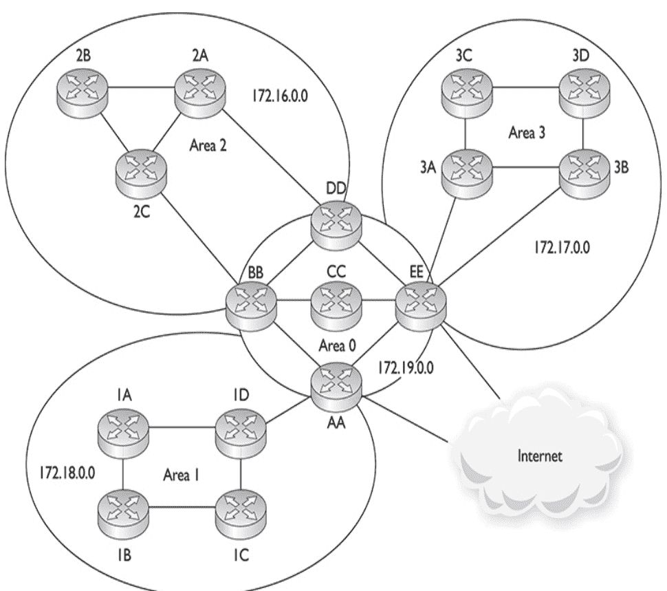
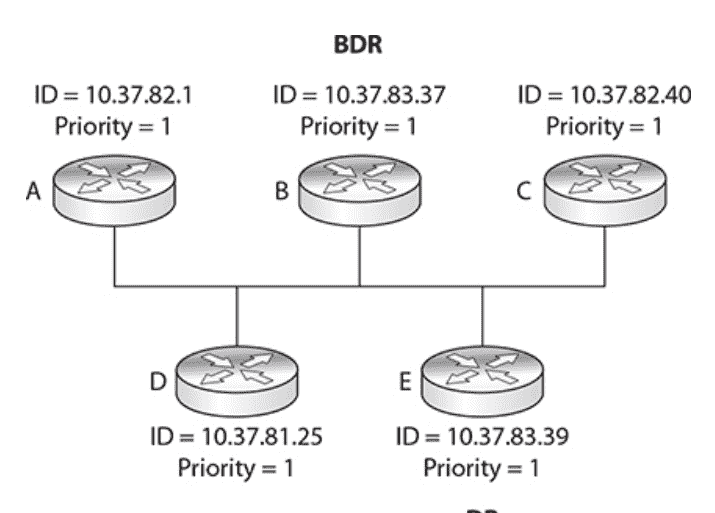
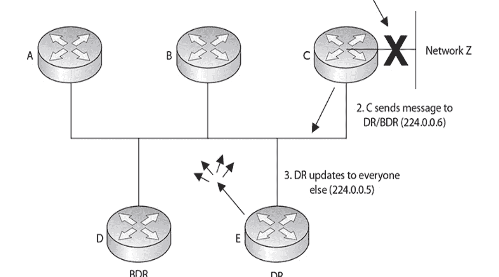
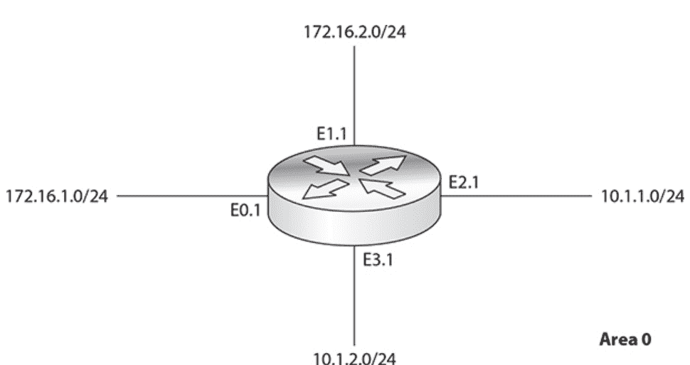
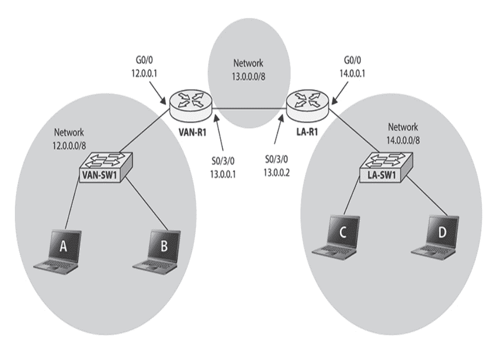
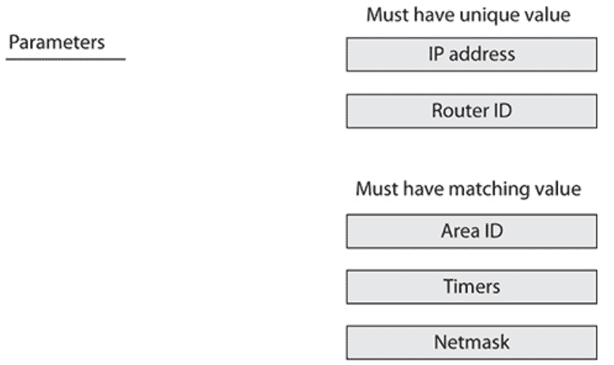

# OSPF 路由

在本章中，您将

- 了解 Open Shortest Path First 协议的基础知识
- 了解 OSPF 的工作原理
- 了解如何配置 OSPF
- 了解 OSPF 故障排除

开放式最短路径优先（OSPF）协议是一种链路状态协议，用于处理 IP 流量的路由。OSPF 版本 2（如 RFC 2328 所述）是一种开放标准，路由信息协议（RIP）的版本 1 和 2 也是如此（RIP 也是一种路由协议）。第 11 章简要介绍了链路状态协议。如您将在本章中看到，OSPF 大量借鉴了第 11 章中描述的概念，但 OSPF 也具有某些独特功能，这些功能将在此处介绍。除了介绍 OSPF 的特性外，本章还提供了相关信息，使您能够使用 OSPF 进行基本路由配置。


**注意** OSPF 的一个优秀资源是“OSPF 设计指南”，可以从思科网站免费查看和下载：[思科 OSPF 设计指南](www.cisco.com/c/en/us/support/docs/ip/open-shortest-path-first-ospf/7039-1.html)。它详细介绍了单区域和多区域设计。

## OSPF Overview

OSPF 创建于 20 世纪 80 年代中期，旨在解决 RIP 在大型企业网络中的许多缺陷和可扩展性问题。由于基于开放标准，OSPF 在当今许多企业网络中非常流行，并具有许多优势，包括：

- 由于基于开放标准，它可以在大多数路由器上运行。
- 它使用由 Edsger Dijkstra 开发的 SPF 算法来提供无环拓扑。
- 它通过链路状态通告（LSA）提供触发式增量更新，从而实现快速收敛。
- 它是无类协议，支持带有变长子网掩码（VLSM）和路由汇总的分层设计，从而减少路由开销。
- 它包含两层层次结构，可将问题限制在区域内并减少路由开销。
- 它具有智能度量（代价），即接口带宽的倒数。
- 它允许您通过汇总和过滤广泛控制路由更新信息。

鉴于其优势，OSPF 确实也有其劣势：

- 它需要更多内存来保存邻接关系（OSPF 邻居列表）、拓扑（包含所有路由器及其路由/链路的链路状态数据库）和路由表。
- 运行 SPF 算法需要额外的 CPU 处理，尤其是在首次打开路由器且它们正在初始构建邻接关系和拓扑表时。
- 对于大型网络，需要仔细设计，通过将路由器分隔到不同区域来将网络划分为适当的分层设计。
- 与距离矢量协议相比，它的配置更复杂，故障排除更困难。


**考试提示** 为考试记住 OSPF 的优点和缺点。

了解任何路由协议的优缺点在选择协议时很有用。通常，OSPF 用于大型企业网络，这些网络要么存在混合路由供应商环境，要么要求路由协议采用开放标准的策略，这使得公司在需要替换现有任何路由器时具有灵活性。


**提示** 通常，当拥有超过 50 台路由器时，思科建议使用更先进的路由协议，例如开放式最短路径优先（OSPF）或增强型内部网关路由协议（EIGRP）。在混合供应商环境中，这两者之间基本只有一种选择：OSPF。

## Hierarchical Design: Areas

为了为非常大的网络提供可扩展性，OSPF 支持两个重要概念：自治系统和区域。*Autonomous systems*（ASs）在第 11 章中介绍过。在 AS 内，*areas* 用于提供分层路由。区域是一组相邻网络。基本上，区域用于控制跨网络共享路由信息的时间和数量。在扁平网络设计中（例如使用 IP RIP 的网络），如果某个路由器发生变化（可能是路由震荡问题），它会影响整个网络中*每台*路由器。通过设计正确的分层网络，这些变化可以限制在单个区域内。


**考试提示** 请记住，OSPF 支持两层层次结构：主干（区域 0 或 0.0.0.0）和连接到主干的区域。

OSPF 实现了两层层次结构：主干和连接到主干的区域，如图 12-1 所示。此网络包括一个主干和三个连接到主干的区域。每个区域都分配了一个 32 位长度的唯一编号。区域编号可以用单个十进制数字表示，例如 1，也可以用点分十进制格式表示，例如 0.0.0.1。区域 0 是特殊区域，代表 OSPF 网络的顶层层次结构，通常称为*主干*。通过正确的 IP 寻址设计，您应该能够在区域之间汇总路由信息。通过汇总路由信息（例如，为每个区域提供一条汇总路由），您正在减少路由器需要知道的信息量。例如，图 12-1 中的每个区域都分配了一个单独的 B 类网络编号。通过区域间边界路由器上的汇总，其他区域不需要查看所有 B 类子网——只需查看各自区域的汇总网络编号（即 B 类网络编号本身）。




图 12-1 OSPF 分层设计


**注意** OSPF 中的骨干（区域 0）是必需的，非 0 区域（如区域 1、2、3 等）必须连接到骨干。首选连接是物理连接；不过，OSPF 支持一项称为 *虚拟链路* 的功能，它使区域能够逻辑上连接到骨干。虚拟链路的讨论超出了本书的范围。

例如，区域 2 不需要查看区域 1 的 172.18.0.0 网络号的所有子网，因为从区域 2 到骨干只有两条路径。然而，区域 2 需要查看其所有内部子网，以便为其在区域 2 内部的自身内部网络创建优化的路由表。因此，在设计正确的 OSPF 网络中，每个区域应仅包含其自身区域的特定路由以及到达其他区域的汇总路由。通过执行此汇总，路由器拥有较小的拓扑数据库（它们仅了解自身区域中的链路和汇总路由），且其路由表更小（它们仅了解自身区域的路由和汇总路由）。通过正确的分层设计，您可以将 OSPF 扩展到非常大的规模。第 5 章讨论了路由汇总。


**考试提示** 请注意，CCNA 考试仅关注单区域设计，本章其余部分的材料仅涵盖单区域概念。然而，CCNP 级别的材料花费大量时间在单区域和多区域设计上。设计多区域 OSPF 网络可能变得非常复杂，并需要大量的网络知识和技能。

## 度量结构

与使用跳数作为度量的 RIP 不同，OSPF 使用开销。开销实际上是链路带宽的倒数：连接速度越快，开销越低。最首选的路径是累积开销值最低的路径。通过将开销作为度量，OSPF 将比 RIP 选择更智能的路径。（度量在本章后面的“OSPF 度量值”部分中有更深入的讨论。）

请记住，在同步串行链路上，无论物理链路的时钟速率如何，带宽始终默认为 1544 Kbps。您需要使用 **带宽** 接口子配置模式命令正确配置此设置（在 [第 11 章](Chapter 11) 中讨论）。如果您有多个通往目的地的同步串行路径，尤其是它们具有不同时钟速率时，这一点非常重要。OSPF 支持到单个目的地最多 16 条等价开销路径的负载平衡；然而，默认情况下仅使用 4 条等价开销路径。请记住，如果您在串行接口上未正确配置带宽度量，路由器可能会意外包含不同时钟速率的路径，这可能导致负载平衡问题。

例如，如果您有一个以 1544 Kbps 时钟的串行连接和另一个以 256 Kbps 时钟的连接，且您未更改带宽值，OSPF 会将 *两者* 都视为 1544 Kbps，并在尝试通过这些链路到达单个目的地时使用 1544 Kbps。这是因为无论接口的时钟速率如何，串行链路的默认带宽都是 1544。当路由器执行负载平衡时，这可能会导致吞吐量问题——一半的连接将走一条链路，另一半走另一条，从而为 256-Kbps 连接创建拥塞问题。因此，请记住，您应使用 **带宽** 命令更改接口的带宽。

## OSPF 操作

如前所述，OSPF 是一种链路状态协议，类似于 [第 11 章](Chapter 11) 中泛型描述的协议。然而，每种链路状态协议（例如 OSPF 和 Intermediate System-Intermediate System（IS-IS））都有其自身独特的功能和特性。本节将向您介绍 OSPF 在单区域设计中的操作方式。

## 路由器标识

OSPF 网络中的每个路由器都需要一个唯一的 ID——该 ID 不仅在区域内必须唯一，在整个 OSPF 网络中也必须唯一。该 ID 用于为 OSPF 路由器提供唯一标识。该 ID 包含在路由器生成的任何其他 OSPF 路由器将处理的 OSPF 消息中。

路由器 ID 根据以下标准之一选择：

- 使用路由器活动环回接口上的最高 IP 地址（这是路由器上的逻辑接口）。
- 如果不存在带有 IP 地址的环回接口，则在路由器启动时使用其活动接口上的最高 IP 地址。


**注意** 环回通常具有主机掩码 (/32)。Cisco 支持环回接口的其他掩码，但许多厂商将您限制在 /32 掩码。

路由器 ID 由路由器用于向网络中的其他 OSPF 路由器宣布自身。该 ID 必须是唯一的。如果未配置环回接口，路由器将使用其一个活动物理接口上的最高 IP 地址。可选地，您可以手动定义路由器 ID，并始终确保无论路由器上存在什么接口，都能定义其方式。


**考试提示** 请记住，在 CCNA 考试中，路由器如何为 OSPF 获取其路由器 ID：活动环回上具有最高 IP 地址，或活动物理接口上具有最高 IP 地址。

如果不存在活动接口，OSPF 进程将不会启动，因此您的路由表中将不会有任何 OSPF 路由。因此，强烈建议您使用环回接口，因为它始终处于活动状态，因此路由器可以获得路由器 ID 并启动 OSPF。

## 查找邻居

与 RIP 几乎接受任何其他 RIP 路由器的路由更新不同（除非配置了带身份验证的 RIPv2），OSPF 有一些关于是否以及如何共享路由信息的规则。首先，在路由器接受来自另一个 OSPF 路由器的任何路由信息之前，路由器必须在它们的连接接口上构建相邻性。当此相邻性建立后，这两个路由器（在连接接口上）被称为邻居，表示两者之间的特殊关系。

OSPF 路由器通过共享链路状态通告（LSA）了解其 OSPF 邻居并构建其相邻性和拓扑表，LSA 存在不同类型。在了解路由器连接到哪些邻居以及跟踪已知邻居时，OSPF 路由器会每 10 秒生成 LSA hello 消息。当发现邻居并与邻居形成相邻性时，路由器期望看到来自邻居的 hello 消息。如果在默认 40 秒的死时间内未看到邻居的 hello，则该邻居被宣布为死亡。当这种情况发生时，路由器将通过 LSA 消息向其他相邻的 OSPF 路由器通告此信息。

为了使两个路由器成为邻居，以下项目必须在每个路由器上匹配：

- 区域编号
- 其连接接口上的 hello 和死间隔定时器
- OSPF 密码（可选），如果已配置
- 区域 stub 标志，指示区域类型（stub 用于包含 OSPF 消息和路由信息，这超出了本书的范围）
- 连接接口上的最大传输单元（MTU）大小

如果这些项目不匹配，路由器将不会形成相邻性并将忽略彼此的路由信息。


**考试提示** 对于 Cisco CCNA 考试，请记住 hello 进程用于发现和维护与其他 OSPF 路由器的邻居关系。为了形成邻居关系，同一网段上的两个 OSPF 路由器必须处于同一区域，必须具有匹配的 hello 和死间隔定时器，如果配置了身份验证则必须具有相同的密码，必须是相同类型（stub、not-so-stubby 或 no stub），并且其接口上必须配置相同的 MTU 大小。

假设您同时在网段上开启了所有路由器。在这种情况下，OSPF 路由器将经历三个状态，称为 *交换过程*，以确定它们是否将成为邻居：

1. **Down 状态** 路由器未与任何其他路由器交换任何 OSPF 信息。
2. **Init 状态** 目标路由器接收新路由器的 hello 并将其添加到其邻居列表中（假设前面要点中的值匹配）。请注意，此时通信仅为单向。
3. **双向状态** 新路由器接收来自目标路由器的单向答复（对其初始 hello 报文的响应），并将目标路由器添加到其邻居数据库中。

一旦路由器进入 *双向* 状态，它们即被视为邻居。此时，将进行选举过程以在网段上选举指定路由器（DR）和备份指定路由器（BDR）。

## 指定路由器和备份指定路由器

OSPF 路由器不会与任何路由器形成相邻性。相反，在 OSPF 的 *每个* 广播段上实现了客户端/服务器设计。对于每个多路访问广播段，例如以太网，有一个 DR 和一个 BDR，以及其他称为 *DROTHERs* 的 OSPF 路由器。例如，如果您在交换区域中有十个 VLAN，您将有十个 DR 和十个 BDR。网段不拥有这两个路由器的唯一例外是在 WAN 点对点链路上。


当 OSPF 路由器启动时，它会在其连接的每个多访问网段上与 DR（指定路由器）和 BDR（备份指定路由器）建立邻接关系；如果它连接到三个网段，它将建立三组邻接关系。任何路由信息的交换都是在这些 DR/BDR 路由器和网段上的其他 OSPF 邻居之间进行的（反之亦然）。OSPF 路由器使用 IP 多播地址 224.0.0.6 与 DR 进行通信。DR 和 BDR 使用多播 IP 地址 224.0.0.5 与所有 OSPF 路由器进行通信。


**考试提示** 请记住，对于 CCNA 考试，OSPF 路由器使用链路状态通告（LSAs）相互通信。LSA 的一种类型是 hello（保持活动包），用于建立邻居关系并作为保活功能。Hellos 每 10 秒生成一次。在共享链路信息（直连路由）时，链路信息发送到 DR（224.0.0.6），然后 DR 将链路信息传播给网段上的其他所有人（224.0.0.5）。在点对点链路上，由于不使用 DR/BDR，所有 OSPF 数据包都寻址到 224.0.0.5。

具有最高优先级的 OSPF 路由器成为该网段的 DR。如果优先级相同，具有最高路由器 ID（不是网段上的 IP 地址）的路由器将成为 DR。默认情况下，所有路由器的优先级均为 1（优先级范围可以是 0 到 255——这是一个 8 位值）。如果 DR 发生故障，BDR 会被提升为 DR，并且另一台路由器会被选举为 BDR。图 12-2 展示了选举过程的示例，其中路由器 E 被选举为 DR，路由器 B 被选举为 BDR。请注意，在此示例中，每台路由器都具有默认优先级 1；因此，由于路由器 E 具有最高的路由器 ID，它被选为 DR；由于路由器 B 具有第二高的路由器 ID，它被选为 BDR。如果一台路由器的优先级为 0，它将永远不会成为 DR 或 BDR。



### 图 12-2 DR 和 BDR 选举过程

DR 和 BDR 的优先级是基于接口逐一对应修改的，并且在接口子配置模式下使用 `ip ospf priority` 命令进行配置。一旦 DR 和 BDR 被选举出来，即使其他具有更高优先级的路由器与它们建立邻接关系，它们也会保持这些角色：只有当不存在 DR 或 BDR 时，才会发生选举或重新选举。


**考试提示** CCNA 考试中理解的一个重要主题是路由器如何成为 DR。具有最高优先级（或最高路由器 ID）的路由器成为 DR——请注意，这并不意味着链路上具有最高 IP 地址的路由器。这个过程适用于多访问网段，但不适用于不使用 DR/BDR 的点对点链路。将优先级设置为 0 意味着该路由器永远不会成为 DR 或 BDR。

## 共享路由信息

在选举出 DR/BDR 对之后，路由器继续生成 hellos 以维持通信。这被视为一种 *exstart*（交换开始）状态，在此状态下，OSPF 路由器准备好共享链路状态信息。路由器经历的过程被称为 *exchange protocol*（交换协议），概述如下：

1.  **Exstart 状态** DR 和 BDR 与网段上的其他 OSPF 路由器建立邻接关系。然后，在每个邻接关系中，具有最高路由器 ID 的路由器成为主节点（master），并首先启动交换过程（共享其链路状态信息）。请注意，DR 不一定是交换过程的主节点。邻接关系中的剩余路由器将是主节点（slave）。
2.  **Exchange 状态** 主节点首先向主节点分享链路状态信息。这些被称为 *database description packets*（数据库描述包，DBDs，有时也称为 DDPs）。DBDs 包含链路状态类型、通告路由器的 ID、通告链路的开销（cost）以及链路的序列号。主节点回复一个 LSACK——对主节点 DBD 的确认。主节点随后将 DBD 的信息与其自身的信息进行比较。
3.  **Loading 状态** 如果主节点拥有比主节点更新的信息，主节点将向主节点的原始 DBD 响应一个链路状态请求（LSR）。主节点随后向主节点发送包含链路详细信息的链路状态更新（LSU）。主节点然后将此内容纳入其本地链路状态数据库。同样，主节点将向主节点生成一个 LSACK，以确认其已接收 LSU。如果主节点拥有更新的信息，它将重复交换和加载状态。
4.  **Full 状态** 一旦主节点和主节点同步，它们就被视为处于完全（full）状态。

总结这四个步骤，OSPF 路由器共享一种 LSA 消息，以披露有关可用路由的信息；基本上，LSA 更新消息包含一条链路和一个状态，以及其他信息。*链路*是生成该更新的路由器接口（一条直连路由）。*状态*是对此接口的描述，包括其上配置的 IP 地址以及该路由器与其相邻路由器的关系。然而，OSPF 路由器不会与任何 OSPF 路由器共享此信息——它是在 OSPF 路由器和网段上的 DR/BDR 之间共享的。


**考试提示** 熟悉路由器将与 DR/BDR 共享路由所经历的四个步骤。还要记住，OSPF 路由器与 DR/BDR 共享有关其直连路由的信息，其中包括链路状态类型、通告路由器的 ID、通告链路的开销以及链路的序列号。

进入完全状态后，OSPF 使用增量更新。这意味着每当发生变化时，只有该变化会与 DR 共享，然后 DR 将此信息与其他网段上的路由器共享。图 12-3 展示了此过程的示例。在此示例中，连接到路由器 C 的网络 Z 关闭。路由器 C 向 DR 和 BDR（目的多播地址为 224.0.0.6）发送多播，告知它们此变化。一旦 DR 和 BDR 内部整合了此变化，DR 随后通过多播消息（发送到 224.0.0.5，即所有 OSPF 路由器）告知网段上的其他路由器有关网络 Z 的变化。任何接收该更新的路由器随后将此更新共享到它们连接的其他网段的 DR。



### 图 12-3 LSA 更新过程

请注意，OSPF 路由器之间的通信是面向连接的，即使使用了多播。例如，如果一台路由器向 DR 告知变化，DR 会用通信源确认这条新信息。同样，当 DR 将此信息与网段上的其他路由器共享时，DR 期望从每个这些邻居处获得确认。请记住，当 OSPF 路由器与另一台路由器交换更新时，该过程需要确认：这确保路由器或路由器们已接收更新。

增量更新过程的一个例外是，DR 每 30 分钟泛洪其数据库，以确保网段上的所有路由器都具有最新的链路状态信息。它使用目的地址 224.0.0.5（网段上所有 OSPF 路由器）来实现这一点。

每个 LSA 消息都与其类型相关联。本书重点关注以下三种类型，它们都位于单个区域内：

-   **LSA 类型 1（路由器 LSA）** 这些由每台路由器为属于该区域的每条链路生成。它们仅在该所属区域内泛洪。此 LSA 的链路 ID 是生成它的路由器的路由器 ID。
-   **LSA 类型 2（网络 LSA）** 这些由 DR 生成，并描述连接到该网段的路由器。它们在网络段所属的区域内发送。链路 ID 是指定路由器的接口 IP 地址，该地址描述特定网段。
-   **LSA 类型 5（外部 LSA）** 自治系统外部 LSA 由自治系统边界路由器（ASBR）生成，并包含指向当前 AS 外部网络的路由。链路 ID 是 LSA 中通告的网络号。

总之，前两种 LSA 类型代表本地区域内的链路，而最后一种 LSA 类型代表来自不同自治系统的链路。这些 LSA 类型被放置在路由设备上的本地数据库中。还有其他 LSA 类型，但它们超出了本书的范围。

在使用链路状态信息构建路由表时，OSPF 路由器可以在其路由表中保留至多 16 条通往单一目的地的路径。唯一的限制是，这些路径必须具有相同的累积开销度量。


**考试提示** 在 CCNA 考试中请记住，双向状态表明两台 OSPF 路由器是邻居。完全状态表明路由器之间链路共享的完成。为了构建和维护 OSPF 数据库，使用 hello（建立邻居）和 LSA（路由信息）消息。

## OSPF 配置


配置 OSPF 与配置 RIP 等路由协议略有不同。配置 OSPF 时，请使用以下语法：

```
Router(config)# router ospf process_ID
Router(config-router)# network IP_address wildcard_mask area area_#
```

进程 ID 在本地具有重要意义，用于区分同一路由器上运行的 OSPF 进程。它可以是 1 到 65,535 之间的任何数字。您的路由器可能是两个 OSPF 自治系统之间的边界路由器，为了在路由器上区分它们，您将为它们分配唯一的进程 ID。请注意，这些 ID 号码在不同路由器之间不需要匹配，并且与自治系统编号无关。如果您的路由设备连接到两个不同的 OSPF 网络，则需要使用不同的进程编号：每个 OSPF 网络都需要一个不同的、本地唯一的进程编号。每个 OSPF 进程都有自己的由进程 ID 标识的 OSPF 数据库。


**考试提示** 请记住，在思科 CCNA 考试中，配置 OSPF 路由进程时，必须指定进程 ID（标识符）。它唯一标识路由器上 OSPF 数据库的一个实例，并且仅在本地具有重要意义：它不需要在 AS 中的每个路由器上匹配。它可以是 1 到 65,535 之间的任何数字。

配置 OSPF 时，您使用 network 命令指定哪些接口进入哪个 OSPF 区域。不同的进程 ID 号用于标识路由设备连接的不同 OSPF 网络。因此，例如，network 0.0.0.0 255.255.255.255 area 0 命令将把所有接口包含在区域 0 中。每个 OSPF 进程都有自己的由进程 ID 标识的 OSPF 数据库。

从配置 OSPF 的命令中可以看到，此命令的语法与 RIP 的配置语法不同，在 RIP 中您只需指定一个类地址。OSPF 是无类别的。使用此配置命令，您可以非常具体地指定哪个接口属于哪个区域。此命令的语法列出一个 IP 地址或网络号，后面跟一个 *通配符掩码*，它与子网掩码不同。通配符掩码告诉路由器地址中感兴趣的部分——换句话说，应该匹配地址的哪一部分。此掩码也用于访问列表，访问列表将在第 17 章中详细讨论。

通配符掩码长度为 32 位。某一位位置中的 0 表示必须匹配，某一位位置中的 1 表示路由器不关心。实际上，通配符掩码是一个 *反向* 子网掩码，其中 1 和 0 已切换。使用通配符掩码，您可以非常具体地指定哪些接口属于哪些区域。配置命令的最后部分告诉路由器这些地址属于路由器上的哪个区域。


**考试提示** 与 RIP 不同，**network** 语句允许您指定 IP 地址和通配符掩码，通配符掩码是一个反向子网掩码。您还必须指定这些地址属于哪个区域：**network *network_# wildcard_mask area area_#***。将子网掩码转换为通配符掩码的技巧是用 255.255.255.255 减去子网掩码；结果将是相应的通配符掩码。（您将在第 17 章中详细了解访问列表和通配符掩码的工作原理。）在考试中，您需要能够查看 OSPF **network** 命令中的通配符掩码，并确定它包含哪个接口或哪些接口。

让我们看一些代码示例，了解通配符掩码的工作原理。请使用图 12-4 中所示的路由器作为示例。



**图 12-4 OSPF 网络配置示例**

```
Router(config)# router ospf 1
Router(config-router)# network 10.1.1.1 0.0.0.0 area 0
Router(config-router)# network 10.1.2.1 0.0.0.0 area 0
Router(config-router)# network 172.16.1.1 0.0.0.0 area 0
Router(config-router)# network 172.16.2.1 0.0.0.0 area 0
```

在此示例中，地址为 10.1.1.1、10.1.2.1、172.16.1.1 和 172.16.2.1 的接口都与区域 0 相关联。通配符掩码 0.0.0.0 表示，要将接口放入区域 0，必须与路由器接口上的地址进行精确匹配。

下面是另一个实现相同目的的示例：

```
Router(config)# router ospf 1
Router(config-router)# network 10.0.0.0 0.255.255.255 area 0
Router(config-router)# network 172.16.0.0 0.0.255.255 area 0
```

在此示例中，地址以 10 或 172.16 开头的接口将包含在区域 0 中。

或者，如果路由器上的所有接口都属于同一区域，您可以使用此配置：

```
Router(config)# router ospf 1
Router(config-router)# network 0.0.0.0 255.255.255.255 area 0
```

在此示例中，所有接口都放置在区域 0 中。

可以看到，OSPF 非常灵活，使您能够指定哪些接口将参与 OSPF 以及它们将属于哪个区域。


**视频 12.01.** 随本书附带的数字资源包含配置路由器 OSPF 的多媒体演示。

### 环回接口

环回接口是路由器上的一个逻辑虚拟接口。默认情况下，路由器上没有环回接口，但可以轻松创建。所有 IOS 平台都支持环回接口，您可以根据需要创建任意数量的这些接口。这些接口被视为路由器上的物理接口：您可以为它们分配寻址信息，将其网络号包含在路由更新中，甚至可以在它们上终止 IP 连接，例如 telnet 和 SSH。


**考试提示** 请记住环回接口的价值，以备思科 CCNA 考试之用。环回接口是一个始终保持启动状态的逻辑接口。使用 interface loopback 命令创建它。

您可能希望创建环回接口的一些原因：

- 为 OSPF 路由器分配路由器 ID
- 用于测试目的，因为此接口始终保持启动状态
- 终止特殊连接，例如 GRE 隧道或 IPsec 连接，因为此接口始终保持启动状态


**提示** OSPF 路由器 ID 在启动 OSPF 路由进程时选择。当您手动执行 **router ospf** 命令或在路由器启动时加载路由器配置时，会发生这种情况。因此，如果在启用 OSPF 后创建环回接口，则不会将环回接口用作路由器 ID；但是，如果重启路由器，默认情况下将使用环回接口。因此，我建议您先创建环回接口并为其分配 IP 地址，然后再启用 OSPF，以消除对路由器 ID 是什么的任何混淆。

要创建环回接口，请使用以下命令：

```
Router(config)# interface loopback port_#
Router(config-if)# ip address IP_address subnet_mask
```

可以看到，创建环回接口很简单。您可以指定 0 到 2147483647 之间的端口号。您使用的编号仅在本地具有重要意义。进入环回接口后，您几乎可以在其上执行任何接口命令；例如，您可以使用 **ip address** 命令为其分配 IP 地址。

### 默认路由传播

在连接到 ISP 的边界 OSPF 路由器上，您通常有一个指向 ISP 的默认路由。要获取此路由并将其重新分发到您的 OSPF 进程，基本上将您的边界路由器变为 ASBR，请使用以下配置：

```
Router(config)# ip route 0.0.0.0 0.0.0.0 ISP_interface_or_IP_address
Router(config)# router ospf process_ID
Router(config-router)# default-information originate
```


**提示** 请确保您的默认路由不指向内部网络，而是指向 ISP 的网络；否则，您将创建一个路由循环。

### OSPF 度量值

您可以通过两种方式影响 OSPF 用于为路由表选择最佳成本路由的成本度量值。首先，请记住，成本度量值是路由器接口累积带宽值的倒数。思科计算成本度量值所使用的默认度量是：cost = 10⁸ / (接口带宽)；10⁸ 表示 100 Mbps。您还可以通过使用 **auto-cost reference-bandwidth** 命令更改 10⁸ 的值来影响成本值。


**考试提示** 在考试中，您需要记住表 12-1 中的 OSPF 接口成本，尤其是串行连接的成本。

表 12-1 包含不同接口类型的一些默认成本。


| Cost Value | Interface Type |
|---|---|
| 1785 | 56-Kbps 串行线路 |
| 1652 | 64-Kbps 串行线路 |
| 64 | T1 |
| 10 | 以太网 (10 Mbps) |
| 1 | 快速以太网 (100 Mbps) |
| 1 | 千兆以太网 (1000 Mbps/1 Gbps) |
| 1 | 10 千兆以太网 (10 Gbps) |
| 1 | 100 千兆以太网 (100 Gbps) |

表 12-1 不同 IOS 接口的默认 OSPF 成本

手动更改接口成本，请使用以下配置：

```
Router(config)# interface type [slot_#/]port_#
Router(config-if)# ip ospf cost cost_value
```

请注意，成本是在接口内分配的。该值范围为 1 到 65,535。请注意，每个供应商可能使用不同的计算方法来得出成本值。


**注意** 在给定网段上，每台路由器的链路成本必须匹配非常重要。网段上的成本值不匹配会导致路由器持续运行 SPF 算法，大大影响路由器性能。

通常，您不会更改接口上的默认成本值。但是，由于 OSPF 使用带宽的倒数作为度量值，并且串行接口默认带宽为 1544 Kbps，您肯定希望将串行接口的带宽度量值与其实时时钟速率匹配。要配置路由器接口的带宽，请使用以下命令：

```
Router(config)# interface type [slot_#/]port_#
Router(config-if)# bandwidth speed_in_Kbps
```

例如，如果时钟速率为 64,000，您将使用 **bandwidth 64** 命令正确配置带宽。请注意，**bandwidth** 命令的速度单位为 *Kbps*。例如，假设您使用 **bandwidth 64000** 配置了带宽。路由器会假设接口的带宽度量值为 64 Mbps，而不是 Kbps。

默认情况下，路由器会在路由表中放置最多 8 条到目标的等成本 OSPF 路径。可通过以下配置将其增加到最多 16 条等成本路径：

```
Router(config)# router ospf process_ID
Router(config-router)# maximum-paths #_of_max_paths
```


**考试提示** 对于 CCNA，请记住 **bandwidth** 命令应用于同步串行接口，以将带宽度量值与接口的时钟速率匹配。无论同步串行接口的时钟速率如何，其默认带宽度量值均为 1544 Kbps。最大路径数的默认值为 8。

## OSPF Authentication

OSPF 支持对邻居和路由更新进行身份验证。这是用于防止恶意 OSPF 路由器将错误或误导性路由信息注入到拓扑数据库中。身份验证可以使用明文密码或使用 MD5 算法创建的数字签名来完成。在两者中，后者更安全：明文密码可能被两个 OSPF 邻居之间的窃听者看到。使用 MD5 时，为了防止重放攻击（例如，相同信息始终发送到邻居，如 hello 消息），消息中包含一个非递减序列号，以确保消息和签名是唯一的。身份验证信息放置在每个 LSA 中，并在被 OSPF 路由器接受前进行验证。要成为邻居，两个对等点上的密钥信息（明文密码或 MD5 算法的密钥）必须匹配。


**注意** 请记住，如果两个 OSPF 邻居上的密码/密钥值不匹配，将不会发生邻接。在两种方法中，使用 MD5 绝对比明文密码安全得多。

配置身份验证是一个两步过程：指定要使用的密码/密钥，并启用身份验证。密钥的配置是按接口进行的，这意味着同一接口上的每个相邻 OSPF 路由器都必须使用该密码/密钥。配置密码/密钥值的命令如下：

```
Router(config)# interface type [slot_#/]port_#
Router(config-if)# ip ospf authentication-key password
```

从 Cisco IOS 12.4 开始，路由器会将任何超过八个字符的密码截断为八个字符。密码以明文形式存储在路由器配置中。要对其加密，请使用 service password-encryption 命令，该命令在第 17 章中讨论。

接下来，您必须指定密码是以明文发送还是由 MD5 用于创建数字签名。这可以在接口上或按区域进行。要指定接口方法，请使用此配置：

```
Router(config)# interface type [slot_#/]port_#
Router(config-if)# ip ospf authentication [message-digest]
```

如果省略 **message-digest** 参数，密钥将作为明文密码发送。

您的另一个选项是为路由器关联的区域配置密码/密钥的使用：

```
Router(config)# router ospf process_ID
Router(config-router)# area area_# authentication
    [message-digest]
```

同样，如果省略 **message-digest** 参数，密钥将作为明文密码发送。

在两种方法中，后者是较旧的方法：接口方法（前者）是在 IOS 12.0 中添加的，是首选方法。

## OSPF Troubleshooting

配置 OSPF 后，可使用以下命令查看和排查 OSPF 配置和操作：

- **show ip protocols**
- **show ip route**
- **show ip ospf**
- **show ip ospf database**
- **show ip ospf interface**
- **show ip ospf neighbor**
- **debug ip ospf adj**
- **debug ip ospf events**
- **debug ip ospf packet**

以下各部分将介绍这些命令。

## The show ip protocols Command

**show ip protocols** 命令显示您在路由器上配置并运行的所有 IP 路由协议。以下是使用 OSPF 的此命令示例：

```
Router# show ip protocols
Routing Protocol is "ospf 1"
    Outgoing update filter list for all interfaces is not set
    Incoming update filter list for all interfaces is not set
    Router ID 192.168.100.1
    Number of areas in this router is 1. 1 normal 0 stub 0 nssa
    Maximum path: 4
    Routing for Networks:
      0.0.0.0 255.255.255.255 area 0
    Routing Information Sources:
      Gateway          Distance      Last Update
      192.168.1.100     110           00:00:24
      192.168.100.1     110           00:00:24
    Distance: (default is 110)
```

在此示例中，路由器 ID 为 192.168.100.1。所有接口都在参与 OSPF（0.0.0.0 255.255.255.255）并位于区域 0。此网络中有两台 OSPF 路由器：192.168.1.100（另一台路由器）和 192.168.100.1（本路由器）。请注意，默认管理距离为 110。


**考试提示** Cisco CCNA 要求您了解连接路由、静态路由、RIP、EIGRP 和 OSPF 的管理距离。请记住，连接路由的默认管理距离为 0；静态路由为 1；RIP 路由的管理距离为 120；EIGRP 路由的管理距离为 90；OSPF 路由的管理距离为 110。有关管理距离的更多信息，请复习第 11 章。

## The show ip route Command

您的路由器在路由表中保存到目的地的最佳 IP 路径列表。要查看路由表，请使用 **show ip route** 命令：

```
Router# show ip route
Codes: C - connected, S - static, I - IGRP, R - RIP,
      M - mobile, B - BGP, D - EIGRP, EX - EIGRP external,
      O - OSPF, IA - OSPF inter area, N1 - OSPF NSSA
      external type 1, N2 - OSPF NSSA external type 2,
      E1 - OSPF external type 1, E2 - OSPF external type 2,
      E - EGP, i - IS-IS, L1 - IS-IS level-1,
      L2 - IS-IS level-2, * - candidate default,
      U - per-user static route, o - ODR,
      T - traffic engineered route
Gateway of last resort is not set
        10.0.0.0/24 is subnetted, 1 subnets
O         10.0.1.0 [110/65] via 192.168.1.100, 00:04:18, Serial0
C     192.168.1.0/24 is directly connected, Serial0
C     192.168.100.0/24 is directly connected, Ethernet0
```

在此示例中，有一条 OSPF 路由（**O**）：10.0.1.0。该路由的管理距离为 110，度量成本为 65，可通过邻居 192.168.1.100 到达。


**考试提示** 对于 CCNA 考试，请记住 OSPF 路由在 **show ip route** 命令的输出中显示为 **O**。请记住括号（[ ]）中的两个数字：管理距离和成本（在处理 OSPF 路由时）。

## The show ip ospf Command

要查看路由器 OSPF 配置的概述，请使用 **show ip ospf** 命令：


```
Router# show ip ospf
  Routing Process "ospf 1" with ID 10.1.1.1 and Domain ID 10.1.1.1
  Supports only single TOS(TOS0) routes
  Supports opaque LSA
  SPF schedule delay 5 secs, Hold time between two SPFs 10 secs
  Minimum LSA interval 5 secs. Minimum LSA arrival 1 secs
  LSA group pacing timer 100 secs
  Interface flood pacing timer 55 msecs
  Retransmission pacing timer 100 msecs
  Number of external LSA 0. Checksum Sum 0x0
  Number of opaque AS LSA 0. Checksum Sum 0x0
  Number of DCbitless external and opaque AS LSA 0
  Number of DoNotAge external and opaque AS LSA 0
  Number of areas in this router is 1. 1 normal 0 stub 0 nssa
  External flood list length 0
    Area BACKBONE(0)
      Number of interfaces in this area is 2
      Area has message digest authentication
      SPF algorithm executed 4 times
      Area ranges are
      Number of LSA 4. Checksum Sum 0x29BEB
      Number of opaque link LSA 0. Checksum Sum 0x0
      Number of DCbitless LSA 3
      Number of indication LSA 0
      Number of DoNotAge LSA 0
      Flood list length 0
```

此命令显示 OSPF 定时器配置及其他统计信息，包括在某个区域内运行 SPF 算法的次数。


**视频** 12.02。随本书附带的数字资源包含使用 **show ip route** 和 **show ip ospf** 命令的多媒体演示。

## show ip ospf database 命令

要显示特定路由设备的 OSPF 数据库相关信息列表，包括 OSPF 链路状态的集合，请使用 **show ip ospf database** 命令。以下是一个示例：

```
Router# show ip ospf database
OSPF Router with ID(192.168.1.11) (Process ID 1)
```

**路由器链路状态（区域 0）**

| 链路 ID | 通告路由器 | 老化时间 | 序列号 | 校验和 | 链路计数 |
| --- | --- | --- | --- | --- | --- |
| 192.168.1.8 | 192.168.1.8 | 1381 | 0x8000010D | 0xEF60 | 2 |
| 192.168.1.11 | 192.168.1.11 | 1460 | 0x800002FE | 0xEB3D | 4 |
| 192.168.1.12 | 192.168.1.12 | 2027 | 0x80000090 | 0x875D | 3 |
| 192.168.1.27 | 192.168.1.27 | 1323 | 0x800001D6 | 0x12CC | 3 |

**网络链路状态（区域 0）**

| 链路 ID | 通告路由器 | 老化时间 | 序列号 | 校验和 |
| --- | --- | --- | --- | --- |
| 172.16.1.27 | 192.168.1.27 | 1323 | 0x8000005B | 0xA8EE |
| 172.17.1.11 | 192.168.1.11 | 1461 | 0x8000005B | 0x07AC |

在这两个部分中，路由器链路状态部分表示 LSA 类型 1 消息，网络链路状态部分表示 LSA 类型 2 消息。链路 ID 列代表路由器 ID 号。通告路由器列代表通告路由设备的路由器 ID。老化时间列表示链路状态信息已存在的时间。序列号列用于检测来自 OSPF 邻居的旧 LSA 或重复 LSA。校验和列是更新的校验和，以确保可靠性。链路计数列代表为路由设备检测到的接口数量。


**考试提示** 在 CCNA 考试中，请记住，**show ip ospf database** 命令显示从其他 OSPF 路由设备学习到的 OSPF 链路集合。

## show ip ospf interface 命令

在逐接口的基础上，您的 OSPF 路由器会跟踪某个接口属于哪个区域，以及哪些邻居（如果有）连接到该接口。要查看此信息，请使用 **show ip ospf interface** 命令：

```
Router# show ip ospf interface
Ethernet1 is up, line protocol is up
Internet Address 172.16.255.1/24, Area 0
Process ID 100, Router ID 172.16.255.1, Network Type BROADCAST, Cost: 10
Transmit Delay is 1 sec, State DROTHER, Priority 1
Designated Router id 172.16.255.11, Interface address 172.16.255.11
Backup Designated router id 172.16.255.10, Interface addr 172.16.255.10
Timer intervals configured, Hello 10, Dead 40, Wait 40, Retransmit 5
Hello due in 0:00:03
Neighbor Count is 3, Adjacent neighbor count is 2
  Adjacent with neighbor 172.16.255.10  (Backup Designated Router)
  Adjacent with neighbor 172.16.255.11  (Designated Router)
```

在此示例中，路由器 ID 为 172.16.255.1。其状态为 DROTHER，这意味着它*不是* DR 或 BDR。实际上，DR 是 172.16.255.11，BDR 是 172.16.255.10（这些是它们的路由器 ID）。还要注意，hello 和 dead 间隔计时器已设置为其默认值：分别为 10 秒和 40 秒。共有三个邻居具有两个邻接关系——请记住，邻接关系仅在路由器与 DR 和 BDR 之间建立，而不是与网段上的所有路由器建立。


**考试提示** **show ip ospf interface** 命令显示您的路由器 ID、DR 和 BDR 的 ID、hello 计时器（10 秒）、dead 间隔（40 秒）、邻居数量以及邻接数量。请记住，要和另一台 OSPF 路由器成为邻居，hello 和 dead 间隔时间值必须匹配。在 CCNA 考试中，要能够识别此命令的输出。

## show ip ospf neighbor 命令

要查看路由器的所有 OSPF 邻居，请使用 **show ip ospf neighbor** 命令：

```
Router# show ip ospf neighbor
```

| ID | 优先级 | 状态 | 失效时间 | 地址 | 接口 |
| --- | --- | --- | --- | --- | --- |
| 172.16.255.11 | 1 | FULL/DR | 0:00:31 | 172.16.255.11 | Ethernet0 |
| 172.16.255.10 | 1 | FULL/BDR | 0:00:33 | 172.16.255.10 | Ethernet0 |
| 172.16.255.9 | 1 | 2WAY/DROTHER | 0:00:35 | 172.16.255.9 | Ethernet0 |
| 172.16.254.2 | 1 | FULL/DR | 0:00:39 | 172.16.254.2 | Serial0.1 |


**考试提示** 在 CCNA 考试中请记住，**show ip ospf neighbor** 命令会列出路由器的所有 OSPF 邻居、它们的 OSPF 状态、路由器 ID 以及邻居连接到的接口。

在此示例中，有三台路由器连接到 Ethernet0：172.16.255.11 是 DR，172.16.255.10 是 BDR，而 172.16.255.9 是另一台 OSPF 路由器（DROTHER）。请注意，对于 DR 和 BDR，状态为 *完全*，这是符合预期的，因为此路由器和 DR/BDR 之间会相互共享路由信息。DROTHER 路由器处于 *双向* 状态，这表示该路由器是邻居，但此路由器和 DROTHER 路由器不会直接相互共享路由信息，因为另一台路由器*不是* DR 或 BDR。或者，您可以将邻居的 ID 添加到 **show ip ospf neighbor** 命令中，以获取有关特定邻居的更多信息。


**警告** 如果 OSPF 路由器接口上的 MTU 大小不同，它们将不会成为邻居；请使用 **show interfaces** 或 **show ip interfaces** 命令验证每个邻居的 MTU 大小。

## debug ip ospf adj 命令

要进行更详细的故障排除，您可以使用 **debug** 命令。如果要查看路由器与其他路由器建立邻接关系的过程，请使用 **debug ip ospf adj** 命令：

```
Router# debug ip ospf adj
172.16.255.11 on Ethernet0, state 2WAY
OSPF: end of Wait on interface Ethernet0
OSPF: DR/BDR election on Ethernet0
OSPF: Elect BDR 172.16.255.10
OSPF: Elect DR 172.16.255.11
        DR: 172.16.255.11 (Id) BDR: 172.16.255.10 (Id)
OSPF: Send DBD to 172.16.255.11 on Ethernet0
        seq 0x10DB opt 0x2 flag 0x7 len 32
OSPF: Build router LSA for area 0, router ID 172.16.255.11
```

在此示例中，您可以看到 DR 和 BDR 的选举过程以及与 DR 共享链路（DBD）的过程。

如果两台路由器错误配置了 OSPF 的认证类型，例如一台使用明文密码，另一台使用 MD5，您会通过之前的 **debug** 命令看到以下输出：

```
OSPF: Rcv pkt from 192.168.1.1, Serial1/0:
Mismatch Authentication type. Input packet specified
                type 0, we use type 1
```

但是，如果两台 OSPF 路由器上的密码（密钥）不匹配，您会看到类似如下的输出：

```
OSPF: Rcv pkt from 192.168.1.1, Serial1/0 :
Mismatch Authentication Key - Clear Text
```

## debug ip ospf events 命令

如果要查看路由器上的 OSPF 事件，请使用 **debug ip ospf events** 命令：

```
Router# debug ip ospf events
4d02h: OSPF: Rcv hello from 192.168.1.100 area 0 from Serial0 192.168.1.100
4d02h: OSPF: End of hello processing
```


**考试提示** 确保你熟悉这些 **debug** 命令以及导致两台路由器无法成为邻居的原因。

在此示例中，路由器接收到了来自 192.168.1.100 的 hello 报文，该设备连接至 Serial0。你还可能看到以下类型的信息：

- 网段上路由器的 Hello 间隔不匹配
- 网段上路由器的 Dead 间隔不匹配
- 网段上 OSPF 路由器的子网掩码不匹配

## debug ip ospf packet 命令

如果要查看 LSA 的 OSPF 报文内容，请使用 **debug ip ospf packet** 命令：

```
Router# debug ip ospf packet
4d02h: OSPF: rcv. v:2 t:1 l:48 rid:192.168.1.100
  aid:0.0.0.0 chk:15E4 aut:0 auk: from Serial0
```

表 12-2 解释了此命令中显示的值。

表 12-2 debug ip ospf packet 命令的调试字段说明

| 字段值 | 说明 |
|---|---|
| Aid: | OSPF 区域 ID 编号 |
| Auk: | 用于邻居身份验证的 OSPF 身份验证密钥 |
| Aut: | OSPF 身份验证类型（0–无，1–简单密码，2–MD5 哈希） |
| Keyid: | 如果启用了此身份验证机制，则为 MD5 密钥值 |
| L: | 报文长度 |
| Rid: | OSPF 路由器 ID |
| Seq: | 序列号 |
| T: | OSPF 报文类型（1–hello，2–数据描述，3–链路状态请求，4–链路状态更新，5–链路状态确认） |
| V: | OSPF 版本号 |

## Exercise 12-1：配置 OSPF

本章的最后几个部分介绍了在路由器上配置 OSPF。本练习将帮助你巩固对配置和故障排除 OSPF 的理解。在本练习中，你将在两台路由器（VAN-R1 和 LA-R1）上配置 OSPF。你的路由器应按照以下网络图进行配置：



1. 确保所有设备均按图连接并已通电，且 IP 地址已分配。
2. 进入 VAN-R1 的 CLI。
3. 在 VAN-R1 路由器上，通过查看接口状态来验证 Gig0/0 和 Serial0/3/0 接口是否已启用。
4. 使用 **show ip route** 命令查看 VAN-R1 上的路由表。
   应有两个直连网络：连接到 Gig0/0 的 12.0.0.0 和连接到 Serial0/3/0 的 13.0.0.0。
5. 切换到 LA-R1 的 CLI 并查看 Gig0/0 和 Serial0/3/0 接口的状态。记下每个接口的 IP 地址。
6. 使用 **show ip route** 命令查看 LA-R1 的路由表。
   应有两个直连网络：连接到 Gig0/0 的 14.0.0.0 和连接到 Serial0/3/0 的 13.0.0.0。
7. 在 ComputerA 上启动命令提示符并使用 **ping 12.0.0.1** 命令，测试 ComputerA 与 VAN-R1 之间的连通性。

Ping 应该成功。

8. 在 ComputerC 上启动命令提示符并使用 **ping 14.0.0.1** 命令，测试 ComputerC 与 LA-R1 之间的连通性。

Ping 应该成功。

9. 测试 ComputerA 与 ComputerC 之间的连通性。

在 ComputerA 的命令提示符下，输入 **ping 14.0.0.5**。Ping 应该失败：VAN-R1 到 14.0.0.0 网络没有路由。

10. 在 VAN-R1 路由器上启用 OSPF，使用进程 ID 1，并使用以下命令将所有接口放入区域 0：

```
VAN-R1>enable
VAN-R1#config term
Enter configuration commands, one per line.  End with CNTL/Z.
VAN-R1(config)#router ospf 1
VAN-R1(config-router)#network 12.0.0.0 0.255.255.255 area 0
VAN-R1(config-router)#network 13.0.0.0 0.255.255.255 area 0
VAN-R1(config-router)#end
VAN-R1#
```

11. 在 LA-R1 路由器上启用 OSPF，使用进程 ID 1，并使用以下命令将所有接口放入区域 0：

```
LA-R1>enable
LA-R1#config term
Enter configuration commands, one per line.  End with CNTL/Z.
LA-R1(config)#router ospf 1
LA-R1(config-router)#network 13.0.0.0 0.255.255.255 area 0
00:17:53: %OSPF-5-ADJCHG: Process 1, Nbr 13.0.0.1 on Serial0/3/0 from
LOADING to FULL, Loading Done
LA-R1(config-router)#network 14.0.0.0 0.255.255.255 area 0
LA-R1(config-router)#end
LA-R1#
%SYS-5-CONFIG_I: Configured from console by console
```

12. 在 LA-R1 上，使用以下命令验证 OSPF 的运行情况：

- 使用 **show ip protocols** 命令确保 OSPF 已配置并运行。请注意以下内容：
  路由协议：___________
  路由器 ID：___________

网络路由：________________
上次更新：________________
距离：________________

- 使用 **show ip route** 命令，在路由表中查找作为 OSPF (**O**) 条目的 14.0.0.0 网络。
- 使用 **show ip ospf neighbor** 命令查看邻居路由器。

13. 任何一台路由器在 WAN 链路上是 DR 还是 BDR？

14. 在 VAN-R1 路由器上，使用以下命令验证 OSPF 的运行情况。

- 使用 **show ip protocols** 命令确保 OSPF 已配置并运行。
- 使用 **show ip route** 命令，在路由表中查找作为 OSPF (**O**) 条目的 14.0.0.0 网络编号。
- 使用 **show ip ospf neighbor** 命令查看邻居路由器。

15. 在 ComputerA 上，你可以 ping 通 ComputerC 吗？

## 章节复习

OSPF 是一种面向 IP 的开放标准路由协议，使用代价作为度量值。它使用 Dijkstra 算法（SPF）来提供无环路的路由拓扑，并支持带有路由汇总的增量更新。OSPF 是分层的，支持两层：骨干（区域 0）和连接到骨干的区域。其缺点是与距离向量协议相比，OSPF 需要更多的内存和 CPU 进程，且配置和故障排除更加困难。

每台 OSPF 路由器都有一个路由器 ID，它是环回接口上的最高 IP 地址，或活动接口上的最高 IP 地址。LSA 用于建立邻居关系，并以组播方式每 10 秒发送一次。对于 LAN 网段，会选举一台 DR 和一台 BDR（最高路由器 ID）来传播路由信息。路由器使用 224.0.0.6 向 DR/BDR 发送信息。OSPF 是面向连接的，因为发送到另一台路由器的任何路由信息都需要一个响应 ACK。

当 DR 与其邻居共享路由信息时，使用的组播地址是 224.0.0.5。

配置 OSPF 需要指定一个进程 ID，该 ID 对路由器具有局部意义。在配置 **network** 命令时，你需要指定 IP 地址或网络编号、通配符掩码（反掩码）以及地址或网络所属区域的编号。**show ip ospf interface** 命令显示路由器 ID、DR 和 BDR 以及定时器信息等 OSPF 信息。**show ip ospf neighbor** 命令显示路由器的邻居及其 OSPF 状态。

## 快速复习

### OSPF 概述

- OSPF 是一种开放标准的链路状态协议。它是无类别的，支持分层路由和路由汇总。它使用代价作为度量值，即链路带宽的倒数。
- OSPF 需要更多的内存和更快的处理器来处理其附加信息。

### OSPF 操作

- 每台 OSPF 路由器都有一个 ID，如果存在环回接口，则为环回接口上的最高 IP 地址；否则为活动接口上的最高 IP 地址。
- 路由器使用链路状态通告（LSA）来了解网络的拓扑。要与另一台路由器共享信息，路由器必须成为邻居：它们的区域编号和类型、定时器以及密码必须匹配。
- 指定路由器（DR）和备份指定路由器（BDR）协助共享拓扑信息。发送到 DR/BDR 对的流量会组播到 224.0.0.6。发送到网段上所有路由器的流量的目标地址为 224.0.0.5。Hello 报文每 10 秒发送一次，死时间定时器为 40 秒。DR 每 30 分钟发送一次定期更新。


## OSPF 配置

- 必须为 OSPF 路由进程指定一个进程 ID，该进程 ID 对路由器仅具有本地意义。在指定哪些接口位于哪些区域并参与 OSPF 时，需要使用通配符掩码：**network IP_address wildcard_mask area area_#**。
- 环回接口始终处于活动状态，除非手动禁用，并且用于为 OSPF 路由器提供路由器 ID。
- **带宽** 命令用于为接口度量值推导代价值；应在串行接口上配置，因为这些接口的带宽默认值为 1544 Kbps。
- 默认情况下，OSPF 在通往目的地的四条开销相等的路径上进行负载均衡。

## OSPF 故障排除

- OSPF 的管理距离为 110。
- **show ip ospf interface**、**show ip ospf database**、**show ip ospf neighbor**、**debug ip ospf adj** 和 **debug ip ospf events** 命令可用于排查邻居关系问题。

## 问题

以下问题可帮助您衡量对本章所呈现材料的理解程度。您肯定会在 CCNA 认证考试中看到关于 OSPF 的问题，因此请仔细阅读本章，完成练习，并解答以下复习问题。

- 1. 关于 OSPF，以下哪项陈述是错误的？
   - A. 它提供无环路拓扑。
   - B. 它是有类协议，并允许分层设计。
   - C. 它比距离矢量协议需要更多内存和处理周期。
   - D. 它配置复杂且难以排除故障。
- 2. OSPF 使用 _________ 作为度量值。
   - A. 带宽
   - B. 延迟
   - C. 开销
   - D. 跳数
- 3. OSPF 路由器 ID 基于 ________。
   - A. 其环回接口上的最低 IP 地址（如果已配置），或其活动接口上的最低 IP 地址
   - B. 其环回接口上的最高 IP 地址（如果已配置），或其活动接口上的最高 IP 地址
   - C. 其活动接口上的最高 IP 地址（如果已配置），或其环回接口上的最高 IP 地址
   - D. 其活动接口上的最低 IP 地址（如果已配置），或其环回接口上的最低 IP 地址
- 4. 在多接入介质上，OSPF Hello 报文每隔 ________ 秒发送一次。
   - A. 5
   - B. 10
   - C. 15
   - D. 40
- 5. 查看以下命令的输出，OSPF 路由器 ID 是多少？

```
VAN-R1> show ip interface brief
Interface              IP-Address      OK? Method Status          Protocol
GigabitEthernet0/0     12.0.0.1         YES manual   up                 up
GigabitEthernet0/1     unassigned       YES unset    administratively down down
GigabitEthernet0/2     unassigned       YES unset    administratively down down
Serial0/3/0            13.0.0.1         YES manual   up                 up
Serial0/3/1            unassigned       YES unset    administratively down down
Vlan1                  unassigned       YES unset    administratively down down
Loopback1              172.16.0.1       YES manual
```

   - A. 172.16.0.1
   - B. 1.1.1.1
   - C. 12.0.0.1
   - D. 13.0.0.1
- 6. 关于 OSPF，以下哪项陈述是正确的？
   - A. 将接口优先级设置为 0 会导致路由器在该接口上成为 DR。
   - B. 如果两个 OSPF 路由器之间的死间隔定时器不匹配，它们将不会成为邻居。
   - C. DR 在广播、多接入和点对点段上选举。
   - D. 路由器使用组播地址 224.0.0.5 向 DR/BDR 发送 LSA。
- 7. OSPF 进程 ID 是 ________。
   - A. 仅具有本地意义，并且是路由器 ID
   - B. 具有全球意义，并且必须在每个路由器上匹配
   - C. 仅具有本地意义
   - D. 一个 AS 编号
- 8. 您在路由器上使用 show ip route。OSPF 路由条目中的值 110 表示什么？

```
Gateway of last resort is not set
O    12.0.0.0/8 [110/65] via 13.0.0.1, 00:02:07, Serial0/3/0
    13.0.0.0/8 is variably subnetted, 2 subnets, 2 masks
C        13.0.0.0/8 is directly connected, Serial0/3/0
L        13.0.0.2/32 is directly connected, Serial0/3/0
    14.0.0.0/8 is variably subnetted, 2 subnets, 2 masks
C        14.0.0.0/8 is directly connected, GigabitEthernet0/0
L        14.0.0.1/32 is directly connected, GigabitEthernet0/0
```

   - A. 路由器 ID
   - B. 路由开销
   - C. 自治系统编号
   - D. 管理距离编号
- 9. 您想要更改路由器接口上的 OSPF 优先级编号。您会使用什么命令？
   - A. if-priority ospf 25
   - B. ip ospf priority 25
   - C. ospf priority 25
   - D. priority 25
- 10. 通过执行 show ip ospf interface 命令，以下哪项您无法查看？
   - A. 您和相邻 OSPF 路由器的进程和路由器 ID
   - B. Hello 和死间隔定时器
   - C. 您路由器的优先级
   - D. 接口的开销
- 11. 两个 OSPF 路由器无法形成邻居关系。以下哪项不会导致此问题？
   - A. Hello 和死间隔不匹配。
   - B. MTU 大小不匹配。
   - C. 子网掩码不匹配。
   - D. 路由器 ID 不匹配。

## 基于性能的问题

1. 您的一位同事正在配置 OSPFv2 邻居邻接，并想知道哪些 OSPF 参数必须相同才能使邻居邻接正常工作。请将左侧的每个项目放入适当的类别中。

- 参数
- 路由器 ID
- 区域 ID
- 定时器
- 子网掩码
- IP 地址


2. 查看以下展示图，将命令与命令的功能定义匹配。

| 命令 | 定义 |
|---|---|
| show ip ospf database | 显示已配置的所有 IP 路由协议。 |
| show ip ospf neighbor | 显示路由表中的路由。 |
| show ip route | 显示从其他 OSPF 路由设备学习到的 OSPF 链路集合。 |
| debug ip ospf packet | 显示路由器 ID、DR 和 BDR 的 ID、定时器值、邻居数量和邻接数量。 |
| show ip ospf interface | 显示路由器的所有 OSPF 邻居。 |
| show ip protocols | 显示发送或接收的 OSPF 数据包。 |

## 答案

- 1. **B.** OSPF 是无类协议，而非有类协议。
- 2. **C.** OSPF 使用开销作为度量值。
- 3. **B.** OSPF 路由器 ID 基于其环回接口上的最高 IP 地址（如果已配置），或其活动接口上的最高 IP 地址。
- 4. **B.** OSPF Hello 报文每隔 10 秒发送一次。
- 5. **A.** 正确答案是 172.16.0.1。如果未显式配置 OSPF 路由器 ID，则路由器 ID 将是分配有最高 IP 地址的环回接口的 IP 地址。如果未配置环回适配器，则路由器 ID 将是分配给活动接口的最高 IP 地址。
- 6. **B.** Hello 和死间隔定时器、区域编号、OSPF 路由器、区域类型和 MTU 大小必须在段上匹配，以便路由器形成邻居关系。
- 7. **C.** OSPF 进程 ID 仅具有本地意义。
- 8. **D.** 使用 **show ip route** 命令查看路由表后，您将看到路由的管理距离。OSPF 使用的管理距离为 110。
- 9. **B.** OSPF 指定路由器（DR）由接口优先级号最高的路由器决定。您可以使用 `ip ospf priority <num>` 命令更改接口的优先级号。
- 10. **A.** 通过执行 `show ip ospf interface` 命令，您可以看到接口上其他路由器的路由器 ID，但看不到它们的进程 ID，因为进程 ID 仅具有本地意义。
- 11. **D.** 自治系统（AS）中的路由器 ID 必须是唯一的，不能相同。

## 基于性能的答案

1. 就此基于性能的问题而言，您必须识别哪些 OSPF 参数在 OSPF 邻居之间必须是唯一的，以及哪些参数必须在两个相邻设备上配置相同。请记住，IP 地址和路由器 ID 必须对每个设备都是唯一的，而 OSPF 区域 ID、定时器和网络掩码必须配置相同。



2. 在实际考试中，您可能需要将屏幕左侧的命令拖动到右侧匹配的描述上。以下显示了将命令与其定义匹配的正确答案。


| 命令 | 说明 |
| --- | --- |
| `show ip ospf database` | 显示从其他 OSPF 路由设备学习到的 OSPF 链路集合。 |
| `show ip ospf neighbor` | 显示本路由器的所有 OSPF 邻居。 |
| `show ip route` | 显示路由表中的路由。 |
| `debug ip ospf packet` | 显示发送或接收时的 OSPF 数据包。 |
| `show ip ospf interface` | 显示路由器 ID、DR 和 BDR 的 ID、计时器值、邻居数以及邻接数。 |
| `show ip protocols` | 显示所有已配置的 IP 路由协议。 |
