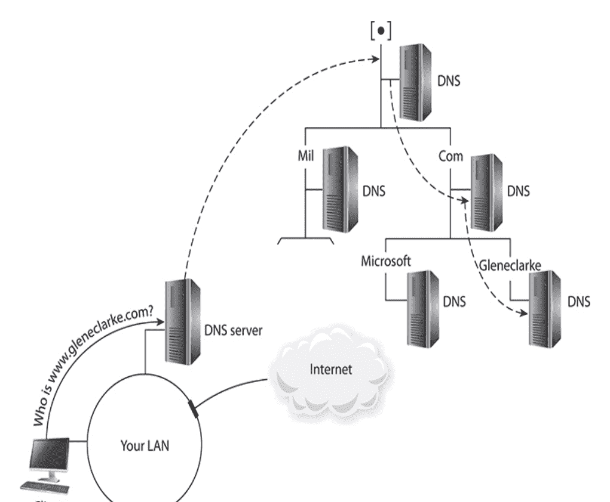
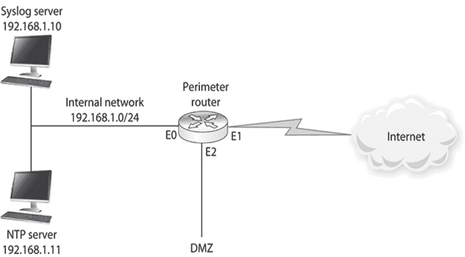
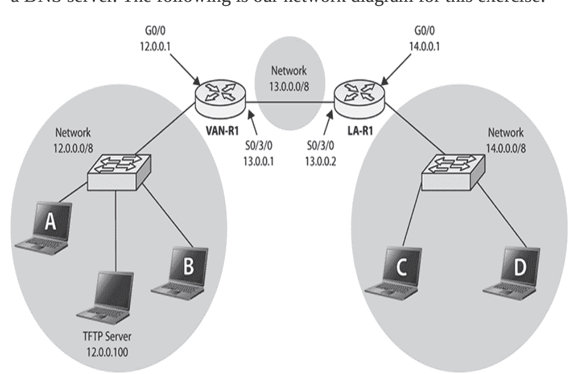
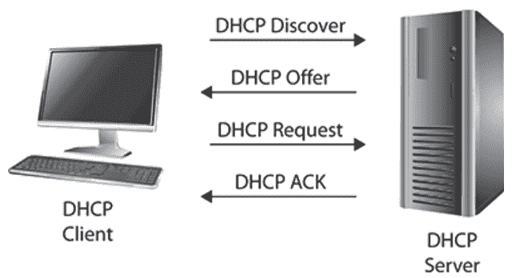
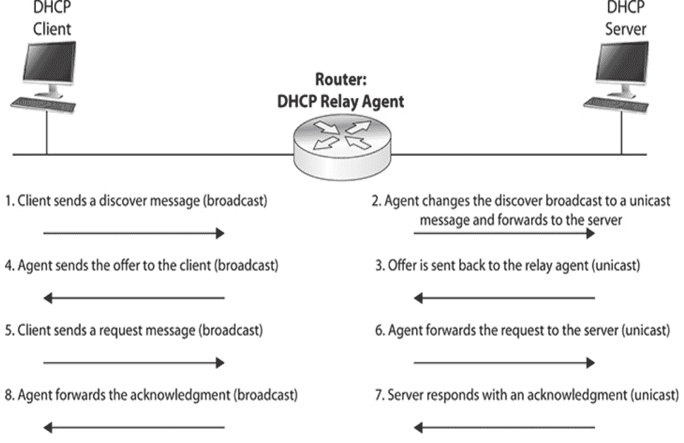
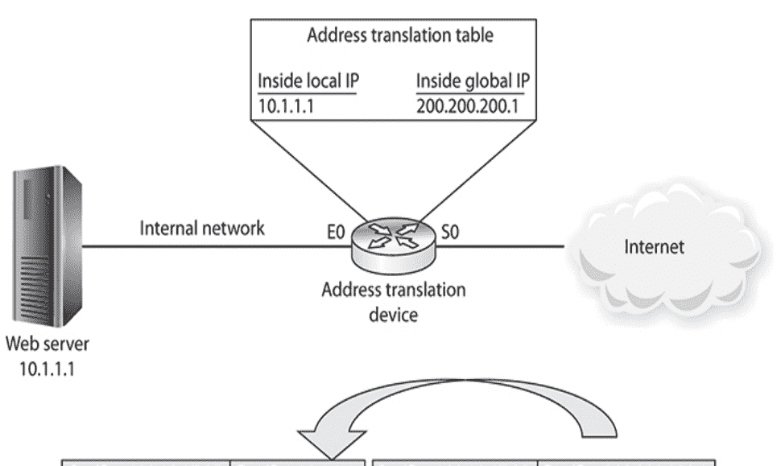
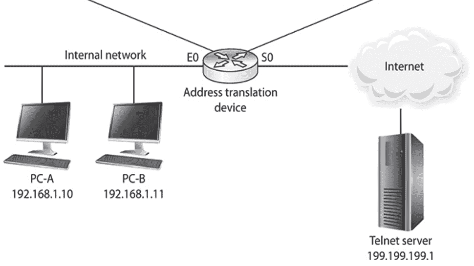
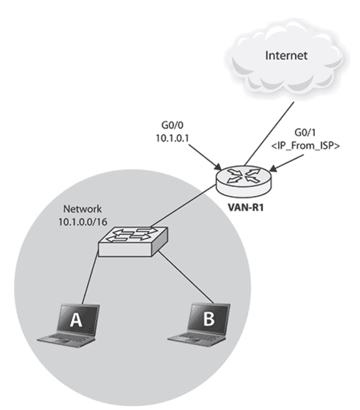
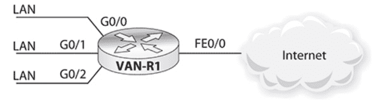
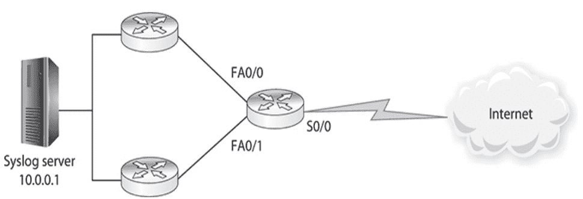

# IP 服务

在本章中，你将

- 学习如何在 Cisco 设备上配置常见的网络服务
- 学习如何配置 DHCP 服务
- 学习如何在 Cisco 路由器上部署网络地址转换
- 学习如何配置日志记录和 syslog
- 学习在 Cisco 设备上使用 NetFlow

现在你已经了解了如何配置和管理 Cisco 路由器和交换机，接下来该讨论网络中常用且 Cisco 设备可用的常见 IP 服务了。在本章中，你将了解动态主机配置协议（DHCP）、网络地址转换（NAT）和名称解析技术等常见网络服务。你还将了解日志记录和 NetFlow 等监控工具。

### 了解网络服务

Cisco 网络设备会使用或提供若干基本网络服务。本节将向你介绍主机名解析服务、网络时间协议（NTP）、简单网络管理协议（SNMP）、文件传输协议（FTP）、简单文件传输协议（TFTP）、Telnet 和安全外壳（SSH）。

#### 主机名解析

在 Cisco 设备上输入命令时，你可能会希望使用友好名称而不是设备 IP 地址来简化操作。友好名称可以通过两种方式解析为 IP 地址：可以创建主机名表，在设备本地解析这些名称；或者将设备配置为查询域名系统（DNS）服务器。

##### 创建主机名表

要按名称引用网络上的设备，你可以创建一个设备本地的主机名表，其中包含名称和对应的 IP 地址。要在主机名表中创建主机名条目，请在全局配置模式下使用 `ip host <name> <ip_address>` 命令。例如，如果你连接到 VAN-R1，并希望使用 ping 或 telnet 按名称引用 LA-R1，可以使用以下命令将 LA-R1 配置为可解析名称：

```
VAN-R1>enable
VAN-R1#config term
VAN-R1(config)#ip host LA-R1 13.0.0.2
```

通过多次执行 `ip host` 命令，每次使用不同的名称和 IP 地址，可以创建多个条目。在表中创建条目后，可以使用 `show hosts` 命令查看这些条目：

```
VAN-R1(config)#exit
VAN-R1#show hosts
Default Domain is not set
Name/address lookup uses domain service
Name servers are 255.255.255.255
Codes: UN - unknown, EX - expired, OK - OK, ?? - revalidate
    temp - temporary, perm - permanent
    NA - Not Applicable, None - Not defined
Host                Port      Flags      Age Type  Address(es)
LA-R1               None      (perm, OK) 0    IP    13.0.0.2
```

请注意 LA-R1 条目及其 IP 地址 13.0.0.2。同时请注意，这是一个永久条目，年龄为 0（不会超时）。

创建主机名条目后，你可以在其他命令中使用该主机名，例如 **ping**、**telnet** 或 **traceroute**。下面的 **ping** 命令将 LA-R1 用作主机名。请注意，名称会解析为 IP 地址，然后执行 ping 操作：

```
VAN-R1#ping LA-R1
Type escape sequence to abort.
Sending 5, 100-byte ICMP Echos to 13.0.0.2, timeout is 2 seconds:
!!!!!
Success rate is 100 percent (5/5), round-trip min/avg/max = 1/1/1 ms
```

如果要从主机名表中删除某个条目，可以使用 **no ip host** 命令。在我们的示例中，即 **no ip host LA-R1**。

#### 了解 DNS

域名系统是一种常见的网络服务，能够将系统名称转换为其 IP 地址，使我们能够使用友好名称进行通信。DNS 是一个服务器层级结构，旨在将*完全限定域名*（FQDN）解析为 IP 地址。例如，参见图 13-1，如果你尝试连接到我的网站 www.gleneclarke.com，你的系统首先会向网络中的 DNS 服务器发送查询，请求 www.gleneclarke.com 的 IP 地址。如果本地 DNS 服务器不知道该站点的 IP 地址，它会将查询发送到 Internet 上的 DNS 根服务器。根服务器随后将请求转发给 .com 名称服务器，进而转发到我的 DNS 服务器。我的 DNS 服务器的数据库中有我网站的 IP 地址，因此我的服务器会将该地址发送回你办公室的 DNS 服务器。然后，你的 DNS 服务器会把该 IP 地址发送给想要访问该网站的客户端系统。



图 13-1 DNS 将 FQDN 解析为 IP 地址。

##### 配置 DNS 查询

如果你希望 Cisco 设备对你输入的非命令条目（如 server1.gleneclarke.com）执行 DNS 查询，可以使用 **ip domain-lookup** 命令配置 DNS 查询。实际上，DNS 查询默认是启用的，但许多管理员会使用 **no ip domain-lookup** 命令禁用它，因为如果命令中出现拼写错误，设备会认为它是一个名称并尝试解析（这会额外耗时）。

在确保已启用 DNS 查询后，你需要使用 **ip name-server** *<ip_dns_server>* 命令指定执行查询的 DNS 服务器。你还可以按需配置可选的域名设置，该域名随后会自动附加到用于创建 FQDN 的任何主机名之后。以下命令演示如何配置 DNS 查询：

```
VAN-R1>enable
VAN-R1#config term
VAN-R1(config)#ip domain-lookup
VAN-R1(config)#ip name-server 12.0.0.100
VAN-R1(config)#ip domain-name gleneclarke.com
```

如果你想验证设备是否已配置为执行域名查询，请使用 `show hosts` 命令：

```
VAN-R1#show hosts
Default Domain is gleneclarke.com
Name/address lookup uses domain service
Name servers are 12.0.0.100
Codes: UN - unknown, EX - expired, OK - OK, ?? - revalidate
    temp - temporary, perm - permanent
    NA - Not Applicable, None - Not defined
Host                Port    Flags       Age Type    Address(es)
LA-R1               None    (perm, OK)  0   IP      13.0.0.2
```

请注意输出中已应用默认域名，名称查询使用域名服务，名称服务器为 12.0.0.100。


**考试提示** 对于 CCNA 考试，请记住，你可以使用 **show hosts** 命令验证 Cisco 设备上是否配置了 DNS 查询。

#### 网络时间协议

路由器上的日期和时间因多种原因而非常重要。最常见的两个原因是：

- 消息日志记录
- 使用数字证书进行身份验证

显然，日志消息上正确的时间戳将在检查与安全相关的日志消息时有助于取证分析。数字证书用于身份验证，设备证书中验证的组成部分之一是证书是否处于有效期内：证书包含开始和结束的日期与时间。接收证书的对端会将其当前时间与证书上的开始和结束日期时间进行比较，以确保当前时间落在该范围内。

如你所见，路由器上的日期和时间也很重要。你可以通过两种方式设置设备上的日期和时间：

- 使用 **clock set** 命令手动配置日期和时间（参见第 7 章）
- 使用 NTP

NTP 是一种开放标准，使你能够将路由器的时钟与集中式时间服务器同步，即你的设备定期轮询 NTP 服务器以获取当前日期和时间。NTP 使用用户数据报协议（UDP）的 123 端口。设备上运行的 NTP 可以从内部或外部服务器获取正确时间。服务器的可靠性取决于时钟源的层级（stratum）级别。最准确的源是原子钟，但大多数网络通常不需要这种精度，而是从全球定位系统（GPS）源获取时间。你也可以使用 Internet 上可用的全局时间服务器（如 Google 公共时间服务）来同步设备时间，使其与 Google 的原子钟同步。在这种情况下，你可以将设备上的 NTP 设置配置为指向 time.google.com。

NTP 提供了三种在时间服务器与 NTP 客户端之间传递时间消息的基本方法：

- **广播** NTP 服务器定期使用广播消息通告时间。此方法假定所有客户端都位于本地子网中。
- **组播** NTP 服务器定期使用组播消息通告时间。在大多数情况下，必须设置组播路由才能将时间信息传播到整个网络。（请注意，组播路由不在本书的讨论范围内。）


- **单播** NTP客户端定期（通常每10分钟）查询NTP服务器以获取正确时间。

**注意** 大多数管理员会实施多播解决方案，因为它的扩展性最好：服务器只发送一条消息，如果多播路由配置正确，该消息将出现于所有拥有NTP客户端的网络段。单播方式通常用于较小的网络，因为它更容易设置。本书将仅关注NTP单播方法。

Cisco IOS设备支持两种版本的NTP：

- NTPv3/v4
- SNTP（简单 NTP）

NTPv3/v4支持使用MD5进行身份验证。共享密钥预配置在时间服务器和您的网络设备上。此密钥通常称为*预共享密钥（PSK）*，因为它必须同时存在于两台设备上，然后才能用于身份验证目的。时间服务器使用MD5将当前日期和时间消息与PSK进行哈希处理，并将此签名添加到时间消息中。您的路由器使用接收到的日期和时间以及本地配置的PSK重复此过程，然后比较两个哈希值；这通常称为*消息摘要*或*数字签名*，它验证消息是有效的（使用了相同的密钥）。

正如其名称所示，SNTP是一种获取时间的更简单方法。与NTPv3或NTPv4不同，思科IOS对SNTP的实现（以及大多数供应商的实现）不支持对时间消息进行身份验证。SNTP不是思科认证考试的重点，因此我们将在此关注NTP。


**注意** 您应设置自己的时间服务器，称为*本地主时钟*（但是，不要使用Internet上的一个，因为它通常不支持对消息进行身份验证），并使用NTP实施MD5身份验证。SNTP是NTP的一种更简单形式，不支持任何身份验证，因此不建议在生产网络中使用。

NTP是网络设备上网络管理的关键组件，包括日志记录和身份验证功能。NTP确保所有设备都与同一时间源同步。但是，NTP不需要与时间源进行身份验证。正因为如此，黑客可能向您的设备发送NTP数据包，更改其时间，从而影响日志记录和身份验证功能。解决此问题有三种方案：

- 使用NTP或虚拟专用网络（VPN）连接到时间源。
- 使用访问控制列表（ACL）（在第17章中讨论）仅从有效时间源过滤定时信息。
- 设置自己的主时间源，而不是使用Internet上不可信的时间源。

## NTP配置

IOS设备可以配置为NTP服务器和/或客户端。它们通常配置为时间服务器，以从可靠的本地主时钟中继时间。本节介绍在思科设备上配置NTP客户端。


**注意** 不应将IOS设备用作本地主时钟，因为IOS不支持连接到外部可靠时间源（例如GPS）的方法。但是，许多操作系统（如Windows和Linux）支持NTP服务器应用程序，这些应用程序支持GPS等外部时钟连接。

以下是在IOS设备上定义NTP服务器的路由器命令：

```
IOS(config)# ntp server IP_address [version number]
            [key keyid] [source interface] [prefer]
```

您首先需要定义远程NTP服务器的IP地址。如果未指定NTP版本号，则默认为3（NTPv3）。可选的key参数引用用于验证服务器或对等体定时通信的身份验证信息：执行NTPv3身份验证时，这必须与服务器正在使用的内容匹配（本参数的使用将在下一段中介绍）。source参数指定在向远程NTP服务器发送通信时，用作IP数据包头中源地址的IOS设备上的IP地址（注意，您需要标识IOS设备上的第3层接口以引用要使用的IP地址）。如果省略此参数，则默认为输出第3层接口的地址。在输入多个NTP服务器时，可以使用prefer参数，它指定此NTP服务器相对于其他服务器在同步时优先；否则，第一个配置的服务器是IOS设备将查询的第一个服务器。

您需要配置三个命令来设置身份验证：

```
IOS(config)# ntp authenticate
IOS(config)# ntp authentication-key key_# md5 key_value
IOS(config)# ntp trusted-key key_#
```

**ntp authenticate**命令启用NTP身份验证。**ntp authentication-key**命令为密钥（*key_#*）以及身份验证密钥定义引用编号。（相同的*key_#*和*key_value*必须在远程NTP服务器上配置。）最后，**ntp trusted-key**命令指定应信任哪些NTP设备进行身份验证，从而防止意外同步到不受信任的系统。请注意，使用引用编号。此引用编号必须与**ntp authentication-key**命令中使用的编号匹配。通过使用密钥编号，您可以创建多个密钥，从而更轻松地更新密钥，并为不同的对等体使用不同的密钥。

定义身份验证后，您需要在相应的**ntp server**命令中引用密钥编号，这告诉IOS设备在向特定对等体发送消息时使用哪个密钥。

## NTP验证

在IOS设备上配置NTP后，您可以使用各种**show**命令来检查配置并排查问题。要查看路由器软件时钟上的当前时间，请使用**show clock**命令。

您将使用两个基本命令来检查NTP信息：

- **show ntp associations**
- **show ntp status**

**show ntp associations**命令显示与NTP服务器的关联。以下是此命令的示例：

```
IOS> show ntp associations
  address      ref clock    st when poll reach delay offset disp
*~192.168.1.11 192.168.1.11 2   31   1024 377   4.1   -8.38  1.5
* master (synced), # master (unsynced), + selected, - candidate,
  ~ configured
```

|  |  |
|---|---|
| * | 此路由器已与此对等体同步。 |
| # | 此路由器几乎已与此对等体同步。 |
| + | 该对等体已被选为可能的同步目标。 |
| - | 该对等体是同步的候选对象。 |
| ~ | 该对等体已静态配置。 |

每列包含以下信息：

- **address** 列出NTP对等体设备的地址
- **ref clock** 列出address列中对等体获取时间的地址
- **st** 指示对等体的 stratum 级别
- **when** 指示从该对等体接收上一条NTP消息以来的时间
- **poll** 指示此路由器用于与指定对等体通信的轮询间隔（以秒为单位）
- **reach** 指示对等体的可达性（八进制）
- **delay** 显示到对等体的往返延迟（以毫秒为单位）
- **offset** 显示对等体时钟与本地路由器时钟的相对时间（以毫秒为单位）
- **disp** 分散是以秒为单位报告的值。它表示服务器和本地时钟之间曾报告的最大时钟差异。

**show ntp status**命令显示路由器上NTP的状态。以下是示例：

```
IOS# show ntp status
Clock is synchronized, stratum 2, reference is 192.168.1.11
nominal freq is 250.0000 Hz, actual freq is 249.9990 Hz, precision is 2**19
reference time is AFE2525E.70597C87 (00:10:39.511 EDT Thu Jan 1 2004)
clock offset is 6.21 msec, root delay is 83.98 msec
root dispersion is 81.96 msec, peer dispersion is 2.02 msec
```

在此示例中，IOS已与IP地址为192.168.1.11的NTP服务器同步，该服务器提供stratum级别2的服务。


## NTP 配置示例

现在你已对 NTP 及其配置有基本了解，让我们来看一个简单示例：边缘路由器需将其时间同步到 NTP 服务器，如图 13-2 所示。以下是路由器的 NTP 客户端配置：



图 13-2 NTP 配置示例

```
Router(config)# ntp server 192.168.1.11 key 99 source ethernet0
Router(config)# ntp authenticate
Router(config)# ntp authentication-key 99 md5 55ab8972G
Router(config)# ntp trusted-key 99
Router(config)# interface ethernet1
Router(config-if)# ntp disable
Router(config)# interface ethernet2
Router(config-if)# ntp disable
```

在本示例中，NTP 服务器为 192.168.1.11，在第一个命令中指定。接下来的三个命令用于设置身份验证，并通过密钥引用编号 99 引用第一个命令。请注意，哈希密钥为 55ab8972G，也必须在 NTP 服务器上配置。最后，在两个不期望从中接收时间消息的接口上禁用了 NTP。如你所见，配置 NTP 很简单。


**视频 13.01.** 随本书附带的数字资源包含在 Cisco 路由器上配置和验证 NTP 的多媒体演示。

## 简单网络管理协议

部分网络设备管理需要使用 SNMP，SNMP 常用于管理（配置和/或监控）远程网络设备。以下各节简要概述 SNMP 及其配置。

## SNMP 概述

SNMP 包含三个组件：

- **网络管理站（NMS）** 该设备访问并管理代理，有时也称为 *管理器*。
- **代理** 这是由 NMS 管理的设备。
- **管理信息库（MIB）** 此数据库定义了信息（配置、操作和统计）在代理上如何存储。

NMS 与代理之间的交互可涉及两种连接类型：

- NMS 向代理发送 **get** 或 **set** 命令；**get** 命令用于检索 MIB 信息，**set** 命令用于更改 MIB 信息。
- 代理向 NMS 发送 *traps* 或 *informs*，它们是一种日志消息，用于指示设备上的重要条件。

存储在代理上的信息位于 MIB 中。每个 MIB 都由对象标识符（OID）唯一标识。Get、set 和 trap 消息基于由特定 OID 标识的 MIB 信息。


**考试提示** 熟悉 SNMP 的三个组件：管理器、代理和 MIB。理解什么是 SNMP trap/inform：由代理生成的警报。

## SNMP 版本

SNMP 有三个主要版本。SNMPv1 和 v2 使用团体字符串进行安全保护：只读和读写。只读团体字符串用于限制对 MIB 信息的读取，读写团体字符串用于更改 MIB 信息。然而，团体字符串的主要问题是它们以明文发送，因此容易受到窃听攻击。SNMPv2c 还添加了对 inform 请求的支持，允许确认通知，以及 get bulk 请求的支持，这使管理站能够在一个请求中访问多个 MIB。

SNMPv3 是 SNMPv2 的增强版。除了支持相同的 MIB 结构以及 get、set 和 trap 操作外，SNMPv3 还支持身份验证、消息完整性和负载加密。消息完整性用于确保 SNMP 消息未被篡改且来自合法源；这是通过 MD5 或安全哈希算法 v1（SHA-1）哈希消息验证码（HMAC）函数实现的。负载加密用于防止中间人（MITM）攻击检查 get、set 和 trap 命令信息。在 MITM 攻击中，攻击者的设备会看到源和目的地之间流动的流量。可以使用加密来防御 MITM 攻击：攻击者仍然可以看到数据包，但内容已加密，无法被窃听。加密通过数据加密算法（DES）、三重 DES（3DES）或高级加密标准（AES）加密算法实现。有关安全性和保护 Cisco 设备的更多信息，请参阅第 16 和 17 章。


**考试提示** 熟悉 SNMPv2c 和 SNMPv3 之间的区别。SNMPv2c 使用团体字符串，并增加了 inform 和 get bulk 请求的使用。SNMPv3 增加了消息完整性、身份验证和加密。

表 13-1 提供了不同 SNMP 版本的安全模型和级别概述。

| SNMP 版本 | 级别 | 身份验证 | 加密 | 发生什么情况 |
|---|---|---|---|---|
| 1 | NoAuthNoPriv | 团体字符串 | 否 | 通过团体字符串匹配进行身份验证。 |
| 2c | NoAuthNoPriv | 团体字符串 | 否 | 通过团体字符串匹配进行身份验证。 |
| 3 | NoAuthNoPriv | 用户名 | 否 | 通过用户名进行身份验证。 |
| 3 | AuthNoPriv | MD5 或 SHA | 否 | 提供 MD5/SHA 用于身份验证。 |
| 3 | AuthPriv | MD5 或 SHA | DES、3DES、AES | 提供 MD5/SHA 用于身份验证，并通过 DES/3DES/AES 进行加密。 |

表 13-1 SNMP 安全模型

## SNMP 配置

本节简要介绍在 IOS 设备上配置 SNMPv2c 和 SNMPv3。在两者中，配置 SNMPv2c 更简单，但安全性较低。无论使用哪个版本，以下命令都用于定义 SNMP 设备的位置和联系信息：

```
IOS(config)# snmp-server location location_information
IOS(config)# snmp-server contact contact_name
```

第一个命令标识设备位置，例如 Cisco 设备所在的建筑物、楼层和布线机房。第二个命令标识管理员联系信息。这两项信息均可从 NMS 获取。

## SNMPv2c 配置

以下是设置 SNMPv2c 通信的基本命令：

```
IOS(config)# snmp-server community string ro
IOS(config)# snmp-server community string rw
IOS(config)# snmp-server host NMS_IP_address traps string
IOS(config)# snmp-server enable traps
```

第一个命令定义用于启用只读访问的团体字符串。第二个命令定义用于读写访问的团体字符串。请注意，团体字符串以明文形式在 SNMP 数据包中发送，以限制访问。最后两个命令启用向 SNMP 管理站发送 SNMP traps（你还需要将 IOS 设备上的团体字符串与 NMS 配置的保持一致）。

## SNMPv3 配置

SNMPv3 的配置要复杂得多。以下是其设置中涉及的命令列表：

```
IOS(config)# snmp-server view view_name oid_mib
    {included | excluded}
IOS(config)# snmp-server group group_name {v1 | v2c | v3}
    {auth | noauth | priv} [read read_view]
    [write write_view] [notify notify_view]
    [access-list ACL_ID]
IOS(config)# snmp-server user user_name group_name {v1 | v2c | v3}
    [auth {md5 | sha} auth_password] [priv {des |
    3des | aes {128 | 192 | 256}} encr_password]
    [access ACL_ID]
IOS(config)# snmp-server host host_name_or_IP [traps | informs]
    [version {1 | 2c | 3} [auth user_name]
IOS(config)# snmp-server enable traps
```

SNMP 视图（snmp-server view）控制可以或不可以访问哪些 OID。使用视图是可选的，但默认情况下，如果你有权访问 IOS 设备的 SNMP，则访问 OID 没有限制。

组（snmp-server group）定义访问级别。通过组，你可以指定使用哪个版本的 SNMP、所需的身份验证类型、哪些视图可以通过 gets、sets 和 traps 访问，以及哪些 NMS 可以访问它们（通过 ACL，将在第 17 章讨论）。

用户定义实际的 NMS。身份验证凭据定义用于创建签名的 HMAC 签名函数和密钥，特权凭据定义要使用的加密算法和密钥。

以下是一个简单的 SNMPv3 配置示例：

```
IOS(config)# access-list 10 permit host 10.0.1.12
IOS(config)# snmp-server view myview interfaces included
IOS(config)# snmp-server group mygroup v3 priv read myview access 10
IOS(config)# snmp-server user myuser mygroup v3 auth sha a3fh95t11a
    priv aes 128 dkfjiewokd892a
IOS(config)# snmp-server host 10.0.1.12 traps version 3 auth myuser
IOS(config)# snmp-server enable traps
```

在本示例中，创建了一个包含 “interfaces” MIB/OID 的 SNMP 视图。创建了一个 v3 SNMP 组，将视图限制为只读访问。该组引用视图和 ACL 以限制 SNMPv3 访问。SNMP 用户指定访问凭据（保护）并引用要使用的组。SNMP 服务器定义为向服务器发送 traps，并引用 SNMP 用户配置，因此


路由器知道要强制执行的访问方法。最后，已启用 SNMP 陷阱，以便路由器可以将事件发送到 SNMP 管理站。

## 其他网络服务

思科 CCNA 考试要求您熟悉其他网络服务，例如用于传输文件的服务和用于远程管理的服务。这些主题在第 8 章中已详细讨论，但现在让我们回顾一下这些网络服务。

## TFTP 和 FTP

思科管理员可以使用 TFTP 或 FTP 服务在其思科设备之间传输文件。TFTP 和 FTP 都是文件传输协议，但有几点区别：

- TFTP 不支持身份验证，而 FTP 支持。
- TFTP 使用 UDP，而 FTP 基于 TCP。
- TFTP 默认运行在 UDP 端口 69 上，而 FTP 默认使用 TCP 端口 21。

思科管理员通常使用 TFTP 来备份其设备配置和 IOS。思科中的 **copy** 命令支持将 TFTP 用作源和目标，因此您可以将文件复制到 TFTP 服务器，或从 TFTP 服务器复制文件。例如，要将 IOS 备份到 TFTP 服务器，可以使用 **copy flash: tftp:** 命令并回答问题，例如要复制的文件名是什么，远程主机（TFTP 服务器）的 IP 地址是什么，以及在目标处要创建的文件名是什么。

您也可以使用 FTP 从思科设备备份文件。如在第 8 章中所学，使用 FTP 需要进行一些额外配置，例如在使用 FTP 功能之前需要配置用户名和密码。


注意 请务必回顾第 8 章中 FTP 和 TFTP 的命令。

## Telnet 和 SSH

思科管理员希望能够远程管理其设备，无论是使用 telnet 作为协议还是使用 SSH。再次提醒，这在第 8 章中已讨论过，但让我们快速回顾一下。

Telnet 已作为远程管理协议多年，但有一个主要缺点，即它会以明文发送所有数据，包括用户名和密码。这意味着任何能够截获 telnet 流量的人都可以查看您正在做的操作，还可以发现您用于登录设备的凭据。

SSH 正是为此而生。SSH 是一种也能实现设备远程管理的协议，但它会加密从您的管理计算机到您正在管理的设备的所有流量。这意味着，如果有人截获流量，流量已加密，因此攻击者无法查看您正在做的操作的详细信息。需要注意的是，SSH 还会加密登录过程中使用的用户名和密码。


注意 有关 telnet 和 SSH 的更多内容，请回顾第 8 章。

## 练习 13-1：配置主机名解析

在此练习中，您将在 VAN-R1 和 LA-R1 上配置主机名表。您还将使用 DNS 服务器为每个系统配置 DNS 名称解析。以下是本练习的网络图：



- 1. 确保根据网络图连接所有物理组件（如路由器和交换机），然后为设备通电。
- 2. 将工作站连接到 VAN-R1 的控制台端口，然后启动 PuTTY，选择串行连接，并设置正确的 COM 端口。然后单击 Open。
- 3. 在 PuTTY 窗口中，按 ENTER 以在思科设备上获取提示符。
- 4. 进入 VAN-R1 的特权 EXEC 模式，并为引用 IP 地址 13.0.0.2 的 LA-R1 配置主机名条目：
- 5. 使用 show hosts 命令查看主机名表。
- 6. 为 IP 地址 12.0.0.100 的 TFTPServer 创建主机名。
- 7. 使用 show hosts 命令查看主机名表。

```
VAN-R1>enable
VAN-R1#config term
VAN-R1(config)#ip host LA-R1 13.0.0.2
```

- 8. 对两个名称执行 Ping 操作以验证主机名表是否正常工作。
- 9. 为域名 exer13-1.loc 配置路由器，并将名称解析的 DNS 服务器指向 12.0.0.100（我们假设 TFTP 服务器也是 DNS 服务器）。

```
VAN-R1(config)#ip domain-lookup
VAN-R1(config)#ip name-server 12.0.0.100
VAN-R1(config)#ip domain-name exer13-1.loc
```

- 10. 转到 LA-R1 并为引用 VAN-R1 的 IP 地址 13.0.0.1 创建主机名条目。
- 11. 使用 **show hosts** 命令验证主机名创建。
- 12. 使用应用于 VAN-R1 的相同设置为 LA-R1 配置 DNS 名称解析。

## 配置 DHCP 服务

DHCP 使设备能够动态获取其 IP 寻址信息，无需管理员在网络上的每个主机上配置 IP 地址信息。DHCP 基于客户端/服务器模型，并定义两个组件：

- **服务器** 将 IP 配置信息传送到 DHCP 客户端（主机）
- **客户端** 从 DHCP 服务器请求并获取主机配置信息

与手动在设备上配置寻址信息相比，使用 DHCP 服务器分配寻址信息提供以下三个网络优势：

- 减少对网络进行寻址所需的时间
- 降低设备上出现 IP 寻址错误的可能性
- 为员工提供流动性，使其能够在网络中移动、连接，并根据其位置获取正确的 IP 寻址信息

在本节中，您将学习如何在 IOS 设备上配置两个 DHCP 功能：

- DHCP 服务器
- DHCP 中继

## 了解 DHCP

DHCP 是一种应用层协议，可以自动为网络上的每个系统配置 IP 地址信息。在思科路由器上配置 DHCP 服务器的第一步是启用该服务，然后您可以配置地址池。*池* 是 DHCP 在网络上分配的 IP 地址范围，以及任何其他设置，例如路由器地址（*默认网关*）、DNS 服务器以及系统拥有 IP 地址的时间。

如图 13-3 所示，DHCP 客户端要经过四个阶段才能从 DHCP 服务器获取 IP 地址：



图 13-3 查看 DHCP 阶段

- **DHCP 发现** DHCP 发现报文由客户端使用目标广播地址（FF-FF-FF-FF-FF-FF）发送到网络上的所有系统。该报文基本上是在说：“如果您是 DHCP 服务器，我需要一个 IP 地址。”请注意，所有阶段都使用此广播地址进行通信，因为客户端尚未拥有 IP 地址。
- **DHCP 提供** 网络上任何接收到发现报文的 DHCP 服务器都会向客户端发送一个报价，基本上声明：“我是 DHCP 服务器，您可以使用这个 IP 地址。”如果系统不是 DHCP 服务器，则在接收到 DHCP 发现报文时将其丢弃。
- **DHCP 请求** 接收到报价后，客户端会发送 DHCP 请求报文，指明其想要接收哪个报价（IP 地址）。请注意，客户端可能会收到多个报价，因此当客户端发送 DHCP 请求报文确认其选择哪个报价时，所有其他 DHCP 服务器都会收回其报价。
- **DHCP 确认 (ACK)** DHCP 服务器接收到来自客户端的请求获取所提供 IP 地址的 DHCP 请求报文后，会发送最终确认报文，向客户端指示该地址现在为该服务器的地址，并指示服务器将拥有该地址的时间（*租期*）。DHCP 确认报文还包含客户端的任何其他 IP 地址选项，例如路由器地址和 DNS 服务器地址。

配置 DHCP 时，您需要创建一个 DHCP *作用域*，即 DHCP 服务器允许分配给客户端的一组地址，称为 *池*。配置作用域时，还需指定 DHCP *租期*，即客户端拥有分配给它的 IP 地址的时间。配置较短租期（例如一天）会产生更多流量，因为客户端需要比租期设置为七天（例如）时更早地续期地址。


**考试提示** 请确保了解 DHCP 的四个阶段，以应对思科 CCT 和 CCNA 考试。

## DHCP 服务器配置


以下显示了在 Cisco IOS 设备上配置 DHCP 服务器时使用的更常见命令：

```
IOS(config)# service dhcp
IOS(config)# ip dhcp pool pool_name
IOS(dhcp-config)# network network_number [mask | /prefix-length]
IOS(dhcp-config)# domain-name domain
IOS(dhcp-config)# dns-server address [address2... address8]
IOS(dhcp-config)# default-router address
IOS(dhcp-config)# lease {days [hours] [minutes] | infinite}
IOS(dhcp-config)# exit
IOS(config)# ip dhcp excluded-address low-address [high-address]
```

在示例中，

- **service dhcp** 启用 IOS 设备上的 DHCP 服务器和/或中继功能。如果没有此命令，IOS 设备将不充当服务器或中继代理。从 IOS 12.2 开始，此命令默认处于启用状态。
- **ip dhcp pool** 为 DHCP 服务器地址池创建一个名称，并将你置于 DHCP 池子命令模式下。
- **network** 指定 DHCP 地址池的子网网络号和掩码。此外，*前缀长度* 指定构成地址前缀的位数。前缀是指定客户端网络掩码的一种替代方法。前缀长度必须以正斜杠 (/) 开头。
- **domain-name** 指定要分配给客户端的域名。
- **dns-server** 指定可供 DHCP 客户端使用的 DNS 服务器的 IP 地址。需要一个 IP 地址；但是，您可以在一行命令中最多指定八个 IP 地址。
- **default-router** 指定要分配给 DHCP 客户端的默认网关的 IP 地址。
- **lease** 指定租用期的持续时间。IP 地址通常以临时方式租给主机。当客户端的地址租用时间达到租用期一半时，它将尝试续期之前获得的现有寻址信息。如果续期尝试不成功，设备将继续以定期间隔尝试续期。默认租用期为一天，但可以为池配置其他参数，例如 VoIP 电话的 TFTP 服务器地址，但这超出了本书的范围。您可以将租用期设置为 infinite，这意味着租用期不会过期。


**考试提示** 对于 Cisco CCT 和 CCNA 考试，需要知道 DHCP 服务器会向请求主机分配 IP 地址设置。CCNA 考试期望您知道如何配置 DHCP——在 Cisco IOS DHCP 服务器上，地址是在池中定义的。如果您为池定义网络号，请务必从池中排除网络号和定向广播地址。IP 地址租给主机，当客户端的租用时间达到租用长度的一半时，它将尝试续期现有地址信息。


**注意** 通常，思科路由器被配置为小型网络（如分支机构）的 DHCP 服务器。在大型企业或校园网络中，通常会在网络的数据中心和/或分发层设置专用 DHCP 服务器或服务器组。

要查看 DHCP 池信息，请使用 **show ip dhcp pool** 命令：

```
IOS# show ip dhcp pool
Pool 1:
  Utilization mark (high/low)      : 85 / 15
  Subnet size (first/next)         : 24 / 24
  Total addresses                  : 254
  Leased addresses                 : 11
  Pending event                    : none
1 subnet is currently in the pool:
Current index      IP address range          Leased addresses
10.1.1.12           10.1.1.1 - 10.1.1.254      11
```

使用此命令，您可以查看可用地址总数、配置的地址范围以及当前已租用的地址数量。

要查看分配给 DHCP 客户端的当前 IP 地址，请使用 **show ip dhcp binding** 命令：

```
IOS# show ip dhcp binding
Bindings from all pools not associated with VRF:
IP address      Client-ID/               Lease expiration      Type
                 Hardware address/
                 User name
10.1.1.1        0063.6973.636f           Mar 29 2014 04:36 AM   Automatic
```

此命令列出分配给客户端的 IP 地址：即 IP 到 MAC 地址的绑定。

在向客户端分配 IP 地址时，IOS 会先对 IP 地址执行 ping 操作，以确保其未分配给其他人；此外，IOS 还会检查其 ARP 表，以确保该 IP 地址未被任何其他设备使用。要查看这些冲突，请使用 **show ip dhcp conflict** 命令：

```
IOS# show ip dhcp conflict
IP address      Detection method         Detection time         VRF
172.16.1.32     Ping                     Feb 16 1998 12:28 PM
172.16.1.64     Gratuitous ARP           Feb 23 1998 08:12 AM
```

如果检测到地址冲突，则将该地址从 DHCP 池中删除，管理员必须手动解决问题。使用 **clear ip dhcp conflict** 命令从列表中清除冲突地址。或者，您可以使用 **debug ip dhcp server** 命令来排查 IOS 设备上 DHCP 操作的问题。


**考试提示** 如果检测到地址冲突，则将该地址从 DHCP 池中删除，管理员必须手动解决问题。请熟悉 **show ip dhcp conflict** 命令的输出。


**视频 13.02.** 随本书附带的数字资源包含在思科路由器上配置和验证 DHCP 服务器的多媒体演示。

## DHCP 中继配置

在大型网络中，需要通过 DHCP 获取地址的网络设备可能不与 DHCP 服务器位于同一广播域，因此无法访问 DHCP 服务器。在大多数公司中，DHCP 服务器集中在分发层或数据中心。因此，默认情况下，DHCP 服务器看不到客户端发布的 DHCP 请求；路由器不转播广播消息来解决此问题。

解决此问题的方法是使用 IOS 功能 *DHCP 中继*：思科路由器充当带有 DHCP REQUEST 消息的中继代理。该过程如图 13-4 所示。在图中，当路由器接收到来自客户端的广播寻址请求时，它会将其更改为单播消息，以路由器为源，DHCP 服务器为目标。代理包括网络号，以帮助 DHCP 服务器选择正确的寻址池。代理与 DHCP 服务器之间的所有消息均使用单播传输。从客户端的角度来看，它认为自己实际上正在与 DHCP 服务器本地通信。



图 13-4 DHCP 代理中继过程

要将路由器配置为 DHCP 中继代理，请使用以下命令：

```
Router(config)# service dhcp
Router(config)# interface g0/0
Router(config-if)# ip helper-address DHCP_server_IP_address
```

service dhcp 命令默认处于启用状态——仅在 DHCP 服务已被手动禁用时才需要执行此操作。然后，您需要导航到要配置的接口以侦听 DHCP 消息。ip helper-address 命令用于将路由器配置为 DHCP 中继代理，并定义要转发 DHCP 消息的 DHCP 服务器。如果您有冗余 DHCP 服务器，可以多次配置此命令。

如果要验证 DHCP 中继操作是否配置正确，并识别 DHCP 消息转发到的 DHCP 服务器地址，可以使用 show ip interface 命令：

```
VAN-R1#show ip interface
GigabitEthernet0/0 is up, line protocol is up (connected)
  Internet address is 12.0.0.1/8
  Broadcast address is 255.255.255.255
  Address determined by setup command
  MTU is 1500 bytes
  Helper address is 14.0.0.10
  Directed broadcast forwarding is disabled
(output omitted for briefness)
```


**视频 13.03.** 随本书附带的数字资源包含在思科路由器上配置和验证 DHCP 中继的多媒体演示。

## 练习 13-2：配置 DHCP 服务

在本练习中，您将配置 VAN-R1 作为 DHCP 服务器，以提供 12.100.0.1 到 12.100.0.50 的 IP 地址。我们将使用与上一个练习相同的网络拓扑进行本练习。

- 1. 确保路由器和交换机等所有物理组件均已根据网络图连接，然后为设备通电。
- 2. 将工作站连接到 VAN-R1 的控制台端口。然后启动 PuTTY，选择串行连接，并设置正确的 COM 端口。然后单击 Open。


3. 在 PuTTY 窗口中，按 ENTER 键以获取 Cisco 设备上的提示符。

4. 进入 VAN-R1 的特权 EXEC 模式，并使用以下信息创建 DHCP 池：

- 使用名称 VAN_Pool。
- 分配 12.0.0.0 网络的 IP 地址。
- 预留其中的前 120 个地址，因为它们已被需要静态地址的设备使用。
- 将路由器地址设置为 12.0.0.1。
- 将域名设置为 Exer13-2.loc。
- 将 DNS 服务器地址设置为 12.0.0.100。

```
VAN-R1>enable
VAN-R1#config term
VAN-R1(config)#ip dhcp pool VAN_Pool
VAN-R1(dhcp-config)#network 12.0.0.0 255.0.0.0
VAN-R1(dhcp-config)#default-router 12.0.0.1
VAN-R1(dhcp-config)#domain-name exer13-2.loc
VAN-R1(dhcp-config)#dns-server 12.0.0.100
VAN-R1(dhcp-config)#exit
VAN-R1(config)#ip dhcp excluded-address 12.0.0.1 12.0.0.120
```

5. 将客户端连接到网络，并验证其是否从路由器的 DHCP 服务获取了 IP 地址。

6. 在 VAN-R1 上使用 show ip dhcp binding 命令查看已分配的地址：

```
VAN-R1#show ip dhcp binding
IP address      Client-ID/      Lease expiration    Type
                Hardware address
12.0.0.121      0030.F2E8.4203  --                  Automatic
VAN-R1#
```

## 网络地址转换

地址转换最初是为了解决两个问题而开发的：应对 IPv4 地址短缺和隐藏网络寻址方案。大多数人认为地址转换主要用于解决第一个问题。然而，网络地址转换为许多问题提供了解决方案，并且具有许多优势。

### 地址耗尽

20 世纪 90 年代初期和中期互联网大规模爆发后，人们预见到当前的 IP 寻址方案将无法容纳需要公共地址的设备数量。为此构思了一个长期解决方案；它要求增强 TCP/IP 协议栈，包括寻址格式。这种新的寻址格式称为 IPv6。与当前使用 32 位表示地址的 IPv4 寻址方案不同，IPv6 使用 128 位进行寻址，创造了数十亿个额外地址。IPv6 在第 14 章中讨论。

### 私有地址

IPv6 花了一段时间才成为标准，此外，其早期采用速度相当缓慢，即使是互联网骨干网上的 ISP 也是如此。该标准长期未被接受的主要原因是地址短缺问题的两个短期解决方案取得了成功：创建额外地址的方案，称为 *私有地址*，以及使用地址转换将这些地址转换为公共地址。

RFC 1918 由互联网工程任务组（IETF）制定，是一份旨在解决地址短缺问题的文档。当设备需要通信时，每个设备都需要一个唯一的 IP 地址。RFC 1918 创建了一个任何公司都可以在内部使用的私有地址空间。表 13-2 显示了 RFC 1918 划定的私有地址范围。如表所示，您可以使用 1 个 A 类、16 个 B 类和 256 个 C 类地址。仅 10.0.0.0 这一个 A 类地址就拥有超过 1700 万个 IP 地址，足以满足您公司的需求。

| 类 | 地址范围 |
|-------|--------------------|
| A | 10.0.0.0–10.255.255.255 |
| B | 172.16.0.0–172.31.255.255 |
| C | 192.168.0.0–192.168.255.255 |

表 13-2 RFC 1918 私有地址


**考试提示** 记住表 13-2 中列出的私有地址。私有地址是 IETF 开发的一种方案，用于克服可用公共 IP 地址数量有限的问题。但是，私有地址不能放置在将路由到公共网络的数据包中；必须先进行转换。转换通常在边缘设备上进行，例如路由器或安全设备（如 Cisco Adaptive Security Appliance [ASA]）。

RFC 1918 解决的主要问题之一是，私有地址只能在公司内部使用，不能用于与公共网络（例如 Internet）中的设备通信。例如，如果您将带有 RFC 1918 地址的数据包发送给 ISP，ISP 会过滤这些数据包，或者无法将此流量路由回您的设备。显然，这会造成连接问题，因为许多带有私有地址的设备需要与公共网络发送和接收流量。

### 地址转换

第二个标准 RFC 1631 是为了解决 RFC 1918 的连接问题而制定的。它定义了网络地址转换（NAT），使您能够将数据包中的 IP 地址更改为不同的地址。在与公共网络中的设备通信时，您的设备需要使用一个公共地址作为源地址。地址转换使您能够在这些数据包离开网络之前，将内部私有地址转换为公共地址。


**注意** 能够执行地址转换的常见设备包括防火墙、路由器和服务器。通常，地址转换由路由器或（更常见的是）防火墙在网络边缘执行。

实际上，RFC 1631 并未规定您更改的地址必须是私有地址——它可以是 *任意* 地址。如果您随机选择了他人的公共地址空间，但仍希望连接到 Internet，这很有用。显然，您不拥有此地址空间，但地址转换使您能够保留当前寻址方案，并在数据包进入 Internet 之前将这些源地址转换为 ISP 分配的地址。

使用地址转换的常见原因如下：

- 您必须使用私有寻址，因为您的 ISP 没有分配给您足够的公共 IPv4 地址。
- 您正在使用公共地址，但已更换 ISP，新 ISP 不支持这些公共地址。
- 您正在合并两家公司，它们使用相同的地址空间（例如 10.0.0.0），这会造成路由和可达性问题。
- 您希望将相同的 IP 地址分配给多台机器，以便 Internet 上的用户将所提供的服务视为单个逻辑计算机。


**考试提示** 记住您可能希望在网络中使用地址转换的原因。

### 地址转换类型

地址转换有多种类型，例如 NAT、端口地址转换（PAT）、动态地址转换和静态地址转换。由于使用了许多术语，地址转换的概念可能会令人困惑，尤其是许多人错误地使用地址转换术语。以下部分将介绍这些不同的地址转换类型。

### 术语和定义

表 13-3 显示了地址转换中使用的一些常用术语，表 13-4 显示了用于地址转换类型的一些术语。

| 术语 | 定义 |
|---|---|
| 内部 | 您网络内部的地址 |
| 外部 | 您网络外部的地址 |
| 本地 | 物理分配给设备的 IP 地址 |
| 全局 | 物理或逻辑分配给设备的公共 IP 地址 |
| 内部本地 IP 地址 | 分配了私有 IP 地址的内部设备 |
| 内部全局 IP 地址 | 拥有注册公共 IP 地址的内部设备 |
| 外部全局 IP 地址 | 拥有注册公共 IP 地址的外部设备 |
| 外部本地 IP 地址 | 分配了私有 IP 地址的外部设备 |

表 13-3 常见地址转换术语

| 转换类型 | 说明 |
|---|---|
| 简单 | 一个 IP 地址转换为不同的 IP 地址。 |
| 扩展 | 一个 IP 地址和一个 TCP/UDP 端口号映射到不同的 IP 地址和（可能）端口号。 |
| 静态 | 在两个地址和（可能）端口号之间执行手动地址转换。 |
| 动态 | 地址转换设备自动在两个地址和（可能）端口号之间执行地址转换。 |
| 网络地址转换 (NAT) | 仅转换 IP 地址（不转换端口号）。 |
| 端口地址转换 (PAT) | 许多内部 IP 地址转换为单个 IP 地址，每个内部地址都会获得不同的 TCP 或 UDP 端口号以确保唯一性。 |

表 13-4 常见地址转换类型


**考试提示** 为考试记住表 13-3 和 13-4 中的术语和定义。

### 实施 NAT

NAT 将一个 IP 地址转换为另一个 IP 地址。这可以是源地址或目的地址。可以使用两种基本的 NAT 实现：*静态* 和 *动态*。以下部分将介绍这些实现的机制。

### 静态 NAT

使用静态 NAT，地址转换设备执行手动转换，将一个 IP 地址转换为另一个 IP 地址。通常，静态 NAT 用于在数据包进入您的网络时转换目的 IP 地址，但也用于转换源地址

它们离开你的网络。图 13-5 显示了外部用户尝试访问内部 Web 服务器的简单示例。在此示例中，你希望 Internet 用户访问内部 Web 服务器，但该服务器使用的是专用地址（10.1.1.1）。如果外部用户在目标 IP 地址字段中输入此专用地址，就会出现问题，因为用户的 ISP 会丢弃数据包。因此，Web 服务器需要显示为拥有公共地址。这是在地址转换设备中定义的（在此示例中，它是一台 Cisco 路由器）。



### 图 13-5 静态 NAT 示例

在图中，Web 服务器在路由器上被分配一个内部全局 IP 地址 200.200.200.1，你的 DNS 服务器将此地址通告给外部用户。当外部用户向 200.200.200.1 地址发送数据包时，路由器会检查其转换表以查找匹配项。在此示例中，它看到 200.200.200.1 映射到 10.1.1.1。然后路由器将目标 IP 地址更改为 10.1.1.1 并将数据包转发到内部 Web 服务器。请注意，如果路由器没有将地址转换为 10.1.1.1，Web 服务器将不会知道此信息是发给它本身的，因为外部用户最初是将流量发送到 200.200.200.1 的。

同样，当 Web 服务器向公共网络发送流量时，路由器将 *源* IP 地址与其转换表中的条目进行比较，如果找到匹配项，则将内部本地 IP 地址（专用源地址，10.1.1.1）更改为内部全局 IP 地址（公共源地址，200.200.200.1）。静态转换始终存在于转换表中。


**考试提示** 请记住，静态转换通常用于启用从外部发起的连接以访问内部资源。静态转换始终存在于转换表中。

## 动态 NAT

使用静态地址转换时，你需要手动构建转换。因此，如果你有 1000 台设备，就需要在地址转换表中创建 1000 个静态条目，这需要大量工作。通常，静态转换用于外部用户想要访问的内部资源。当内部用户访问外部资源时，通常使用动态转换。在此情况下，分配给内部用户的全局地址并不那么重要，因为外部设备不会直接连接到你的内部用户——它们只是将内部用户请求的流量返回给他们。

使用动态 NAT 时，你必须在地址转换设备上手动定义两组地址：一组定义哪些内部地址被允许转换（本地地址），另一组定义这些地址要转换为什么（全局地址）。当内部用户通过地址转换设备（例如路由器）发送流量时，它会检查源 IP 地址并将其与内部本地地址池进行比较。如果找到匹配项，它会确定应使用哪个内部全局地址池进行转换。然后它会从全局地址池中动态选择一个当前未分配给任何内部设备的地址。路由器将此条目添加到其地址转换表中，数据包被转换，然后数据包被发送到外部网络。如果在本地地址池中未找到匹配项，则不会转换该地址，而是将其以原始状态转发到外部网络。

当返回流量进入你的网络时，地址转换设备会检查目标 IP 地址并将其与地址转换表进行比对。在找到匹配项后，地址转换设备会将数据包头部目标 IP 地址字段中的全局内部地址转换为本地内部地址，并将数据包转发到内部网络。

当源匹配动态 NAT 策略配置时，动态 NAT 转换会被添加到转换表中，并在达到空闲定时器后被移除。来自某个源的所有流量都会被转换到同一目标，无论从该源打开了多少个连接。

## 端口地址转换

静态或动态 NAT 的一个问题在于，它只提供一对一的地址转换。因此，如果你有 5000 台拥有专用地址的内部设备，并且所有 5000 台设备同时尝试连接 Internet，则需要 5000 个公共地址在你的内部全局地址池中。如果你只有 1000 个公共地址，则只有前 1000 台设备会被转换，其余 4000 台无法访问外部目标。为克服此问题，你可以使用 *地址过载*。还有许多其他术语用于描述此过程，包括端口地址转换 (PAT) 和网络地址端口转换 (NAPT)。

当新连接匹配动态 PAT 策略配置时，动态 PAT 会被添加到转换表中，并在达到空闲定时器或连接结束后被移除。例如，对于 TCP，当看到 FIN 和 FIN-ACK 段消息或执行硬重置 (RST) 时，连接结束。大多数转换设备足够智能，可以为打开到同一目标的多个连接使用相同的 PAT 地址。例如，如果你从 Web 服务器下载网页，这通常需要几十个连接。在此情况下，大多数转换设备（包括 Cisco IOS 设备）会为所有这些转换使用相同的源地址。这确保目标服务器看到所有这些连接都来自同一源。


**考试提示** 考试时请记住，PAT（或动态 NAT 地址过载）使你能够为所有内部设备使用相同的全局 IP 地址，其中 TCP 或 UDP 头部的源端口（可能会更改）用于区分不同的转换连接。当需要访问 Internet 的设备数量多于 ISP 分配给你的公共 IP 地址数量时，使用带有过载的动态 NAT。

## 相同 IP 地址，不同端口号

使用 PAT 时，所有经过地址转换设备的设备都被分配相同的全局 IP 地址，因此使用源 TCP 或 UDP 端口号来区分不同的连接。如果两台设备具有相同的源端口号，转换设备会更改其中一个以确保唯一性。当你查看地址转换设备中的转换表时，在对数据包执行 PAT 时，你会看到以下项：

- 内部本地 IP 地址（原始源专用 IP）
- 内部本地端口号（原始源端口号）
- 内部全局 IP 地址（转换后的公共源 IP）
- 内部全局端口号（新源端口号）
- 外部全局 IP 地址（目标公共地址）
- 外部全局端口号（目标端口号）

NAT 相对于 PAT 的一个主要优势是，NAT 基本上可与大多数类型的 IP 连接配合使用。由于 PAT 依赖端口号来区分连接，PAT 仅适用于 TCP 和 UDP；但是，包括 Cisco 在内的许多厂商也支持使用专有转换方法将 PAT 与 Internet 控制消息协议 (ICMP) 配合使用。


**注意** 大多数厂商使用 ICMP 回显消息中的序列号，连同源地址，来为 ICMP 流量唯一地标识转换。

## 使用 PAT 的示例

让我们来看一个使用 PAT 的示例。在图 13-6 中，两台 PC 都向 199.199.199.1 执行 Telnet，并且这两个连接都使用源端口号 50,000。当这些连接到达地址转换设备时，设备会执行其 PAT 转换。对于第一个连接，假设是 PC-A，源 IP 地址（内部本地）被更改为 200.200.200.7（内部全局）。由于这是第一个连接，并且源端口在转换表中未找到，源端口号保持不变。当 PC-B 向远程设备建立 Telnet 连接时，由于它使用的源端口号（50,000）已在表中用于与 Telnet 服务器的连接，地址转换设备将其从 50,000 更改为转换表中未使用的编号——在这里，例如，为 50,001。因此，当流量从 Telnet 服务器发送到内部 PC 时，地址转换设备将能够通过检查 Telnet 回复数据包中的目标 IP 地址和端口号来区分这两个连接并正确撤销转换：目标端口 50,000 将重定向到 PC-A，目标端口 50,001 将更改回 50,000 并重定向到 PC-B。在两种情况下，目标 IP 地址也会更改为要转发数据包到的设备的内部本地地址。


翻译表

| 内部本地 IP | 内部全局 IP | 内部本地端口 | 内部全局端口 |
|---|---|---|---|
| 192.168.1.10 | 200.200.200.7 | 50,000 | 50,000 |
| 192.168.1.11 | 200.200.200.7 | 50,000 | 50,001 |



图 13-6 PAT 示例


**注意** 请注意，您不必将自己限制为一种地址转换过程。例如，PAT 通常用于内部到外部连接，而静态 NAT 用于外部到内部连接。

## 端口地址重定向

上一个示例显示，地址转换设备正在动态执行 PAT。然而，在某些情况下，这将不起作用。

例如，您的 ISP 可能会为您分配一个公共 IP 地址。您需要将其与 PAT 一起使用，以便让内部用户访问外部资源。但是，如果您希望外部用户访问内部服务（例如 Web 服务器），则会出现问题。不幸的是，动态 PAT 在这种情况下不起作用。

另一种解决此问题的方法是可用的：静态 PAT，通常称为 *端口地址重定向*（PAR）。让我们看一个简单的示例来解释 PAR 的工作原理。假设您的 ISP 已为您分配一个公共 IP 地址：199.199.199.1。您需要使用此地址让内部用户访问外部网络，但您仍然需要外部网络访问内部 Web 服务器。使用静态 PAT 时，您可以配置地址转换设备，使其不仅查看目标 IP 地址（199.199.199.1），还查看目标端口号（Web 服务器的 80）。您创建一个静态 PAT 条目，这样当地址转换设备看到此地址和端口号组合时，设备会将其转换为内部本地 IP 地址以及（可能）内部设备上服务使用的端口号。

例如，假设您获得的网络如图 13-5 所示。在此示例中，您的 ISP 已为您分配一个 IP 地址 200.200.200.1，并且该地址必须配置在路由器的 S0 接口上。在此示例中，这会带来问题，因为您有一个希望外部用户访问的内部 Web 服务器。可以使用端口地址重定向来解决此问题。您将在路由器上设置一个静态 PAT 条目，将发送到 200.200.200.1 端口 80 的 TCP 流量重定向到 10.1.1.1 端口 80。如果没有 PAR，路由器将尝试自行处理 Web 连接，因为该 IP 地址分配给其自身的本地接口。


**考试提示** 对于考试，您应该记住，端口地址重定向可让您将定向到某个地址的应用程序流量重定向到不同的地址。

## 地址转换的优势

如前所述，网络地址转换设备通常用于为您提供几乎取之不尽的地址数量，并隐藏您的内部网络寻址方案。地址转换的另一个优势是，如果您更换 ISP 或与另一家公司合并，您可以保留当前的寻址方案，并在地址转换设备上进行必要的更改，从而使地址管理更加容易。

地址转换的另一个重大优势是，它让您对进入和离开您的网络的流量拥有更严格的控制。例如，如果您在内部使用专用地址，那么所有进入和离开的流量都必须经过地址转换设备。由于此限制，实施您的安全和业务策略要容易得多。


**考试提示** 请记住网络地址转换的优势：节约公共地址、使用专用地址保护资源（安全）免受外部设备影响、以及在从一个 ISP 切换到另一个 ISP 时无需对设备重新寻址。

## 地址转换的劣势

虽然后文网络地址转换解决了许多问题并有许多优势，但它也有其自身的劣势。以下是三个主要问题：

- 每个连接都会增加延迟。
- 故障排除更加困难。
- 并非所有应用程序都支持地址转换。

因为地址转换会更改数据包的内容，以及（可能）分段头部，并计算任何必要的新校验和值，因此每个数据包都需要额外处理。这种额外处理显然会影响您连接的吞吐量和速度。需要通过地址转换设备进行转换的数据包越多，用户就越有可能注意到延迟。因此，选择合适的地址转换产品变得非常重要。


**考试提示** 请记住考试中地址转换的劣势和局限性。

每当涉及地址转换的连接出现问题时，排查这些问题可能会很困难。很难追踪连接的真正源和目标——您需要登录到地址转换设备并查看转换表。如果数据包经过多层转换（可能在源站点和目标站点都有），这可能会让人抓狂。此外，尽管地址转换的一项优势是隐藏您的内部寻址方案，但它也会产生安全问题——外部黑客可以通过将其数据包发送到转换设备或多个转换设备，更轻松地隐藏其身份和 IP 地址。

可能地址转换最棘手的问题是，并非所有应用程序都支持它。例如，某些应用程序会在实际数据负载中嵌入 IP 寻址或端口信息（例如 FTP），期望目标设备使用负载中的寻址信息，而不是数据包和分段头部中的信息。这可能会给地址转换带来问题，因为地址转换默认不转换数据负载信息，只转换头部信息。多媒体和 NetBIOS 应用程序臭名昭著地会在数据负载中嵌入寻址信息。在某些情况下，某些供应商的地址转换设备可以检测特定应用程序的此过程，并在构建转换表中的相应转换时将其修复。例如，配备 IOS 防火墙功能集的 Cisco 路由器和 ASA 安全设备支持一种 fix-up 过程，该过程涵盖了许多此类应用程序问题，包括嵌入式寻址信息。但是，如果您的产品不支持此功能，则需要为受影响的设备禁用地址转换。

## NAT 配置

如前所述，NAT 可以是静态或动态的。两种类型的配置过程相似。配置地址转换最困难的事情可能是理解 *内部* 和 *外部* 术语之间的区别。这些术语指您的设备所在的位置（内部）以及外部网络（例如 Internet）所在的位置（外部）。在配置地址转换时，这一点很重要。在 IOS 设备上，您必须执行两个基本配置步骤：

- 定义地址转换类型（全局配置模式命令）。
- 定义设备位置（接口子配置模式命令）。

以下部分介绍了静态 NAT 和动态 NAT 的配置。

## 配置静态 NAT

如前所述，当网络外部的设备想要访问内部资源（例如 Web、DNS 和电子邮件服务器）时，通常使用静态 NAT。以下是用于定义 NAT 静态转换的两条命令：

```
Router(config)# ip nat inside source static
    inside_local_source_IP_address
    inside_global_source_IP_address
Router(config)# ip nat outside source static
    outside_global_destination_IP_address
    outside_local_destination_IP_address
```

**内部** 和 **外部** 参数指定转换发生的方向。例如，**内部** 关键字指定内部源本地 IP 地址在 *离开* 网络时转换为内部全局 IP 地址；目标全局 IP 地址被


当进入您的网络时，将被转换为内部本地 IP 地址。**outside** 关键字将外部 *目的* 全局 IP 地址更改为外部本地地址（**ip nat inside source static** 命令用于连接两个公司网络且它们的地址重叠时）。


### 考试提示
对于考试，请记住如何使用 **ip nat inside source static** 和 **ip nat outside source static** 命令创建一对一静态转换。

配置转换后，您必须使用以下配置指定路由器上哪些接口被视为内部，哪些被视为外部：

```
Router(config)# interface type [slot_#]/port_#
Router(config-if)# ip nat {inside | outside}
```

为连接到您网络内部的接口指定 **inside**，为连接到外部网络（例如您的 ISP）的接口指定 **outside**。

让我们来看一个简单的静态 NAT 示例。本示例将使用图 13-7 所示的网络。在此示例中，内部 Web 服务器（192.168.1.1）将被分配全局 IP 地址 200.200.200.1。

### 图 13-7 网络转换示例

以下是路由器配置，以实现此静态转换：

```
Router(config)# ip nat inside source static
                  192.168.1.1 200.200.200.1
Router(config)# interface ethernet 0
Router(config-if)# ip nat inside
Router(config-if)# exit
Router(config)# interface serial 0
Router(config-if)# ip nat outside
```

ip nat inside source static 命令定义转换。ip nat inside 和 ip nat outside 命令指定哪些接口位于内部（E0）以及哪些接口位于外部（S0）。请注意，任何不匹配地址转换规则的数据包都将在未转换的情况下在这两个接口之间传递。如果您希望只有转换的数据包在这些接口之间传递，则需要配置适当的 ACL 或 ACLs。


### 考试提示
使用 **ip nat inside** 或 **ip nat outside** 接口子配置模式命令来指定哪些接口被视为内部，哪些被视为外部。

## 配置动态 NAT

配置动态 NAT 时，您需要配置三项内容：要转换的内部地址、动态转换将使用的全局地址以及参与转换的接口。要指定哪些内部设备将转换其源地址，请使用以下命令：

```
Router(config)# ip nat inside source
    list standard_IP_ACL_name_or_#
    pool NAT_pool_name
```

**ip nat inside source list** 命令要求您配置一个标准 IP ACL，其中包含要转换的内部源地址列表——任何列出了 **permit** 语句的地址都将被转换，任何列出了 **deny** 或隐式 **deny** 语句的地址都不会被转换。其后是地址池的名称：这将关联您将使用的包含全局源 IP 地址的地址池。

要创建源内部全局 IP 地址池，请使用此命令：

```
Router(config)# ip nat pool NAT_pool_name
    beginning_inside_global_IP_address
    ending_inside_global_IP_address
    netmask subnet_mask_of_addresses
```

您指定的池名称引用了将由 **ip nat inside source list** 命令转换的内部地址。接下来，列出池中的起始和结束 IP 地址，后跟地址的子网掩码。完成此操作后，您需要配置的最后一项是哪些接口被视为网络的内部和外部。使用前面讨论过的 **ip nat inside** 和 **ip nat outside** 接口子配置模式命令。


### 考试提示
**ip nat inside source list** 命令指定哪些内部地址将被动态转换。请记住，转换仅发生在数据包与 ACL 中的 **permit** 语句匹配时：匹配 **deny** 语句或隐式拒绝会使数据包免于转换。**ip nat pool** 命令指定在对本地地址执行动态转换时要使用的全局地址。

查看图 13-7 所示的网络，以说明如何配置动态 NAT。在此示例中，两台 PC 将执行动态 NAT：

```
Router(config)# ip nat inside source list 1 pool nat-pool
Router(config)# access-list 1 permit host 192.168.1.10
Router(config)# access-list 1 permit host 192.168.1.11
Router(config)# ip nat pool nat-pool 200.200.200.2
                    200.200.200.3 netmask 255.255.255.0
Router(config)# interface ethernet 0
Router(config-if)# ip nat inside
Router(config-if)# exit
Router(config)# interface serial 0
Router(config-if)# ip nat outside
```

**ip nat inside source list** 命令指定将被转换的内部源 IP 地址。请注意，这些是 ACL 1 中的地址——192.168.1.10 和 192.168.1.11。它们与名为 nat-pool 的全局地址池相关联。**ip nat pool** 命令指定内部源地址将被转换到的全局地址。最后，ethernet 0 被指定为内部，serial 0 是外部。


### 视频 13.04.
随本书提供的数字资源包含在路由器上配置动态 NAT 的多媒体演示。

## PAT 配置

前一个示例展示了动态 NAT 的示例。本节介绍如何在路由器上配置 PAT。此配置与配置动态 NAT 非常相似，需要三个基本转换命令。您首先要指定哪些内部设备将转换其源地址。您将使用与动态 NAT 中相同的命令，但要添加 **overload** 参数以指定将执行 PAT：

```
Router(config)# ip nat inside source
    list standard_IP_ACL_#
    pool NAT_pool_name overload
```

接下来，您要指定要使用的全局池。同样，您将使用动态 NAT 中使用的相同命令：

```
Router(config)# ip nat pool NAT_pool_name
    beginning_inside_global_IP_address
    ending_inside_global_IP_address
    netmask subnet_mask_of_addresses
```

在 PAT 中，您可以指定要使用的多个地址，也可以指定单个 IP 地址（对起始和结束地址使用相同的地址）。最后，您必须分别告诉 IOS 哪些接口是内部，哪些是外部，使用 **ip nat inside** 和 **ip nat outside** 命令。

现在我们将使用图 13-7 来查看如何配置 PAT。在此示例中，200.200.200.1 用于内部服务器的静态转换。地址池中只放置了一个额外的 IP 地址（200.200.200.2），且地址转换仅限于对两台设备执行 PAT：192.168.1.10 和 192.168.1.11。以下是配置：

```
Router(config)# ip nat inside source list 1 pool
                nat-pool overload
Router(config)# access-list 1 permit host 192.168.1.10
Router(config)# access-list 1 permit host 192.168.1.11
Router(config)# ip nat pool nat-pool 200.200.200.2
                200.200.200.2
                netmask 255.255.255.0
Router(config)# interface ethernet 0
Router(config-if)# ip nat inside
Router(config-if)# exit
Router(config)# interface serial 0
Router(config-if)# ip nat outside
```

## 地址转换验证

配置地址转换后，您可以使用许多不同的命令来验证和排查路由器上地址转换的操作。例如，如果您想查看路由器上的地址转换表，请使用 show ip nat translations 命令：

```
Router# show ip nat translations
```

| 协议 | 内部全局 | 内部本地 | 外部本地 | 外部全局 |
|-----|---------------|--------------|---------------|----------------|
| --- | 200.200.200.1 | 192.168.1.1 | --- | --- |
| --- | 200.200.200.2 | 192.168.1.2 | --- | --- |

在此示例中，正在转换两个地址：192.168.1.1（内部本地）到 200.200.200.1（内部全局）以及 192.168.1.2（内部本地）到 200.200.200.2（内部全局）。请注意，未列出协议（Pro）或端口号，表明这些是 NAT 转换，而非 PAT。

以下是转换表中包含 PAT 转换的 show 命令示例：


| 协议 | 内部全局 | 内部本地 | 外部本地 | 外部全局 |
|------|----------|----------|----------|----------|
| tcp | 200.200.200.1:1080 | 192.168.1.1:1080 | 201.1.1.1:23 | 201.1.1.1:23 |
| tcp | 200.200.200.1:1081 | 192.168.1.2:1080 | 201.1.1.1:23 | 201.1.1.1:23 |

在此示例中，192.168.1.1 和 192.168.1.2 都正在使用 telnet 访问同一台外部设备（201.1.1.1）。请注意，两者还使用相同的源端口号（内部本地列下的 1080）。IOS 已注意到这一点，并将第二个连接的源端口号从 1080 更改为 1081，以区分两个连接。

```
Router# show ip nat statistics
Total translations: 2 (0 static, 2 dynamic; 0 extended)
Outside interfaces: Serial0
Inside interfaces: Ethernet0
Hits: 98 Misses: 4
Expired translations: 1
Dynamic mappings:
-- Inside Source
access-list 1 pool nat-pool refcount 2
pool nat-pool: netmask 255.255.255.255
start 200.200.200.10 end 200.200.200.254
type generic, total addresses 12, allocated 1 (9%), misses 0
```

在此示例中，翻译表中当前有两个动态翻译。Hits 是指 IOS 查找翻译表并找到匹配项（可用于数据包的现有翻译）的次数，而 Misses 是指 IOS 在表中查找翻译、未找到，并且不得不为数据包在翻译表中创建条目的次数。

对于翻译表中的动态条目，可以使用以下命令清除所有条目或特定条目：

```
Router# clear ip nat translation *
Router# clear ip nat translation inside
    global_IP_address local_IP_address
Router# clear ip nat translation outside
    global_IP_address local_IP_address
Router# clear ip nat translation protocol inside
    global_IP_address global_port
    local_IP_address local_port
```

第一个命令清除表中的所有动态条目。请注意，要清除静态条目，需要从配置模式中删除静态 NAT 配置命令。

除了 **show** 命令，还可以使用 **debug** 命令进行故障排除。例如，**debug ip nat** 命令将显示 IOS 对每个翻译数据包执行的翻译。这对于判断 IOS 是否正在正确翻译数据包和分段首址信息非常有用。请注意，在繁忙的网络上，此命令将占用路由器大量 CPU 周期。


**考试提示** 请记住这些命令以供考试使用。使用 **show ip nat translations** 命令显示路由器的翻译。使用 **clear ip nat translation** 命令从翻译表中清除动态翻译。**debug ip nat** 命令以实时方式显示路由器执行地址翻译的情况。

以下是 **debug ip nat** 命令的示例：

```
Router# debug ip nat
05:32:23: NAT: s=192.168.1.10->200.200.200.2, d=201.1.1.1 [70]
05:32:23: NAT*: s=201.1.1.1, d=200.200.200.2->192.168.1.10 [70]
```

在此示例的第一行中，一台内部机器（192.168.1.10），即数据包中的源地址（s=），正在将其地址翻译为 200.200.200.2，数据包将发送到目标 201.1.1.1（d=）。第二行显示来自 201.1.1.1 的返回流量以及从全局到内部本地地址的翻译。星号（*）表示数据包已快速交换。括号中的数字（[ ]）是数据包的标识号，可用于将此信息与使用外部协议分析器或嗅探器产品进行的数据包跟踪相关联。


**提示** 可以向 **debug ip nat** 命令添加 **detailed** 参数，以显示每个翻译候选数据包的描述，以及任何错误（例如，全局池中没有更多地址可分配给出站用户）。


**视频 13.05.** 随本书提供的数字资源包含一个多媒体演示，展示如何在路由器上监控 NAT。

## 练习 13-3：配置 NAT 过载

在此练习中，您将使用不同的网络拓扑来练习在 Cisco 路由器上配置 NAT 过载。此实验练习使用以下网络拓扑：



- 1. 确保所有物理组件（如路由器和交换机）已根据网络图连接，然后为设备通电。
- 2. 将工作站连接到 VAN-R1 的控制台端口。然后启动 PuTTY，选择串行连接，并设置正确的 COM 端口。然后单击“打开”。
- 3. 在 PuTTY 窗口中按 ENTER 键以在 Cisco 设备上获取提示符。
- 4. 为 VAN-R1 上的每个接口配置适当的 IP 地址。
- 5. 创建一个访问控制列表，其中包含 10.1.0.0/16 网络上所有将被允许使用 NAT 的 IP 地址：

```
VAN-R1(config)#access-list 1 permit 10.1.0.0 0.0.255.255
```

- 6. 启用 NAT 并应用访问控制列表。对连接到 Internet 的接口进行过载（在此示例中为 g0/1）：
  `VAN-R1(config)#ip nat inside source list 1 interface g0/1 overload`
- 7. 配置内部接口：
  ```
  VAN-R1(config)#interface g0/0
  VAN-R1(config-if)#ip nat inside
  ```
- 8. 配置外部接口：
  ```
  VAN-R1(config-if)#interface g0/1
  VAN-R1(config-if)#ip nat outside
  ```
- 9. 确保客户端系统正在使用 10.1.0.0/16 网络中的 IP 地址，并将 10.1.0.1 设置为默认网关。
- 10. 从客户端系统输入 **ping 8.8.8.8**。
- 11. 要查看 VAN-R1 上的翻译，请使用 **show ip nat translations** 命令。

## 地址翻译故障排除

排除路由器流量问题不一定是一件容易的事。这可能会因您启用的功能而变得复杂，如您从前两节中所见。在排除您认为与地址翻译相关的问题时，请遵循以下步骤：

- 1. 验证 NAT 命令，以确保配置正确，包括 ACL，并使用指定应动态翻译的流量的 **permit** 语句。
- 2. 检查路由器是否使用 **show ip nat translations** 命令实际正在为用户翻译数据包。
- 3. 使用 **show ip nat statistics** 命令查看是否实际发生了翻译——请记住，输出是静态的，您需要多次重新执行它以更新统计信息。例如，通过路由器发送五个与 NAT 翻译规则匹配的 ICMP 回显，您应该看到命中计数增加 5。
- 4. 使用 **debug ip nat [detailed]** 命令查看是否正在发生翻译；执行动态 NAT 时，请确保相应的全局 NAT 池中有足够的地址可用。
- 5. 验证是否已使用 **ip nat inside** 或 **ip nat outside** 接口子配置模式命令正确配置了路由器的内部或外部 NAT 接口。
- 6. 使用 **show access-lists** 命令查看应翻译的数据包的 **permit** 语句上是否出现命中计数。
- 7. 通过使用 **show ip route** 查看路由表，确保路由器可以将数据包路由到目标。
- 8. 如果数据包正在被翻译，但您没有收到用户流量的任何回复（例如使用 ping 时的回显回复），请检查路由器上的任何 ACL，以使用 **show access-lists** 命令确保流量可以通过路由器返回：查找 **deny** 语句上递增的命中计数。


**考试提示** 对此处列出的排除地址翻译问题的故障排除步骤要熟练掌握。

## 服务质量

当今网络需要具备承载不同类型流量（如常规数据、语音和视频）的能力，并必须以某种方式确保所有数据都能及时到达目的地。网络管理员必须确保为关键业务应用程序或需要更多带宽的应用程序（如语音和视频应用程序）提供足够的带宽。

*服务质量*（QoS）具有一组机制，使网络设备能够做出与带宽和性能相关的决策，以优化网络流量。在图 13-8 中，您可以看到一台连接到 LAN 的三个千兆接口的路由器。假设每个 LAN 上都有许多主机需要通过快速以太网接口向 Internet 发送大量流量。问题是，所有这些来自三个千兆接口的流量都试图通过较低的


连接到 Internet 的 100 Mbps 链路带宽。作为该网络的管理员，您可能需要优化流量，以确保关键应用程序数据的优先级高于其他流量。



图 13-8 QoS 场景

## 转发逐跳行为和 QoS 术语

Cisco 使用差分服务（即 *DiffServ*）作为在网络上实现 QoS 的工具。DiffServ 作为一种技术使用 *逐跳行为*（PHB），用于确定数据包在通过路由器（即一个跳）时分配的优先级。

在讨论 DiffServ（和 QoS）时，您应该熟悉一些术语和概念。让我们来看看 QoS 进程和术语。

## 分类和标记

实施 QoS 的第一步是必须将数据包或帧分类为特定类型的流量，然后进行标记，以便网络设备可以对这些数据包执行 QoS 操作。数据包的 *分类* 是由设备的 QoS 功能分析数据包的报头来确定其流量类型完成的。例如，QoS 可以使用 ACL 将来自特定网络的数据包识别为高优先级流量。

对数据包或帧分类后，将对其进行 *标记* 以实现某种服务类型。通过在数据包或帧的报头中添加信息来标记数据包或帧。对于 IP 数据包，数据包中有一个 *服务类型（ToS）* 字段，该字段会用 *差分服务代码点（DSCP）* 进行标记。DiffServ 使用 DSCP 代码来指示网络设备应对数据包采取哪种操作。

下面是一些 DiffServ DSCP 代码示例：

- **快速转发（EF）** 此代码适用于需要低延迟和低丢包率的数据包。例如，语音流量将使用 EF，且 IP 电话默认会使用 EF 标记其 VoIP 数据包。
- **Assured Forwarding（AF）** 这些代码用于为数据包标记队列及其丢弃优先级。代码的格式为 *AFXY*，其中 *X* 是数据包的队列（1 到 4），*Y* 是 1 到 3 的丢弃优先级值。
- **类选择器（CS）** 此字段将数据包应用到一个类中。该类用 *CSn* 值标识，*n* 是 0 到 7 之间的数字。

在第 2 层帧中，802.1Q 报头中的一个字段（即 *服务类型（CoS）* 字段）由使用干线的第 2 层设备标记，以指示设备应对帧采取的任何操作。请注意，无线流量也是第 2 层流量，但它使用 ToS 字段而不是 CoS。

## 排队

当设备需要传递消息且接口繁忙时，设备需要将消息放入队列。使用 QoS 时，每种流量分类可以放入不同的队列，由调度程序确定队列中流量何时可以转发，通常基于优先级。

## 拥塞

QoS 提供了可帮助您避免网络链路上拥塞的功能。例如，当来自三个千兆接口的流量试图以 100 Mbps 从一个快速以太网接口发送出去时，就会发生 *拥塞*。要处理链路（例如 WAN 链路）上的拥塞，可以使用优先级功能和排队功能，以确保在拥塞链路上首先处理对延迟敏感的流量。

## 策略

您可以使用策略来限制链路的比特率——就像 ISP 根据您付费的内容限制 Internet 流量的比特率一样。使用策略，您可以监控流量并将其与流量合同进行比较，通常称为 *承诺信息速率*（CIR）。当流量超过合同比特率时，您可以丢弃额外的流量。在监控流量比特率时，可以采取多种操作，例如允许数据包继续、丢弃数据包，或使用不同的 DSCP 值标记数据包。

## 整形

整形是一种 QoS 功能，可让管理员在接口上强制实施低于其处理能力的比特率。ISP 通常使用整形根据客户的订阅强制实施客户使用的带宽。管理员可以使用整形来限制不同部门使用的带宽。整形与策略类似，但使用整形时，通常会将超出的流量缓冲以供以后传输，而不是将其丢弃。

## 日志和 Syslog

*事件* 是发生的事情（例如有人登录）；*安全事件* 是与所发生之事相关的问题（检测到未经授权的登录访问）。日志在您的管理解决方案和安全解决方案中起着关键作用。尽管 SNMP 支持陷阱，但您可以使用的陷阱数量有限：日志支持的消息类型和种类比 SNMP 陷阱多得多。

将日志记录到 syslog 服务器，可让您更轻松地管理并保留来自多种设备的日志信息的历史记录。Syslog 使用 UDP 并在端口 514 上运行。不幸的是，所有日志信息都以明文发送，没有数据包完整性检查，黑客很容易向 syslog 服务器发送虚假数据。因此，强烈建议您在网络设备与 syslog 服务器之间加密信息，并在 syslog 服务器上设置过滤器，仅接受来自特定 IP 地址的日志信息。

默认情况下，日志消息将发送到路由器的控制台端口；但是，还支持以下位置：终端行、内部内存缓冲区、SNMP 陷阱和 syslog 服务器。管理员常用的目标包括日志缓冲区（RAM）、控制台终端和 syslog 服务器。Syslog 是最常用的，因为它可让您在服务器上轻松集中（汇总）日志消息。使用 syslog 的优势在于，消息可以存储在 syslog 服务器的硬盘上，而不是存储在路由器本身上，从而释放路由器资源。以下部分将向您介绍日志记录以及如何从 CLI 配置日志记录。


**注意** 管理员常用的日志目标包括日志缓冲区（RAM）、控制台终端和 syslog 服务器。使用 syslog 的优势在于，消息可以存储在 syslog 服务器的硬盘上，而不是存储在路由器本身上，从而释放路由器资源。尽管 SNMP 支持陷阱，但陷阱数量有限：日志支持的消息类型和种类比 SNMP 陷阱多得多。Syslog 可让您在服务器上轻松集中（汇总）日志消息。

## 日志消息

所有 Cisco 日志消息都可以包含以下信息：

- **时间戳** 发生的日期和时间（可选）
- **日志消息名称** 消息的名称
- **严重程度** 日志消息的严重级别，嵌入在日志名称中（例如 %SYS-5-CONFIG_I，其中 5 是严重级别）
- **消息文本** 对事件的非常简短的描述

这是一个日志消息示例：

```
Nov 19 12:30:00 EST: %SYS-5-CONFIG_I: Configured from
    console by vty0 (10.0.11.11)
```

在此示例中，已启用时间戳（默认情况下禁用）。随后是日志类别（SYS 表示系统消息）、严重级别（5）和子类别（CONFIG 表示路由器上的更改）。最后是消息文本。

## 日志严重级别

表 13-5 汇总了日志消息的严重级别以及各严重级别的重要性。

| 级别 | 名称 | 描述 |
|---|---|---|
| 0 | 紧急 | 路由器无法使用（IOS 无法加载）。 |
| 1 | 警报 | 路由器需要立即关注；例如，温度过高。 |
| 2 | 严重 | 存在严重情况；例如，路由器内存不足。 |
| 3 | 错误 | 存在错误情况，例如内存大小无效。 |
| 4 | 警告 | 存在警告情况，例如加密操作失败。 |
| 5 | 通知 | 发生了正常事件；例如，接口状态发生了变化。 |
| 6 | 信息 | 这是一条信息消息；例如，路由器因 ACL 过滤器丢弃了一个数据包。 |
| 7 | 调试 | 这是 debug 命令的输出。 |

表 13-5 日志级别


**考试提示** 熟悉这些日志级别数字 *和* 名称以备考试。此外，请记住，日志级别表示该级别或更高级别的任何消息。例如，如果将级别设置为 3，则会记录级别 1 到 3 的消息。默认设备级别为 local7。

## 日志配置

以下是设置日志的基本命令：

```
Router(config)# logging [host] {hostname | IP_address}
Router(config)# logging trap level_name_or_#
Router(config)# logging console level_name_or_#
Router(config)# logging buffered level_name_or_#
Router(config)# logging monitor level_name_or_#
Router(config)# logging facility facility_type
Router(config)# logging source-interface interface_name
Router(config)# logging on
```

每个命令的描述如下：

- **记录 [host]** 定义发送日志消息的 syslog 服务器。
- **记录陷阱** 定义记录消息的严重级别。此命令必须指定级别的名称或编号，如表 13-5 的前两列所示。级别表示该级别或更高级别的任何消息。例如，如果将级别设置为 3，则会记录级别 1 到 3 的消息。
- **记录控制台** 定义控制台行的日志级别。
- **记录缓冲** 定义存储在路由器 RAM 中的日志消息的日志级别。
- **记录监视** 定义发送到路由器其他行（如虚拟类型终端 (VTY)）的日志消息的日志级别。
- **记录设备** 将日志信息定向到 syslog 服务器上的相应文件。默认值为 local7，但可以更改。设备类型使您可以在同一 syslog 服务器上为不同设备保存不同的日志文件，从而更轻松地查找日志消息。
- **记录源接口** 指定路由器上将用于到达 syslog 服务器的接口。默认情况下，路由器将使用其路由表来确定发送日志消息时使用哪个接口，从而确定使用哪个源 IP 地址。如果路由器可以使用多个接口到达日志服务器，且可能使用多个源 IP 地址，但 syslog 服务器仅允许来自路由器一个 IP 地址的日志消息，则您可能希望配置此命令。
- **记录启用** 您必须使用此命令启用日志。但是，发送到控制台的日志消息默认已启用，因此此命令不是必需的。


**注释** **记录** 命令有许多其他参数，但我讨论的参数是最常配置的参数。

默认情况下，Cisco IOS 设备不会将本地时间戳（日期和时间）包含在发送到 syslog 服务器的 syslog 消息中：它们依赖服务器将其时间附加到消息上。要使 IOS 设备包含其自身的本地时间，请配置以下命令：

```
Router(config)# service timestamps {log | debug} datetime [msec]
```

您可以将时间戳添加到日志消息或 **调试** 命令的输出中。**毫秒** 参数指定当前毫秒值应包含在路由器的带时间戳的日志消息中。


**考试提示** 您需要熟悉考试中 service timestamps 命令的语法。

## 日志验证

使用 show logging 命令验证您的配置。如果启用了记录到路由器 RAM（缓冲区），您将在显示底部看到这些日志消息：

```
Router# show logging
    Syslog logging: enabled (0 messages dropped, 1 messages
            rate-limited, 0 flushes, 0 overruns, xml disabled,
            filtering disabled)
No Active Message Discriminator.
No Inactive Message Discriminator.
    Console logging: level debugging, 32 messages logged, xml
            disabled, filtering disabled
    Monitor logging: level debugging, 0 messages logged, xml
            disabled, filtering disabled
    Buffer logging: level informational, 2 messages logged,
            xml disabled, filtering disabled
    Logging Exception size (4096 bytes)
    Count and timestamp logging messages: disabled
    Persistent logging: disabled
No active filter modules.
ESM: 0 messages dropped
    Trap logging: level notifications, 27 message lines logged
        Logging to 10.0.0.1 (udp port 514, audit disabled,
            authentication disabled, encryption disabled, link up)
            1 message lines logged,
            0 message lines rate-limited,
            0 message lines dropped-by-MD,
            xml disabled, sequence number disabled
            filtering disabled

Log Buffer (51200 bytes):
*Jan 29 16:39:25.991: %SYS-5-CONFIG_I: Configured from console by console
*Jan 29 16:39:26.991: %SYS-6-LOGGINGHOST_STARTSTOP: Logging to host 10.0.0.1 port 514 started - CLI initiated
```

## 日志 CLI 示例

我将使用图 13-9 所示的网络示例来说明如何设置路由器将日志消息发送到 syslog 服务器 (10.0.0.1)。配置如下：



图 13-9 日志示例

```
Router(config)# logging 10.0.0.1
Router(config)# logging trap 5
Router(config)# logging source-interface fa0/0
Router(config)# logging on
```

请注意，路由器将仅从级别 5 及更低级别发送日志消息，并且路由器从 FA0/0 接口发送日志消息。


视频 13.06。随书提供的数字资源包含在 Cisco 路由器上配置和验证 syslogging 的多媒体演示。

## 使用 NetFlow

NetFlow 是一项 Cisco 专有技术，用于分类和识别流量并为流量提供统计信息。最初它是为 QoS 和流量管理而设计的，但也可以通过查找流量会话中的异常来检测攻击。NetFlow 的常见用途包括

- 网络流量计费
- 基于用量的网络计费
- 网络容量与规划
- 安全性
- 拒绝服务 (DoS) 监控功能
- 网络监控与故障排除


**注释** NetFlow 使管理员能够识别导致网络拥塞的应用程序，诊断性能缓慢问题，并验证应用程序是否根据其服务类别 (CoS) 获得适当的带宽。优势包括网络、应用程序和用户监控、网络规划以及计费/账单。

NetFlow 就像电话账单：它向您显示谁（源）正在连接到谁（目的地），他们正在使用什么应用程序和/或协议，连接持续了多长时间，通过连接传输了多少信息（源与目的地对比），等等。


**注释** Cisco 依赖使用 NetFlow，但市场上还有其他类似解决方案。开放标准 sFlow 通常由其他厂商支持。

## NetFlow 架构

*流* 基本上是两个设备之间的会话：与涉及第 3 层和第 4 层报头信息以及其他一些组件的连接相关联的参数，用于识别流。流可能涉及以下内容：

- 第 3 层协议
- 源和目标 IP 地址
- 源和目标端口号
- CoS 或 ToS 信息
- 输入接口名称
- 流时间戳
- 下一跳 IP 地址
- TCP 标志

最小限度上，流必须包含源 IP 地址、目标 IP 地址和入口接口。Cisco 使用专用集成电路 (ASIC) 来捕获流信息。ASIC 使用的技术，Cisco Express Forwarding (CEF)，实现了许多功能，以将 CPU 的处理卸载到接口或卡上。CEF 最常见的功能是将流量转发从 CPU 卸载到 ASIC。CEF 的另一个功能是为 NetFlow 创建流信息。尽管 ASIC 捕获流信息，但 IOS 设备的 CPU 必须参与将流信息转发到 NetFlow 收集器：这可能非常耗费 CPU。

部分 NetFlow 信息可以在 IOS 设备上本地检查；但是，要长期收集和检查 NetFlow 信息，您需要一个 NetFlow 收集器（基本上是一个了解 NetFlow 流信息的日志服务器）。Cisco 支持以下版本：


|  |  |
|---|---|
| 1 | NetFlow 的原始版本 |
| 5 | 标准且最常见的实现 |
| 7 | 特定于 6500、6800 和 7600 产品 |
| 8 | 减少资源使用（汇总流信息） |
| 9 | 灵活的文件格式，用于支持其他字段以及用于 IPv6、多协议标签交换 (MPLS)、边界网关协议 (BGP) 和组播 |

NetFlow 最常见的实现是版本 5，但最灵活的是版本 9。向收集器发送 NetFlow 信息时，必须识别 IOS 设备和收集器上使用的版本，以便两者都能理解流信息。NetFlow 信息使用 UDP 作为传输协议发送。

市场上有大量产品可以充当 NetFlow 收集器的功能。NetFlow Collector 是一款 Cisco 产品，提供 GUI 以可视化格式查看流信息和统计信息，包括柱状图、饼图和直方图，仅举几例。使用收集器时的一个顾虑是收集器将接收的设备数量和流信息量：如果发送过多信息，可能会迅速使收集器过载。


**考试提示** 考试时请记住，至少，流必须包含源 IP 地址、目标 IP 地址和入接口。如果数据包包含相同的 IP 寻址、端口号和第 3 层协议信息，则流量被视为同一流。将流信息发送到收集器可能会占用大量 CPU 资源。使用收集器时的一个顾虑是收集器将接收的设备数量和流信息量。版本 5 是 NetFlow 最常见的实现。

## NetFlow 配置

要配置 NetFlow，必须执行以下四项任务：

- 1. 在接口上启用数据捕获：ingress 为入方向，egress 为出方向。
- 2. 定义 NetFlow 收集器的 IP 地址和 UDP 端口。
- 3. 可选：识别用于导出流信息的 NetFlow 版本。
- 4. 验证 NetFlow 配置、操作和统计信息。


**注意** 尽管 ASIC 使用 CEF 捕获流信息，但流信息必须存储在 RAM 中。如果 IOS 设备内存有限，IOS 允许为 NetFlow 定义内存限制。默认缓存大小取决于特定的 Cisco 产品和平台。

```
IOS(config)# ip cef
IOS(config)# interface type number
IOS(config-if)# ip flow {ingress | egress}
IOS(config-if)# exit
IOS(config)# ip flow-export version {1 | 5 | 9}
IOS(config)# ip flow-export destination mgmt_IP UDP_port
```

NetFlow 版本因设备和代码而异。例如，从 IOS 12.4 开始，路由器仅支持版本 1、5 和 9。

大多数充当收集器的 Cisco 管理站默认监听 UDP 端口 9997。流监视器是 NetFlow 组件，可让您定义全局 NetFlow 参数，例如缓存大小和要收集的唯一流记录数。此配置随后应用于相应接口（流监视器的配置超出了本书的范围）。


**提示** 流监视器是 NetFlow 组件，可让您定义全局 NetFlow 参数，例如缓存大小和要收集的唯一流记录数。此配置随后应用于相应接口。

## NetFlow 验证

可以使用两个命令验证 IOS 设备上的 NetFlow 配置。首先，验证它是否在相应接口上启用：

```
IOS# show ip interface g1/0/1
.
.
.
Input features: Ingress-NetFlow, MCI check
Output features: Egress-NetFlow
```

要验证 NetFlow 配置并获取 NetFlow 操作的总体状态，请使用 show ip flow export 命令：

```
Router# show ip flow export
Flow export v5 is enabled for main cache
  Exporting flows to 10.51.12.4 (9991)
  Exporting using source IP address 10.1.97.17
  Version 5 flow records
  11 flows exported in 8 udp datagrams
  0 flows failed due to lack of export packet
  0 export packets were sent up to process level
.
.
.
```

在此示例中，11 个流被导出到位于 10.51.12.4 的 NetFlow 收集器。

要查看 IOS 设备捕获的流信息摘要，请使用 show ip cache flow 命令：

```
Router# show ip cache flow
IP packet size distribution (44027 total packets):
  1-32   64   96   128  160  192  224  256  288  320  352  384  416  448
 .119 .800 .000 .000 .000 .000 .000 .000 .000 .000 .000 .000 .000 .000
  480  512  544  576 1024 1536 2048 2560 3072 3584 4096 4608
 .000  .000 .000 .039 .000 .039 .000 .000 .000 .000 .000 .000
IP Flow Switching Cache, 278544 bytes
  51 active, 4045 inactive, 173 added
  84752 ager polls, 0 flow alloc failures
  Active flows timeout in 3 minutes
  Inactive flows timeout in 60 seconds
IP Sub Flow Cache, 25800 bytes
  153 active, 871 inactive, 451 added, 173 added to flow
  0 alloc failures, 0 force free
  1 chunk, 1 chunk added
  last clearing of statistics never
Protocol  Total  Flows  Packets Bytes    Packets Active(Sec) Idle(Sec)
-------   Flows  /Sec   /Flow  /Pkt   /Sec    /Flow        /Flow
TCP-FTP        8   0.0     871    40     3.4    1394.5       0.4
TCP-FTPD       8   0.0     872    40     3.4    1394.9       0.1
TCP-WWW        4   0.0     871    40     1.7    1393.3       1.1
TCP-SMTP       4   0.0     871    40     1.7    1393.3       1.4
TCP-other     16   0.0     871    40     6.8    1393.3       1.1
UDP-other     72   0.0       1    53     0.0       0.0      15.4
ICMP          10   0.0     871   427     4.3    1394.6       0.3
Total:       122   0.0     357   117    21.6     571.3       9.4

SrcIf  SrcIPAddress  DstIf  DstIPAddress  Pr SrcP DstP Pkts
Et0/0.1 192.168.67.6 Et1/0.1* 172.16.10.200 01 0000 0C01 7
Et0/0.1 192.168.67.6 Et1/0.1 172.16.10.200 01 0000 0C01 7
Et0/0.1 172.16.6.1 Null 224.0.0.9 11 0208 0208 1
.
.
.
```

使用此命令，您可以查看哪些协议/应用程序流量使用量最高，以及这些会话发生在哪些主机之间。


**考试提示** 考试时请记住，**show ip cache flow** 命令可视化 IOS 设备捕获的一般 NetFlow 数据。


**视频 13.07.** 随本书提供的数字资源包含在 Cisco 路由器上配置和验证 NetFlow 的多媒体演示。

## 章节复习

路由器上的日期和时间对于消息日志、数字证书和许多其他事项非常重要。访问 NTP 信息的常见方法是通过服务器的组播消息或客户端的单播查询消息。NTPv3 支持使用基于 MD5 的数字签名对消息进行身份验证。建议您设置自己的本地主时间源。

许多 Cisco IOS 设备支持 DHCP 服务器和中继代理功能。设置服务器时，您会创建一个 DHCP 池，其中包含 IP 地址、DNS 服务器、域名、默认网关地址和租用时间。当服务器检查池中未使用的地址是否正在被使用，并确定该地址当前正被另一台设备使用时，就会发生地址冲突。冲突必须由 IOS 设备上的管理员手动清除。当客户端和 DHCP 服务器位于不同子网 (VLAN) 中时，使用 DHCP 中继；IOS 设备可以充当两台设备之间的中继，使用单播消息与 DHCP 服务器交互。

SNMP 用于远程管理设备。SNMP 的三个组件是管理站 (NMS)、代理和 MIB。Get、send 和 trap/inform 消息在 NMS 和代理之间使用。SNMPv2c 支持用于安全性的共同体字符串，这些字符串以明文形式存在。


SNMPv3支持消息验证、身份验证和消息加密，因此比SNMPv2c更安全。

专用地址在RFC 1918中定义：10.0.0.0/8、172.16.0.0/16–172.31.0.0/16和192.168.0.0/24–192.168.255.0/24。如果使用专用地址，必须在数据包到达公共网络之前将其转换为公共地址。当公共地址不足、更换ISP但保留现有地址、合并具有重叠地址空间的公司，或希望将相同IP地址分配给多台机器时，使用地址转换。

术语*内部本地IP地址*指的是带有专用或原始IP地址的数据包。术语*内部全局IP地址*指的是带有公共或转换后地址的数据包。NAT将一个IP地址转换为另一个，而PAT（地址重载）将许多IP地址转换为相同的全局地址，其中源端口号会更改以确保转换设备可以区分连接。PAT将发往某设备端口的流量重定向到另一台设备。

地址转换可以访问几乎取之不尽的地址组，并使您能够向外部人员隐藏内部网络设计。它还使您能够更严格地控制进出网络的流量。但是，地址转换会为流量增加一些延迟，使故障排除更加困难，并且不适用于所有应用程序，尤其是多媒体应用程序。

**ip nat inside source static**命令用于配置静态NAT。**ip nat inside source list**和**ip nat pool**命令（添加**overload**以执行PAT）用于配置动态转换。**ip nat inside | outside**接口子配置模式命令定义哪些接口被视为地址转换的内部接口和外部接口。

使用**show ip nat translations**命令查看路由器的地址转换表。**clear ip nat translation ***命令清除路由器转换表中的所有动态地址转换条目。**debug ip nat**命令将显示IOS对每个转换数据包执行的转换。

日志记录用于记录设备上发生的事件。日志信息可以在设备上本地查看，或转发到syslog服务器。消息的日志级别表示其严重程度，日志级别范围从0（紧急）到7（调试）。日志提供的信息远多于SNMP陷阱和通知所提供的信息。默认情况下，IOS设备的控制台已启用日志记录，但其他目标必须手动启用。日志和调试消息的时间戳默认禁用，但可以使用**service timestamps**命令启用。

NetFlow是Cisco的一项专有技术，用于捕获流信息，这些信息可用于网络流量计费、基于发送流量量的计费/账单、网络容量规划、网络监控以及许多其他网络管理功能。流基本上是两台设备之间的会话，至少必须包含源IP地址、目标IP地址和入站接口。Cisco使用ASIC来捕获流信息。Cisco支持多个版本的NetFlow，其中版本5最常见。**show ip cache flow**命令显示会话流的摘要，但要按历史收集信息，需要外部NetFlow收集器。

## 快速复习

## 了解网络服务

- NTP有三种交付时间消息的方法：广播、单播和组播。
- NTPv3支持使用MD5签名对消息进行身份验证。
- 应设置自己的时间服务器（通常称为本地主时钟），并使用NTPv3实施MD5身份验证——不要使用SNTP，因为Cisco不支持与其进行身份验证。
- SNMP的三个组件是管理程序、代理和MIB。
- SNMP陷阱/通知是由代理生成的警报。
- SNMPv2c使用社区字符串，并添加了inform和getbulk请求的使用。SNMPv3添加了消息完整性、身份验证和加密。

## 配置DHCP服务

- DHCP服务器向请求主机分配IP地址参数。在Cisco IOS DHCP服务器上，地址定义在池中。
- 如果为池定义网络号，请确保从池中排除网络号和指向广播地址。
- IP地址租给主机，通常是临时基础。当客户端当前地址生存期达到租期的一半时，它将尝试续用之前获得的现有寻址信息。
- 如果检测到地址冲突，则该地址将从DHCP池中删除，管理员必须手动解决问题。可以通过执行**show ip dhcp conflict**命令查看冲突。

## 网络地址转换

- 使用地址转换的原因包括公共地址不足、更换ISP、合并具有重叠地址的网络，以及将多台设备表示为单个逻辑设备。
- 内部本地IP地址是分配给内部设备的专用地址。内部全局IP地址是与内部设备关联的公共地址。
- NAT执行一对一地址转换。PAT将多个IP地址转换为单个地址，使用源TCP/UDP端口号来区分连接。
- 端口地址重定向是静态PAT的一种形式，其中发送到特定地址和端口的流量被重定向到另一台机器（以及可能不同的端口）。
- 要定义内部和外部，请使用**ip nat inside | outside**接口子配置模式命令。
- 要配置静态NAT，请使用**ip nat inside | outside source static**命令。
- 要设置动态NAT，请使用**ip nat inside source list**命令，并使用标准ACL指定内部本地地址。向此命令添加**overload**以执行PAT。使用**ip nat pool**命令指定全局地址。
- 使用**show ip nat translations**命令查看静态和动态地址转换。使用**clear ip nat translation ***命令从地址转换表中清除动态转换。使用**debug ip nat**查看实际转换过程。
- 当排查地址转换问题时，首先验证地址转换配置。使用**show ip nat translations**命令检查转换表。使用**show ip nat statistics**命令查看转换是否实际发生。
- 使用**debug ip nat [detailed]**命令查看是否正在进行转换。验证已正确将路由器接口配置为NAT的内部或外部。使用**show access-lists**命令查看应转换的数据包的permit语句上是否出现命中计数。

## 日志记录和Syslog

- 管理员常用的日志目标包括日志缓冲区（RAM）、控制台终端和syslog服务器。使用syslog的优势在于消息可以存储在syslog服务器的硬盘上，而不是路由器本身，从而释放路由器资源。Syslog使您可以轻松在服务器上集中（聚合）日志消息。
- 尽管SNMP支持陷阱，但陷阱数量有限：日志支持的消息类型和种类比SNMP陷阱支持的多得多。
- 日志级别为紧急（0）、警报（1）、严重（2）、错误（3）、警告（4）、通知（5）、信息（6）和调试（7）。日志级别表示该级别或更高级别的任何消息。例如，如果将级别设置为3，则会记录1到3级别的消息。
- 默认设施级别为local7。
- **service timestamps**命令用于向日志或调试记录添加本地日期、时间，以及可选的毫秒。

## 使用NetFlow


- NetFlow 使管理员能够识别导致网络拥塞的应用程序，诊断运行缓慢问题，并验证应用程序根据其服务类别（CoS）获得适当的带宽。
- NetFlow 的优势包括网络、应用程序和用户监控；网络规划；以及计费/账单。
- 最少情况下，一个流必须包含源 IP 地址、目标 IP 地址和入接口。如果数据包包含相同的 IP 地址、端口号和第 3 层协议信息，则流量被视为同一流。
- 将流信息发送到收集器可能会占用大量 CPU。
- 收集器的一个问题是收集器将接收的设备数量和流信息的数量。
- 流监视器是 NetFlow 组件，可让您在全局定义 NetFlow 参数，例如缓存大小和要收集的唯一流记录数量，然后将其应用到相应的接口。
- **show ip cache flow** 命令显示 IOS 设备捕获的常规 NetFlow 数据。

以下问题将帮助您衡量对本章所学材料的理解程度。请仔细阅读所有选项，因为每个问题可能不止一个正确答案。为每个问题选择正确答案。

1. 哪个 IOS 命令定义 NTP 服务器？
   A. **ip ntp server**
   B. **ntp server**
   C. **ntp-server**
   D. **ip ntp-server**

2. 应从 DHCP 服务器地址池中排除哪些 IP 地址？（选择两项。）
   A. 所有 DHCP 服务器的 IP 地址
   B. 子网号
   C. 指向广播地址
   D. DHCP 客户端地址

3. 如果之前已禁用，必须执行______ IOS 命令以启用 DHCP 服务器和/或中继代理功能。

4. 以下哪些是 SNMP 的组件？（选择三项。）
   A. Agent
   B. Manager
   C. NetFlow
   D. Syslog
   E. MIB

5. 输入 IOS 命令以将日志记录到控制台以外的目标：______。

6. 管理员在 Cisco 设备上使用的常见日志记录目标有哪两个？（选择两项。）
   A. TFTP 服务器
   B. 终端会话
   C. Syslog 服务器
   D. RAM
   E. Flash

7. NetFlow 流最少必须包含哪些项目？（选择两项。）
   A. IP 地址
   B. 端口号
   C. 入接口
   D. CoS

8. 版本______是 NetFlow 最常见的实现。

9. ______ 将一个（且仅一个）IP 地址转换为另一个。
   A. NAT
   B. PAT
   C. PAR
   D. NAT 和 PAT

10. ______ 是与内部设备关联的公共 IP 地址。
    A. 内部全局 IP 地址
    B. 内部本地 IP 地址
    C. 外部全局 IP 地址
    D. 外部本地 IP 地址

11. 哪个命令用于定义静态转换为全局地址的本地地址？
    A. ip nat inside source static
    B. ip nat inside
    C. ip nat inside source list
    D. ip nat pool

12. 您有 30 台需要访问 Internet 的内部机器：192.168.1.32/27。您已获得六个用于此访问的公共 IP 地址：199.1.1.41–199.1.1.46。接口 fastethernet0/0 连接到内部网络，serial1/0 连接到路由器上的 ISP。输入命令以使用此信息执行 PAT。

13. 配置 ip nat inside source 命令时，必须指定哪个参数才能执行 PAT？
    A. pat
    B. overload
    C. load
    D. port

14. 使用 QoS 时，IP 电话为 VoIP 流量默认在 DSCP 字段中放置哪个 DiffServ 值？
    A. AF22
    B. ToS
    C. CS0
    D. EF

## 基于性能的问题

在 Cisco 考试中，基于性能的问题要求您将屏幕左侧的框拖动到屏幕右侧的适当位置来回答问题。以下是一些基于性能的问题示例。

1. 使用以下展示图，将左侧列出的每个特性写入右侧相应的框中。

将 FQDN 解析为 IP 地址
用于自动向主机分配 IP 地址
使用 UDP 端口 67 和 68
使用 UDP 端口 53

DHCP

DNS

2. 使用以下展示图，将 DHCP 阶段按正确顺序排列。

- DHCP Request
- DHCP Offer
- DHCP Acknowledge
- DHCP Discover

Phase 1
Phase 2
Phase 3
Phase 4

## 答案

1. **B.** 使用 **ntp server** 命令定义 NTP 服务器。

2. **B 和 C。** 应排除网络地址和指向广播地址，以及静态分配的 IP 地址，包括子网/VLAN 的默认网关地址（子网号）。

3. 如果之前已禁用，必须执行 **service dhcp** IOS 命令以启用 DHCP 服务器和/或中继代理功能。

4. **A、B 和 E。** 代理、NMS（管理器）和 MIB 是 SNMP 的三个组件。

5. **logging on** 命令启用将日志记录到控制台以外的目标。

6. **C 和 D。** 管理员使用的常见日志记录目标是日志缓冲区（RAM）、控制台终端和 Syslog 服务器。

7. A 和 C。最少情况下，一个流必须包含源 IP 地址、目标 IP 地址和入接口。

8. 版本 5 是 NetFlow 最常见的实现。

9. A. NAT 仅将一个 IP 地址转换为另一个。

10. A. 内部全局 IP 地址是分配给内部设备的公共 IP 地址。

11. A. ip nat inside source static 命令配置静态 NAT 转换。

12. 要输入的命令如下：

```
ip nat pool mypool 199.1.1.41 199.1.1.46
    netmask 255.255.255.248
    access-list 1 permit 192.168.1.32 0.0.0.31
    ip nat inside source list 1 pool mypool overload
    interface fastethernet0/0
      ip nat inside
    interface serial1/0
      ip nat outside
```

13. B. 使用 ip nat inside source 命令的 overload 参数来设置 PAT。

14. D. DiffServ 快速转发（EF）值被放置在 DSCP 字段中，以指示数据需要低延迟。

## 基于性能的答案

1. 以下列出了 DNS 和 DHCP 的特性。

DHCP
用于自动向主机分配 IP 地址
使用 UDP 端口 67 和 68

DNS
将 FQDN 解析为 IP 地址
使用 UDP 端口 53

2. 以下是 DHCP 进程的正确顺序。

Phase 1
DHCP Discover

Phase 2
DHCP Offer

Phase 3
DHCP Request

Phase 4
DHCP Acknowledge
