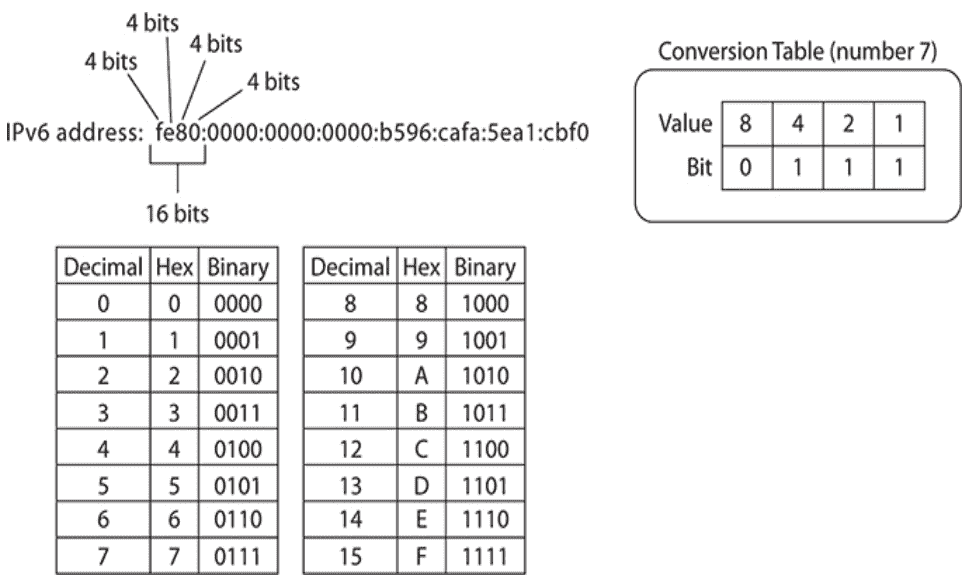
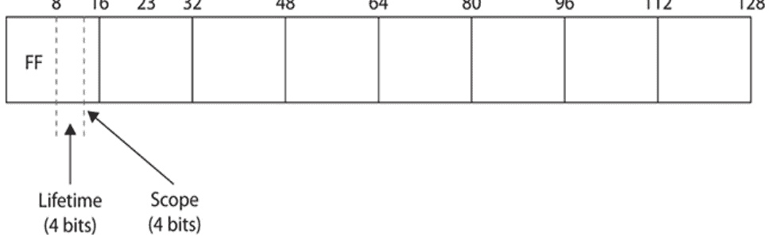
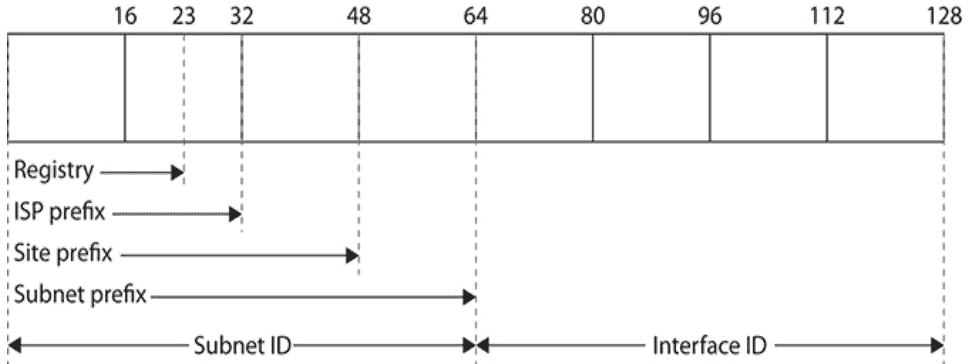
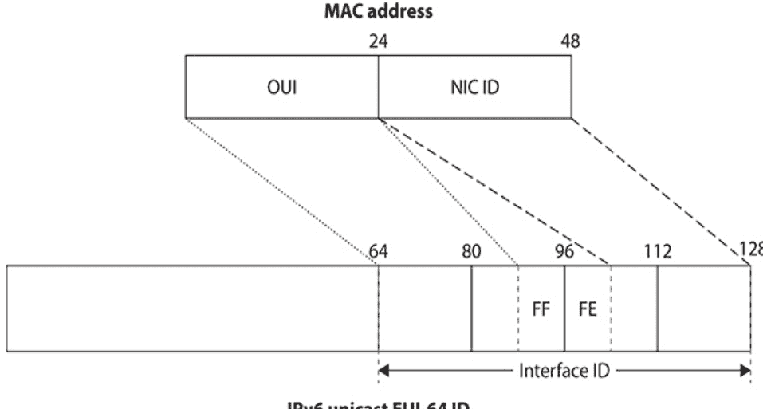
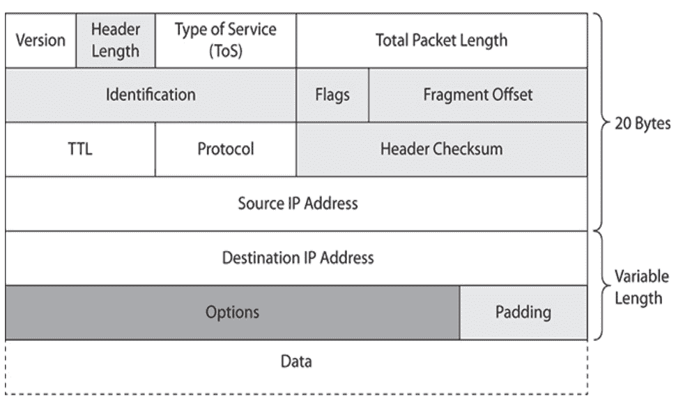
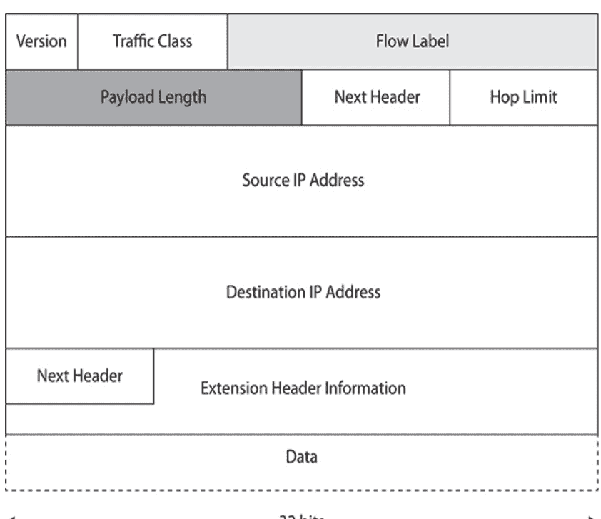
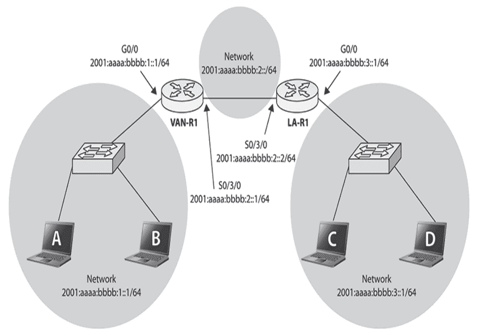
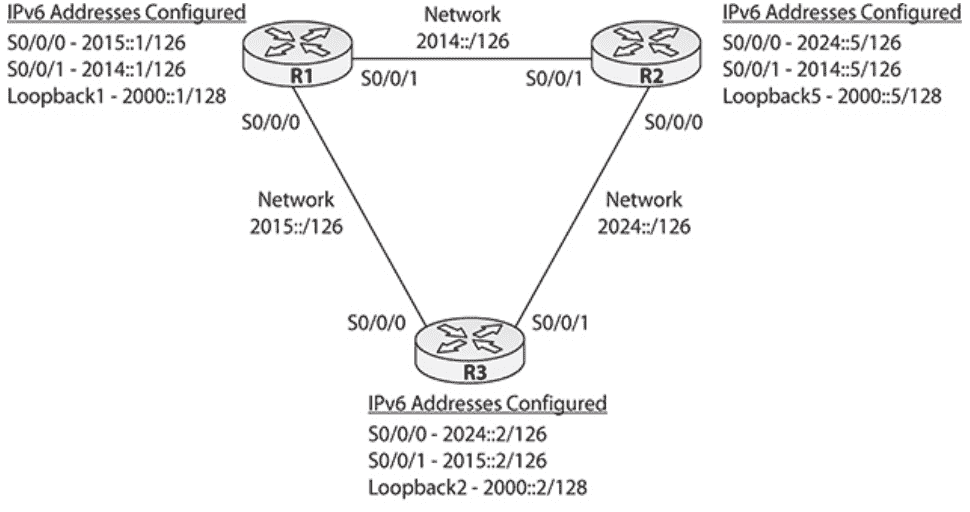
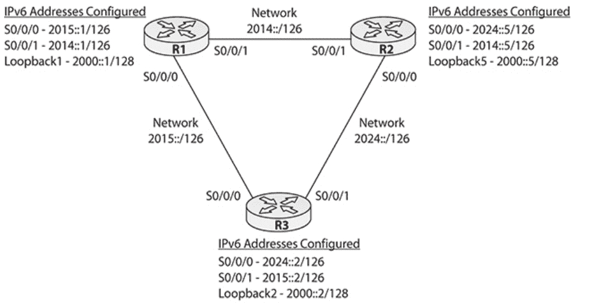

# IPv6

在本章中，您将

- 了解 IPv6 的必要性
- 了解 IPv6 增强功能和寻址
- 了解如何在接口上配置 IPv6
- 了解如何配置 IPv6 路由

本章将向您介绍 TCP/IP 的下一代：IP 版本 6（IPv6）。由于发现了 IPv4 的诸多缺陷，以及 IPv4 在分级寻址方面可扩展性差，因此开发了 IPv6 以满足小型公司、企业以及互联网（尤其是中国和印度等新兴市场）快速增长的需求。在本章中，您将了解 IPv6 为何必要、不同类型的 IPv6 地址、使用 IPv6 进行路由，以及如何配置基本的 IPv6 设置。CCNP 认证的内容比本章所介绍的要深入得多。

### IPv6 必要性

IPv4 地址长度为 32 位，这意味着有 2³² 个实际 IP 地址，即 43 亿个地址。然而，并非所有这些地址都可用：其中只有 37 亿个实际上可用。许多地址被保留，例如研究用（239–254）、广播（255）、组播（224–239）、私用（10、172.16 和 192.168）以及回环地址（127）。而且，许多可用地址已经分配，为新增长留下了非常非常少的地址。

与 32 位 IPv4 地址不同，IPv6 使用 128 位地址。这允许有 3.4 × 10³⁸ 个地址，足以为地球上的每个人（甚至可能是多个星球上的人）提供许多 IP 地址。

### 增长问题

在 20 世纪 90 年代初至中期，人们开始担心 IPv4 地址数量的减少。解决此问题的临时方案是预留一个称为 *私有地址* 的地址空间，任何人都可以在公共网络中使用。请回顾第 4 章，这些地址在 IETF RFC 1918 中定义：10.0.0.0/8、172.16.0.0–172.31.255.255 和 192.168.0.0–192.168.255.255。要访问公共网络，会使用地址转换将私有寻址信息转换为公共地址，通常使用静态网络地址转换（NAT）转换用于内部服务，以及动态过载（特别是端口地址转换，或 PAT）用于用户连接。

然而，市场上的许多变化正在迅速达到地址转换不再足够的地步：将不再有可供转换的公共地址。以下是公司开始迁移到 IPv6 环境的一些有效原因：

- 目前有超过 30 亿人连接到互联网，并且基于中国和印度等快速新兴的技术市场，这一数字呈指数级增长。
- 超过 20 亿部智能手机、平板电脑及类似设备提供电子邮件和网页浏览等常见数据服务，并且随着越来越多的企业实施移动应用程序，这一数字预计会增长。
- 消费品（如汽车、家用电器和工业设备）上提供的数据服务越来越多，并且这一数字预计会增长到数十亿。

由此可见，问题不在于公共地址是否会耗尽，甚至不在于何时会耗尽，而在于在不久的将来将*多早*发生这种情况。由于 IPv4 只是 32 位地址，而且设计者没有预见到互联网的增长，我们


IPv4地址用尽。IPv6的目标是增加地址空间（它是一个128位地址空间），这为世界上的每个人提供了足够多的IPv6地址可用，并能处理未来的增长。

想想过去十年中发生的技术革命：你现在可以使用智能手机更改电视频道，致电家中并编程让微波炉开启，或者将来自电视提供商的内容流式传输到PC，然后再传输到电视可以快速访问的网络存储设备上。而这场革命仍处于早期阶段。为了让所有这些设备之间进行通信，它们需要一种寻址结构，而大多数公司基本上依赖TCP/IP来提供这种结构。

## IPv6 特性

很明显，IPv4的替代品需要为这种不断增长的需求提供足够的地址，但它还需要提供易于使用和配置、增强的安全性，以及在过渡期间与IPv4互操作的能力。以下是IPv6中内置的一些特性：

- **非常大的地址空间** IPv6庞大的地址空间应对全球增长，其中路由前缀可以在路由更新中轻松聚合。使用单个地址空间支持对互联网服务提供商（ISP）的多宿主很容易实现。地址信息的自动配置，包括在IP地址中包含媒体访问控制（MAC）地址的功能，以及即插即用选项，简化了地址管理。重新编号和修改地址很容易适应，公共到私有的重新寻址也是如此，而不涉及地址转换。
- **安全性** IP安全性（IPsec）内置于IPv6中，而在IPv4中它是一个笨拙的附加组件。使用IPv6时，两个设备可以动态协商安全参数并在它们之间构建安全隧道，无需用户干预。
- **移动性** 随着智能手机和平板电脑等移动设备的增长，设备可以在无线网络之间漫游而不会中断连接。
- **简化的封装** IPv6的封装比IPv4更简单，提供更快的路由器转发速率和更好的路由效率。不包括校验和，减少了端点上的处理。不使用广播，减少了同一子网内设备的利用率。服务质量（QoS）信息内置于IPv6标头中，其中流标签标识流量；这使得中间网络设备无需检查数据包内容、TCP/UDP标头和有效载荷信息来正确分类流量以用于QoS。
- **寻址能力** 与IPv4一样，地址可以静态分配或通过动态主机控制协议（DHCPv6）获得。然而，与IPv4不同，IPv6支持无状态自动配置，这使设备能够在不实现DHCP服务器解决方案的情况下自动获取地址。
- **过渡能力** 存在各种解决方案，以便在两者之间迁移时使IPv4和IPv6能够成功共存。一种方法，双协议栈，使您可以在设备的一个接口上同时运行两种协议。第二种方法，隧道，使您可以在IPv4上构建IPv6隧道，反之亦然，以使用另一种类型跨网络传输一种IP版本。Cisco支持第三种方法，网络地址转换-协议转换（NAT-PT），以在IPv4和IPv6之间进行转换（有时术语*代理*用于替代协议）。


**考试提示** 考试时，请确保您熟悉项目符号列表中的IPv6增强功能。

## IPv6 寻址

大多数管理员对IPv6地址感到害怕的是它们与IPv4地址相比有多么不同。学习处理长度四倍的地址似乎是不可能的；但是，正如您将在本章中看到的，TCP/IP的标准机构已将其尽可能简化。

## IPv6 地址格式

与使用点分十进制格式的IPv4地址不同，其中每个字节范围从0到255，IPv6地址使用八组四个十六进制地址（每组16位），由冒号(:)分隔，如下所示：
xxxx:xxxx:xxxx:xxxx:xxxx:xxxx:xxxx:xxxx（x将是一个十六进制值）。
这种表示法通常称为*字符串*表示法。每个十六进制值范围从0到9和A到F（0–F）。

有关IPv6地址的一些重要事项如下：

- 字符A–F的十六进制值可以以小写或大写显示。
- 数字组中的前导零可以省略；例如，您可以在八个字段中的一个中输入0012或12，两者都正确。
- 如果IPv6地址中有连续的零字段，您可以将它们表示为两个冒号(::)。例如，0:0:0:0:0:0:0:5可以表示为::5；2000:C67:0:0:8888:9999:1111:0可以表示为2000:C67::8888:9999:1111:0。但是，您只能在地址中这样做一次：2000::C67::891::00将是无效的，因为::在地址中出现了多次。造成此限制的原因是，如果您有两个或更多重复，您将不知道每个部分中省略了多少组零。
- 未指定地址表示为::，因为它包含全零。


**考试提示** 考试时，您需要记住IPv6地址的格式：八组四个十六进制数字（16位）。如果IPv6地址中有连续的零字段，您可以将它们表示为两个冒号(::)。但是，您只能在地址中这样做一次；因此2000::C67::891::00将是无效的，因为::在地址中出现了多次。

## 计算十六进制地址

让我们来看看IPv6地址如何从二进制转换为十六进制地址。图14-1显示了典型IPv6地址的结构并标明了位结构。



图14-1 将十六进制转换为二进制

让我们分解一下图表。在图表的左上角，您可以看到以fe80开头的IPv6地址。IPv6地址中的每个字符由4位组成。这意味着地址中由冒号(:)分隔的每个块长度为16位。共有八个块，因此8 × 16位 = 128位。

每个字符构成的4位模式可以使用图14-1右上角显示的快速转换表轻松得出。您可以看到每个4位的值为8、4、2，最后是最右侧的1。就像计算IPv4中八位组的值一样，您可以通过获取十进制数字（图中示例为7）并打开（将位设置为1）4位、2位和1位占位符来计算所使用的4位。这将创建十进制值4 + 2 + 1 = 7。查看图中的图表，您会发现十进制值7也是十六进制值7，其二进制值为0111。知道每个字符都基于4位值，您可以使用转换表来帮助您找出每个十六进制值的二进制表示。

要开始制作表格，我按顺序列出从0到15的16个十进制数字（因为十六进制地址是16进制的）。然后按顺序列出每个十六进制值，从0到9（这只有10个数字；我们还需要6个），然后第十个十六进制值是A，并继续到F，以构成十六进制系统中的16个值。最后，我创建第三列，即每个十六进制值的二进制值——您可以作弊，使用十六进制值对应的十进制数字来找出二进制应该是什么。例如，十六进制值“C”对应十进制值12，计算12的二进制为1100（8 + 4 + 0 + 0）。

这意味着fe80 IPv6中的第一个块具有以下16位模式：

```
1111 1110 1000 0000
```

## IPv6地址类型

回顾第4章，存在多种类型的IPv4地址：单播、广播、组播、研究、私有等等。IPv6也有不同类型的地址。以下是三种主要类型：

- **任播** 这与IPv4广播非常不同。任播地址用于一个设备与其接口上分配有该地址的最近设备进行通信（一对最近地址），其中许多接口可以共享相同的地址。这些地址取自单播地址空间，但可以表示多个设备，例如多个默认网关。例如，在路由器上使用任播地址作为默认网关地址，用户设备只需知道一个地址，并且您不需要配置诸如热备份路由器协议（HSRP）或虚拟路由器冗余协议（VRRP）之类的协议。


- **多播** 这与 IPv4 中的多播类似。
- **单播** 这表示用于直接通信的单个唯一地址。


**考试提示** 请确保你能对比考试中任播、多播和单播 IPv6 地址，并记住 IPv6 不支持广播地址。

## 任播

IPv4 寻址中的一个问题是使用广播，网段上的每个设备都必须处理广播（即使广播最终并非发往某个设备）。IPv4 严重依赖广播来发现网段上的设备，例如地址解析协议（ARP），以及获取地址，例如动态主机配置协议（DHCP）。在 IPv6 中，广播已不再存在：它们已被任播和多播地址所取代。


**考试提示** 请记住，任播地址用于一个设备与拥有该地址的最近设备（其接口上分配了该地址）进行通信（一对一最近）。任播地址是配置在多个设备上的 IPv6 全局地址池中的地址。

任播地址标识一个或多个 *接口*。请注意，我没有使用 *设备* 这个术语，因为一个设备可以拥有多个接口。有时人们使用 *节点* 这个术语来指定设备上的一个接口。基本上，任播是单播和多播的混合体。对于单播，一个数据包发送到一个目的地；对于多播，一个数据包发送到多播组的所有成员；而对于任播，一个数据包发送到配置了任播地址的一组设备中的任何一个成员。默认情况下，发送到任播地址的数据包将转发到最近的接口（节点），这基于用于将数据包发送到目的地的路由过程。鉴于此过程，任播地址通常被称为一对一最近地址。而且，有趣的是，任播地址从 IPv6 的单播地址全局池中分配，因此在数据包中查看时，单播地址和任播地址无法相互区分。由于多个设备可以配置相同的任播地址，当需要将网络流量（例如 Web 内容）负载平衡到两个不同的目的地时，通常会使用任播地址。

## 多播

IPv6 中的多播与其 IPv4 中的对应物起到类似的作用：它们代表一组有兴趣查看相同流量的接口。IPv6 中的多播数据包示例如图 14-2 所示。前 8 位设置为 FF。接下来的 4 位是地址的生存期：0 表示永久，1 表示临时。接下来的 4 位表示多播地址的范围（数据包可以传播的距离）：1 表示节点，2 表示链路，5 表示站点，8 表示组织，E 表示全局（互联网）。例如，以 FF02::/16 开头的多播地址是永久链路地址，而 FF15::/16 地址是站点的临时地址。FF02::1 表示所有 IPv6 设备（类似于 IPv4 中的广播）。FF02::2 表示 IPv6 网段或 VLAN 上的所有路由器。

## IPv6 多播地址



## 图 14-2 IPv6 多播地址


**考试提示** 对于考试，你需要记住 FF02::1 是表示所有 IPv6 设备的多播地址（类似于 IPv4 中的广播地址）。FF02::2 是表示 IPv6 网段或 VLAN 上所有路由器的多播地址。还要注意，IPv6 中所有多播地址都以 FF 开头。

## 单播

IPv6 单播地址分配给每个节点（接口），其用途在 RFC 4291 中有讨论。五种单播地址类型列于表 14-1 中。有趣的是，任何类型的多个地址都可以分配给设备的接口：单播、多播和任播。

| 地址 | 值 | 描述 |
|---|---|---|
| 全局 | 2000::/3 | 全局单播地址是可在互联网上路由的 IPv6 公有 IP 地址，由互联网编号分配机构（IANA）分配。它们相当于 IPv4 公有 IP 地址。ISP 汇总这些地址以提供互联网的可扩展性。 |
| 保留 | (范围) | 保留地址用于特定类型的任播以及未来使用。目前约 1/256 的 IPv6 地址空间被保留。 |
| 私有 | FE80::/10 | 与 IPv4 类似，IPv6 最初支持私有寻址，供不需要访问公有网络的设备使用。前两位是 FE，第三位可从 8 到 F 范围内选择。 |
| 环回 | ::1 | 与 IPv4 中的 127.0.0.1 地址类似，0:0:0:0:0:0:1 或 ::1 用于本地测试功能；不同于 IPv4 为本地测试专用完整的 A 类地址块，IPv6 仅使用一个地址进行本地测试。 |
| 未指定 | :: | IPv4 中的 0.0.0.0 表示“未知”地址。在 IPv6 中，这由 0:0:0:0:0:0:0 或 :: 表示，通常用于数据包的源地址字段，当接口没有地址并尝试动态获取地址时。 |

表 14-1 IEEE 以太网组件

## 私有地址

如表 14-1 所述，私有地址用于不需要访问诸如互联网之类公有网络的设备。私有地址有两种：

- **站点本地/唯一本地** 站点本地地址（又称唯一本地地址）被视为私有 IP 地址，类似于 IPv4 中的 10.0.0.0/8 私有 IP。此地址用于站点内的本地通信。站点本地地址始终以 FEC:: 到 FFF:: 开头。
- **链路本地** 链路本地地址类似于 IPv4 中的 APIPA 地址，用于网络链路上的通信。链路本地地址以 FE80::/10（FE8:: 到 FEB::）开头。

站点本地地址类似于 RFC 1918 地址，代表特定站点或公司。这些地址可在公司内部使用，而无需浪费任何公有 IP 地址——鉴于 IPv6 中可用地址数量庞大，这并非问题。但是，通过使用私有地址，你可以为 IPv6 设置地址转换策略，以轻松控制谁可以离开你的网络并接收返回流量。

链路本地地址是 IPv6 中的一个新概念。这类地址的传播范围较小——即不超过本地链路（数据链路层）。路由器会处理发往链路本地地址的数据包，但不会将其转发到其他链路。其最常见的用途是让设备获取单播站点本地或全局单播地址信息、发现默认网关并发现网段上的其他第 2 层邻居。当设备使用链路本地地址时，必须指定出站接口，因为每个接口都连接到一个“链路”。


**考试提示** 对于考试，请记住各种地址类型的起始值。站点本地地址以 FEC:: 到 FFF:: 开头，链路本地地址以 FE8:: 到 FEB:: 开头（通常是 FE80）。环回地址是 ::1，相当于 IPv4 的 127.0.0.1。

## 全局单播地址

除了多播地址空间 FF00::/8 之外，单播和任播地址构成了其余地址类型。全局单播地址的第一个十六进制值的前三位始终设置为 001，这意味着全局单播地址始终以 2 或 3 开头，例如 2000 或 2001。但是，IANA 目前仅将 2000::/3 地址分配给全局池，这约占可用 IPv6 地址的 1/6。在这些地址中，只有 2001::/16 分配给各种互联网地址注册机构。全局单播地址由两个组件组成，如图 14-3 所示：子网 ID（64 位）和接口

ID（64 位）。子网 ID 包含地址的注册机构（负责分配该地址的机构，例如 IANA）、ISP 前缀（与该地址关联的 ISP）、站点前缀（被分配地址空间的公司）以及子网前缀（站点内的子网）。ISP 被分配一个 ISP 前缀范围，使其能够轻松聚合其前缀，仅向互联网骨干网宣告单一路由；这缓解了互联网发展过程中以及 ISP 最初被分配 IPv4 地址空间时难以进行汇总的一个主要问题。这种地址分配的另一个优势在于子网前缀长度为 16 位。因此，使用单个全球站点地址，一家公司最多可寻址 65,536 个子网。

## IPv6 单播地址



图 14-3 IPv6 单播地址

IPv6 地址的后半部分，即接口 ID，代表站点内的特定接口。对于从 2000::/3 到 E000::/3 的地址，有一个要求是接口 ID 必须包含一个 64 位值才被视为有效。因此，最后 64 位为 0 的地址被视为无效的 IPv6 单播地址。例如，2004:1234:5678:90AB:: 无效，因为接口 ID（即最后 64 位——也就是最后四组数字）是二进制零。


**考试提示** 考试时请记住，全球地址的首位为 2 或 3，目前通常为 2000 或 2001。一个接口可以被分配多个 IPv6 地址——这包括链路本地地址、全球单播地址和/或任播地址。

## 修改的 EUI-64

接口 ID 通常由接口 MAC 地址的一部分组成。这样做时，接口 ID 通常称为扩展唯一标识符 64（EUI-64）。图 14-4 显示了带有 EUI-64 格式的帧示例。组织唯一标识符（OUI），即网卡 MAC 地址的前 24 位，被映射到接口 ID 的前 24 位。最高序字节的第七位设置为 1，表示接口 ID 在站点范围内是唯一的，或设置为 0，表示它仅在本地范围内唯一。OUI 映射后跟随 16 位值 FFFE。然后，MAC 地址的最后 24 位被映射到接口 ID 的最后一部分。



图 14-4 EUI-64 接口 ID


**考试提示** 请记住，单播 IPv6 地址中接口 ID 部分为 0 的地址是无效的。例如，这是一个无效的 IPv6 单播地址：2001:5005::。另外，请记住，使用 EUI-64 方法时，0xFFFE 被插入到 MAC 地址的高 3 字节和低 3 字节之间，然后成为地址的主机 ID。

## IPv6 增强功能

IPv6 相对于 IPv4 做了一些增强和更改，使其更加网络友好且可扩展。这些增强包括 IPv6 头部、ICMPv6 和邻居发现。

## IPv6 头部

图 14-5 显示了 IPv4 头部及其字段。该头部包含 12 个字段，后面跟随选项字段，如果存在，选项字段长度可变。如果没有任何选项，IPv4 头部为 20 字节；如果有选项，则最多为 40 字节。



图 14-5 IPv4 头部

在 IPv6 中，这些头部字段中有六个不再是新 IPv6 头部的一部分。这些字段在图 14-5 中用较浅的阴影表示：

- **头部长度** 在 IPv6 中不再需要，因为所有 IPv6 头部都是固定长度的。
- **标识** 该功能在 IPv4 中很久以前就不再使用，并且在 IPv6 中已被弃用。
- **标志** 该功能在 IPv4 中很久以前就不再使用，并且在 IPv6 中已被弃用。
- **分片偏移** IPv6 中的分片处理方式不同，不需要 IPv6 头部中的字段来完成此过程（此功能已移至 IPv6 中的扩展头部信息字段）。
- **头部校验和** 当今的数据链路层技术非常可靠，因此此字段在 IPv6 中不再必要。
- **填充** 此字段在 IPv6 中不再必要。

图 14-6 显示了 IPv6 头部的字段。以下是对 IPv6 头部中八个字段的说明：

- **版本** 这个 4 位字段包含数字 6，而不是 4。
- **流量类别** 这个 8 位字段类似于 IPv4 头部中的 ToS 字段。
- **流标签** 这个 20 位字段是 IPv6 中新增的，没有对应的 IPv4 字段。它用于标记单独的流量流，以便路由设备执行额外的策略功能。
- **有效载荷长度** 这个 16 位字段指示有效载荷的大小。在 IPv4 中，总分组长度字段是整个分组的大小，但在 IPv6 中，有效载荷长度字段不包括 IPv6 头部的大小。
- **下一个头部** 这个 8 位字段执行与 IPv4 头部中协议字段相同的功能。
- **跃点限制** 这个 8 位字段执行与 IPv4 头部中 TTL 字段相同的功能。
- **源 IP 地址** 这个 128 位（16 字节）字段指示源 IPv6 地址。
- **目标 IP 地址** 这个 128 位（16 字节）字段指示目标 IPv6 地址。



图 14-6 IPv6 头部

在这八个字段之后是扩展头部（如果存在）。这些扩展头部取代了 IPv4 选项字段。扩展的数量不是固定的，因此扩展头部信息字段（扩展列表）的总长度是可变的。如图 14-5 和 14-6 所示，IPv6 头部已被简化（字段更少）。

## ICMPv6

ICMPv6 的协议编号为 58。类似于 IPv4 中的 ICMP，ICMPv6 用于帮助执行诊断测试和识别问题（回显、回显答复、目标不可达、跃点数超限等等）。但是，ICMPv6 中添加了更多功能。

从某种意义上说，ICMPv6 就像 IPv6 协议中的“瑞士军刀”。它承担了 IPv4 中其他独立协议所承担的责任：

- **地址解析协议 (ARP)** IPv4 使用 ARP 将 IP 地址解析为 MAC 地址。ARP 不再作为 IPv6 中的独立协议存在；ICMPv6 现在执行其功能。
- **互联网组管理协议 (IGMP)** IPv4 使用此协议，以便路由设备可以了解 VLAN 中是否有希望接收多播流的多播设备，并将必要的流或流转发到 VLAN。IGMP 不再作为 IPv6 中的独立协议存在；ICMPv6 现在执行其功能。

ICMPv6 还承担了其他协议的角色，并具有新功能。以下是 ICMPv6 中执行的一些新功能示例：

- **路由器请求和通告** 使设备能够使用多播消息查询段上的路由设备，或使路由设备能够通过多播消息宣告自己；还允许将终端设备重定向到目标网络的最佳网关
- **DNS 请求和通告** 使设备能够使用多播消息查询段上的 DNS 服务器，或使 DNS 服务器能够通过多播消息宣告自己
- **邻居请求和通告** 通常称为*邻居发现*，确定同一链路上邻居的数据链路层地址（IPv4 ARP 的替代品），查找相邻路由器，并通过多播消息跟踪邻居的可达性


**考试提示** 考试时请记住，IPv6 没有广播流量，因此 ICMPv6 使用单播和多播流量。


## 地址分配

您可以使用四种方法将 IPv6 地址分配给接口：其中两种是静态的，两种是动态的。接下来的三个部分将讨论这四种选项。

### 静态地址分配

您可以选择使用以下两种方法之一，将单播地址静态分配给设备的接口：

- 手动指定所有 128 位。
- 手动指定前 64 位，并使用 EUI-64 获取最后 64 位。

您可以手动指定完整的 128 位地址，也可以指定子网 ID，并让设备使用 EUI-64 方法创建地址的接口 ID 部分。如果您手动输入完整地址，请记住，包含 0 的字段组可以用双冒号 (::) 缩写。EUI-64 方法是大多数网络管理员更常用的方法。

### DHCPv6

DHCPv6 是 IPv4 中 DHCP 的更新，其工作方式与之前的版本类似，但存在一些差异。在 IPv6 中，DHCPv6 被称为有状态自动配置。客户端开始之前，必须首先通过邻居发现过程检测链路上的路由器。如果客户端检测到路由器，则会检查路由器通告消息，以确定是否已设置 DHCPv6。如果路由器指定支持 DHCPv6，或未看到任何路由器通告消息，客户端将通过生成 DHCP 请求消息来开始查找 DHCPv6 服务器。该消息发送到 ALL-DHCP-Agents 组播地址，使用链路本地作用域，以确保消息默认不会转发到本地链路之外。代理可以是 DHCPv6 服务器或中继（例如路由器）。

在 DHCPv4（IPv4 寻址）中，当 DHCP 服务器与请求客户端不在同一网段时，您会在 Cisco 路由器上配置 IP Helper 功能。IP Helper 会让路由器将 DHCP 请求重定向到特定服务器，或重定向到包含一个或多个 DHCP 服务器的网段的指向广播地址。在 DHCPv6 中，这已不再必要：如果链路上没有服务器，中继可以将请求转发到具有站点本地作用域的 ALL-DHCP-Agents 组播地址。您仍然可以选择以静态方式执行此操作，如果您想控制哪个或哪些 DHCPv6 服务器应处理请求，则有必要这样做。

### 无状态自动配置

无状态自动配置是 DHCPv6 的扩展。与 DHCPv6 类似，客户端可以动态获取其寻址信息；但是，使用无状态自动配置时，无需 DHCP 服务器即可为客户端分配 IPv6 寻址信息。相反，客户端使用路由器通告消息中的信息为接口配置 IPv6 地址。具体做法是获取路由器通告源地址（路由器地址的前缀）中的前 64 位，并使用 EUI-64 进程创建 64 位接口 ID。无状态自动配置主要为手机和家用网络及设备而设计，用于自动分配地址，而无需管理 DHCP 服务器基础设施。设备在使用前，将通过使用 ICMPv6 的邻居查询消息验证其地址是否唯一。


**考试提示** 考试时请记住无状态自动配置这一术语。无状态自动配置无需 DHCP 服务器即可动态分配地址。设备会从路由器通告中学习 IPv6 前缀，并使用 EUI-64 动态创建地址的接口 ID 部分。

通常，路由器会生成定期的路由器通告 (RA) 消息，客户端可以监听这些消息并使用它们自动生成其链路地址；但是，当客户端启动时，等待 RA 可能需要一段时间。在这种情况下，客户端将生成一个路由器请求消息，要求路由器用 RA 进行回复，以便客户端可以生成其接口地址。

可通过无状态自动配置获取的信息包括

- 网络编号（前缀）
- 前缀的生存期
- 指示终端站可以执行的自动配置类型的标志（无状态或有状态）
- 前缀的默认路由器以及该值的生存期
- 网段的默认最大传输单元 (MTU) 大小
- 允许的最大跳数

还可以获取其他信息，但此列表包含最常见的参数。

## 路由和 IPv6

与 IPv4 类似，IPv6 中的路由器基于度量和管理距离查找到目标的最佳路径；与 IPv4 一样，IPv6 路由器会在 IPv6 路由表中查找最长匹配前缀，以将数据包转发到其目标。主要区别在于，IPv6 路由器在做出路由决策时查看的是 128 位，而不是 32 位。


**注意** RFC 2461 要求路由器必须能够识别每个邻居路由器的链路本地地址，该地址在路由过程中使用。因此，RFC 不建议将全局单播地址用作下一跳地址。

## 支持的路由协议

IPv6 支持静态和动态路由协议。IPv6 支持以下路由协议：静态、下一代路由信息协议 (RIPng)、开放最短路径优先 (OSPFv3)、IPv6 的中间系统到中间系统 (IS-IS)、多协议边界网关协议 (MP-BGP4) 和 IPv6 的增强型内部网关路由协议 (EIGRP)。本书仅介绍静态、RIPng 和 OSPFv3 路由；其他动态路由协议在 Cisco 的 CCNP 课程和认证中有更深入的介绍。

### RIPng

RIPng 定义在 RFC 2080 中。它实际上与 IPv4 的 RIP 类似，具有以下特征：

- 它是一种距离矢量协议。
- 跳数限制为 15。
- 使用分离地平线和毒性反转来防止路由环路。
- 它基于 RIP v2。


**注意** 运行 12.2(2)T 及更高版本的 Cisco 路由器支持 RIPng。

以下是 RIPng 中的增强功能：

- 使用 IPv6 数据包传输路由更新。
- 所有 RIP 路由器组播地址 (FF02::9) 用作路由通告中的目标地址，并传送到 UDP 端口 521。
- 路由更新包含路由器的 IPv6 前缀和下一跳 IPv6 地址。


**考试提示** 您需要知道 RIPng 对其连接使用 UDP 端口 521，其目标组播地址是 FF02::9。

### OSPFv3

OSPFv3 是支持 IPv6 的 OSPF 版本，并通过许多功能进行了增强，使其可与其他内部网关协议一样具有可扩展性。OSPFv3 的协议编号为 89。以下是其中一些增强功能：

- OSPFv3 进程需要一个路由器 ID，这与 OSPFv2 (IPv4) 一样。这是一个 32 位数字，必须静态配置；它不能通过路由设备上的 IPv4 地址获取，因为您在路由设备上可能根本没有使用 IPv4。
- 在形成邻接关系时，路由器使用其链路本地地址作为源。链路本地地址出现在链路状态数据库和用作下一跳地址的路由表中。
- 由于使用了链路本地地址，接口上冲突的全局地址不会阻止形成邻接关系：换句话说，全局寻址结构已从接口中抽象出来。在 OSPFv2 中，这会导致路由器无法建立邻接关系，但在 OSPFv3 中不会造成问题。
- 区域内的任何路由器都可以执行汇总或过滤。与 EIGRP 相比，这是 OSPFv2 的最大弱点之一。在 OSPFv2 中，仅区域边界路由器 (ABR) 和自治系统边界路由器 (ASBR) 可以执行汇总或过滤，而 EIGRP 路由器可以执行此操作。这极大地限制了 OSPFv2 的可扩展性。OSPFv3 不再存在此问题。

### IPv6 的 EIGRP


EIGRP 已更新以支持 IPv6 路由，现在称为 EIGRP for IPv6。EIGRP for IPv6 是一个独立进程，不是 EIGRP for IPv4 配置的一部分。它支持与其旧版 IPv4 EIGRP 实现相同的功能：扩散更新算法 (DUAL)、丰富的度量结构、负载均衡以及许多其他功能。

## 实施策略

将网络迁移到 IPv6 的一个不错的功能是，您不必一次性完成所有工作。各种迁移策略在您从 IPv4 迁移到 IPv6 的过程中同时支持这两种协议。表 14-2 简要列出了这些策略。接下来的两节将讨论双栈和手动 IPv6 隧道，即两种最常用的方法。

| 迁移方法 | 描述 |
|---|---|
| 双栈 | 例如 PC 和路由器之类的设备同时运行 IPv4 和 IPv6，因此拥有两组地址。 |
| 手动 IPv6-over-IPv4 (6to4) 隧道 | 通过将 IPv6 数据包封装在 IPv4 数据包中，在 IPv4 网络上隧道传输 IPv6 数据包。这需要配置了双栈的路由器。 |
| 动态 6to4 隧道 | 使 IPv6 站点能够自动通过 IPv4 骨干网（例如 Internet）连接到其他 IPv6 站点。此方法为每个站点应用唯一的 IPv6 前缀，无需从地址注册机构或 ISP 获取 IPv6 寻址信息。 |
| 站点内自动隧道寻址协议 (ISATAP) 隧道 | 使用虚拟链接在主要使用 IPv4 的站点内将 IPv6 站点连接在一起。两种寻址类型之间的边界路由器必须配置双栈。 |
| Teredo 隧道 | 它不使用路由器来隧道传输数据包，而是由主机执行隧道操作。这要求主机配置双栈。通常用于通过 IPv4 地址转换设备传输数据包。 |
| NAT 代理和转换 (NAT-PT) | 让地址转换设备在 IPv6 和 IPv4 网络之间以及反过来转换地址。 |

表 14-2 IPv4 到 IPv6 的过渡选项


EXAM TIP 熟悉表 14-2 中的信息以备考试。请记住，同时运行 IPv6 和 IPv4 的路由器被称为“双栈”。通过在 IPv4 数据包内隧道传输 IPv6 数据包来连接 IPv6 网络被称为“6to4 隧道”。

### 双栈

在双栈中，设备同时运行两个协议栈：IPv4 和 IPv6。在所有过渡方法中，这是最常见的一种。双栈可以在设备的同一接口或不同接口上实现。图 14-7 的上半部分展示了路由器上双栈的示例，其中 NetworkA 包含配置为两种不同协议的设备混合体，路由器配置为双栈模式。旧的仅限 IPv4 的应用程序在通过支持新 API 来处理 IPv6 地址和使用 IPv6 地址的 DNS 查找而迁移到 IPv6 时，仍然可以工作。

双栈
主机1: IPv4
主机2: IPv6
网络A
IPv4 和 IPv6
路由器A
IPv4 和 IPv6
网络B
IPv4
网络C
IPv6

IPv6-over-IPv4 隧道
主机1 IPv6
路由器A
IPv4 网络
路由器B
主机2 IPv6

图 14-7 双栈和 IPv6 隧道


注意 在网段上进行双栈配置的主要缺点是，仅配置一个协议栈的设备必须将其流量转发到双栈设备（例如路由器），然后该路由器必须使用另一个协议栈将流量转发回同一网段。这是带宽的低效利用，但它确实允许同时使用两个协议栈的设备在同一网段上共存。

### IPv6 隧道

IPv6 隧道使您可以通过将 IPv6 数据包作为 IPv4 数据包的有效载荷来隧道传输 IPv6 数据包，如图 14-7 下半部分所示。使用隧道，您可以通过中间 IPv4 网络连接 IPv6 网络。在 IPv4 有效载荷中隧道传输 IPv6 数据包时，IPv4 协议字段包含值 41，指示正在发生 IPv6 隧道传输。执行隧道传输的两个路由器必须配置双栈，因为它们需要与不同网段上的 IPv6 和 IPv4 设备进行通信。

如果您手动配置隧道，则需要静态配置 IPv4 和 IPv6 地址。您还需要确保路由正常工作，以便通过 IPv4 网络隧道传输 IPv6 数据包，并允许图 14-7 中所示的两个 IPv6 网络相互查看对方的路由。


提示 Cisco 不建议将 IP Unnumbered 功能用于隧道端点，因为当隧道无法工作时，这会使您更难以排查问题。

## IPv6 配置

本节介绍在路由器上启用 IPv6、为接口分配 IPv6 地址以及启用基本路由功能的基础知识。

### 启用 IPv6 和分配地址

要在路由器上使用 IPv6，您至少必须启用该协议并为接口分配 IPv6 地址，如下所示：

```
IOS(config)# ipv6 unicast-routing
IOS(config)# interface type [slot_#/]port_#
IOS(config-if)# ipv6 address ipv6_address_prefix/prefix_length
[eui-64]
```

ipv6 unicast-routing 命令全局启用 IPv6，并且必须是在路由器上执行的第一个 IPv6 命令。ipv6 address 命令分配前缀、长度以及使用 EUI-64 来分配接口 ID。可选地，您可以省略 **eui-64** 参数并配置完整的 IPv6 地址。

要使用无状态自动配置，请使用以下配置：

```
IOS(config)# interface type [slot_#]/port_#
IOS(config-if)# ipv6 address autoconfig [default]
```

如果在此接口上选择了默认路由器，则 **default** 参数会导致使用该默认路由器安装默认路由。**default** 参数只能在一个接口上指定。

您可以使用 **show ipv6 interface** 命令来验证接口的配置。以下是配置示例及其验证：

```
IOS(config)# ipv6 unicast-routing
IOS(config)# interface fastethernet0/0
IOS(config-if)# ipv6 address 2001:1cc1:dddd:2::/64 eui-64
IOS(config-if)# end
Router# show ipv6 interface fastethernet0/0
FastEthernet0/0 is up, line protocol is up
  IPv6 is enabled, link-local address is FE80::207:EFF:FE46:4070
    [TEN]
  No Virtual link-local address(es):
  Global unicast address(es):
    2001:1CC1:DDDD:2:207:EFF:FE46:4070, subnet is
    2001:1CC1:DDDD:2::/64  [EUI/TEN]
  Joined group address(es):
    FF02::1
    FF02::2
.
.
.
```

在此示例中，请注意链路本地地址是 FE80::207:EFF:FE46:4070。另请注意全局地址：2001:1CC1:DDDD:2:207:EFF:FE46:4070。

您可以使用 **ping** 和 **traceroute** 命令来测试 IPv6 连通性。执行命令并紧跟您要测试的 IPv6 地址。以下是一个示例：

```
IOS# ping 2001:DB8:D1A5:C800::5
Type escape sequence to abort.
Sending 5, 100-byte ICMP Echos to 2001:DB8:D1A5:C800::5, timeout is
  2 seconds:
.!!!!
Success rate is 100 percent (5/5), round-trip min/avg/max = 0/0/4 ms
```

请记住，您只能在同一 VLAN 内测试到链路本地地址的连通性；但是，您可以测试访问同一 VLAN 或不同 VLAN 中的全局地址。

要在路由器上设置静态 DNS 解析表，请使用 **ipv6 host** 命令；您还可以使用 **ip name-server** 命令指定 DNS 服务器：

```
IOS(config)# ipv6 host hostname [port_#] ipv6_address1
                [ipv6_address2...]
IOS(config)# ip name-server DNS_server_IPv6_address
```

**ip name-server** 命令可用于分配 IPv4 和 IPv6 DNS 服务器。


**考试提示** 为考试了解在路由器上配置 IPv6 的步骤。首先，使用 **ipv6 unicast-routing** 命令启用 IPv6。然后，使用 **ipv6 address** **ipv6_address_prefix/prefix_length** 命令在接口上创建 IPv6 地址。


**视频 14.01.** 随本书提供的数字资源包含在 Cisco 路由器上配置 IPv6 地址的多媒体演示。


## IPv6 静态路由

配置 IPv6 静态路由与配置 IPv4 静态路由类似。语法如下：

```
IOS(config)# ipv6 route prefix/bits IPv6_next_hop_address
    administrative_distance
```

*前缀* 是你想要到达的网络编号及其对应的网络位数。对于默认路由，请使用 ::/0 作为前缀。

要查看路由设备路由表中的 IPv6 路由，请使用 **show ipv6 route** 命令：

```
Router# show ipv6 route
IPv6 Routing Table - default - 19 entries
Codes:C - Connected, L - Local, S - Static, R - RIP, B - BGP
    U - Per-user Static route, I1 - ISIS L1, I2 - ISIS L2,
    IA - ISIS interarea, IS - ISIS summary, O - OSPF intra,
    OI - OSPF inter, OE1 - OSPF ext 1, OB2 - OSPF ext 2
IPv6 Routing Table - 8 entries
L   4000::2/128 [0/0]
    via ::, Ethernet1/0
C   4000::/64 [0/0]
    via ::, Ethernet1/0
LC  4001::1/128 [0/0]
    via ::, Loopback0
L   5000::2/128 [0/0]
    via ::, Serial6/0
C   5000::/64 [0/0]
    via ::, Serial6/0
S   5432::/48 [1/0]
    via 4000::1, Null0
L   FE80::/10 [0/0]
    via ::, Null0
L   FF00::/8 [0/0]
    via ::, Null0
```

输出格式与 IPv4 路由表略有不同。与 IPv4 路由表一样，**C** 表示直接连接的路由（网络），**S** 表示静态路由。**L** 是新增的——它是主机路由。这是连接到该接口的主机的 IPv6 地址。还要注意，你可以看到每条路由的管理距离和度量值（[X/Y]）。


**视频** 14.02. 随本书提供的数字资源包含在 Cisco 路由器上配置 IPv6 静态路由的多媒体演示。

## RIPng

启用 RIPng 的方式与启用 IPv4 的 RIP 略有不同。首先，使用 **ipv6 router rip tag** 命令全局启用 RIPng：

```
IOS(config)# ipv6 unicast-routing
IOS(config)# ipv6 router rip tag
```

如果尚未启用 IPv6 单播路由，则必须先执行此操作。执行 **ipv6 router rip** 命令后，将进入子命令模式，在该模式下可以修改 RIPng 的某些全局值，例如禁用水平分割、更改管理距离和调整定时器。**tag** 是一个仅在本地有意义的标识符，用于区分路由器上运行的多个 RIP 进程。

与 IPv4 的 RIP 不同，RIPng 没有用于包含接口的 **network** 命令。相反，必须使用 **ipv6 rip tag enable** 命令在每个接口上单独启用 RIPng：

```
IOS(config)# interface type [slot_#]/port_#
IOS(config-if)# ipv6 rip tag enable
```

**tag** 参数将接口与正确的 RIPng 路由进程关联。


**考试提示** 考试时，你将被要求知道如何使用这些命令。使用 ipv6 router rip tag 命令全局启用 RIPng，使用 ipv6 rip tag enable 命令在接口上启用它。

要查看路由协议配置，请使用 show ipv6 rip 命令：

```
Router# show ipv6 rip
RIP process "RIPPROC1", port 521, multicast-group FF02::9,
    pid 187
    Administrative distance is 120. Maximum paths is 16
    Updates every 30 seconds, expire after 180
    Holddown lasts 0 seconds, garbage collect after 120
    Split horizon is on; poison reverse is off
    Default routes are not generated
    Periodic updates 2, trigger updates 0
Interfaces:
    FastEthernet0/0
Redistribution:
    None
```

在此示例中，tag 为 RIPPROC1，即 RIPng 路由进程的名称，且 RIPng 已在 FastEthernet0/0 上启用。要查看 RIPng 的 IPv6 路由表，请使用 show ipv6 route 或 show ipv6 route rip 命令。

## OSPFv3

为 IPv6 启用 OSPFv3 与为 IPv4 启用 OSPFv2 略有不同。以下部分将简要介绍基本的 OSPFv3 配置和验证。

### OSPFv3 全局配置

与 OSPFv2 一样，在 OSPFv3 中，你可以全局启用一个进程，并在该进程内执行某些功能，例如分配路由器 ID 和定义区域：

```
IOS(config)# ipv6 router process_ID
IOS(config-router)# router-id router_ID
IOS(config-router)# area area_number
```

进程 ID（与 OSPFv2 相同）用于唯一标识路由设备上本地运行的 OSPF 进程（它仅在本地有意义，不与其他 OSPFv3 路由设备共享）。路由器 ID 是一个 32 位数字，通常使用点十进制格式表示。区域号也是一个 32 位数字，可以用十进制（12）或点十进制（0.0.0.12）格式表示。以下是一个简单示例：

```
IOS(config)# ipv6 unicast-routing
IOS(config)# ipv6 router process_ID
IOS(config-router)# router-id router_ID
IOS(config-router)# area area_number
```


**提示** 通常，在创建路由器 ID 时，我使用第一个数字来表示路由器所在的区域。对于区域边界路由器（ABR），第一个数字将是 0，第二个数字（可能还有第三个数字）将表示设备所在的区域。我保留最后一个八位组用于区域内路由器的标识。例如，如果我有一个所有接口都在区域 0 内的骨干路由器，其路由器 ID 可能是 0.0.0.1。如果我有一个连接到区域 1 的 ABR，其路由器 ID 可能是 0.1.0.5。这有助于我快速识别路由器的身份及其角色。在 OSPFv3 中，你必须硬编码路由器 ID，而在 OSPFv2 中则是可选的。但是，即使在 OSPFv2 中，我也有时会为某些客户使用此方法。

### OSPFv3 接口配置

配置好 OSPFv3 的全局属性后，必须将接口置于本地进程中。与 OSPFv2 不同，在 OSPFv2 中，你在 OSPFv2 路由进程配置中使用 **network** 命令，而 IPv6 的配置类似于 RIPng，即在接口下进行配置：

```
IOS(config)# interface type [slot_#]/port_#
IOS(config-if)# ipv6 ospf process_ID area area_number
```

### 简单 OSPFv3 配置示例

以下是将两个接口放置在区域 0 中的示例配置：

```
IOS(config)# ipv6 unicast-routing
IOS(config)# ipv6 router ospf 1
IOS(config-router)# router-id 0.0.0.1
IOS(config-router)# exit
IOS(config)# interface g1/0/1
IOS(config-if)# ipv6 ospf 1 area 0
IOS(config-if)# exit
IOS(config)# interface g1/0/2
IOS(config-if)# ipv6 ospf 1 area 0
IOS(config-if)# exit
```

如你所见，配置相当简单。请记住，你的 Cisco 设备接口不需要全局 IPv6 地址即可参与 OSPFv3——它只需要一个链路本地地址，前提是已全局启用 IPv6 且接口已启用，设备会自动获取该地址。

### OSPFv3 验证

配置 OSPFv3 后，可以使用类似于 OSPFv2 中使用的 **show** 命令来验证 OSPFv3 的运行情况。要显示 OSPFv3 路由进程的一般信息，请使用 **show ipv6 ospf** 命令。以下是一个示例：

```
IOS# show ipv6 ospf
Routing Process "ospfv3 1" with ID 10.10.10.1
  SPF schedule delay 5 secs, Hold time between two SPFs 10 secs
  Minimum LSA interval 5 secs. Minimum LSA arrival 1 secs
  LSA group pacing timer 240 secs
  Interface flood pacing timer 33 msecs
  Retransmission pacing timer 66 msecs
  Number of external LSA 0. Checksum Sum 0x000000
  Number of areas in this device is 1. 1 normal 0 stub 0 nssa
    Area BACKBONE(0)
      Number of interfaces in this area is 2
      MD5 Authentication, SPI 1000
      SPF algorithm executed 2 times
      Number of LSA 5. Checksum Sum 0x02A005
      Number of DCbitless LSA 0
      Number of indication LSA 0
      Number of DoNotAge LSA 0
      Flood list length 0
```

在此示例中，路由器的 ID 是 10.10.10.1，两个接口连接到区域 0。

要显示 IPv6 邻居发现（ND）缓存信息（实际邻居），请使用 show ipv6 neighbors 命令。你还可以使用 show ipv6 ospf neighbor 命令专门显示 OSPFv3 的邻居信息，如下所示：

```
Router# show ipv6 ospf neighbors
Neighbor ID  Pri  State       Dead Time  Interface ID  Interface
172.16.4.4    1    FULL/ -     00:00:31   14            Serial1/0/1
172.16.3.3    1    FULL/BDR    00:00:30   3             FastEthernet0/0
172.16.5.5    1    FULL/ -     00:00:33   13            Serial1/0/2
```

使用 show ipv6 route 命令查看路由表。要仅查看 OSPF 路由，请添加 ospf 参数：show ipv6 route ospf。

## IPv6 的 EIGRP

IPv4 的 EIGRP 中可用的可扩展性功能（包括邻居发现、DUAL 算法、度量值、负载均衡、组播和增量更新）也可在 IPv6 的 EIGRP 中使用。与 IPv4 的 EIGRP 类似，IPv6 的 EIGRP 使用 hello 数据包来发现并与其他本地 IPv6 EIGRP 路由器成为邻居。同样，与 IPv4 的 EIGRP 类似，IPv6 的 EIGRP for


IPv6 使用组播，但使用 FF02::A IPv6 组播链路本地地址。本节对 EIGRP for IPv6 的配置提供了扼要的介绍。

## EIGRP for IPv6 全局配置

以下是启用 EIGRP for IPv6 的基本全局命令：

```
IOS(config)# ipv6 unicast-routing
IOS(config)# ipv6 router eigrp autonomous_system
IOS(config-rtr)# eigrp router-id router_ID
IOS(config-rtr)# [no] shutdown
```

第一条命令在路由设备上启用 IPv6。第二条命令指定路由设备关联的自治系统。与 EIGRP for IPv4 类似，两台路由器之间的自治系统编号必须匹配，否则它们不会建立邻居关系。eigrp router-id 命令定义路由器的 32 位 ID。您可以将其表示为十进制或点分十进制数字，例如 10.1.1.1。shutdown 命令禁用或启用 EIGRP 进程。根据 IOS 版本，默认值可能不同（此内容已在第 11 章中讨论）。

## EIGRP for IPv6 接口配置

在配置好 EIGRP for IPv6 的全局属性后，必须将接口放入本地进程。与在 EIGRP 路由进程配置中使用 network 命令的 EIGRP for IPv4 不同，IPv6 的配置与 RIPng 和 OSPFv3 相似，即在接口下进行配置：

```
IOS(config)# interface type [slot_#]/port_#
IOS(config-if)# ipv6 eigrp autonomous_system
```

## EIGRP for IPv6 简单配置

以下是将两个接口置于自治系统 100 的配置示例：

```
IOS(config)# ipv6 unicast-routing
IOS(config)# ipv6 router eigrp 100
IOS(config-router)# eigrp router-id 100.1.1.1
IOS(config-router)# no shutdown
IOS(config)# interface g1/0/1
IOS(config-if)# ipv6 eigrp 100
IOS(config-if)# exit
IOS(config)# interface g1/0/2
IOS(config-if)# ipv6 eigrp 100
IOS(config-if)# exit
```

如您所见，配置相当简单，且与 OSPFv3 的配置非常相似。请记住，您的 Cisco 设备不需要在接口上配置全球 IPv6 地址即可参与 EIGRP for IPv6——它只需要一个链路本地地址，假设 IPv6 已全局启用且接口已启用，它将自动获取该地址。

## EIGRP for IPv6 验证

要验证 EIGRP for IPv6 的邻居关系，请使用 **显示 IPv6 EIGRP 邻居** 命令：

```
IOS# show ipv6 eigrp neighbors
IPv6-EIGRP neighbors for AS (100)
H Address          Intf   Hold   Uptime   SRTT  RTO  Q   Seq
                     (sec)  (ms)                Cnt  Num
0 Link-local address: Et0/0 14 00:00:13 11 200 0 2
FE80::A8BB:CCFF:FE00:200
```

在此示例中，一个邻居通过自治系统 100 中的接口 E0/0 连接。

要显示 EIGRP IPv6 拓扑表中的条目，请使用 **显示 IPv6 EIGRP 拓扑** 命令：

```
IOS# show ipv6 eigrp topology
IPv6-EIGRP Topology Table for AS(1)/ID(2001:0DB8:10::/64)
Codes: P - Passive, A - Active, U - Update, Q - Query, R - Reply,
r - reply Status, s - sia Status
P 2001:0DB8:3::/64, 1 successors, FD is 281600
  via Connected, Ethernet1/0
```

在此示例中，拓扑表中有一条继任者路由。

要查看路由表中的 EIGRP 路由，请使用 **显示 IPv6 EIGRP 路由** 命令。与 IPv4 类似，EIGRP for IPv6 路由以 **D** 标识。所有这些 **显示** 命令的输出与相应的 IPv4 命令非常相似。

## 练习 14-1：配置 IPv6 静态路由

在本练习中，您将在 VAN-R1 和 LA-R1 路由器上配置 IPv6 地址，然后在路由器上配置 IPv6 静态路由，以便数据可以通过网络。本章所有练习的网络图如下图所示：



- 1. 确保所有网络设备已启动。
- 2. 连接到 VAN-R1 的控制台端口。
- 3. 在 VAN-R1 路由器上，通过查看其状态来验证 Gig0/0 和 Serial0/3/0 接口是否已启动。
- 4. 要在 VAN-R1 上启用 IPv6 路由，请键入以下命令：

```
VAN-R1>enable
VAN-R1#config term
Enter configuration commands, one per line. End with CNTL/Z.
VAN-R1(config)#ipv6 unicast-routing
```

- 5. 要为 Gig0/0 和 Serial0/3/0 分配 IPv6 地址，请使用以下命令：

```
VAN-R1(config)#interface g0/0
VAN-R1(config-if)#ipv6 address 2001:aaaa:bbbb:1::1/64
VAN-R1(config-if)#no shutdown
VAN-R1(config-if)#interface s0/3/0
VAN-R1(config-if)#ipv6 address 2001:aaaa:bbbb:2::1/64
VAN-R1(config-if)#no shutdown
```

请记下每个接口的 IP 地址。

- 6. 要验证每个接口上的 IPv6 地址，请使用 show ipv6 interface brief 命令：

```
VAN-R1(config-if)#exit
VAN-R1(config)#exit
VAN-R1#show ipv6 interface brief
GigabitEthernet0/0                 [up/up]
  FE80::209:7CFF:FE04:AB01
  2001:AAAA:BBBB:1::1
Serial0/3/0                        [up/up]
  FE80::209:7CFF:FE04:AB01
  2001:AAAA:BBBB:2::1
```

请记下分配给每个接口的全球单播地址和链路本地地址。

- 7. 切换到 LA-R1 路由器的控制台端口并导航到全局配置模式。
- 8. 在 LA-R1 路由器上启用 IPv6 路由。
- 9. 在 LA-R1 路由器的串行接口上配置 IPv6 地址 2001:aaaa:bbbb:2::2/64。
- 10. 在 LA-R1 路由器的千兆接口上配置 IPv6 地址 2001:aaaa:bbbb:3::1/64。
- 11. 以下汇总了您应使用的所有命令：

```
LA-R1>enable
LA-R1#config term
LA-R1(config)#ipv6 unicast-routing
LA-R1(config)#interface s0/3/0
LA-R1(config-if)#ipv6 address 2001:aaaa:bbbb:2::2/64
LA-R1(config-if)#no shutdown
LA-R1(config-if)#interface g0/0
LA-R1(config-if)#ipv6 address 2001:aaaa:bbbb:3::1/64
LA-R1(config-if)#no shutdown
LA-R1(config-if)#exit
LA-R1(config)#exit
LA-R1#
```

通过输入 **显示 IPv6 接口简要信息** 命令验证 LA-R1 上的 IPv6 地址。

- 12. 通过运行 **显示 IPv6 路由** 命令验证 LA-R1 上的 IPv6 路由表。
- 13. 要测试 LA-R1 和 VAN-R1 路由器之间 WAN 链路的连通性，请使用以下 **ping** 命令，该命令应成功：

```
LA-R1#ping 2001:aaaa:bbbb:2::1
Type escape sequence to abort.
Sending 5, 100-byte ICMP Echos to 2001:aaaa:bbbb:2::1, timeout is 2 seconds:
!!!!!
Success rate is 100 percent (5/5), round-trip min/avg/max = 1/3/12 ms
```

- 14. 要通过 ping 千兆接口来测试 LA-R1 与温哥华网络之间的连通性，请运行以下命令（请注意，ping 不应成功，因为 LA-R1 不知道如何到达 :1 子网）：

```
LA-R1#ping 2001:aaaa:bbbb:1::1
Type escape sequence to abort.
Sending 5, 100-byte ICMP Echos to 2001:aaaa:bbbb:1::1, timeout is 2 seconds:
.....
Success rate is 0 percent (0/5)
```

- 15. 要能够 ping 通每个网络，您需要将静态 IPv6 路由添加到路由表中。在 LA-R1 上，通过输入以下命令向 :1 子网添加静态路由：

```
LA-R1>enable
LA-R1#config term
LA-R1(config)#ipv6 route 2001:aaaa:bbbb:1::/64 2001:aaaa:bbbb:2::1
```

请注意，此语句的意思是，“如果有针对 2001:aaaa:bbbb:1 子网的任何数据，则将其发送到 2001:aaaa:bbbb:2::1 地址”，即 VAN-R1 的 WAN 接口。

- 16. 查看 LA-R1 上的 IPv6 路由表，您应该能看到 :1 子网的条目。
- 17. 现在您需要向 VAN-R1 路由器添加一条静态路由，以便它知道如何到达 :3 子网。转到 VAN-R1 的 CLI。
- 18. 输入以下命令以添加到达 :3 子网的 IPv6 路由：

```
VAN-R1>enable
VAN-R1#config term
Enter configuration commands, one per line. End with CNTL/Z.
VAN-R1(config)#ipv6 route 2001:aaaa:bbbb:3::/64 2001:aaaa:bbbb:2::2
```

- 19. 使用 show ipv6 route 命令验证 :3 子网的路由是否已添加。
- 20. 切换回 LA-R1 路由器，尝试通过其 IPv6 地址 ping VAN-R1 的 WAN 接口：

```
LA-R1#ping 2001:aaaa:bbbb:2::1
Type escape sequence to abort.
Sending 5, 100-byte ICMP Echos to 2001:aaaa:bbbb:2::1, timeout is 2 seconds:
!!!!!
Success rate is 100 percent (5/5), round-trip min/avg/max = 1/3/12 ms
```

- 21. 现在尝试从 LA-R1 ping VAN-R1 上千兆端口的 IPv6 地址。（这次应该成功，因为我们已配置 IPv6 静态路由。）

```
LA-R1#ping 2001:aaaa:bbbb:1::1
Type escape sequence to abort.
Sending 5, 100-byte ICMP Echos to 2001:aaaa:bbbb:1::1, timeout is 2 seconds:
!!!!!
Success rate is 100 percent (5/5), round-trip min/avg/max = 1/4/17 ms
```


## 练习 14-2：配置 OSPFv3 路由

在此练习中，你将删除上一练习中创建的 IPv6 静态路由，然后配置 OSPFv3 路由协议以在两台路由器之间共享 IPv6 路由表。

- 确保所有思科路由器都已启动并运行。
- 通过控制台登录 VAN-R1 并输入以下命令删除静态路由：
- 使用 do show ipv6 route 命令验证路由已被删除。
- 连接到 LA-R1 的控制台端口并使用以下命令删除静态路由：
- 从 LA-R1 路由器，尝试 ping 地址 2001:aaaa:bbbb:1::1。（你不应该能成功，因为提供路由器到达该系统知识的路由已消失。）
- 在 VAN-R1 上配置 OSPFv3，输入以下命令：

```
VAN-R1>enable
VAN-R1#config term
VAN-R1(config)#no ipv6 route 2001:aaaa:bbbb:3::/64
```

```
LA-R1#enable
LA-R1#config term
LA-R1(config)#no ipv6 route 2001:aaaa:bbbb:1::/64
```

- 为区域 0 配置接口，输入以下命令：

```
VAN-R1(config)#ipv6 unicast-routing
VAN-R1(config)#ipv6 router ospf 1
VAN-R1(config-rtr)#router-id 0.0.0.1
VAN-R1(config-rtr)#exit
VAN-R1(config)#interface g0/0
VAN-R1(config-if)#ipv6 ospf 1 area 0

VAN-R1(config-if)#interface s0/3/0
VAN-R1(config-if)#ipv6 ospf 1 area 0
VAN-R1(config-if)#exit
VAN-R1(config)#exit
```

- 在 LA-R1 上配置 OSPFv3，输入以下命令：

```
LA-R1>enable
LA-R1#config term
LA-R1(config)#ipv6 unicast-routing
LA-R1(config)#ipv6 router ospf 1
%OSPFv3-4-NORTRID: OSPFv3 process 1 could not pick a router-id, please configure manually
LA-R1(config-rtr)#router-id 0.0.0.2
LA-R1(config-rtr)#exit
LA-R1(config)#interface g0/0
LA-R1(config-if)#ipv6 ospf 1 area 0
LA-R1(config-if)#interface s0/3/0
LA-R1(config-if)#ipv6 ospf 1 area 0
LA-R1(config-if)#exit
LA-R1(config)#exit
LA-R1#
01:51:40: %OSPFv3-5-ADJCHG: Process 1, Nbr 0.0.0.1 on Serial0/3/0 from LOADING to FULL, Loading Done
LA-R1#
```

- 从 LA-R1 输入 ping 2001:aaaa:bbbb:1::1 以测试到 :1 子网的连通性。应该会成功，因为 OSPF 已在两台路由器之间共享了路由表。

- 使用以下命令验证两台路由器上 OSPFv3 的配置：

```
show ipv6 interface brief
show ipv6 route
show ipv6 ospf
```

## 章节复习

本章重点介绍了 IPv6。由于 IPv4 剩余地址数量有限，IPv6 的设计旨在将互联网带入下一代。IPv6 地址使用八组四位十六进制地址（每组 16 位），用冒号 (:) 分隔，格式如下：xxxx:xxxx:xxxx:xxxx:xxxx:xxxx:xxxx:xxxx。如果 IPv6 地址中有连续的零字段，可以使用两个冒号 (::) 表示。但是，这种简写在一个地址中只能使用一次。

IPv6 地址有三种基本类型：任播、多播和单播。任播地址与 IPv4 广播非常不同：它表示一对最近接口，许多接口可以共享相同地址。多播地址类似于 IPv4 中的多播：一对多。单播地址表示单个接口。全球单播地址是 2000::/3。环回地址是 ::1。站点本地私有地址范围从 FEC:: 到 FFF::，链路本地地址范围从 FE8:: 到 FEB::。

IP 标头中的许多 IPv4 字段已被弃用，不再使用。IPv6 标头已被简化和精简，以使其对当今网络更加高效。一些协议，例如 ARP 和 IGMP，也已被弃用。它们的功能现在由 ICMPv6 执行，ICMPv6 还具有新功能，包括路由器、DNS 服务器和邻居发现。

为接口分配静态地址最常用的方法是使用 EUI-64 方法。DHCPv6 和无状态自动配置使设备能够动态获取地址。无状态自动配置通过请求路由器提供子网 ID，并让设备使用 EUI-64 动态获取接口 ID 来实现这一点。

IPv6 支持的路由协议包括静态、RIPng、OSPFv3、IPv6 的 IS-IS、MP-BGP4 和 IPv6 的 EIGRP。RIPng 使用 UDP 端口 521 进行连接。其目标多播地址是 FF02::9。从 IPv4 过渡到 IPv6 最常用的方法包括双栈和 6to4 隧道。在双栈中，设备同时运行两种协议栈。在 6to4 隧道中，IPv6 数据包被封装在 IPv4 数据包中，以便通过 IPv4 骨干网到达另一个 IPv6 网络。

必须先执行 ipv6 unicast-routing 命令来启用 IPv6。每个接口必须分配一个地址，通常使用 EUI-64 方法，才能处理 IPv6 数据包。RIPng 必须全局配置，然后在每个接口上启用。标记用于指定接口所属的 RIPng 路由进程。与 RIPng 类似，OSPFv3 和 EIGRP 必须全局配置，然后在每个接口上启用。在 OSPFv3 全局配置中，你定义路由器 ID 和区域编号；然后将接口与 OSPF 进程的区域关联起来。对于 IPv6 的 EIGRP，全局配置要求你配置自治系统编号，并可能使用 no shutdown 命令启动路由进程。

## 快速复习

### IPv6 必要性

- IPv6 地址长度为 128 位。
- IPsec 内置于 IPv6 协议中，允许设备在不丢失连接的情况下漫游。

### IPv6 寻址

- IPv6 地址使用八组四位十六进制地址（每组 16 位），用冒号 (:) 分隔，格式如下：xxxx:xxxx:xxxx:xxxx:xxxx:xxxx:xxxx:xxxx。
- 如果 IPv6 地址中有连续的零字段，可以使用两个冒号 (::) 表示，但这种表示法在地址中只能使用一次。
- 任播地址表示设备的最近接口，许多设备可以共享任播地址。多播地址以 FF 开头。
- 全球单播地址是公共地址，用途类似于 IPv4 公共地址。全球单播地址以 2 或 3 开头，例如 2000 或 2001。
- 站点本地/唯一本地地址用途类似于 IPv4 私有地址，始终以 FEC:: 到 FFF:: 开头。常见的站点本地/唯一本地地址引用为 FEC0。
- 链路本地地址用途类似于 IPv4 中的 APIPA 地址，以 FE80 开头。
- 子网 ID 是前 64 位，接口 ID 是最后 64 位。EUI-64 允许使用接口上的 MAC 地址动态创建接口 ID 部分。

### IPv6 增强功能

- IPv6 标头已更新并简化，因为 IPv4 标头中的一些字段今天已不相关。
- ICMPv6 已增强。ICMPv6 接管了 IPv4 ARP 和 IGMP 协议的职责，还执行邻居、路由器和 DNS 服务器发现服务。

### 地址分配

- DHCPv6 和无状态自动配置使接口能够动态获取其地址。
- 无状态自动配置使接口能够从路由器学习子网 ID，并使用 EUI-64 方法动态创建接口 ID。

### 路由与 IPv6

- IPv6 支持的路由协议包括静态、RIPng、OSPFv3、IPv6 的 IS-IS、MP-BGP4 和 IPv6 的 EIGRP。
- RIPng 基于 RIPv2。所有 RIP 路由器的多播地址是 FF02::9，并通过 UDP 发送到端口 521。
- 在双栈中，设备同时运行 IPv4 和 IPv6 协议栈。6to4 隧道将 IPv6 数据包隧道传输在 IPv4 有效载荷中，以通过中间 IPv4 网络连接两个 IPv6 网络。

### IPv6 配置

- **ipv6 unicast-routing** 命令全局启用 IPv6，并且必须是路由器上执行的第一个 IPv6 命令。**ipv6 address** 命令分配前缀、长度以及使用 EUI-64 分配接口 ID。
- **ipv6 router rip tag** 命令在路由器上启用 RIPng 路由进程。**ipv6 rip tag enable** 命令将接口与特定的 RIPng 路由进程关联。**show ipv6 rip** 命令显示 RIPng 路由进程的配置。**show ipv6 route rip** 命令显示 IPv6 路由表中的 RIPng 路由。


- **ipv6 router ospf process_ID** 命令将带您进入 OSPFv3 路由进程，而 **router-id** 和 **area** 命令定义路由器的 ID 以及路由器连接的区域。**ipv6 ospf process_ID area area_number** 命令将接口关联到特定的 OSPF 路由进程和区域。

- **ipv6 router eigrp autonomous** 命令将带您进入 IPv6 的 EIGRP 路由进程，而 **no shutdown** 命令启用 IPv6 的 EIGRP 进程（在某些 IOS 版本中这是必需的）。**ipv6 eigrp autonomous_system** 命令将接口关联到特定的 IPv6 EIGRP 自治系统。

## 问题

以下问题将帮助您衡量对本章所呈现材料的理解。请仔细阅读所有选项，因为可能不止一个正确答案。为每个问题选择正确答案。

1. 您正在为配置了以下接口的路由器配置 IPv6 的 OSPF：

G0/0: 192.168.2.1/24
S0/3/0: 192.168.3.1/24

您希望仅为 G0/0 接口配置 OSPF 以路由流量。您会使用哪些命令在 G0/0 接口上启用 IPv6 的 OSPF 路由？

- **A.** R1(config)#ipv6 unicast-routing
  R1(config)#ipv6 ospf 10
  R1(config-rtr)#router-id 0.0.0.1

- **B.** R1(config)#ipv6 ospf 10
  R1(config)#router-id 0.0.0.1

- **C.** R1(config)#ipv6 ospf 10
  R1(config)#network 192.168.2.0

- **D.** R1(config)#ipv6 unicast-routing
  R1(config)#ipv6 router ospf 10
  R1(config-rtr)#router-id 0.0.0.1

```
R1(config)#interface G0/0
R1(config-if)#ipv6 ospf 10 area 0
```

2. 以下哪些是有效的 IPv6 单播地址？（选择两项。）
- A. 2001::567::891::
- B. 2000::57
- C. 2000:FFEE:7878:1111:1:2:7:E
- D. 2001::

3. 以下哪项最能描述任播地址？
- A. 一对全部
- B. 一对多
- C. 单接口
- D. 最近点

4. 以下哪项表示全球单播地址？
- A. 2001:FFEE:7880::
- B. FF80::9868:1122:ABCD:1234
- C. ::1
- D. 以上都不是

5. 以下哪些 IPv4 协议已被 ICMPv6 执行的功能所取代？（选择两项。）
- A. ARP
- B. RIP
- C. DHCP
- D. IGMP

6. 以下哪项允许路由器将 DHCP 请求转发到远程 DHCP 服务器？
- A. DHCP solicit
- B. 无状态自动配置
- C. 有状态自动配置
- D. IP Helper

7. 关于 RIPng，以下哪项是正确的？
- A. 使用 6to4 与相邻路由器共享路由信息
- B. 使用多播地址 FF02::9
- C. 使用 TCP 作为传输协议
- D. 使用端口 520

8. 将过渡方法与其描述匹配：

| 过渡方法 | 描述 |
|---|---|
| 双协议栈 | 主机到主机隧道 |
| 6to4 隧道 | 虚拟链路连接 IPv6 站点 |
| ISATAP | IPv6 数据包被封装在 IPv4 有效载荷中 |
| Teredo 隧道 | 设备上同时运行两种协议栈 |

9. 在 Cisco 路由器上必须首先输入的 IPv6 命令是哪个？
- A. router ipv6-unicast
- B. ipv6 address
- C. ipv6 unicast-routing
- D. ipv6 support enable

10. 您会使用哪个命令来配置路由器使用基于修改后 EUI-64 格式的全球 IPv6 地址？
- A. IPv6 address 2001:aaaa:bbbb:1::/64
- B. ipv6 enable
- C. ipv6 address autoconfig
- D. IPv6 address FE80::/EUI-64

11. 哪个路由器命令在接口上启用 RIPng？
- A. ipv6 rip tag enable
- B. network
- C. ipv6 router rip tag
- D. ripng enable tag

12. 以下哪种地址类型表示不可在 Internet 上路由的 IPv6 私有地址？
- A. 全球单播
- B. 多播
- C. 环回
- D. 唯一本地

## 性能题

1. 观察以下 IPv6 网络，您会使用哪些命令从路由器 R3 配置到 R1 上 Loopback 接口的主路由，并使用 R2 路径作为备用路由？

从左侧可用命令中，将相应命令连线到路由器 R3 的两个配置位置（在实际考试中，针对此类题目，您将执行拖放操作）。



### 可用命令

- ipv6 route 2000::1/128 2014::1
- ipv6 route 2000::1/128 2015::1
- ipv6 route 2000::1/128 2014::5 10
- ipv6 route 2000::1/128 2024::2 10
- ipv6 route 2000::1/128 2015::2
- ipv6 route 2000::1/128 2024::5 10

### 路由器 R3 的期望配置

Command 1:

Command 2:

## 答案

1. **D.** 要启用 IPv6 的 OSPF，您必须先启用 IPv6 路由，然后启动 OSPFv3 路由进程并为其指定 ID。接着为路由器分配路由器 ID，最后为每个所需接口配置 OSPF。

2. **B, C。**2000::57 和 2000:FFEE:7878:1111:1:2:7:E 是有效的 IPv6 单播地址。作为参考，**A** 不正确，因为它包含多个 :: 表示法，因此无效。选项 **D** 的问题在于其接口 ID 值全为 0，这也是无效的。

3. **D。**任播是一种一对最近点类型的地址。

4. **A。**全球单播地址的前三位始终设置为 001，这意味着它们总是以 2 (0010) 或 3 (0011) 开头。因此，2001:FFEE:7880:: 是正确的。

5. **A, D。**IPv4 的 ARP 和 IGMP 在 IPv6 中已被弃用；这些功能现在由 ICMPv6 执行。

6. **D。**IP Helper 是使路由器能够将 DHCP solicit 消息转发到远程 DHCP 服务器的功能。作为参考，**A** (DHCP solicit) 是 DHCP 客户端用于获取其寻址信息生成的消息。**B** (无状态自动配置) 是客户端在未配置 DHCP 但仍希望动态获取寻址信息时执行的操作。

7. **B。**RIPng 使用多播地址 FF02::9。

8. 双协议栈：设备上同时运行两种协议栈。6to4 隧道：IPv6 数据包被封装在 IPv4 有效载荷中。ISATAP：虚拟链路连接 IPv6 站点。Teredo 隧道：主机到主机隧道。

9. **C。** **ipv6 unicast-routing** 命令在全局范围内启用 IPv6，并且必须是在路由器上执行的第一个 IPv6 命令。

10. **C。**使用 **ipv6 address autoconfig** 命令自动为地址的主机 ID 部分分配修改后的 EUI-64 格式。

11. **A。** **ipv6 rip tag enable** 命令在接口上启用 RIPng。

12. **D。** **unique-local** IPv6 地址类型是一种私有地址，类似于 10.0.0.0/8 IPv4 私有地址类型。唯一本地地址也称为站点本地地址，其地址通常以 FE80 开头。

## 性能题答案

1. 这看起来像是一个复杂的问题，但实际上只是一个简单的路由问题，它使用您在本章中学到的 IPv6 知识，加上第 11 章中的静态路由知识。在此示例中，您需要向 2000::1/128 地址添加两条路由。第一条路由必须使用到 R1 的直接路径，因此您指定静态路由发送到 2015::1，而备份路由则使用管理距离设置为更高值（在此示例中为 10）的静态浮动路由。备份路由将数据发送到 R2，因此您必须指向 R2 上最接近 R3 的接口。



### 可用命令

- ipv6 route 2000::1/128 2014::1
- ipv6 route 2000::1/128 2014::5 10
- ipv6 route 2000::1/128 2024::2 10
- ipv6 route 2000::1/128 2015::2

### 路由器 R3 的期望配置

Command 1:

```
ipv6 route 2000::1/128 2015::1
```

Command 2:

```
ipv6 route 2000::1/128 2024::5 10
```
