# 无线网络

在本章中，您将

- 了解无线网络概念，例如射频、SSID 和信道
- 了解无线标准和协议
- 了解无线架构、WLC 定位和 AP 模式
- 了解管理访问连接

网络不再局限于使用有线或缆线设备。当今的网络结合了有线系统和使用射频 (RF) 向 *无线接入点* (WAP) 传输数据的无线系统。WAP 可能与有线网络相连，这使得无线设备能够与整个网络进行通信。

本章将向您介绍无线网络的世界！为了 CCNA 认证考试，了解无线网络的各个方面非常重要，因此请务必好好学习本章。本章将向您介绍无线基础知识，讨论无线安全问题，然后向您展示如何设置无线网络。

### 无线网络简介

在无线网络中，射频 (RF) 通过空气将数据从一个设备传输到另一个设备。无线网络在办公室中特别有用，它们使员工可以在任何位置使用笔记本电脑连接到网络，而不仅仅是使用台式计算机

硬连线到网络。大多数笔记本电脑都安装了无线网卡以实现无线连接。

如您所知，计算机以 1 和 0 的形式处理数据。使用无线时，无线网络设备中的收发器负责将该数据编码为 RF 波。如果您能观察 RF 波，您会发现波的低频部分是 0，而波的高频部分是 1（参见图 15-1）。

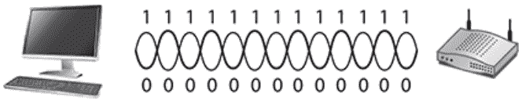

图 15-1 无线电波表示正在传输的数据（1 和 0）。

当系统在无线网络上发送数据时，计算机无线网卡中内置的收发器将数据（1 和 0）编码为无线电波。收发器随后将数据传递到设备上的无线天线，通过空气将无线电波发送到接收设备，接收设备的天线接收无线电波并将其传递给收发器。然后收发器将无线电波转换为数据（1 和 0），供接收设备读取。

## 无线概念

创建无线网络使用多种网络组件。在本节中，我们将介绍您需要熟悉的常见组件。

## 无线接入点

WAP 设备，通常简称为接入点，为您的网络添加无线功能。它负责发送和接收无线电波，以使无线设备能够与局域网（LAN）上的其他设备通信。无线设备（例如笔记本电脑）向 LAN 上的设备（例如打印机）发送数据，先将数据无线发送到无线接入点，接入点再将数据转发给连接到有线网络的设备（打印机）。图 15-2 显示了使用 WAP 的典型网络设置。

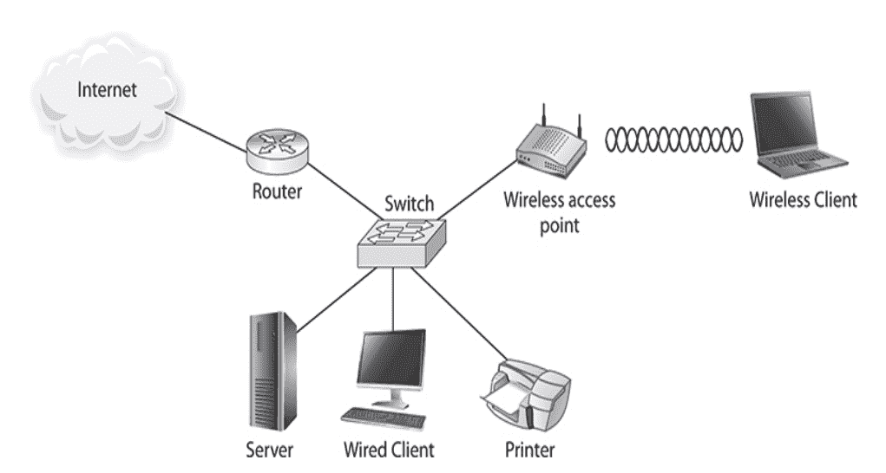

图 15-2 WAP 使无线设备能够与 LAN 通信。

## 无线客户端

无线客户端是指安装了无线网卡并能与 RF 信号通信的任何设备。无线客户端示例包括笔记本电脑、智能手机、平板电脑以及任何安装了无线网卡的其他设备。无线客户端（也称为无线站）通常通过 WAP 连接到网络。

要将无线客户端连接到无线网络，您需要一个 WAP，它拥有天线，可在无线客户端和接入点之间发送和接收无线信号，但接入点也连接到有线网络，以便无线客户端可以访问有线网络上的资源。大多数家庭用户都有无线路由器，它既执行接入点的功能，还包括网络地址转换（NAT）、网络防火墙和动态主机配置协议（DHCP）服务等其他功能。虽然大多数 IT 人员将无线接入点和无线路由器的术语混用，但从技术上讲它们是不同的设备。无线接入点专注于为无线客户端提供连接，而无线路由器也提供此功能，但还提供刚才提到的其他服务。

## 无线局域网控制器

拥有多个接入点（AP）的企业网络可以使用无线局域网控制器（WLC）从中心点配置多个 AP。如果您配置 WLC 使用中心 Remote Authentication Dial-In User Service（RADIUS）服务器，WLC 还可以为网络上所有 AP 提供集中式身份验证。

WLC 与 AP 以相同方式连接到网络——它们都连接到网络交换机，交换机是网络上的有线设备（即，不是无线连接）。一旦所有 AP 和 WLC 都连接到网络，WLC 就可用于向 AP 部署配置设置或执行其他管理任务，例如软件升级。

图 15-3 展示了 WLC 和 AP 在网络上可能的部署位置示例。请注意 2、3、4 楼的 AP，它们为这些楼层上的设备提供无线访问。另请注意，每个 AP 都通过有线以太网连接到交换机；此交换机称为 *分发系统*（DS）。DS 可以是专用于 WAP 连接的交换机，也可以是所有其他有线设备连接的有线网络交换机。请注意，Cisco 9300 交换机可以在其上安装 WLC 控制器软件，因此如果您在分支机构使用 9300 交换机，则可以部署分支 WLC，无需任何额外硬件。

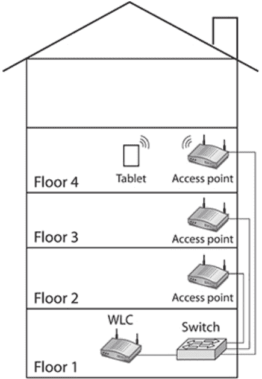

图 15-3 接入点和无线局域网控制器连接到交换机。

每个 AP 都有自己的管理 IP 地址，您可以远程连接到该 AP 并更改配置设置。或者，您可以将 WLC 添加到网络中，用于集中管理所有 AP 的配置。请注意，在图 15-3 中，WLC 位于 1 楼，也连接到交换机，即分发系统。

WLC 上连接到交换机（分发系统）的端口是 *分发端口*。由于 WLC 通过该端口发送大量数据，包括 CAPWAP（Control and Provisioning of Wireless Access Points，无线接入点控制与提供）隧道中发往 AP 的流量以及来自无线客户端的流量，因此 WLC 常拥有多个分发端口，用于将 WLC 连接到分发系统（交换机）。这些分发端口始终作为中继端口（而非接入端口）运行，因为它们需要承载所有虚拟局域网（VLAN）的流量。还常将分发端口组合为 *链路聚合组*（LAG），以聚合组内所有端口的带宽。LAG 还为端口提供负载均衡，确保没有任何一个端口过载；如果某个端口失效，组内其他端口可通过链路容错处理工作负载。

## 综合起来

让我们来看看一个典型的无线网络设置，使用 AP 为网络上属于不同 VLAN 的客户端提供网络访问。在图 15-4 中，您可以看到一个包含两个 VLAN 的 Cisco 交换机：VLAN 10 供会计部门使用，VLAN 20 供营销部门使用。

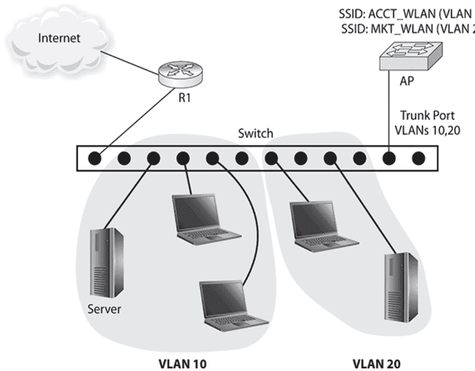

图 15-4 单个 AP 提供多个无线网络

为每个部门提供无线访问，我们将接入点连接到交换机，但请注意，图中的接入点连接的是位于两个 VLAN 之外的端口。这是因为我们需要 AP 转发两个 VLAN 的流量。因此，我们将 AP 连接到交换机，并将 AP 连接的端口配置为中继端口，以便它能够承载 VLAN 10 和 VLAN 20 的流量。

要配置 AP，您可以通过 CLI 或 Web GUI 连接到 AP 并配置两个 *服务集标识符*（SSID）。SSID 是客户端在看到可用网络列表时会选择的无线网络名称；即客户端将连接的无线网络。每个 AP 可以提供多个无线网络或多个 SSID。在我们的示例中，我们为会计部门配置一个 SSID（ACCT_WLAN），为营销部门配置一个 SSID（MKT_WLAN），然后将每个 SSID 分配给相应的 VLAN。

## 天线类型

典型的无线网络环境涉及使用带有连接天线的 WAP，通过空气传输无线电信号。新的 CCNA 考试期望您了解无线技术使用的这些类型的无线天线：

- **全向** 向所有方向发送无线电信号，以覆盖广泛的范围或区域。
- **半向** 向单一方向发送无线电信号，但该方向上的信号覆盖范围广泛。您可以将其比作向下照射但覆盖下方广阔区域的路灯。半向天线的示例是设施中的走廊无线天线。
- **高度定向** 也称为 *单向*，此天线向单一方向发送无线电信号，覆盖非常小的区域。回到光的比喻——您可以将其比作聚光灯照射时覆盖小区域的方式。高度定向天线可用于医院或仓库的长走廊，覆盖狭长、窄小、封闭的空间。

此外，一些常见做法可以帮助覆盖无线网络所需的区域并控制与无线网络的连接。通过操纵天线特性，几种方法可以帮助实现无线网络的区域覆盖和安全性。

为了获得更好的性能和区域覆盖，请尝试保持天线之间的视线通畅。虽然这不是必需的，但请记住，越多

信号需要穿越的物体越多，信号就会越弱。另外，请确保 WAP 上的天线与无线客户端保持合理距离。如果客户端太远，可能无法连接。从安全角度来看，你希望通过将 WAP（及其天线）放置在建筑物中心来限制谁可以连接到你的无线网络。请记住，如果将 AP 放置在靠近建筑物外墙的位置，建筑物外部的人员可能会连接到你的无线网络。

你还可以更改 AP 上的功率电平来控制信号强度。如果客户端因为太远而无法连接到 AP，你可以通过提高 AP 功率电平来解决问题，这会增强信号，使其传输距离更远。从安全角度来看，请注意，最好*降低*功率电平，以便信号范围不会超出建筑物墙壁。

## 无线网络类型

你可以创建两种主要的无线网络模式：特设模式或基础设施模式。这些模式各自被称为无线模式，并且各有优势。

使用*特设模式*时，无线设备（如笔记本电脑）会在对等环境中连接到其他无线设备，而不需要 WAP。使用*基础设施模式*时，无线客户端连接到一个中心设备，即 WAP。无线客户端将数据发送到 AP，然后 AP 将数据转发到目标（如图 15-5 所示）。如前所述，无线客户端连接到 AP 后，可以访问有线网络上的网络资源，因为 AP 已连接到有线网络。

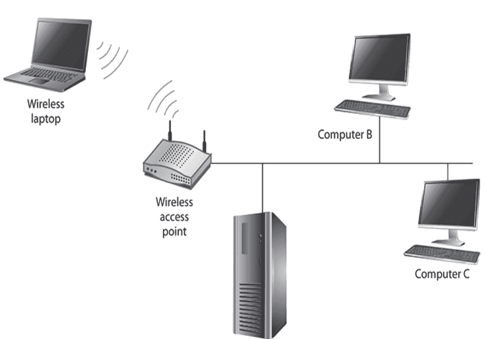

图 15-5 运行在基础设施模式下的典型无线网络

特设模式的优势是你不需要购买 AP；基础设施模式的好处是，当你使用 WAP 时，你可以控制谁可以连接到无线网络，并且许多设备可以同时连接到 AP 以共享信息。

## 无线术语

为了 Cisco CCNA 考试，你需要熟悉许多其他无线术语和概念。其中一些术语在本章中已经提到过：

### 基本服务集 (BSS)

这指的是只有一个 AP 的无线网络。所有无线客户端都连接到该单个 AP 以访问网络。

### 基本服务集标识符 (BSSID)

这是 WAP 的 MAC 地址。当你使用无线安全工具来评估无线网络的安全性时，你会注意到这些工具使用“BSSID”标签来标识 AP MAC。当你使用许多命令行安全工具时，你通常使用 --bssid 开关来指定正在测试的 AP。

### 服务集标识符 (SSID)

这是无线网络的名称。配置 AP 时，你需要通过设置 SSID 设置来配置无线网络的名称。

### 分布式系统 (DS)

这是将 AP 连接到 LAN 的网络交换机。

### 扩展服务集 (ESS)

在较大的组织中，办公环境跨越大面积区域（如多个楼层或多个建筑物），你可能无法为所有无线客户端提供单个 AP 服务（即 BSS），因为它们在地理上分布很广。在这种情况下，你需要设置一个 ESS，它由多个配置了相同 SSID 的接入点组成，这些接入点分布在建筑物的不同位置，以服务该区域内的无线客户端。

创建 ESS 需要满足以下条件：

- 每个 AP 必须配置相同的 SSID。
- 每个 AP 必须配置不同的、非重叠的信道。
- AP 必须覆盖重叠 10% 的区域，以便漫游的无线客户端不会丢失连接。

图 15-6 对比了 BSS 与 ESS。

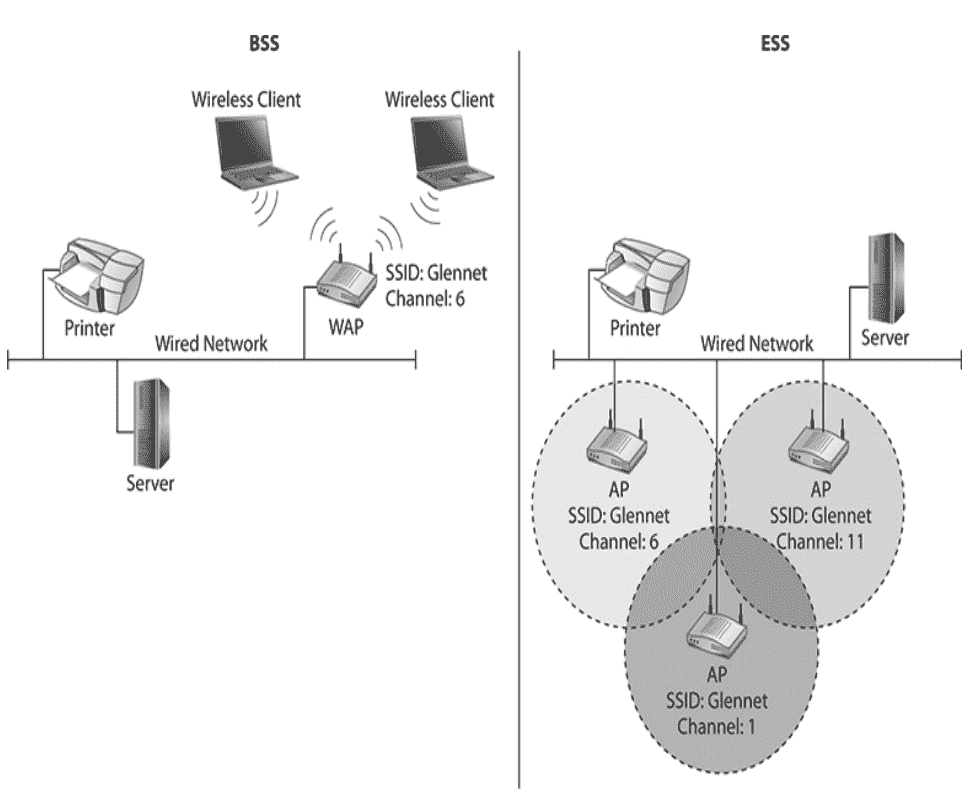

图 15-6 BSS 与 ESS 的对比

**考试提示** 请务必了解本节讨论的无线术语，以备 CCNA 考试之用。

## 无线标准

电气和电子工程师学会（IEEE）委员会已在 802 项目模型中开发了无线网络的无线标准。无线及多个标准由 802.11 项目模型定义。

### 802.11a

802.11a 无线标准是一个较旧的标准，运行在 5 GHz 频率上。802.11a 设备可以以 54 Mbps 传输数据，且与 802.11b 和 802.11g 设备不兼容。

**考试提示** 考试时请记住，802.11a 是早期的无线标准，其运行频率与 802.11b 和 802.11g 不同。这使其与 802.11b/g 不兼容。请记住，802.11a 定义了在 5 GHz 频率下以 54 Mbps 运行的无线环境。

### 802.11b

802.11b 无线标准的传输速率为 11 Mbps，使用 2.4 GHz 频率。这些设备与 802.11g/n 设备兼容，因为它们运行在相同频率上并遵循 Wi-Fi 标准。

**考试提示** 请注意，802.11b 运行在 11 Mbps，而 802.11g 运行在 54 Mbps。802.11n 标准设计用于高达 600 Mbps！

### 802.11g

802.11g 无线标准是一个较新的标准，设计用于与 802.11b 兼容，但也提高了传输速率。802.11g 设备的传输速率为 54 Mbps，使用 2.4 GHz 频率。

所有 802.11g 设备都与 802.11b/n 设备兼容，因为它们都遵循 Wi-Fi 标准并运行在相同的 2.4 GHz 频率上。

### 802.11n

802.11n 无线标准于 2009 年末推出。802.11n 的目标是提高传输速率，超越当前标准（如 802.11g）所支持的速率。802.11n 支持高达 600 Mbps 的传输速率。

为了帮助实现这一点，802.11n 引入了两个新功能：多输入多输出 (MIMO) 和信道绑定。MIMO 使用多个天线来实现比单个天线更多的吞吐量。信道绑定使 802.11n 能够通过两个非重叠信道传输数据，以实现更多吞吐量。802.11n 设计为与 802.11a、802.11b 和 802.11g 向后兼容，并可以在 2.4 GHz 或 5 GHz 频率下运行。

**考试提示** 当今的无线网络称为 Wi-Fi，即无线保真。802.11b、802.11g 和 802.11n 都是 Wi-Fi 标准的一部分，因此彼此兼容。

### 802.11ac

802.11ac 无线标准于 2014 年获批，被认为是一种在 5 GHz 频率范围内运行的高吞吐量无线标准。802.11ac 标准通过增加信道宽度并提供与 802.11n 标准类似的功能（例如 MIMO 和多用户 MIMO (MU-MIMO)）来实现潜在的 1 Gbps 吞吐量，后者涉及启用多个发射器同时发送独立信号，并让多个接收器同时接收独立信号。

大多数 802.11ac 无线路由器都带有通用串行总线 (USB) 3.0 端口，你可以在其中连接外部硬盘驱动器到无线路由器，并向客户端流式传输高清视频。

重要的是要注意，802.11a 是无线网络的早期实现，与早期的 Wi-Fi 网络（如 802.11b 和 802.11g）不兼容。作为兼容性的一个示例，我的家庭无线网络有一个是 802.11g 设备的 AP，但我的一台旧笔记本电脑有一张 802.11b 无线网卡。我的旧笔记本电脑可以在网络上通信，因为这两个标准彼此 100% 兼容。在此示例中，带有 802.11b 网卡的笔记本电脑只能以 11 Mbps 连接，而带有 802.11g 网卡的我的新笔记本电脑可以以 54 Mbps 连接。

## 需记住的有关无线标准的关键点

表 15-1 概述了 CCNA 认证考试中你需要熟悉的不同无线标准的关键点。

| 标准 | 802.11a | 802.11b | 802.11g | 802.11n | 802.11ac |
|---|---|---|---|---|---|
| 频率 | 5 GHz | 2.4 GHz | 2.4 GHz | 5/2.4 GHz | 5 GHz |
| 传输速率 | 54 Mbps | 11 Mbps | 54 Mbps | 高达 600 Mbps | 1 Gbps |
| 范围 | 150 英尺 | 300 英尺 | 300 英尺 | 300 英尺 | 300 英尺，但吞吐量更高 |
| 兼容性 | 802.11a | 802.11g/n | 802.11b/n | 802.11a/b/g | 802.11a/b/g/n |

表 15-1 不同无线标准的对比

**考试提示** 请记住，随着你与 WAP 距离的增加，无线传输速度会降低。

## 信道

你已经读到 802.11b/g/n/ac 全部在 2.4 GHz 频率下运行，但你还应该理解，2.4 GHz 是一个频率范围。每个频率

在范围内被称为一个 *信道*。本讨论侧重于 2.4 GHz 频率，它也使用信道，但我们将首先关注 2.4 GHz 频率，因为存在彼此重叠的信道。使用彼此重叠的信道可能会导致无线网络出现干扰和不稳定。

大多数无线设备允许您指定要使用的信道。这很重要，因为如果您的无线网络经常出现故障，可能是无线设备与您所在区域的其他无线设备发生冲突或干扰。一个很好的例子是无绳电话；它们可能在 2.4 GHz 范围内运行，并可能导致您的无线网络出现问题。作为解决方案，您可以更改 WAP 和客户端上的信道，这会更改频率——希望能防止与其他家用物品发生任何冲突。请注意，现代无绳电话遵循 DECT 6 标准，该标准将通信移至 1.9 GHz 频段，解决了无绳电话干扰问题。

表 15-2 列出了不同信道使用的不同频率。

| 信道 | 频率范围 |
|---|---|
| 1 | 2.3995 GHz–2.4245 GHz |
| 2 | 2.4045 GHz–2.4295 GHz |
| 3 | 2.4095 GHz–2.4345 GHz |
| 4 | 2.4145 GHz–2.4395 GHz |
| 5 | 2.4195 GHz–2.4445 GHz |
| 6 | 2.4245 GHz–2.4495 GHz |
| 7 | 2.4295 GHz–2.4545 GHz |
| 8 | 2.4345 GHz–2.4595 GHz |
| 9 | 2.4395 GHz–2.4645 GHz |
| 10 | 2.4445 GHz–2.4695 GHz |
| 11 | 2.4495 GHz–2.4745 GHz |
| 12 | 2.4545 GHz–2.4795 GHz |
| 13 | 2.4595 GHz–2.4845 GHz |

## 表 15-2 不同 Wi-Fi 信道及其工作频率范围

查看 2.4 GHz 频率中重叠信道的图示时，您可以看到可以使用三个主要不重叠信道——信道 1、6 和 11。

查看图 15-7，您可以看到信道 1、6 和 11 彼此不重叠。因此，如果您要在 2.4 GHz 频率内创建多个无线网络，可以先将一个网络放在信道 1 上，另一个放在信道 6 或 11 上。请记住，您周围有其他无线网络，因此如果您的无线网络遇到干扰，可能是因为您附近的其他无线网络正在使用同一信道。尝试更改无线网络的信道以提高网络稳定性。

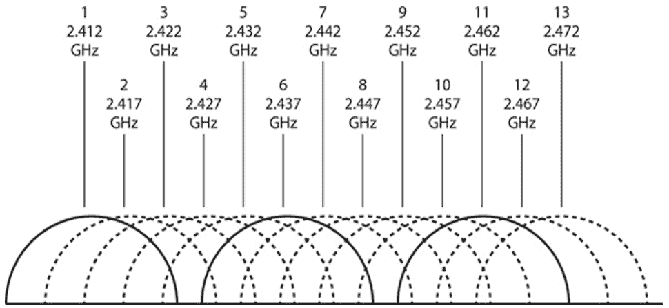

图 15-7 信道 1、6 和 11 不重叠。

## 使用不重叠信道

排查无线网络时请记住，您可能会受到其他无线设备和家用设备（例如无绳电话或运行在同一信道上的蓝牙设备）的干扰。要解决此问题，请尝试更改无线网络使用的信道以减少接收到的干扰量。如表 15-2 所示，相邻信道具有重叠频率并会相互干扰，因此从信道 2 更改到信道 1 无法解决干扰问题，但从信道 2 更改到信道 6 可能可以。

**提示** 为避免其他家用物品对无线网络造成干扰，请尝试购买运行频率不同于 2.4 GHz 的物品（例如无绳电话）。如果无线网络出现问题，您可以尝试更改无线设备上的信道，看看不同的信道是否更可靠。还请注意，其他非无线设备（例如微波炉）可以通过在 2.4 GHz 频率范围内产生噪声信号来造成干扰。

信道具有特定的“宽度”，该宽度允许特定数量的数据通过信道（称为 *带宽*）。此处要指出的是，具有更大信道带宽的无线标准将能够传输更多数据并提供更好的性能。例如，802.11g 的信道带宽为 20 MHz，而 802.11n 的信道带宽可达 40 MHz（在 5 GHz 频率下运行时）。增加信道带宽是较新无线标准提供更高传输速率的方式。以下列出了每个标准的信道带宽：

- 802.11a: 20 MHz
- 802.11b: 22 MHz
- 802.11g: 20 MHz
- 802.11n: 20 or 40 MHz
- 802.11ac: 20, 40, 80, or 160 MHz

## 无线安全协议

多年来，已开发出多种无线身份验证和加密协议，以帮助保护您的无线网络。您应考虑在无线网络上实施这些协议。

## 有线等效隐私

有线等效隐私 (WEP) 旨在为无线世界提供与有线网络世界相当的安全级别。在有线世界中，有人必须身处您的办公室才能将电缆连接到您的网络，但对于无线网络，当然情况并非如此。有人可以坐在您大楼外的停车汽车里并连接到您的无线网络。

要使用 WEP 配置无线网络，您只需在 WAP 上指定一个共享密钥或通行短语即可。其原理是，如果有人想连接到您的无线网络，他们需要知道共享密钥，并需使用该密钥配置其工作站。当您在 AP 和客户端上配置共享密钥时，客户端和 AP 之间发送的任何数据都会使用 WEP 进行加密。这将防止未经授权的个人截获传输中的数据并读取它。

请注意，WEP 在其实现加密和密钥使用方面存在巨大缺陷，因此，64 位和 128 位 WEP 都很容易被破解。出于安全考虑，除非您拥有不支持 WPA 或 WPA2 的旧版 AP，否则不应使用 WEP。

## Wi-Fi 保护访问

Wi-Fi 保护访问 (WPA) 的设计旨在改进无线安全并修复 WEP 中的一些缺陷。WPA 使用 128 位密钥和临时密钥完整性协议 (TKIP)，该协议用于更改每个发送数据包的加密密钥。这将使黑客更难破解密钥，而使用 WEP 破解密钥非常容易。WPA 使用 RC4 作为对称加密算法，这就是为什么 WPA 有时被称为 TKIP-RC4（如 CCNA 目标中所述）。

WPA 相较于 WEP 还有许多其他改进；例如，它具有改进的完整性检查，并支持使用可扩展身份验证协议 (EAP) 进行身份验证，EAP 是一种非常安全的身份验证协议，支持多种身份验证方法，例如 Kerberos、令牌卡、证书和智能卡。

EAP 消息被封装在 IEEE 802.1X 数据包中，用于有线或无线网络的网络访问身份验证。当使用 IEEE 802.1X 控制对无线网络的访问时，无线客户端会尝试连接到 WAP；AP 会向客户端请求身份证明，然后将其转发到 RADIUS 服务器进行身份验证。

多年来，EAP 发展出了许多变体：

- **LEAP** 轻量级可扩展身份验证协议是 Cisco 在 IEEE 创建 802.1X 之前创建的专有 EAP 解决方案。
- **PEAP** 受保护的可扩展身份验证协议用于通过使用传输层安全协议 (TLS) 的安全隧道封装 EAP 消息。因为 EAP 假设数据包通过安全网络发送，所以使用 PEAP 时，TLS 用于在两个点之间创建安全隧道。
- **EAP-FAST** EAP-FAST 是 Cisco 设计用于替代 LEAP 的身份验证协议。EAP-FAST 通常用于为无线网络提供身份验证服务。
- **EAP-TLS** EAP-TLS 是用于在无线网络上进行安全身份验证的 EAP 协议，该协议使用 TLS 安全性。EAP-TLS 解决方案通常涉及使用客户端证书来执行身份验证。
- **EAP-TTLS** EAP-TTLS (EAP-隧道式传输层安全协议) 在 EAP-TLS 的基础上开发，具备同时验证客户端和服务器的功能，尽管客户端不需要使用证书进行身份验证。在使用服务器证书建立安全信道后，服务器可以对客户端进行身份验证。

在无线网络上配置 WPA 时，请注意 WPA 有三种不同的模式——WPA 个人版、WPA 企业版和开放模式：

- **WPA 个人版** 使用 WPA 个人版（又称 WPA-PSK，即 WPA 预共享密钥），您可以使用一个起始密钥值（称为预共享密钥）配置 AP，然后用于加密流量。此模式最常由家庭用户和小型企业使用。
- **WPA 企业版** WPA 企业版（又称 WPA-802.1X）是一种 WPA 实现，它使用集中式身份验证服务器（例如 RADIUS 服务器）进行身份验证和审计功能。大型组织使用 WPA 企业版，以便他们可以使用其

现有身份验证服务器以控制谁有权访问无线网络并记录网络访问。

- **开放** 开放式无线网络连接不需要任何密码，也不使用任何形式的加密来防止无线数据被窥探者窃取。当然，不建议让您的无线网络保持开放状态（您应该实现 WPA2），也不建议将您的客户端系统连接到您不熟悉的开放网络。

**考试提示** CCNA 认证考试将测试您对 WPA、WPA2、WPA3 和开放网络等不同安全协议的了解。请务必始终实施设备支持的最安全方法；这通常是 WPA2。

## WPA2

WPA2 改进了 WPA 的安全性，如果有选择，应使用 WPA2 而非 WPA。WPA2 在 WPA2 无线网络上使用带有密码块链消息身份验证码协议的计数器模式（CCMP 或 CCM 模式协议）来实现数据隐私、完整性和身份验证。WPA2 使用与高级加密标准（AES）协议（有时也称为 CCMP-AES）结合的 CCMP 来加密无线流量，而不使用 TKIP，并支持其他功能，例如对自组网络和密钥缓存的附加保护。因为 WPA2 将 AES 用作其加密协议，所以它支持 128 位、192 位和 256 位加密。

WPA2 还通过使用 EAP 支持 TLS 和 TTLS 协议。这些协议被称为 EAP-TLS 和 EAP-TTLS，它们提供在无线网络上执行身份验证的安全方法。

## WPA3

WPA3 是 WPA 的最新版本，于 2018 年开发，正在逐渐被制造商采用。因为 WPA3 相当新，您可能只在较新的无线设备上将其作为选项。WPA3 通过引入一些新功能，改进了 WPA2 的安全性：

- 它通过使用 256 位 Galois/计数器模式协议（GCMP-256）进行数据加密来改进加密。
- 同时身份验证对等体（SAE）是 WPA3 的一项功能，它通过允许接入点对客户端进行身份验证，并允许客户端对接入点进行身份验证来提高安全性。这种更强的身份验证方法有助于防止 WPA2 中常见的握手流量窃听和破解。
- WPA3 的加密过程使用会话密钥，旨在保护用户，即使两者都使用了相同的 Wi-Fi 密钥，也无法解密另一用户的流量。

**考试提示** 请务必熟悉 CCNA 考试的不同无线安全协议。

## Cisco 无线架构

在设计无线网络时，您可以使用不同的 Cisco 无线架构以及不同的 Cisco WAP 模式。并且，您可以连接到 AP 以执行远程管理。

### 无线架构

您可以以不同方式设置 Cisco 无线网络：每种设置称为无线架构。某些无线架构很简单，仅涉及一个 WAP，而其他架构则拥有 WLC 以帮助管理多个 AP 上的无线设置。

## 无线安全实践

### 身份验证和授权

CCNA 考试期望您熟悉通过*身份验证*和*授权*控制谁可以访问无线网络的技术。

### 共享或开放

开放式无线网络（也称为共享网络）不实施任何方法来控制谁可以访问网络。它是所有无线网络类型中安全性最低的一种。

### 预共享密钥

您可以通过在个人模式下配置 WPA2 或 WPA3 等加密协议，然后指定加密密钥（也称为预共享密钥）来控制谁可以访问无线网络。任何想要连接到您的无线网络的设备都需要配置此加密密钥。

### MAC 过滤

除了使用预共享密钥外，您还可以配置 MAC 过滤，该功能根据 MAC 地址授权谁可以访问网络。请记住，可以使用许多工具来监控无线流量并查看连接到接入点的授权客户端的 MAC 地址。攻击者随后可能会伪造 MAC 地址以绕过 MAC 过滤功能。

### 802.1X

在企业模式下使用 WPA2/WPA3 时，必须在接入点或 WLC 的配置中指定 RADIUS 或 TACACS+ 服务器的 IP 地址。这意味着接入点/WLC 会将客户端转发到 RADIUS 服务器进行身份验证，然后才授予其访问网络的权限。802.1X 的好处是，您可以不仅通过预共享密钥来验证用户身份，还可以使用用户名和密码针对中央身份验证服务进行身份验证。

### 自主架构

在自主架构模型下，您的 Cisco 无线网络由独立的 AP 组成，通常使用 AP 的 GUI 单独进行管理。每个 AP 可以提供一个或多个 SSID，每个 SSID 关联到不同的 VLAN。

使用此模型，每个 SSID 关联到一个 VLAN，并且 AP 使用中继端口连接到交换机。中继端口被配置为承载每个 VLAN 的所有流量。

在这种情况下，如果您需要向所有 AP 添加新的无线网络（SSID），则必须单独配置每个 AP，因为它们各自独立运行。

### 分布式 MAC 架构

分布式 MAC 架构提供了一个更集中的模型，其中使用 WLC 将配置部署到每个 AP。在这种情况下，AP 称为轻量级接入点（LAP），因为它们从 WLC 接收配置，而不是直接配置。

在此模型中，WLC 用于部署配置设置，例如要使用的无线电频率、服务质量（QoS）设置、任何涉及 TACACS+/RADIUS 服务器配置的身份验证、授权和计费（AAA）设置以及策略设置。

在分布式 MAC 架构模型中，无线接入点控制和配置协议（CAPWAP）是一种安全的私有隧道，用于在 WLC 和 LAP 之间传输通信。WLC 和 LAP 之间的所有通信都通过 CAPWAP 进行。实际上有两条隧道：一条用于控制通信，另一条用于数据：

- 控制通道承载命令，默认情况下是加密的。CAPWAP 控制通道使用 UDP 5246。
- 数据通道默认情况下不加密，但可以加密。CAPWAP 数据通道使用 UDP 5247。

### 基于云的架构

在基于云的架构中，WLC 不是您物理网络上的设备，而是由云提供商提供并驻留在云端。基于云的 WLC 提供与连接到您的 LAN 的 WLC 相同的功能，但您可以获得由云提供商管理的云设备的优势。基于云的架构模型包括 Cisco Meraki 许可证和 Cisco Catalyst 9800-CL，它们为无线网络提供 WLC 功能。

### WLC 定位

您需要了解 WLC 在网络中扮演的角色，以便了解应将 WLC 物理放置在何处。架构类型包括集中式 WLAN、Cisco FlexConnect 模式和融合式 WLAN。

### 集中式 WLAN 架构

在集中式 WLAN 架构中，您使用 WLC 来管理 LAP。所有发往 LAP 的通信都必须通过 WLC 以验证通信是否经过授权（请记住，WLC 可以提供 AAA 功能）。这意味着，当数据从一个无线设备传输到另一个无线设备时，连接到 LAP 的两个无线客户端之间的通信必须经过 WLC（然后再返回）。如果 WLC 与 LAP 之间物理距离较远，这可能会导致延迟甚至中断问题。

应仔细考虑 WLC 的位置。如果您将 WLC 放置在与 LAP 相对的网络端，则承载 LAP 和 WLC 之间流量的 CAPWAP 隧道必须穿越网络，从而导致延迟。此外，因为 LAP 必须能够与 WLC 通信，如果在集中式 WLAN 架构中 WLC 或 CAPWAP 隧道出现故障，则无线设备将被断开网络连接（即使 LAP 正常工作）。您可以通过更改 AP 上的模式（稍后介绍）或将 WLC 放置在更靠近 LAP 的位置来解决此问题。

### Cisco FlexConnect

思科 FlexConnect 模式在 LAP 上允许 LAP 直接将数据传输到 LAN，而无需将数据通过 WLC 传输。此外，LAP 可以对客户端进行身份验证，以便客户端获得无线访问权限，而在集中式模型中，所有身份验证均由 WLC 执行。使用思科 FlexConnect 模式时，如果 CAPWAP 隧道失败，LAP 仍能正常工作，因为它们拥有自身的配置，并被授权将流量传递到网络并对无线客户端进行身份验证。当您的 WLC 位于总部且分支机构部署有 LAP 时，思科 FlexConnect 模式是一种常用选择。

## 汇合式 WLAN 架构

为确保 WLC 与 LAP 之间的通信高效且可靠，在汇合式 WLAN 架构中，WLC 和 LAP 连接到同一台交换机。这些交换机可以是接入层交换机或分布层交换机。这样，LAP 可以通过交换机与 WLC 快速通信，而无需流量跨越整个网络。在汇合式 WLAN 架构中，您需要为网络的不同部分部署多个 WLC。其优势在于 CAPWAP 隧道在 LAP 与其 WLC 之间的距离更短。这种拓扑结构可实现更快的 Wi-Fi 访问，延迟更少。

## AP 模式

您刚刚了解到可以更改 AP 模式以修改 AP 的使用方式和操作方式。对于 CCNA 考试，您需要熟悉这里列出的多种不同的接入点模式。

### 本地模式

这是 LAP 的默认模式，涉及我们之前描述的内容：LAP 与 WLC 之间建立 CAPWAP 隧道，所有流量必须通过 CAPWAP 传输到 WLC。如果 CAPWAP 失败，该 LAP 上的所有无线客户端都会断开连接。

### 桥接模式

当您希望使用 AP 连接两个网络（例如相距较远的两栋楼的网络）时，会使用此模式。在这种场景中，充当桥梁的 AP 已对远程无线网络进行身份验证，但远程建筑中的设备未经过验证。

### FlexConnect 模式

在此模式下，LAP 位于分支机构，而 WLC 位于总部。LAP 可以在客户端与 LAN 之间直接转发流量，而通常情况下流量需要发送到 WLC。这是一项重要功能，因为它减少了因通过 WAN 发送流量到达 WLC 而导致的网络延迟。在 FlexConnect 模式下，LAP 还可用于对无线客户端进行身份验证和授权。请记住，在 FlexConnect 模式下，即使 CAPWAP 隧道失败，LAP 仍能正常工作。

### Mesh 模式

此模式代表另一种特殊场景模式，其中一个 WAP 连接到另一个 WAP，本质上充当无线网络的扩展器。当无线客户端连接并将数据发送到 LAN 时，数据可能在到达 LAN 之前经过多个 Mesh 节点。Mesh 节点（Mesh 拓扑中的 AP），也称为 Mesh 接入点（MAP），使用自适应无线路径协议（AWPP）来确定到根接入点（RAP）的最佳路径。

### 监听模式

此模式用于监控连接到网络的非法 AP 的活动。以监听模式运行的 AP 不会发送无线信号，而仅接收无线信号以检测非法 AP。

### 抓包模式

要分析无线流量，您可以将 AP 配置为抓包模式。配置抓包模式后，AP 将捕获无线流量并将其发送到远程计算机进行分析。

**考试提示** 务必了解 Cisco CCNA 认证考试所需的 AP 模式。

## 管理访问连接

在管理或配置 WAP 或无线 LAN 控制器时，您可以使用 CLI 或 Web 界面。

### 从 CLI 管理

您可以通过设备上的控制台端口进行本地管理，或者如果已启用使用 Telnet 或安全外壳（SSH）的远程管理，则可以使用这些协议来通过 CLI 管理 AP 或 WLC。对于许多 AP 和无线控制器，您可以连接到本地控制台端口以从 CLI 配置设备。当然，这假设您可以本地访问设备。您还可以在 AP 或无线 LAN 控制器上启用 Telnet 或 SSH，以便从网络远程管理设备。如您在后续章节中将了解到的，应优先使用 SSH 而不是 Telnet，因为 SSH 会加密通信。

### 从 Web 界面管理

如果您不希望使用 CLI 配置 WAP 或 WLC，可以通过连接到设备的管理 IP 地址来使用 Web 界面。使用 HTTP（非安全）或 HTTPS（安全）配置 AP 或 WLC，包括配置 Telnet 或 SSH、配置 RADIUS 用于集中身份验证或创建无线网络等（这只是几个配置选项示例）。

### TACACS+/RADIUS

您可以配置 AP 或 WLC 以使用 TACACS+ 或 RADIUS 等身份验证服务。您将在接下来的几章中了解更多有关身份验证服务的信息，但目前需要知道，您可以要求 AP 或 WLC 让连接的人通过外部身份验证系统（TACACS+ 或 RADIUS 服务器）进行身份验证。

## 使用 GUI 配置无线

新的 Cisco CCNA 考试要求您了解创建和配置无线 LAN 以及安全设置和 QoS 设置等设置的步骤。在本节中，您将学习在 WLC 上配置无线网络的步骤。

我应该指出，许多 WLC 都有一个服务端口，这是一种带外管理端口，您可以使用它连接到 WLC 并配置设备。还有一个已分配 IP 地址的管理接口，您也可以使用它远程管理 WLC 设备。如果您无法连接到管理接口，服务端口是管理设备的一个良好备份方法。

## 创建 WLAN

配置 WLAN 控制器的第一步是创建 WLAN。您需要将 WLAN 连接到 WLC 上的动态接口，该接口可使 WLAN 绑定到有线网络上的 VLAN。

### 创建动态接口

我们的第一项任务是创建动态接口，该接口用于将 WLAN 与交换机上的 VLAN 相关联。步骤如下：

- 1. 使用 Web 界面登录到 WLC。
- 2. 在页面顶部选择 Controller。
- 3. 从左侧导航窗格中选择 Interfaces。
- 4. 单击右上角的 New 按钮以创建新接口。
- 5. 输入接口名称，例如 ACCT。
- 6. 指定要将接口连接到的 VLAN ID。例如，您可以指定 10（即 VLAN ID 10）。
- 7. 为接口配置 VLAN 网络范围内的 IP 地址。

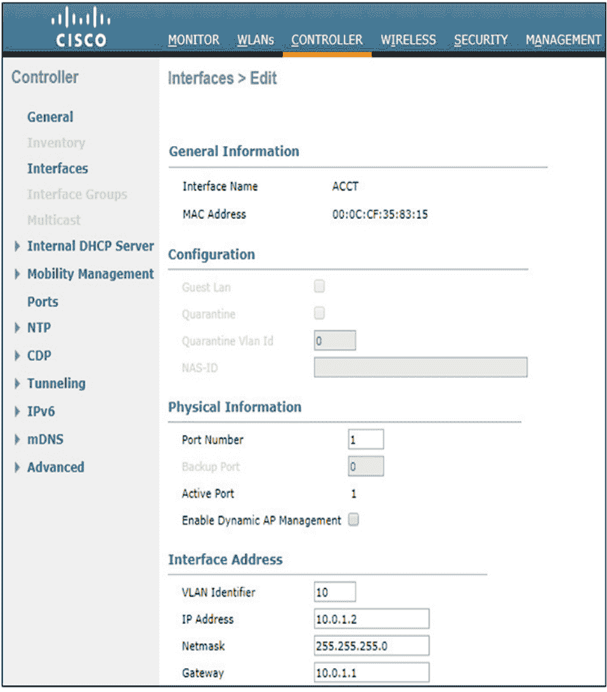

### 创建 WLAN

您的下一项任务是在 WLC 中创建将绑定到该接口的 WLAN 对象。执行以下步骤：

- 1. 从顶部导航中单击 WLANs 链接。
- 2. 从右上角的下拉列表中选择 Create New，然后单击 Go。

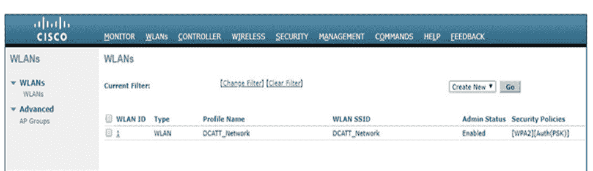

- 3. 输入 WLAN 的配置文件名称，例如 ACCT。
- 4. 输入无线 LAN 的 SSID，例如 ACCT。
- 5. WLAN 在 WLC 中被分配了唯一 ID。单击 Apply。

单击 Apply 后，您将看到 WLAN 的配置屏幕，可以在其中更改常见设置，例如 SSID、WLAN 分配到的 WLC 上的动态接口，以及是否要广播 SSID。请注意，在下图中，我已将 ACCT 无线网络分配给了在上一步中创建的名为 ACCT 的动态接口。

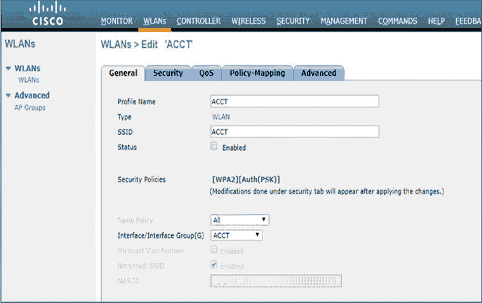

### 安全设置

在修改 WLAN 配置时，您可以选择 Security 选项卡来更改 WLAN 的安全设置。

- 1. 在屏幕顶部选择 Security 选项卡。
- 2. 选择 WPA+WPA2 作为第 2 层安全协议。
- 3. 在 WPA+WPA2 Parameters 部分中选择 WPA2 Policy。
- 4. 然后可以选择 AES 作为 WPA2 Encryption 类型。
- 5. 选择 PSK（预共享密钥）作为身份验证密钥管理类型。
- 6. 选择 ASCII 作为 PSK Format。
- 7. 输入所需的预共享密钥（无线密码）。

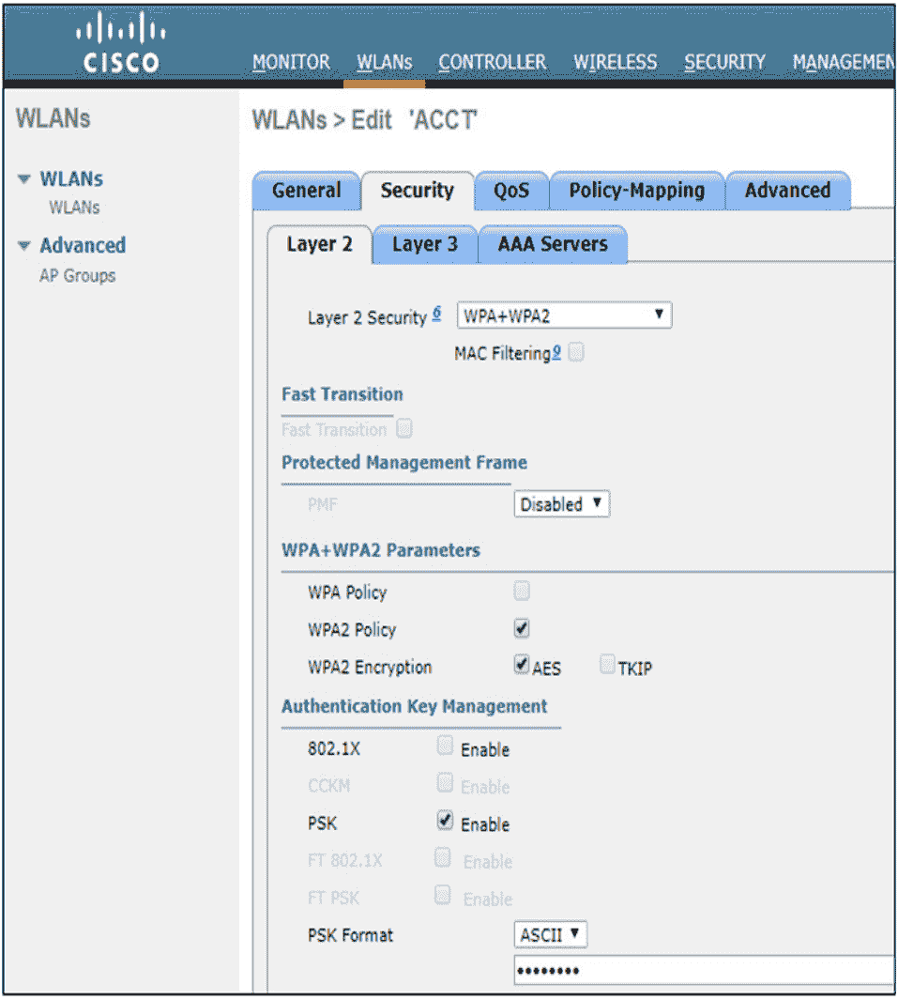

## QoS 配置文件

配置完无线安全设置后，您可以选择为无线网络配置 QoS 设置。选择 QoS 配置文件将指定 WLC 应如何处理并确定来自此无线网络流量的优先级。您可以从以下 QoS 配置文件中选择一个：

- Platinum（用于确保语音流量的高服务质量）
- Gold（用于确保视频流量的高服务质量）
- Silver（用于常规流量——默认值，被视为尽力而为配置文件）
- Bronze（用于背景流量，因为其分配到的带宽最低）

选择最符合您需求的配置文件。请记住，针对认证考试，VoIP 流量应使用 Platinum QoS 配置文件。

## 高级无线 LAN 设置

选择 QoS 配置文件后，单击“高级”选项卡以设置无线网络的高级设置。在此处，您可以指定诸如会话超时值等设置，即客户端必须重新向 WLAN 进行身份验证的频率；配置诸如点对点 (P2P) 阻止、URL 过滤等功能，以控制客户端访问的 URL，以及可连接的最大客户端数量。

1. 选择所需的高级设置。
2. 单击“应用”以完成配置。

## 配置 RADIUS/TACACS+

如果您希望将无线网络配置为使用 RADIUS 服务器或 TACACS+ 服务器作为连接到您无线网络的客户端的身份验证服务，则需要执行几个配置步骤。首先，必须将 RADIUS/TACACS+ 服务器添加到配置中，然后才能在配置无线 LAN 时选择该服务器。

要将 RADIUS/TACACS+ 服务器添加到控制器：

1. 从顶部导航栏中选择“安全”链接。
2. 单击“新建”按钮以添加新 RADIUS 服务器。
3. 输入 RADIUS 服务器的 IP 地址，并填写共享密钥/确认共享密钥。共享密钥是连接到 RADIUS 服务器所需的密码。
4. 选择“应用”。

现在，您已添加 RADIUS 服务器，可以返回 WLAN 并将 WLAN 配置为使用该 RADIUS 服务器。按以下步骤将 WLAN 配置为使用 RADIUS 服务器：

1. 在顶部导航栏中选择 WLANs 链接。
2. 单击要编辑的 WLAN 的链接。
3. 在 WLAN 设置中选择“安全”选项卡。
4. 选择“AAA 服务器”选项卡。
5. 从服务器 1 下拉列表中选择 RADIUS 服务器的 IP 地址。
6. 在右上角选择“应用”。

## 本章回顾

在本章中，您了解了无线网络及其组件。您了解了如何使用无线电波传输数据以及无线网络的组件，例如无线接入点 (WAP) 和无线 LAN 控制器 (WLC)。

您了解了基本服务集 (BSS) 和扩展服务集 (ESS) 之间的区别，以及配置 ESS 的三个核心要求：多个具有相同 SSID 的接入点、不同信道以及至少 10% 的重叠覆盖区域。您还了解了不同的无线标准，例如 802.11g、802.11n 和 802.11ac。

然后，您阅读了不同的无线安全协议，以及应在无线网络上使用 WPA2 或 WPA3（如果可能）来加密无线通信。最后，您了解了 Cisco 无线架构，例如自治架构（其中每个接入点单独配置）或 Split-MAC 架构（涉及使用无线 LAN 控制器从中心位置配置所有接入点）。

## 快速复习

### 无线网络简介

- 无线客户端连接到无线接入点 (AP) 以访问网络。无线通信使用无线电波传输数据。
- 在企业环境中，您可以使用无线 LAN 控制器 (WLC) 集中管理多个 AP。AP 和 WLC 使用名为 CAPWAP 的专用隧道进行通信。
- BSS 是具有单个 AP 的无线网络，而 ESS 是具有多个 AP 以覆盖更大区域的无线网络。使用 ESS 时，每个 AP 使用相同的 SSID，但使用不同信道。
- 802.11b 和 802.11g 无线标准在 2.4 GHz 频率上运行。802.11b 标准以 11 Mbps 运行，而 802.11g 以 54 Mbps 运行。802.11n 标准可在 2.4 GHz 或 5 GHz 频率上运行，而 802.11ac 在 5 GHz 频率上运行。802.11n 标准提供最高 600 Mbps 的传输速率，而 802.11ac 可提供 1 Gbps。
- WEP 安全协议使用 RC4 作为加密算法，WPA 使用 TKIP，WPA2 使用 AES。您可以在企业模式下运行 WPA/WPA2/WPA3，这意味着您将 AP 配置为使用诸如 TACACS+ 或 RADIUS 之类的身份验证服务。

### Cisco 无线架构

- 自治架构涉及单独配置每个 AP。Split-MAC 架构使用 WLC 从中心位置配置所有 AP。使用基于云的架构时，WLC 位于云中。
- 将 AP 配置为 FlexConnect 模式，以使轻量级接入点 (LAP) 能够直接在客户端和 LAN 之间传递流量，并在 CAPWAP 失败时仍允许 AP 功能正常。
- CAPWAP 是一个专用隧道，用于在 LAP 和 WLC 之间传输通信。
- CAPWAP 隧道中有两个信道：控制信道和数据信道。控制信道传输控制信息，例如命令，并使用 UDP 5246。数据信道在 LAP 和 WLC 之间传输所有其他信息，并使用 UDP 5247。

## 问题

以下问题将帮助您衡量对本章所呈现材料的理解。仔细阅读所有选项，因为可能有多个正确答案。为每个问题选择正确的答案。

1. 您的经理想知道您为什么购买无线 LAN 控制器 (WLC)。您会使用以下哪项来描述 WLC 的优势？
A. 它可以与自治和轻量级接入点一起使用。
B. 它需要使用 RADIUS 服务器。
C. 它使您能够集中管理所有接入点。
D. 它仅允许通过控制台端口进行配置。

2. 如果您希望确保在与 WLC 通信失败时接入点仍能为客户端提供服务，您会使用哪种接入点解决方案？
A. Mesh
B. FlexConnect
C. Local
D. CAPWAP

3. 哪种类型的接入点由 WLC 管理？
A. Autonomous
B. CAPWAP
C. Heavyweight
D. Lightweight

4. 在设计扩展服务集 (ESS) 无线网络时，以下哪项代表设计最佳实践？
A. 为每个接入点配置唯一的非重叠信道和相同的 SSID。
B. 为每个接入点配置相同的信道和相同的 SSID。
C. 为每个接入点配置唯一的非重叠信道和唯一的 SSID。
D. 为每个接入点配置相同的信道，但不同的 SSID。

5. 以下哪项是使用预共享密钥的 WPA2 所使用的加密算法？
A. RC4
B. AES
C. TKIP with RC4
D. TKIP with WEP

6. 您正在使用无线 LAN 控制器的 GUI 配置无线网络。在配置 WPA2 PSK 时，可以使用哪两种数据格式？（选择两项。）
A. Hexadecimal
B. Decimal
C. Binary
D. ASCII
E. Base10

7. 哪种无线标准以 54 Mbps 运行？
A. 802.11ac
B. 802.11n
C. 802.11g
D. 802.11b

8. 哪种无线加密协议将 AES 用作加密算法？
A. WEP
B. WPA2
C. RC4
D. WPA

9. 您正在使用无线扫描仪，该扫描仪会报告每个无线网络的 BSSID。BSSID 代表什么？
A. 接入点的 MAC 地址
B. 无线网络的名称

C. 无线网络的信道

D. 访问点的 IP 地址

## 基于性能的问题
1. 使用以下图表，将无线术语与其定义匹配。

| 术语 | 定义 |
|------|------|
| WPA2 | 一种无线加密协议 |
| 服务端口 | 用于带外管理的接口 |
| 无线局域网控制器 | 用于集中管理访问点 |
| 动态接口 | 用于将 WLAN 映射到 VLAN |
| 接入点 | 无线客户端用于访问有线网络 |

## 答案

- 1. C. WLC 用于从单一点管理多个轻量级接入点 (LAPs) 的配置设置。
- 2. B. FlexConnect 接入点即使在 WLC 或 CAPWAP 隧道失败的情况下也可以为无线客户端提供服务。
- 3. D. WLC 管理轻量级接入点 (LAPs) 的配置。
- 4. A. 要配置 ESS，必须将每个接入点配置为相同的 SSID 但不同的、不重叠的信道。
- 5. B. WPA2 无线加密协议使用高级加密标准 (AES) 对称加密算法来执行加密。
- 6. A, D. 在输入 WPA2 预共享密钥时，您可以将密钥输入为 ASCII 值或十六进制值。
- 7. C. 802.11g 无线标准以 54 Mbps 运行。

- 8. B. WPA2 无线加密协议使用 AES 作为其对称加密算法。

- 9. A. BSSID 是无线接入点的 MAC 地址。

## 基于性能的答案

1. 以下是无线术语及其定义的映射。请记住真实考试，您需要将左侧的项目拖放到右侧匹配的项目上。

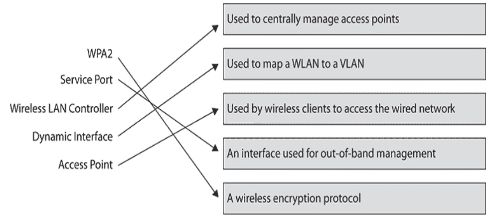
