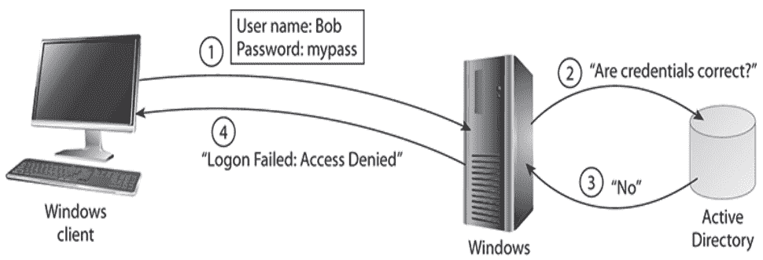
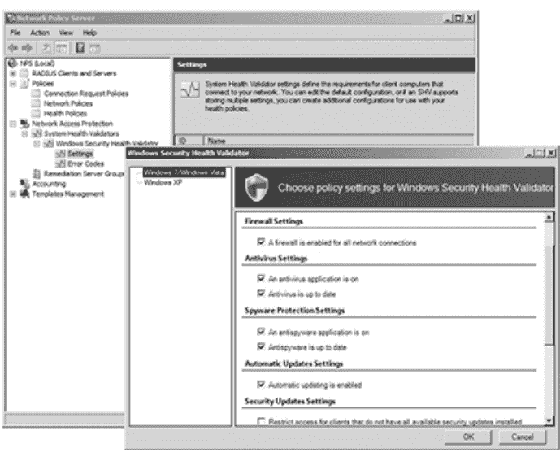
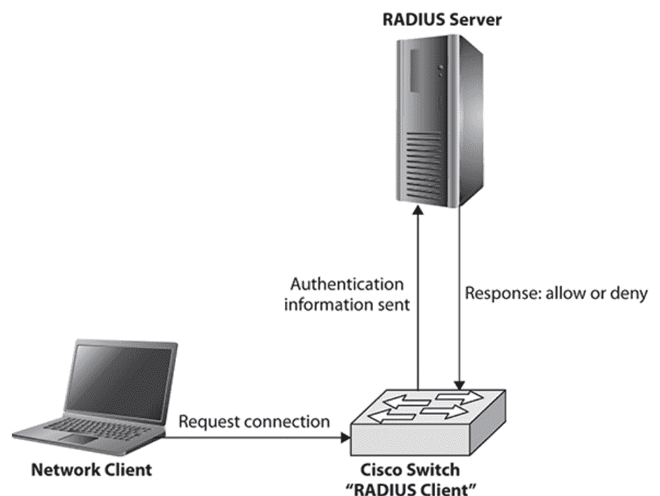
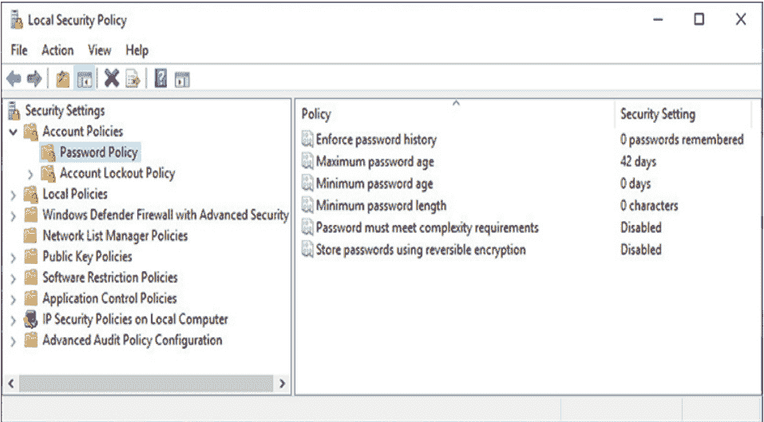
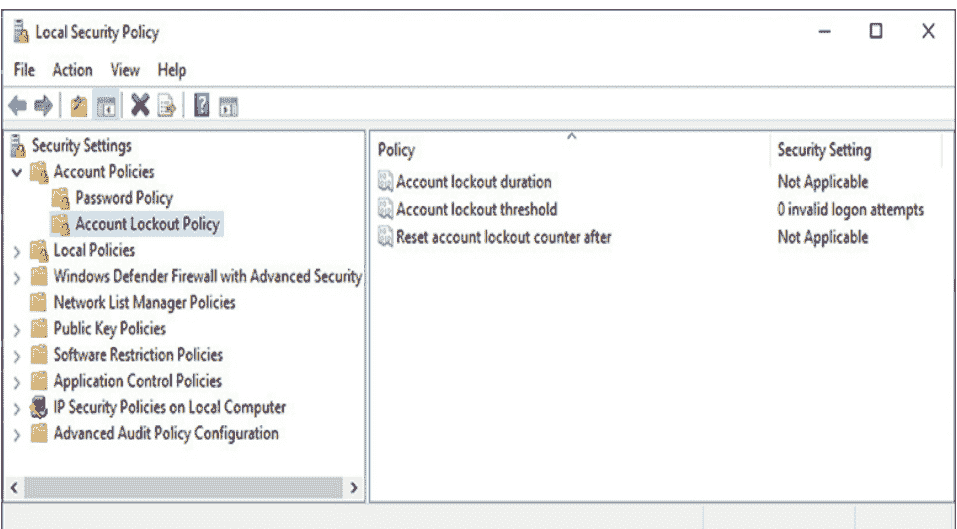
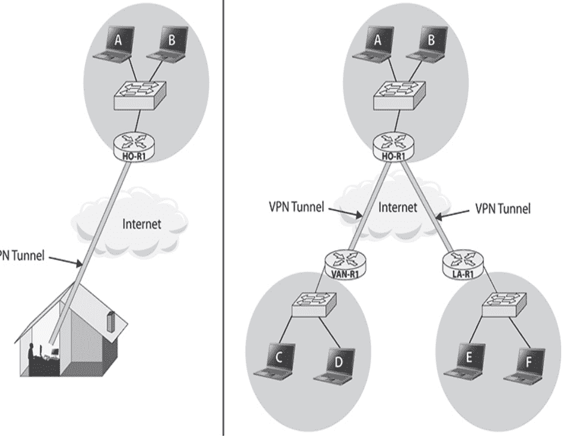
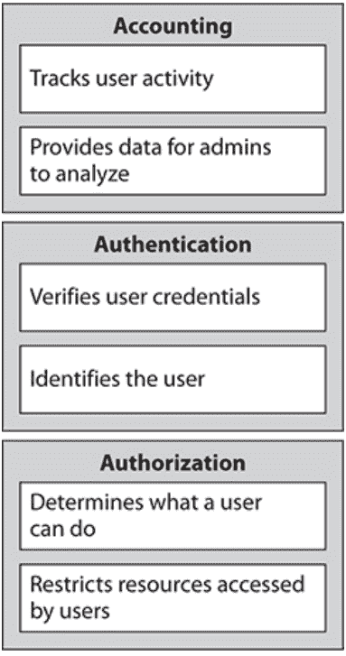

# 安全基础

在本章中，您将

- 了解威胁和攻击类型
- 比较身份验证和授权
- 了解密码策略元素的重要性
- 了解远程访问和 VPN
- 了解实施安全程序的最佳实践

思科 CCNA 认证的新关注点之一是增加了安全主题。在本章中，您将学习威胁、漏洞和利用等基本安全概念。您还将了解系统遭受攻击的常见原因，以及通过遵循常见安全最佳实践来缓解这些攻击的方法。

您还将了解身份验证和授权之间的区别，以及与身份验证、授权和计费 (AAA) 服务和使用 RADIUS 和终端访问控制器访问控制系统加强版 (TACACS+) 的集中式身份验证相关的概念。

## 了解威胁和攻击类型

作为本章的第一个主题，我们将向您介绍与安全概念相关的基本术语以及针对系统的不同威胁。本节稍后，我们将识别当今常见的不同攻击类型。

## 安全基础

当今信息安全是一个大产业，因为公司寻求保护其资产免受各种形式的攻击。作为 IT 专业人员，您将被要求保护这些资产，但如何知道应该使用哪种保护机制？答案取决于您试图保护的安全基本要素：机密性、完整性或可用性 (CIA)。

## 机密性

信息安全的首要目标是保持信息机密，即不允许未经授权的个人访问信息。您可以使用多种方法来保持机密性：

- 您可以在文件和/或文件夹上配置权限，以阻止未经授权的个人访问这些文件和/或文件夹。
- 您可以加密存储中的数据，以便只有拥有解密密钥的人才能访问数据。这被称为 *加密存储*。
- 您可以在数据跨越网络或 Internet 传输时对其进行加密。这被称为 *传输中加密*。

## 完整性

完整性涉及能够确保所读取数据的完整性。例如，如果员工将文件存储在服务器上，下个月再次访问该文件，她如何知道文件未被篡改或更改？您可以使用提供完整性服务的技术来识别文件是否被更改。

证明完整性的常见技术是 *哈希*。使用哈希时，数据（在此例中为文件）会经过哈希算法处理以生成结果（称为 *哈希值*）。然后存储该哈希值以供日后参考。下次读取文件时，会使用相同的哈希算法对文件进行处理以生成新的哈希值。然后比较两个哈希值：如果两个哈希值相同，则文件未被更改。哈希算法的常见示例包括消息摘要 5 (MD5) 和安全哈希算法 1 (SHA-1) 及 256 (SHA-256)。

## 可用性

信息安全的第三个目标是可用性。例如，如果员工将报告存储在服务器上，他期望在需要时稍后仍能找到该报告。我们可以使用多种技术来增加公司资产（例如该报告）可用的可能性，如下所示：

- **备份** 如果我们对文件服务器进行备份且服务器崩溃，可以从备份中恢复公司数据。作为网络专业人员，您将使用在第 8 章中学到的命令备份 Cisco 设备配置和 IOS。
- **RAID** 服务器配置了多个驱动器组成 RAID 阵列，因此如果驱动器故障，员工仍然可以访问公司数据。
- **集群** 服务器位于高可用性集群中，因此如果一台服务器故障，另一台服务器可以处理工作负载。
- **FHRP** 如您在第 11 章中所学，可以将 Cisco 路由器配置为首跳冗余协议 (FHRP) 拓扑，因此如果路由器故障，另一台路由器可以接管，员工仍然可以访问 Internet 或 WAN。

## 漏洞和利用

在深入了解各种不同类型的攻击之前，您需要了解在讨论与攻击相关的主题时会听到的一些常见安全术语。在学习更多关于安全和攻击的内容时，以下是一些您应该记住的关键术语：

- **威胁** 暴露资产机密性、完整性或可用性受到威胁的行为。威胁示例包括拒绝服务 (DoS) 攻击（违反可用性）或攻击者入侵数据库并检索信用卡号码（违反机密性）。
- **威胁行为者** 导致威胁发生的个人或群体。常见示例是黑客和不满员工。
- **漏洞** 产品中的弱点，可能使某人能够绕过产品安全性并访问系统或对系统造成损害。每个产品都存在漏洞，这就是为什么我们需要定期修补系统的原因。当产品供应商了解漏洞时，会通过软件补丁发布修复程序。
- **利用** 利用系统或软件漏洞来危害安全性的活动。个人利用系统或软件漏洞来危害安全性，从而导致利用行为。
- **缓解技术** 用于降低威胁发生的可能性或影响，或将其完全消除的方法。例如，为了缓解 DoS 攻击，可以在高可用性解决方案中创建多个服务器。或者，为了缓解潜在攻击者访问信用卡号码，可以对数据库中包含的信用卡号码进行加密。

**考试提示** 对于考试，请知道*漏洞*是产品中的弱点，而*利用*是指有人利用该漏洞来危害系统。

## 常见漏洞

多种常见配置错误可能导致系统和设备上的漏洞。作为网络管理员，您应该了解这些常见漏洞，因为它们可能导致系统遭受攻击：

- **不必要的运行服务** 请务必评估计算机上运行的服务，然后禁用任何不必要的服务。系统上运行的软件越多，黑客可以用来访问系统的漏洞就越可能存在。
- **开放端口** 系统上开放的传输控制协议 (TCP) 或用户数据报协议 (UDP) 端口是黑客访问系统的邀请函。关闭系统上的任何开放端口

不需要的系统，并使用防火墙阻止对必须保持开放的端口的访问。

- **未打补丁的系统** 请务必保持系统及时打补丁和安全修复。这样，系统上的任何软件都不太可能拥有黑客可以利用的漏洞。
- **未加密的通道** 请确保系统之间的任何通信通道尽可能加密。使用未加密的通信会使黑客能够捕获流量并读取信息。
- **明文凭据** 请确保用户向系统进行身份验证时，所使用的身份验证协议正在加密密码。请使用安全的身份验证协议替换任何不安全的身份验证协议。
- **不安全的协议** 请务必加密所有通信。我们日常使用的大多数 Internet 协议，例如 telnet、HTTP、文件传输协议 (FTP)、简单文件传输协议 (TFTP) 和简单网络管理协议 (SNMPv1 和 v2)，都以未加密格式发送流量。如果攻击者使用嗅探器程序捕获未加密的流量，他可以查看流量详细信息，访问该流量中的任何敏感信息，并可能了解用于向系统进行身份验证的用户名和密码。请务必调查网络上使用的每个协议；如果它没有加密通信，请为该协议寻找安全替代方案。例如，不要使用 telnet 远程管理 Cisco 设备，而应使用安全外壳 (SSH)。

## 恶意软件

另一种常见的黑客攻击形式是通过恶意软件。恶意软件是指任何旨在损害系统的软件，且形式多样。以下是您应该为 CCNA 考试熟悉的一些恶意软件：

- **病毒** 传统病毒附加到文件上，因此当您打开文件时，病毒被激活并感染您的系统。病毒可以从系统中删除文件或修改引导扇区，使计算机无法再启动。
- **蠕虫病毒** 今天，我们通常会大量处理蠕虫病毒。蠕虫病毒是一种自我复制的病毒，这意味着它可以在您不打开文件的情况下感染您的系统。蠕虫可以作为电子邮件、即时消息的附件到达，或通过软件漏洞传播。或者，它可能存在于闪存驱动器上，当您将闪存驱动器连接到计算机时，它会感染您的系统。蠕虫病毒感染一台计算机，然后在整个网络中传播。
- **特洛伊木马病毒** 特洛伊木马病毒是一种您被诱骗安装的程序，因为您认为该应用程序具有某种实用功能；但实际上，该程序是一种会感染您系统的病毒。特洛伊木马病毒通常通过打开 TCP/IP 端口来修改您的系统，这使黑客能够连接到系统并控制它。
- **间谍软件** 这种隐藏软件会监视并收集有关您及您的互联网浏览习惯的信息。间谍软件还被知晓不仅仅用于监视信息：它可以通过浏览器重定向（将您发送到不同的网页）或减慢网络连接来更改您的系统。
- **广告软件** 此软件会在您的屏幕上自动加载广告，通常以弹出窗口的形式出现。这些旨在引诱您购买产品或订阅特定网站的广告。
- **逻辑炸弹** 这种病毒被植入您的系统，意图稍后感染它。在安装受感染的应用程序后，逻辑炸弹会等待特定条件满足（例如特定日期），然后病毒执行其恶意目的。
- **键盘记录器** 键盘记录器是安装在您系统上的软件或硬件设备，旨在捕获您的所有按键操作，以试图获取您的密码和其他信息。
- **垃圾邮件** 垃圾邮件是指未经请求的商业电子邮件。这些电子邮件通常是大量发送的，其目的是说服您购买其产品或服务。发送垃圾邮件的人（即垃圾邮件发送者）通常会在您向新闻组发表评论后，从网站或新闻组获取您的电子邮件地址。
- **勒索软件** 这种恶意软件会控制您的系统，并在您支付费用之前不归还控制权。在最近常见的场景中，勒索软件会加密您的驱动器，您必须支付费用才能获取加密密钥。

## 缓解攻击

您已了解缓解技术——您可以采取的减少或消除威胁的行动。以下概述了您可以采用的一些安全最佳实践，以帮助保护公司资产。以下是一些可帮助您防止攻击或减轻攻击影响的常见缓解技术：

- *修补系统。* 您可以采取的保护系统的第一步是确保已制定补丁管理策略。请确保所有系统都及时打补丁，因为补丁会从系统中删除已知漏洞。大多数操作系统和应用程序都具有可启用的自动更新功能，以便在发布更新时自动下载和应用。
- *加密网络流量。* 为了保护您的数据不被窥探，请确保正在加密所有网络通信。这包括（如有必要）加密 Web、电子邮件和 FTP 流量。
- *加密移动设备上存储的数据。* 请确保正在加密存储在笔记本电脑和其他移动设备上的数据。员工可能会丢失设备，或者其移动设备可能会在某个时刻被盗，因此，确保这些设备上存储的数据已加密且设备受密码保护至关重要。
- *安装防病毒软件。* 为了保护系统免受恶意软件侵害，请务必在所有系统上安装防病毒软件，并保持病毒定义及时更新。
- *使用强密码。* 请确保为所有用户帐户和设备使用强密码。
- *教育员工。* 向员工传授安全最佳实践非常重要，并确保他们了解如果不遵循这些实践会发生什么。
- *运行哈希算法。* 您可以通过将数据运行于数学哈希算法来验证数据的完整性，该算法会生成哈希值。服务器使用密钥与存储在服务器上的密码创建哈希值，然后将生成的值与客户端发送的哈希值进行比较。如果两个哈希值相同，则客户端提供了正确的密码。如果哈希值不同，则表示数据以某种方式被更改。哈希算法示例包括 MD5 和 SHA。

## 练习 16-1：匹配安全术语

在此练习中，您将安全术语与其描述进行匹配。

| 术语 | 描述 |
|---|---|
| ___ 威胁 | A. 用于确保数据未遭恶意篡改 |
| ___ 漏洞 | B. 正在导致威胁发生的个人或群体 |
| ___ 机密性 | C. 用于降低威胁发生的可能性或影响，或将其完全消除 |
| ___ 漏洞利用 | D. 暴露资产机密性、完整性或可用性受到损害的行为 |
| ___ 威胁行为体 | E. 用于利用漏洞以危害安全 |
| ___ 完整性 | F. 通过加密等控制措施确保信息保持私密 |
| ___ 缓解技术 | G. 产品中的弱点 |

## 攻击类型

现在是时候了解可能针对系统发生的不同类型的威胁和攻击了。了解黑客用来危害系统的不同类型的攻击和方法，对于理解如何保护您的环境至关重要。本节将向您介绍多种不同类型的攻击。

## 社会工程攻击

在社会工程攻击中，攻击者通过电子邮件或电话与个人进行社交互动来危害网络或系统，诱骗受害者泄露可用于危害安全的信息。受害者向黑客泄露的信息最可能在后续攻击中用于未经授权地访问系统或网络。

教育是保护您和同事免受社会工程攻击的关键。让所有工作人员了解社会工程攻击的普遍性以及可能构成此类攻击示例的不同场景，有助于提高组织的安全性。

以下是一些最常见的社会工程攻击场景：

- **攻击者冒充管理员** 攻击者可能会给员工打电话，冒充公司的网络管理员。黑客会试图说服员工更改密码或泄露密码信息，以便攻击者可以使用该信息访问系统。
- **攻击者冒充用户** 攻击者会给一个毫无戒心的网络管理员打电话，扮演一个无法登录网络的沮丧用户的角色。网络管理员自然会通过重置该“用户”的密码并帮助其登录来提供帮助，从而导致攻击者获得系统访问权限。
- **攻击者冒充供应商** 攻击者可能会给客户发送电子邮件，冒充某款软件的供应商。攻击者试图说服用户安装一个更新，但用户不知道该更新实际上是一种特洛伊木马病毒，它会让攻击者获得系统访问权限。

## 钓鱼攻击

当今常见的一种社交工程攻击是网络钓鱼攻击。当黑客创建一个与热门网站（例如银行或在线商家网站）长得一模一样的假冒网站时，就会发生网络钓鱼攻击。攻击者发送电子邮件，试图诱使用户点击链接到该假冒网站（称为“网络钓鱼”）。当用户尝试使用其账户信息登录假冒网站时，攻击者会记录用户名和密码，然后尝试使用该信息登录真实网站，从而可能获得对用户账户的访问权限。

网络钓鱼攻击有多种形式。*鱼叉攻击*针对特定受害者或一组受害者。通常，网络钓鱼攻击会发送到随机电子邮件地址，但在鱼叉攻击中，攻击者伪装成已知或可信的发件人，针对特定个人或群体。*鲸鱼攻击*是一种针对公司高管（如 CEO）的网络钓鱼攻击形式。鲸鱼攻击针对的是组织中的“鲸鱼”或“大鱼”。

## 网络攻击

大多数类型的攻击都被视为网络攻击，即黑客从远程系统执行攻击。网络攻击有多种不同类型：

- **窃听攻击** 也称为 *数据包嗅探*，窃听涉及使用一种称为嗅探器的网络监控工具，该工具用于捕获和分析网络流量。如果流量未加密，黑客可以读取机密数据，包括用户名和密码。
- **伪装** 在伪装攻击中，黑客修改其发送的数据包的源地址，使数据包看起来像是来自另一个人。伪装是绕过交换机、路由器或防火墙上的访问控制的常用方法。伪装有几种不同类型：
  - *MAC 欺骗* 涉及修改数据包的源 MAC 地址。攻击者通常会伪造 MAC 地址，以便绕过无线网络上的 MAC 过滤功能或尝试绕过交换机的端口安全功能。
  - *IP 欺骗* 涉及修改数据包的源 IP 地址。攻击者可能会使用 IP 欺骗来尝试绕过路由器或防火墙上的访问控制列表 (ACL)。
  - *电子邮件欺骗* 涉及修改电子邮件的源电子邮件地址。攻击者通常在网络钓鱼攻击中使用电子邮件欺骗，使电子邮件看起来像是来自另一个人（可信方）。
- **中间人 (MITM) 攻击** 在中间人 (MITM) 攻击中，黑客将自己插入两个正在通信的系统中间。然后他在两者之间来回传递信息，双方都不知道所有通信都经过黑客的系统。这样做的好处是，黑客随后可以查看两个系统之间发送的任何敏感数据。
- **劫持攻击** 黑客接管你与另一个人之间的会话，并将另一个人从通信中断开连接。你仍然认为自己正在与原始方通信，并可能将私人信息发送给黑客而不是原始方。
- **拒绝服务** 拒绝服务 (DoS) 攻击会导致系统或其服务崩溃或无响应。结果，系统无法实现其目的并提供这些服务。例如，您的 Web 服务器向客户销售产品。攻击者通过向 Web 服务器发送大量请求来执行 DoS 攻击，使其不堪重负，忙于无法处理客户的有效请求。
- **分布式拒绝服务** 在分布式拒绝服务攻击中，黑客使用多个系统攻击单个目标系统。一个好例子是 smurf 攻击，黑客在其中向多台计算机发送 ping，但修改了这些数据包的源地址，使它们看起来像是来自另一个系统（在此情况下为受害者）。当所有这些系统都收到 ping 请求时，它们会回复同一个地址，基本上用数据过载该系统。
- **缓冲区溢出** 在缓冲区溢出攻击中，攻击者向缓冲区发送的数据超出其容量。数据可能包含恶意代码，这些代码可能损坏数据或泄露私人信息，使攻击者能够在命令提示符或 shell 中获得对系统的管理访问权限。
- **漏洞利用攻击** 在这种攻击类型中，攻击者了解操作系统或软件中的安全问题（漏洞），并利用该知识通过利用漏洞来发动攻击。
- **僵尸网络** 僵尸网络是黑客接管并用于 DDoS 攻击的一组系统。
- **DNS 投毒** 在 DNS 投毒中，黑客篡改（或投毒）您的 DNS 数据，以将客户端重定向到错误系统。在针对 DNS 的另一种常见攻击中，黑客尝试执行区域传输（复制您的 DNS 数据）以绘制您的网络图。
- **smurf 攻击** 在 smurf 攻击中，黑客向多个系统发送 ping 消息，但伪造 IP 地址，使 ping 消息看起来像是来自不同系统。结果是所有系统都向受害者发送 ping 响应，基本上执行了 DDoS 攻击。
- **友好/无意的 DoS** 某些场景可能导致无意的 DoS 攻击。例如，帐户锁定策略可能导致 DoS，在帐户被锁定后阻止用户登录。如果用户意外删除文件，也可能无意中导致 DoS。
- **物理攻击** 当攻击者获得对您设施的物理访问权限并能够损坏设备甚至设施时，就会发生物理攻击。实施物理安全控制（例如锁定机制和警卫）可帮助防止这些攻击。
- **ARP 投毒** 黑客可以通过修改受害者系统上的地址解析协议 (ARP) 缓存并导致所有通信都经过黑客的系统，从而将自己插入通信中间，使攻击者能够捕获所有流量。这是执行 MITM 攻击的常用方法。
- **VLAN 跳变** VLAN 跳变是针对虚拟局域网 (VLAN) 的一种利用攻击，它使个人在未连接到 VLAN 的情况下能够访问该 VLAN。黑客通过为不同 VLAN 的帧添加双重标记来实现这一点，或者他们可以模仿中继端口以便接收所有流量。
- **去认证** 去认证攻击在无线攻击中很常见。黑客发送命令将客户端从无线网络断开连接或取消其身份验证。结果，客户端被迫与无线网络重新进行身份验证，黑客可以在其中捕获重新身份验证流量。攻击者可以重放身份验证数据包，以期生成更多流量并尝试破解无线加密。
- **零日攻击** 在零日攻击中，在软件开发人员意识到问题并发布补丁之前，会利用开发人员未知的漏洞。公司可以配备团队来测试软件并识别尚未知晓的漏洞。

## 密码攻击

攻击者可能会尝试破解存储在网络帐户数据库或受密码保护的文件中的密码。密码攻击有三种主要类型：字典攻击、暴力攻击和混合攻击：

- **字典攻击** 此攻击涉及使用单词列表文件，即潜在密码列表。攻击者使用程序读取并尝试文件中的每个密码以进入系统。这是一种非常快速的密码攻击形式，因为不需要计算：攻击者只是在读取文件。
- **暴力攻击** 在暴力攻击中，攻击者使用程序尝试每一种可能的字符组合来猜测密码。这种攻击比字典攻击慢，因为不读取文件；相反，程序会计算每个可能的密码。
- **混合攻击** 与字典攻击类似，混合攻击涉及单词列表文件，但它还会在单词末尾添加数字，以捕获不是字典单词的密码，以防密码末尾包含数字（这是常见情况）。例如，字典攻击无法找到密码 *pass1*，但混合攻击可能会找到。

**考试提示** 在参加 Cisco 考试之前，请确保您了解所有不同类型的攻击。最要熟悉拒绝服务攻击、欺骗攻击、密码攻击和社会工程攻击。

## 身份验证和授权概念

身份验证和授权流程存在差异，以及这些流程用于允许或拒绝访问网络资源的方式也存在差异。在保护网络资源时，您首先应让用户使用其私有用户名和密码登录到网络；登录后，他们将能够访问已获得许可访问的网络资源。登录到网络的过程称为 *身份验证*，而控制用户登录到网络后可以访问哪些网络资源的过程称为 *授权*。

## 身份验证

身份验证是用户或计算机向网络识别自身的过程，以便他们可以开始访问网络资源或网络设备（在管理设备的情况下）。用于验证用户的方法取决于网络环境，可以采用以下形式之一：

- **用户名和密码** 当用户启动计算机或连接到网络时，输入与其特定网络帐户关联的用户名和密码。
- **智能卡** 使用智能卡登录类似于在 ATM 上访问您的银行帐户。要登录到网络，您将智能卡（类似于借记卡）插入智能卡读卡器，然后提供 PIN。要进行身份验证，您必须持有智能卡并知道其密码。智能卡也称为 PKI 卡，因为它们用于在公钥基础架构 (PKI) 环境中验证客户端；卡中包含员工的私钥。
- **生物识别** 在这种情况下，用户提供视网膜扫描或指纹作为凭据。生物识别正在成为高安全环境中的非常流行的解决方案，这些环境使用特殊的生物识别设备。

无论使用何种方法提供必要的凭据，结果都是一样的，即凭据被发送到目录服务（例如 Microsoft Active Directory）进行验证。例如，如果用户名和密码正确，则用户已通过身份验证并允许访问网络资源。网络服务器也有能力根据用户的身份验证方式授权用户访问不同资源——例如，通过生物识别进行身份验证可能允许用户访问比简单的用户名和密码身份验证更多的资源。如果凭据不正确，身份验证失败，用户将被拒绝访问网络，如图 16-1 所示。

## 图 16-1 登录到网络

当用户提供用户名和密码等凭据时，凭据将使用身份验证方法传递到服务器。Microsoft 世界中使用了多种身份验证方法，如以下列表中所述：

- **匿名身份验证** 您不需要登录。Windows 为实际服务使用一个帐户，您将以该帐户身份传递。匿名帐户拥有的任何权限都是您在匿名连接时将拥有的权限。这是网站或 FTP 服务器的常用身份验证方法。
- **基本身份验证** 您需要登录，并且用户名和密码将以明文形式发送到服务器。这意味着如果有人在您和服务器之间安装了数据包嗅探器，该人将能够捕获您的密码并查看它，因为它未加密。
- **集成 Windows 身份验证** 您需要登录到服务器，但您的用户名和密码将以加密格式发送到服务器。如果用户需要登录，此身份验证方法比基本身份验证更安全。
- **Kerberos** 这种流行的相互身份验证协议默认用于 Microsoft Active Directory 环境。Active Directory 遵循轻量目录访问协议 (LDAP) 标准，这是访问和查询目录的 Internet 协议。Kerberos 使用密钥分发中心 (KDC) 服务器，该服务器负责签发客户端向网络上的任何其他服务器（称为域）请求服务所需的票据。Kerberos 流程在客户端登录到网络时开始。KDC 身份验证服务器向客户端签发票据授予票据，该票据授予客户端请求服务票据的权限，而服务票据是向网络上的服务器请求服务所必需的。当客户端想要连接到网络上的特定服务器时，它必须从票据授予服务 (TGS) 请求票据，TGS 是 KDC 的另一个组件。TGS 将票据授予客户端，以便客户端可以访问网络上的所需服务器。

这些身份验证方法非常“Microsoft 风格”，但也有用于执行身份验证的标准协议。各种网络服务（例如远程访问服务 (RAS) 和虚拟专用网络 (VPN)）使用的标准身份验证协议包括以下内容：

- **密码身份验证协议 (PAP)** PAP 以明文形式发送用户的凭据，非常不安全，因为有人很容易分析和解释登录流量。这是前面提到的基本身份验证方法使用的身份验证协议。
- **质询握手身份验证协议 (CHAP)** 使用 CHAP 时，服务器向客户端发送一个质询（一个密钥），该密钥与用户的密码组合。用户的密码和质询都经过 MD5 哈希算法（一个公式）处理，生成哈希值或数学答案，并将该哈希值发送到服务器进行身份验证。服务器使用相同的密钥与服务器上存储的密码创建哈希值，然后将生成的值与客户端发送的哈希值进行比较。如果两个哈希值相同，则客户端提供了正确的密码。好处是用户的凭据根本没有在线路上传输。
- **Microsoft 质询握手身份验证协议 (MS-CHAP)** MS-CHAP 是 CHAP 的一种变体，使用 MD4 哈希算法，而不是 CHAP 使用的 MD5。MS-CHAP 还使用 Microsoft 点对点加密 (MPPE) 协议配合 MS-CHAP 加密从客户端到服务器的所有流量。
- **MS-CHAPv2** 使用 MS-CHAP 版本 2 时，身份验证方法已扩展为对客户端和服务器都进行身份验证。MS-CHAPv2 还使用比 CHAP 和 MS-CHAP 更强的加密密钥。
- **可扩展身份验证协议 (EAP)** EAP 允许多种登录方式，例如智能卡登录、证书、Kerberos 和公钥身份验证。EAP 还经常与远程身份验证拨入用户服务 (RADIUS) 一起使用，RADIUS 是一种集中式身份验证服务，可被 RAS、无线或 VPN 解决方案使用。

## 密码替代方案

除了键入用户名和/或密码之外，还可以使用其他身份验证技术：

- **生物识别** 使用生物识别身份验证时，您需要向系统展示您自身的某个方面来进行身份验证。例如，系统可能会扫描您的指纹、拍摄视网膜扫描图像，或使用面部或语音识别。
- **证书** 您可能需要持有证书才能向系统进行身份验证。证书是一个电子文件，包含加密密钥和其他属性，例如所有者的 ID 和谁创建了证书。证书通常存储在 PKI 卡（智能卡）上，也可能存储在 USB 存储棒上。证书可以作为一种无密码的身份验证形式，可在您的 Cisco 设备上配置用于 SSH 远程访问。

## 身份验证因素

CCNA 考试要求您了解不同的身份验证方法或因素。个人可以使用以下任何身份验证因素进行身份验证：

- **您知道的东西** 这是最常见的身份验证因素，您知道一些信息来证明您的身份。此身份验证因素的示例是知道密码或 PIN。
- **您持有的东西** 这也是常见的身份验证因素，基于您持有某样东西，使您能够访问环境。例如，您使用刷卡或物理令牌进入建筑物。在当今的网站登录时代，在您键入正确的用户名和密码后，网站可以向您的手机发送一个代码。这将是您持有的东西的一个示例，因为为了接收代码，您需要将手机随身携带。
- **您的特征** 您可以使用这种更高级的身份验证因素来访问系统。此身份验证因素涉及生物识别：您使用自身的特征进行身份验证，例如视网膜扫描、指纹或语音识别，以证明您的身份。这被认为是最安全的身份验证方法。

**考试提示** CCNA考试要求你了解这些不同的身份验证因素，但也要求你能识别出*单因素身份验证*、*双因素身份验证*和*三因素身份验证*方案。

除了上述因素外，你还应熟悉其他几种身份验证因素。如果你仅使用一种身份验证因素来对系统进行身份验证，则你使用的是*单因素身份验证*方案。例如，知道用户名和密码属于单因素身份验证方案，因为它们都是“你所知道的东西”的示例。

*双因素身份验证方案*基于两种身份验证因素，例如你所知道的东西和你所拥有的东西。例如，你拥有银行卡（你所拥有的东西），并且你知道使用银行卡在ATM机上操作的PIN码。与仅需持有银行卡即可访问账户相比，这种身份验证方案要强得多。如果情况如此，任何持有银行卡的人都可以从账户中取钱。以下是双因素身份验证方案的常见示例：

- **物理令牌和密码** 你使用你所拥有的东西和你所知道的东西进行身份验证。
- **智能卡和PIN码** 你使用你所拥有的东西和你所知道的东西进行身份验证。
- **生物识别和密码** 你使用你本身的东西和你所知道的东西进行身份验证。
- **登录凭据，然后来自手机通知的访问代码**
  在此示例中，你将使用用户名和密码登录，然后你的手机会收到一条包含一次性访问代码的通知，你需要在登录应用程序时输入该代码。这是“你所知道的东西”（用户名和密码）和“你所拥有的东西”（手机）的示例。

多因素身份验证 (MFA) 要求你使用两个或多个因素进行登录。假设你需要一个身份验证代码才能登录某个网站。你输入用户名和密码（你所知道的东西），并使用你的手机（你所拥有的东西）来接收身份验证代码。收到代码后，你在网站上输入该代码以完成登录过程。这是一项重要功能，应与任何网站登录一起使用，以确保即使有人获得了你的密码，他们也无法以你的身份登录该网站，因为他们不拥有你的手机。

虽然双因素身份验证是MFA中更常见的形式，但也可以有更多因素，例如三因素身份验证。三因素身份验证的示例是：你需要进行视网膜扫描（你本身的东西）、刷卡（你所拥有的东西），然后输入与该卡关联的PIN码（你所知道的东西）。

**考试提示** 对于考试，需要知道智能卡是双因素身份验证的一个示例，因为你需要持有智能卡并且需要知道PIN码才能获得访问权限。双因素身份验证的另一个示例是指纹扫描和密码。请注意，在此示例中，两个因素分别是你本身的东西和你所知道的东西。

## 单点登录

单点登录 (SSO) 是关于身份验证的一个重要概念。当你对提供SSO的网络进行身份验证时，你可以基于该单一身份验证信息访问多个系统。因此，使用SSO时，你不需要为访问的每个不同系统进行身份验证——你只需验证一次，然后即可无需再次验证而访问多个系统。

使用SSO，你不需要单独对每个服务器进行身份验证。多年前，在SSO出现之前，登录到每个系统都需要单独的用户名和密码，因此用户必须记住各种密码才能访问多个服务器。使用SSO时，用户使用一组凭据登录，会生成一个令牌，然后该令牌会提交给网络上的其他可信服务器，以使用户能够访问网络上的资源。

**考试提示** 对于思科CCNA考试，请记住，当有人向系统证明自己的身份并且其身份得到验证时，就发生了身份验证。

## 授权

一旦你对网络进行了身份验证，你将被授权访问网络资源。授权有多种类型，具体取决于你试图获得哪方面的授权。例如，如果你试图访问网络上的文件，授权将根据分配给该文件的权限来确定。如果你试图更改服务器上的时间，授权将由你的特权或权利来确定。从思科网络角度来看，授权是作为访问控制列表实现的，这些列表在路由器上配置，以允许或拒绝流量进入或离开网络。

## 权限 vs. 权利

权限和权利是用于工作站和服务器等端点的授权示例。（这不是思科示例，但我想提及它，因为它是授权的一个示例，如果你负责管理服务器安全，那么你会在网络中遇到它。）

*权限*是你对文件、文件夹或对象等资源的访问级别。权限是资源的特征，而不是用户帐户的特征。例如，如果管理员想要给Bob分配文件的读取权限，管理员会转到该文件的属性并设置权限。请注意，管理员不会转到用户帐户来分配权限。

在Windows操作系统中，*权利*是你在操作系统中执行特定任务的特权。例如，当公司将Windows部署到网络上的所有客户端系统时，用户可能会惊讶地发现他们无法更改计算机上的时间。这是因为他们没有更改系统时间权利。用户（或用户所属的组）必须被分配适当的权利，才能配置操作系统的特定方面。权利是Microsoft操作系统的一项重要安全特性。重要的是要注意，管理员可以配置操作系统，因为他们所属的组（Administrators）被分配了所有权利。

这里的目的不是将此过多地讨论为Windows问题，而只是提供授权示例。登录到计算机后，你是否被授权访问不同文件或执行不同操作，取决于为你作为用户配置的权限和权利。

## 控制流量

思科授权的一个示例是访问控制列表 (ACL)。要授权哪些流量可以进入或离开网络的不同部分，你需要在防火墙或思科路由器上配置规则。ACL是这些规则的列表，这些规则允许或拒绝不同类型的流量进入或离开你的网络。（你将在第17章中了解更多有关ACL的信息）。路由器接收数据包，然后通常根据协议、源IP地址或目标IP地址（IP过滤），或源端口和目标端口（端口过滤）来允许或拒绝数据包。

## 网络访问控制

网络访问控制 (NAC) 是当今的一项热门技术，它使你能够根据连接系统的状态（称为*态势评估*）来授权谁可以访问有线或无线网络。使用NAC，你可以指定系统必须满足的条件才能访问网络。如果不满足这些条件，用户可以被送往受限网络，在那里他可以采取措施来解决问题。

例如，你可以要求系统要连接到网络，必须安装防病毒软件，并且病毒定义必须是最新的。你还可以要求系统启用个人防火墙。如果不满足这些条件中的任何一项，NAC系统会将客户端置于受限网络中，在那里用户通常可以应用补丁，或者在这种情况下，更新病毒定义。

当连接到受限网络时，客户端无法访问网络资源，因为来自受限网络到私有公司网络的通信受到控制。图16-2显示了网络访问控制环境。

图16-2 NAC用于对连接到网络的系统施加健康要求。

今天，NAC在许多场景中都有应用，如以下示例所示：

- **无线连接** 连接到无线网络时，NAC 系统可能会要求你接受无线网络使用条款，然后才能访问该网络。

- **补丁状态** 客户端可以通过本地连接或 VPN 连接到网络。系统会检查客户端的运行状况，以确保已安装防病毒软件、病毒定义已更新，并且系统已应用最新补丁，然后才允许客户端连接到网络。

- **连接到交换机** 如果交换机符合 802.1x 标准，可以将其配置为在允许客户端访问网络之前，由身份验证服务（例如 RADIUS）对连接的客户端进行身份验证。

## 端口安全

另一种常用于授权谁可以访问网络的方法是在 Cisco 交换机上实现 *端口安全*。

交换机的端口安全功能使你能够根据 MAC 地址控制哪些系统可以连接到交换机的各个端口。要回顾端口安全知识，请参阅第 9 章。

**考试提示** 对于 CCNA 考试，请务必熟悉 ACL 和端口安全，并能够识别正在使用它们的场景。

## 网络分段

确保将不同类型的系统或环境相互隔离非常重要，这有助于提高安全性。例如，为客人提供无线接入的酒店会确保无线网络中的系统与酒店的企业系统不相连。通常通过在两个网络之间不提供物理连接来对系统进行分段，或者，如果需要物理连接，则使用路由器或防火墙通过 ACL 控制不同类型系统之间的通信。VLAN 也是 Cisco 交换机的一项出色功能，可帮助实现不同的网络段。

在以下场景中，实现网络分段非常重要：

- **旧版系统** 你可能希望将旧版系统与网络其余部分隔离，因为旧版系统运行的是旧软件或协议。或者，你可能希望对旧版系统进行分段，因为它较旧且可能不如新系统安全，因为不再为旧系统提供补丁。将旧系统与新系统置于同一网络上会降低新系统的安全性。例如，你可以将运行旧版应用程序的 Windows 7 系统或 Windows Server 2012 列为旧版系统。

- **隔离私有/公共网络** 应将专用网络（你的 LAN）与任何不可信的公共网络（例如互联网）隔离开来，以帮助减少来自互联网的攻击机会。

- **蜜罐/蜜网** 蜜罐是一种系统或网络，旨在吸引黑客攻击它，而不是攻击生产系统或网络。你需要确保将蜜罐环境与生产环境分段，以免被诱骗试图攻击蜜罐的黑客看到生产系统或网络。

- **测试实验室** 任何测试环境都应与生产网络分段。这样做的一个很好的原因是，测试实验室通常使用与生产系统相同的 IP 地址和计算机名称，因此你需要确保系统不在同一网络上，以防止 IP 和名称冲突。

- **性能优化和负载均衡** 你可以选择对系统进行分段，以便作为负载均衡工作的一种方式。例如，不要让所有用户都连接到一台服务器以获取服务，你可以将该服务放置在两台不同的服务器上，每台服务器位于不同的网络中。这样一来，每个网络都由一台服务器处理，流量减半。你还可以通过为每个楼层配置单独的交换机或布线间，并让该楼层连接到第 3 层交换机，从而对流量进行负载均衡，以将每个楼层的流量与其他楼层的流量分开。

- **合规性** 你可能需要使用不同的段来分隔系统，以符合法规或其他要求。例如，除非某个产品与不同类型的系统分开，否则供应商可能不支持该产品。约束你组织的法规也可能包含涉及控制对存储敏感数据的系统访问的合规性要求。例如，支付卡行业数据安全标准（PCI DSS）要求将任何存储或处理信用卡数据的系统隔离在其自身的网络段上。

## 计费

个人经过系统身份验证后，随后会被授权（或未授权）在系统或网络上执行不同的操作。随后 *计费* 会启动，跟踪和记录用户在访问系统或网络时执行的操作。计费对安全性非常重要；通过记录用户操作，用户需对其所有操作负责。

以下是可能跟踪的活动示例：

- **互联网使用情况** 记录用户访问的每个网站。

- **文件访问** 记录用户访问服务器上某些文件的每次操作，更重要的是，记录用户删除或复制文件的每次操作。

- **数据库访问** 记录用户访问数据库中某些数据、更改数据库中的数据或删除数据库中的数据的时间。

## AAA 服务

行业内将身份验证、授权和计费服务统称为 AAA 服务。

- **身份验证** 身份验证服务负责验证用户提供的凭据，通常涉及维护一个包含条件的身份验证数据库。例如，当用户使用用户名和密码登录时，该信息会与账户数据库进行验证。

- **授权** 验证账户信息后，用户即可获得网络访问权限。授权组件在授予访问权限前可能需要除账户信息之外的条件。例如，授权服务可能要求身份验证请求来自特定子网。

- **计费** 计费涉及记录用户和管理员执行的活动，以便用户对其行为负责。计费还可用于帮助确定每个部门应为该服务（安全解决方案）支付多少费用。

多年来发布了许多 AAA 解决方案，例如 RADIUS 和 TACACS+。这些服务的优点在于提供一个中心系统，可为多种环境（例如有线网络、无线网络和 VPN）提供身份验证、授权和计费。

## RADIUS

远程拨入用户服务（RADIUS）是一项流行多年的中心身份验证服务。需要访问网络的客户端计算机会通过尝试连接到交换机或无线接入点，或者通过互联网连接到 VPN 服务器来连接到网络。在这种情况下，交换机、无线接入点或 VPN 服务器被称为 RADIUS 客户端，因为它会将身份验证请求发送到后台运行的 RADIUS 服务器。该 RADIUS 服务器验证凭据并发送回复，指示是授予还是拒绝网络客户端的访问权限（请参见图 16-3）。

图 16-3 RADIUS 是服务和设备的中心身份验证服务。

**注意** IEEE 802.1x 是设备可使用 RADIUS 服务器进行身份验证服务的标准。购买交换机和接入点等网络设备时，如果需要使用中心身份验证服务器，请务必验证它们是否符合 802.1x 标准。

## TACACS 和 XTACACS

TACACS 最初是一种在 UNIX 系统上运行的身份验证服务。TACACS 服务使用 TCP 和 UDP 端口 49。TACACS 出现几年后

被引入后，Cisco 创建了其自己的专有身份验证服务，名为 *扩展 TACACS (XTACACS)*，该服务作为 Cisco 设备的集中式身份验证服务。

## TACACS+

TACACS+ 协议是 Cisco 网络使用的 AAA 协议，取代了原始 TACACS 和 XTACACS 协议。TACACS+ 使用 TCP 进行通信，并使用与 RADIUS 相同的拓扑，即客户端尝试连接到 Cisco 交换机，而交换机（在此情况下为 TACACS 客户端）将身份验证请求发送到 TACACS 服务器。从安全角度来看，TACACS+ 已优于 RADIUS，因为它加密了 TACACS 客户端和 TACACS 服务器之间的所有信息，而 RADIUS 仅加密 RADIUS 客户端和 RADIUS 服务器之间的密码。

## Password Policy Elements

CCNA 考试要求您了解策略在保护环境中的重要性。在本节中，您将了解更多有关密码复杂性、密码策略、账户锁定策略以及账户和密码管理的信息。

### Password Complexity

与密码相关的最重要概念之一是确保用户了解使用复杂密码的重要性。*复杂密码* 是指长度至少为八个字符，并且要求包含小写字母、大写字母、数字和符号的密码。例如，jT94q$ym4C 将是一个复杂密码。

然而，使用复杂密码的问题是它们难以记住。在讨论复杂密码时，我鼓励用户选择一个熟悉的短语，并从短语中选择要包含在密码中的字符。例如，您可以根据整个短语或短语中每个单词的第一个或第二个字符来创建密码。

让我们以常用短语“*the best of both worlds*”为基础来查看一个示例：

- 首先，我们可以将单词连接起来，并将每个单词的首字母大写（以满足小写和大写字符的要求）：
  *TheBestOfBothWorlds*
- 接下来，我们可能需要进行一些字符替换，以使用字母、数字和符号的组合。例如，*O* 可以替换为 0（零），*e* 可以替换为 3，*s* 可以替换为 $（美元符号）。现在我们有一个看起来像这样的密码：
  *Th3B3st0fB0thW0rld$*

这只是一个小示例，向您展示如何教育用户创建复杂密码，同时也让他们容易记住。

### Password Policy

为了强制实施强密码和良好的密码实践，您需要配置密码策略来控制系统上密码的使用方式。图 16-4 显示了 Windows 10 工作站上的密码策略元素。

**图 16-4 密码策略元素**

以下列表概述了任何环境中都应配置的常见密码策略元素：

- **最小密码长度** 指定密码必须有多长。我建议将其设置为至少八个字符。
- **最大密码使用期限** 指定用户需要更改密码的频率（天数）。我建议密码更改最多为 30 到 90 天。
- **密码历史记录** 指定用户不能将密码更改为之前使用过的密码。我建议将密码历史记录设置为记住 24 个密码；这意味着用户无法重复使用过去使用过的最后 24 个密码。
- **最小密码使用期限** 指定用户在再次更改密码之前必须保留密码多长时间。此策略的目的是防止某人自愿连续大量更改密码，以从密码历史记录中删除密码，从而能够重用旧密码，绕过密码历史记录要求。我建议此处设置为一两天。

- **复杂性要求** 指定密码应包含大写字母、小写字母、数字和符号。

### Account Lockout Policy

账户锁定策略可帮助您保护用户帐户免受黑客攻击。使用账户锁定策略（请参见图 16-5），您可以指定在一定数量的错误登录尝试后，帐户将被锁定且无法使用。您还可以指定帐户被锁定的时间；通常，帐户将被锁定直到管理员将其解锁。

**图 16-5 账户锁定策略元素**

以下是 Windows 系统上的账户锁定策略设置：

- **账户锁定阈值** 在帐户被锁定之前容忍的错误登录尝试次数。
- **账户锁定持续时间** 帐户将被锁定的分钟数。例如，可能会锁定若干分钟，或设置为 0（零），这意味着帐户将被锁定直到管理员将其解锁。
- **重置账户锁定计数器后** 错误登录阈值重置为零之前的时间。

## Account and Password Management

作为网络管理员，您将执行许多任务来管理用户帐户和密码，以帮助创建安全环境。您的前两个步骤是创建密码策略和账户锁定策略，但您可能还需要执行其他操作。

### Password Expiration

密码策略设置为在最长时间后过期。例如，假设您将用户的密码过期时间设置为 30 天。这意味着在用户使用密码 30 天后，它将过期。用户下次登录时，系统将要求她更改密码。如果密码重置出现问题，您可能需要使用用户帐户管理工具重置用户的密码。

### Disable Accounts

如果员工因工作（例如产假）请假或辞职，您首先应该做的是禁用用户帐户，以便员工无法登录并使用该帐户。这在今天尤其重要，因为员工可能通过互联网从任何地方访问工作电子邮件，或者他们可能在远程、场外工作。如果员工离开公司，他不应该能够登录以访问公司电子邮件或使用公司网络。尽快禁用用户帐户非常重要。

### Remove Unnecessary Accounts

您应不时审计环境中存在的用户帐户，并识别不再需要且可以删除的帐户。我建议，为了保险起见，您先禁用一段时间不需要的帐户（以查看是否有人抱怨），然后，如果您确定该帐户不再必要，就可以删除该帐户。

## Remote Access and VPNs

当今网络环境中，远程访问概念（如虚拟私有网络 (VPN)）、远程访问协议（如 Cisco AnyConnect）、站点到站点 VPN 以及远程管理协议（如 telnet、SSH 和 RDP）很常见。对于 Cisco CCNA 认证考试，您需要基本了解远程访问概念，特别是 VPN 的目的以及公司用于远程访问网络设备的不同远程访问协议。

### VPN Overview

一旦互联网流行起来，允许远程（场外）位置的用户与远程网络通信就是一个显而易见的解决方案。例如，如果您在纽约有一个办公室，而波士顿酒店房间里的一个用户需要访问纽约网络，还有什么比使用互联网更好的解决方案呢？当然，通过互联网发送数据涉及许多安全问题，因为全世界的黑客都可能接入您的网络！

虚拟私有网络 (VPN) 提供了一种解决方案。使用 VPN，波士顿酒店的用户可以使用酒店提供的 Wi-Fi 连接连接到互联网。一旦建立互联网连接，用户可以使用纽约 VPN 服务器的 IP 地址，在其笔记本电脑（客户端系统）和纽约的 VPN 服务器之间创建“安全隧道”。使用 VPN，在两个系统之间传输的任何数据都将被加密，因此被认为是安全的。

VPN 提供两个主要好处：它们在不安全的媒介上提供安全通信，并且在两个位置之间通信时不会产生费用。一旦所有系统都有互联网连接，VPN 解决方案就会利用该连接并为其添加安全性。

**考试提示** 请记住，VPN 旨在在不受信任的网络（例如互联网）上建立安全（加密）隧道，并且

用于加密穿越该不可信网络的流量。

## VPN 协议

为CCNA认证考试，你需要了解VPN的目的以及用于加密VPN通信的主要协议。以下是用于保护VPN流量的常见协议：

- **点对点隧道协议（PPTP）** 这是一种较旧的VPN协议，用于加密点对点协议（PPP）流量，并在较旧的Microsoft环境中常见。PPTP使用通用路由封装（GRE）协议传输PPP数据包，但使用Microsoft点对点加密（MPPE）协议加密流量。要允许PPTP流量通过防火墙，你需要在防火墙上打开TCP端口1723（控制端口）和协议ID 47（承载数据）。
- **二层隧道协议（L2TP）** L2TP已经存在多年，但它是比PPTP更新的VPN协议。L2TP使用更安全的IPsec（Internet Protocol Security，互联网协议安全）来加密流量，而不是MPPE。要允许L2TP流量通过防火墙，你需要在防火墙上打开UDP端口500（用于密钥交换）、UDP端口5500（用于IPsec NAT）和UDP端口1701。
- **安全套接字隧道协议（SSTP）** SSTP是当今常见的VPN协议，也是列出的三种协议中最新的一种。SSTP的优势在于它使用安全套接层（SSL）加密VPN流量，从而轻松配置防火墙以允许VPN流量通过——你只需打开SSL端口443。

除了这些协议之外，你还应熟悉另外三种安全协议：GRE、IPsec和ISAKMP。

- **通用路由封装（GRE）** GRE是一种网络协议，旨在在两个设备之间创建点对点隧道。作为隧道协议，GRE用于建立点对点链接，然后将其他类型的流量（例如IPv4或IPv6数据包）封装到GRE数据包中。GRE是一种常用协议，用于在两台Cisco路由器之间建立VPN隧道。
- **IPsec** 一旦在系统或设备上配置了IPsec，该协议即用于加密所有IP流量。IPsec协议使用封装安全有效载荷（ESP）加密流量，使用认证报头（AH）协议进行消息完整性和身份验证，并使用互联网密钥交换（IKE）在系统之间交换加密密钥。
- **ISAKMP** 互联网安全关联和密钥管理协议（ISAKMP）负责建立安全通道（即安全关联）并交换密钥。ISAKMP由IKE用于在密钥交换之前进行身份验证。

## 远程访问VPN

用户（或管理员）可以在笔记本电脑上安装VPN软件，通过笔记本电脑到公司网络的安全隧道，通过Internet连接到工作处的VPN服务器。这有助于确保通过隧道传输的数据的安全性。运行在公司笔记本电脑上的VPN软件使用前面提到的VPN协议之一来加密从笔记本电脑、穿过Internet到公司网络的数据。例如，笔记本电脑用户可能在其笔记本电脑上安装了Cisco AnyConnect，以使用SSL建立到企业网络的VPN连接。

## 站点到站点VPN

另一种常用拓扑是站点到站点VPN解决方案。在这种情况下，VPN设备（通常是具有VPN功能的路由器）安装在每个位置，用于从一个位置到另一个位置创建加密隧道。客户端不建立隧道，因此它们不需要从自己的系统配置到远程位置的VPN连接。相反，它们将通过路由器等网络设备，该设备将创建到另一个位置的VPN隧道。

站点到站点VPN通常用于将分支机构连接到总部。图16-6比较了员工在家中使用的远程访问VPN（用于连接办公室）和用于以安全方式连接不同办公地点的站点到站点VPN。需要记住的关键点是，使用远程访问VPN时，端点设备上安装了VPN软件来创建安全隧道；而使用站点到站点VPN时，Cisco路由器或ASA防火墙为该网络位置创建安全隧道。

### 远程访问VPN
### 站点到站点VPN

图16-6 远程访问VPN与站点到站点VPN对比

考试提示 对于CCNA考试，了解远程访问VPN和站点到站点VPN之间的区别。使用远程访问VPN解决方案时，用户在其系统上安装了VPN软件，并使用该软件通过安全隧道远程连接到办公室。使用站点到站点VPN时，每个网络位置的边缘设备（即路由器）会创建VPN隧道。

## 远程管理协议

你通常需要从异地位置管理网络上的设备。在*远程管理*中，你不会通过控制端口直接连接到设备，而是需要从网络的另一部分或通过Internet进行管理更改。

要远程管理这些设备，你将使用远程管理协议。以下是一些常用的远程管理协议：

- **Telnet** 你之前在这本书中了解到，Telnet是一种常见的远程管理协议，可让你连接到交换机或路由器并进行远程管理更改。然而，Telnet的问题在于它以明文发送数据，包括身份验证流量（用户名和密码）。出于此原因，你不应使用Telnet进行远程管理；而是应使用SSH安全地访问本地交换机和路由器。你将在下一章中学习如何配置SSH。
- **SSH** SSH以加密格式发送所有数据，包括身份验证流量（用户名和密码）。如果你需要远程管理Cisco交换机和路由器，请确保仅使用SSH协议。
- **RDP** 远程桌面协议用于远程管理网络上的工作站和服务器。你可以使用RDP来管理网络或Internet上其他位置的计算机。

## 实施安全计划

最后一个安全主题是一个重要主题：如何实施安全计划。简单来说，安全计划是在公司内制定的一系列程序，旨在帮助改善安全性。一个良好的安全计划涉及多个要素，例如用户意识、公司员工培训计划以及物理访问控制方法的实施。

### 用户意识

提高任何组织安全性的关键是建立用户意识计划，以传达保持安全性以保护公司资产的重要性。用户意识计划应阐明每位员工维护组织安全策略的责任。

员工应了解许多安全实践：

- **不共享密码** 确保员工了解不要与任何人共享其密码的重要性。
- **使用强密码** 确保员工知道密码越强，攻击者就越难破解密码并访问网络。
- **保持门关闭并锁好** 确保员工知道，安全设施的某些区域会锁上门，以防止未经授权的人员进入设施及其设备。
- **保持桌面整洁** 清桌政策旨在帮助保持信息机密。员工不应将机密文件无人看管地放在桌上供所有人查看。
- **不要单击来自不可信来源的链接** 员工应了解网络钓鱼攻击，以便明白单击来自未知来源的链接可能会让恶意人员访问公司的系统和数据。

### 员工培训

安全培训应旨在提高公司的整体安全性。安全计划应包含培训要素，以确定每类员工应接受的不同培训级别，旨在提高公司的整体安全性。例如，所有员工都应参加一天的安全意识培训班，介绍所有用户都应遵循的核心安全最佳实践。员工培训计划可以针对公司内的每个职位提供额外的安全培训。例如，管理层应接受培训，了解如何管理其员工以帮助他们做到最好。

保持安全的工作环境，而技术团队将需要专门培训，演示如何实施不同的安全控制以保护公司资产。

## 物理访问控制

物理安全是任何组织中最重要的安全概念之一。可以使用各种物理安全措施，以确保未经授权的个人无法获得对计算机或设备的物理访问权限。

### 外围安全

物理安全的第一道防线位于设施场所的外围。特别是在高安全环境中，控制谁被允许进入公司财产（甚至建筑物外部）至关重要。控制公司财产访问权限的两种常用方法是围栏和安全警卫。

### 外围围栏

在高安全环境中，在物业周围安装围栏可以阻止入侵者闯入。场所周围的围栏可以迫使想要进入设施的人通过主闸，安全警卫在那里监控每个进出设施的人。

围栏的高度取决于您组织的特定安全要求。要阻止偶然入侵者，3 到 4 英尺高的围栏就足够了。不过请记住，4 英尺的围栏很容易攀爬，因此 5 到 7 英尺高的围栏可能更合适。然而，决心坚定的入侵者攀爬 7 英尺高的围栏毫不费力；要阻止此类入侵者，建议围栏高度为 8 英尺，顶部有三道带刺铁丝，向外倾斜 45 度角。

**考试提示** 对于认证考试，需要知道，阻止决心坚定的入侵者的推荐围栏高度是 8 英尺，加上顶部的三股带刺铁丝，以 45 度角朝向入侵者。

### 安全警卫

围起来的物业需要一个主闸，警卫在那里监控每个进出场所的人。安全警卫将核实访客是否被期望在设施中，并通常提供必须随时佩戴的访客 ID 徽章。进入设施的员工需要出示员工 ID 徽章才能获得访问权限。ID 徽章通常包括员工姓名和照片。

安全警卫可以监控离开设施的人员，以确保没有设备被盗。安全警卫还可以监视任何异常活动。（我曾与一位客户交谈，他说如果员工带走公司笔记本电脑或其他一些设备以远程使用，安全警卫会核实该员工是否被允许带着设备离开，并让他或她登记借出设备。此过程旨在消除公司资产的内部盗窃。）

如果公司认为有必要，安全警卫可以部署在设施各处，以帮助确保不发生安全事件。警卫应接受培训，监控所有穿过设施的人员是否佩戴 ID 徽章，并拦截并盘问任何没有正确 ID 徽章的人。（在一家客户的设施中，我获得了一张访客徽章，当我戴上时，批准我的那位先生说：“不，你得把它别在左边。”该组织要求所有人员和访客将 ID 徽章佩戴在左侧，以便安全警卫可以轻松看到。）

### 人身锁

如果不包含人身锁，任何物理安全讨论都不完整。典型的 *人身锁* 是两扇门之间的一个小区域。它提供访问安全，因为第二扇门不会在第一扇门关闭之前解锁。这有助于防止 *尾随* 或 *跟随*，即未经授权的人在您解锁一扇门后试图溜进您身后。人身锁确保每次只有一个人能够通过安全入口。进入第一扇门后，如果有人从您身后进入人身锁区域，您不应打开第二扇门（除非您确定该人有权进入）。

人身锁的另一种形式是一个 C 形圆柱体，大小约如老式电话亭，可在两个开口之间旋转，并可在半途停止，以防止入侵者继续前进。人身锁也可以是旋转门，旋转足以仅允许一个人通过。

根据环境不同，人身锁区域可能包括一个安全窗户。在窗户的另一侧，安全警卫监控任何进出设施的人。

考试提示 人身锁用于通过将个人困在两扇门之间的区域来帮助防止尾随。第二扇门不会在第一扇门关闭之前解锁。

## 侦测控制

可以采用各种侦测控制来帮助提供或支持组织场所的物理安全。这些包括运动探测器、视频监控摄像头、资产跟踪标签和防篡改保护。

### 运动检测和视频监控摄像头

组织可以在整个设施中安装运动探测器，以检测不应发生活动的区域中移动的物体或人员。检测到运动时，某些探测器会触发发送给指定个人手机的警报。或者，探测器可能会打开灯光照亮区域，或者可能使用视频监控设备开始录制视频。某些运动探测器发射红外光，当光束中断时会发送警报通知。其他探测器发射微波辐射射线，如果这些波中的任何一条反射其路径中的物体，就会被触发。

物理安全可能涉及使用闭路电视（CCTV）或其他视频监控技术，例如 IP 摄像头。在 CCTV 中，摄像头安装用于监控设施区域。视频馈送发送到中央安全区域的计算机屏幕，安全人员可以在其中监控可疑活动。旧的 CCTV 监控系统将视频发送到 VHS 磁带或其他录制设备；今天的视频监控摄像头将录制内容保存到个人视频录像机（PVR），该设备将数据存储在硬盘上。

**考试提示** 请记住，CCTV 系统会捕获视频并将其发送到 *特定* 系统或一组显示器。将这些视频馈送发送到控制室很常见，安全人员在那里监控屏幕以查找可疑活动。

当今许多视频监控系统更为先进，不再真正被视为 CCTV，因为设备所有者现在可以通过 Internet 连接到摄像头并在智能手机上实时查看捕获的视频。大多数现代监控系统还可以将捕获的视频通过网络录制到远程位置，例如中央服务器。

### 资产跟踪标签

物理安全的另一部分是能够跟踪公司资产并维护每个资产及其位置的清单。例如，公司应在笔记本电脑、打印机、计算机、显示器和投影仪上放置资产跟踪标签，然后将有关该设备及其资产编号的信息存储在数据库中。应定期对物品进行清点，以确保数据库是最新的。

### 防篡改检测

计算机和服务器等设备具有防篡改检测功能，可以检测计算机机箱何时被打开。启动时，如果发生任何此类操作，系统会通知用户。在查看系统 BIOS 设置时，您应验证防篡改检测功能是否已启用。

## 事件预防控制

事件预防控制是一种有助于防止安全事件发生的机制。在本节中，您将了解与物理安全相关的事件预防控制，包括徽章、生物识别、智能卡、近距离读卡器和钥匙扣以及锁。

### 徽章

为确保物理安全，组织人员可能需要佩戴通常包含员工姓名和照片的 ID 徽章。其他类型的 ID 徽章用于识别非人员，例如设施访客。在高安全环境中，访客徽章通常是一种颜色，可以轻松区分使用不同颜色的员工徽章。有些公司更进一步，要求访客使用两种不同颜色的 ID 徽章：一种颜色用于在场所内必须由陪同人员陪同的访客，另一种颜色的 ID 徽章用于无陪同访客。

### 生物识别

生物识别涉及用户的个人特征，这些特征必须经过身份验证才能解锁门或访问设备。生物识别的示例包括视网膜扫描、指纹扫描或语音识别。许多笔记本电脑和移动设备使用指纹扫描仪来验证个人身份，然后才允许他们访问设备。

### 智能卡

这张信用卡大小的塑料卡包含一个计算机芯片，用于存储有关获准使用该卡进行访问的持卡人的信息。智能卡可以在芯片中包含身份验证信息，该信息可用于控制对建筑物不同区域的访问。

### 近距离读卡器和钥匙扣

近距离读卡器是一种读取令牌或卡片中访问代码的传感器设备。近距离读卡器可以是用户激活的，也可以是系统感应的。使用用户激活的近距离读卡器时，员工会输入一个代码

或将门禁卡在传感器处刷卡以进入锁上的门。系统感应式近距离读卡器系统会持续发送询问信号，用户的访问设备会通过向传感器发送访问代码来响应，从而解锁门。

钥匙扣是一种类似钥匙链的设备，用于刷过传感器以进入某个区域、网络机柜或服务器机房。还有钥匙扣令牌设备，例如 RSA 令牌，它会不断重新生成有效期为 60 秒的代码。该代码与用户的密码一起用于对网络进行身份验证。

## Locks

控制进入设施或房间最流行的方法之一是在门上实施锁定系统。传统锁容易被撬开，并且易受撞钥匙攻击。撞钥匙是一种被锉平以适应锁芯的普通钥匙；将钥匙插入锁中并拉出一个档位。当敲击钥匙时，它会导致锁中的弹子对齐，从而解锁门。

您可以购买防撬锁（成本更高），它们提供额外的安全性且不易被攻破，但当今大多数公司在高安全环境中使用电子锁定系统，也称为电子钥匙系统。这里列出了两种流行的电子锁定系统：

- **卡片读卡器和刷卡卡** 一些电子锁定系统涉及令牌设备或刷卡卡，这些设备或卡片与近距离或刷卡读卡器配合使用以解锁门。每个设备或卡片中都编码了持卡人的访问代码。当员工将令牌或卡片刷过读卡器的电子传感器时，门会解锁。
- **密码锁** 使用密码锁（也称为电子组合锁）时，员工在键盘上输入个人识别号码 (PIN) 或按键代码序列以获得访问权限。该锁有时可能要求用户同时按下多个数字键。例如，代码可能要求用户按 3，然后同时按 2 和 4，接着按 7。（我见过电子键盘，在按下开始按钮之前，按钮上不显示数字。按下开始按钮后，系统会随机生成数字的位置，因此如果有人观察你的手指位置，他们将无法确定你的访问代码。）

通过使用这些电子锁定系统中的任何一种，公司可以根据访问代码控制员工可以进入哪些区域。这些系统还可以记录访问情况，包括员工进入设施或设施不同区域的日期和时间。

## Network Closet or Server Room

控制了进入建筑物的权限后，您还希望确保控制谁可以进入网络机柜或服务器机房。为确保物理安全，存放通信设备的网络机柜应加锁，且只有有限人数的人员才能进入网络机柜。存放服务器、路由器和交换机的服务器机房也加锁，权限受限。

大多数服务器机房和通信机柜还使用支持锁定机柜门的机架系统，以防止某人接触到安装在机架上的网络设备。这是保护设备免受可能已经进入房间的人员访问的绝佳额外安全层。

## Chapter Review

在本章中，您了解了一些应在任何环境中实践的安全概念。

您首先了解了机密性、完整性和可用性 (CIA) 作为安全基本目标的重要性。然后，您了解了可能发生的不同类型的攻击以及可用来帮助防止攻击发生的一些常见技术。

您还了解了 AAA 服务——身份验证、授权和计费。这些是考试需要知道的重要概念。您还了解了 RADIUS 或 TACACS+ 作为网络上的集中式身份验证服务。

确保用户具有良好的密码实践对环境的安全性至关重要。您了解了密码策略和账户锁定策略以及其他用户账户和密码管理概念。

您还了解了使用虚拟专用网络 (VPN) 和远程管理协议进行远程访问概念的重要性。VPN 用于在不安全网络（例如 Internet）上创建加密隧道。您还了解了应在路由器和交换机上配置 SSH 以满足远程管理需求。

最后，您了解了安全计划的概念以及安全计划中包含的元素类型。

## Quick Review

### Understanding Threats and Attack Types

- 安全的基本目标是机密性、完整性和可用性。这通常称为 CIA。
- 漏洞是产品中的弱点，而利用程序是利用该弱点的东西。
- 社交工程是指攻击者试图通过社交接触（电子邮件、电话或面对面交谈）诱使您危及安全。

### Authentication and Authorization Concepts

- 身份验证是凭据验证，而授权是检查某人是否被允许执行某项操作。
- 计费是跟踪个人执行的操作。

### Password Policy Elements

- 密码策略应确保密码复杂（字母、数字和符号的组合）并满足最少字符数（例如 8 个）。
- 账户锁定策略用于在一定数量的失败登录尝试后锁定账户。

### Remote Access and VPNs

- 远程访问 VPN 是指用户在其系统上运行 VPN 软件，以从其工作站到 VPN 服务器创建安全连接。
- 站点到站点 VPN 是指分支机构路由器与主办公室创建安全连接。使用站点到站点 VPN 时，员工不需要在其工作站上安装 VPN 软件。

### Implementing a Security Program

- 创建一个安全计划，向员工宣传他们在公司安全方面角色的重要性。

## Questions

以下问题将帮助您衡量对本章所呈现材料的理解。为了帮助您更好地准备考试，在选择答案之前请仔细阅读所有选项。为每个问题选择正确答案。

- 1. 身份验证服务与授权服务有什么区别？
  A. 身份验证确定用户可以执行什么操作，而授权识别并验证用户。
  B. 授权跟踪用户活动，而身份验证识别并验证用户。
  C. 身份验证识别并验证用户，而授权确定用户可以执行什么操作。
  D. 授权确定用户可以执行什么操作，而身份验证跟踪用户活动。

- 2. 使用 AAA 服务进行计费的目的是什么？
  A. 计费旨在确定用户可以执行什么操作。
  B. 计费旨在跟踪用户的活动。
  C. 计费用于识别并验证用户。
  D. 计费用于使用其自身特征对用户进行身份验证。

- 3. 以下哪项身份验证操作满足多因素身份验证的要求？
  A. 员工输入用户名和密码以登录系统。
  B. 员工使用用户名和 PIN 登录。
  C. 用户必须持有钥匙扣和驾驶执照才能登录。
  D. 员工使用用户名和密码登录，然后输入她在智能手机上收到的通知中的访问代码。

- 4. 以下哪项准确定义了 AAA？
  A. 身份验证跟踪用户活动，计费验证用户，授权确定用户允许执行的任务。
  B. 身份验证验证用户，计费跟踪用户活动，授权确定用户允许执行的任务。
  C. 身份验证跟踪用户活动，计费确定用户允许执行的任务，授权验证用户身份。
  D. 身份验证确定用户允许执行的任务，计费跟踪用户活动，授权验证用户身份。

- 5. 以下哪项将包含在公司的用户意识培训计划中？
  A. 从未知来源向所有用户发送要求其点击链接的电子邮件
  B. 在路由器上配置 SSH
  C. 在高度安全的设施中要求使用人陷阱
  D. 禁用交换机上的未使用端口

- 6. Smurf 攻击是什么类型的攻击？
  A. 钓鱼攻击
  B. 密码攻击
  C. 缓冲区溢出攻击
  D. DDoS 攻击

- 7. RADIUS 和 TACACS+ 之间有什么区别？
  A. RADIUS 由 Cisco 创建，而 TACACS+ 是一种 IEEE AAA 服务。

- **B.** TACACS+ 仅对用户名和密码进行加密，而 RADIUS 对所有流量进行加密。
- **C.** RADIUS 仅对用户名和密码进行加密，而 TACACS+ 对所有流量进行加密。
- **D.** 它们是同一服务。

8. 哪种技术用于加密跨不可信网络的通信？
- **A.** RADIUS
- **B.** TACACS+
- **C.** NAC
- **D.** VPN

9. 你正在配置站点到站点 VPN。哪种协议负责加密两个站点之间的数据？
- **A.** SHA1
- **B.** IPsec
- **C.** IKE
- **D.** WPA2

10. 哪种类型的攻击涉及攻击者修改数据包的源 IP 地址，以便绕过你的访问控制列表？
- **A.** 欺骗
- **B.** 分布式拒绝服务
- **C.** 钓鱼
- **D.** 密码

## 基于性能的问题

思科考试包含基于性能的问题，要求你将屏幕左侧的框拖动到屏幕右侧的适当位置来回答问题。以下是与本章主题相关的一些基于性能的示例问题。

1. 查看展示图左侧的描述，将该术语识别为会计、身份验证或授权的特征。

- 决定用户可以执行什么操作
- 跟踪用户活动
- 验证用户凭据
- 限制用户访问的资源
- 为管理员提供分析数据
- 识别用户

### 会计

### 身份验证

### 授权

2. 查看屏幕左侧的攻击类型，将每种攻击类型与最匹配的描述连线。

- 拒绝服务攻击
- 欺骗攻击
- 键盘记录器
- 钓鱼攻击
- 分布式拒绝服务攻击
- 字典攻击
- ARP

- 黑客发送一封电子邮件，试图诱使用户点击链接
- 一种使用密码列表文件的密码攻击形式
- 用于中间人攻击，以便受害者将数据发送给黑客
- 黑客使用多个系统导致受害者系统崩溃
- 用于捕获用户输入内容的恶意软件
- 涉及黑客修改源地址
- 导致系统崩溃或无响应

## 答案

- 1. C. 身份验证涉及用户提交凭据，系统验证这些凭据。用户经过身份验证后，授权允许或拒绝用户执行操作。
- 2. B. 会计服务是 AAA 服务的一部分，旨在跟踪或记录用户执行的活动。
- 3. D. 多因素身份验证要求用户使用以下至少两种方式登录：你知道的东西、你拥有的东西和你自身具备的特征。用户名和密码是 *你知道的东西*，而随身携带手机以便接收访问代码则是 *你拥有的东西* 因素。
- 4. B. 请记住考试要点：身份验证验证用户，会计跟踪用户活动，授权确定用户允许执行的操作。
- 5. A. 用户意识涉及向用户介绍直接影响他们的安全主题，例如钓鱼攻击（即收到来自未知来源的电子邮件，要求用户点击链接）。向他们发送钓鱼攻击示例，有助于用户了解电子邮件如何被用来欺骗他们。
- 6. D. Smurf 攻击是一种较旧的攻击，涉及向大量系统发送 ping 消息，但将 ping 消息的源 IP 地址修改为目标受害者的地址。这是 DDoS 攻击的示例，因为所有回复都会压倒并崩溃受害者的系统。
- 7. C. RADIUS 是一种行业标准身份验证服务，仅加密用户名和密码，而 TACACS+ 是思科专有身份验证服务，加密所有流量。
- 8. D. 虚拟专用网络（VPN）用于在两个点之间创建安全隧道，以便数据能够以安全方式跨不可信网络传输。
- 9. B. IPsec 是一种加密协议，用于加密 VPN 内的通信。
- 10. A. 在欺骗攻击中，攻击者会修改源地址。这可能是源 MAC 地址、源 IP 地址或电子邮件消息的源电子邮件地址。

## 基于性能的答案

以下是本章基于性能问题的正确答案。

1. CCNA 考试要求你理解身份验证、授权和会计之间的区别。以下是基于性能问题的答案。在实际考试中，你需要将屏幕左侧的框拖放到屏幕右侧匹配的描述上。

2. 以下显示了每种攻击类型与最匹配的描述的对应关系：

- 拒绝服务攻击
- 欺骗攻击
- 键盘记录器
- 钓鱼攻击
- 分布式拒绝服务攻击
- 字典攻击
- ARP

- 黑客发送一封电子邮件，试图诱使用户点击链接
- 一种使用密码列表文件的密码攻击形式
- 用于中间人攻击，以便受害者将数据发送给黑客
- 黑客使用多个系统导致受害者系统崩溃
- 用于捕获用户输入内容的恶意软件
- 涉及黑客修改源地址
- 导致系统崩溃或无响应
