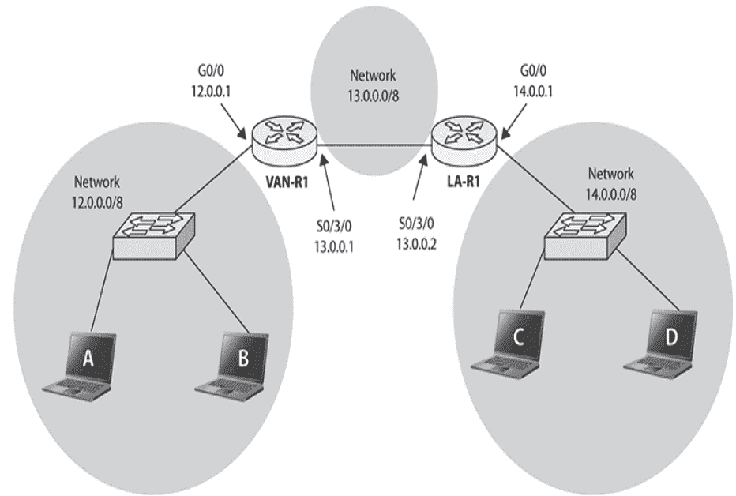
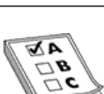
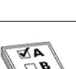
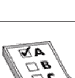
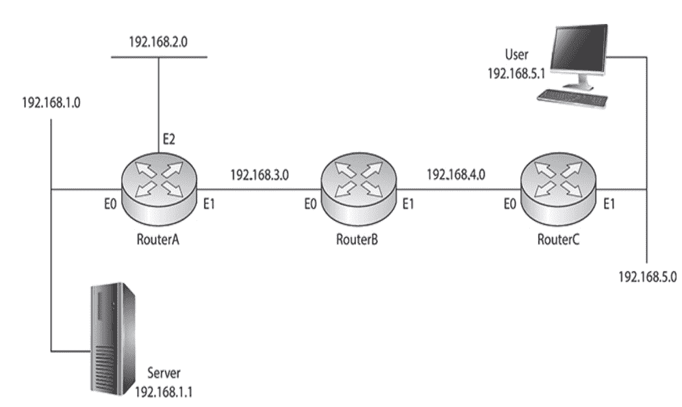
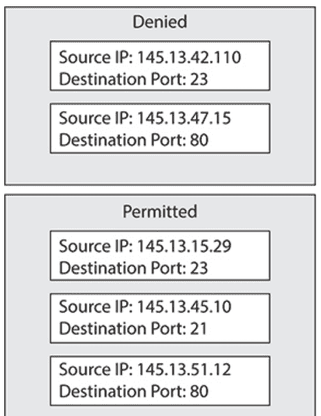

# 在思科设备上实施安全性

在本章中，你将

- 回顾设备密码配置
- 了解如何配置第 2 层安全功能
- 关注访问控制列表
- 了解访问控制列表放置

新的 CCNA 考试要求你理解思科设备的安全功能。上一章向你介绍了安全术语，你同样会被测试，但本章更侧重于你应该了解的影响设备安全性的实际配置设置。

在本章中，我们将回顾密码配置选项以及思科设备上安全外壳 (SSH) 的配置，然后再研究第 2 层安全功能以帮助防止网络上的攻击。你将了解访问控制列表，可以使用它来允许或阻止流量进入或离开网络。

### 配置设备密码

保护你的思科设备始于配置设备上可能存在的不同密码。在本节中，你将了解应在思科设备上配置的不同密码。思科 CCNA 考试将包含一些关于设备密码和本节包含内容的问题。

### Enable 密码和秘密

要讨论的第一个密码是管理员在使用 enable 命令从用户 EXEC 模式导航到特权 EXEC 模式时需要输入的密码。可以配置两种 Enable 密码：Enable 密码（配置文件中未加密）和 Enable 秘密（配置文件中加密）。如果同时设置了 Enable 密码和 Enable 秘密，则需要使用秘密才能访问特权 EXEC 模式。


VIDEO 17.01. 随本书提供的数字资源包含配置 Enable 密码和 Enable 秘密的多媒体演示。

你可以使用 enable password 命令配置 Enable 密码，使用 enable secret 命令配置 Enable 秘密，如下所示：

```
VAN-R1>enable
VAN-R1#config term
VAN-R1(config)#enable password ciscopass
VAN-R1(config)#enable secret ciscosecret
```

现在，如果你使用 do show running-config 命令显示配置，你将看到 Enable 密码未加密，但秘密已加密：

```
VAN-R1(config)#do show running-config
Building configuration...
(output cut for briefness)
enable secret 5 $1$mERr$wZMKJsj2RVk4hay2C4T32.
enable password ciscopass
```


**提示** 请记住，使用 Cisco 时，可以通过在命令开头添加 **no** 来删除某个功能。因此，如果要删除 enable secret，可以使用 **no enable secret** 命令；如果要删除 enable password，可以使用 **no enable password** 命令。

## 保护控制台和辅助端口

下一步要在设备上配置的密码是控制台密码，当有人连接到设备的控制台端口时需要此附加密码。请记住，管理员甚至在进入特权 EXEC 模式之前就需要提供控制台端口密码，并且还需要提供 enable 密码或 enable secret。要配置控制台密码，请从全局配置模式导航到 line con 0 端口，然后设置密码，如下所示：

```
VAN-R1>enable
VAN-R1#config term
VAN-R1(config)#line con 0
VAN-R1(config-line)#password conpass
```

下一步非常重要。在配置了前面的命令后，如果您连接到设备的控制台端口，您会发现系统不会提示输入密码。这是因为在设置密码后，必须使用 **login** 命令来向 Cisco 设备指示该端口需要身份验证，并提示输入密码：

```
VAN-R1(config-line)#login
```


**考试提示** 对于 Cisco CCNA 考试，请记住，设置密码后需要使用 **login** 命令才能要求对该端口进行身份验证。

您的 Cisco 路由器在控制台端口旁边可能有一个辅助 (AUX) 端口。辅助端口用作备用线路，可以连接调制解调器，以便您远程访问路由器并执行管理更改。通常，您会使用路由器的 IP 地址通过 SSH 远程访问路由器，但如果接口出现问题且无法从网络另一端连接，您可以将调制解调器连接到路由器的辅助端口，然后拨号进入路由器。请注意，如果未向辅助端口连接调制解调器，它将像另一个控制台端口一样工作，您可以本地连接到它来管理设备。


**提示** 这里的关键是，无论您是否向辅助端口连接调制解调器，都需要在该端口上配置密码。我看到许多网络管理员没有在辅助端口上配置密码，因为他们没有意识到有人可能会将其视为第二个控制台端口进行连接。

要在辅助端口上配置密码，请从全局配置模式导航到 AUX 线路，然后使用接下来显示的命令设置密码。请注意，此处也使用了 **login** 命令；如果您忘记此命令，配置的密码将无效，因为设备不会在该端口上要求身份验证。

```
VAN-R1>enable
VAN-R1#config term
VAN-R1(config)#line aux 0
VAN-R1(config-line)#password auxpass
VAN-R1(config-line)#login
```


**视频 17.02.** 随本书提供的数字资源包含在 Cisco 设备上配置控制台密码和辅助密码的多媒体演示。

## 保护 VTY 端口

如果您想使用 telnet 或 SSH 远程管理设备，则需要在虚拟类型终端 (VTY) 端口上配置密码。要在 VTY 端口上配置密码，请导航到 VTY 线路，然后使用 **password** 命令。此处还必须使用 **login** 命令，以强制设备在连接到这些端口时通过提示输入密码来要求身份验证。

```
VAN-R1>enable
VAN-R1#config term
VAN-R1(config)#line vty 0 15
VAN-R1(config-line)#password telnetpass
VAN-R1(config-line)#login
```


**注意** 本书前文中我曾提到过，这里再次强调：您应该使用 SSH 而不是 telnet，因为 telnet 会以明文形式从管理员计算机向设备发送所有通信。这包括身份验证流量，因此任何能够截取该通信的人都可以获取您的设备用户名和密码。SSH 会加密从管理员计算机到设备的所有通信，包括身份验证流量。您将在本章后面学习如何在设备上配置 SSH。


VIDEO 17.03. 随本书提供的数字资源包含在 Cisco 设备上配置 VTY 密码的多媒体演示。

## 练习 17-1：在 Cisco 路由器上配置密码

在此练习中，您将为 VAN-R1 和 LA-R1 路由器配置控制台、辅助和 VTY 密码。以下插图显示了本章练习所用的网络设置：



- 1. 确保已按照网络图连接所有物理组件（如路由器和交换机），然后打开设备电源。
- 2. 将工作站连接到 VAN-R1 的控制台端口。然后启动 PuTTY，选择串行连接，设置正确的 COM 端口，并选择“打开”。
- 3. 在 PuTTY 窗口中按 ENTER 以在 Cisco 设备上获得提示符。
- 4. 进入 VAN-R1 的特权 EXEC 模式并配置以下密码。确保路由器在尝试连接时会提示输入这些密码：
  - 控制台端口密码：labconpass
  - 辅助端口密码：labauxpass
  - VTY 密码：labvtypass
- 5. 配置以下 enable 密码和 secret 值：
  - Enable 密码：labenablepass
  - Enable secret：labenablesecret
- 6. 使用 do write 命令将更改保存到 NVRAM。
- 7. 使用 do show running-config 命令验证配置。
- 8. 在 LA-R1 路由器上配置相同的密码。使用前面的命令作为指南。

```
VAN-R1>enable
VAN-R1#config term
Enter configuration commands, one per line. End with CNTL/Z.
VAN-R1(config)#line con 0
VAN-R1(config-line)#password labconpass
VAN-R1(config-line)#login
VAN-R1(config-line)#line aux 0
VAN-R1(config-line)#password labauxpass
VAN-R1(config-line)#login
VAN-R1(config-line)#line vty 0 15
VAN-R1(config-line)#password labvtypass
VAN-R1(config-line)#login
```

```
VAN-R1(config-line)#exit
VAN-R1(config)#enable password labenablepass
VAN-R1(config)#enable secret labenablesecret
VAN-R1(config)#
```

- 9. 在 VAN-R1 路由器上，退出控制台连接，然后重新连接。根据需要提供密码（请注意，您必须先提供控制台密码，再提供 enable secret 密码）。

请注意，您已配置 enable 密码和 enable secret，但现在进入特权 EXEC 模式时，必须将 enable secret 值作为密码提供。

## 配置用户

在为控制台端口、辅助端口或 VTY 端口设置安全性时，可以通过要求用户名和密码（而不仅仅是密码）来提高安全性。在本节中，您将学习如何在 Cisco 设备上管理用户列表，并了解特权级别。

## 创建用户帐户

您可以创建一个用户帐户名和密码列表，这些信息会本地存储在 Cisco 设备上。为此，请使用 **username** 命令，并如下所示填写用户名和密码参数：

```
VAN-R1>enable
VAN-R1#config term
VAN-R1(config)#username edtet z password edpass
VAN-R1(config)#username glenclarke password glenpass
```


**视频 17.04.** 随本书提供的数字资源包含在 Cisco 设备上配置用户帐户的多媒体演示。

接下来，在将使用该列表进行身份验证的每个端口类型上使用 **login local** 命令。在 **login local** 命令中，**login** 意味着强制身份验证（与前面的密码选项类似


讨论)，但 **本地** 意味着使用本地用户名和密码数据库进行身份验证（而不仅仅是端口密码）。例如，以下命令将配置控制台端口，要求用户使用用户名和密码登录才能本地访问设备：

```
VAN-R1(config)#line con 0
VAN-R1(config-line)#login local
```

您会在VTY端口和辅助端口上使用 **login local** 命令，如果您希望要求使用针对用户名和密码列表验证的身份验证。


**考试提示** 对于CCNA考试，请记住，**login local** 命令用于控制台、辅助和VTY端口，以强制使用本地用户名和密码数据库进行身份验证。

## 特权级别

Cisco设备上有16个特权级别，编号为0到15，其中0表示最低特权，15表示最高特权。为了让您了解各级别的功能，当您处于用户EXEC模式时，您的特权级别为1，这就是为什么您无法对设备进行更改。当您进入特权EXEC模式时，您的特权级别将提升到15（完全管理功能）。这就是为什么您必须进入特权EXEC模式才能对设备进行更改。

特权级别的有趣之处在于，您可以将特权级别分配给用户，然后将该特权级别关联到命令，以便用户可以执行该命令。要将特权级别关联到用户，请在 **username** 命令中使用 **privilege** 参数，如下所示：

```
VAN-R1(config)#username adminguy privilege 3 password adminpass
```

如果要更改命令的特权级别，以便用户可以执行该命令，请使用 **privilege exec** 命令为命令分配相同的特权级别：

```
VAN-R1(config)#privilege exec level 3 show running-config
```

在此示例中，我已将 **show running-config** 命令分配给级别3，以便用户需要具有至少级别3的特权级别才能运行该命令。

如果您不确定自己的特权级别，可以使用 **show privilege** 命令：

```
VAN-R1>show privilege
Current privilege level is 1
VAN-R1>enable
VAN-R1#show privilege
Current privilege level is 15
```

请注意，当我处于用户EXEC模式时，我的特权级别为1，但当我进入特权EXEC模式时，我的特权级别会变为15。

## 练习17-2：在Cisco设备上创建用户

在此练习中，您将在Cisco设备的本地用户帐户数据库中配置一些用户帐户，然后修改控制台端口，要求在登录到Cisco设备时使用用户名和密码。

- 1. 在继续此练习之前，请确保已完成上一个实验练习。
- 2. 将工作站连接到控制台端口VAN-R1。然后启动PuTTY，选择串行连接，设置正确的COM端口，并选择打开。
- 3. 在PuTTY窗口中按ENTER键以在Cisco设备上获取提示符。
- 4. 访问VAN-R1的特权EXEC模式并在路由器上配置以下用户名和密码：

用户名：**bob** / 密码：**bobpass**
用户名：**sue** / 密码：**suepass**

- 5. 断开并重新连接到控制台端口。系统是否提示您输入用户名和密码？________
- 6. 使用控制台密码labconpass登录到路由器，并通过提供密钥labenablesecret进入特权EXEC模式。
- 7. 要强制路由器对控制台访问、辅助端口访问和VTY访问使用用户名和密码列表，请导航到每个端口并使用 **login local** 命令：
- 8. 保存配置更改，然后从控制台端口断开连接并重新连接。系统是否要求您输入用户名和密码？________
- 9. 使用用户名bob和密码bobpass登录。
- 10. 为了更多练习，在LA-R1路由器上配置相同的用户名和密码。确保在连接到控制台端口、辅助端口和VTY端口时使用用户名和密码登录。
- 11. 将所有更改保存到两个路由器，并保持运行以备下一个练习使用。

```
VAN-R1(config)#line con 0
VAN-R1(config-line)#login local
VAN-R1(config-line)#line aux 0
VAN-R1(config-line)#login local
VAN-R1(config-line)#line vty 0 15
VAN-R1(config-line)#login local
```

## 加密密码

现在我们已为Cisco设备配置了所有密码，让我们使用 **write** 命令将其保存到启动配置中。让我们使用 **show startup-config** 命令查看配置文件。

```
VAN-R1#show startup-config
Using 1385 bytes
version 15.1
(output cut for briefness)
enable secret 5 $1$mERr$wZMkJsj2RVk4hay2C4T32.
enable password ciscopass
username adminguy privilege 3 password 0 adminpass
line con 0
  password conpass
  login
line aux 0
  password auxpass
  login
line vty 0 4
  password telnetpass
  login
line vty 5 15
  password telnetpass
  login
VAN-R1#
```

查看配置文件时，您可以看到，除了密钥外，所有密码都以明文形式存储。这意味着，如果有人能够物理访问您的路由器，他或她可以查看配置文件并看到您正在使用的密码。从安全角度来看，这是一种非常糟糕的配置！

您可以使用快速简单的命令 **service password-encryption** 加密Cisco配置文件中的所有密码：

```
VAN-R1#config term
VAN-R1(config)#service password-encryption
VAN-R1(config)#do write
```

执行该命令后，它会加密配置文件中的任何明文密码，因此查看配置文件的人不会知道您的密码是什么。执行命令后，您可以查看配置文件以验证密码是否已加密：

```
VAN-R1(config)#do show startup-config
Using 1444 bytes
version 15.1
(output cut for briefness)
service password-encryption
...
```

请注意，在输出中，**service password-encryption** 显示在配置文件中，并且已启用。另外，请注意突出显示的区域中，密码不再在配置中可见。


**视频17.05。** 伴随本书的数字资源包含在Cisco设备上配置密码加密的多媒体演示。

在配置文件中加密所有密码的价值在于，如果有人确实获得了对您设备的物理访问权限并能够查看配置文件，他将不知道您的密码是什么。例如，如果有人获得了对我的路由器的物理访问权限，使用密码恢复程序（您在第8章中了解过）绕过了密码，而我未加密密码，他可以查看我的VTY密码，然后稍后使用该密码远程登录我的网络。请记住这一点：加密密码！


**考试提示** 对于考试，请记住，**service password-encryption** 命令用于加密配置文件中的所有密码。

## 练习17-3：在Cisco设备上加密密码

在此练习中，您将查看在Cisco设备上配置的密码，然后在Cisco配置文件中对其进行加密。

- 1. 在继续此练习之前，请确保已完成上一个实验练习。
- 2. 将工作站连接到VAN-R1的控制台端口。启动PuTTY，选择串行连接，设置正确的COM端口，并选择打开。
- 3. 在PuTTY窗口中按ENTER键以在Cisco设备上获取提示符。
- 4. 访问VAN-R1的特权EXEC模式，并使用 **show running-config** 命令查看正在运行的配置。记录哪些密码已加密：
- 5. 导航到全局配置并使用 **service password-encryption** 命令加密所有密码。然后查看正在运行的配置。
- 6. 记录哪些密码现在已加密：

|  | 是 | 否 |
|---|---|---|
| 启用密码 |  |  |
| 启用密钥 |  |  |
| 控制台密码 |  |  |
| 辅助密码 |  |  |
| VTY密码 |  |  |
| Bob的密码 |  |  |
| Sue的密码 |  |  |


|  | 是 | 否 |
|---|---|---|
| 启用密码 |  |  |
| 启用保密 |  |  |
| 控制台密码 |  |  |
| 辅助密码 |  |  |
| VTY 密码 |  |  |
| Bob 的密码 |  |  |
| Sue 的密码 |  |  |

- 7. 使用 **do write** 命令保存您的更改。
- 8. 切换到 LA-R1 路由器，并确保通过使用 **service password-encryption** 命令对该路由器上的所有密码进行加密。
- 9. 在 LA-R1 路由器上，验证密码是否已加密，然后保存配置。

## 配置 SSH

另一个您应该在 Cisco 设备上配置的安全功能是将设备配置为使用 SSH 而非 Telnet。以下是对两者的简要回顾：Telnet 使用 TCP 端口 23，不加密通信。SSH 使用 TCP 端口 22，并加密所有通信，包括从管理员计算机传输到 Cisco 设备的用户名和密码。

配置 SSH 需要几个准备步骤：

- 1. 如果路由器上尚未配置主机名，请配置主机名。
- 2. 创建管理员在使用 SSH 连接设备时进行身份验证所用的用户名和密码。
- 3. 在设备上配置域名，因为该域名用于生成用于加密的加密密钥。

示例如下：

```
Router>enable
Router#config term
Router(config)#hostname VAN-R1
VAN-R1(config)#username glenclarke password glenpass
VAN-R1(config)#ip domain-name glenclarke.com
```

您还需要验证 Cisco 设备使用的是支持加密的 IOS 版本，例如 IOS 映像文件名以 K9 结尾的版本。

完成准备步骤后，即可使用 crypto key generate rsa 命令生成加密密钥：

```
VAN-R1(config)#crypto key generate rsa
The name for the keys will be: VAN-R1.glenclarke.com
Choose the size of the key modulus in the range of 360 to 2048 for your
General Purpose Keys. Choosing a key modulus greater than 512 may take
a few minutes.
How many bits in the modulus [512]: 512
% Generating 512 bit RSA keys, keys will be non-exportable...[OK]
VAN-R1(config)#
```

请注意，密钥名称基于您配置的主机名和域名。当系统询问要使用的位强度时，接受默认值 512。

有了加密密钥后，您可以配置 VTY 端口，仅在使用 SSH 时才接受连接。在以下代码示例中，请注意我们正在配置使用设备上的本地用户名进行身份验证。然后，您可以使用 transport input ssh 命令指定这些端口上仅使用 SSH 协议。

```
VAN-R1(config)#line vty 0 15
VAN-R1(config-line)#login local
VAN-R1(config-line)#transport input ssh
```

此时，Cisco 设备将不再接受用于远程管理的 Telnet 连接。您可以进一步使用访问控制列表来限制哪些 IP 地址可以 SSH 登录到设备，但我们将把该讨论留到本章后面的“实施访问控制列表”部分。


**考试提示** 对于 CCNA 考试，请记住限制 VTY 端口仅接受来自 SSH 客户端（而非 Telnet 客户端）连接的命令。

## 练习 17-4：为远程管理强制使用 SSH

在本练习中，您将仅使用 SSH 协议配置 VAN-R1 和 LA-R1 Cisco 路由器以进行远程管理。

- 1. 在继续本练习之前，请确保已完成上一练习。
- 2. 将您的工作站连接到 VAN-R1 的控制台端口。启动 PuTTY，选择串行连接，设置正确的 COM 端口，然后选择打开。
- 3. 在 PuTTY 窗口中按 ENTER 键以在 Cisco 设备上获取提示符。
- 4. 进入 VAN-R1 的特权 EXEC 模式，创建用户名 *exer174user* 及其密码 *Pa$$w0rd*。配置域名 *exer17-4.loc*：
- 5. 使用以下命令为 SSH 创建加密密钥。出现提示时，将位强度设置为 *512*：
- 6. 在 VTY 端口上使用 **login local** 命令配置 VTY 端口以使用用户名和密码进行身份验证：

```
VAN-R1>enable
VAN-R1#config term
VAN-R1(config)#username exer174user password Pa$$w0rd
VAN-R1(config)#ip domain-name exer17-4.loc
```

```
VAN-R1(config)#crypto key generate rsa
```

```
VAN-R1(config)#line vty 0 15
VAN-R1(config-line)#login local
```

- 7. 确保 VTY 端口仅使用 SSH 作为协议：

```
VAN-R1(config-line)#transport input ssh
```

- 8. 转到 LA-R1 的 CLI，并验证您无法使用 **telnet 13.0.0.1** 命令 Telnet 登录到 VAN-R1 路由器。您应收到错误。
- 9. 在 LA-R1 路由器上，执行本练习中的相同步骤，以确保 SSH 仅可用作远程管理协议。


**视频 17.06.** 随本书提供的数字资源包含一个多媒体演示，演示如何为您的 Cisco 设备要求将 SSH 作为远程管理协议。

## 配置第 2 层安全功能

在本节中，您将了解第 2 层和第 3 层交换机支持的第 2 层安全功能。本节将首先回顾加固交换机的一些基本做法，然后探讨一些常见的第 2 层攻击以及如何缓解这些攻击。

## 禁用未使用的端口

加固交换机的第一个安全最佳实践是禁用交换机上的任何未使用端口。这有助于防止未经授权的人员连接到空闲端口并获得网络访问权限。要禁用端口，请在端口上使用 **shutdown** 命令：

```
VAN-SW1>enable
VAN-SW1#config term
VAN-SW1(config)#interface g0/10
VAN-SW1(config-if)#shutdown
```

如果您想一次关闭交换机上的多个端口，可以使用 interface range 命令选择端口，然后接着使用 shutdown 命令：

```
VAN-SW1>enable
VAN-SW1#config term
VAN-SW1(config)#interface range g0/12 - 24
VAN-SW1(config-if)#shutdown
```


视频 17.07. 随本书提供的数字资源包含一个多媒体演示，演示如何禁用交换机上的未使用端口。

## 端口安全

在禁用交换机上的任何未使用端口后，加固交换机的下一步是在已用端口上配置端口安全。如您在第 9 章中所学，端口安全是一项功能，可让您指定哪些 MAC 地址有权使用端口。如果未经授权的设备连接到端口，端口安全功能可以关闭端口，直到管理员启用它。

要回顾端口安全，请导航到端口并将端口置于访问模式，这意味着端点设备（例如工作站）将连接到端口以使用它：

```
VAN-SW1>enable
VAN-SW1#config term
VAN-SW1(config)#interface g0/7
VAN-SW1(config-if)#switchport mode access
```

接下来，您将在端口上启用端口安全功能，然后指定有权使用端口的 MAC 地址。为了免去您需要知道并键入 MAC 地址的麻烦，您可以使用 *sticky 选项*，这意味着交换机将动态配置端口安全，以适应连接到端口的任何设备。如果您将要学习的最大地址数设置为 *1*，则 **sticky** 将仅学习当前连接设备的地址，并将使用该 MAC 地址配置端口安全：

```
VAN-SW1(config-if)#switchport port-security
VAN-SW1(config-if)#switchport port-security mac-address sticky
VAN-SW1(config-if)#switchport port-security maximum 1
```


**考试提示** 对于 CCNA 考试，请记住，端口安全中的 **sticky** 选项用于将端口限制为当前连接到该端口的系统。它使管理员免于必须学习该客户端的 MAC 地址，然后将其输入到端口安全命令中。

最后，使用违规模式指定当未经授权的设备连接到交换机端口时会发生什么。回顾第 9 章以了解违规模式；这里我们将使用 shutdown 模式禁用端口：

```
VAN-SW1(config-if)#switchport port-security violation shutdown
```


**视频** 17.08. 随本书提供的数字资源包含一个多媒体演示，演示如何在交换机上配置端口安全。

## DHCP 防伪


当今企业网络中常见的一个问题是，当一台恶意 DHCP 服务器被放置在网络上并向网络客户端分配虚假 IP 地址时。这会导致客户端计算机无法访问网络资源，因为分配给客户端的地址通常位于不同的子网上。

恶意 DHCP 服务器会对组织带来巨大的安全风险，因为黑客可能已将恶意 DHCP 服务器放置在网络上，以分发其自己的 IP 地址范围，包括默认网关和 DNS 服务器设置。这使攻击者能够执行中间人攻击，因为她可以将默认网关设置为自己的系统，从而导致所有流量都流经她的系统。

您可以使用名为 DHCP Snooping 的第 2 层交换机功能来缓解恶意 DHCP 服务器问题。使用 DHCP Snooping 时，您可以将端口分类为受信任端口或非受信任端口。将 DHCP 服务器连接所在的端口配置为受信任端口，表明该端口在您的控制之下，并有权生成 DHCP 服务器消息。然后，将所有其他端口配置为非受信任端口，因为 DHCP 服务器未连接到这些端口。然后，如果有人将恶意 DHCP 服务器连接到某个非受信任端口，交换机将丢弃与 DHCP 服务器相关的消息，例如 DHCPOFFER、DHCPACK 和 DHCPNACK，从而保护网络免受恶意 DHCP 服务器的攻击。

## 配置 DHCP Snooping

默认情况下禁用 DHCP Snooping 功能，必须先全局启用，然后在交换机上为每个 VLAN 启用。例如，以下命令在交换机上启用 DHCP Snooping，然后为 VLAN 1 启用：

```
Switch>enable
Switch#config term
Switch(config)#ip dhcp snooping
Switch(config)#ip dhcp snooping vlan 1
```

请记住，这两个命令应该是您运行的最后两个命令，尽管从教学角度来看，它们是我喜欢讨论的第一个命令。之所以应该将这两个命令作为最后两个命令，是因为现在已启用 DHCP Snooping，但我们没有指定任何受信任端口，这意味着网络上的真实 DHCP 服务器目前不允许向客户端分配地址，直到您将其配置为受信任端口。


**考试提示** 对于 CCNA 考试，请记住如何配置 DHCP Snooping，并注意它可以按 VLAN 基础启用。

要使您的 DHCP 服务器能够在网络上分配地址，请通过进入接口并使用 **ip dhcp snooping trust** 命令，将 DHCP 服务器连接所在的交换机接口配置为受信任端口：

```
Switch(config)#interface g1/0/2
Switch(config-if)#ip dhcp snooping trust
```


**考试提示** 对于 CCNA 考试，请记住，连接了 DHCP 服务器的交换机端口应配置为受信任端口。

## DHCP Snooping 绑定数据库

当交换机拦截 DHCP 消息时，它会构建 *DHCP Snooping 绑定数据库*，即列出从 DHCP 服务器接收到 IP 地址的非受信任主机（连接到非受信任端口的主机）。DHCP Snooping 绑定数据库包含每个已连接系统的非受信任接口的条目，详细信息包括接口 ID、客户端的 MAC 地址、连接到该端口的系统的 IP 地址以及该接口所属的 VLAN。如果您想查看 DHCP Snooping 绑定数据库，可以使用 **show ip dhcp snooping binding** 命令。

DHCP Snooping 绑定数据库由交换机维护，因此当交换机看到 DHCPACK 消息时，它会将条目添加到数据库中，当看到 DHCPRELEASE 消息时，它会从数据库中删除条目。

## 动态 ARP 检测

在将动态 ARP 检测作为第 2 层安全功能来探讨之前，我们先讨论一下它解决了什么问题。当网络上的设备与另一台设备通信时，它必须先学习该设备的 MAC 地址，以便能够向其发送数据。您在第 3 章中了解到，设备使用 ARP 通过广播 ARP 请求消息来学习网络上设备的 MAC 地址，消息内容为：“谁有这个 IP 地址，我需要知道你的 MAC 地址。”所有系统都能看到该广播，但除拥有该特定 MAC 地址的系统外，其他系统都会忽略。该系统会发送 ARP 回复，内容大致为：“那是我的 IP 地址，这是我的 MAC 地址。”从安全角度来看，这是重要部分：当设备收到 ARP 回复时，它会将这些信息存储在称为 ARP 缓存的内存区域中，ARP 缓存是 IP 地址及其对应 MAC 地址的列表。这里需要注意的是，网络上的设备默认会信任 ARP 缓存中的任何信息。

攻击者已经学会执行 ARP 毒化攻击，这使他们能够将错误信息放入系统会信任的 ARP 缓存中。例如，如果攻击者想要执行中间人攻击，他可以通过指定自己的 MAC 地址对应默认网关的 IP 地址来毒化您的 ARP 缓存。然后，当您上网时，所有流量都会被发送到攻击者的系统，在那里他可以捕获流量，然后将其转发到真正的默认网关。

为了提高安全性并帮助防止 ARP 毒化攻击（和中间人攻击），思科交换机包含 *动态 ARP 检测*（DAI）功能。如果在交换机上启用 DAI 功能，交换机将拦截所有 ARP 消息，然后将 ARP 消息中的信息与 DHCP Snooping 绑定数据库中存储的数据（包含 IP 地址和 MAC 地址列表）进行比较。例如，启用 DAI 后，如果攻击者发送一条声称自己正在使用默认网关的 IP 地址，并提供其系统 MAC 地址的 ARP 毒化消息，交换机将在 DHCP Snooping 绑定数据库中查找该 IP 地址，并验证它是否与该 IP 地址匹配正确的 MAC 地址。如果不匹配，数据包将被丢弃，这意味着攻击者无法成功毒化 ARP 缓存。


**考试提示** 对于 CCNA 考试，请记住，动态 ARP 检测旨在防止中间人攻击和 ARP 毒化攻击。

请记住，DAI 仅在非受信任端口上执行检查，因为它使用 DHCP Snooping 绑定数据库，该数据库仅在非受信任端口上存储信息。同样，与 DHCP Snooping 一样，DAI 是按 VLAN 基础配置的。要在交换机上为 VLAN 1 配置动态 ARP 检测，请使用以下命令：

```
Switch>enable
Switch#config term
Switch(config)#ip arp inspection vlan 1
```

如果有多台交换机相互连接，则将交换机的连接端口（中继端口）配置为受信任端口，以便交换机不会验证来自这些端口的 ARP 消息。例如，如果我的交换机上的端口 24 连接到另一台交换机，我将使用以下命令指定该端口为受信任端口：

```
Switch(config)#interface g1/0/24
Switch(config-if)#ip arp inspection trust
```



**考试提示** 对于考试，请记住，中继端口配置为受信任端口，以便交换机不会检查来自另一台交换机的所有 ARP 消息。

## 实现访问控制列表

过去几章向您介绍了路由协议及其基本配置。默认情况下，一旦设置了路由，您的路由器就会允许任何数据包在接口之间流动。出于安全或流量策略原因，您可能希望实施策略以限制流量流动。思科使您能够通过使用访问控制列表（ACL）来控制接口之间的流量流动。ACL 读作 *ackles*，是思科 IOS 的一项强大功能。思科实际上支持非 IP 协议的 ACL，包括 Internetwork Packet Exchange（IPX）、AppleTalk、第 2 层流量及其他协议。本章仅关注 IP ACL。

## ACL 概述

ACL 以其在流量进入或离开接口时对其进行过滤的能力而闻名，还可用于其他目的，包括限制对 IOS 设备的远程访问（VTY）、过滤路由信息、通过排队对流量进行优先级排序、使用按需拨号路由（DDR）触发电话呼叫、更改路由的管理距离，以及指定受 IPsec VPN 保护的流量，还有许多其他目的。本章专注于限制流向路由器或流经路由器的流量。


**考试提示** 请记住，ACL 既可用于过滤流经 IOS 设备的流量，也可用于过滤流向 IOS VTY 线路的远程访问流量。


## 定义

ACL 基本上是一组命令，按数字或名称分组，用于过滤进入或离开接口的流量。ACL 命令具体定义哪些流量被允许，哪些被拒绝。ACL 在全局配置模式下创建。

创建一组 ACL 语句后，必须激活它们。对于过滤接口之间的流量，ACL 在接口子配置模式下激活。这可以是物理接口，如 ethernet0 或 serial0，也可以是逻辑接口，如 ethernet0.1 或 serial0.1。在接口上激活 ACL 时，必须指定流量应在哪个方向上进行过滤：

- **入站** 当流量从外部源进入接口时，IOS 在将数据包转发到另一个接口之前，将数据包与接口 ACL 进行比较。
- **出站** 数据包在接口上接收并转发到退出接口；在流量从接口退出到网络之前，IOS 将数据包与 ACL 进行比较。

ACL 的一个限制是，它们无法过滤路由器自身发出的流量。例如，如果你从路由器执行 ping 或 traceroute，或从路由器 telnet 到另一台设备，应用于路由器接口的 ACL 无法过滤这些出站连接。但是，如果外部设备尝试 ping、traceroute 或 telnet 到路由器，或通过路由器到达远程目标，路由器可以过滤这些数据包。


**考试提示** 考试会考查 ACL，因此请记住，对于入站 ACL，ACL 在 IOS 进行任何进一步处理之前先被处理；对于出站 ACL，数据包首先被路由到接口，然后处理出站 ACL。应用于接口的出站 ACL 不能用于过滤 IOS 自身产生的流量。

## 类型

ACL 有两种类型：*编号* 和 *命名*。编号 ACL 和命名 ACL 定义路由器如何引用 ACL。你可以将此视为类似于索引值。编号 ACL 在所有 ACL 中被分配一个唯一编号，而命名 ACL 在所有命名 ACL 中被分配一个唯一名称。随后路由器使用这些引用来过滤流量。

对 ACL 的每种引用都支持两种过滤类型：*标准* 和 *扩展*。标准 IP ACL 只能根据数据包内的源 IP 地址进行过滤，而扩展 IP ACL 可以根据数据包中的源 IP 地址和目的 IP 地址、IP 协议（TCP、UDP、ICMP 等）以及协议信息（例如 TCP 或 UDP 源端口和目的端口号或 ICMP 消息类型）进行过滤。使用扩展 ACL，你可以非常精确地进行过滤。例如，你可以过滤用户 PC 到远程 Telnet 服务器的特定 Telnet 会话。标准 ACL 不支持这种粒度。使用标准 ACL，你可以允许或拒绝来自特定源设备的所有流量。表 17-1 比较了两种 ACL 类型，并列出了可用于每种类型过滤流量的参数。

| 过滤信息 | 标准 IP ACL | 扩展 IP ACL |
|---|---|---|
| 源地址 | 是 | 是 |
| 目的地址 | 否 | 是 |
| IP 协议 (IP, TCP, 或 UDP) | 否 | 是 |
| 协议信息 (端口号) | 否 | 是 |

表 17-1 标准和扩展 ACL 比较

两种 ACL 都可以在 IOS 设备上静态定义，或通过身份验证服务器动态下载。当用户对网络进行身份验证时，通常会使用动态 ACL，例如通过使用 IEEE 802.1X 的交换机端口；一旦用户成功通过身份验证，交换机就会从身份验证服务器下载 ACL 并将其应用于用户的交换机端口。然后，ACL 用于过滤流量。一旦用户离开网络，动态 ACL 就会从交换机端口中删除。动态 ACL 的使用和配置超出了本书的范围，本书专注于 IOS 设备本身上静态 ACL 的配置。


**考试提示** 记住表 17-1 中标准 ACL 与扩展 ACL 的过滤能力。能够描述动态 ACL 的用途。

## ACL 处理

ACL 基本上是按名称或数字分组的语句。在这组语句中，当 ACL 处理数据包时，IOS 会按特定步骤查找与 ACL 语句的匹配项。IOS 按*自上而下*的顺序处理 ACL。数据包会与 ACL 中的第一条语句进行比较，如果 IOS 在数据包和语句之间找到匹配项，IOS 将执行语句中包含的两种操作之一：*允许* 或 *拒绝*。

如果 IOS 没有在第一条 ACL 语句中找到数据包内容的匹配项，IOS 将继续处理列表中的下一条语句，再次执行相同的匹配过程。如果第二条语句匹配数据包内容，IOS 将执行两种操作之一。如果此语句没有匹配项，IOS 将继续遍历列表，直到找到匹配项。如果 IOS 遍历了整个列表，但在 ACL 语句中找不到与 ACL 内容匹配的项，路由器将*丢弃*数据包。

ACL 的自上而下处理带来了以下几点非常重要的说明：

- 一旦找到匹配项，列表中将不再处理后续语句。
- 语句的顺序很重要，因为在第一个匹配之后，其余语句将不再被处理。
- 如果列表中没有找到匹配项，数据包将被丢弃。

## 语句顺序

如果在某条语句上找到匹配项，则不会再处理后续语句。因此，ACL 中语句的顺序*非常*重要。如果你有两条语句，一条拒绝某个主机，另一条允许同一主机，那么列表中*首先*出现的那条将被执行，第二条将被忽略。由于语句顺序很重要，你应始终将最具体的 ACL 语句放在列表顶部，将最不具体的语句放在列表底部。

让我们看一个示例来说明这一过程。在此示例中，路由器上有一个 ACL，包含以下顺序的两条语句：

- 1. 允许来自子网 172.16.0.0/16 的流量。
- 2. 拒绝来自主机 172.16.1.1/32 的流量。

请记住，路由器按*自上而下*的顺序处理这些语句。假设路由器接收到源 IP 地址为 172.16.1.1 的数据包。根据前面的 ACL，路由器将数据包内容与第一条语句进行比较。数据包是否来自网络 172.16.0.0/16 的源地址？是的。因此，结果表明路由器应允许该数据包。请注意，一旦路由器在某条语句上找到匹配项，第二条语句将永远不会被处理。在此示例中，来自 172.16.0.0/16 子网的任何流量都被允许，即使来自 172.16.1.1 的流量也是如此。

让我们反转 ACL 中两条语句的顺序，看看重新排序后的 ACL 将如何影响流量流向：

- 1. 拒绝来自主机 172.16.1.1 的流量。
- 2. 允许来自子网 172.16.0.0/16 的流量。

如果 172.16.1.1 通过路由器发送流量，IOS 首先将这些数据包与第一条 ACL 语句进行比较。由于源地址与 172.16.1.1 匹配，路由器将丢弃数据包并停止处理 ACL 中的语句。在此示例中，172.16.1.1 发送什么流量无关紧要，因为它会被丢弃。如果另一台设备（例如 172.16.1.2）通过路由器发送流量，路由器将数据包内容与第一条 ACL 语句进行比较。由于数据包中的源地址与 ACL 语句中的源地址不匹配，路由器将继续处理列表中的下一条语句。将数据包内容与语句进行比较，存在匹配项。因此，路由器将执行结果，允许来自 172.16.1.2 的流量。从这两个 ACL 示例中可以看出，ACL 中语句的顺序非常重要，并且*肯定*会影响哪些流量被允许或拒绝。


**考试提示** 能够重新排序 ACL 中的语句以提供所需的结果。

## 隐式拒绝

自上而下处理的另一个重要方面是，如果路由器将数据包与列表中的每条语句进行比较但没有在数据包内容中找到匹配项，路由器将*丢弃*数据包。此过程称为*隐式拒绝*。每个 ACL 末尾都有一个不可见语句，用于丢弃不匹配 ACL 中任何前面语句的所有流量。鉴于此过程，仅包含拒绝语句的列表没有意义，因为隐式拒绝无论如何都会丢弃所有流量。因此，每个 ACL 应至少包含一条*允许*语句；否则，仅包含拒绝语句的 ACL 将丢弃所有流量，考虑到拒绝语句和隐藏的隐式拒绝语句。


**考试提示** 考试时，你需要记住关于 ACL 语句的几点。ACL 可以执行两种操作：允许或拒绝。语句按自上而下的顺序处理。一旦找到匹配项，将不再处理后续语句；因此，顺序很重要。如果未找到匹配项，ACL 末尾不可见的隐式拒绝语句将丢弃数据包。每个 ACL 应至少包含一条允许语句；否则，由于每个 ACL 末尾都有隐藏的隐式拒绝语句，所有流量都将被丢弃。


## 重要配置指南

配置ACL并非简单过程。要正确完成配置过程，应参考以下列表：

- 语句顺序很重要。将最严格的语句放在列表顶部，最不严格的放在底部。
- ACL语句按从上到下的顺序处理，直到找到匹配项，之后不再处理列表中的其他语句。
- 如果在ACL中未找到匹配项，则丢弃数据包（隐式拒绝）。
- 每组ACL语句都需要一个唯一编号或唯一名称。
- 路由器无法过滤其自身发起的流量。
- 每个方向（入站和出站）一个接口只能应用一个IP ACL——不能向同一接口应用两个或多个入站或出站ACL。（实际上，每种协议（如IP和IPX）可以在每个方向上向接口应用一个ACL。）
- 向接口应用空ACL默认允许所有流量。要使ACL具有隐式拒绝语句，ACL中至少需要一个实际的permit或deny语句。

从本指南列表可以看出，ACL并非简单事务。ACL是IOS中更复杂但功能强大的功能之一。ACL的配置、管理和故障排除可能变得非常复杂，给你带来许多麻烦。因此，了解路由器将数据包与ACL进行比较时使用的过程以及如何创建和维护它们非常重要。以下部分介绍了路由器上ACL的基本配置。



**考试提示** 对于CCNA考试，请记住重要ACL配置指南列表。

## 创建ACL

本节简要介绍配置IP ACL所用的两个基本命令。以下部分将详细介绍编号ACL与命名ACL以及标准ACL与扩展ACL的配置。

要创建编号ACL，请使用以下通用语法：

```
Router(config)# access-list ACL_# permit|deny conditions
```

在IOS 11.2之前，只能为ACL指定编号作为标识符。从IOS 11.2开始，可以通过编号或名称引用ACL。ACL_#的用途是将语句分组为单一列表或策略。不能为ACL选择任意编号。每种第3层协议都有自己的编号范围或范围。

表17-2列出了IP ACL的有效编号。从本表可以看出，编号ACL可创建的列表数量有限，这取决于分配给协议类型的编号范围。但是，命名ACL没有此限制。基本上，路由器上命名ACL的数量仅受路由器RAM和NVRAM容量的限制。

| ACL类型 | ACL编号 |
|---|---|
| IP 标准 | 1-99, 1300-1999 |
| IP 扩展 | 100-199, 2000-2699 |

表17-2 ACL类型和编号



**考试提示** 对于CCNA考试，请记住可用于IP ACL的编号。标准ACL可使用1到99和1300到1999的编号，扩展ACL可使用100到199和2000到2699的编号。

ACL语句中的*条件*告诉路由器数据包中的哪些内容需要匹配，以便路由器执行操作（**允许**或**拒绝**）。条件可以包括IP地址和协议信息的匹配。当IOS将数据包与条件进行比较时，如果找到匹配项，则不再处理更多ACL语句；如果未找到匹配项，IOS将继续将数据包与列表中的下一条ACL语句进行比较。

## 匹配地址：通配符掩码

在ACL语句中处理IP地址时，可以使用*通配符掩码*来匹配一系列地址，而不是手动输入要匹配的每个IP地址。

首先，通配符掩码*不是*子网掩码。与IP地址或子网掩码一样，通配符掩码由32位组成。表17-3比较了子网掩码和通配符掩码中的位值。使用通配符掩码时，某个位位置上的*0*表示ACL语句地址中相应的位位置*必须*与检查数据包中IP地址相同位位置匹配。某个位位置上的*1*表示ACL语句地址中相应的位位置*不必*与检查数据包中IP地址的相应位位置匹配。换句话说，通配符掩码与ACL语句中的地址协同工作。通配符掩码告诉路由器，ACL语句地址中的哪些定址位必须与正在比较的数据包中的位匹配。

| 位值 | 子网掩码 | 通配符掩码 |
|-----------|-------------|---------------|
| 0 | 主机组件 | 必须匹配 |
| 1 | 网络组件 | 忽略 |

**表17-3** 子网掩码与通配符掩码

实际上，通配符掩码更像是一个*反转*的子网掩码。例如，如果要匹配子网或网络中的任何地址，只需取子网掩码，反转其位值（将1改为0，将0改为1），即可得到相应的通配符掩码。

让我们看一个将子网掩码转换为通配符掩码的二进制简单示例。假设子网掩码为255.255.0.0。其二进制表示为11111111.11111111.00000000.00000000。将其转换为通配符掩码时，反转位，如下所示：00000000.00000000.11111111.11111111。然后将其转换为十进制：0.0.255.255。这是子网掩码255.255.0.0对应的通配符掩码。在本示例中，通配符掩码告诉路由器，ACL语句中相应IP地址的前16位必须与检查数据包中IP地址的前16位匹配，路由器才能继续处理该语句；否则，路由器将转到下一条ACL语句。从本示例可以看出，此示例转换很容易。

让我们看一个更困难的示例。假设要匹配具有子网掩码255.255.240.0的子网。以下是完整的子网掩码二进制形式：11111111.11111111.11110000.00000000。在本示例中，第一、第二和第四个八位组容易转换：难点在于第三个八位组。要将子网掩码转换为通配符掩码，反转所有位，如下所示：00000000.00000000.00001111.11111111。然后将其转换回十进制。这将得到通配符掩码0.0.15.255。

从本示例可以看出，如果子网掩码的某个八位组为0，则通配符掩码对应值为255；如果子网掩码的某个八位组为255，则通配符掩码对应值为0。但是，第二个示例中的第三个八位组使此过程变得更加困难。

以下是一种简化子网掩码转换为通配符掩码的快捷方法。进行转换时，用255减去子网掩码中的每个字节。结果即为通配符掩码的对应字节值。回到255.255.240示例，快捷方法如下：

- 第一个字节：255 – 255（第一个子网字节值）= 0（通配符掩码值）
- 第二个字节：255 – 255（第二个子网字节值）= 0（通配符掩码值）
- 第三个字节：255 – 240（第三个子网字节值）= 15（通配符掩码值）
- 第四个字节：255 – 0（第四个子网字节值）= 255（通配符掩码值）

从本示例可以看出，这将得到通配符掩码0.0.15.255。这个简单技巧使子网掩码与通配符掩码之间的相互转换变得非常容易。


**考试提示** 通配符掩码用于将规则与数据包中的位进行匹配。某个位位置上的0表示匹配，1表示忽略。如果要匹配子网，请反转子网掩码以创建通配符掩码。诀窍是用255减去子网掩码中的每个八位组，得到通配符掩码。如果在CCNA考试中需要针对少数ACL问题使用此技巧，请不要惊讶。

## 特殊通配符掩码

存在两种特殊类型的通配符掩码：0.0.0.0和255.255.255.255。0.0.0.0通配符掩码告诉IOS，ACL语句地址的所有32位必须与IP数据包中的地址匹配，IOS才能执行该语句的操作。0.0.0.0通配符掩码称为主机掩码。以下是ACL语句中此信息的简单示例：192.168.1.1 0.0.0.0。此语句告诉IOS在IP数据包中查找完全相同的IP地址（192.168.1.1）。如果IOS未找到匹配项，IOS将转到下一条ACL语句。如果配置192.168.1.1 0.0.0.0，IOS将其转换为以下语法：host 192.168.1.1（注意IP地址前面的关键字host）。

255.255.255.255通配符掩码告诉路由器与0.0.0.0掩码完全相反的信息。在此掩码中，所有位值均为1，这告诉IOS它正在与ACL进行比较的数据包内容无关紧要。


语句—*any*地址将匹配。通常，您会将其记录为IP地址0.0.0.0和通配符掩码255.255.255.255，如下所示：0.0.0.0 255.255.255.255。如果输入此内容，IOS将地址和掩码转换为关键字*any*。实际上，使用此掩码输入的IP地址无关紧要。例如，如果输入192.168.1.1 255.255.255.255，这仍然匹配任何IP地址。请记住，是通配符掩码决定了IP地址中哪些位是*有趣*的并且应匹配。


**提示** 某些通配符掩码可能会让人困惑，例如0.0.1.255。对于此类掩码，有时从子网掩码的角度来看会更容易。在本示例中，相应的子网掩码将是255.255.254.0。您可以使用一个简单的技巧：从本地广播地址（255.255.255.255）中减去通配符掩码，即可得到正确的通配符掩码。基于这个小技巧，更容易理解为什么表17-4的第四行匹配172.16.2.0到172.16.3.255范围内的地址。

## 通配符掩码示例

由于通配符掩码的概念可能会令人困惑，让我们来看一些示例。表17-4显示了一些IP地址和通配符掩码的示例。

| IP地址 | 通配符掩码 | 匹配项 |
|---|---|---|
| 0.0.0.0 | 255.255.255.255 | 匹配任何地址（ACL语句中的关键字any）。 |
| 172.16.1.1 | 0.0.0.0 | 仅当地址为172.16.1.1时匹配（前面带有关键字host）。 |
| 172.16.1.0 | 0.0.0.255 | 仅匹配位于172.16.1.0/24（172.16.1.0–172.16.1.255）中的数据包。 |
| 172.16.2.0 | 0.0.1.255 | 仅匹配位于172.16.2.0/23（172.16.2.0–172.16.3.255）中的数据包。 |
| 172.16.0.0 | 0.0.255.255 | 仅匹配位于172.16.0.0/16（172.16.0.0–172.16.255.255）中的数据包。 |

表17-4 通配符掩码示例


**考试提示** 对于CCNA考试，要熟悉通配符掩码的工作原理，以及思科用于匹配所有设备或特定主机的特殊表示法，如表17-4所示。通配符掩码0.0.1.255匹配两个C类网络的范围。

## 激活ACL

构建IP ACL后，直到将其应用于IOS中的进程之前，它都不会起作用。本章主要侧重于通过接口过滤流量；要让IOS在接口之间过滤流量，您必须输入相应的接口或接口并激活ACL。在接口上激活ACL的命令如下：

```
Router(config)# interface type [slot_]port_
Router(config-if)# ip access-group ACL_# in|out
```

在ip access-group命令的末尾，您必须指定要激活哪个ACL以及方向：

- **入站** 随着流量进入接口
- **出站** 随着流量离开接口


**考试提示** 对于CCNA考试，请记住，您使用**ip access-group**命令在接口上激活ACL。您必须指定ACL编号或名称以及方向：要么是**入站**，要么是**出站**。对于入站ACL，ACL会先被处理，然后再转发到出口接口。ACL甚至可以应用于子接口：LAN（VLAN流量）和WAN。您可以在每个接口上为每个方向、每个协议应用一个ACL。

请注意，您可以将相同的ACL应用于路由器上的多个接口，也可以在同一接口上两次激活相同的ACL：入站和出站。您还可以将不存在的ACL应用于接口。不存在的ACL是指没有任何语句的ACL——空ACL将允许*所有*流量。要使ACL具有隐式拒绝，它至少需要一条**permit**或**deny**语句。强烈建议您*不*将不存在的ACL应用于路由器接口。在这种情况下，当您在列表中创建第一条语句时，隐式拒绝会自动放在底部，这可能会为您的路由器创建可达性问题。

让我们来看一个带有不存在的ACL的示例，并检查您可能遇到的问题类型。假设您已将ACL（#10）应用于路由器的ethernet0接口，而该ACL当前没有任何**permit**或**deny**语句（它是空的）。您通过telnet在此接口上连接到路由器，您的PC的IP地址为192.168.1.1。您在ACL #10中创建了一个允许来自172.16.0.0/16流量的条目。一旦您执行此操作，您就会失去telnet连接。如果您猜到是隐式拒绝导致路由器丢弃了您的连接，那么您猜对了。一旦路由器中有一条语句，隐式拒绝就会被添加到底部。在此示例中，由于您的PC的源地址为192.168.1.1，并且未包含在第一条语句中，路由器丢弃了您的连接，因为它在ACL #10中找不到任何匹配的语句。


**注意** 出版作者之间对空ACL存在很多困惑：有人认为空ACL会丢弃所有流量，有人认为它允许所有流量，还有人认为这取决于IOS版本。自IOS版本7首次推出ACL以来，我一直在使用ACL。空ACL一直允许流量到达和穿过接口。我鼓励您通过将一个没有任何语句的入站ACL应用于路由器接口，然后ping该接口来测试这一点：ping将会成功。

既然我们了解了一些ACL的基础知识，现在想了解标准ACL和扩展ACL。以下各节将介绍编号ACL和命名ACL的标准及扩展ACL。

## 标准编号ACL

标准IP ACL简单且易于配置。首先，标准IP ACL仅根据IP数据包中的源IP地址进行过滤。使用以下命令在标准编号IP ACL中创建条目：

```
Router(config)# access-list {1-99 | 1300-1999} {permit | deny}
    source_IP_address [wildcard_mask] [log]
```

使用标准编号IP ACL时，您可以使用列表编号1–99和1300–1999。其后是路由器在条件匹配时应采取的操作。条件完全基于源IP地址。在源IP地址参数后跟一个可选的通配符掩码。如果省略掩码，它默认为0.0.0.0——执行操作需要完全匹配。


**考试提示** 对于CCNA考试，要非常熟悉标准ACL的语法，以及它只能过滤数据包中源地址的事实。如果在标准ACL中省略通配符掩码，它默认为0.0.0.0（要求整个地址完全匹配）。

接下来是可选的**log**参数，该参数在IOS 12.0中引入到标准ACL。此参数会导致此语句的任何匹配项打印到路由器的控制台端口。默认情况下，这些消息不会显示在IOS设备的*非控制台*连接（例如VTY或TTY）上，除非您执行以下操作：

```
Router# terminal monitor
```


**注意** **terminal monitor**命令仅对当前会话有效：当您注销后再次登录到IOS设备时，需要重新执行该命令才能在VTY或TTY会话中查看日志输出。

您还可以将这些ACL日志消息转发到syslog服务器。此设置对调试和安全目的很有用。创建ACL后，您可以使用**ip access-group ACL_# in|out**命令将其激活到接口上。

## 标准IP ACL示例

既然您已经了解了创建和激活标准编号IP ACL的两个基本命令，让我们看一些示例以帮助您进一步理解。以下是第一个示例：


```
Router(config)# access-list 1 permit 192.168.1.1
Router(config)# access-list 1 deny 192.168.1.2
Router(config)# access-list 1 permit 192.168.1.0 0.0.0.255
Router(config)# access-list 1 deny any
Router(config)# interface serial 0
Router(config-if)# ip access-group 1 in
```

在这个示例中，ACL #1 中的第一条 ACL 语句表示，要执行 permit 动作，IP 数据包的源地址必须是 192.168.1.1——如果不是，IOS 将处理第二条语句。请记住，如果在标准 ACL 中省略通配符掩码，它默认为 0.0.0.0——即 ACL 语句中对应地址的精确匹配。第二条 ACL 语句表示，要执行 deny 动作，IP 数据包的源地址必须是 192.168.1.2；如果不是，IOS 将处理第三条语句。第三条 ACL 语句表示，要执行 permit 动作，IP 数据包的源地址必须在 192.168.1.0 到 192.168.1.255 之间——如果不是，IOS 将处理第四条语句。第四条语句实际上并非必要：它会丢弃任何数据包。你不需要这条语句，因为每个 ACL 的末尾都会有一个不可见的隐式 deny any 语句。ACL 示例中的最后两条命令在流量进入接口时在串行接口 0 上激活 ACL #1。

实际上，你可以像下面这样编写前面的 ACL：

```
Router(config)# access-list 1 deny 192.168.1.2
Router(config)# access-list 1 permit 192.168.1.0 0.0.0.255
Router(config)# interface serial 0
Router(config-if)# ip access-group 1 in
```

此示例将列表中的四条 ACL 语句减少到两条。


VIDEO 17.09. 随本书提供的数字资源包含在路由器上配置标准编号 ACL 的多媒体演示。

下面是标准 ACL 的另一个示例：

```
Router(config)# access-list 2 deny 192.168.1.0
Router(config)# access-list 2 deny 172.16.0.0
Router(config)# access-list 2 permit 192.168.1.1
Router(config)# access-list 2 permit 0.0.0.0 255.255.255.255
Router(config)# interface ethernet 0
Router(config-if)# ip access-group 2 out
```

此 ACL 示例存在一些问题。请检查它，看看是否能发现这些问题。

第一条 ACL 语句似乎拒绝来自 192.168.1.0/24 的所有流量。实际上，它不会产生任何效果。请记住，如果省略地址的通配符掩码，它默认为 0.0.0.0——即精确匹配。问题是，你永远不会有源地址为 192.168.1.0 的数据包，因为这是一个网络号，而不是主机地址。第二条语句存在同样的问题。第三条和第四条语句没有问题。

正如你所见，配置 ACL 可能比较棘手。对于前面的示例，下面是更新后的配置：

```
Router(config)# access-list 2 deny 192.168.1.0 0.0.0.255
Router(config)# access-list 2 deny 172.16.0.0 0.0.255.255
Router(config)# access-list 2 permit 192.168.1.1
Router(config)# access-list 2 permit 0.0.0.0 255.255.255.255
Router(config)# interface ethernet 0
Router(config-if)# ip access-group 1 out
```

在这个示例中，第一条语句现在表示，任何源地址来自网络 192.168.1.0/24 的数据包都应被丢弃。第二条语句将丢弃来自 B 类网络 172.16.0.0/16 的任何流量。第三条语句将允许来自 192.168.1.1 的流量。第四条语句将允许来自任何位置的流量。实际上，此配置仍有一个问题——请查看第一条和第三条语句。第三条语句会被执行吗？如果你回答“否”，那你是正确的。在这种情况下，你需要将更具体的条目放在较不具体的条目之前。另一个小点是，列表中的第四条语句可以使用关键字 any 来表示地址。下面是更新后的配置：

```
Router(config)# access-list 2 permit 192.168.1.1
Router(config)# access-list 2 deny 192.168.1.0 0.0.0.255
Router(config)# access-list 2 deny 172.16.0.0 0.0.255.255
Router(config)# access-list 2 permit any
Router(config)# interface ethernet 0
Router(config-if)# ip access-group 1 out
```

此 ACL 实际上还有一个问题。如果你猜测接口上使用的 ACL 编号不正确，那么你猜对了。请注意，创建的 ACL 编号为 2，而在接口上应用 ACL 时使用的编号是 1。要修复此问题，请使用以下配置：

```
Router(config)# interface ethernet 0
Router(config-if)# no ip access-group 1 out
Router(config-if)# ip access-group 2 out
```

请注意，必须先从接口中删除旧的 ACL，然后再应用新的 ACL。


**考试技巧** 对于 CCNA 考试，你需要能够通过检查列表中语句的顺序来排查 ACL 配置问题。前面带有配置错误 ACL 语句的示例是配置 ACL 时需要查找的问题的绝佳示例。

## 限制对路由器的 VTY 访问

除了使用标准 IP ACL 过滤进入和/或离开接口的流量外，你还可以使用它们来限制对路由器的 VTY 访问（Telnet 和 SSH）。你可能希望这样做，以便只允许网络管理员远程访问 IOS 设备的 CLI。此设置与在接口上设置受限访问几乎相同。

首先，你需要创建一个标准 ACL，其中包含一组 **permit** 语句，以允许相应的网络管理员进行远程访问；在列表中包括他们的 PC 的 IP 地址。接下来，你需要激活 ACL。但是，你不会在路由器的任何接口上执行此操作。如果在接口上激活此 ACL，它将允许来自管理员的任何类型流量，但丢弃所有其他流量。请记住，当有人通过 Telnet 或 SSH 访问你的路由器时，路由器会将此连接与 VTY 线路关联。因此，你会将标准 ACL 应用到 VTY 上，如下所示：

```
Router(config)# line vty 0 4
Router(config-line)# access-class standard_ACL_# in|out
```

请记住，你的路由器默认支持五个 Telnet 会话（0–4），某些 IOS 设备支持更多。你可以在 vty 参数后指定起始和结束行号，以同时配置所有 VTY。如果你不对所有 VTY 应用限制，就会为路由器留下后门，这可能会导致安全问题。

还要注意将 ACL 应用到线路时使用的命令：access-class。这与在路由器接口上激活 ACL 不同。如果使用 in 参数，你限制的是对路由器本身的 Telnet 和 SSH 访问。out 参数比较特殊。使用此参数，你限制的是当有人使用 telnet、connect 或 ssh 命令时，该路由器可以 Telnet 或 SSH 到达的目标地址。这会对标准 ACL 产生例外，并使路由器将 ACL 语句中的地址视为目标地址；它会导致路由器在允许路由器上的用户 Telnet 到指定目标之前，将该地址与 Telnet 命令中的地址进行比较。

下面是使用标准 ACL 过滤发送到路由器的 Telnet 流量的简单示例：

```
Router(config)# access-list 99 permit 192.168.1.0 0.0.0.255
Router(config)# line vty 0 4
Router(config-line)# access-class 99 in
```

在这个示例中，只有来自 192.168.1.0/24 的流量被允许 Telnet 或 SSH 登录此路由器。由于访问列表 99 末尾存在隐式 deny，因此到达此路由器（通过 VTY）的所有其他连接都将被丢弃。


**VIDEO 17.10.** 随本书提供的数字资源包含配置标准编号 ACL 以限制对路由器远程访问的多媒体演示。

正如你在下一节中将看到的，你也可以使用扩展 ACL 来限制对 IOS 设备的访问，但此配置要复杂得多。其次，扩展 ACL 应用于接口，因此无法限制从路由器到远程目标的 Telnet 访问。第三，每当你在路由器接口上应用 ACL 时，都会影响该接口上路由器的性能。取决于路由器型号、IOS 版本和你启用的功能，性能下降程度会有所不同（当今最新的 IOS 版本在接口上使用 ACL 时性能损耗非常小）。因此，如果你只想限制到或来自路由器的 Telnet 或 SSH 访问，在 VTY 上使用标准 ACL 和 **access-class** 语句是最佳方法。


**考试技巧** 对于 CCNA 考试，请记住，你可以通过要求用户登录、仅使用 SSH 以及在 VTY 线路上应用标准 ACL 来限制对 IOS 设备的远程访问。你需要在 VTY 线路上使用 **access-class** 模式命令应用 ACL。请注意，你也可以使用扩展 ACL 来实现此目的，但这需要更多的配置工作。

## 练习 17-5：配置标准编号 ACL

在本练习中，你将在 VAN-R1 路由器上创建两个标准访问列表。第一个 ACL 将阻止来自 14.0.0.0 网络的所有流量，但一个 IP 地址的流量除外，第二个 ACL 将用于


管理员被允许从哪个远程工作站来管理路由器。

- 1. 在继续本练习之前，请确保已完成上一个练习。
- 2. 将工作站连接到 VAN-R1 的控制台端口。然后启动 PuTTY，选择串行连接，设置正确的 COM 端口，并选择 Open。
- 3. 在 PuTTY 窗口中按 ENTER 键，以在 Cisco 设备上获取提示符。
- 4. 访问 VAN-R1 的特权 EXEC 模式，并创建编号为 1 的标准访问列表，允许整个 12.0.0.0/8 IP 地址范围，并将其应用于 VTY 端口，作为远程管理的唯一授权 IP 地址：
- 5. 创建另一个编号为 2 的标准访问列表，仅允许来自 IP 地址 14.0.0.5 和 IP 地址 14.0.0.1 的流量，并拒绝来自 14.0.0.0 网络的所有其他流量。将访问列表应用于 WAN 接口的入站方向：

```
VAN-R1>enable
Password: labenablesecret
VAN-R1#config term
VAN-R1(config)#access-list 1 permit 12.0.0.0 0.255.255.255
VAN-R1(config)#line vty 0 15
VAN-R1(config-line)#access-class 1 in
VAN-R1(config-line)#exit
```

```
VAN-R1(config)#access-list 2 permit 14.0.0.5 0.0.0.0
VAN-R1(config)#access-list 2 permit 14.0.0.1 0.0.0.0
VAN-R1(config)#access-list 2 deny 14.0.0.0 0.255.255.255
VAN-R1(config)#interface g0/0
VAN-R1(config-if)#ip access-group 2 out
VAN-R1(config-if)#exit
```


**注意** 我们将访问列表应用于内部网卡，而不是连接到 WAN 的网卡，以便可以接收来自 LA-R1 的开放最短路径优先（OSPF）数据包。来自 14.0.0.0 网络的任何流量都不会被传送到 12.0.0.0 网络，除非它来自 14.0.0.1 或 14.0.0.5。

- 6. 前往 IP 地址为 14.0.0.5 的计算机，尝试 ping 12.0.0.5。成功了吗？_______
- 7. 前往 14.0.0.0 网络上的另一台计算机，尝试 ping 12.0.0.5。成功了吗？_______

## 扩展编号 ACL

与标准 ACL 相比，扩展 IP ACL 在可匹配的内容上要灵活得多。扩展 ACL 可以匹配以下所有信息：

- 源 *和* 目标 IP 地址
- TCP/IP 协议（IP、TCP、UDP、ICMP 等等）
- 协议信息，例如 TCP 和 UDP 的端口号，或 ICMP 的消息类型

以下部分介绍扩展编号 IP ACL 的配置和使用。


**考试提示** 对于 CCNA 考试，请记住，扩展 IP ACL 可以根据源 IP 地址和目标 IP 地址、协议以及源端口和目标端口等协议数据进行过滤。由于扩展 ACL 在过滤内容上非常具体，Cisco 建议将它们放置在尽可能靠近被过滤源的位置。

## 命令语法

以下是配置扩展编号 IP ACL 的通用命令：

```
Router(config)# access-list {100-199 | 2000-2699} {permit | deny}
    IP_protocol
    source_address source_wildcard_mask
    [protocol_information]
    destination_address destination_wildcard_mask
    [protocol_information] [log]
```

从该命令可以看出，扩展 ACL 的配置比标准 ACL 更复杂。扩展编号 IP ACL 可以使用 100–199 和 2000–2699 范围内的列表编号。在操作（permit 或 deny）之后是要匹配的 IP 协议。这是扩展 ACL 与标准 ACL 之间的第一个主要区别。这些 IP 协议包括以下内容：ip、icmp、tcp、gre、udp、igrp、eigrp、igmp、ipinip、nos 和 ospf。如果要匹配任何 IP 协议（如 TCP、UDP、ICMP 等），请为协议使用 ip 关键字。如果 Cisco 为您想要指定的 IP 协议没有名称，请改用该协议的编号，例如 TCP 的 6。

第二个主要区别是，您必须同时指定源地址和目标地址及其各自的通配符掩码。使用标准 ACL 时，您只能指定源地址，且通配符掩码是可选的。根据 IP 协议，您可能能够为源和/或目标添加协议信息。例如，TCP 和 UDP 允许您同时指定源端口和目标端口号，而 ICMP 允许您指定 ICMP 消息类型。与标准 ACL 类似，您可以使用 log 参数将消息记录到控制台或 syslog 服务器。

创建扩展编号 IP ACL 后，必须使用 ip access-group 命令将其激活在路由器接口上。请注意，这是与标准 ACL 相同的配置。激活 ACL 后，路由器将开始在接口上过滤流量。


**考试提示** 要非常熟悉扩展 ACL 语句的一般语法：您可能需要在考试中配置扩展 ACL。

## TCP 和 UDP

使用以下语法为 TCP 或 UDP 配置扩展 ACL：

```
Router(config)# access-list {100-199 | 2000-2699} {permit | deny}
    {tcp | udp} source_address source_wildcard_mask
    [operator source_port_#]
    destination_address destination_wildcard_mask
    [operator destination_port_#]
    [established] [log]
```

指定操作（**允许** 或 **拒绝**）后，配置 IP 协议：**tcp** 或 **udp**。

## 运算符

在 TCP 和 UDP 中，您可以指定源、目标或源和目标端口号或名称。要指定如何执行匹配，必须配置运算符。运算符告诉路由器如何匹配端口号或名称。表 17-5 列出了 TCP 和 UDP ACL 条目的有效运算符。请注意，这些运算符仅适用于 TCP 和 UDP 连接。其他 IP 协议不使用它们。如果您省略端口号或名称，ACL 将在所有 TCP 或 UDP 连接上查找匹配项。

| 运算符 | 说明 |
|---|---|
| lt | 小于 |
| gt | 大于 |
| neq | 不等于 |
| eq | 等于 |
| range | 端口号范围 |

表 17-5 TCP 和 UDP 运算符

## 端口号和名称

对于 TCP 和 UDP 连接，您可以列出端口的名称或编号。例如，如果要匹配 telnet 流量，可以使用关键字 telnet 或编号 23。表 17-6 列出了 TCP 连接的一些最常见端口名称和编号。

| 端口名称 | 命令参数 | 端口号 |
|---|---|---|
| FTP 数据 | ftp-data | 20 |
| FTP 控制 | ftp | 21 |
| Telnet | telnet | 23 |
| SMTP | smtp | 25 |
| WWW | www | 80 |
| POP3 | pop3 | 110 |

表 17-6 常见 TCP 端口名称和编号

表 17-7 显示了一些常见的 UDP 端口名称和编号。

| 端口名称 | 命令参数 | 端口号 |
|---|---|---|
| DNS 查询 | dns | 53 |
| TFTP | tftp | 69 |
| SNMP | snmp | 161 |
| IP RIP | rip | 520 |

表 17-7 常见 UDP 端口名称和编号


**考试提示** 设置 ACL 时出现的一个常见问题是，管理员为应用程序指定了错误的协议，例如为 TFTP、RIP 或 DNS 查询指定 TCP，而不是 UDP。端口号或名称也是如此。在设置过滤策略时，您需要熟悉 TCP/IP 协议及其端口。为了考试，请记住表 17-6 和表 17-7 中的 TCP 和 UDP 应用程序名称和编号。

## 已建立关键字

**已建立** 关键字仅用于 TCP 连接。使用此关键字背后的假设是，您正在网络内部发起 TCP 流量，并在返回流量进入网络时对其进行过滤。在这种情况下，此关键字允许（或拒绝）任何在 TCP 段首部中设置了特定标志或标志位的 TCP 流量，表明这是返回到您网络的流量。


**考试提示** 对于 Cisco CCNA 考试，请理解在 TCP ACL 语句中使用 **已建立** 关键字。


**视频 17.11.** 随本书提供的数字资源包含一个多媒体演示，演示如何配置扩展编号 ACL 以允许 telnet 流量通过路由器。

## ICMP

以下命令显示过滤 ICMP 流量的语法：

```
Router(config)# access-list {100-199 | 2000-2699} {permit | deny} icmp
    source_address source_wildcard_mask
    destination_address destination_wildcard_mask
    [icmp_message] [log]
```


与 TCP 和 UDP 不同，ICMP 不使用端口。相反，ICMP 使用消息类型。与 TCP 和 UDP 扩展 ACL 允许您指定源端口和目标端口不同，ICMP 允许您输入 ICMP 消息。表 17-8 列出了常见的 ICMP 消息及其简要描述。您可以通过名称或编号输入 ICMP 消息。如果省略 ICMP 消息类型，则包含所有消息类型。

| 消息类型 | 消息描述 |
|---|---|
| administratively-prohibited | 指示数据包已被过滤 |
| echo | 用于 ping 检查目标 |
| echo-reply | 对 ping 创建的 echo 消息的响应 |
| host-unreachable | 子网可达，但主机未响应 |
| net-unreachable | 网络/子网不可达 |
| traceroute | 使用 ICMP 时，对 traceroute 信息进行过滤 |

表 17-8 常见 ICMP 消息


**提示** 如果执行 **no access-list** 命令，后跟 ACL 编号，则将删除整个 ACL 及其引用的命令。大多数管理员没有意识到或忘记的是，如果在任何编号的 ACL 语句前加上 **no** 参数，则效果完全相同：整个 ACL 被删除。例如，执行 **no access-list 100 permit tcp any any** 命令会导致路由器基本上忽略 **100** 参数后的所有内容，导致路由器执行命令，就好像它是 **no access-list 100** 一样！


**考试技巧** 使用带有 ICMP 协议的扩展 ACL 来过滤 ping 应用程序流量。考试时，请记住表 17-8 中的 ICMP 消息类型。

## 扩展 IP ACL 示例

现在您已了解创建扩展编号 IP ACL 的语法，请查看配置示例：

```
Router(config)# access-list 100 permit tcp
    any 172.16.0.0 0.0.255.255
    established log
Router(config)# access-list 100 permit udp
    any host 172.16.1.1 eq dns log
Router(config)# access-list 100 permit tcp
    172.17.0.0 0.0.255.255
    host 172.16.1.2 eq telnet log
Router(config)# access-list 100 permit icmp
    any 172.16.0.0 0.0.255.255
    echo-reply log
Router(config)# access-list 100 deny ip any any log
Router(config)# interface GigabitEthernet 0/0
Router(config-if)# ip access-group 100 in
```

该示例背后的假设是限制可以进入网络的流量。第一条语句表示，如果任何 TCP 会话来自任何源地址且目的地址为 172.16.0.0/16，则当 TCP 段头中设置了某些 TCP 标志位（**established**）时将被允许，这表明是返回流量。请记住，关键字 **any** 等同于 0.0.0.0 255.255.255.255。另外，**log** 关键字会导致对此语句的匹配在控制台上打印。由于未指定 TCP 端口，所有 TCP 连接都将与此语句匹配。

本示例的第二行允许来自任何源设备的 DNS 查询发送到内部 DNS 服务器（172.16.1.1）。请记住，0.0.0.0 掩码已被删除，并且关键字 **host** 插入到 IP 地址的前面。对此语句的匹配也会被记录。

本示例的第三行允许来自 172.17.0.0/16 网络中设备的任何 Telnet 连接，前提是目标设备为 172.16.1.2。请记住，Telnet 使用 TCP。对此语句的匹配也会被记录。

本示例的第四行允许对 ping 的任何响应返回到地址为 172.16.0.0/16 的设备。请注意，仅允许 echo 响应——不允许 echo，防止某人从此接口执行 ping。对此语句的匹配也会被记录。

第五行不是必需的，因为与前面的 **permit** 语句不匹配的所有流量都将被丢弃。但是，如果要记录被丢弃的内容，则需要使用 **log** 参数配置此语句，如示例所示。配置的最后部分显示在 ethernet0 上入站应用了 ACL。


**考试技巧** 请返回查看扩展 IP ACL 示例，确保您了解 ACL 的工作方式。您需要了解考试中类似示例中 ACL 的工作方式。

## 命名 ACL

从 IOS 11.2 开始，Cisco 路由器同时支持编号 ACL 和命名 ACL。编号 ACL 的最初限制之一是您只能创建有限数量的 ACL。最初，您只能拥有 99 个标准 IP ACL 和 100 个扩展 IP ACL。从 IOS 11.2 开始，Cisco 允许您使用名称来引用 ACL，而不是或除了编号 ACL 之外。与编号 ACL 不同，在命名 ACL 中，您可以删除 ACL 中的单个条目而无需删除整个 ACL。无需担心命名 ACL 是何时引入的，只需知道这是一项受欢迎的功能，因为它意味着我们不再受数值限制。

## 创建命名 ACL

要创建命名 IP ACL，请使用以下命令：

```
Router(config)# ip access-list {standard | extended} ACL_name
```

首先必须指定 ACL 类型：标准或扩展。其次，必须为 ACL 命名，以将 ACL 语句分组在一起。该名称在所有命名 ACL 中必须是唯一的。

输入此命令后，将进入相应的 ACL 子配置模式，如下所示：

```
Router(config-std-acl)#
```

或者

```
Router(config-ext-acl)#
```

进入子配置模式后，可以输入 ACL 命令。对于标准命名 ACL，请使用以下配置：

```
Router(config)# ip access-list standard ACL_name
Router(config-std-acl)# permit|deny source_IP_address
    [wildcard_mask]
```

对于扩展命名 ACL，请使用以下配置：

```
Router(config)# ip access-list extended ACL_name
Router(config-ext-acl)# permit|deny IP_protocol
    source_IP_address wildcard_mask
    [protocol_information]
    destination_IP_address wildcard_mask
    [protocol_information] [log]
```

如您所见，创建标准或扩展命名 IP ACL 与创建编号 ACL 类似。创建扩展编号 IP ACL 后，必须使用 ip access-group 命令在 IOS 设备的接口上激活它，引用名称而不是编号。


**考试技巧** 熟悉如何创建命名 ACL，以及根据 ACL 是标准还是扩展而进入的两种不同子配置模式。

## 命名访问列表示例

此示例将本章前面“扩展 IP ACL 示例”部分中的扩展 IP 编号 ACL 转换为命名 ACL：

```
Router(config)# ip access-list extended do_not_enter
Router(config-ext-acl)# permit tcp any 172.16.0.0 0.0.255.255 established log
Router(config-ext-acl)# permit udp any host 172.16.1.1 eq dns log
Router(config-ext-acl)# permit tcp 172.17.0.0 0.0.255.255 host 172.16.1.2 eq telnet log
Router(config-ext-acl)# permit icmp any 172.16.0.0 0.0.255.255 echo-reply log
Router(config-ext-acl)# deny ip any any log
Router(config)# interface GigabitEthernet 0/0
Router(config-if)# ip access-group do_not_enter in
```

此示例与编号示例的作用完全相同。因此，是使用命名 ACL 还是编号 ACL 取决于个人偏好。（我的偏好是使用编号 ACL，仅仅是因为我从 IOS 版本 7 推出时就开始使用它们。）


视频 17.12。本书附带的数字资源包含在路由器上配置命名 IP ACL 的多媒体演示。

## ACL 备注

从 IOS 12.0(2)T 开始，您可以在 ACL 语句中嵌入备注或注释。备注适用于命名 ACL 和编号 ACL。以下是根据您使用编号 ACL 还是命名 ACL 而异的配置：


Router(config)# access-list ACL_# remark remark

或者

Router(config)# ip access-list standard|extended ACL_name  Router(config-{std|ext}-acl)# remark remark

备注最多可为 100 个字符。


**提示** 大胆在 ACL 中使用大量备注，因为某些 ACL 可能包含成千上万条语句！如果没有备注功能，当面对如此众多的 ACL 条目时，您几乎无法确定某条语句或一组语句的作用。

## 访问列表验证

创建并激活 ACL 后，您可以使用各种 **show** 命令来验证其配置和运行情况。您可以使用的常见命令之一是特权 EXEC **show running-config** 命令，该命令将显示您的 ACL 以及其激活所在的接口。不过，您还可以使用许多其他命令。

如果您只想查看路由器接口上激活了哪些 ACL，可以使用 **show ip interfaces** 命令：

```
Router# show ip interfaces
GigabitEthernet0/0 is up, line protocol is up
  Internet address is 172.16.1.1/24
  Broadcast address is 255.255.255.255
  Address determined by setup command
  MTU is 1500 bytes  Helper address is not set
  Directed broadcast forwarding is disabled
  Outgoing access list is not set
  Inbound  access list is 100
  Proxy ARP is enabled
  .
  .
  .
```

从此命令的输出中，您可以看到 ACL 100（一个带编号的扩展 IP ACL）已应用于 ethernet0 的入方向。


视频 17.13。本书随附的数字资源包含使用路由器上的 show ip interfaces 命令验证 ACL 激活情况的多媒体演示。

要查看 ACL 中的语句，请使用以下两个命令之一：

```
Router# show access-lists [ACL_#_or_name]
Router# show ip access-list [ACL_#_or_name]
```

以下是 show access-lists 命令的示例：

```
Router# show access-lists
Extended IP access list 100
  permit tcp 172.16.0.0 0.0.255.255 any established
    (189 matches)
  permit udp host 172.16.1.39 any eq domain
    (32 matches)
  permit icmp host 199.199.199.1 any
IPX sap access list 1000
  deny FFFFFFFF 7
  permit FFFFFFFF 0
```

首先，请注意路由器会跟踪每条语句的匹配情况。ACL 100 中的第一条语句已有 189 次匹配。


提示：建议在扩展 ACL 的末尾添加一条 deny ip any any 命令，即使隐式 deny 语句会丢弃流量。通过在 ACL 末尾放置此语句，您可以查看所有被拒绝流量的命中次数：由于隐式 deny 命令不可见，因此无法查看其命中次数。

您可以使用以下命令清除这些计数器：

```
Router# clear access-list counters [ACL # or name]
```


考试提示：对于思科 CCNA 考试，您需要知道可用于排查 ACL 故障的命令。使用 show ip interfaces 命令查看 IP ACL 是否已应用于路由器的接口。使用 show access-lists 命令查看路由器上的所有 ACL。show ip access-list 命令仅列出路由器上的 IP ACL。

还请注意，使用 **show access-lists** 命令会显示路由器上所有协议的所有 ACL。从前面的输出中，显示了两个 ACL：一个带编号的扩展 IP ACL 和一个 IPX SAP ACL。如果您只想查看 IP 的 ACL，请使用以下命令：

```
Router# show ip access-list
Extended IP access list 100
  permit tcp 172.16.0.0 0.0.255.255 any established  (189 matches)
  permit udp host 172.16.1.39 any eq domain  (32 matches)
  permit icmp host 199.199.199.1 any
```

如果您只想查看某个特定 ACL，请使用以下两个命令之一：

```
Router# show access-lists 100
Extended IP access list 100
  permit tcp 172.16.0.0 0.0.255.255 any established  (189 matches)
  permit udp host 172.16.1.39 any eq domain  (32 matches)
  permit icmp host 199.199.199.1 any
```

或者

```
Router# show ip access-list 100
.
.
.
```


**视频 17.14。** 本书随附的数字资源包含使用路由器上的 **show ip access-list** 或 **show access-lists** 命令验证 ACL 激活情况的多媒体演示。

## ACL 更改

在添加带序号的 ACL 功能之前，您基本上必须在外部文本编辑器（如 Windows 记事本）中修改 ACL，删除路由器上的旧 ACL，然后粘贴新命令。

不过，从 IOS 12.3 开始，您可以使用 *带序号的 ACL* 功能在 IOS 设备上实时编辑 ACL。带序号的 ACL 使您能够在现有 ACL 中插入和删除语句和备注。

使用带序号的 ACL 时，每条 ACL 命令都会被分配一个唯一的序列号。默认情况下，序列号从 10 开始，每次递增 10。如果使用 **show access-lists** 命令显示 ACL，并在 ACL 语句前看到序列号，则表示您的 IOS 设备支持带序号的 ACL：

```
Router# show access-lists
Extended IP access list 101
  10 permit ip host 192.168.101.69 any
  20 permit ip host 192.168.101.89 any
```

从本示例可以看出，ACL 101 正在使用带序号的 ACL。序列号在路由器启动并加载 ACL 时，或您通过 CLI 或思科 Configuration Professional (CP) 添加或更改 ACL 时添加。无论何时将 IOS 配置保存到 NVRAM，序列号都不会随 ACL 语句一起存储：思科实现此功能是为了与不支持带序号的 ACL 的旧版 IOS 版本保持向后兼容。

带序号的 ACL 适用于命名 ACL 和带编号的 ACL；不过，要编辑带编号的 ACL，必须将其视为命名 ACL。进入 ACL 子命令模式后，可以通过在序列号前加上 **no** 命令来删除条目：

```
Router(config)# ip access-list {standard|extended} ACL_name_or_#
Router(config-{std|ext}-nacl)# no sequence_#
```

要在 ACL 中插入语句，请进入 ACL 子命令模式，并在 ACL 语句前加上当前语句列表中不存在的序列号，如下所示：

```
Router(config)# ip access-list {standard|extended} ACL_name_or_#
Router(config-{std|ext}-nacl)# sequence_# {permit | deny}
                     ACL_condition
```

由于序列号每次递增 10，如果您需要在 ACL 的同一位置插入多于九条语句，则首先需要对列表中的条目重新排序：

```
Router(config)# ip access-list resequence ACL_name_or_number
    starting_seq_#  increment
```

使用此命令，您需要指定初始序列号，然后是增量。在以下示例中，初始序列号为 100，增量为 100：

```
Router(config)# ip access-list resequence 101 100 100
Extended IP access list 101
  100 permit ip host 192.168.101.69 any
  200 permit ip host 192.168.101.89 any
```


视频 17.15。本书随附的数字资源包含带序号的 ACL 功能的多媒体演示。

## 了解 ACL 放置

本节介绍 ACL 的设计问题，即您应该将给定类型（标准或扩展）的 ACL 放置在哪里。根据您要过滤的源和目的地，应在哪台路由器的哪个接口上激活您的 ACL？本节介绍确定 ACL 放置位置时应考虑的一些重要要点。

首先，不要过度创建 ACL 并在所有路由器上创建几十上百条 ACL。这会使测试和排查过滤规则几乎不可能。例如，在校园网络中，ACL 配置和过滤是在连接建筑物或楼层到校园骨干网的分发层上的 Layer 3 交换机或路由器上进行的。该模型在第 1 章中讨论过——核心层、分发层和接入层。

第二点是，您希望限制 ACL 中的语句数量。包含数百条语句的 ACL 几乎无法测试和排查问题。不足为奇的是，一个 ACL 包含大量


多年来流传下来的不必要且重叠的命令。

至于 ACL 应该放在哪里，以下两条规则在大多数情况下都适用：

- 标准 ACL 应该尽可能靠近目标设备放置。
- 扩展 ACL 应该尽可能靠近源设备放置。


提示 请记住，标准 ACL 应该尽可能靠近目标设备放置，扩展 ACL 应该尽可能靠近源设备放置。

## 标准 ACL

你希望将标准 ACL 放在尽可能靠近你想阻止源访问的目标设备处，因为它们只允许根据数据包标头中的源 IP 地址进行过滤。如果将标准 ACL 放置得太靠近源，可能会阻止源访问网络中的其他有效服务。通过将标准 ACL 放置得尽可能靠近目标，你仍然允许源访问其他资源，同时限制其访问远程目标设备。

让我们来看一个示例来说明标准 ACL 的放置位置。使用图 17-1 所示的网络。在此示例中，用户（192.168.5.1）不应被允许访问服务器（192.168.1.1）。以下是 ACL 配置：



## 图 17-1 ACL 放置

```
Router(config)# access-list 1 deny host 192.168.5.1
Router(config)# access-list 1 permit any
```

从这个示例可以看出，目标是防止 192.168.5.1 访问位于 192.168.1.1 的服务器，同时允许其他所有人访问该服务器。让我们讨论放置此 ACL 的选项。你的第一个选择是将此 ACL 放置在 RouterC 上。如果将它放在这里，192.168.5.1 将无法访问 192.168.1.1，但用户也无法访问任何其他内容。如果将 ACL 放置在 RouterB 上，用户可以访问 192.168.4.0 网络，但无法访问其他任何内容。你实际上有两个选择来在 RouterA 上放置 ACL：接口 E0 和 E1。如果在 E1 上入方向放置，用户将无法访问网络 192.168.2.0。因此，你必须将其放置在 RouterA 的 E0 出方向上。

请注意，使用标准 ACL 仍然存在一个问题——来自 192.168.5.1 的任何流量在尝试离开此接口时都会被丢弃。因此，用户不仅无法访问服务器，而且无法访问该段上的任何其他内容。标准 ACL 的另一个问题是，由于你通常将它们放置得尽可能靠近目标，因此它们对网络并不友好：数据包几乎走完到目标的整个路径后才被丢弃。这会浪费网络带宽，尤其是当源向目标发送大量流量时。

## 扩展 ACL

鉴于前面的示例，将标准 ACL 放置得尽可能靠近源会更好，以便在不需要的流量被丢弃前防止其穿越几乎整个网络。但是，使用标准 ACL 时，你将阻止用户访问网络中的大部分资源。

然而，扩展 ACL 没有此限制，因为它们可以过滤 IP 数据包标头中的源地址和目标地址。鉴于此能力，建议将扩展 ACL 放置得尽可能靠近源，从而防止不需要的流量穿越你的网络。使用扩展 ACL 时，由于你可以同时过滤两个地址，你可以阻止源访问特定目标或目标，但仍允许其访问其他目标。

鉴于前面的示例，使用扩展 ACL 时，你的配置如下：

```
Router(config)# access-list 100 deny ip host 192.168.5.1 host 192.168.1.1
Router(config)# access-list 100 permit ip any any
```

此配置示例仅阻止从 192.168.5.1 到 192.168.1.1 的流量。现在问题是，你应该将此 ACL 放置在哪里？同样，你希望将此扩展 ACL 放置得尽可能靠近源。这意味着你应该将它放置在 RouterC 上。但是，RouterC 有两个接口。在这种情况下，将扩展 ACL 放置得尽可能靠近源意味着将其放置在 RouterC 的 E1 接口上的入方向。如果将它放置在 E0 上，并且路由器有另一个可以用来到达目标的接口，那么源仍然可能绕过过滤器。如果将它放置在 RouterC 的 E1 接口上，192.168.5.1 可以访问除 192.168.1.1 以外的所有位置。同样，任何其他流量都可以前往网络中的任何位置。

在此示例中，你可以进行更具体的过滤。例如，如果你只想限制 telnet 访问，但允许从 192.168.5.1 到 192.168.1.1 的其他类型访问，那么你应该指定 IP 协议（**tcp**）和目标端口名称或编号（**telnet** 或 **23**）。


**注意** 标准 ACL 很少用于过滤接口之间的流量。在早期的 IOS 版本中，使用标准 ACL 与扩展 ACL 之间存在很大的性能差异，标准 ACL 处理速度快得多。如今，在运行较新 IOS 版本的当前路由器平台上，两者没有区别。了解此信息后，你应该专注于使用扩展 ACL 来过滤发往路由器或穿过路由器的流量。

## 章节回顾

在本章中，你学习了配置思科设备时的一些安全最佳实践。你学习了如何配置设备密码，例如 enable 密码和 enable 机密，以及如何在控制台端口、辅助端口和 VTY 端口上配置密码。

你还学习了如何创建用户帐户并使用 **login local** 命令配置不同端口类型的身份验证。你学习了如何加密思科设备上的所有密码，以及如何将远程管理访问限制为 SSH 而不允许 telnet 通信，因为它不安全。

你学习了第 2 层安全功能，例如禁用未使用的端口。如果启用端口，可以使用端口安全功能将 MAC 地址与端口关联，以便未经授权的设备无法连接到该端口。你学习了 DHCP 源查验功能，该功能允许交换机防止网络上的非法 DHCP 服务器。最后一个第 2 层安全功能是动态 ARP 检查，它通过将任何 ARP 消息的 IP 地址和 MAC 地址与 DHCP 源查验绑定数据库进行比对，来帮助防止通过 ARP 欺骗进行中间人攻击。

本章的最后一个主题讨论了使用访问控制列表（ACL）来控制允许进入或离开设备的流量。标准访问列表仅根据数据包的源 IP 地址创建规则，而扩展访问列表可以根据源 IP 地址和目标 IP 地址、源端口和目标端口以及协议信息创建规则。

## 快速复习

## 配置设备密码

- 你可以配置 enable 密码或 enable 机密，在进入特权 EXEC 模式时用于对某人进行身份验证。如果两个密码都已设置，则 enable 机密会在配置文件中加密并优先生效。
- 在每种类型的端口（控制台、辅助和 VTY）上配置密码，以便有人连接时必须对系统进行身份验证。你可以在端口类型上使用 **login** 命令提示输入密码。
- 你可以在控制台、辅助或 VTY 端口上使用 **login local** 命令创建用户帐户和密码列表，并强制使用用户列表进行身份验证。
- 你可以使用 **service password-encryption** 命令加密配置文件中的所有密码。
- 为在设备上配置 SSH 做准备，请设置设备的主机名和域名。生成加密密钥时会使用这些信息。
- 要强制将 SSH 作为远程管理协议且不允许 telnet，必须在 VTY 端口上使用 **transport input ssh** 命令。

## 配置第 2 层安全功能

- 使用 **shutdown** 命令禁用交换机上的未使用端口。
- 在安全级别高的环境中，考虑使用端口安全功能，该功能会锁定启用的端口，以便只能由一个


授权设备。端口安全将授权系统的 MAC 地址与端口关联。

- 要防止非法 DHCP 服务器在网络上发送 DHCPOFFER 消息，请使用 DHCP Snooping。
- 要防止网络上的 ARP 欺骗攻击，请使用动态 ARP 检测，该功能会根据 DHCP Snooping 绑定数据库验证 ARP 消息中的 IP 地址和 MAC 地址。

## 实现访问控制列表

- 标准 ACL 仅用于根据源 IP 地址过滤流量，其 ACL 编号范围为 1 到 99 或 1300 到 1999。
- 扩展 ACL 用于根据源 IP 地址和目标 IP 地址、源端口和目标端口以及协议信息过滤流量。扩展 ACL 的编号范围为 100 到 199 或 2000 到 2699。
- 每个 ACL 在末尾都有一个隐式拒绝，因此如果规则与正在评估的数据包不匹配，则数据包会被丢弃。
- 可以使用 **access-list** 命令创建访问列表（例如，**access-list 1 permit 192.168.2.0 0.0.0.255**）。
- 创建访问列表后，请导航到接口并使用 **ip access-group** 命令将其应用到接口（例如，**ip access-group 1 in**）。
- 可以使用 **access-class** 命令将访问列表应用到 VTY 端口。

## 理解 ACL 放置

- 标准 ACL 应尽可能靠近目标设备放置。
- 扩展 ACL 应尽可能靠近源设备放置。

## 问题

以下问题将帮助您衡量对本章所学内容的理解程度。请仔细阅读所有选项，因为可能有多个正确答案。为每个问题选择正确答案。

1. 在 Cisco 设备上，应使用什么命令来确保配置文件中的密码已加密？

- A. password-encryption
- B. service password-encryption
- C. password encrypt on
- D. enable secret

2. 您在 Cisco 设备上配置了 enable 密码和 enable 密钥。进入特权 EXEC 模式时，需要使用哪一个？

- A. enable 密码
- B. 两者中较强的密码
- C. enable 密钥
- D. 首先配置的那个

3. 查看网络管理员执行的以下配置，为什么管理员连接到控制台端口时不会被提示输入密码？

```
VAN-R1>enable
VAN-R1#config term

VAN-R1(config)#line con 0
VAN-R1(config-line)#password conpass
```

- A. 需要配置 enable 密码
- B. 需要配置 enable 密钥
- C. 必须添加 authenticate 命令
- D. 缺少 login 命令

4. 您想要创建一个仅根据数据包的源 IP 地址过滤流量的访问列表。应该使用哪种类型的访问列表？

- A. 扩展型
- B. 标准型
- C. 扩展
- D. 基本

5. 您的经理担心网络中会添加非法 DHCP 服务器。应使用哪种交换机功能来防止非法 DHCP 服务器？

- A. DHCP Snooping
- B. 动态 ARP 检测
- C. 访问控制列表
- D. 端口安全

6. 您正在 Cisco 交换机上配置 SSH。配置成功必须满足哪两个条件？

- A. 交换机必须运行支持加密的 IOS 映像。
- B. 必须已配置控制台密码。
- C. 必须禁用路由。
- D. 必须已运行 ip domain-name 命令。
- E. 交换机上必须运行 OSPFv2。

7. 您想要配置一个访问列表，以确保只有 HTTP 流量可以到达 IP 地址为 10.0.45.10/24 的系统。应该使用哪种类型的访问列表？

- A. 扩展型
- B. 标准型
- C. 扩展
- D. 基本

8. 您已创建编号为 100 的访问列表，并希望将其应用于 GigabitEthernet 0/0 接口的入站流量。应使用什么命令？

- A. 使用以下命令：
```
Router(config)# interface GigabitEthernet 0/0
Router(config-if)# ip access-group 100 ingress
```
- B. 使用以下命令：
```
Router(config)# interface GigabitEthernet 0/0
Router(config-if)# ip access-group 100 egress
```
- C. 使用以下命令：
```
Router(config)# interface GigabitEthernet 0/0
Router(config-if)# access-class 100 in
```
- D. 使用以下命令：
```
Router(config)# interface GigabitEthernet 0/0
Router(config-if)# ip access-group 100 in
```

使用以下配置回答第 9 和第 10 题。

```
VAN-R1>enable
VAN-R1#config term
VAN-R1(config)#enable password ciscopass
VAN-R1(config)#enable secret ciscosecret

VAN-R1(config)#username edtetz password edpass
VAN-R1(config)#username glenclarke password glenpass

VAN-R1(config)#line con 0
VAN-R1(config-line)#password conpass

VAN-R1(config)#line vty 0 15
VAN-R1(config-line)#password telnetpass
VAN-R1(config-line)#login
```

9. 在该配置中，管理员远程管理 Cisco 设备时不会被提示输入用户名和密码。可以采取什么措施来补救？

- A. 在 con 0 上添加 login 命令。
- B. 在用户帐户上使用更强的密码。
- C. 将 login 命令更改为 login local 命令。
- D. 添加 service password-encryption 命令。

10. 管理员进入特权 EXEC 模式需要使用哪个密码？

- A. glenpass
- B. ciscosecret
- C. conpass
- D. ciscopass

## 性能测试题

Cisco 考试中包含性能测试题，您需要将屏幕左侧的项目拖动到右侧的适当位置来回答问题。以下是与安全相关的一些性能测试题示例。

1. 您已配置带有以下规则的扩展访问列表：

```
access-list 120 deny tcp 145.13.45.100 0.0.7.255 any eq 23
access-list 120 deny tcp 145.13.45.100 0.0.7.255 any eq http
access-list 120 permit ip any any
```

使用以下展示图，通过在右侧框中填写数据包信息来识别哪些数据包会被拒绝，哪些数据包会被允许。在实际考试中，您需要将表示数据包的框拖动到右侧的相应类别中。

源 IP: 145.13.15.29
目标端口: 23

源 IP: 145.13.42.110
目标端口: 23

源 IP: 145.13.45.10
目标端口: 21

源 IP: 145.13.47.15
目标端口: 80

源 IP: 145.13.51.12
目标端口: 80

拒绝

允许

2. 将左侧命令与右侧适当的描述连线。并非所有描述都会使用。

### 命令

- service password-encryption
- switchport port-security violation shutdown
- ip arp inspection vlan 1
- transport input ssh
- ip dhcp snooping trust

### 描述

- 将 VTY 访问限制为 SSH 协议
- 禁止使用 SSH
- 加密配置文件中的密码
- 发生安全违规时禁用端口
- 配置在连接 DHCP 服务器的端口上
- 配置在 DHCP 客户端连接的端口上
- 用于防止中间人 (MiTM) 攻击

## 答案

- 1. **B.** **service password-encryption** 命令用于加密配置文件中的所有明文密码。强烈建议您执行此操作，以防止有人在查看 Cisco 设备上的配置时看到您的密码。
- 2. **C.** **enable password** 和 **enable secret** 命令都用于配置管理员进入特权 EXEC 模式时所需的密码。但是，建议使用 enable secret，因为它在配置文件中是加密的。如果两者都已设置，则必须使用密钥作为密码，因为它优先级更高。
- 3. **D.** 在控制台端口、辅助端口或 VTY 端口等任何连接线路上配置密码后，必须使用 **login** 命令告诉 Cisco 设备您希望在该端口上进行身份验证。
- 4. **B.** 标准访问列表仅用于根据源 IP 地址过滤数据包。
- 5. **A.** 您可以通过在交换机上使用 DHCP Snooping 功能来防止将非法 DHCP 服务器添加到网络中。当


启用 DHCP snooping 时，必须将授权 DHCP 连接的端口配置为受信任端口。所有其他端口均为非受信任端口，这意味着交换机将阻止 DHCP 相关消息，例如 DHCPOFFER 消息。

6. A、D。要为交换机配置 SSH，其必须具有支持加密的 IOS 映像，以便你可以使用 crypto 命令生成加密密钥。支持加密的 IOS 在 IOS 映像文件名中包含 K9。你还需要设置设备的主机名和 IP 域名，因为生成加密密钥时会用到这些名称。

7. A。扩展访问列表可以根据源 IP 地址和目标 IP 地址、源端口和目标端口以及协议信息来过滤流量。请记住，标准访问列表只能根据数据包中的源 IP 地址来过滤流量。

8. D。要将访问列表应用到接口，必须先进入该接口，然后使用 ip access-group 命令来指定访问列表编号以及访问列表要过滤的流量方向（入方向或出方向）。以下代码正确：

```
Router(config)# interface GigabitEthernet 0/0
Router(config-if)# ip access-group 100 in
```

9. C。对于远程管理，管理员将连接到 VTY 端口。查看配置，你可以看到有一组用户名和密码，但 VTY 端口缺少 login local 命令，该命令告诉 Cisco 设备你想要使用本地用户帐户进行身份验证。

10. B。进入特权 EXEC 模式时，如果配置了 enable secret 值，则使用该值登录；否则，将使用 enable password 值。

## 基于性能的答案

1. 以下插图显示哪些数据包将被允许，哪些将被拒绝。要回答这个问题，你首先需要弄清楚规则处理的是哪个子网。最好的方法是使用以下计算：255.255.255.255 – 0.0.7.255（通配符掩码）。这将给你一个子网掩码 255.255.248.0。这意味着每个网络块由第三个八位组中的增量 8 来确定。这使得所讨论的子网为 145.13.40.0–145.13.47.255，因此该范围内使用端口 80 或端口 23 的任何地址都将被拒绝。



2. 以下显示命令与命令旨在实现的描述的正确匹配。

| 命令 | 描述 |
| --- | --- |
| service password-encryption | 在配置文件中加密密码 |
| switchport port-security violation shutdown | 当发生安全违规时禁用端口 |
| ip arp inspection vlan 1 | 用于防止中间人攻击 |
| transport input ssh | 将 VTY 访问限制为 SSH 协议 |
| ip dhcp snooping trust | 配置在连接 DHCP 服务器的端口上 |
| | 禁止使用 SSH |
| | 配置在连接 DHCP 客户端的端口上 |
