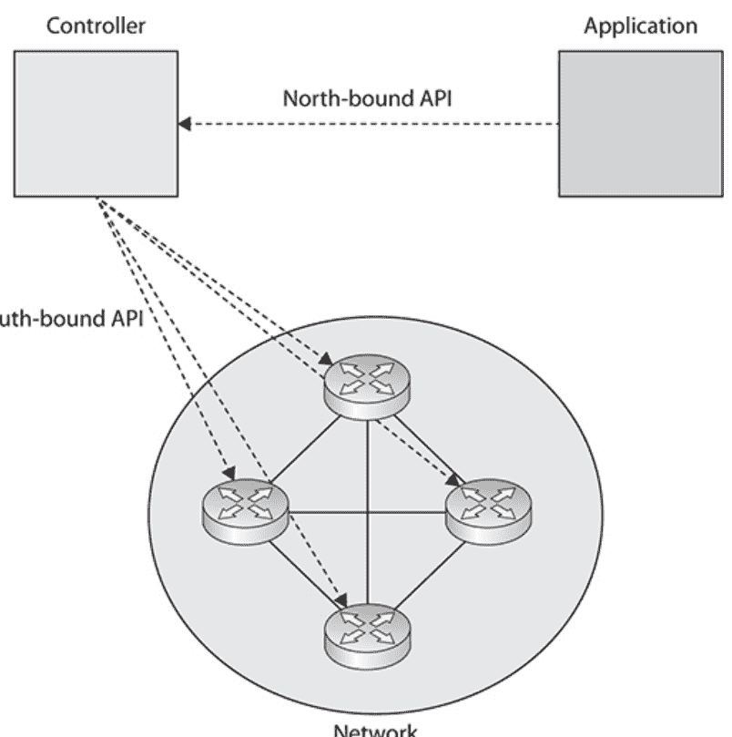
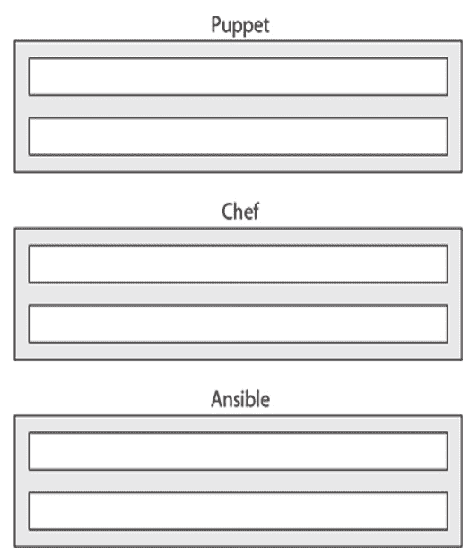
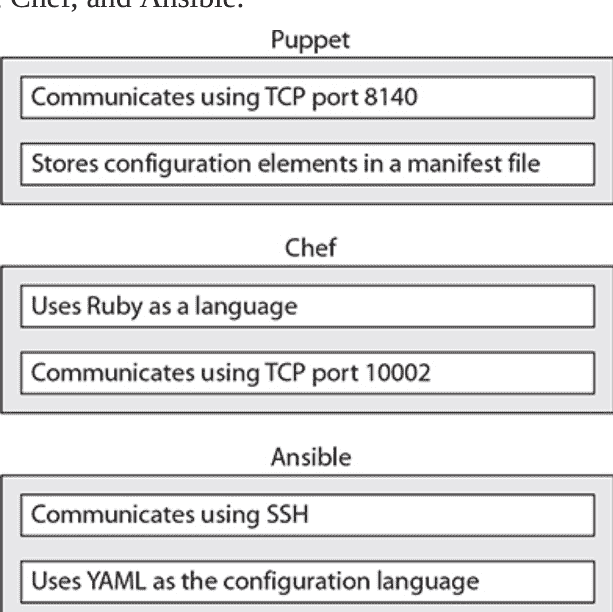

# 自动化与可编程性

在本章中，你将

- 了解传统网络管理与基于控制器的自动化之间的区别
- 了解软件定义网络（SDN）和思科数字网络架构（DNA）
- 了解诸如 XML 和 JSON 之类的数据交换格式

我们的最后一章是思科 CCNA 考试的新主题，对自动化和软件定义网络（SDN）进行了介绍。我确信 SDN 将在未来版本的 CCNA 考试中成为重点；然而，对于当前版本的考试，你只需了解自动化的目的和相关概念。

## 自动化简介

在本节中，你将通过首先回顾传统网络的管理方式，然后将其与使用自动化进行比较，来了解自动化网络设备的好处。

## 传统网络与基于控制器的网络

全新的思科 CCNA 期望你理解并能够比较传统网络环境与基于控制器的网络，后者是未来的网络环境。

### 传统网络管理

在传统网络环境中，你需要逐一管理每个网络设备，例如思科路由器和交换机。这当然需要大量人力，而且管理员容易在设备配置上出错，因为他们必须手动输入每条命令。

在传统网络环境中，在设备的整个生命周期内，你通常会对每个网络设备执行以下操作：

- 将网络设备安装到网络环境中。
- 向设备应用初始配置，使其按需运行。
- 随着时间推移，向配置应用更新。
- 根据需要升级设备上的软件。
- 使用诸如简单网络管理协议（SNMP）和 NetFlow 之类的协议监控设备的整体性能以及设备上发生的事件。

这五项操作看起来可能工作量不大，但请记住，你需要对网络中的每个设备执行这些步骤。例如，如果有新的 IOS 需要应用到所有交换机，那么进行升级需要花费相当多的时间：你需要备份设备的配置、备份设备的旧 IOS、将新 IOS 添加到设备，并确保设备正在引导到该 IOS。

还要牢记，对于需要对网络设备进行的每个配置更改，你需要通过 telnet 或安全外壳（SSH）控制台登录或远程登录到设备，然后应用配置更改。然后，你必须断开连接并连接到下一台设备以应用配置更改。而且，你必须对所有设备都这样做。

以下是关于传统网络管理的一些需要记住的要点：

- 网络管理员的关注点是每个单独的设备。管理员必须连接到每个设备并将更改应用到该设备。
- 配置更改由管理员手动输入。这意味着配置错误的潜在可能性很高。
- 最后，传统管理涉及使用黑名单作为安全模型，这意味着除非你禁止，否则一切都是允许的。

### 基于控制器的网络

基于控制器的网络利用自动化技术，一次性将配置更改应用到多个设备。*controller* 软件组件或设备会自动执行网络上的配置更改，并同时处理向多个设备部署配置更改。

使用自动化时，当新设备添加到网络时，它会定位需要应用的初始配置并应用该配置，而无需管理员干预。配置还可以基于 *profiles* 应用，例如服务质量（QoS）配置文件或身份验证、授权和计费（AAA）配置文件。你还可以通过使用脚本（例如 Cisco TLC 或在设备上执行的 Python 脚本）来自动化对设备的更改。

你可以使用自动化来执行许多不同的任务。例如，如果需要对设备进行升级，可以使用自动化来检查设备上存在什么软件映像，如果确定旧版本需要替换，则可以自动化升级程序以在该设备上执行。同样，这一切都在无需管理员实际访问设备的情况下完成。你还可以使用自动化在设备上计划特定任务或操作，并在设备出现问题时自动化故障排除程序。

对于 CCNA 考试，你需要记住有关基于控制器的网络管理的以下要点：

- 管理员的关注点是整个网络。更改可以一次性应用到多个设备。
- 管理员将更改输入到策略元素中，这些策略元素随后会自动应用到多个设备。
- 使用白名单安全模型：除非你允许，否则一切都将被阻止。

## 自动化的好处


自动化带来巨大的好处。首先，公司可以通过自动化技术人员传统上需要通过访问每个设备来执行的许多任务，来减少支持人员并节省人力成本。这并不意味着我们失业了！这只是意味着作为技术人员，我们的工作会发生一些变化，即我们将专注于创建自动化程序和脚本。

其次，自动化可以节省时间。在传统网络中，向多个设备应用配置更改需要花费相当长的时间。在大多数情况下，管理员需要前往每个设备的位置来应用更改（除非是可以远程执行的简单更改）。

最后，自动化的更重要好处之一是，你可以保证配置的一致性。使用自动化时，你创建脚本，然后指示控制器将其部署到设备上；每个设备都接收相同的配置。这不仅有助于确保你熟悉每个设备的配置，而且还意味着发生配置错误的情况会减少，因为管理员不需要在每个设备上反复输入相同的配置命令。

## 理解平面

在深入了解自动化架构和软件定义网络（SDN）之前，我想讨论每个 Cisco 设备架构中包含的不同平面，以及每个平面负责的操作类型。这一点很重要，因为在自动化环境中，如果你愿意，可以将部分平面从设备移至云端。但首先你需要知道什么是平面。

所有 Cisco 设备在其架构中都包含三个平面，每个平面在设备上执行特定功能。这些平面被称为控制平面、数据平面和管理平面。

## 控制平面

控制平面负责在设备上运行不同的协议，例如路由协议、第 2 层协议，以及如果配置了动态主机配置协议（DHCP）等协议。通过运行这些协议，控制平面会了解网络信息，然后将这些信息存储在表中。例如，在运行开放最短路径优先（OSPF）等路由协议时，控制平面会了解路由，然后将这些路由存储在路由表中。控制平面可以填充 MAC 地址表、路由表和 ARP 表等。

控制平面运行路由协议，处理路由信息的交换，并决定哪些内容进入路由表。虽然控制平面执行逻辑来创建和填充这些表，但这些表在物理上存储在使用它们附近——即数据平面中。

## 数据平面

数据平面负责存储表中的信息，并根据表中包含的信息做出决策。数据平面也称为转发平面，因为该平面包含控制帧或包转发的所有逻辑和物理组件。例如，当数据包进入路由器时，数据平面会查看路由表以确定将数据包转发到哪里，然后再将其转发到目标。请注意，数据包检查、QoS 分类和访问控制列表（ACL）等功能将在数据平面中处理。

## 管理平面

管理平面运行我们用于管理设备的组件，例如 Telnet 或 SSH 等管理协议。它还包含管理端口，例如用于管理设备的控制台端口和辅助端口。管理平面还负责 AAA 功能（如果正在使用）。例如，管理平面验证任何试图访问设备的人，授权个人的操作，并提供计费功能。

## 软件定义网络

要实现自动化（基于控制器的网络），你使用软件定义网络（SDN）。在 SDN 中，软件负责对网络上的设备应用配置更改。通过此软件，你可以从一个中心点管理网络上的所有设备。*SDN 控制器*推动自动化，并将更改应用到网络上的设备。

SDN 控制器可以有多种实现方式：

- 作为安装在服务器上的软件
- 作为内置控制器的设备
- 作为位于云端的远程控制器

无论控制器以何种方式实现，控制器都会使用 Puppet、Chef 和 Ansible 等工具来帮助自动化网络上的更改。你将在本章后面的“配置管理技术”部分了解更多有关 Puppet、Chef 和 Ansible 的内容。

控制器的使用方法如下：启动 GUI，然后选择要更改的设备。然后选择要应用到每个设备的设置。控制器随后将这些更改应用到这些设备上。

## 软件定义架构

Cisco CCNA 考试要求你理解并描述 SDN 架构组件，例如下位网络、上位网络和 SDN 结构。

## 下位网络

下位网络包含所有常规网络组件，例如路由器。构建 SDN 环境时，第一步是确保所有网络设备都配置了适当的协议和功能，以实现网络通信并能够访问网络设备。这意味着你必须在接口上配置所有 IP 地址，确保接口已启用，并配置网络广播域之间的路由。你必须使用开放式标准协议（如 OSPF、边界网关协议（BGP）或中间系统到中间系统（IS-IS））作为路由协议。

## 上位网络

上位网络是运行在传统网络设备（即下位网络）之上的逻辑网络。上位网络包括在下位网络之上创建的*虚拟网络*，这些虚拟网络使用虚拟路由和转发（VRF）、多协议标签交换虚拟专用网络（MPLS VPN）和虚拟可扩展局域网（VXLAN）等虚拟技术。


**考试提示** 虽然 CCNA 考试不要求你熟悉这些虚拟技术，但你应该知道有与虚拟网络配套的虚拟协议。同样重要的是要记住，下位网络充当上位网络（即逻辑网络）所使用的物理连接。

## SDN 结构

*SDN 结构*包括构成 SDN 环境的所有组件，包括下位网络和上位网络。SDN 结构由下位网络中包含的物理网络设备组成，这些设备由 SDN 控制器控制，而 SDN 控制器也是 SDN 结构的一部分。

## 平面分离

实施 SDN 模型时，你正在更改控制平面的位置。在传统网络中，控制平面与数据平面驻留在同一设备上，但在 SDN 网络中，控制平面遵循集中式模型，即在 SDN 控制器上运行。SDN 应用程序会出于两个原因与 SDN 控制器通信：向网络设备发送配置更改，以及接收设备配置的更新信息，以便在 SDN 应用程序中映射配置。

当通过 SDN 应用程序进行更改时，这些更改会传达给控制器，然后控制器将这些更改发送到每个网络设备。分离这些组件使管理员能够及时在整个网络中部署更改。


**注意** 如果 SDN 控制器宕机，你将无法进行新更改，但设备仍可以根据设备上数据平面的当前状态做出转发决策。

## 校园设备管理与 Cisco DNA Center 的比较

当我们许多人想到*校园设备管理*时，我们想到的是用于管理 Cisco 设备配置更改的传统方法。我们通过控制台登录设备，或通过 SSH 远程管理设备，然后应用所需的配置更改，最后与设备断开连接。如果我们需要将配置更改应用到十个不同的设备，我们会对每个设备重复这些步骤。

Cisco *数字网络架构*（DNA）Center 是一款可购买的物理设备，提供 SDN 功能（自动化）。DNA Center 提供一个中心点来管理网络设备、自动化配置更改并对设备进行分析。SDN 和 DNA Center 提供*基于意图的网络*，这意味着它们使用软件来控制网络环境。

当你购买 Cisco DNA Center 设备时，它包含一个内置的*应用策略基础设施控制器*（APIC），这是 DNA Center 中内置的 SDN 控制器组件。DNA Center 还包含一个内置的*网络数据平台*（NDP）组件，它是


负责分析问题，显示有关问题的信息，然后为问题提供解决方案。

## 北向 API 和南向 API

*应用程序编程接口*（API）是包含若干执行不同操作的函数的应用程序逻辑。在 SDN 网络中，API 对于将信息从用于管理更改的应用程序传输到控制器，然后从控制器传输数据到网络设备至关重要。API 是移动数据的*逻辑*，但数据本身处于一种*数据格式*中，该格式使其能够跨应用程序和设备共享。（您稍后将了解更多有关数据格式的内容。）

对于 Cisco CCNA 考试，您需要熟悉 SDN 网络中的两个 API：*北向 API* 和 *南向 API*。如图 18-1 所示，北向 API 负责在应用程序和控制器之间移动数据，而南向 API 负责在控制器和网络设备之间移动数据。



图 18-1 北向 API 和南向 API

API 使用客户端/服务器架构，每次执行都需要客户端和服务器。客户端是接收数据的组件，服务器是发送数据的组件。因此，对于北向 API，服务器是应用程序，客户端是控制器。对于南向 API，服务器是控制器，客户端是网络设备。


**考试提示** 对于 Cisco CCNA 考试，请熟悉北向 API 和南向 API。

API 有两种不同类型：*内部 API* 和 *Web 服务 API*。内部 API 用于在系统上的应用程序之间共享数据，而 Web 服务 API 用于在网络或 Internet 上的设备之间交换数据。

## 数据交换

在 SDN 网络中，需要在用于将配置设置应用于设备的应用程序、SDN 控制器和网络设备之间交换配置设置。在本节中，您将了解该数据交换的发生方式以及数据格式。

## 基于 REST 的 API

最常见的 API 类型之一是*表述性状态转移*（REST）API。这种 Web 服务 API 主要用于北向 API。在基于 REST 的 API 中，HTTP 方法对数据执行创建、读取、更新和删除（CRUD）操作。例如，HTTP **GET** 动词（即方法）用于读取数据，而 HTTP **POST** 动词用于创建数据。以下是 REST API 使用的一些 HTTP 动词：

- **GET** 用于执行从源*读取*数据的调用。例如，以下 URL 可能会检索客户 5 的详细信息：
- **PUT** 用于*更新*数据中的现有记录。例如，以下 URL 将更新客户 2：
- **POST** 用于*创建*数据中的新记录。例如，以下 URL 将创建客户 10：
- **DELETE** 用于从数据中*删除*记录。例如，以下 URL 将删除客户 10：

```
GET http://www.gleneclarke.com/customers/5
```

```
PUT http://www.gleneclarke.com/customers/2/Glen/Clarke/Halifax
```

```
POST http://www.gleneclarke.com/customers/10/Bob/Smith
```

## 数据格式

如前所述，API 是对数据执行的操作，但数据需要处于一种便于在平台、应用程序和设备之间共享的格式中。这就是两种常见数据格式（也称为数据编码方法）发挥作用的地方：XML 和 JSON。

### XML 数据格式

可扩展标记语言 (XML) 是一种常见格式，用于需要交换的数据，以便数据在目标端可被理解。XML 在 2000 年代初非常流行，并且今天仍被用于交换数据。

XML 易于阅读，因为它使用类似于 HTML 标签的标签来描述数据。查看以下 XML 代码，您可以看到数据中有多本书籍，第一本书的标题是 CompTIA Security+ Certification Study Guide，第二本书是 CompTIA Network+ Certification Study Guide：

```
<Books>
    <Book ISBN="1260026051">
        <Title>CompTIA Security+ Certification Study Guide</Title>
        <Author>Glen E. Clarke</Author>
        <Price>34.76</Price>
    </Book>
    <Book ISBN="1260122042">
        <Title>CompTIA Network+ Certification Study Guide </Title>
        <Author>Glen E. Clarke</Author>
        <Price>37.26</Price>
    </Book>
</Books>
```

请注意，两本书的作者很清楚是 Glen E. Clarke。使用标签可确保数据接收方不会误解信息（换句话说，接收方不会将作者 Glen E. Clarke 与书籍标题混淆）。

### JSON 数据格式

多年来，XML 一直是在环境之间交换信息的数据格式，但不断打开和关闭标签增加了正在传输的数据量。随着移动应用程序的普及，需要一种新的数据格式来尽量减少传输的数据量，尤其是通过蜂窝电话网络：于是 JavaScript 对象表示法 (JSON) 登场了。

与 XML 相比，JSON 被认为是一种轻量级数据交换协议。现在，许多应用程序和 API 都在使用它来在环境之间共享数据。以下是我们书籍数据的 JSON 格式示例：

```
{ "books": [
  { "isbn":"1260026051",
    "title":"CompTIA Security+ Certification Study Guide",
    "author":"Glen E. Clarke",
    "price":"34.76"},
  { "isbn":"1260122042",
    "title":"CompTIA Network+ Certification Study Guide",
    "author":"Glen E. Clarke",
    "price":"37.26"}
]}
```

关于 JSON 格式，请注意几点——因为您确实需要知道这些以应对考试：数据表示为名称-值对，标签位于引号内，然后是冒号，然后是该数据的值，也位于引号内。每个数据项之间用逗号分隔，每条记录都位于花括号 { } 中。例如，请注意每本书的信息都位于一组花括号中。还请注意，整个列表位于两组括号内：花括号和方括号，{ [ ] }。这是因为 JSON 数据需要花括号 { }，但由于此列表中有多本书籍，因此使用数组，并由方括号 [ ] 标识。


**考试提示** 对于 CCNA 考试，请了解 JSON 数据格式。

## 配置管理技术

在讨论 SDN 环境时，我提到应用程序与 SDN 控制器通信，然后由控制器将配置更改发送到网络设备。这些应用程序称为*配置管理系统*，用于自动对网络设备进行配置更改。配置管理系统使用您开发的脚本，以同时向多个设备应用配置更改。脚本创建后，您可以使用配置管理系统的 GUI 来安排在设备上运行脚本的任务，也可以手动将配置更改应用到设备。在配置管理系统领域，您应该记住的三大主要参与者是 Puppet、Chef 和 Ansible。

请注意，这些程序都使用我们之前讨论过的 API 来传达所需的更改。例如，配置管理应用程序（Puppet、Chef 或 Ansible）使用北向 API 将配置更改发送到控制器，然后控制器使用南向 API 将更改发送到设备。

### Puppet

Puppet 使用主/代理拓扑，其中主节点是控制器，您在要管理的每个网络设备上安装一个代理。Puppet 使用*拉取模型*，这意味着代理会定期向主节点（控制器）检查是否有任务需要运行。如果找到此类任务，代理会从主节点拉取脚本（称为*清单文件*）并在设备上运行它。Puppet 使用的脚本语言是 Ruby，主节点与设备通信的通道是 TCP 端口 8140。

### Chef

Chef 与 Puppet 类似，它也是主/代理拓扑，并且也会检查需要运行的任务。同样，如果找到此类任务，代理会从主节点（控制器）拉取更改脚本（在此示例中称为*食谱*）并应用配置


## Ansible

Ansible 与 Puppet 和 Chef 略有不同，因为它是无代理的。您不需要在设备上安装代理，因为 Ansible 使用推送模型，其中主控节点（控制器）将配置更改推送到设备。Ansible 是一个 Python 工具，使用 YAML 语言创建 *playbook*，playbook 是主控节点将文件推送到设备后，需要在设备上执行的指令文件。考试需要知道的重要一点是，Ansible 使用 SSH 与设备通信并应用配置，因此需要在设备上配置 SSH。


### 考试提示

针对 CCNA 考试，您需要熟悉 Puppet、Chef 和 Ansible 之间的区别。还要记住什么时候使用北向 API，什么时候使用南向 API。

## 章节复习

在本章中，您了解了网络配置概念，例如传统网络管理与用于自动化的控制器式网络之间的区别。您了解了软件定义网络及其架构。您还了解了 SDN 如何将控制平面与数据平面分开。

您了解了思科 DNA Center 以及使用 API 在组件之间交换数据。您了解了 JSON 作为数据格式的重要性，并了解了 JSON 数据格式的示例。最后，您了解了 Puppet、Chef 和 Ansible 等配置管理技术。

## 快速复习

### 自动化简介

- 传统网络管理涉及逐个向每台设备应用配置更改。这既耗时又容易出现管理错误。
- 控制器式网络涉及使用自动化技术将更改发送到控制器，并让控制器将更改同时应用到所有设备。
- 控制平面负责运行路由和功能以收集信息，并将其填充到设备使用的表中。
- 数据平面（也称为转发平面）使用表中的信息来做出转发或路由决策。
- 管理平面处理管理访问以及 AAA 功能（身份验证、授权和计费）。

### 软件定义网络

- 在 SDN 中，使用软件向网络上的设备应用配置更改。
- SDN 控制器向网络上的设备应用配置更改。
- SDN 架构包含三个组件：底层网络（配置了 IP 地址和路由协议等协议和功能的网络设备）；覆盖网络（在软件中创建的虚拟网络）；以及 SDN 结构（所有网络设备和 SDN 控制器）。

### 校园设备管理与思科 DNA Center

- 思科 DNA Center 是您购买的设备，其中包含网络的 SDN 控制器。
- 北向 API 用于将配置信息从应用程序发送到控制器。
- 南向 API 用于将配置信息从控制器发送到设备。

### 数据交换

- JSON 数据格式用于在环境之间交换信息。
- REST API 是通过 HTTP 执行任务的应用程序逻辑。
- REST API 使用 HTTP 动词来执行操作。

## 问题

以下问题可帮助您衡量对本章所介绍材料的理解程度。请仔细阅读所有选项，因为可能不止一个正确答案。为每个问题选择正确的答案。

- 1. 以下哪项是 JSON 数据的有效格式？
  - A. "empid":"126","name":"Bob Smith","phone":"555-5555"
  - B. {"empid":"126","name":"Bob Smith","phone":"555-5555"}
  - C. empid: "126",name: "Bob Smith",phone: "555-5555"
  - D. {empid: "126",name: "Bob Smith",phone: "555-5555"}
- 2. 用于在控制器和网络设备之间通信配置信息的 API 是哪个？
  - A. REST API
  - B. Web API
  - C. 南向 API
  - D. 北向 API
- 3. 软件定义网络架构中的哪个组件包含虚拟网络？
  - A. 南向 API
  - B. 底层网络
  - C. 覆盖网络
  - D. Puppet
- 4. 以下哪些是传统网络管理的特征？（选择三项。）
  - **A.** 管理员关注设备。
  - **B.** 管理员关注网络。
  - **C.** 管理员手动输入配置。
  - **D.** 管理员将配置放置在策略中。
  - **E.** 它使用白名单安全模型。
  - **F.** 它使用黑名单安全模型。
- 5. 哪个配置管理应用程序使用 YAML 作为脚本语言？
  - **A.** Ansible
  - **B.** Puppet
  - **C.** Chef
  - **D.** 思科 DNA Center
- 6. 以下哪些是控制器式网络的特征？（选择三项。）
  - **A.** 管理员关注设备。
  - **B.** 管理员关注网络。
  - **C.** 管理员手动输入配置。
  - **D.** 管理员将配置放置在策略中。
  - **E.** 它使用白名单安全模型。
  - **F.** 它使用黑名单安全模型。

## 性能问题

思科考试中有基于性能的问题，您需要将屏幕左侧的框拖动到屏幕右侧的相应位置来回答问题。以下是与本章相关的基于性能的问题示例：

1. 使用以下展示图，将屏幕左侧列出的每个特征写入右侧的正确类别中。

- 使用 TCP 端口 8140 进行通信
- 使用 SSH 进行通信
- 使用 TCP 端口 10002 进行通信
- 使用 Ruby 作为语言
- 在清单文件中存储配置元素
- 使用 YAML 作为配置语言



## 答案

- 1. **B.** JSON 格式中的每条记录都包含在花括号 { } 内。每个标签都用引号括起来，后跟冒号，后跟表示数据的带引号的值。因此，{"empid":"126","name":"Bob Smith","phone":"555-5555"} 是正确的。
- 2. **C.** 南向 API 用于在控制器和网络设备之间通信配置更改。
- 3. **C.** 覆盖网络包含 SDN 架构的虚拟网络组件。
- 4. **A, C, F.** 在传统网络管理中，管理员关注每个单独的设备，并分别连接到每个设备以手动应用更改。传统网络还使用黑名单模型，其中允许一切，管理员必须阻止不需要的流量。
- 5. **A.** Ansible 使用 YAML 作为脚本语言。
- 6. **B, D, E.** 在控制器式网络中，管理员关注网络，并一次性在整个网络中进行更改。这涉及将配置更改放入策略元素中，然后将策略元素应用到需要该更改的网络设备。控制器式网络遵循白名单安全模型，其中一切都被阻止，直到管理员允许为止。

## 基于性能的答案

以下是本章基于性能问题的答案。请记住，在实际考试中，您需要拖放项目以将其放置在正确的位置。

- 1. 以下显示了 Puppet、Chef 和 Ansible 的特征正确映射。




## 考试准备核对表：100-490 & 200-301

### CCT 认证考试 (100-490)

| 目标 | 章节 |
|---|---|
| **1.0 一般网络知识** | **1, 2, 3, 4, 6, 8, 14** |
| 1.1 使用 OSI 和 TCP/IP 模型及其关联协议来解释数据如何在网络中流动 | 2, 3 |
| 1.2 描述此硬件的基本功能和关键差异：LAN 交换机、路由器和无线接入点 | 1 |
| 1.3 区分这些第 2 层技术：以太网、快速以太网、千兆以太网、串行和光纤 | 1 |
| 1.4 描述 LAN 布线 | 1 |
| 1.5 描述 CSU/DSU 的功能 | 1, 6 |
| 1.6 描述电信终端点 | 1 |
| 1.7 描述 IPv4 和 IPv6 地址及子网 | 4, 14 |
| 1.8 描述 FTP、TFTP 和 PING 的功能 | 1, 8 |
| 1.9 描述 Telnet 和 SSH 的功能 | 1, 8 |
| **2.0 Cisco 设备及相关硬件** | **6** |
| 2.1 识别 Cisco 设备，包括 Cisco Nexus 9000 系列、Nexus 7000 系列、Nexus 3000 系列、MDS 9000 系列、Catalyst 9000 系列、Catalyst 6800 系列、Catalyst 6500 E 系列、Catalyst 3850、3650、2960、1000 系列和 Meraki 交换机，以及 Cisco 8000 系列、Cisco ASR 9000 系列、Cisco ASR 1000 系列、NCS 5500 系列、NCS 5000 系列路由器和 Cisco 4000、1100、900、800 系列集成服务路由器 | 6 |
| 2.2 通过标志标记和型号识别 Cisco 产品（包括但不限于机箱、线卡、模块或适配器上的位置） | 6 |
| 2.3 识别 Cisco 收发器模块 | 6 |
| 2.4 识别并定位 Cisco 产品的序列号（包括但不限于机箱、线卡、模块或适配器上的位置） | 6 |
| 2.5 识别并描述常用组件 | 6 |
| 2.6 描述硬件内存常见术语及其在 Cisco 路由器和交换机中的用途 | 6 |
| 2.7 识别 Cisco 设备上的布线 | 6 |
| 2.8 识别硬件安装和更换工具 | 6 |
| 2.9 识别不同的环回插头（RJ45 以太网、T1、56K） | 6 |
| 3.0 Cisco IOS 软件操作 | 6,7,8 |
| 3.1 描述 Cisco IOS、IOS-XE、IOS-XR 和 NX-OS 软件的关键作用 | 6 |
| 3.2 在不同操作模式之间导航 | 7 |
| 3.3 确定设备的当前模式 | 7 |
| 3.4 从/向路由器或交换机复制和粘贴配置文件 | 6 |
| 3.5 使用和解释基本的 Cisco IOS 软件命令 | 7 |
| 3.6 描述更改配置寄存器参数的位置和过程 | 8 |
| 3.7 从 Cisco 设备识别配置文件 | 7 |
| 3.8 描述不同平台上的许可流程 | 6 |
| 3.9 描述 Bundle Mode/Install Mode IOS-XE | 6 |
| 4.0 服务相关知识 | 6,7,8 |
| 4.1 查找并使用文本编辑器，例如 Notepad | 6 |
| 4.2 查找并使用 Windows 命令提示符 | 6 |
| 4.3 查找、配置和使用终端仿真（Tera Term、Putty） | 6 |
| 4.4 配置笔记本电脑以太网端口的网络设置（IP 地址、子网掩码和默认网关），并使用正确的电缆与 Cisco 设备上的以太网端口建立连接 | 6 |
| 4.5 从笔记本电脑到 Cisco 控制台端口建立物理连接 | 6 |
| 4.6 连接、配置并验证设备接口的运行状态 | 6 |
| 4.7 配置和使用 TFTP 和 FTP 服务器（TFTPD32/64、Filezilla） | 8 |
| 4.8 使用 TFTP、FTP、xmodem、tftpdlnld 或 USB 存储执行软件升级或降级 | 8 |
| 4.9 通过 TCP/IP 网络管理配置 | 8 |
| 4.10 在 Cisco 设备上执行密码恢复 | 8 |
| 4.11 识别并纠正第 1 层和第 2 层的常见网络问题 | 7 |
| 4.11.a 串行或以太网接口状态 | 7 |
| 4.11.b 以太网第 2 层（全双工和半双工、速度问题） | 7 |
| 4.11.c WAN 串行环回测试（T1、56K 和电信辅助环回） | 7 |

### CCNA 认证考试 (200-301)

| 目标 | 章节 |
|---|---|
| 1.0 网络基础 | 1, 3, 4, 5, 9, 14, 15 |
| 1.1 解释网络组件的作用和功能 | 1 |
| 1.1.a 路由器 | 1 |
| 1.1.b 第 2 层和第 3 层交换机 | 1 |
| 1.1.c 下一代防火墙和 IPS | 1 |
| 1.1.d 接入点 | 1 |
| 1.1.e 控制器（Cisco DNA Center 和 WLC） | 1 |
| 1.1.f 终端 | 1 |
| 1.1.g 服务器 | 1 |
| 1.2 描述网络拓扑架构的特征 | 1 |
| 1.2.a 2 层 | 1 |
| 1.2.b 3 层 | 1 |
| 1.2.c 脊叶 | 1 |
| 1.2.d 广域网 | 1 |
| 1.2.e 小型办公室/家庭办公室 (SOHO) | 1 |
| 1.2.f 本地和云 | 1 |
| 1.3 比较物理接口和布线类型 | 1 |
| 1.3.a 单模光纤、多模光纤、铜缆 | 1 |
| 1.3.b 连接（以太网共享介质和点对点） | 1 |
| 1.3.c PoE 概念 | 1 |
| 1.4 识别接口和电缆问题（冲突、错误、双工不匹配和/或速度问题） | 1 |
| 1.5 比较 TCP 和 UDP | 3 |
| 1.6 配置和验证 IPv4 寻址和子网划分 | 4, 5 |
| 1.7 描述私有 IPv4 寻址的必要性 | 4 |
| 1.8 配置和验证 IPv6 寻址和前缀 | 14 |
| 1.9 比较 IPv6 地址类型 | 14 |
| 1.9.a 全球单播 | 14 |
| 1.9.b 唯一本地 | 14 |
| 1.9.c 链路本地 | 14 |
| 1.9.d 任播 | 14 |
| 1.9.e 组播 | 14 |
| 1.9.f 修改后的 EUI 64 | 14 |
| 1.10 验证客户端操作系统（Windows、Mac OS、Linux）的 IP 参数 | 4 |
| 1.11 描述无线原理 | 15 |
| 1.11.a 不重叠的 Wi-Fi 信道 | 15 |
| 1.11.b SSID | 15 |
| 1.11.c 射频 | 15 |
| 1.11.d 加密 | 15 |
| 1.12 解释虚拟化基础（虚拟机） | 1 |
| 1.13 描述交换概念 | 9 |
| 1.13.a MAC 学习和老化 | 9 |
| 1.13.b 帧交换 | 9 |
| 1.13.c 帧泛洪 | 9 |
| 1.13.d MAC 地址表 | 9 |
| 2.0 网络接入 | 8, 9, 10, 15 |
| 2.1 配置和验证跨多个交换机的 VLAN（正常范围） | 9 |
| 2.1.a 接入端口（数据和语音） | 9 |
| 2.1.b 默认 VLAN | 9 |
| 2.1.c 连通性 | 9 |
| 2.2 配置和验证交换机间连通性 | 9 |
| 2.2.a 干线端口 | 9 |
| 2.2.b 802.1Q | 9 |
| 2.2.c 本地 VLAN | 9 |
| 2.3 配置和验证第 2 层发现协议（Cisco 发现协议和 LLDP） | 8 |
| 2.4 配置和验证（第 2 层/第 3 层）EtherChannel（LACP） | 10 |
| 2.5 描述 Rapid PVST+ 生成树协议的必要性和基本操作并识别基本操作 | 10 |
| 2.5.a 根端口、根桥（主/辅）和其他端口名称 | 10 |
| 2.5.b 端口状态（转发/阻塞） | 10 |
| 2.5.c PortFast 优势 | 10 |
| 2.6 比较 Cisco 无线架构和 AP 模式 | 15 |
| 2.7 描述 WLAN 组件（AP、WLC、接入/干线端口和 LAG）的物理基础设施连接 | 15 |
| 2.8 描述 AP 和 WLC 管理访问连接（Telnet、SSH、HTTP、HTTPS、控制台和 TACACS+/RADIUS） | 15 |
| 2.9 仅使用 GUI 配置无线 LAN 访问的组件以供客户端连接，例如 WLAN 创建、安全设置、QoS 配置文件和高级 WLAN 设置 | 15 |
| 3.0 IP 连通性 | 11, 12 |
| 3.1 解释路由表的组成部分 | 11 |
| 3.1.a 路由协议代码 | 11 |
| 3.1.b 前缀 | 11 |
| 3.1.c 网络掩码 | 11 |
| 3.1.d 下一跳 | 11 |
| 3.1.e 管理距离 | 11 |
| 3.1.f 度量值 | 11 |
| 3.1.g 最后手段网关 | 11 |
| 3.2 确定路由器默认如何做出转发决策 | 11 |
| 3.2.a 最长匹配 | 11 |
| 3.2.b 管理距离 | 11 |
| 3.2.c 路由协议度量值 | 11 |
| 3.3 配置和验证 IPv4 和 IPv6 静态路由 | 11 |
| 3.3.a 默认路由 | 11 |
| 3.3.b 网络路由 | 11 |
| 3.3.c 主机路由 | 11 |
| 3.3.d 浮动静态 | 11 |
| 3.4 配置和验证单区域 OSPFv2 | 12 |
| 3.4.a 邻居邻接 | 12 |


| 主题 | 页码 |
|------|------|
| 3.4.b 点对点 | 12 |
| 3.4.c 广播（DR/BDR 选举） | 12 |
| 3.4.d 路由器 ID | 12 |
| 3.5 描述首跳冗余协议的目的 | 11 |
| **4.0 IP 服务** | **8, 13, 17** |
| 4.1 配置并验证使用静态和地址池的内部源 NAT | 13 |
| 4.2 配置并验证以客户端和服务器模式运行的 NTP | 13 |
| 4.3 解释 DHCP 和 DNS 在网络中的作用 | 13 |
| 4.4 解释 SNMP 在网络操作中的功能 | 13 |
| 4.5 描述包括设施和级别在内的 syslog 功能 | 13 |
| 4.6 配置并验证 DHCP 客户端和中继 | 13 |
| 4.7 解释 QoS 的逐跳转发行为（PHB），例如分类、标记、排队、拥塞、流量监管和流量整形 | 13 |
| 4.8 配置网络设备以使用 SSH 进行远程访问 | 8, 17 |
| 4.9 描述 TFTP/FTP 在网络中的功能和作用 | 8, 13 |
| 5.0 安全基础 | 15, 16, 17 |
| 5.1 定义关键安全概念（威胁、漏洞、利用和缓解技术） | 16 |
| 5.2 描述安全计划要素（用户意识、培训和物理访问控制） | 16 |
| 5.3 使用本地密码配置设备访问控制 | 17 |
| 5.4 描述安全密码策略元素，例如管理、复杂性和密码替代方案（多因素身份验证、证书和生物识别） | 16 |
| 5.5 描述远程访问和站点到站点 VPN | 16 |
| 5.6 配置并验证访问控制列表 | 17 |
| 5.7 配置第 2 层安全功能（DHCP 侦听、动态 ARP 检查和端口安全） | 17 |
| 5.8 区分身份验证、授权和计费概念 | 16 |
| 5.9 描述无线安全协议（WPA、WPA2 和 WPA3） | 15 |
| 5.10 使用 GUI 配置使用 WPA2 PSK 的 WLAN | 15 |
| 6.0 自动化和可编程性 | 18 |
| 6.1 解释自动化如何影响网络管理 | 18 |
| 6.2 比较传统网络与控制器基础网络 | 18 |
| 6.3 描述控制器基础和软件定义架构（覆盖、底层和交换结构） | 18 |
| 6.3.a 控制平面和数据平面分离 | 18 |
| 6.3.b 北向和南向 API | 18 |
| 6.4 比较传统校园设备管理与启用 Cisco DNA Center 的设备管理 | 18 |
| 6.5 描述基于 REST 的 API 的特征（CRUD、HTTP 动词和数据编码） | 18 |
| 6.6 识别配置管理机制 Puppet、Chef 和 Ansible 的功能 | 18 |
| 6.7 解读 JSON 编码的数据 | 18 |
