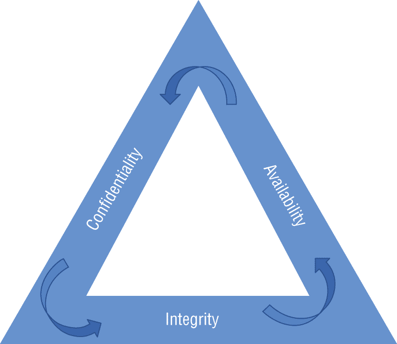
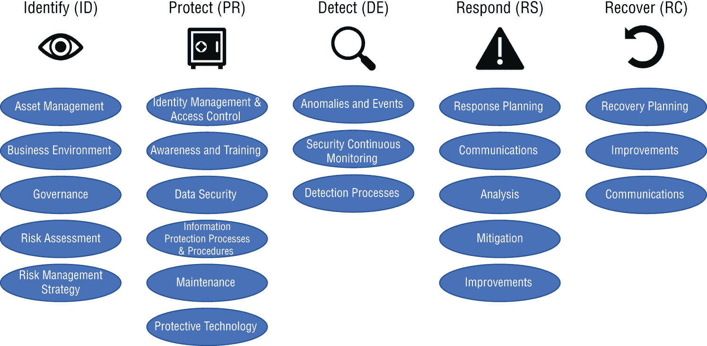
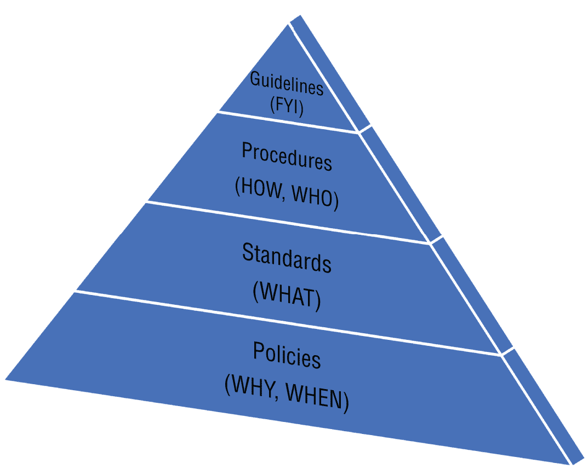
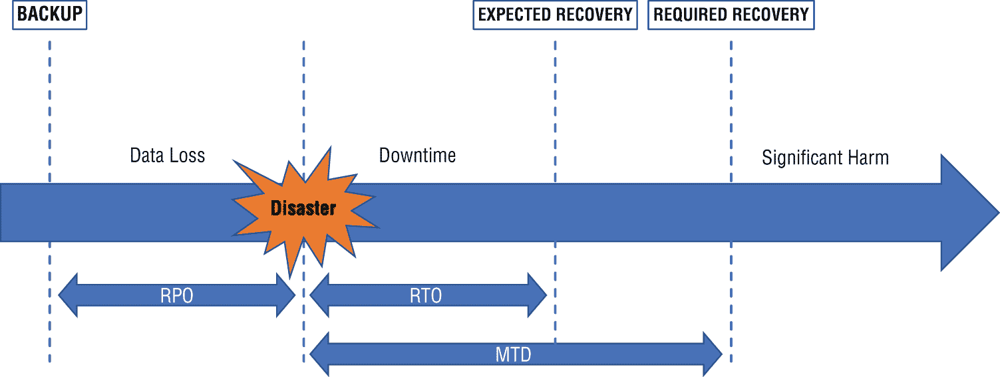
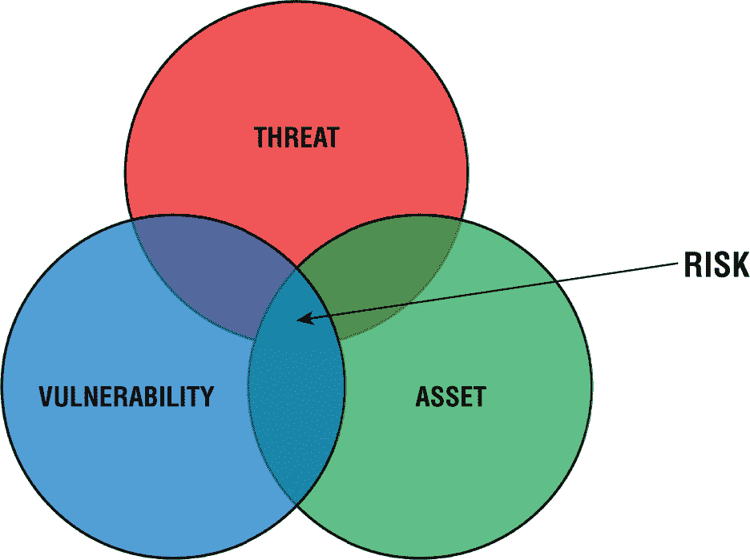
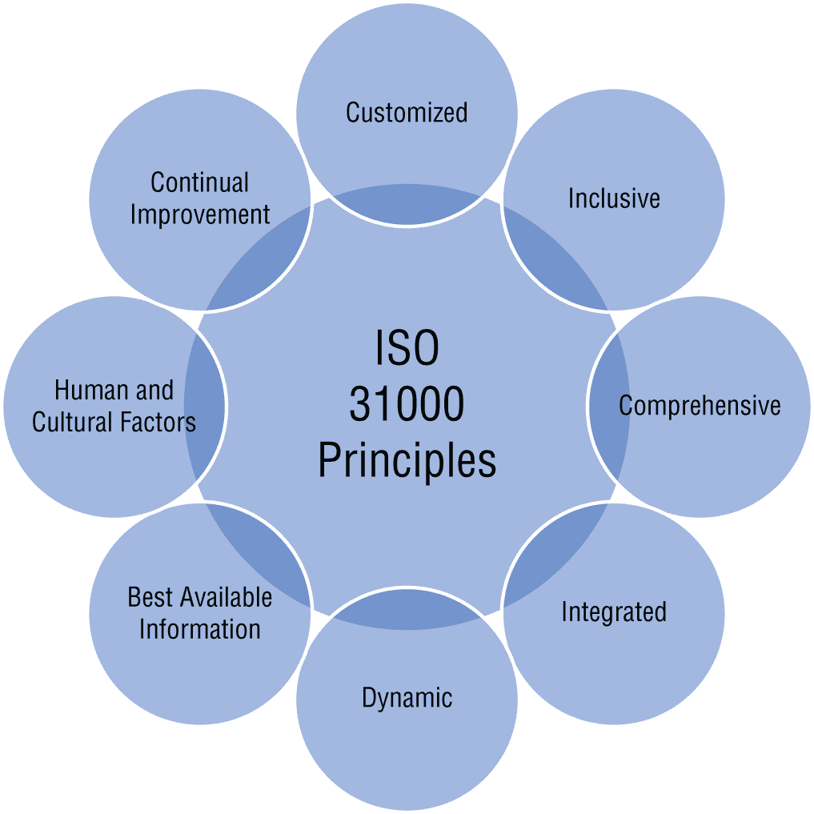
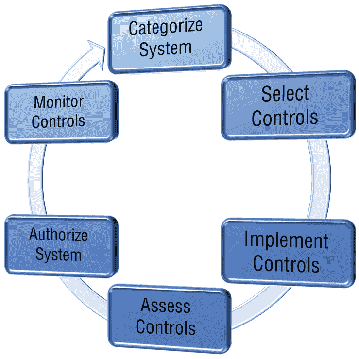

# DOMAIN 1

## 安全与风险管理

**CISSP** 通用知识体系（`CBK`）的**第 1 域**涵盖了构建和管理基于风险的信息安全计划的基础主题。本域涵盖了 `CBK` 其余部分所构建的各种概念。

在深入探讨安全与风险管理概念的核心之前，本章首先介绍职业道德及其在信息安全领域的应用。作为一名安全专业人员，了解你的职责与了解如何应用安全概念同等重要。随后我们将讨论与理解组织使命、战略、目标和业务目标相关的话题，并评估如何安全地满足组织业务需求。

理解风险管理及其概念如何应用于信息安全，是你应从本章中获得的最重要收获之一。我们描述了风险管理概念并解释如何在组织的安全计划中应用它们。此外，了解相关的法律、监管和合规要求是每个信息安全计划的关键组成部分。第 1 域包括网络犯罪和数据泄露、进出口管制以及进行各种类型调查的要求等概念的介绍。

本章介绍了安全的人为因素，并包括有关向组织员工传授关键安全概念的方法的介绍。我们介绍了安全意识计划的结构，并讨论了如何评估教育和培训方法的效果。

## 理解、遵守并推广职业道德

理解并遵循严格的职业道德准则应是任何安全专业人员的首要任务。作为 `CISSP`（或由 `(ISC)²` 认证的任何信息安全专业人员），你需要理解并完全承诺支持 `(ISC)²` 职业道德准则。任何明知违反 `(ISC)²` 职业道德准则的 `(ISC)²` 成员都将接受同行评审，并可能受到处罚，其中可能包括撤销其 `(ISC)²` 认证。

### (ISC)² 职业道德准则

`(ISC)²` 职业道德准则序言如下：

* 社会和公众的福祉以及对委托人的责任和对彼此的责任，要求我们遵守并被视为遵守最高行为道德标准。
* 因此，严格遵守本职业道德准则是有条件认证的。

简而言之，《道德准则》序言指出，每一位 CISSP 认证会员不仅必须遵守《道德准则》，而且必须被明显地视为在遵守《道德准则》。即使是不当行为或道德偏离的感知也可能质疑会员的地位。因此，CISSP 认证会员必须始终在其组织和行业内担任可见的道德领导者。

(ISC)²《道德准则》包含四项准则，旨在作为高层次的指导方针来补充、而非取代会员的专业判断。(ISC)²《道德准则》准则如下：

* **准则 I：** 保护社会、公共利益、必要的公众信任和信心以及基础设施。
* **准则 II：** 诚实、公正、负责任并合法行事。
* **准则 III：** 为委托人提供勤勉和胜任的服务。
* **准则 IV：** 推进和保护该职业。

遵守并推广 (ISC)²《道德准则》不仅包括注意自身的职业行为，还包括关注同行的行为。(ISC)² 要求任何观察到另一名会员违反《道德准则》的会员都必须遵循已发布的道德投诉程序。未能这样做可能被视为违反准则 IV。有关 (ISC)²《道德准则》以及道德投诉程序的更多信息可在 [www.isc2.org/Ethics](http://www.isc2.org/Ethics) 找到。

### 组织道德准则

除了 (ISC)²《道德准则》之外，作为信息安全专业人员，您必须了解雇主或行业要求您遵守的任何道德准则。与 (ISC)²《道德准则》类似，这些其他组织道德准则不应被视为对健全判断和道德行为的替代。作为 CISSP，您是组织内的领导者。因此，您应以身作则遵守组织的《道德准则》。

## 理解和应用安全概念

*信息安全* 指的是保护信息和底层系统免受不当访问、使用、修改或干扰所涉及的流程和方法。这通常由三个关键安全概念来描述：保密性、完整性和可用性。这三个原则共同构成了信息安全支柱，即 *CIA 三角*（见 Figure 1.1）。

**FIGURE 1.1 CIA Triad**

尽管不同类型的系统和数据可能优先考虑其中一个原则，但所有三个安全概念协同工作并相互依赖，以成功维护信息安全。保密性、完整性和可用性是信息安全提供的最关键特征，理解这三个原则是所有信息安全专业人员的基本要求。因此，对 CIA 三角中每个要素含义的共同理解使安全专业人员能够有效沟通。

### 保密性

CIA 三角的第一个原则是保密性。*保密性* 是将数据访问限制在授权用户和系统，并限制未经授权方访问的概念。换句话说，保密性保证只有预期的人能够访问信息和资源。简而言之，保密性的目标是防止未经授权访问数据，即查看、复制或移动数据。未能保护数据保密性的组织面临违反数据保护相关合同和法规义务的风险。此外，保密性泄露已知的公司通常会遭受声誉损害，从而使竞争对手受益并可能影响其底线。

保密性概念与安全最佳实践 *最小权限* 密切相关，该实践断言信息访问应仅基于需要知道的原则授予。在最小权限下，用户仅被授予完成其工作所需的访问权限——不多也不少。

*隐私* 是与安全密切相关的一个领域，专注于个人数据的保密性。具体而言，可用于唯一识别个人的信息，例如姓名、出生日期和社会安全号码，被视为 *个人身份信息*（PII），通常依法要求高度保密。隐私要求将在本章后面的“确定合规性和其他要求”部分介绍。

许多恶意行为针对数据保密性，包括网络钓鱼和其他形式的社会工程、凭证（如密码）窃取、网络嗅探等。除了恶意行为外，保密性还可能因人为错误、疏忽或单纯的疏忽而受损。例如，未对敏感数据进行加密、邮件误发，或在未经授权的观看者附近时在计算机显示器上显示敏感信息。

保密性通常是数据所有者最关心的概念，并且有许多安全控制可协助此项。加密、多因素身份验证和基于角色的访问控制是一些可帮助确保数据保密性的措施。广泛的人员培训是降低与人为错误和疏忽相关风险的重要措施。我们在本书其余部分中继续讨论数据保密性并讨论相关控制。

### 完整性

CIA 三角的第二个原则是完整性。*完整性* 是维护数据和系统的准确性、有效性和完整性的概念。它确保数据不会被除具有授权目的的授权方之外的任何人操纵，并且任何未经授权的操纵都能被轻易识别为此类。完整性的主要目标是确保所有数据保持完整、正确和可靠。未能妥善保护数据完整性可能会对业务流程产生负面影响，包括导致人员因信息不正确而做出不当决策或可能有害的行为。

与保密性一样，完整性可能因恶意行为、人为错误、疏忽或过失而受损。病毒、糟糕编写代码的入侵以及故意修改是可能违反完整性的恶意威胁示例，我们将在本书中讨论其他威胁。此外，完整性违规也可能发生在管理员在数据库中输入错误命令时、管理员在配置文件中更改错误行时，或用户通过网络钓鱼电子邮件意外将恶意软件引入其系统时。

数据备份、软件版本控制、严格访问控制和加密哈希是一些有助于确保数据完整性的措施，通过防止未经授权的修改或允许被篡改的数据恢复到已知良好状态。与保密性类似，广泛的安全意识培训是防止非恶意完整性违规的主要因素。

真实性和不可否认性是与完整性密切相关的两个概念。*真实性* 指确保数据是真实的，并且所有各方都是他们声称的人。*不可否认性* 是一个法律原则，在信息安全领域有很强的平行关系；该概念要求确保没有任何一方能够否认其行为（例如创建、修改或删除数据）。数字签名是信息系统中建立真实性和不可否认性的最常见机制。

### 可用性

CIA 三元组第三个也是最后一个原则是可用性。*可用性*是指确保授权用户在需要时能够访问数据的概念。在企业环境中，可用性的概念意味着提供保证，即合法方能够及时且不间断地访问其为完成工作所需系统和数据。对可用性的威胁会干扰甚至停止组织的业务运营。关键系统和数据长时间中断可能会导致声誉受损，进而导致客户和收入流失。

与可用性一起应考虑的相关概念包括以下内容：

*   *可访问性*是指用户使用资源或在需要时访问数据的能力和便捷程度。这涉及为授权用户访问这些资源和数据消除障碍。例如，考虑存储在公司内部网络驱动器上的一个文件。只要文件完整且网络驱动器正常运行，该文件就可以被视为可用。然而，如果有人将该文件移动到共享驱动器上的受保护文件夹，你可能缺乏访问该文件的所需权限——数据仍然可用但不再可访问。
*   *可用性*是指用户利用可用数据满足其需求的能力。如果你曾经需要编辑一个 Google 文档（或其他任何文件）并注意到你仅被授予只读权限，那么该文件绝对可用但缺乏足够的可用性。
*   *及时性*是指信息和资源可用性的时间预期，是信息预期时间与信息可供使用时间之间间隔的衡量。确保及时性要求数据在可接受的时间段内可供授权用户使用。对于云服务以及涉及第三方管理数据的其他情况，及时性是必须在服务等级协议（SLAs）中达成一致并记录的关键因素。

数据和系统可用性存在许多威胁，它们可能是恶意的或非恶意的，可能是人为的或自然发生的。恶意可用性威胁包括拒绝服务（DoS）攻击、对象删除和勒索软件攻击。虽然恶意破坏可用性往往最受关注，但还有各种非恶意威胁会干扰资源和数据可用性。一些常见示例包括硬件故障、软件错误以及环境威胁，如停电、洪水、过热等。在规划你的信息安全计划时，至关重要的是你必须全面考虑基于人类和自然发生的威胁，并制定应对所有威胁向量的缓解措施。

诸如数据备份、冗余存储、备用电源和 Web 应用防火墙（WAFs）等机制可以帮助防止系统和信息可用性中断。对于具有高可用性和持续运行时间要求的系统，云计算提供了额外的冗余和可用性保障。

### CIA 三元组的局限性

CIA 三元组源于 20 世纪 60 年代中期进行的理论工作。正是因为其简单性，分布式系统的兴起以及新技术大量新应用的出现导致研究人员和安全从业者扩展了三元组的覆盖范围。

保证通信中各方身份的真实性对保密性至关重要。CIA 三元组并未直接解决真实性和不可否认性的问题，但不可否认性的要点是双方都不能否认参与了通信。这一三元组的扩展独特地解决了保密性和完整性的方面，而这些在早期的理论工作中从未被考虑过。

美国国家标准与技术研究院（NIST）特别出版物 800-33《信息技术安全的底层技术模型》将 CIA 三元组作为其五项安全目标中的三项，但增加了问责制（实体行为可唯一追溯到该实体）和保证（对安全措施——技术和运营——按预期保护系统及其处理的信息工作的信心的基础）的概念。NIST 的工作作为将系统安全最佳实践方法编纂化的努力，仍然具有影响力。

信息安全先驱 Donn B. Parker 提出的对 CIA 三元组最广泛接受的扩展。Parker 在扩展三元组时将另外三个概念纳入模型中，认为这些概念是原子性的（在概念上无法进一步分解）且不重叠的。该框架后来被称为 Parker 六元组。Parker 六元组包含以下概念：

*   **保密性：** 谁有权访问信息的限制
*   **完整性：** 信息是否处于预期状态
*   **可用性：** 信息是否能够及时访问
*   **真实性：** 创建信息的个人是否正确归属
*   **效用：** 信息的有用性
*   **占有或控制：** 信息维护的物理状态

后续的学术工作产生了数十种其他信息安全模型，所有这些模型都旨在解决同一个基本问题——如何表征信息安全风险。

除了 CIA 三元组和相关模型中规范的安全主题外，隐私的概念已成为安全专业人员的核心考虑。*隐私*，根据（ISC）² 术语表定义，是人类个人控制关于自己的信息分发的权利。隐私虽然通常在组织中央安全团队之外管理，但与保密性原则密切相关，对于处理员工或客户个人信息的每个组织都必须优先考虑。我们在本书其余部分的多个章节中讨论隐私。

对于安全专业人员来说，扎实理解 CIA 三元组在传达信息安全实践时至关重要，但重要的是要考虑三元组未涵盖的相关主题。

## 评估和应用安全治理原则

*安全治理*是与在组织中定义、管理和监督安全实践相关的职责、政策和程序的集合。安全经常被错误地认为是 IT 问题；实际上，保护组织的资产和数据是业务问题，需要整个组织的人员——而不仅仅是 IT 部门——进行高度的规划和监督。由于安全是一个广泛的业务问题，安全治理通常与组织的公司治理和 IT 治理重叠。因此，安全治理通常由公司的高级管理层领导，通常包括董事会。应用安全治理原则涉及以下内容：

*   将组织的安保职能与公司的业务战略、目标、使命和目标保持一致
*   定义和管理需要安全参与或监督的组织流程（例如，收购、剥离和治理委员会）
*   在整个组织中制定安全角色和职责
*   确定一个或多个安全控制框架以使你的组织保持一致
*   持续进行尽职调查和审慎活动

### 将安全职能与业务战略、目标、使命和目标保持一致

一个有效的安全职能必须与公司的商业战略、目标、使命和业务目标保持一致。在创建和管理组织的信息安全计划和政策时，应考虑这些要素中的每一个。

未能正确将安全计划与其商业战略、目标、使命和目标保持一致的公司，往往将安全视为业务阻碍；这些公司经常将信息安全体验为必须清除的障碍才能完成工作。相反，与公司的战略和使命紧密一致的信息安全职能可以作为业务推动者，其中安全融入公司的结构中，并有助于推动实现共同的目标和目标。换句话说，公司应部分得益于安全实现其使命，而不是*尽管*安全。

*使命宣言*是对公司职能和目的的简单声明；使命宣言总结了公司是什么、做什么以及公司为何存在以做这些事情。使命宣言应用于指导所有企业活动，包括组织对时间、财务和精力的分配。

*商业战略*描述了公司为实现其目标和目标而采取的行动。使命宣言描述了*将*实现什么，而组织的商业战略则明确了*如何*实现使命。公司的使命宣言很少改变，但组织的战略必须足够灵活以适应商业环境的变化。

在商业中，*目标*是组织期望实现或完成的事情。业务目标有助于公司规划成功，并且组织的目标应有助于其使命。许多公司使用 SMART 标准来定义其组织目标。*SMART* 是一个助记缩写，用于定义创建高质量目标的标准。SMART 目标必须表现出以下特征：
* **具体：** 使用真实数字和真实截止日期说明你将做什么。
* **可衡量：** 确定评估进展和衡量成功（或失败）的方法。使用指标或数据目标以确保目标可追踪。
* **可实现或可达成：** 建立具有挑战性但可实现且在你的范围内目标。
* **相关：** 建立与你的整体使命和愿景相关且与你的组织价值观和战略保持一致的目标。
* **有时限：** 使用具体日期或时间框架说明你何时完成目标。

*目标*是里程碑或有助于组织实现其目标并达成其使命的具体步骤。目标用于定义实现更广泛目标的增量步骤。与 SMART 目标一样，组织通常使用 SMART 框架来定义高质量目标。虽然许多人错误地将*目标*和*目标*互换使用，但你应该理解目标是支持长期目标的短期里程碑。

在建立你的组织安全职能时，你应首先定义一个与组织整体商业战略和使命宣言保持一致的安全战略。你应制定一套具体、可衡量、可实现、相关且有时限的目标和目标，以帮助你有效地维护公司系统和信息保密性、完整性和可用性，同时不影响组织实现其业务目标和目标的能力。运行一个有效的安全计划需要仔细考虑业务需求和组织战略，以及法律和合规要求，并需要治理来管理安全职能在整个组织内的有效性。

## 组织流程

认为信息安全纯粹是 IT 事务的人更容易只关注适合安全计划的技术。作为一名 CISSP，你应该知道成熟的信息安全计划不仅仅是一堆防火墙、入侵检测系统和入侵预防系统（IDS/IPS）以及其他工具的集合——一个管理良好的安全计划需要建立流程来提供对组织高层管理人员活动监督的。*安全治理*是定义和管理信息安全政策和程序所涉及的所有组织流程的集合，包括确保这些政策和程序遵循组织战略和使命方向的监督。

### 治理委员会

*治理委员会*是一组定期开会的高管和领导者，设定公司安全职能的方向并提供指导，以帮助安全职能与公司的整体使命和商业战略保持一致。治理委员会审查正在进行和计划中的项目、运营指标以及可能影响整个业务的其他安全事项。治理委员会的主要目标是为公司的安全职能提供监督，同时确保安全职能继续满足组织及其利益相关者的需求。

有许多组织流程需要大量安全治理。合并、收购和剥离是伴随着大量安全风险的重大业务事件，公司必须管理这些风险。

### 合并与收购

*合并*是将两个独立组织合并创建新的联合组织。*收购*是由另一家组织接管一家组织。虽然合并和收购（M&A）有不同的业务方法，但它们共享许多相同的安全问题，通常一起讨论。

当一家公司收购另一家公司或两个组织决定合并时，可能存在无数潜在的安全风险。对于任何合并或收购，组织在触发之前必须考虑这些风险并确定适当的缓解措施。一些 M&A 风险因素包括以下内容：
* **吸收未知：** 与或收购另一个组织合并时，你正在吸收其整个 IT 基础设施——好或坏。这意味着你正在获取可能与你自己的管理方式不同的系统，并且现有的安全控制和流程可能存在显著差异。此外，被收购公司可能使用自研或高度定制的应用程序，需要安全地集成到你的现有环境中。此外，被收购或吸收的公司可能对威胁建模和漏洞管理采用不同的方法（如果他们这样做的话）。安全流程的差异可能导致在两个业务整合期间和之后出现运营挑战和不一致的程序。
* **创建新的攻击向量：** 通过添加新系统和平台，你可能会为公司被攻击创造新的途径。例如，如果你的组织使用 Windows 和 macOS，而你收购了一家拥有 Linux 系统舰队的公司，那么你现在就有第三个操作系统需要管理和保护。
* **影响资源：** 合并和收购对所有参与者都具有挑战性。你的 IT 团队可能捉襟见肘，因为他们试图跟上新收购的基础设施，同时还要保持现有系统安全运行。

### 不满的员工
除了员工可能感受到的倦怠外，企业并购还可能导致原本在独立公司中完全满意的员工产生严重的 dissatisfaction。内部威胁通常被认为是最重要的安全问题之一，而收购不满的员工对组织构成严重威胁。

公司的安全职能部门应在任何并购谈判中发挥关键作用，并应帮助识别与目标组织的安全态势、运营或政策相关的潜在问题。如果两个组织的安全态势差异很大，通常最好重新考虑交易，或至少在连接两个公司的网络和系统之前，考虑先修复关键的安全差距。考虑到前面列表中的风险，收购公司（或合并中的两家公司）在完成并购交易之前应执行以下活动：

* 审查公司信息安全政策和程序，以确定其是否全面。注意任何缺失的安全政策/程序，这可能表明安全成熟度较低。
* 审查公司的数据资产并确定适用的监管或合规要求（例如，PCI、HIPAA、GDPR 等）。特别注意任何可能为贵组织带来新要求的法规。
* 审查组织的人员安全政策以识别潜在问题或担忧。例如，贵公司可能有合规要求进行特定类型的背景调查，而目标公司可能不符合要求。
* 识别公司管理的任何专有或定制应用程序，并要求对其运行静态和动态应用程序安全测试以证明其安全态势。（SAST 和 DAST 在第 8 章“软件开发与安全”中有所介绍。）
* 请求最近的渗透测试（pentest）结果，其中包括网络、操作系统、应用程序和数据库测试。任何严重或高风险发现都应有补救或缓解计划。
* 审查组织对第三方和开源软件的使用，以确保软件安全且许可适当。

前面的列表并非旨在全面，而是作为在任何合并和收购之前需要考虑事项的起点。你的安全团队需要在从初步谈判到整合的整个并购过程中发挥不可或缺的作用。

### 分拆
*分拆*是指出售或处置业务利益或资产的子集的行为。组织可能出于政治、社会或纯粹财务等多种原因进行分拆。分拆通常发生在管理层决定业务的某一部分不再与公司业务战略或使命一致时。分拆也经常在合并或收购后发生，在这种情况下，合并或收购在合并后的组织内部造成了冗余。

信息通常会随公司分拆的实物资产和利益一起转移，这对信息安全构成重大担忧。分拆中最大的安全问题涉及在公司处置可能包含敏感或专有信息的资产时保持保密。作为一名 CISSP，你应确保组织在完成分拆前采取以下行动：

* 识别并分类分拆涉及的所有资产；这包括硬件、软件和信息资产。创建所有受影响资产的完整清单是确保安全分拆的关键第一步。
* 将受影响的系统与剩余的基础设施分离。贵公司可能使用通用的人力资源（HR）、会计和技术系统（例如虚拟专用网络、电子邮件等）来支持整个公司。被分拆的资产必须从此通用基础设施中移除，并为新组织所有和管理。
* 审查所有访问权限。你必须确定谁有权访问受影响的资产，并确定他们是否需要保留该访问权限。人员有时会成为分拆的一部分，部分员工可能会随其他分拆资产一起离开。如果你的分拆情况如此，你必须适当撤销不必要的权限，同时保留所需的权限。
* 请教法律和合规团队，以确保你遵循数据保留、删除等方面的所有必需监管和合规要求。

在分拆期间，两个公司（即分拆方和被分拆公司）都必须考虑业务交易对其各自安全计划的影响。每个公司都必须确保其安全控制、运营、政策和程序以及治理结构继续支持重组后的公司。如果被分拆公司被出售给另一家公司（即作为收购的一部分），那么购买公司必须更新其安全计划以适应其新收购的资产。在被分拆公司导致完全新实体成立的情况下，新公司必须创建全新的安全职能（以及支持的政策、程序和治理结构）以适当管理信息安全。

与合并和收购一样，分拆也可能为组织带来许多安全挑战。同样，成功分拆的关键是你的安全团队从早期规划阶段一直到分拆完成期间积极参与。

### 组织角色和职责
不从事安全工作的人往往认为安全专业人员是唯一负责保护系统和信息安全的员工。当然，作为信息安全专业人员，我们知道保护组织的资产和信息安全是*每个人的*工作——这意味着从首席执行官（CEO）到邮局最基层的职员，每个人都包括在内。作为一名 CISSP，你的工作之一是在公司内部推广安全，同时帮助在整个组织中定义安全角色和职责。

你的组织应在信息安全政策中定义安全角色和职责，并应与组织其他政策中定义的角色和职责保持一致。重要的是，角色和职责应由各个层级和业务线的员工以及第三方（如承包商和供应商）定义并理解。

不同公司有不同的角色，但以下指定是一些最常见的信息安全角色：

* **首席信息安全官（CISO）：** *CISO* 是组织内负责信息安全计划整体管理和监督的高级行政人员。CISO 推动组织的安全战略和愿景，并最终对公司系统和信息的安全负责。虽然企业汇报结构因公司规模和行业而异，但大多数 CISO 现在向公司的首席信息官（CIO）或 CEO 汇报。
* **首席安全官（CSO）：** *CSO* 是组织内通常负责所有物理安全和人员安全事务的高级行政人员。许多组织已将 CSO 职责合并到 CISO 角色中，但你应意识到两者之间可能存在的区别。为了使事情更加复杂，一些组织将整体安全负责人称为 CSO（而不是 CISO）。你应依靠上下文来理解这些头衔的使用。

*   **安全分析师：** *安全分析师* 是在一個或多個安全領域具有技術專業知識的人員，負責執行日常安全工作。這可能包括數據分析、防火牆規則管理、事件處理以及其他運營活動等。

*   **經理或項目經理：** 在安全領域，*經理*（或*項目經理*）是擁有與信息安全相關的一個或多個流程的人員。安全經理可能是合規、漏洞管理或由安全分析師執行的任何其他廣泛責任集合的負責人。

*   **總監：** 在安全領域，*總監* 通常是管理者的管理者，負責對一組安全項目進行整體戰略指導。

如前所述，安全是每個人的責任。除了前一列表中描述的信息安全角色和職責外，組織內部的每位用戶在保護信息安全方面都發揮著重要作用。*用戶*（或*終端用戶*）包括任何訪問或處理組織信息系統或數據的人員。用戶可能包括全職和兼職員工、實習生、承包商、顧問、供應商、合作夥伴等。一些通用的用戶職責包括以下內容：

*   理解、同意並遵守所有信息安全政策、程序、標準和指南，以及任何相關的監管和合規要求。用戶還負責履行影響公司信息和流程保密性的合同義務（如保密協議）。
*   在要求的完成日期前完成所有必要的信息安全培訓和意識活動。
*   及時向適當人員報告任何實際或疑似安全違規或違規行為。

### 安全控制框架

糟糕的安全管理是許多組織安全問題的主要原因之一。安全管理可以通過採用自上而下的方法、自下而上的方法或兩者的結合來實現。

歷史上，企業更傾向於使用*自下而上*的安全方法，即 IT 部門重視安全並嘗試為公司建立安全職能。在這種方法中，運營人員識別安全需求和問題，並將這些發現向上推至高級管理層以提供指導和資金。這種方法往往導致公司採取被動措施而非制定主動政策，並且經常導致安全項目資金不足。

在*自上而下*的方法中，高級領導層首先了解組織面臨的法規和安全威脅，並啟動策略、政策和指南，並將其向下傳達至整個組織。採用自上而下的方法時，信息安全由公司最資深的高管倡導，這確保了安全得到優先考慮並與公司的整體業務戰略保持一致。有效的自上而下方法需要強大的治理（本章前面已討論過），從與一個或多個安全控制框架保持一致開始。

*安全控制* 是用於防止、檢測、最小化或抵消安全威脅的技術、運營或管理保障措施。（ISC）² 將*安全控制框架*定義為“概述組織安全方法概念性構建，包括組織使用的具體安全流程、程序和解決方案的清單。”組織通常採用安全控制框架以協助滿足法律和監管合規義務，同時也有助於建立維護公司資產保密性、完整性和可用性的安全項目。

組織通常根據其行業選擇安全控制框架。例如，支付卡行業（PCI）控制框架是全球金融服務組織和處理持卡人數據的公司使用的框架。在美國，《健康保險流通與責任法案》（HIPAA）為醫療保健組織和處理受保護健康信息（PHI）的公司提供了一個控制框架。除了 PCI 和 HIPAA（本章後面會介紹）之外，ISO/IEC、NIST 和 CIS 提供了組織在多個行業中採用的最常見的安全控制框架之一。雖然還有許多其他控制框架可用，但您至少應熟悉以下框架：

*   ISO/IEC 27001
*   ISO/IEC 27002
*   NIST 800-53
*   NIST Cybersecurity Framework
*   CIS Critical Security Controls

#### ISO/IEC 27001

ISO/IEC 27001（有時僅稱為 ISO 27001）是由國際標準化組織（ISO）和國際電工委員會（IEC）發布的信息安全標準。ISO 27001 是 ISO/IEC 27000 系列標準中最受歡迎的標準，重點在於創建和維護*信息安全管理體系*（ISMS），ISO 將其定義為“系統化管理敏感公司信息以使其保持安全的方法。”用通俗的語言來說，ISMS 是一組人員、流程和技術，用於管理公司系統和數據的整體安全。ISO/IEC 27001 描述了 ISMS 的整體組成部分，並且該標準是許多組織安全項目的基礎。

截至本文撰寫時，ISO/IEC 27001 最近一次修訂是在 2013 年，儘管其母標準 ISO/IEC 27000 已於 2018 年修訂。ISO 27001:2013 包含 14 個領域的 114 個控制項，如下所示：

*   信息安全政策
*   信息安全組織
*   人力資源安全
*   資產管理
*   訪問控制
*   密碼學
*   物理和環境安全
*   運營安全
*   通訊安全
*   系統採購、開發和維護
*   供應商關係
*   信息安全事件管理
*   業務連續性管理的信息安全方面
*   合規

#### ISO/IEC 27002

ISO/IEC 27002（同樣通常僅稱為 ISO 27002）標題為“安全技術 — 信息安全控制實務規範。”該標準在 ISO 27001 的基礎上，為組織根據自身安全風險狀況選擇、實施和管理安全控制提供了指南。換句話說，ISO 27002 比 ISO 27001 更具指導性，因為它為組織構建和維護其 ISMS 提供了最佳實踐建議。

#### NIST 800-53

國家標準與技術研究院是美國商務部下屬的非監管機構，其使命是通過推進標準和技術來促進創新和工業競爭力。NIST 發布和管理與信息安全、雲計算和其他技術相關的各種專刊。NIST 800-53，《聯邦信息系統和組織的安全和隱私控制》，是 NIST 的龐大安全控制框架。儘管 NIST 800-53 最初是為幫助美國政府機構管理其安全項目而創建的，但它被廣泛認為是最全面的安全控制基線之一，並被全球眾多行業所引用。NIST 800-53 在以下 18 個控制族中定義了數百個安全控制：

*   訪問控制（AC）
*   意識和培訓（AT）
*   審計和問責（AU）
*   安全評估和授權（CA）
*   配置管理（CM）
*   應急規劃（CP）
*   識別和驗證（IA）
*   事件響應（IR）

* 维护 (MA)
* 媒体保护 (MP)
* 物理和环境保护 (PE)
* 规划 (PL)
* 人员安全 (PS)
* 风险评估 (RA)
* 系统和服务采购 (SA)
* 系统和通信保护 (SC)
* 系统和信息完整性 (SI)
* 项目管理 (PM)

### NIST 网络安全框架

NIST 网络安全框架 (CSF) 于 2014 年首次发布，是管理网络安全风险的一系列标准、指南和最佳实践的集合。截至本文撰写时，NIST CSF v1.1 是当前版本，于 2018 年发布。NIST CSF 最初是针对被视为“关键基础设施”的行业而开发的——例如银行、能源和通信等行业。此后，它已成为各规模、各业务领域公司都可采用的控制框架。

NIST CSF 与 NIST 800-53 以及其他控制框架中的控制措施和最佳实践保持一致，但旨在为私营企业提供更灵活、更易理解的适配选项。NIST 网络安全框架由五个核心功能组成，每个功能下有多個 NIST 称之为类别的子划分。 （参见 图 1.2。）

**FIGURE 1.2 NIST Cybersecurity Framework**

NIST CSF 中的五个核心功能旨在同时且持续地执行，以形成评估和应对网络安全风险的文化。NIST 对五个核心功能的定义如下：

* `Identify (ID)`: 建立组织对系统、人员、资产、数据和能力的网络安全风险管理的理解。
* `Protect (PR)`: 开发并实施适当的保护措施以确保关键服务的交付。
* `Detect (DE)`: 开发并实施适当的活动以识别网络安全事件的发生。
* `Respond (RS)`: 开发并实施适当的活动以对检测到的网络安全事件采取行动。
* `Recover (RC)`: 开发并实施适当的活动以保持恢复能力计划并恢复因网络安全事件而受损的任何能力或服务。

五个核心功能分为 23 个类别，这些类别进一步细分为总共 108 个子类别。每个子类别描述了特定的安全控制或期望结果。访问 [www.nist.gov/cyberframework](http://www.nist.gov/cyberframework) 以获取子类别的完整列表以及使用 NIST 网络安全框架的额外指导。

### CIS 关键安全控制

CIS 关键安全控制（或 CIS Controls）是关于信息安全的 20 项最佳实践指南的出版物。该出版物最初由 SANS Institute 创建，但在 2015 年移交给了互联网安全中心 (CIS)。今天，您可能会看到这 20 项关键控制被标记为 CIS CSC、CIS 20、Sans Top 20 或其他变体。

CIS Controls v7.1 于 2019 年 4 月发布，确定了 CIS 建议用于减轻网络和系统最常见攻击的基础、基础和组织控制措施。根据互联网安全中心，20 项关键安全控制如下：

* `CIS Control 1`: 硬件资产的清单和控制
* `CIS Control 2`: 软件资产的清单和控制
* `CIS Control 3`: 持续漏洞管理
* `CIS Control 4`: 管理员权限的受控使用
* `CIS Control 5`: 移动设备、笔记本电脑、工作站和服务器的硬件和软件安全配置
* `CIS Control 6`: 审计日志的维护、监控和分析
* `CIS Control 7`: 电子邮件和 Web 浏览器保护
* `CIS Control 8`: 恶意软件防御
* `CIS Control 9`: 网络端口、协议和服务的限制和控制
* `CIS Control 10`: 数据恢复能力
* `CIS Control 11`: 网络设备的安全配置，例如防火墙、路由器和交换机
* `CIS Control 12`: 边界防御
* `CIS Control 13`: 数据保护
* `CIS Control 14`: 基于需要知道的受控访问
* `CIS Control 15`: 无线访问控制
* `CIS Control 16`: 账户监控和控制
* `CIS Control 17`: 实施安全意识和培训计划
* `CIS Control 18`: 应用软件安全
* `CIS Control 19`: 事件响应和管理
* `CIS Control 20`: 渗透测试和红队演练

## 尽职注意和尽职调查

治理要求设定组织战略方向和使命的个人代表利益相关者行事。他们治理行为的最低标准要求他们以尽职注意行事。`Due care` 是一个法律术语，用来描述在特定情况下合理的人会采取的行为。在商业中，尽职注意是指使用合理谨慎来保护组织的利益。更具体地说，就信息安全而言，尽职注意与合理的人为维护其组织资产的保密性、完整性和可用性而采取的行为有关。 “合理”这一概念乍一看可能有点模糊，但其目的是保护个人或组织免受疏忽指控。简而言之，世界各地的法院判决表明，如果具有类似背景和经验的人在面临相同情况时会采取相同或类似的行动，则可以认为某人的行为是“合理”的。安全领域尽职注意的例子包括扫描和修补安全漏洞、启用安全日志记录，以及编写限制性防火墙规则以强制执行最小权限原则（在 第 3 章 “安全架构与工程”中讨论）。

`Due diligence` 是另一个法律概念，与持续确保行为保持尽职注意有关。换句话说，尽职调查是尽职注意的持续执行和监控。关于信息安全，尽职调查与组织及其人员为确保组织资产得到合理保护而持续进行的行为有关。安全领域尽职调查的例子包括审查安全日志输出以查找可疑活动，以及进行渗透测试以确定防火墙规则是否足够严格。

尽职注意和尽职调查的概念在法律和金融领域非常重要，但信息安全专业人员也必须理解。行使尽职注意并进行尽职调查是避免在法庭上被指控疏忽所必需的。CISSP CBK 旨在建立“合理”安全领导者所需的一套知识和活动。

## 确定合规性和其他要求

(ISC)² 将 `compliance` 定义为遵守强制性要求；它包括组织为了解并满足所有适用的法律、监管要求、行业标准和合同协议而开展的一系列活动。

### 立法和监管要求

许多合规期望来自适用于所有行业的成文法或监管要求。其他则特定于某些行业或产品。这不断变化的期望集需要持续审查组织实践，以确保信息在符合所有适用要求的情况下得到保护。

识别合规要求面临的第一个挑战是了解哪个司法辖区拥有设定这些要求的法律权力。`Jurisdiction` 是一个法律概念，它确立了做出法律决定和判决的官方权力。仅仅知道相关的地理或政治边界是不够的；司法辖区还可能受到国际条约和协议、贵组织活动的或任何其他因素的影响。无论本文列出的示例法律和法规如何，信息安全从业人员必须意识到其运营所在司法辖区的细微差别。

在大多数司法辖区，法律都是为了定义什么是允许的，什么是不允许的而制定的。在美国法律中，`law` 一词指的是任何如果被违反会使当事人受到刑事惩罚或民事责任的规则。法律可以大致分为两部分：`statutes` 和 `regulations`。`Statutes` 是由司法辖区的立法机构撰写并通过的，例如美国国会，而 `regulations` 则是关于如何执行一项法律的更详细规则。法规和规章都具有法律约束力，但规章从属于法律。

在美国和世界各地，立法和监管要求的数量日益增长，但有两项总体美国法律你应该熟悉：

* U.S. Computer Security Act of 1987
* U.S. Federal Information Security Management Act (FISMA) of 2002

### U.S. Computer Security Act of 1987

《计算机安全法》由美国国会于 1987 年颁布，旨在改善存储在美国联邦政府计算机上的敏感信息的保护和隐私。该法案包含要求为联邦政府计算机系统建立最低可接受的安全实践，以及为政府机构建立满足这些实践的安全政策的规定。作为该法案的一部分，安全意识培训被确立为任何使用政府计算机系统的联邦政府雇员的强制要求。

《计算机安全法》规定，国家标准与技术研究所，即美国商务部下属机构，负责为非机密、非军事的政府计算机系统制定计算机安全标准，而国家安全局负责为机密的政府和军事系统及应用制定安全指导。

1987 年的《计算机安全法》已被 2002 年的《联邦信息安全管理法》废除，下文将讨论该法。

### U.S. Federal Information Security Management Act (FISMA) of 2002

《联邦信息安全管理法》，通常简称为 FISMA，发音为“fizz-muh”，是 2002 年颁布的一项美国法律，在很大程度上扩展了 1987 年的《计算机安全法》。FISMA 承认信息安全对美国经济和国家安全利益的重要性，并要求所有美国联邦政府机构以及为这些机构提供信息服务的非政府组织进行基于风险的安全评估，并与 NIST 风险管理框架 RMF 相一致。

## 行业标准和其他合规要求

除了国家、州和地方法律法规外，贵组织可能还需要根据其所属行业或提供的服务类型遵守某些法规和标准。你应该了解的最突出的行业标准包括以下内容：

* U.S. Sarbanes–Oxley Act of 2002 (SOX)
* System and Organization Controls (SOC)
* Payment Card Industry Data Security Standard (PCI DSS)

### U.S. Sarbanes–Oxley Act of 2002

在几起备受关注的企业和会计丑闻之后，SOX 在美国颁布，旨在重建公众对上市公司和公共会计师事务所的信任。SOX 要求公司实施一系列旨在最大限度减少利益冲突、为投资者提供适当的风险信息、对提供虚假财务披露的高管处以民事和刑事处罚、并为向监管机构举报不当行为的举报人提供保护的控制措施。

根据 SOX，公众公司会计监督委员会 PCAOB 被设立为一个负责监督 SOX 实施的非营利组织。PCAOB 的“审计标准”确定了信息系统在维护财务记录方面的作用，并要求审计师评估 IT 在维护和编制财务报表方面的使用。作为 PCAOB 标准的一部分，审计师应广泛考虑可能对公司财务报表产生重大影响的信息安全风险。尽管 SOX 主要是以财务为重点的法律，但该法规对 IT 和信息安全产生了真实且日益增长的影响。

### System and Organization Controls

SOC 常被误认为是 SOX，SOC 代表 System and Organization Controls，即系统和组织控制，是一种审计框架，可使组织根据自身需求灵活接受审计。常用的 SOC 审计和报告类型有三种，恰当地命名为 SOC 1、SOC 2 和 SOC 3。这三种审计和报告类型与美国注册会计师协会 AICPA 于 2017 年发布的《鉴证业务准则声明》SSAE 18 中概述的标准一致，并于 2019 年通过 SSAE 20 作出修订。

* `SOC 1`: 一项审计和合规报告，严格关注公司的财务报表以及可能影响客户财务报表的控制措施。执行信用卡处理的公司很可能需要 SOC 1 审计和合规报告。
* `SOC 2`: 一项审计和合规报告，根据 AICPA 的五项“受信服务原则”评估组织：隐私、安全、可用性、处理完整性和保密性。许多组织接受 SOC 2 审计，并向监管机构和客户出示 SOC 2 报告，以证明其符合行业标准安全控制。
* `SOC 3`: 这是 SOC 2 报告的“精简版”，抽象或删除了所有敏感细节。SOC 3 报告通常表明组织是否已证明每项受信服务原则，而不披露具体细节。公司会向公众提供 SOC 3 报告，并将 SOC 2 报告限制在可信方。

### Payment Card Industry Data Security Standard

如果贵组织处理支付卡信息，即信用卡或借记卡，则很可能需要证明 PCI DSS 合规性。PCI DSS 是一项于 2004 年制定的专有安全标准。PCI DSS 为接受或处理持卡人数据和/或敏感认证数据的商户和服务提供商，以及用于支付卡交易的应用程序和设备的软件开发商和制造商建立了技术和运营要求。

PCI DSS 包括超过 200 项安全控制，分为 12 项要求，进一步细分为 6 个目标，通常与安全最佳实践保持一致。根据 PCI SSC，PCI DSS 涵盖以下内容：

* Build and Maintain a Secure Network

  `Requirement 1`: Install and maintain a firewall configuration to protect cardholder data.

  `Requirement 2`: Do not use vendor-supplied defaults for system passwords and other security parameters.

* Protect Cardholder Data

  `Requirement 3`: Protect stored cardholder data.

  `Requirement 4`: Encrypt transmission of cardholder data across open, public networks.

* Maintain a Vulnerability Management Program

### 要求 5：使用并定期更新防病毒软件或程序。

### 要求 6：开发并维护安全系统和应用程序。

#### 实施强访问控制措施

**要求 7：** 按业务需要知情原则限制对持卡人数据的访问。

**要求 8：** 为每位拥有计算机访问权限的人员分配唯一的 ID。

**要求 9：** 限制对持卡人数据的物理访问。

#### 定期监控和测试网络

**要求 10：** 跟踪并监控对网络资源和持卡人数据的所有访问。

**要求 11：** 定期测试安全系统和流程。

#### 维护信息安全政策

**要求 12：** 维护一份针对员工和承包商的信息安全政策。

尽管 `PCI DSS` 尚未成为法律要求，但它通常是合同要求，并且是行业标准的典型范例，用于在几乎所有司法管辖区的适用组织中强制、执行和审计安全标准。由于它不是立法，`PCI DSS` 不受任何政府机构管辖或执行。相反，`PCI DSS` 的合规性由本节前面提到的支付卡公司（如 Visa、Mastercard、American Express 等）评估和执行。未能满足 `PCI DSS` 要求可能会导致组织失去接收和处理此类支付卡交易的能力。

### 隐私要求

*Privacy* 意味着将个人信息的访问限制在授权方用于授权用途；本质上，隐私就是维护个人信息的保密性 specifically（与一般而言的所有敏感数据相对）。随着越来越多的个人数据转移到网上，隐私已成为监管机构、组织和用户最关心的安全相关问题之一。

诸如您的姓名、地址和社会安全号码等个人信息被视为个人身份信息，必须保密。`PII` 通常受合同和监管隐私要求的某种组合约束。虽然要求的来源可能各不相同，但组织应认真对待这些要求的程度不会改变。作为 `CISSP`，您必须知道组织处理的 `PII` 和其他个人数据是什么，并且必须了解管理该数据隐私的所有法律、合同和监管要求。

## 从整体角度理解与信息安全相关的法律和监管问题

作为 `CISSP`，您必须了解与信息安全相关的法律和监管要求——既广泛地，也在您特定行业和/或地理区域内。牢固理解法律和监管问题涉及熟悉信息系统面临的安全威胁以及规范组织处理敏感数据和系统的国家、州和地方法规。对于 `CISSP` 考试和“现实世界”，您必须熟悉管理网络犯罪和数据泄露处理、许可和知识产权处理、进出口管制、跨境数据流动以及（当然）隐私的法律和法规。

### 网络犯罪和数据泄露

*cybercrime* 是任何直接涉及计算机或互联网的刑事活动。在网络犯罪中，计算机可能是执行犯罪活动的工具，也可能是犯罪活动的目标。网络犯罪有三大主要类别：

* **针对个人的犯罪：** 这些犯罪包括网络跟踪、在线骚扰、身份盗窃和信用卡欺诈。
* **针对财产的犯罪：** 此处的财产可能包括存储在计算机内的信息，或计算机本身。这些犯罪包括黑客攻击、传播计算机病毒、计算机破坏、知识产权（`IP`）盗窃和版权侵权。
* **针对政府的犯罪：** 针对政府组织的任何网络犯罪都被视为对该国主权的攻击。此类网络犯罪可能包括黑客攻击、机密信息窃取或网络恐怖主义。黑客行动主义是另一种网络犯罪，涉及黑客试图通过攻击发表政治声明。黑客行动主义者通常以政府实体为目标，但也可能以他们不同意的其他组织为目标。

*data breach* 是一种特定的网络犯罪，其中信息被网络犯罪分子未经授权访问或窃取。数据泄露的目标是信息系统及其存储的数据。数据泄露，以及更广泛的网络犯罪，可能对个人、公司或整个国家构成威胁。因此，有许多法律规范和监管网络犯罪如何被预防、检测和处理。

作为 `CISSP`，您应熟悉以下全球网络犯罪和信息安全法律和法规：

* U.S. Computer Fraud and Abuse Act of 1986
* U.S. Electronic Communications Privacy Act (`ECPA`) of 1986
* U.S. Economic Espionage Act of 1996
* U.S. Child Pornography Prevention Act of 1996
* U.S. Identity Theft and Assumption Deterrence Act of 1998
* USA PATRIOT Act of 2001
* U.S. Homeland Security Act of 2002
* U.S. Controlling the Assault of Non-Solicited Pornography and Marketing (`CAN-SPAM`) Act of 2003
* U.S. Intelligence Reform and Terrorism Prevention Act of 2004
* The Council of Europe's Convention on Cybercrime of 2001
* The Computer Misuse Act 1990 (U.K.)
* Information Technology Act of 2000 (India)
* Cybercrime Act 2001 (Australia)

#### U.S. Computer Fraud and Abuse Act of 1986, 18 U.S.C. § 1030

美国《1986 年计算机欺诈和滥用法》是目前在美国生效的最古老、也可能是最相关的网络犯罪法律之一。该法律多年来已被修订，您应熟悉其原始形式以及本节中讨论的修订。

《计算机欺诈和滥用法》`CFAA` 是一项于 1986 年作为 1984 年《综合犯罪控制法》修正案颁布的网络犯罪法案。`CFAA` 的创建是为了澄清计算机欺诈和滥用的定义，并将现有法律扩展到包括计算机数据等无形财产。虽然 `CFAA` 现在涵盖所有计算设备，但原始法律是为涵盖“联邦利益计算机”而编写的——该术语在 1996 年对该法案的修正案中被改为“受保护计算机”。第 `1030(e)(2)` 条将受保护计算机定义为

* “[E]xclusively for the use of a financial institution or the United States Government, or, in the case of a computer not exclusively for such use, used by or for a financial institution or the United States Government and the conduct constituting the offense affects that use by or for the financial institution or the Government”
* “[U]sed in or affecting interstate or foreign commerce or communication”

用通俗英语来说，*protected computer* 是指由美国政府或金融机构使用的计算机，或用于州际和外国通信和金融交易的计算机。这里需要注意的是，该定义范围足够广泛，可适用于任何“用于或影响”政府和商业的计算机——根据此定义，计算机不需要被网络犯罪分子直接使用或针对即可被视为受保护。

`CFAA` 确立了七项与计算机欺诈和滥用相关的刑事犯罪，并确定了每项的处罚：

* **获取国家安全信息：** §1030(a)(1) 描述了明知无权或超出授权访问计算机、获取国家安全或外交关系信息，并故意将该信息保留或传输给未经授权方的重罪行为。

## 美国《1986 年计算机欺诈和滥用法》

### 访问计算机并获取信息
§1030(a)(2) 描述了故意未经授权或超出授权访问计算机并从受保护计算机获取信息的轻罪行为。如果该行为是为了获得商业优势或私人经济利益而实施，或是为了推进其他刑事或侵权行为而实施，或获取信息的价值超过 $5,000，则该罪行升级为重罪。

### 侵入政府计算机
§1030(a)(3) 将侵入行为的定义扩展到计算领域，并描述了故意未经授权访问非公开的受保护计算机并影响该计算机由美国政府使用或为美国政府使用的轻罪行为。§1030(a)(2) 适用于 §1030(a)(3) 可能被起诉的许多相同案件，但 §1030(a)(2) 即使未从计算机获取信息也可以被起诉。换句话说，第 1030(a)(3) 条禁止仅仅侵入受保护计算机，无论是否窃取信息。

### 为欺诈和获取价值而访问
§1030(a)(4) 是对 1984 年法案的关键补充，它描述了明知故犯地未经授权或超出授权访问受保护计算机以实施欺诈的重罪行为。根据 §1030(a)(4)，犯罪者必须获得任何有价值的东西，包括如果其价值超过 $5,000 的信息使用权。§1030(a)(4) 的关键因素在于它允许在有欺诈证据的情况下，将信息盗窃（在 §1030(a)(2) 中描述）作为重罪起诉。

### 损坏计算机或信息
§1030(a)(5) 最初是为描述与篡改、损坏或破坏受保护计算机或其信息，或阻止对计算机或信息的授权使用有关的重罪行为而编写的，且导致一年期间累计损失 $1,000 或以上。该条款后来被重写，现在更一般地描述了明知故犯地造成计算机或信息损坏的轻罪行为。§1030(a)(5) 在以下情况下将犯罪升级为重罪：如果损坏导致一年内损失 $5,000 或以上，改变了对某人的医疗护理，造成人身伤害，威胁公共健康或安全，损坏用于司法管理或国家安全的系统，或损坏在一年内影响 10 台或以上受保护计算机。

### 密码交易
§1030(a)(6) 规定了轻罪并禁止个人故意交易计算机密码或类似信息，当此类交易影响州际或外国商业或允许未经授权访问由美国或为美国使用的计算机时。这里的 *traffic* 一词是指非法转移密码或取得密码控制权并意图将其转移给另一方的行为。该定义很重要，因为它排除了如果没有转移意图，仅持有密码的情况。

### 威胁损坏计算机
§1030(a)(7) 描述了与传统勒索的计算机变种相关的重罪行为。该条款禁止威胁损坏受保护计算机或威胁未经授权或超出授权获取或披露机密信息以勒索金钱或其他有价值物品的意图。

美国《1986 年计算机欺诈和滥用法》随着时间的推移经历了多次修正案，既直接修正，也通过其他立法进行。1988 年、1989 年和 1999 年进行了小幅修正，1994 年、1996 年和 2001 年通过本章后面讨论的各种其他法案发布了重大修正案。

## 美国《1986 年电子通信隐私法》

电子通信隐私法（ECPA）由美国国会于 1986 年颁布，以将对政府窃听的限制扩展到包括计算机和网络通信（而不仅仅是电话通话）。ECPA 通过禁止窃听、拦截和未经授权监控所有电子通信（包括通过计算机网络发送的通信）来补充 CFAA。

然而，ECPA 确实做出了某些例外，允许通信提供商（如 ISP）在先通知用户监控的情况下出于正当商业原因监控其网络。这为网络监控建立了法律依据，多年来一直受到批评。美国《爱国者法案》（在后面的章节中讨论）在 2001 年对 ECPA 进行了多项广泛修正。

## 美国《1996 年经济间谍法》

《经济间谍法》（EEA）由美国国会通过并于 1996 年由克林顿总统签署成为法律。EEA 是首部广泛定义并为盗窃或未经授权使用商业秘密设立严格处罚的联邦法律。EEA 将为外国实体的利益复制、下载、上传、更改、窃取或转移商业秘密定为刑事犯罪。EEA 对经济间谍行为的处罚包括最高 $10 百万的罚款和最高 15 年监禁，以及没收用于实施经济间谍行为的任何财产或因犯罪行为获得的财产。

## 美国《1996 年儿童色情预防法》

《儿童色情预防法》（CPPA）于 1996 年颁布，以限制和惩罚在互联网上生产和分发儿童色情制品的行为。

## 美国《1998 年身份盗窃和冒用遏制法》

《身份盗窃和冒用遏制法》于 1998 年颁布，并正式将身份盗窃确立为美国联邦法律下的刑事行为。根据该法，*身份盗窃* 是“明知故犯地在未经合法授权的情况下转移或使用他人的身份识别手段，意图实施、或协助或教唆任何违反联邦法律的违法活动，或构成任何适用州或地方法律的重罪。”在该法之前，身份盗窃未被作为犯罪进行监管或调查，这使得起诉因互联网兴起而日益增长的身份盗窃索赔变得困难。

## 美国《2001 年爱国者法案》

《通过提供适当工具来拦截和阻止恐怖主义来团结和加强美国》（USA PATRIOT）法案，通常称为《爱国者法案》，于 2001 年签署成为法律，以回应 2001 年 9 月 11 日在美国发生的恐怖袭击。该法案最初作为临时措施发布，但大多数措施于 2006 年重新授权。

《爱国者法案》修改了 CFAA 和 ECPA 中的许多条款，提供了新的刑事犯罪定义和对先前和新定义的计算机犯罪的新处罚。

《爱国者法案》试图加强 CFAA 和 ECPA 中的条款，以赋予执法部门进一步的权力来保护美国免受恐怖主义行为的侵害。该法案自出台以来一直存在激烈争论，其中一些条款已被各联邦地区法院宣布违宪。在该法案的剩余条款中，以下内容对 CISSP 考试以及作为安全专业人员的你尤其相关：

* **第 202 条 — 授权拦截与计算机欺诈和滥用犯罪有关的电线、口头和电子通信：** 本节修改了 CFAA，授权调查人员为与计算机欺诈和滥用有关的重罪违规行为获取窃听令。
* **第 209 条 — 根据搜查令扣押语音邮件信息：** 本节授权调查人员根据搜查令扣押语音邮件信息。在《爱国者法案》之前，语音邮件仅在更难获得的窃听令下才被授权扣押。

### 第 210 节 — 电子通信记录传票的范围
本节更新了之前的法律，并在申请电子记录传票时授予访问额外信息。

### 第 212 节 — 为保护生命和肢体而紧急披露电子通信
本节授予特殊规定，允许通信提供商（如 ISP）在紧急情况下向执法部门披露客户信息，例如即将发生的犯罪或恐怖袭击。在此次修正案之前，通信提供商在未经客户同意提供此类信息时可能面临民事责任诉讼。

### 第 214 节 — FISA 下的电话记录器和追踪器权限
*电话记录器*是一种显示从电话发出的外呼的设备，而*追踪器设备*显示呼叫电话的来电号码；这些功能通常整合到一个称为*电话/追踪设备*的单一设备中。爱国者法案的本节授权在全国范围内使用这些设备（与签发法院的管辖权相反），并扩大权限以包括计算机和基于互联网的通信。

### 第 217 节 — 拦截计算机入侵者通信
本节修正了之前的法律，允许通信提供商和其他组织允许执法部门拦截和监控其系统。在此次修正案之前，公司有权监控自己的系统，但不允许执法部门协助此类监控。

### 第 220 节 — 电子证据搜查令的全国性送达
本节授权对与电子证据（如电子邮件）相关的搜查令拥有全国性管辖权。

### 第 808 节 — 联邦恐怖主义犯罪的定义
恐怖主义的官方定义包括，除其他事项外，“通信线路、站点或系统的破坏”。

### 第 814 节 — 遏制和预防网络恐怖主义
本节加强了与《计算机欺诈和滥用法》违规相关的处罚，包括将最高监禁刑期从 10 年加倍至 20 年。

### 第 815 节 — 与响应政府请求保存记录相关的民事诉讼的额外抗辩
此次修正案免除了组织因响应“政府实体的请求”而违反《电子通信隐私法》所产生的民事处罚。

### 第 816 节 — 网络安全取证能力的开发和支持
本节要求美国司法部长建立区域计算机取证实验室，以支持对扣押或截获的计算机证据进行取证检查。第 816 节还要求这些实验室为联邦、州和地方执法人员以及检察官提供取证分析培训和教育。本节还包括开放式语言，授权这些取证实验室“开展美国司法部长认为适当的其他活动”。

#### 2002 年美国国土安全法
《国土安全法》于 2002 年颁布，是在 2001 年 9 月 11 日美国恐怖袭击事件后对《爱国者法案》回应的基础上制定的。《国土安全法》引发了自 1947 年成立国防部以来美国政府最大规模的重组。根据《国土安全法》，数十个政府机构、办公室和服务部门被合并到新成立的美国国土安全部（DHS）。随着 DHS 的成立，国土安全部长这一新的内阁级职位也被设立。《国土安全法》第 X 标题确定了应用于保护美国联邦政府信息的若干标准、策略和控制措施。第 X 标题及其小节确立了与信息安全相关的权限、职责和职能。

#### 2003 年美国控制非 solicited 色情和营销法案
《美国控制非 solicited 色情和营销法案》于 2003 年签署成为法律。该法律在针对垃圾邮件（不受欢迎）邮件的投诉日益增多之际，建立了美国首个发送商业电子邮件的国家标准。该法律要求公司允许电子邮件收件人退订或选择退出未来的电子邮件，并对电子邮件内容和发送行为建立了各种要求。CAN-SPAM 指定联邦贸易委员会（FTC）负责执行该法案中的规定。

#### 2004 年美国情报改革和恐怖主义预防法
《2004 年情报改革和恐怖主义预防法》设立了国家反恐中心（NCTC）和国家情报总监（DNI）职位。根据该法律，国土安全部和其他美国政府机构必须共享情报信息以帮助防止针对美国的恐怖行为。该法案还设立了隐私和公民自由监督委员会，旨在保护美国公民的隐私和公民自由。

#### 2001 年欧洲委员会《网络犯罪公约》
《网络犯罪公约》，也称为《布达佩斯公约》，是为应对网络犯罪而制定的首个国际条约。该条约于 2001 年首次签署，于 2004 年生效，此后已有 65 多个国家签署（美国于 2006 年批准该条约）。该条约旨在加强各国之间的合作，并建立更一致的国家法律，以防止和起诉网络犯罪。

#### 1990 年《计算机滥用法》（英国）
《计算机滥用法》于 1990 年在英国生效，并引入了与网络犯罪相关的五项罪行：
* 未经授权访问计算机材料
* 未经授权访问并意图实施或促成进一步犯罪
* 未经授权的行为，意图损害或鲁莽地损害计算机等运行
* 造成或造成严重损害风险的未经授权行为
* 为其他犯罪制造、供应或获取物品

#### 2000 年《信息技术法》（印度）
《信息技术法》于 2000 年由印度议会通过，并于 2008 年修订。该法为电子文件和数字签名建立了法律认可，同时还为网络犯罪如数据盗窃、身份盗窃、儿童色情和网络恐怖主义建立了定义和处罚。

#### 2001 年《网络犯罪法》（澳大利亚）
《2001 年网络犯罪法》是澳大利亚对 2001 年 9 月 11 日美国恐怖袭击事件的回应。《2001 年网络犯罪法》定义了严重的计算机犯罪，如未经授权访问、未经授权修改和未经授权损害电子通信，并为此类犯罪设立了处罚。

### 许可和知识产权要求
尽管今天存在的网络犯罪法律清单不断增长，但从法律上定义和起诉计算机犯罪仍然相当困难。因此，许多检察官仍依赖传统的刑事法律概念，如盗窃和欺诈。不管你为哪个组织工作，你都有很大可能拥有某种需要防范盗窃和欺诈的知识产权。知识产权可能包括软件、数据、多媒体内容如音乐和电影、算法、图纸等等。作为一名 CISSP，你的职责是保护所有形式的知识产权。
世界各地有各种组织建立和保护知识产权权利；其中包括世界贸易组织（WTO）、世界海关组织（WCO）和世界知识产权组织（WIPO）。

在美国存在众多知识产权法律和法规，它们可分为五大类：

* Licensing
* Patents
* Trademarks
* Copyrights
* Trade secrets

## Licensing

法律对知识产权的保护使创作者和发明者能够从其作品中获利。不幸的是，信息复制和传输的便捷性使得人们更容易侵犯合法所有者权利而复制信息。

从经济角度来看，其影响是巨大的。到 2022 年，全球仿冒和盗版产品的贸易，无论是实体还是线上，预计将增长至 1.9 至 2.8 万亿美元。商业软件联盟（BSA）的估计显示，全球使用中超过 40%的软件未获得适当许可。

假冒商品也带来了重大的经济和人身风险。作为一个年产值 4600 亿美元的行业，假冒行为因电子商务平台的普及和国际运输的加速而变得更加简单，这伴随着贸易壁垒的降低。知识产权非法使用的次生影响同样令人惊讶。一种估计表明，23%的全部带宽消耗于侵犯知识产权的活动。

虽然新兴技术为改善许可方法提供了机会，但缺乏执法仍然是最大的障碍之一。随着越来越多的应用转向云启用模式，确保合法的软件许可与软件即服务密不可分。

使用未授权软件会增加软件漏洞的风险，因为用户无法获得补丁和更新。这使得盗版软件用户在软件被发现漏洞时面临风险。虽然厂商会为其合法版本提供补丁，但未授权版本却得不到更新。颇具讽刺意味的是，通过非法使用未授权软件，个人更有可能被其他非法行为者盯上。这种影响在 WannaCry 恶意软件在中国的快速传播中表现得最为明显，据估计，中国 70%的计算机用户都在运行未授权软件，国家媒体承认有超过 40,000 家机构受到攻击影响。

## Patents

`patent`是政府颁发的许可证或授予发明人的财产权，禁止另一方在特定时间内制造、使用、进口或销售该发明。在美国，专利由美国专利商标局（`USPTO`）颁发，通常有效期为 15 或 20 年。要获得专利资格，发明必须具有新颖性、有用性和非显而易见性。由`USPTO`颁发的专利仅在美国及其领土内有效；发明人必须在希望受国家专利法保护的所有国家提交专利申请。还有欧洲专利局（`EPO`）、欧亚专利组织（`EAPO`）和非洲地区知识产权组织（`ARIPO`）等。作为`CISSP`，你应熟悉所在司法辖区的当地知识产权法律。

美国专利法编纂于`35 U.S.C.`和`37 C.F.R.`中，并由美国法律体系执行（而非`USPTO`）。对于美国专利的国际侵权，专利持有人可通过美国国际贸易委员会（`ITC`）采取行动，而非或除法院系统之外；`ITC`可发布排除令或停止令以限制侵权产品进入美国。通过法院系统可能才能实现对美国专利国际侵权的最佳救济。

## Trademarks

根据`USPTO`，`trademark`是“用于识别并区分一方商品来源与他人商品来源的文字、短语、符号和/或设计”。`service mark`是类似的法律授权，用于识别并区分服务的来源而非商品。术语`trademark`通常用于指代商标和服务商标。把品牌名称可口可乐作为一个流行的商标；可口可乐一词将该特定品牌与百事或其他任何可乐/汽水品牌区分开来。除`35 U.S.C.`外，商标还受商标法条约实施法案（美国公共法 105-330）保护。与专利不同，商标不会在固定期限后过期。相反，商标权只要在商业中使用就可以持续存在，可能长达永远。

## Copyrights

`copyright`是对“原创作品”作者授予的法律保护，可能包括书籍、电影、歌曲、诗歌、艺术创作和计算机软件等类别。个人创作的版权受保护期限为作者终生加 70 年。美国版权法最近一次全面修订为 1976 年版权法，并编纂于`17 U.S.C.`。美国版权局负责版权注册、记录和转让，但原创作品无需注册即可获得版权保护。

## Trade Secrets

`trade secret`是公司拥有独占权的专有配方、流程、做法或信息组合。以之前的例子来说，可口可乐自 1886 年以来一直保密的配方就是一个商业秘密，因为它是专有的，并且只有因其保密性才对公司具有经济价值。在美国，商业秘密法通常由各州自行管理，尽管大多数州已采纳统一商业秘密法（`UTSA`），该法最后一次修订于 1985 年。此外，1996 年经济间谍法（本章前面讨论过）和 2016 年《保护商业秘密法》（`DTSA`）均将商业秘密的盗窃或不当获取确立为联邦犯罪。

## Import/Export Controls

许多国家严格管控技术在其边境的流动。这可能是为了保护本地产业免受外部竞争，限制敏感技术（如加密）的出口，或实现特定国家的其他政策目标。作为`CISSP`，你应了解组织运营或公司员工可能前往的任何进出口管制的影响。

最著名的建立进出口管制的法规之一是美国《国际武器贸易条例》（`ITAR`）。`ITAR`管制国防物资和国防服务的出口，以防止这些敏感材料落入外国人手中。`ITAR`适用于政府机构以及处理美国军品清单（`USML`）中列出的受管制材料的承包商或分包商。受管制产品和技术数据包括卫星、飞机、航天器、导弹等等。仅仅发送包含`ITAR`管制数据（如蓝图或 3D 设计文件）的电子邮件就被视为`ITAR`项下的出口。因此，重要的是你的组织必须保持适当的安全控制，以限制`ITAR`数据的流向合法人员和地点。

欧盟也对军民两用技术实施限制。2009 年 5 月 5 日的`ECPA No. 428/2009`要求成员国参与对军民两用物品的出口、转让、经纪和过境的管制。2017 年，这些法规更新以反映对网络武器的管制。

一些国家已通过法律或法规，要求进行安全审查，或在某些情况下，完全禁止公司将其产品进口到其国家。2016 年，中国通过了一项广泛的网络安全法，要求信息技术供应商将其产品提交给国家安全部进行技术分析。该法律允许该部在审查过程中要求提供源代码以供检查。俄罗斯和其他国家对软件产品也提出了类似的期望。2017 年，美国政府出于安全考虑，点名卡巴斯基实验室，立法规定该公司的产品不得在任何美国政府计算机系统上使用。

## 跨境数据流动

跨境数据流动的概念与之前讨论的进出口管制主题密切相关。更具体地说，这一概念侧重于限制某些数据进入或来自特定地理位置或司法管辖区的相关要求。上一节讨论的 ITAR 就是限制数据流动的立法的绝佳例子。根据 ITAR，数据必须留在美国境内；否则，就被视为出口（可能被允许，也可能不被允许）。此外，ITAR 特别禁止将受监管的数据发送到伊朗、叙利亚、朝鲜和其他指定国家。ITAR 要求对于具有全球足迹的公共云基础设施尤其值得注意。许多云服务提供商已开发出“GovCloud”或类似的区域化云服务，以支持 ITAR 和其他限制跨境数据流动的进出口要求。

许多司法管辖区要求某些类型的数据必须在其境内处理。近年来，这一趋势有所增加，其假设是信息默认情况下会更安全，会在合法请求时提供给政府，并具有经济效益，即促使数据处理中心运营商在其国家内设立设施。超过 34 个国家有某种形式的数据本地化要求。

数据本地化法律在斯诺登披露国家安全局进行的各种收集活动后变得更加重要。数据本地化法律被视为对外国势力的情报活动提供某种保护。

数据本地化的经济论据不一定令人信服。大量研究表明，数据流动壁垒造成的贸易和投资机会丧失、IT 成本上升、竞争力下降以及经济生产率和 GDP 增长降低的成本是显著的。估计显示，本地化使巴西、中国、欧盟、印度、印度尼西亚、韩国和越南的 GDP 降低了 0.7%至 1.7%。

尽管如此，许多国家（除了前面提到的美国）已通过此类法律。

### 俄罗斯

2015 年，俄罗斯成为首批要求所有在俄罗斯境内收集的关于俄罗斯公民的数据必须存储在俄罗斯境内的政权之一。实施该法律的法规可能不要求本地化，如果信息服务并非针对俄罗斯（即使用俄语、使用俄罗斯顶级域名等）；这仍然对信息提供商产生了重大影响。一些提供商，包括 Google、Apple 和 Twitter，已在俄罗斯收购计算能力以遵守该法律。其他人，尤其是领英，则抵制该法律，其服务在俄罗斯境内被封锁或受限。

### 中国

在中国，《网络安全法》的执行将对信息流动施加新的限制。中国声称对在其边界内运营的互联网拥有主权，并安装了网络保护措施，包括限制接入点和严格的防火墙规则，以审查在中国境内提供的数据。《网络安全法》第 37 条要求关键行业网络运营商将其网络运营商收集或产生的所有数据存储在国内系统上。特别是，该法律要求在国内收集的中国公民数据必须保留在中国境内，未经中国政府许可不得转移到国外。

## 隐私

隐私和信息安全密不可分。如本章前面所述，隐私有效地是应用于个人数据的保密安全原则。全球有几项重要法规建立了隐私和数据保护要求。作为一名安全专业人员，了解管辖您所在司法管辖区的每项隐私法规非常重要。作为一名 CISSP，您可能熟悉以下法规，具体取决于您的司法管辖区：
* 美国 1974 年联邦隐私法
* 美国 1996 年健康保险可携性和责任法案（HIPAA）
* 美国 1998 年儿童在线隐私保护法（COPPA）
* 美国 1999 年格雷姆-里奇-比利雷法案（GLBA）
* 美国 2009 年经济和临床健康法案中的健康信息技术法案（HITECH）
* 数据保护指令（欧盟）
* 1998 年数据保护法（英国）
* 安全港
* 欧盟-美国隐私盾
* 通用数据保护条例（GDPR）（欧盟）

### 美国 1974 年联邦隐私法，5 U.S.C. § 552a

《联邦隐私法》是 1974 年颁布的美国法律。《隐私法》建立并规范了美国政府机构收集、维护、使用和传播个人身份信息的做法。《隐私法》的目的是在政府维护公民和永久居民信息的需要与这些个人保持其个人信息私密的权利之间取得平衡。在其条款中，《隐私法》规定，“任何机构不得通过任何通信方式向任何人或另一机构披露记录系统中的任何记录，除非根据该记录所涉及的个人的书面请求，或经该个人事先书面同意。”尽管《1974 年隐私法》大大早于互联网，但该法中的条款仍然相关，并在在线隐私同意书和其他用作“个人书面同意”的机制的形式中体现出来。

### 美国 1996 年健康保险可携性和责任法案

HIPAA 于 1996 年签署成为法律，而 HIPAA 隐私规则和安全规则分别于 2003 年生效。必须遵守 HIPAA 要求的组织被称为受监管实体，分为三类：
* 健康计划：这包括健康保险公司、政府项目如医疗保险，以及支付医疗保健的军事和退伍军人健康项目。
* 医疗保健提供者：这包括医院、医生、养老院、药房和其他传输健康信息的医疗提供者。
* 医疗保健清算所：这包括公共和私人组织，如计费服务，它们处理或促进非标准健康信息的处理并将其转换为标准数据类型。医疗保健清算所通常是医疗保健提供者与健康计划或医疗服务付款人之间的中介。

HIPAA 隐私规则为保护患者隐私建立了最低标准，并规范了个人健康信息的使用和披露，被称为受保护健康信息。根据 HIPAA，个人的 PHI 仅允许用于执行和计费医疗服务的目的，并且必须受到不当披露或使用的保护。

HIPAA 安全规则为以电子形式存储或传输的受保护健康信息（PHI）建立了最低保护标准。安全规则通过建立涵盖实体必须实施的技术、物理和行政控制措施，将隐私规则具体化，以保护以电子形式存储的 PHI（或 e-PHI）的保密性、完整性和可用性。

HIPAA 违规的民事处罚可能包括罚款，每项违规从 100 美元到 50,000 美元不等，类似违规的最高罚款为每年 150 万美元。刑事处罚包括最高 25 万美元的罚款以及最高 10 年的监禁。

### 美国《1998 年儿童在线隐私保护法》
《1998 年儿童在线隐私保护法》是一项美国联邦法律，为在线企业保护 13 岁以下儿童的隐私建立了严格的指导方针。COPPA 适用于全球任何处理居住在美国的儿童数据的组织，也适用于居住在美国境外的儿童，如果公司是美国本土企业。该法律对寻求父母同意设定了要求，并对向 13 岁以下儿童进行营销设定了限制。

### 美国《1999 年格拉姆-里奇-布莱利法案》
《格拉姆-里奇-布莱利法案》，也称为《1999 年金融服务现代化法案》，是一项美国法律，要求金融机构保护其客户的个人身份信息（PII）。GLBA 中的规定之一，金融隐私规则要求金融机构向每个客户提供书面隐私通知，说明从客户处收集的个人信息是什么，如何使用以及如何保护。GLBA 安全保障规则要求组织实施适当的<|message|> 控制措施来保护客户的个人数据。
违反 GLBA 的处罚可能包括对组织的每项违规最高 10 万美元的民事罚款，以及对金融服务公司的高级管理人员和董事最高 1 万美元的罚款。此外，违反 GLBA 的刑事行为可能包括吊销执照和最高五年监禁。

### 美国《2009 年经济与临床健康信息技术法案》
《经济与临床健康信息技术法案》，称为 HITECH 法案，是在 2009 年《美国复苏与再投资法案》下颁布的。HITECH 法案旨在促进电子健康记录（EHR）的广泛使用。随着采用率的提高，该法案预计安全和隐私风险也会增加。因此，HITECH 法案通过提高 HIPAA 合规违规的处罚力度，加强了医疗数据的安全和隐私保护，从而扩展了 HIPAA 隐私保护。在 HITECH 法案下，最高财务处罚被提高到每项违规类别、每年 150 万美元。
HITECH 法案还引入了新的 HIPAA 泄露通知规则。根据该规则，涵盖实体必须在发现泄露后 60 天内向受影响方披露未受保护的受保护健康信息的泄露。除了通知受影响个人外，泄露通知规则还要求涵盖实体向美国卫生与公众服务部以及服务于受影响方所在司法管辖区的主要媒体机构报告影响 500 人或以上的人的泄露事件。

### 数据保护指令（欧盟）
数据保护指令，正式名称为 95/46/EC 指令，于 1995 年由欧洲议会颁布。数据保护指令旨在规范欧洲公民个人数据的处理。尽管此后已被 GDPR 取代（将在后面的章节中讨论），但数据保护指令是欧盟第一部重要的隐私法，被认为是整个欧洲的基础隐私法规。

### 《1998 年数据保护法》（英国）
《数据保护法》由英国议会制定，以执行欧盟《数据保护指令》中的规定。《数据保护法》确立了英国公民有权控制其个人信息的法律权利，并旨在强制执行存储在计算机系统上的个人数据的隐私。《1998 年数据保护法》后来被《2018 年数据保护法》取代，后者旨在执行和补充 GDPR 中的规定（将在后面的章节中讨论）。

### 安全港
国际安全港隐私原则，通常简称为“安全港”，是美国和欧洲联盟之间于 1998 年至 2000 年间建立的协议，旨在调和美国和欧盟隐私法律之间的差异。根据安全港，美国公司可以自我认证其符合美国和欧洲联盟商定的数据隐私要求。安全港于 2015 年被欧洲法院裁定无效，不久后被欧盟-美国隐私盾取代。

### 欧盟-美国隐私盾
欧盟-美国隐私盾是欧盟和美国第二次尝试就共同监管两司法管辖区之间个人数据交换的原则达成一致。该协议于 2016 年达成，不到一年后安全港被欧洲法院裁定无效。然而，到 2020 年，同一法院宣布欧盟-美国隐私盾无效。

### 通用数据保护条例（欧盟）
GDPR 被大多数人认为是世界上最强有力的数据隐私法。GDPR 于 2016 年制定，用数百页的法规取代了欧盟 1995 年的数据保护指令，要求全球各地的组织保护欧盟公民的隐私。凭借这一全面的法规，全球与欧洲客户开展业务的公司被迫重新思考其对数据安全和隐私的方法。作为一名 CISSP 和信息安全领导者，这是一项你很可能需要熟悉的立法。
GDPR 第 5 条确立并描述了处理个人数据的七项原则：
* **合法性、公平性和透明度：** 按照适用法律获取和处理个人数据，并充分告知客户其数据将如何使用。
* **目的限制：** 确定数据收集的“具体、明确和合法”目的，并告知他们该目的。
* **数据最小化：** 仅收集和处理提供商定服务所必需的最小数据量。
* **准确性：** 确保个人数据保持“准确，并在必要时保持最新”。
* **存储限制：** 个人数据只能存储在提供商定服务所必需的时间内。
* **完整性和保密性：** 确保个人数据的适当安全，并提供防止未经授权访问以及意外丢失或破坏的保护。这包括在必要时实施数据匿名化技术以保护客户身份。
* **问责制：** *数据控制者*（即存储和处理个人数据的方）必须能够证明其遵守所有这些原则。许多客户追求行业标准认证，例如 ISO 27001，以证明其对安全和隐私的问责制和承诺。
GDPR 第 4 章 包含几项建立与数据控制者和处理者相关的要求的条款，并要求 *数据处理者*（即代表数据控制者存储和处理 PII 的组织）优先考虑安全和隐私。特别值得关注的是，第 25 条要求“通过设计和默认的数据保护”；这是一项巨大的指令，将安全专业人员多年来一直建议的最佳实践法典化。

## 了解调查类型的要求

在本节中，我们比较和对比不同类型的调查，包括行政调查、刑事调查、民事调查和监管调查。对于每种调查类型，我们讨论谁执行调查、收集和呈现证据的标准，以及类型之间的一般差异。

在讨论法律事务时，重要的是要强调法律和法院在全球范围内差异很大；执法机构、法院、律师和法官的行为和表现方式之间存在许多具体区别，这取决于你居住的地方、导致调查发生的事件发生地以及其他变量。本书中提供的信息主要基于英国普通法的传统，严格作为示例；然而，作为一名安全专业人员，你必须绝对熟悉与你的所在地和客户相关的法律和法规，以便你能提供充分、知情的服务。

举证责任是指刑事检察官或民事原告/索赔人必须证明他们对被告提出的指控。提出主张的一方必须用有力的证据证明该主张的真实性；在大多数现代社会中，对主张进行抗辩的实体被推定为无罪或无过错——也就是说，法院不会在该主张得到证实且被告被证明有罪之前承认对任何人的主张的有效性。需要多少以及多强的证明才能使判决偏离这一无罪推定，取决于提出的是哪种主张；例如，主张是由一个私人当事人对另一个私人当事人提出，还是由政府对个人或组织提出（稍后我们将详细介绍这一区别）。在美国法律体系中，必须满足的两种主要证明标准被称为证据优势和排除合理怀疑。

证据优势是两者中较低的标准，主要用于民事诉讼。它本质上意味着证据表明被告更有可能造成损害，而不是没有。换句话说，证据说服了法官、陪审团或裁决机构，被告造成损害的可能性至少有 51%。

第二个标准，排除合理怀疑，要难得多，主要用于刑事诉讼。证据仅仅让法官或陪审团更倾向于有罪而不是无罪是不够的。在这种情况下，证据必须清晰且有说服力，以至于“合理”的人在看到证据后对被告的罪行没有任何怀疑或保留。

### Administrative

在讨论调查时，对于 (ISC)² 来说，行政一词将指仅限于在单一组织内进行的行动——也就是说，组织对其自身进行行政调查。内部调查通常在事项涉及违反组织政策且不涉及执法机构、投资者、第三方供应商或攻击者等外部实体时进行。

组织本身可以指派任何人执行行政调查的活动。这可能包括组织内部的员工和工作人员（物理和 IT 安全人员、审计员、管理层等），或可能涉及组织聘请的专门承包商来执行调查任务。

行政调查的举证责任是所有调查类型中最低的。管理层可以使用他们选择的任何标准来相信证据。

行政调查可能导致惩罚性措施，包括员工解雇、特权丧失、重新分配等。管理层也可能根据行政调查中发现的结果选择改变调查类型；如果行政调查显示相关方从事故意/恶意或刑事活动，管理层可能会升级为民事诉讼（诉讼）或提起刑事指控，这两种情况都需要与这些情况相关的调查行动。

尽管管理层在行政调查中采取行动所需的举证责任很低，但在过程中仍应谨慎行事。有时，在行政调查期间收集的证据可能导致或被用于民事或刑事调查，如前所述。如果在行政调查期间证据被不当处理，可能损害在后续程序中使用该证据的能力。如果对行政调查最终是否会升级存在任何不确定性，与管理层或内部或外部律师讨论这一问题是明智的。

考虑以下调查示例：IT 部门联系安全办公室报告一名员工滥用组织的互联网连接进行未经授权的文件共享，直接违反了组织的政策。安全办公室将情况告知管理层；管理层指示 IT 和安全部门收集有关用户在线活动的信息。IT 和安全部门的人员共同努力收集有关用户账户和机器的日志数据，并将这些信息提交给管理层。管理层与法律和人力资源部门协商以评估行动方案。管理层决定解雇该员工。

这纯粹是一项行政调查。

### Criminal

刑事调查涉及根据刑事法律进行起诉。政府在联邦、州或地方层面通过对违法者处以罚款、监禁，或在某些极端情况下甚至处以死刑来起诉其法律的违反行为。刑事调查由执法组织进行，可能包括地方、州、联邦甚至国际机构。虽然一些 CISSP 在执法职位上并自行进行刑事调查，但我们大多数人可能需要向执法部门报告刑事事件并帮助收集/提供证据。

执法机构参与刑事案件的起诉之前，必须首先确定管辖权。正如我们在“确定合规性和其他要求”一节中讨论的那样，管辖权是政府机构（如法院或执法机构）对特定事项的法律管辖权，通常基于地理位置。对于涉及信息资产的犯罪，确定管辖权可能很复杂，并且经常可能涉及多个不同的政府机构、地区和法律。

一旦确定管辖权，执法调查员首先尝试了解发生了什么，造成了什么损害，以及可能适用于起诉的犯罪范围有哪些。在某些情况下，由于 IT 的全球性，一个案件可能因管辖权问题、调查成本与犯罪规模和影响的对比，以及成功起诉的可能性而被撤销或转交给另一家执法机构。

随着调查的进展，执法部门开始了解潜在嫌疑人可能是谁以及有哪些证据可用，调查员必须开始将重点缩小到具体的法律和法规。许多国家、省份、城市和其他司法管辖区都有各种关于技术滥用和误用的法律。

通常情况下，刑事法院对确定责任和有罪有最高的法律标准；这通常被称为证明被告造成了损害的证据，证据必须排除合理怀疑。按照这一标准，绝大多数证据必须表明被告有罪，使法院别无其他合理结论。

刑事调查人员收集证据，直到可以证明构成要件或直到明显无法证明为止。他们使用调查技术，包括数字取证（见第 7 章，“安全运营”）。调查人员可视证据需要扣押媒体和设备。

在收集证据时，执法人员可能需要也可能不需要获得法院命令，从而允许政府访问由私人实体拥有的财产、设备和数据。这些法院命令可能以搜查令或传票的形式出现；有些必须由法官签发，而其他则可以由法院的任何官员（如政府委任的检察官）签发。

当私人组织请求执法部门介入或对疑似事件作出响应时，该组织可以授权政府访问其财产/设备/数据，且无需法院命令；该组织拥有财产/设备/数据，因此可以允许任何其选择的人访问。在刑事案件中，受雇于请求执法响应的组织的安保专业人员不应在未得到执法人员指导的情况下自行进行调查。换句话说，如果你作为安保专业人员怀疑已发生犯罪并打算向政府报告此案，你应暂停调查活动（超出遏制即时损害的范围），除非政府/当局另有指示，否则应立即将问题上报管理层。未经训练的人员不熟悉法律程序和适当的证据收集与处理流程，其调查行为可能污染证据并妨碍调查。

此外，受雇于组织的安保专业人员不应单方面决定联系执法部门。这是一个复杂的决定，应与管理层以及内部和/或外部律师协商后作出。

最后，适用于受雇于执法和检察机构的安保专业人员或调查人员的额外规则。公司可以简单地选择向执法部门提供其拥有的证据，但执法部门和检察部门员工对证据的收集、处理和分析则适用严格规则。政府调查人员必须意识到并理解适用于他们的法律要求；这将包括（除其他要求外）是否需要搜查令来扣押证据、严格遵守证据保管链程序，以及证据分析是否不超出特定情况下法律允许的范围。

### Civil

民事法规范私人实体之间的关系和互动。民事案件中的原告起诉要求赔偿损失或解决某种类型的纠纷。作为信息安全从业人员，我们可能被要求在客户作为民事诉讼的原告或被告时提供支持。以下是在安保专业人员，如你，可能涉及的可能民事诉讼的示例：

*   **你的组织是原告：**如果有人未经授权访问你的生产环境并窃取数据，给你的组织造成损害，你的组织可能会起诉肇事者索赔损害赔偿（对所造成损害的赔偿）。你可能被要求监督证据的收集（例如，被渗透主机的日志、入侵检测系统和网络设备），以证明被告造成了损害。（注：这可能是在政府对被告提起的*刑事*行动之*外*进行的。）

*   **你的组织是被告：**如果前员工指控组织制造了敌对的工作环境，你可能需要监督证据的收集（例如，管理层和执行人员之间讨论员工待遇的电子邮件），以及在法院或律师要求时防止潜在证据被销毁（称为*销毁保留通知*、*保存通知*、*诉讼保留*或类似术语）。

与刑事法不同，在民事诉讼中，通常的证明标准是证据优势，这意味着举证责任要低得多。证据优势是简单的过错/责任多数；如果原告能够向法院证明被告对损害的责任甚至达到 50.1%，被告将败诉民事案件。

在民事诉讼中，没有有罪与无罪的问题，而是责任与无责任的问题。如果被告被认定有责任，可能被命令支付损害赔偿、停止损害原告的活动，或履行其先前订立的合同或协议。与刑事判决不同，当事人不会因民事诉讼中的责任而被监禁或处死。然而，如果民事诉讼当事人拒绝遵守法院命令，可能导致藐视法庭指控，最终可能导致监禁。

由于民事案件的举证负担和败诉风险远低于刑事案件，收集和处理证据的努力程度也相应较低。这*并不*意味着民事案件中的证据可以随意或粗心处理；仍需谨慎采取适当、专业的方式行事。然而，在民事案件中，调查和证据收集不会由佩戴徽章的执法人员和政府特工执行；相反，它是由信息技术和安全专业人员，如 CISSP，来完成的。

与刑事审判类似，民事审判中可以使用哪些证据也有规则。被认为不可靠的收集证据可能被主持审判的法官排除。应注意保留调查员收集的证据的原始副本，并应妥善记录证据保管链。原始证据绝不应被更改，除非极少数例外情况，且未经监督调查或处理案件的律师的直接指示。证据的毁损（即原始证据的篡改或销毁）可能导致案件中证据被排除，或在某些情况下，可能导致因毁损造成的损害而提起的单独诉讼。

如果对民事诉讼证据收集和处理的规则存在不确定性，咨询数字取证专家或律师会有所帮助。

### Regulatory

监管调查涉及确定组织是否遵守特定法规或法律要求。法规具有法律效力；因此，监管调查与刑事调查类似。法规的制定旨在保护普通公民或消费者、保护环境，或使行业更安全、更公平。

政府机构进行监管调查，以确定是否存在足够的证据证明违反规则或法规。这些机构有权自行决定何时进行调查。这些机构拥有自己的内部调查员、检察官和用于其程序的法院。监管机构还可以要求目标组织提供信息，或利用审计报告数据来代替或补充其自身调查。

监管调查的举证责任标准是证据优势，处罚通常涉及罚款和禁令。然而，也有监管机构要求移交刑事执法的情况，这可能导致监禁。

### 行业标准

调查是一个宽泛的术语。目前在这个领域提供了许多标准和指南，其中一些取决于组织运营的司法管辖区或行业。本节快速浏览了一些与调查相关的最常见标准和指南。

`ISO/IEC 27043:2015` 推荐了进行安全事件调查的程序步骤。这些指南涵盖了从准备阶段到调查结束的许多事件场景。涵盖的场景包括数据丢失或损坏、未经授权访问以及已确认的数据泄露等事件。

`ISO/IEC 27037:2012` 提供了处理数字证据的指南。这是通过识别、收集、获取和保存的四步流程来完成的。证据收集和处理涵盖了许多类型的媒体和场景，包括磁性和光学存储介质、移动设备、摄像系统、标准计算机，以及从网络设备收集网络流量数据。该出版物还涵盖了证据保管链程序以及如何在司法管辖区之间正确交换证据。

`NIST SP 800-86`，“将取证技术整合到事件响应中的指南”，在内容上与前两个来源有很大重叠。它是 NIST 对数字取证过程的观点。它详细说明了如何在组织内部建立取证能力，这意味着什么，以及员工需要哪些工具和培训。该出版物还描述了如何为组织构建取证政策、标准和程序，以及它们应包含的内容。最重要的是，`NIST SP 800-86` 将数字取证过程总体描述为四个阶段：收集、检查、分析和报告。

`NIST SP 800-101 Revision 1`，“移动设备取证指南”，标题具有自解释性。它涵盖了获取、保存、检查、分析和报告移动设备上存在的数字证据的独特要求。讨论了与移动设备相关的技术差异，例如影响证据收集的内存类型和文件结构差异。该出版物还讨论了当移动设备为私人所有时可能出现的敏感问题。

从这份行业标准列表中可以看出，证据管理和数字取证是进行技术调查的核心。CISSP CBK 的 第 7 域 涵盖了安全运营，我们在本书的 第 7 章 中进一步讨论了理解和遵守调查。

## 开发、记录和实施安全政策、标准、程序和指南

虽然防火墙、加密和复杂的访问控制机制等技术安全控制在维护组织数据安全方面非常重要，但政策、标准、程序和指南等文件是信息安全计划中最重要的组成部分。这些文件各不相同，但密切相关，共同指导组织的行动。 图 1.3 显示了政策、标准、程序和指南之间的关系。

### 政策

*policy* 是正式的一组声明，建立了一套指导决策和行动的原则。更具体地说，*security policy* 是一组声明，确定了管理组织信息系统和数据保护的原则和规则。政策可以是公司范围的、系统特定的或问题特定的（例如事件响应政策）。一些常见的安全政策示例包括以下内容：
* 可接受使用政策
* 访问控制政策
* 变更管理政策
* 远程访问政策
* 灾难恢复政策

**FIGURE 1.3 Relationship between policies, procedures, standards, and guidelines**

政策为组织的安全计划奠定了基础，通常写得足够宽泛，以便在多年内适用且相关。就像建筑物的地基一样，安全政策应长期存在，并且比其他文件更不可能发生变化，尽管应定期审查和更新（如有必要）。标准、程序和指南是支持要素，为组织的政策提供具体细节以补充。

### 标准

*Standards* 是具体且细粒度的要求，为更广泛的更高层级政策提供方向。标准建立了必须遵循和执行以满足政策的具体行为和行动。标准可能对特定组织是强制性的，如果由合同或法律强制要求。联邦信息处理标准（FIPS）例如，是 NIST 开发的公开宣布的标准，用于为美国政府机构建立各种安全要求；例如，FIPS 140-2 是一个建立加密模块安全要求的标准。在此标准中，有特定的加密设备被允许和禁止在美国政府系统中使用。

*Baselines* 与标准相关，并为系统、网络或设备建立最低安全水平。例如，您的组织可能会为公司使用的每个操作系统维护单独的基线。这些基线中的每一个都应确定必须到位以满足公司安全标准和政策的具体设置、应用程序和配置。虽然在 CISSP CBK 中没有特别提及，但您应该熟悉基线并了解它们如何融入更大的图景。

作为基线的一个子集，*security baselines* 表达了保护特定配置的 CIA 和其他安全属性所需的最低安全控制集。范围指导通常作为基线的一部分发布，定义了对特定基线可接受的偏离范围。一旦建立了范围指导，就会进行定制，以应用特定的一组控制措施，在范围指导范围内实现基线。范围和定制在 第 2 章，“资产安全”中进一步讨论。

### 程序

*procedure* 是实现特定目标或要求的详细分步指南。程序告诉您 *如何* 实施您的政策以及 *如何* 满足您的标准和基线。一些常见的安全程序示例包括以下内容：
* 漏洞扫描程序
* 备份和恢复程序
* 账户配置程序
* 补丁管理程序

作为一名 CISSP，您可能被要求在您的组织中创建、更新和管理信息安全政策。此外，作为一名 CISSP，您必须确保组织内的其他非信息安全程序（例如人力资源和交易处理程序）是安全、合规且符合相关政策和标准的。

### 指南

*guideline* 与标准类似，但是一种建议而非强制性要求。指南引用政策声明，并为满足政策意图提供灵活的建议，或为实施标准和基线中的要求提供建议。

信息安全实践的指导来源有很多。毫无疑问，CISSP CBK 就是其中之一，它反映了广泛的安全实践，但在组织的信息安全环境内部并不具有强制性。ISO/NIST/ITIL 框架经常被用作指导；然而，如果组织有合规期望，它们可能会成为政策或标准。其他指导来源包括制造商的默认配置、行业特定指南，或独立组织，例如开放式 Web 应用安全项目 Open Web Application Security Project (OWASP) 在软件开发方面的工作。

## 识别、分析和确定业务连续性需求

业务连续性 Business Continuity (BC) 和灾难恢复 Disaster Recovery (DR) （在 Chapter 7 中详细讨论）是密切相关的概念，有助于组织在安全事件期间继续开展关键运营，并在灾难（或重大破坏性事件）后尽可能快速、安全地恢复。业务连续性和灾难恢复经常被一起提及，但重要的是你要理解各自的作用。

* *业务连续性计划* Business Continuity Plan (BCP) 是一种方法和一套协议，用于在危机情况下使组织能够保持其关键业务功能运行；这有时被称为 *运营连续性* Continuity of Operations (COOP)。业务连续性包括所有预防性控制措施和员工管理，有助于在灾难期间保持整体业务的功能。
* *灾难恢复计划* Disaster Recovery Plan (DRP) 是在破坏性事件发生后，安全高效地恢复信息系统和运营的一系列流程。DR 是 BC 的子集，其主要目标是最大限度地减少业务停机时间，并在可能的最短时间内恢复正常运营。

当灾难发生时，BC 和 DR 活动会同时启动——业务连续性任务保持关键业务功能运行，而灾难恢复行动则致力于使事物恢复正常。对于 BC 和 DR 规划，业务影响分析 Business Impact Analysis (BIA) 可以帮助识别关键业务功能。

### 业务影响分析

根据 ISO，*业务影响分析* 是“分析中断对组织随时间推移的影响的过程”。换句话说，BIA 有助于组织识别其关键业务功能并了解灾难对每个功能的影响；BIA 为业务连续性计划及其要求提供了主要依据。BIA 有助于组织识别其哪些业务功能更具弹性，哪些更脆弱。

要完成 BIA，你应首先建立 BC 项目团队、范围和预算；我们在下一节“制定和记录范围和计划”中介绍此步骤。你应确保获得高层对 BCP 活动的支持。BCP 不会产生直接或有形的回报，因此你需要高级领导的支持来提供财务资源、人员配备和整体战略愿景。

下一步是最重要的：识别所有关键业务功能 Critical Business Functions (CBFs) 和其他关键业务要素。这里的关键词是 *业务*，因为你应专注于识别对业务运营至关重要的关键功能，无论你的业务是销售小部件还是挽救生命。

识别 CBFs 需要来自广泛利益相关者的输入。系统所有者、主题专家、客户和供应商的观点都有助于识别组织的潜在 CBFs。CBFs 和关键业务要素的清单应包括以下内容：

* 人员
* 业务流程
* 信息系统和应用程序
* 其他资产

对于组织识别的每个 CBF，你应执行风险分析以识别存在的任何漏洞，以及减轻这些弱点的步骤。此外，你必须确定不利事件影响 CBFs 的可能性以及业务愿意因任何一个关键业务功能中断而接受的影响程度。确定灾难的影响程度有多种方式，有几个指标你应该熟悉：

* *最大可容忍停机时间* Maximum Tolerable Downtime (MTD)，或最大可接受中断 Maximum Acceptable Outage (MAO)，表示关键业务功能在不造成对业务重大、长期损害的情况下可以不可用的最长时间；它是 CBF 在威胁组织长期生存之前可以保持停用的最长时间。MTD 必须由系统所有者定义，系统所有者最终对 CBF 的正常运行负责。超过 MTD 是业务所有者表达不可接受风险的表现。
* *恢复时间目标* Recovery Time Objective (RTO) 是将系统恢复到满足系统所有者最低服务期望的点的计划所需时间。换句话说，RTO 是在中断后必须在其中恢复 CBF 的最长时期，以避免不可接受的业务后果。由于不可接受的灾难发生在超过 MTD 时，RTO 按定义必须小于或等于 MTD。RTO 必须通过应用额外控制措施进行调整，以使其在 MTD 范围内。在业务所有者不再愿意应用控制措施时，他们已接受运营风险。
* *恢复点目标* Recovery Point Objective (RPO) 表示可容忍数据丢失的度量，以时间段表示。与 MTD 一样，这必须由业务定义，并且业务有责任提供实现 RPO 的控制措施。

MTD、RTO 和 RPO 是业务连续性规划的基本阈值。Figure 1.4 直观地表示了这些概念以及它们如何相互配合。

**FIGURE 1.4 Relationship between MTD, RTO, and RPO**

### 制定和记录范围和计划

BCP 本身是组织对维持业务运营的承诺，以及组织为此采取的步骤。该计划侧重于业务依赖以向客户交付商品和服务的人员、流程和技术。从 BIA 活动中得出的信息应用于记录业务连续性计划的范围。

BCP 必须保护组织的关键业务功能及其客户，并为组织提供在满足任何法律和监管要求以及组织定义的 MTD、RTO 和 RPO （在上一节中讨论） 的服务水平和时间段内继续有效业务运营的能力。

BCP 的范围必须涵盖组织的全部运营，包括组织开展业务的每个业务领域和每个地理区域。虽然业务连续性规划没有一刀切的方法，但大多数计划的范围包括以下内容：

* 关键业务功能
* 威胁、漏洞和风险
* 数据备份和恢复计划
* BCP 人员
* 通信计划
* BCP 测试要求

一旦组织完成了业务影响评估，你应该拥有 CBFs 的清单，并了解组织对每个 CBF 的停机时间和损失的阈值。连续性规划的下一阶段涉及识别减轻 CBFs 风险的具体机制和程序，并保持与已建立的 MTD、RTO 和 RPO 的合规性。

与任何好的计划一样，BCP 涉及人员、流程和技术——按此顺序。在接下来的三个部分中，我们将介绍保护这三类资产所需的要素和技术。

### People

人员始终无一例外地是您最宝贵、最关键的资产。任何 BCP 的首要目标都必须是确保在紧急情况发生期间和之后您的人员安全。在 BCP 的背景下，“人员”包括您的员工、承包商、客户、供应商以及可能受不利事件影响的任何其他活着的人类。

在确保人员安全之后，您必须确保他们获得继续尽可能正常工作的必要资源。这可能包括庇护所（例如，替代工作地点）和他们为生存以及完成 BCP 和运营任务所需的食物。

一个设计良好的业务连续性计划必须包含通知所有受影响人员（内部和外部）发生不利事件的协议。您必须确保有多重通信方式来通知关键 BCP 人员，以防由于灾难导致一种或多种方式不可用。此外，管理层和关键 BCP 利益相关者必须在灾难期间定期收到状态更新，以提供知情并使战略决策能够得到充分信息支持。

### Processes

BCP 团队必须评估每个关键业务职能，并确定在灾难期间必须可用的资源。您的连续性计划应确定维持关键运营所需的关键物资和物流，并应建立一个流程以确保这些资源持续可用。

最基本 BCP 流程之一确保组织的<|message|> 关键数据处理设施和能力在灾难期间保持运行。您的组织应确定在何处以及如何继续关键数据处理职能。解决此主题最相关的方法是通过制定在灾难期间使用替代场地的流程。主要恢复站点类型为热站点、冷站点和暖站点。我们在 Chapter 7 中介绍这些内容。

### Technologies

硬件和软件故障——这只是技术现实的一部分。业务连续性计划必须预见这些故障并概述控制措施和程序以降低技术故障风险。系统和数据备份是组织应对此风险最久经考验的方法。您必须拥有全面的备份流程，以确保关键系统和数据被捕获、存储，并在需要时可用于恢复。您应维护最关键信息的多个副本。如果您的组织维护本地系统（例如，如果您运行数据中心），那么，备份集中的一份必须存储在异地；这可以在灾难摧毁主要位置的情况下保护您的数据至少有一个副本。如果您使用基于云的系统，您应在多个 `cloud regions`（或数据中心所在地理位置）中维护备份副本，以便您的数据在任何给定时间都可恢复。

除了信息备份之外，您的 BCP 还应建立维护冗余系统的协议，以在重大负面事件期间继续支持您的业务。冗余的电力供应、水源、电信系统和网络连接系统是确保灾难期间持续运营所必需的。许多组织租用两个或多个互联网服务提供商（ISP）、多个公用事业提供商和至少两个银行提供商，以防灾难源于这些提供商之一而不是组织内部。

## CONTRIBUTE TO AND ENFORCE PERSONNEL SECURITY POLICIES AND PROCEDURES

CISSP CBK 的安全与风险管理领域涵盖了构建和管理安全系统和数据所需的基础概念的基础。由于硬件、软件和技术控制往往得到所有关注，因此重要的是您要记住，人为因素可能是信息安全中最大的部分。您组织的安全规划的一个重要部分应侧重于确保员工安全的政策和程序。在本节中，我们将介绍候选人筛选和招聘、员工入职和离职、管理外部人员（即供应商、顾问和承包商）以及其他重要人员安全考虑等主题。

### Candidate Screening and Hiring

候选人筛选和招聘合适的员工是确保贵公司系统和数据安全的关键部分。您不仅需要确保为工作招聘合适的人选，而且在将他们带入组织并让他们访问敏感信息之前，了解候选人的背景和历史也至关重要。

在开始为职位招聘候选人之前，您的组织必须做几件事。首先，招聘经理应与人力资源部门合作，清晰简洁地记录职位描述和职责。拥有职责明确记录的职位描述可以帮助您为工作招聘合适的人选，并且以后可以用作衡量员工是否符合聘用前设定的期望的标尺。接下来，您应根据该职位人员故意或疏忽违反安全协议可能造成的损害程度来确定该职位的分类或敏感性。分配给职位的分类或敏感性（例如，NIST 称之为 `risk designation`）应指导员工一旦被聘用后将获得的授权类型；因此，您的候选人筛选流程的彻底程度应与您所填补职位的敏感性相匹配。作为 CISSP，在授予任何员工访问敏感信息的权限之前，应考虑风险等级（或您所在司法管辖区的等效等级）。

一旦确定潜在员工或承包商，您的组织应核实其申请中的信息，并通过进行背景调查来确认其是否适合该职位。一般来说，雇佣背景调查可能包括以下检查和核实：

* Education
* Work history
* Citizenship
* Criminal record
* Credit and financial history
* References

除上述列表外，候选人筛选可能包括药物检测和/或对高度敏感职位或需要特殊安全许可的职位的进一步调查（这对于政府机构的就业尤其相关）。作为 CISSP，您应确保您的组织制定了政策和程序，以根据您所在司法管辖区的任何相关法规筛选和聘用候选人。

### Employment Agreements and Policies

加入组织时，员工通常会签署一份雇佣合同，其中可能包含一项或多项员工协议，对员工必须遵守的某些规定作出规定。最常见的员工协议是非披露协议和非竞争协议。

`nondisclosure agreement`（NDA）是一项协议，限制员工或承包商（或任何其他有权访问敏感信息的人）披露他们通过受雇或与组织的关系获得的敏感信息。NDA 的设计目的是保护组织的机密数据（如商业秘密或客户信息），并且通常是终身协议（即使员工离开公司后也有效）。

*非竞争协议*是一种协议，限制员工在受雇期间直接与组织竞争，并在大多数情况下，在雇佣关系结束后的一段固定时间内继续限制。非竞争协议是单向协议，旨在保护组织免受前员工或承包商的不公平竞争。例如，如果你被聘为手机设计公司的硬件工程师，你可能需要签署一份非竞争协议，声明在终止雇佣关系后至少 18 个月内不会为其他设计手机的公司工作；这里的想法是，在这 18 个月之后，你对公司的内部知识将不再构成劣势。

除了保密协议和非竞争协议外，员工可能还需要负责审查和/或签署各种雇佣政策，例如可接受使用政策、行为准则或利益冲突政策。

### 入职、调岗和离职流程

入职、调岗和离职是雇佣的三个阶段，每个阶段都有其自身的安全考虑。让人员进入组织的流程决定了他们的工作行为基调。同样，员工离职流程应明确人们在离开公司时尊重组织知识产权和数据安全的义务。作为一名安全专业人员，你应积极与业务部门合作，以确保入职、调岗和离职流程得到明确记录，并在雇佣的各个阶段设定行为期望。

#### 入职

为工作行为设定良好的期望应始于员工踏入办公室之前。员工入职培训计划的一部分应涉及信息安全期望和要求。应提醒员工保护信息的义务以及对组织信息资产的当前威胁，特别是如果他们可能成为恶意行为者的目标。此外，入职实践应告知新员工报告安全事件的流程、他们维护工作区域安全的角色，以及公司的分类和归类流程，以便他们能够识别特定信息所需的控制级别。

员工还应大致了解存在监控其使用组织资产的控制措施。不仅如此，这让他们确信组织确实采取行动保护其信息，而且仅此信息本身可能对不当行为起到威慑作用。其意图不是为员工提供足够的技術细节以击败控制措施，而是确保他们理解自己的行为可能会受到审查。

#### 调岗

组织应制定明确的政策和程序来处理员工从一个角色调到另一个角色的情况。此流程的一部分应涉及审查员工现有的信息访问权限并评估继续访问相同信息的必要性。在可能的情况下，你的组织应寻求删除在员工新角色中不再需要的访问权限；这执行了我们本章前面讨论过的最小权限原则。此外，你应建立流程以识别员工在调岗前需要接受的任何基于角色的培训；当员工的新角色带来新的责任或访问更高敏感度的信息时，这一点尤为关键。

#### 离职

在人员离开组织时采取适当的谨慎措施，与确保他们被妥善引入组织一样重要。离职可能是自愿的，即员工退休或找到新工作，或非自愿的，即员工被解雇、休假或以其他方式“被解雇”。这些前内部人员对组织构成风险，必须采取适当措施确保他们不会损害其被托付的运营、知识产权或敏感信息。

当个人在良好条件下离开组织时，相对容易按照标准清单进行操作：暂停电子访问、收回其访问徽章和设备、清点其钥匙、更改离职员工使用的密码锁上的钥匙代码等，都是众多标准做法之一。大多数组织都有结构良好的离职流程，以确保在个人不再有权访问组织信息或资源时移除其访问权限。

雇佣关系的非自愿终止对所有相关人员来说都是情绪激动的事件。在几乎所有情况下，非自愿终止迫使雇主假设被终止的个人对组织构成威胁，应采取适当行动保护组织资产。大多数组织的终止程序包括特定的流程通知信息安全组织以禁用对电子和物理系统的访问。

在可能的情况下，应尝试收回非自愿离职员工使用的财产。在适当的情况下，收回的材料应作为证据进行跟踪并保留以供后续取证分析。最后，一旦个人离开组织，应通知剩余员工被终止的个人不再被允许访问，并且该个人尝试访问资源或财产的任何行为都应报告。

### 供应商、顾问和承包商协议及控制措施

许多组织需要组织内部不存在的专业知识或人才。这些关系可能存在于货物或服务，但这两种类型的获取都会使组织面临风险。应制定信息安全政策以确保这些关系不会使组织的敏感信息暴露于不合理的风险。保密协议和其他雇佣协议政策在与第三方建立期望方面发挥着重要作用，并可能导致组织在执行这些协议时产生额外的合规负担。

### 合规政策要求

遵守适用政策和法规的责任应得到明确记录并为组织内的所有员工所理解。在许多情况下，员工可能需要签署一份证明，声明他们已审查并同意遵守所有公司政策和适用法规。

具有系统和信息访问权限的员工和其他方必须接受包括安全意识和基于岗位的培训在内的初始和定期培训。通常，每年重新认证是确保所有有权访问的人员继续遵守雇佣政策的好方法。

### 隐私政策要求

你组织的*隐私政策*是对你公司个人数据收集和使用做法的解释。隐私政策应链接回适用的隐私法律和法规，例如美国的 HIPAA 和处理欧盟居民信息的公司的 GDPR。

你的隐私政策应说明收集了何种个人数据、你的组织将如何或不会如何使用它，以及个人数据将如何存储、维护和保护。隐私政策应向所有人员公开，许多组织要求每位员工签署确认书。

## 理解和应用风险管理概念

`Risk management` 主题及其内部的所有概念是信息安全的核心，是每个强大信息安全计划的核心。`Risk management` 包括与识别威胁和漏洞以及量化并应对与这些威胁和漏洞相关的风险相关的所有流程。风险管理流程为做出安全决策（如购买和实施安全工具以及招聘人员）提供了一种结构化的方法。本节涵盖风险管理背后的关键概念，并指导您在组织中应用这些概念。

### Identify Threats and Vulnerabilities

在安全领域，`risk` 是由于 `threat` 利用 `vulnerability` 而对组织、其目标或目标，或其资产（包括人员、系统和数据）造成负面影响的可能性。您应该注意，不同行业对这些术语（即 `risk`、`threat` 和 `vulnerability`）各有数十种定义。我们将进一步讨论这些术语，但重要的是要理解风险位于 Figure 1.5 中所示的三个组成部分的交集处。

FIGURE 1.5 Relationship between threats, vulnerabilities, assets, and risks

#### Threats

`threat` 是可能导致不期望结果的负面事件，例如资产的损坏或丢失。威胁由 `threat actor` 构成，`threat actor` 是能够故意或意外地损害资产安全的人或实体。作为安全专业人员，威胁是我们努力保护信息和系统免受其侵害的人和事件。

安全威胁的示例包括以下内容：
* 一名黑客想要加密您的数据并向您收取赎金
* 一名不满的员工想要窃取或出售公司信息
* 火灾或其他自然灾害可能会损坏或摧毁您的数据中心

#### Vulnerabilities

`vulnerability` 是系统中存在的弱点或差距，可能被（威胁行为者）利用来损害资产的安全或触发风险事件。漏洞是我们试图加固和改进的系统内的事物。

安全漏洞的示例包括以下内容：
* 未修补的软件应用程序
* 弱访问控制机制（例如，弱密码）
* 有缺陷的消防抑制系统

#### Assets

`asset` 是任何有价值的东西，可能包括人员、财产和信息。资产是我们作为安全专业人员试图保护的东西。人员资产可能包括您公司的员工、承包商和供应商，以及您的客户。财产资产包括服务器和设备等有形事物，以及软件代码和其他知识产权等无形事物。

### Risk Assessment

请记住，风险是威胁、漏洞和资产的交集，如 Figure 1.5 所示。`risk assessment` 是识别存在的威胁和漏洞并确定这些威胁利用已识别漏洞的影响和可能性的活动集合。

有许多风险框架（在“Risk Frameworks”部分中讨论）为进行风险评估提供指导，但一般来说，风险评估包括 Figure 1.6 中所示的步骤。

FIGURE 1.6 Steps for assessing risk

#### Risk Identification

典型风险评估流程的第一步是识别您的资产并确定这些资产的价值；这包括根据其对组织的敏感性或价值来识别和分类您的敏感数据。在风险识别阶段，您找到需要保护的系统、应用程序和信息，然后识别并描述对每个资产构成风险的漏洞和威胁。

#### Risk Analysis

风险分析应始终从漏洞评估开始（在 Chapter 6 “Security Assessment and Testing” 中讨论）以及威胁分析（在本章后面“Understand and Apply Threat Modeling Concepts and Methodologies” 部分中讨论）。风险评估的这一阶段侧重于评估已识别威胁利用环境中弱点（即漏洞）的可能性，并确定如果发生这种情况对资产的影响。`Likelihood` 描述事件发生的概率，而 `impact` 定义如果事件发生会造成多大的灾难。

可能性可以通过评估每个威胁并评估威胁可能实际利用漏洞的概率来识别。例如，您可能会确定与破坏性火灾相关的风险相对较低，如果您拥有每月测试的冗余消防抑制系统；如果您有检测和扑灭火灾的机制，并且定期测试这些机制，那么火灾摧毁一切的可能性或概率就会降低。同样，如果您与一家大型组织签订合同而未进行彻底的背景调查，您可能会将内部威胁识别为高可能性——在这种情况下，发生坏事的概率更大。

影响可以通过为每个可能受影响的资产建立相关价值并确定该价值将如何被不利事件破坏或以其他方式影响来识别。资产的价值可以是 `quantitative`（即由其成本或市场价值决定）或 `qualitative`（即由其对您或您组织的相对重要性决定）。通过建立资产的价值，您可以更好地确定该资产的安全被破坏的影响——这允许在确定为保护给定资源花费多少时做出明智的决策，因为您永远不想花费保护资产的费用超过资产本身的价值。

#### Risk Evaluation

在风险评估期间，您将风险分析的结果与组织建立的风险概况或风险承受能力（即组织愿意承担多少风险）进行比较。通过这样做，您能够为每个已识别的风险确定最佳行动方案。我们将在下一节中介绍风险响应的各种选项。

### Risk Response/Treatment

一旦您识别并评估了组织面临的威胁、漏洞和风险，您必须确定解决每个风险的最佳方式；这称为 `risk treatment`（或 `risk response`）。风险处理主要有四类，我们将在以下各节中描述：避免、缓解、转移和接受。这些最终都是领导/管理决策，应有 CISSP 的参与和知情。

#### Avoid

`Risk avoidance` 涉及通过停止或移除导致风险的活动或技术来消除已识别的风险。组织在特定风险超过其可接受的风险承受能力时使用风险规避，但完全规避通常很难实现而不造成业务中断。虽然这种风险处理方式通常意味着简单地不做某事，但禁止使用可移动介质或个人云存储服务的政策是需要前期投资和行动的规避步骤。

#### Mitigate

风险缓解（有时称为风险降低或风险修改）是一种策略，涉及降低威胁实现的可能性或减轻已实现威胁对组织造成的冲击。风险缓解是已识别风险最常见的处理选项，涉及实施政策和技术以减少风险可能造成的危害。从单因素身份验证转向多因素身份验证就是对敏感数据访问的一种缓解措施的例子。

### 转移

风险转移（也称为风险分配）涉及将与风险相关的责任和潜在损失转移给第三方。保险是最常见的风险转移形式。例如，如果公司因网络入侵而丢失客户数据，公司可能会依赖其网络保险来覆盖与入侵相关的任何货币损失。在这种情况下，被入侵组织已将财务风险转移给其网络保险公司，但公司仍必须应对一定程度的声誉风险。完全转移所有风险是困难的，因此许多人改用风险分担这一说法。使用基于云的服务或托管安全服务就是一个很好的例子，因为风险在您作为客户和第三方提供商之间分摊。

### 接受

风险接受不出所料地涉及接受与特定威胁相关的风险。如果避免、缓解或转移风险的成本高于已实现威胁的预期损失，则风险接受是可行的方法。理论上，只有风险完全在组织的风险承受范围内时才应接受风险。实际上，组织往往被迫接受与正常业务运营相关的可能痛苦的风险。

## 对策选择与实施

缓解是上一节中四种风险处理方法中最常见的风险处理方法。风险缓解涉及选择和实施一个或多个对策（或“安全控制”），目标是降低不良事件发生的可能性或该事件发生的影响。对策通常分为三类：
* 与人员相关：由于人们通常被认为是组织的“薄弱环节”，这些对策往往证明非常宝贵。招聘（或解雇）、组织重组和意识培训是一些常见的与人员相关的对策。尽管我们可能成为弱点，但在具有强大安全意识计划的高绩效组织中，人们往往可以证明是最大的安全资产。
* 与流程相关：政策、程序和其他“基于工作流程”的缓解措施通常属于此类。例如，考虑实施发票审批和付款的职责分离作为抵御网络欺诈的流程相关缓解措施。
* 与技术相关：这是通常获得最多关注的类别。加密、修改配置设置以及其他硬件或软件更改是技术相关对策的常见示例。

在选择对策时，您必须考虑诸如安全有效性、成本效益和运营影响等因素。

### 安全有效性

衡量安全控制的安全有效性是选择和实施过程中的一个重要步骤。在选择对策时，您希望确保您选择的具体政策、技术或运营控制能够直接解决风险分析过程中识别出的风险。为此，必须考虑想要防止、检测或纠正何种安全风险，然后确定专门针对这些风险的对策。例如，许多安全团队选择对所有内容都使用加密，但如果您担心加密无法解决的风险（如可用性风险），您最好将这些资源用于其他对策（如备份）。

### 成本效益

也许比安全有效性更重要（信不信由你），成本效益是安全团队及其管理团队的主要考虑因素。成本效益可以通过进行成本效益分析来计算，该分析将对策（或多个对策）的成本与因对策旨在缓解的风险被破坏而产生的成本进行比较。
如果使用对策后的年度损失期望值（`ALE`）加上对策成本小于未使用对策时的 `ALE`，则可认为该对策具有成本效益。例如，如果与敏感数据被盗相关的 `ALE` 为 500,000 美元，您理论上最多可以花费 499,999.99 美元用于对策，以将此类数据被盗的 `ALE` 降低到 0.01 美元。当然，您希望从所有麻烦中获得超过一分钱的收益，但这说明了这一点。另一种看待方式是，如果贵公司因勒索软件攻击而产生的 `ALE` 预计为 200,000 美元，而您花费 50,000 美元购买一套复杂的备份系统，所选对策对组织的价值为 150,000 美元，这显然具有成本效益。

### 运营影响

除了成本效益和纯安全有效性之外，您必须确保评估对策可能对组织产生的潜在运营影响。如果对策实施或使用过于困难，它可能会产生适得其反的效果，实际上增加风险，因为它未被正确使用（或根本未使用）。例如，一些组织要求使用第三方电子邮件加密平台发送敏感信息，而其中一些平台的用户友好性非常差。如果没有仔细选择平台并进行适当的用户培训，一些用户可能会规避此对策并以明文形式发送敏感电子邮件。了解组织的文化和战略是选择不会产生负面运营影响的对策的重要部分。

## 适用的控制类型

安全控制是为积极影响安全而实施的任何保障措施。安全控制可以是自动的或手动的，可以是技术性的（即通过硬件、软件或固件实现和执行）、运营性的（即与日常运营和有形事物如保安、门禁等相关）或管理性的（即由人员实施并与管理方法相关——诸如政策、程序和指南等事物）。有五种主要类型的控制，您会注意到一些对策（如保安）可能适合多个类别：
* 预防性：这些是旨在防止不良安全事件发生的首道防线控制。例如，软件应用程序通常具有某种形式的“输入验证”，以避免无效输入被执行并导致问题。防火墙、系统备份和安全意识培训是预防性控制的其他常见示例。
* 检测性：这些控制旨在在负面安全事件发生时或发生后不久识别该事件。就像人类侦探一样，这种类型的控制旨在收集信息并帮助安全团队确定发生了什么、损害有多大以及导致其发生的原因。安全审计、门禁报警和 `IDSs` 是检测性控制的常见示例。

### 纠正性
这些控制措施旨在最大限度地减少并修复不利安全事件后的损害；它们通常在侦测性控制识别出问题后实施。纠正性控制包括诸如软件补丁、配置文件修改，以及针对事件原因的新政策等内容。

### 恢复
这些对策旨在补充纠正性控制，其目的是尽快使系统恢复正常。示例包括系统和数据备份以及灾难恢复站点。

### 威慑
这些控制措施旨在通过让攻击者三思而后行来阻止其恶意意图。铁丝网、保安人员和看门狗就是一些威慑的例子。

### 控制评估

定期评估您的安全控制措施与选择和实施这些控制措施同等重要。在许多情况下，您的组织可能有法律或监管要求规定如何以及何时进行安全控制评估（SCA），但在所有情况下，您都应定期进行控制评估，以确保您的安全和隐私控制措施保持有效。

SCA 可能采用自我评估或由第三方进行的外部评估的形式。存在许多不同的 SCA 方法，但它们通常包括以下某种形式的评估方法：检查、访谈和测试。`NIST 800-53A`，《联邦信息系统和组织中安全和隐私控制的评估》，为进行控制评估提供了一些有用的指导，并将三种评估方法描述如下：

* **Examine:** 此方法为“审查、检查、观察、研究或分析一个或多个评估对象（即规范、机制或活动）的过程。检查方法的目的是促进评估者理解、实现澄清或获取证据。”评估者通常在 SCA 开始时请求一份工件或证据清单（例如安全策略、配置文件等），以便他们可以进行检查以形成初步观点。
* **Interview:** 此方法为“与组织内个人或个人群体进行讨论的过程，再次促进评估者理解、实现澄清或获取证据。”在审查检查阶段提供的任何证据后，评估者会与关键利益相关者会面，以获得有关已实施的安全控制及其工作原理的额外清晰度。
* **Test:** 此方法为“在指定条件下行使一个或多个评估对象（即活动或机制）的过程，以将实际行为与预期行为进行比较。”在此阶段，审计员或评估者寻求确认安全控制已按其记录的方式实施，并且它们正在有效运行并按预期运行。

Chapter 6 深入涵盖了安全评估。

### 监控和度量

监控和度量您的控制措施是运营基于风险的安全计划的重要组成部分。除了定期（例如每年或每季度）进行安全和隐私控制评估外，您还应主动、有意地监控您的控制措施，以衡量其有效性并评估整体安全计划的健康状况。根据您组织的需求，您应制定一套关键绩效指标（KPI），以便量化并衡量控制措施的长期绩效。

### 报告

如果没有完善管理的报告职能，进行 SCA 和其他监控和度量活动将毫无用处。审计员和评估者通常会创建正式报告，详细说明他们对每个受评估控制的发现。此外，您的安全团队应有流程来记录并向高级领导、监管机构和其他利益相关者报告任何重要发现或指标。

一些法律、法规和行业要求附带特定的报告指南；作为信息安全领导者，您必须熟悉与您的组织相关的任何此类要求。一般而言，完善管理的基于风险的安全计划包括以下方面的某种程度的报告：

* 内部审计（例如自我评估）
* 外部审计（即监管机构或任何其他第三方审计）
* 组织风险状况的重大变化
* 安全或隐私控制的重大变化
* 疑似或已确认的安全漏洞（或其他事件）

### 持续改进

安全领导者之间常见的目标是不断改进其组织的安全态势并衡量其通往理想最终状态的旅程。作为一名 CISSP，您需要持续确定您的组织是否正在改进其信息安全风险管理。您还应寻求不断改进与组织实施的安全工具、控制措施和流程相关的投资回报率（ROI）。“不够安全”和“也许安全工具和流程太多”之间存在微妙界限。作为 CISSP，您应寻求不断改进组织安全管理计划的效率。

*风险成熟度模型* 是一种允许组织评估其安全计划的强度并根据其结果制定持续改进计划的过程。通过在预定义量表上确定其计划的成熟度，组织可以更好地专注于需要改进的行为类型，而不是严格陷入单个安全差距。成熟度模型将在 Chapter 8 中进一步讨论。

### 风险框架

*风险框架* 是识别、评估和管理组织风险的结构化流程。已开发出许多框架来识别和评估风险。这些框架已发展以满足不同行业和法规的独特需求。单独来看，这些框架以不同方式处理信息系统的评估、控制、监控和审计，但都力求提供内部控制以将风险降至可接受水平。虽然存在一些国际公认的风险框架，但也开发了许多行业特定框架以满足特定需求。

无论采用何种框架，要在组织中有效应对风险，评估信息系统运行风险的标准流程必须考虑到不断变化的威胁环境、系统的潜在和实际漏洞、风险发生的可能性，以及如果风险成为现实对组织的影响。

从治理角度来看，框架的选择应创建如下的控制环境：

* **Consistent:** 治理计划在信息安全和隐私的方针和应用上必须保持一致。
* **Measurable:** 治理计划必须提供确定进展和设定目标的方式。大多数控制框架包含评估标准或程序以确定合规性，在某些情况下也确定风险。
* **Standardized:** 与可衡量性一样，控制框架应依赖标准化，以便一个组织或组织的一部分的结果能够以有意义的方式与另一个组织的结果进行比较。
* **Comprehensive:** 所选框架应涵盖组织的最低法律和监管要求，并可扩展以适应额外的组织特定要求。
* **Modular:** 模块化框架更有可能经受住组织的变革，因为只有需要修改的控制或要求才会被审查和更新。

有数十种不同的风险管理框架。虽然许多框架针对特定的行业或组织要求，但您应了解更常见框架的广泛特征。

## 国际标准化组织

国际标准化组织制定了 `ISO 31000` 系列标准，以确定通用风险管理的原则并提供实施指南。该系列使用 `ISO/IEC Guide 73:2009` 中包含的一致语言开发，`ISO 31000:2018` 旨在适用于任何组织，无论其治理结构或行业如何。该标准鼓励在组织各条线和各层级整合风险管理活动，为组织提供一致的运营和战略风险管理方法。

`ISO 31000:2018` 基于一套八项原则，这些原则推动了 Figure 1.7 所示的风险框架的开发。该框架进而构建了实施风险管理的流程。

**FIGURE 1.7 ISO 31000:2018**

八项 `ISO 31000` 原则描述如下：

*   **Customized:** 框架应根据组织和风险水平进行定制和适当。
*   **Inclusive:** 相关利益相关者的适当及时参与是必要的。
*   **Comprehensive:** 需要结构化和全面的方法。
*   **Integrated:** 风险管理是所有组织活动不可分割的一部分。
*   **Dynamic:** 风险管理能够及时预见、检测、承认并响应变化。
*   **Best available information:** 风险管理明确考虑可用信息的任何局限性。
*   **Human and cultural factors:** 人文和文化因素影响风险管理的各个方面。
*   **Continual improvement:** 风险管理通过学习和经验不断改进。

为帮助组织实施 `ISO 31000` 标准，`ISO 31004`，“Risk Management — Guidance for the implementation of ISO 31000” 已发布，以提供一种结构化方法，使其现有风险管理实践与 `ISO 31000` 保持一致，并与组织的个体特征和需求保持一致。

虽然 `31000` 系列涉及一般风险，但信息安全实践在 `ISO 27000` 系列中得到解决。`ISO/IEC Guide 73` 的使用允许使用通用语言，但 `ISO/IEC 27005:2011`，“Information technology— Security techniques — Information security risk management” 通过定义信息安全风险决策的背景，为信息安全风险提供细节和结构。该背景包括组织风险承受能力的定义、合规期望以及风险评估和处理的首选方法。

`ISO 27005` 并未直接提供风险评估流程。相反，它为组织使用的风险评估实践提供输入并获取输出。在此框架中，评估过程可以以定量或定性方式执行，但必须保持一致，以便进行优先级排序。`ISO 27005` 进一步强调了与利益相关者沟通的必要性，以及持续监控风险环境变化的流程。

`ISO` 标准因其在标准制定过程中广泛的国际参与而得到广泛采用。此外，这些标准本身虽然不断审查，但与 `ISO` 内部管理的其他标准相连接。这使组织能够采用适合其业务的标准，并为组织的风险和合规活动提供更全面的视角。

## 美国国家标准与技术研究院

通过一系列出版物，国家标准与技术研究院为美国政府机构实施信息安全实践提供指导。在当前版本中，风险管理框架 (`RMF`) 提供了一种结构化分析流程，用于识别、控制、评估和改进组织的信息安全控制。记录在 `NIST Special Publication 800-37`，“Guide for Applying the Risk Management Framework to Federal Information Systems” 中，它规定了联邦政府管理其信息系统风险的六步流程；这六个步骤如图 Figure 1.8 所示。尽管该框架中的步骤针对政府机构进行了定制，但它们在几乎每个行业中都具有广泛适用性。

`NIST RMF` 的第一步涉及根据机密性、完整性或可用性丧失对组织造成的潜在影响，对所有信息系统进行分类。隐含在此流程中的是，组织必须拥有系统的全面清单以应用分类标准。一旦完成安全分类，就必须根据已识别的分类和影响选择一组基线控制。

**FIGURE 1.8 NIST Risk Management Framework**

一旦系统被分类并选择了基线控制，就必须实施并监控这些控制，以确保“它们已正确实施、按预期运行，并就满足系统的安全要求而言产生预期结果”。这将产生一套证明控制技术应用的文件。

在对信息系统进行分类、选择和实施控制并评估这些控制的有效性之后，组织领导层随后正式决定是否授权使用该系统。该决定基于控制使系统在组织风险承受范围内运行的能力。最后，组织必须持续监控控制的有效性，以确保系统的持续运行在组织的风险承受范围内。

虽然 `NIST` 标准和指南侧重于美国政府的计算活动，但由于其广泛范围、公共领域的可用性以及行业、学术和其他标准组织参与标准的制定，它们对安全社区产生了深远影响。此外，`NIST` 标准通常为其他受监管行业所期望的安全实践设定了标准。这在 `HIPAA` 立法中最为明显，其中医疗保健组织必须证明其控制措施与 `NIST` 安全实践保持一致。由于其广泛引用，`NIST RMF` 是 `CISSP CBK` 的重要组成部分。

## COBIT 和 RiskIT

在 1990 年代后期，美国和加拿大的审计界认识到 IT 治理与更大的组织管理结构之间存在显著差距。因此，IT 活动通常与公司目标不一致，风险未被控制结构全面解决，也未在财务报告中一致反映。为解决这一差距，`ISACA` 开发了一个框架，通过该框架可以评估组织的 IT 活动。

控制信息技术和相关技术目标框架将流程区分为企业 IT 治理（五个流程）或企业 IT 管理（32 个流程）。每个流程都有一组目标、输入、关键活动、输出，以及用于评估相对于目标的绩效的度量。由于该框架与其它管理框架和工具（`ISO 20000`、`ISO 27001`、`ITIL`、`Prince 2`、`SOX` 和 `TOGAF`）紧密对齐，因此它已获得广泛认可，成为管理 IT 交付的全面框架。

基于 ISACA `COBIT` 治理框架，`RiskIT` 框架为识别、评估和监控信息技术风险提供了一个结构。这简化了将 IT 风险整合到更大组织的企业风险管理（`ERM`）活动中的过程。

`RiskIT` 框架由三个域组成——风险治理、风险评估和风险响应——每个域各有三个流程。该框架随后详细说明了每个流程中的关键活动，并确定了组织职责、流程间的信息流以及流程绩效管理活动。有关如何实施该框架并将其链接到其它组织管理实践的更多详细信息包含在 `RiskIT Practitioner Guide` 中。

## 理解和应用威胁建模概念和方法

`Threat modeling` 是一种技术，通过它你可以识别系统和应用程序的潜在威胁，以及针对这些威胁识别合适的对策。威胁可能与整体系统漏洞或必要安全控制的缺失有关。威胁建模最常在应用程序开发阶段使用，但你也可以使用威胁建模来帮助降低现有应用程序和环境中的风险。

`attack surface` 是攻击者可能执行入侵的总范围。对于信息系统，这可能包括通信方法、访问控制或底层架构中的弱点。对于物理环境，攻击面可能包括建筑技术、位置或出入口方式。将攻击面限制为最少的暴露区域可减少威胁演变为成功攻击的机会。

### 威胁建模概念

威胁建模有三种通用方法。不同的风险方法论、合规框架或系统更偏好其中一种，但作为一名 CISSP，你应该能够将这三种方法应用于特定环境。这些方法分别是攻击者中心、资产中心和软件中心（或系统中心），将在以下各节中分别介绍。

#### 攻击者中心

攻击者中心威胁建模方法首先通过识别可能对系统造成损害的各种行为者开始。以攻击者中心方法，你首先通过对潜在攻击者的特征、技能和动机进行画像，然后利用该画像来识别最有可能执行特定类型攻击的攻击者。这种方法在通过限制分析场景数量来狭窄地处理问题时很有帮助。战术军事情报通常由攻击者中心威胁模型驱动，许多业务连续性/灾难恢复规划流程也是如此。如果你从事金融服务，你可能熟悉来自反洗钱（`AML`）和其它反金融犯罪应用的攻击者中心建模。`AML` 流程涉及使用洗钱者攻击时运作方式的过程模型，以识别遏制此类攻击的步骤。

#### 资产中心

与攻击者中心方法相反，资产中心威胁模型首先识别有价值的资产。资产应以其对组织的价值以及对潜在攻击者的价值为特征。然后评估管理、操纵、使用和存储资产的方式，以识别攻击者如何可能破坏资产。许多合规制度都侧重于资产的保护（例如 `HIPAA` 下的 `PHI`、`GDPR` 下的 `PII` 或 `PCI-DSS` 下的持卡人数据），因此这种方法在建立或验证合规性时很有帮助。你还会发现这种方法在保护其它高价值资产（如知识产权和安全凭证）时特别有用。

#### 软件中心（或系统中心）

对于许多信息系统环境，软件或系统中心模型最有用。在这种方法中，系统被表示为一组相互连接的流程，使用架构图，例如数据流图（`DFDs`）或组件图。然后威胁分析师评估这些图，以识别针对每个组件的潜在攻击，并确定是否需要安全控制、是否存在以及是否实现了控制效果。

### 威胁建模方法

有许多不同的威胁建模方法。其中一些最重要的方法包括 `STRIDE`、`PASTA`、`NIST 800-154` 和 `DREAD`——我们将在以下各节中讨论每一种。

#### STRIDE

`STRIDE` 是一种威胁建模方法，由微软在 1990 年代后期开发，用于帮助识别和分类计算机安全威胁。名称本身是六类安全威胁的助记符，在此讨论：

* `Spoofing`：`Spoofing` 是一种攻击，在此期间恶意方通过伪造信息冒充另一方（用户或系统）的身份。身份欺骗的常见示例是电子邮件垃圾邮件发送者修改“From:”字段，以显示目标收件人更可能信任的发送者名称。在应用程序中，如果攻击者窃取并使用受害者的身份验证信息（如用户名和密码）冒充其在应用程序中操作，则可能发生欺骗。

* `Tampering`：`Data tampering` 是通过故意和恶意操纵数据来攻击数据完整性的攻击。篡改可能包括更改磁盘、内存、网络上的数据或其它位置的数据。未正确验证用户输入的应用程序可能允许恶意行为者修改值，并使被操纵的数据被应用程序存储和使用。

* `Repudiation`：`Repudiation` 是某方否认其执行了某项操作的能力。否认威胁发生时，用户声称自己未执行某项操作，且没有其它方能够证明相反。在物理世界中，为邮件投递签名是不可否认性的常见形式——投递公司保留你在特定日期收到并接受邮件的记录。在数字世界中，否认威胁的示例是用户声称自己未进行在线购买——即使他们实际上确实进行了购买。综合日志记录、数字签名和多因素身份验证可以集成到应用程序中，为高风险操作提供不可否认性。

* `Information disclosure`：`Information disclosure` 是信息被分享给未经授权的方——例如在数据泄露期间或无意中将电子邮件发送给错误的人时。此威胁损害数据的保密性，具体风险取决于泄露数据的敏感性。存储和处理 `PII`、`PHI`、持卡人数据或其它机密信息的组织应关注此威胁，并识别控制措施以减轻风险。数据加密、强大的访问控制和其它数据保护机制是防止未经授权的信息泄露的关键。

### 服务拒绝
*拒绝服务*（DoS）攻击是一种常见的可用性攻击，会拒绝合法用户访问资源。应建立控制措施以监控和检测任何单个用户异常高的资源消耗；这可能是恶意或非故意资源耗尽的迹象。作为原则，应用程序应在开发时考虑到可用性和可靠性。

### 权限提升
*权限提升*（或*权限 escalation*）发生在未授权用户能够将其权限升级为特权用户（如系统管理员）的权限时。权限提升可能让不受信任的方获得“王国的钥匙”，并使其能够访问和控制敏感数据和系统。需要强有力的访问控制来帮助抵御此威胁。系统在授予特权访问之前应重新验证用户的身份和凭证，并且在可能的情况下应使用多因素身份验证。

#### PASTA
*攻击模拟与威胁分析流程*（PASTA）是一种基于风险的威胁模型，于 2012 年开发，支持动态威胁分析。PASTA 方法将业务目标与技术要求相结合，使输出更容易被高层管理者理解。

PASTA 方法有七个阶段：
* 定义目标
* 定义技术范围
* 应用分解
* 威胁分析
* 漏洞分析
* 攻击枚举
* 风险和影响分析

#### NIST 800-154
NIST 800-154，《数据中心系统威胁建模指南》，于 2016 年以草案形式发布。它明确拒绝认为最佳实践方法足以保护敏感信息，因为最佳实践过于笼统，常常忽略专门针对保护敏感资产而量身定制的控制措施。NIST 800-154 为数据中心系统威胁建模建立了四个主要步骤：
1. 识别并描述系统和感兴趣的数据。
2. 识别并选择要包含在模型中的攻击向量。
3. 描述用于缓解攻击向量的安全控制。
4. 分析威胁模型。

#### DREAD
DREAD 是一种较旧的威胁建模技术，曾被微软使用但后来被放弃。DREAD 为使用五个类别对安全威胁进行定量风险评级提供了一个助记符：
* **D**amage
* **R**eproducibility
* **E**xploitability
* **A**ffected users
* **D**iscoverability

尽管今天使用稀少，你仍应熟悉 DREAD 助记符及其代表的类别。

#### 其他模型
其他威胁建模方法包括以下内容：
* 运营关键威胁、资产和漏洞评估（OCTAVE）是软件工程研究所（SEI）开发的一种管理信息安全风险的方法。
* Trike 是一种开源的威胁建模方法和工具，专注于将威胁模型用作风险管理工具。
* 构建安全关键系统风险分析平台（CORAS），也是开源的，是一个欧洲项目， heavily 依赖统一建模语言（UML）作为可视化威胁的前端。
* 可视化、敏捷和简单威胁建模（VAST）是一种专有方法，利用敏捷概念。

实施结构化的威胁建模计划使组织能够一致地识别和描述其面临的威胁，然后对与这些威胁相关的风险应用适当的控制。

## 应用供应链风险管理概念
当今信息系统的互联性质使得对来自全球多个供应商的系统的保密性、完整性和可用性高度依赖。这一生态系统已被证明容易受到意外和故意的中断和破坏。保护您组织资产需要您评估整个供应链的安全风险，并应用适当的控制来管理该风险。

### 与硬件、软件和服务相关的风险
只要组织考虑使用第三方硬件、软件或服务，组织就必须确定新的硬件、软件或服务如何融入组织的现有环境，并评估这些新增项可能如何影响组织的整体安全态势。例如，如果您的组织考虑使用公共云提供商，如果 CSP 将数据存储在您国家之外，则可能存在合规风险，或者如果 CSP 未满足您在法律或合同上必须满足的数据安全要求，则可能存在其他安全风险。

### 第三方评估和监控
为了最大限度地降低供应链风险，必须应用适当的控制措施来验证所有相关方的<|message|> 安全实践。在大多数情况下，已确定了可以解决安全风险的控制措施；最困难的挑战是确保第三方确实采取了应有的措施来保护您的组织免受这些风险的信息。

任何与承包商、供应商或任何其他第三方开展业务的组织都应制定第三方风险管理政策，建立负责评估、监控和控制与外包给第三方相关的风险的第三方风险管理计划。治理和监督活动应包括现场安全调查、第三方系统的正式安全审计以及在可行的情况下进行渗透测试。任何新第三方都应根据您组织的安全要求进行评估，差距应记录并密切监控。此外，供应商和其他第三方应定期重新评估并持续监控，以确保他们继续充分保护您组织的信息。我们在 Chapter 6 中详细介绍了审计、审计标准和其他相关概念。

### 最低安全要求
类似于基线和标准（本章前面讨论过），您的组织应建立最低安全要求（MSRs），定义供应商和供应链中其他方必须满足的最低可接受安全标准。当然，您应努力确保第三方具有尽可能强大的安全态势，但 MSRs 如其名称所示，描述了您的组织愿意从第三方接受的最低安全水平。为了避免问题，您的 MSRs 应考虑您必须满足的任何法律、合同或监管要求；您不应建立低于任何外部安全合规要求的 MSR。您还必须准备好审计和评估第三方对其已建立并传达的任何 MSRs 的合规性。

### 服务级别要求
*服务级别协议*（*SLA*）是服务提供商与其客户之间的合同协议，规定提供商有义务满足的最低绩效标准。在与供应商和其他第三方打交道时，SLA 可作为经记录和同意的绩效要求，客户可据此追究第三方的责任。例如，您可能与公共云提供商签订 SLA，承诺一定的系统正常运行时间和可用性水平。在云服务持续中断的情况下，您可能有权获得经济补偿或有权在无惩罚的情况下终止服务。

### 框架
多个框架明确解决了供应链风险。这是风险管理的一个不断发展的领域，但管理信息系统供应链的复杂性已显而易见多年。

#### NIST IR 7622

# 供应链风险管理

美国政府开始将网络供应链风险作为一个单独问题直接加以处理，是在发布 NIST IR 7622《联邦信息系统的概念性供应链风险管理实践》之后。这项工作认识到，供应链中各实体所需采取的行动将根据其角色而变化，所应用的控制的级别和类型也会随之变化。该文件确定了在应对供应链风险时应考虑的 10 项实践：

* 唯一识别供应链要素、流程和行为者。
* 限制供应链内部的访问和暴露。
* 建立并维护要素、流程、工具和数据的来源。
* 在严格限制范围内共享信息。
* 执行供应链风险管理意识和培训。
* 对系统、要素和流程采用防御性设计。
* 执行持续的集成商审查。
* 加强交付机制。
* 确保可持续性活动和流程。
* 在系统或要素生命周期内管理处置和最终处置活动。

美国政府还有许多其他供应链风险管理举措，包括国家安全系统委员会指令 505《供应链风险管理》，该指令专门针对战略国家系统的安全要求，以及综合国家网络安全倡议第 11 号，该倡议为机构提供了一套工具，通过风险驱动的方法管理其网络安全供应链。

## ISO 28000

ISO 28000:2007《供应链安全管理系统规范》为管理供应链风险提供了广泛的框架。虽然并非专门针对网络安全，但 ISO 28000 对利用其他 ISO 规范（如 ISO 9001 和 ISO 27001）的组织非常有用，以便将供应链风险与组织的审计流程保持一致，或寻求采用标准化、基于风险的方法来评估供应链风险。

ISO 28000:2007 很大程度上依赖于计划-执行-检查-行动（PDCA）持续过程改进模型，以改进安全管理体系并确保组织符合安全实践。这种方法促进了供应链风险与更广泛的组织风险管理活动的整合。

## 英国国家网络安全中心

英国国家网络安全中心（NCSC）提出了指导建议，旨在提高组织对供应链风险的认识，同时确立 12 项原则，帮助组织建立和维护对其供应链的有效控制。这 12 项供应链原则分为以下几个独立阶段：

1. **了解风险：** 本阶段的原则涉及识别供应链中的供应商，并确定供应链中需要保护的内容（以及原因）。
2. **建立控制：** 本阶段涉及建立最低安全要求（参见前文“最低安全要求”部分）并向供应商传达您的安全期望。
3. **检查安排：** 本阶段涉及建立保证活动并将其纳入供应链流程中。这包括建立审计权、关键绩效指标和其他测试/验证活动。
4. **持续改进：** 本阶段涉及不断与供应商建立信任，并不断鼓励供应链的安全改进。

## 建立并维护安全意识、教育和培训计划

无论你的武器库中有多少安全工具，你组织的安全性都只取决于其最薄弱的环节——而这往往是你的员工。信息安全是少数几个由相对较小的团队管理但却是组织内每个人的责任的领域之一。因此，组织内的所有人员都需要接受培训并提高对安全威胁和攻击者技术的认识，以便他们知道要寻找什么以及如何避免可能损害组织信息安全的常见陷阱。

### 呈现意识和培训的方法和技术

*安全意识计划* 是一项正式计划，其中包括培训用户了解组织信息和系统面临的潜在威胁的流程，以及教育用户如何处理此类威胁。标准的安全意识计划至少应包括新用户入职培训、讲座或计算机化培训（CBT），以及张贴海报和发放传单等印刷材料，分享安全提示。此外，组织还可以使用钓鱼和其他社会工程练习、安全倡导者以及游戏化来提高人们对重要安全主题的认识；以下各节将讨论这些内容。

#### 社会工程

*社会工程* 是指通过人类操纵进行的实践，攻击者假装成他人以获取敏感数据。*网络钓鱼* 是最常见的社会工程形式，它涉及通过电子邮件进行的社会工程活动。网络钓鱼一直位居最常见的网络安全问题之首，因为它可以规避您最复杂的许多安全工具，并危及组织的薄弱环节——即员工。

模拟钓鱼活动是安全意识计划的热门组成部分。您首先应先教育员工了解网络钓鱼的危害以及如何识别网络钓鱼。您应进行随机模拟钓鱼演练，以帮助强化员工培训并帮助您了解风险所在（即哪种类型的网络钓鱼对员工最有效，以及哪些员工需要进一步培训）。点击模拟钓鱼链接的员工应被通知并接受进一步培训，提醒他们如何识别和报告网络钓鱼迹象。

#### 安全倡导者

*安全倡导者* 是组织安全团队与公司其他部门之间的联络人；他们负责提高组织内部的安全意识。在此角色中，安全倡导者是为那些不以安全为主要工作的人员倡导安全最佳实践的倡导者。安全倡导者的角色最初是为了提高软件开发团队的应用安全意识而创建的，但如今，组织经常选择为任何（或所有）非安全团队指定安全倡导者。

#### 游戏化

*游戏化* 是指在非游戏应用中使用游戏技术来吸引和教育受众。在安全意识方面，游戏化可以提供一种有趣且引人入胜的方式来教育员工并推广强大的安全实践。这样的游戏可以让公司以有趣且引人入胜的方式向员工传授关键的信息安全概念。

### 定期内容审查

信息安全是一个不断发展的领域，安全威胁和漏洞也在不断变化。因此，定期审查您安全意识、教育和培训计划中的内容非常重要，以确保其仍然相关。内容应至少每年审查和更新一次，以确保没有提及过时或不相关的技术或术语，并且这些审查应验证所有安全意识和培训材料是否反映了与您的组织和行业相关的当前安全趋势、概念和问题。理想情况下，安全意识内容应被视为“实时”材料，其演变频率甚至高于这些定期审查。作为一名 CISSP，您应确保此类安全培训内容包含贵组织员工应了解的所有相关和当前信息。

### 程序有效性评估

开展安全意识、教育和培训活动是不够的；评估和衡量您安全教育活动的有效性同样重要。虽然您组织整体信息安全态势的评估可以反映出您安全意识计划的有效性，但仍应进行正式评估，以针对意识计划本身的缺陷。

您可以通过多种方法评估安全意识计划的有效性。一些示例包括以下内容：

*   `Training metrics`：像培训完成率这样简单的指标是评估安全意识计划有效性的一个很好的起点。这类指标可以告诉您培训资源是否覆盖了足够比例的员工，并可能提醒您是否需要替代的交付方式。

*   `Quizzes`：这是通过知识保留来衡量计划有效性的最有效方法之一。测验在衡量安全政策及相关信息的有效性时最为可靠。对测验结果的分析应进行以识别揭示培训材料需要修改的趋势；如果大量员工对同一个问题答错，很可能意味着您需要提供关于该主题的进一步（或更清晰）的信息。

*   `Security awareness days or weeks`：通过赞助安全意识日或周，您不仅有机会提供安全教育，还可以利用此机会征求员工对计划本身的反馈。您可以为与会者提供匿名问卷，让他们表达对当前计划的意见并提出内容交付的新想法。

*   `Inherent evaluation`：如前所述，您还可以通过评估组织整体安全态势来衡量意识计划的有效性。某些指标，例如报告给 IT 的钓鱼邮件和其他安全问题的数量，可以为您的计划有效性提供大量见解。随着贵公司员工对安全风险的了解不断提高，您应开始看到自报告的安全问题数量上升。看到疑似问题的报告数量上升比看到成功入侵数量上升要好。

## SUMMARY

信息安全的广度要求安全专业人员具备广泛的知识和技能。您必须充分掌握机密性、完整性和可用性等概念，并了解如何制定、记录和实施强制执行这些概念的安全政策、标准、程序和指南。良好的安全实践必须与组织的业务目标、战略和目标保持一致。作为安全专业人员，了解这些业务概念并掌握如何将安全治理原则应用于帮助组织实现其使命非常重要。

风险管理是信息安全的核心，每个安全计划都应努力基于风险管理概念。识别威胁和漏洞并评估安全风险是确定在环境中实施哪些正确安全控制的关键。应持续监控控制措施以评估其降低风险的有效性，并且组织应维护一个定期衡量和报告公司风险态势的计划。有多个行业标准风险框架可指导您开发和管理基于风险的安全计划。

法律、监管和合规要求在安全中发挥着重要作用。CISSP CBK 的一个重要组成部分是理解基于管辖权、行业或其他因素影响您组织的此类法律和其他要求。

工具和技术往往获得大部分关注，但必须记住，在维护信息安全方面，人是薄弱环节。候选人筛选、背景调查和其他人员安全政策在确保组织数据掌握在正确的人手中方面发挥着关键作用。此外，建立和维护健全的安全意识计划是教育员工并衡量他们对组织资产构成的风险的重要方式。
