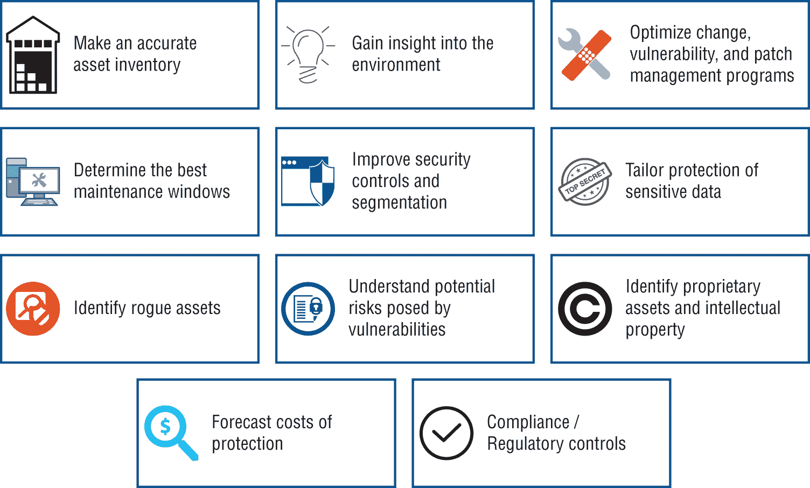
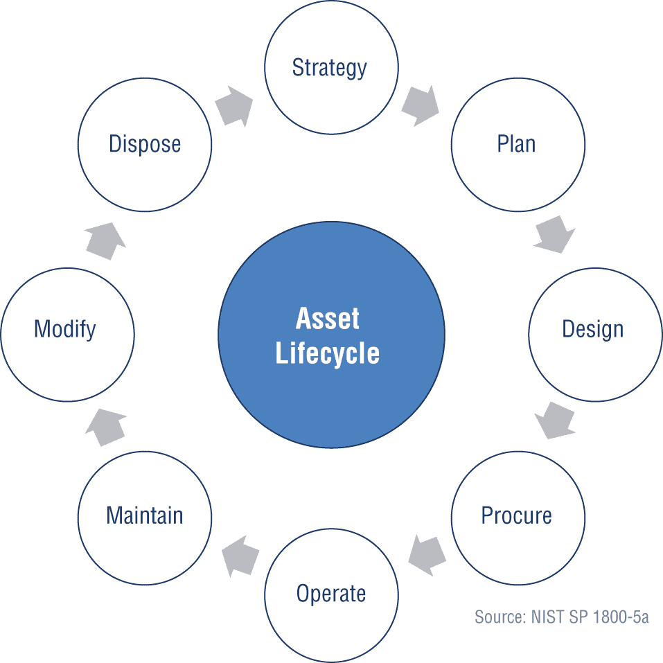
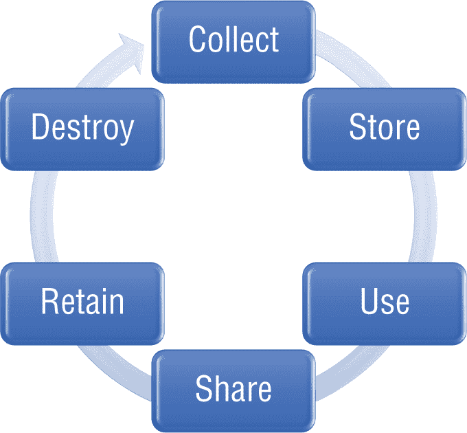
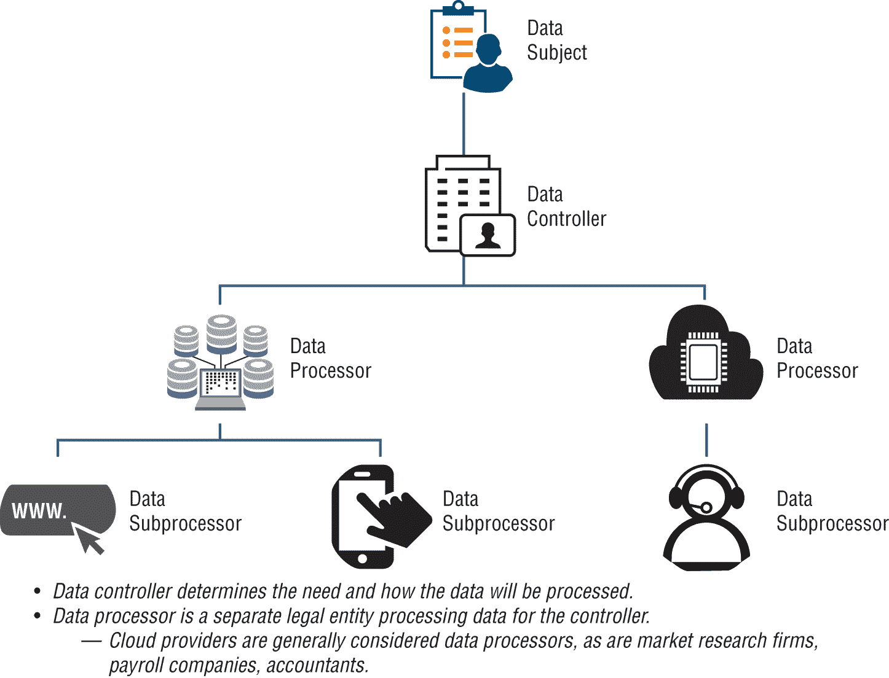
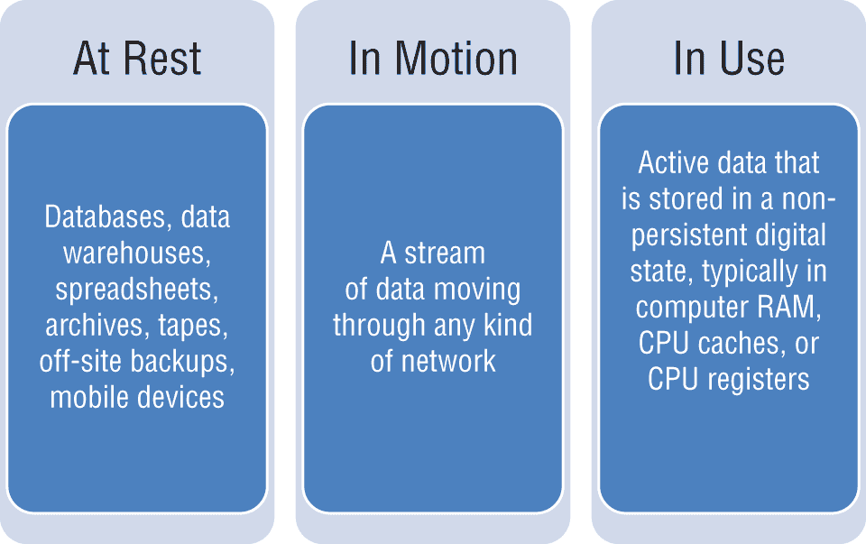

# DOMAIN 2

## Asset Security

`TO APPLY AND ENFORCE` 有效的资产安全，您必须集中精力盘点所有价值来源，即 `assets`。资产可以是有形或无形的，以信息存储、数据库、硬件、软件或整个网络的形式存在。

在本领域中，我们涵盖了在信息生命周期内识别、分类、保护和监控这些资产的战略的重要要素。虽然资产也可以是建筑物和房地产，但这些不在本领域的范围内——物理安全已在 Chapter 7，“Security Operations” 中得到充分阐述。本章将重点介绍确保组织信息和技术资产的机密性、完整性和可用性的最佳政策、实践和方法。

## IDENTIFY AND CLASSIFY INFORMATION AND ASSETS

识别和分类信息资产是确保系统和数据安全的关键第一步。如果不认真考虑这些任务，您将不知道资产在哪里，更不用说如何保护它们了！如果没有信息分类，您将无法确定哪些资产比其他资产更有价值，哪些资产需要额外的安全控制。其结果将是一个低效、昂贵的信息安全计划，试图保护所有资产，并假设敏感资产位于组织的所有部分（本地存储、共享存储、云中等）。更糟糕的是，一些仅需最低限度保护的资产，如公开信息，将与机密信息一样受到保护。成熟的安全计划始于资产识别和分类，这使您能够定位和分类资产并区分各自的安全方法。

创建组织拥有哪些资产、资产位于何处以及谁对资产负责的清单，是建立信息安全资产管理计划的基础步骤。由于廉价的本地存储、云技术和“随时随地工作”运动导致数据在组织内大量扩散，定位数据变得更加困难。绘制数据驻留位置是一项艰巨的任务，但却是必要的。

法律法规通常是组织资产识别和分类政策的驱动来源。以下是一些常见的法规和指南，它们规范了信息资产的分类和分类：

*   **加拿大：**《信息安全法》
*   **中国：**《保守国家秘密》
*   **欧洲联盟（EU）：**《通用数据保护条例》（GDPR）
*   **英国：**《官方保密法》（OSA）
*   **美国：** NIST 联邦信息处理标准 199，“联邦信息和信息系统安全分类标准”
*   **美国：** NIST 特刊（SP）800-60，“将信息类型和信息系统映射到安全类别的指南”（该文件被视为 FIPS 199 的“操作手册”）
*   **美国：** 国家安全系统委员会（CNSS）第 1253 号指令，“国家安全系统的安全分类和控制选择”

上述法规和指南的内容各不相同，但每个都侧重于数据保护的一个或多个方面。例如，英国《官方保密法》关注国家机密和官方信息的保护，并为此类信息的分类等级提供依据。欧盟《通用数据保护条例》加强并统一了数据保护，并为数据流政策提供依据。在美国，NIST FIPS 199 可用于在整体风险管理流程中进行资产分类。根据贵组织开展业务的地区，一个或多个这些法规或指南可作为制定资产分类要求的基础步骤之一。

### 数据分类和数据分类

数据分类和数据分类是密切相关的流程，使组织能够对数据进行排序和组织，以便更有效地进行分析和安全控制实施。以下各节介绍这些概念，并为在贵组织中对数据资产进行分类和分类奠定基础。

#### 数据分类

*数据分类*是将数据组织成描述数据敏感性、关键性或价值的组或类别的过程。数据分类有助于确定管理数据并保护其机密性、完整性和可用性所需的安全控制措施，是数据安全和风险管理的基石。此外，数据分类通常是遵守法律和监管要求的必要条件。

数据分类主要有三种类型：

*   **基于上下文：**源自所有权、位置或其他可间接指示敏感性或关键性的元数据。
*   **基于内容：**通过检查文件内容并直接识别敏感数据得出，而非从元数据中推断。合规机构，例如《1996 年健康保险流通与责任法案》（HIPAA）、支付卡行业（PCI）或合同相关条款（例如保密协议）涉及基于内容的分类，因为信息本身的类型决定了分类。
*   **基于用户：**涉及手动分配数据分类，并基于用户对数据及其组织分类方案的理解。

尽管对数据进行分类始终是最佳实践，但这一概念在军事或政府组织或受严格监管的组织（如银行）中更为正式。每个组织的实际标签都会有所不同。

制定数据分类政策和程序可使贵组织开始为信息提供最有效和最有效的保护而设计安全控制。如果不找到并正确分类数据，您将面临关键数据保护不足或非关键数据过度保护的风险。一旦您彻底对数据进行了分类，您就更能胜任对存储和处理该数据的资产进行分类。

#### 数据分类

数据分类常与数据分类混淆，数据分类是一种密切相关但不同的技术。*数据分类*是将具有可比“敏感性标签”（分类）的类型数据分组的过程。根据 NIST SP 800-60，“信息根据其信息类型进行分类。信息类型是由组织定义的特定类别的信息（例如隐私、医疗、专有、财务、调查、承包商敏感、安全管理），在某些情况下由特定法律、行政命令、指令、政策或法规定义。”通过将数据分类到具有相似敏感性分类的桶中，贵组织更能胜任对具有相似敏感性的资产应用类似的安全控制。

### 资产分类

数据分类侧重于识别数据的敏感性、关键性和价值，而*资产分类*则更广泛地涉及识别存储、处理和传输数据的<|message|> 信息系统和资产的敏感性、关键性和价值，以及数据本身。资产包括有价值的数据、处理数据的硬件以及存储数据的介质——它们可能采用电子或物理形式，包括服务器、硬盘、数据库、云存储或纸质记录。资产分类涉及根据资产的相对敏感性水平以及资产被破坏时对组织的影响程度对资产进行分组。在考虑资产分类时，重要的是要考虑该资产上存储或处理的信息的分类，因为数据通常是最重要的资产（例如知识产权）。

资产分类始于进行资产盘点并确定资产的负责人或所有者。资产包含数据或提供信息处理能力，资产清单使管理层能够了解组织中存在哪些敏感资产以及谁负责这些资产。借助此清单，安全团队和资产所有者能够根据各自的敏感性水平对资产进行分类和分组，这随后决定了组织将用于保护信息的最低安全控制集。正式的数据政策是组织建立分类级别的主要机制，然后管理层可以制定控制措施，以提供针对资产特定风险和威胁的充分保护。

#### 分类的好处

由于它为环境提供了宝贵的见解，分类是更安全、更完善的资产和数据管理的关键第一步。对于一个相对简单的流程，其收益是显著的。Figure 2.1 描绘了分类的主要好处。该列表并不全面，不同组织会发现收益程度各不相同。

#### 资产分类级别

资产应根据其敏感性级别进行识别和控制。这使得可以按照组织对资产的价值评估将类似资产进行分组。评估标准可以包括资产处理的数据类型、资产执行的流程，或两者兼有。资产分类类别没有强制性的公式或命名法。每个组织都必须自行确定名称和敏感性级别。表 2.1 显示了资产分类类型的示例。这是一个概念性的资产分类框架，用于说明组织的资产组合如何划分为关键性等级，并映射到高、中、低。*层级* 和 *重要系统* 在此用作示例，并非由监管机构规定。

**FIGURE 2.1 General benefits of asset classification**

**TABLE 2.1 Examples of Asset Classifications**

| CATEGORIES || ASPECTS || EXAMPLES |
| --- | --- | --- |
| Tier 0 || 对多个业务单元至关重要。  
可能处理或包含极其敏感的数据。  
被破坏可能会对业务的正常运作产生关键性影响。  
需要 100% 时间可用。 || 域控制器。  
数据库。  
邮件服务器。  
文件共享。  
客户端 Web 服务器。  
网关网络设备（防火墙、路由器和网络关键基础设施）。  
任何一旦损坏或关闭就会让业务停摆一天的东西。 |
| --- | --- | --- |
| Tier 1 || 对组织而言重要但不一定关键。  
对特定部门至关重要，但对整个业务并非如此。  
任何这些资产被破坏都将对业务的正常运作产生中等影响。 || 包含关键数据的开发环境。  
包含关键数据的冗余备份系统。  
部门文件共享。  
本地网络设备（交换机、路由器、防火墙和细分设备）。 |
| Tier 2 || 对日常运营既非必需也非关键。  
这些系统和数据通常仅由少数人或个人使用。  
任何这些资产被破坏可能只会给少数人带来不便，但不会对业务流程造成重大干扰。 || 工作站。  
笔记本电脑。  
手机和平板电脑。  
打印机。  
座机。 |
| Significant Systems || 任何处理或存储受合规标准约束的数据的资产。  
重要系统可能属于多个类别，也可能单独进行分类，因为即使系统丢失不会中断运营，但仍可能对业务造成损害。 || 持卡人数据（CD）——任何存储、处理或传输 CD 的系统必须符合 PCI DSS。  
受保护的健康信息（PHI）——医疗数据必须根据 HIPAA 概述的标准进行保护。  
财务数据——此数据可能受金融业监管局（FINRA）概述的某些隐私要求约束。  
美国联邦政府数据（FISMA/FIPS）——适用于美国军方和政府。 |

## ESTABLISH INFORMATION AND ASSET HANDLING REQUIREMENTS

有各种技术、运营和管理控制措施，可帮助安全专业人员执行对敏感信息和有价值资产的处理要求。组织应建立并维护政策和程序，以规范敏感信息和其他重要资产的标记、标注、处理、解密和存储。

### Marking and Labeling

标记资产是指将相关信息直接以清晰可见的方式放置在资产上，以便人员能够轻松识别资产所包含信息的适用安全级别和分类，以及任何分发限制和处理注意事项。对于物理资产（如纸质文件或硬盘）来说，这相对简单，但对于信息资产（即数据）而言，逻辑结构或元数据必须包含可写入标签的位置，例如文档页眉。对此过程的另一种说法是标注，因为用于标记资产的信息在分组在一起并在数字或物理标签上易于访问时效果最佳，具体取决于资产类型。电子资产可以包含文档页眉或页脚中的标记和标签，而有形资产可以包含粘贴在资产上的物理标签。当用户了解资产（包括数据）的价值时，他们就能更好地根据其分类妥善保护资产。

有了清晰可见的标签，更容易识别单个资产的重要性，并根据其分类级别管理资产，以确保保密性、完整性和可用性。

### Handling

您的组织应制定政策和程序来规范每类和每个分类资产的处理。这些政策和程序为访问、传输、运输和使用敏感数据和其他关键资产提供了规则。

员工对正确信息处理责任的意识和培训是任何资产安全计划的关键组成部分。培训应让员工了解因对资产处理要求掉以轻心而带来的风险。随着时间的推移，即使是处理最受限制信息的员工也可能变得麻痹大意，从而导致数据丢失。当员工对数据处理政策和程序漠不关心时，内部威胁就会发生，例如员工将专有信息发送给错误的人，或在公共咖啡馆访问敏感数据。

### Storage

与信息处理指南类似，信息存储指南对组织整体资产安全管理至关重要。当敏感信息全部为纸质时，信息存储安全只需将资产锁好并置于足够的物理屏障之后即可。随着数字信息存储在数据中心、移动硬盘、手机和云中，资产存储变得有些复杂。在数字时代，存储数据被盗、因管理不善而意外泄露，或因身份凭证被盗而被未经授权的人员访问的方式太多。

数字信息安全资产存储的首要考虑因素是加密。只要可行，静态敏感数据应进行加密。还必须对加密密钥本身的存储和保护给予额外考虑。这通常需要使用多重人员完整性控制，例如许多硬件安全模块（HSM）系统内置的控制措施（我们在第 3 章，“Security Architecture and Engineering”中讨论）。

安全存储的另一个考虑因素是限制保留的数据量。确保只存储所需的数据可降低组织风险并减少运营成本。就风险而言，数据存储限制也有助于改善灾难恢复和业务连续性，因为如果多余数据不会妨碍整体恢复过程，则在短时间内访问数据会更可行。

与数据存储相关的最后一点考虑是备份。您的组织必须制定明确的政策和程序，规定应备份哪些数据以及如何备份。此外，您还应制定并提供有关备份介质如何安全和受保护的指导。

### Declassification

## 分级解除

*分级解除*是指将资产的 assigned classification 修改为更低敏感级别的过程。随着数据在数据生命周期中流动，可能会出现数据不再具有与最初分类时相同的价值或敏感性的情况；你的组织必须有流程对数据进行分级解除，以应对这种演变。例如，当数据敏感性从机密变为公开时，标记、处理和存储要求必须相应调整。如果分级解除未正确进行，过度和昂贵的控制措施仍会保留，导致财务和工作效率的双重影响。

资产的分级解除是一个需要充分记录并通常需要多级审批的过程。数据所有者在该过程中发挥核心作用，因为他们决定数据的分类级别以及何时可以更改。组织内部应有数据治理流程来确定是否将对数据分类进行人工审查调整。组织也可以选择使用规则和应用程序自动执行该流程，以查找并重新分类数据资产。规则可能基于数据所有者确定的特定事件的发生，或最大时间框架的到期。

分级解除资产的方法包括修改数据以移除或混淆数据的标识或敏感元素。以下几节描述了其中几种方法：去标识化（包括匿名化和掩码）以及令牌化。

### 去标识化

*数据去标识化*是指移除可用于识别个人的信息（即个人身份信息（PII））的过程。去标识化用于保护敏感数据的保密性，特别是在数据用于测试或开发环境或其他可能没有所需安全机制的使用场景时。该过程涉及将任何个人识别数据字段转换为经过掩码、混淆、加密或令牌化的数据字段。例如，在*匿名化*下，“姓名”数据字段可能会从个人的真实姓名更改为随机唯一数字（参见 Figure 2.2），而在*掩码*协议下，你的信用卡号码除最后四位以外的所有数字都可能被一系列“X”字符替换（参见 Figure 2.3）。

**FIGURE 2.2 Data de-identification via anonymization**

**FIGURE 2.3 Data de-identification via masking**

文件中的某些数据字段可能仍保持其原始形式，但去标识化过程使剩余的原始信息对未经授权的个人变得不那么有用。年龄或种族等字段即使姓名和其他个人身份信息已被去标识化，仍可能对分析有用。如果使用加密，则需要重新识别密钥来解密数据库。无论使用何种过程对数据进行去标识化，都必须遵循准则，以防止通过组合数据字段或猜测用于匿名化的算法而轻易重新识别数据。

### 令牌化

令牌化是一种特定的去标识化形式，自有密码以来就已存在。然而，随着安全威胁的变化以及对加密等技术控制的局限性的认识，其受欢迎程度日益提高。*令牌化*是指用一组不敏感的字符或数字，即*令牌*，替换敏感数据元素的过程。通常，令牌与被替换的数据具有相同的字段长度，但与原始数据相比 otherwise 没有意义。换句话说，与加密不同，令牌无法逆向工程回原始数据的值。查找表用作重新识别密钥。原始数据和重新识别密钥应安全存储，与生产系统和原始数据分开。

## 安全地配置资源

随着资源的不断增减，组织的整体安全态势也在不断演变。因此，信息技术（IT）资源的配置（和取消配置）会对组织的整体安全产生重大影响。安全地配置信息资源涉及许多要素。本书各处讨论了这些主题，例如 Chapter 1 中的供应链管理。本节讨论资产所有权、资产清单和整体资产管理概念。

### 信息和资产所有权

信息和资产所有权是适当信息安全的核心。在组织内部，根据使命以及数据和资产的敏感级别，可能存在数据政策和信息资产安全管理政策。受法律、合同或其他合规结构保护的数据必须由组织的 data governance practice 处理。然而，每个政策的共同部分将是分配责任和资产所有权的指导方针。数据所有者和数据处理者（本章后面讨论）应有明确定义的角色和职责。数据治理，包括访问、可接受使用和数据保留，必须由组织中的合适人员执行或监督。

在组织内部，首席执行官或授权代表具有正式的所有权责任，如组织的正式治理文件所定义和指导，并在法律和法规的合规限制范围内。此责任包括代表组织保护和保障信息资产安全的权限。

资产所有者的额外责任可能包括以下内容：

* 保持信息资产清单为最新
* 识别信息资产的分类级别
* 定义并实施适当的保障措施，以确保信息资产的保密性、完整性和可用性
* 评估和监控保障措施以确保合规并报告不合规情况
* 授权具有业务需求的人员访问信息
* 确保不再具有业务需求的人员的访问权限被移除
* 不断评估环境和法律/合规环境，以确定是否需要对上述内容进行更改

### 资产清单

任何组织都需要作为其安全和合规计划的基础，有效的工具和流程来跟踪其资产清单。资产清单包括所有物理和虚拟资产，包括硬件、软件和数据。

拥有当前且完整的清单是实施和监控技术安全控制的绝对基石。如果没有全面准确的资产清单，就无法确定是否已妥善保护所有关键资产。

强大的资产清单工具和流程还将告知组织未经授权的（或“ rogue ”）资产。当然，除了知道要保护什么之外，我们还想知道什么不属于这里，以便任何不需要的资产能够尽快被移除或隔离。

#### 清单工具/系统记录

由于任务的规模、复杂性和频率，组织应使用自动化工具来协助创建和维护资产清单。这些系统枚举工具和其他端点管理工具应能够感知组织企业中的所有资产，并能够发现引入环境中但未在清单中正确记录的新资产。此数据来自安装在每个资产上的资产管理代理或客户端，或“内置”到每个系统映像中，通过与各种扫描仪和传感器工具的集成，或在托管或云资产的情况下，来自供应商的数据馈送或定期报告（是否与客户共享取决于合同）。本段所述的系统枚举工具为组织提供了对其环境中资产的极佳可见性，并可帮助支持第 7 章所述的配置管理活动。

资产清单工具应有一种方法来区分授权资产和未经授权的设备和应用程序，并在发现后者时发出警报。该工具还应收集和跟踪报告、审计、风险管理以及事件管理所需的单个资产详细信息。这些详细信息需要涵盖技术规格，例如以下内容：

* 硬件
  * 制造商
  * 型号
  * 序列号
  * 物理位置
  * 处理器数量和类型
  * 内存大小
  * 网络接口及其 MAC 和 IP
  * 主机名
  * 超级管理器、操作系统、容器、在此设备上运行的虚拟映像
  * 购买日期、保修信息
  * 最后更新日期（固件、超管理器等）
  * 资产使用指标
* 软件
  * 发布者
  * 版本号、服务包/热修复编号
  * 许可信息
  * 购买日期
  * 安装日期

此外，还应收集操作安全详细信息，例如资产上存储和处理的数据类型、资产分类和特殊处理要求、其支持的业务流程或任务，以及所有者和管理员及其联系信息。

当然，有许多工具可执行这些任务或其中的部分任务。大多数组织已经拥有许多此类工具。请考虑以下内容：

* Active Directory（AD）和轻量级目录访问协议（LDAP）服务器可以提供其中很大一部分信息。
* 漏洞扫描仪、配置扫描仪和网络映射工具可以查找并提供组织 IP 范围内所有主机的基本信息。
* 管理/跟踪软件许可证的工具可以执行此任务的大部分。
* DLP 解决方案通常具有可用于此目的的发现功能。

除了前面的列表外，组织可能需要利用专门的系统枚举和资产管理工具来发现、跟踪和管理其资产清单。对于其可用工具中的差距，组织可以通过手动工作、电子表格和脚本来弥补，以提取和汇总资产数据。专用资产清单工具通常提供此功能，并避免了手动数据提取和工具集成的需求。

无论使用何种工具或工具组合，都应有一个组织认为权威且最终的工具，以便在整个组织中引用——这是 `system of record`。该工具中的信息需要是确定的。这是当其他工具报告的信息存在冲突时应信任的数据来源。`system of record` 还应是用于官方报告和其他数据请求（例如审计的一部分）的来源。随着自动映射环境的下一代安全系统的出现，组织更能够动态跟踪可能每天看到多次软件发布以及端点进出的敏捷环境。持续集成和持续交付（CI/CD）和其他软件开发概念在第 8 章，“软件开发安全”中有所介绍。

### 流程考虑

现在我们讨论了所需的工具，我们将讨论清单管理最佳实践。首先，组织必须定义权威的清单或系统记录以及清单应如何刷新或更新的过程；这包括定义更新清单的适当频率，尽管许多敏捷组织将按需进行此操作。除了定期间隔的清单更新外，手动通知清单工具管理员在安装或移除资产或组件以重大方式更新/更改时也是一个良好的做法，只是为了验证这些更改是否已被清单工具捕获。

对于大量使用虚拟化组件的环境，包括托管云服务实现，资产管理可以通过不同方式完成。在这些情况下，使用自动化工具来查找、汇总和配置资产通常是可取的；流行品牌包括 `Puppet`、`Chef` 和 `Ansible`。

对于本地资产，使用地理位置信息/地理标签或使用射频识别（RFID）清单标签来增强清单流程通常很有帮助。这可以提高定位资产的速度和准确性，尤其是在事件发生时，时间至关重要。

### 资产管理

Figure 2.4 描绘了一个典型的资产生命周期，有助于理解与资产管理相关的阶段连续体。组织应在其整个生命周期内跟踪、管理和报告信息资产。这样最终可以通过提高资产可见性、识别易受攻击的资产、实现对安全警报的更快响应、揭示哪些应用程序实际上正在使用等来提高网络弹性。正确实施时，资产管理流程有助于降低成本、改善服务并降低风险。

**FIGURE 2.4 Typical asset management lifecycle**

实施正式资产管理计划的关键活动包括所有权分配（本节前面已讨论）、IT 资产管理（ITAM）、配置管理和变更管理。

#### 信息技术资产管理

`Information technology asset management`（也称为 `IT asset management`，或简称 `ITAM`）是一组与管理 IT 资产相关的业务实践，包括硬件、软件、数据和相关流程。`ITAM` 有助于组织确保其资产得到核算、维护、升级，并在适当时退役。简单来说，`ITAM` 就是确保您的有价值的 IT 资产，无论有形还是无形，都得到跟踪并有效使用。

国际标准化组织（ISO）已建立了一套与 ITAM 相关的正式标准。`ISO 19770` 是一个标准系列，最后更新于 2017 年，旨在帮助组织管理与 IT 资产相关的风险和成本。

`ISO 19770` 由五个主要部分组成，讨论如下：

* **ISO/IEC 19770-1：** 建立了一个流程框架，概述了最佳实践，并允许组织证明其符合 ITAM 标准。

**ISO/IEC 19770-2：** 建立了 ITAM 数据标准，用于 *软件识别*（或 SWID）*标签*，该标签为已安装软件或其他可许可项目提供权威的识别信息。SWID 标签使您的组织能够唯一识别部署在硬件资产上的软件。

**ISO/IEC 19770-3：** 提供了 ITAM 数据标准，建立了在描述软件授权权利、限制和指标时使用的通用术语。

**ISO/IEC 19770-4：** 建立了支持资源利用标准化报告的数据标准。当管理基于云的系统或其他复杂资产和许可证时，该标准尤为重要。

**ISO/IEC 19770-5：** 提供了 ITAM 的概述并定义了相关词汇。

### 配置管理

配置管理在 第 7 章 中有详细讨论，但由于其与资产管理及资产安全相关，这里有必要进行介绍。与保持库存为最新相关，系统和软件配置必须得到严格控制并彻底记录——这就是 *配置管理* 的作用。未经指导进行的配置可能会导致其他安全领域出现问题，例如漏洞管理，因为硬件和软件升级和修补的要求可能未知且被遗漏。

您应熟悉的基线有两种类型。*系统基线* 标识产品、系统或子系统中所有配置项（CIs）的版本和设置；系统基线回答了“要正确构建系统，我需要什么？”这个问题。安全 *基线* 是保护给定系统所需的一组最低安全保障措施（例如安全控制）。组织通常为企业内每个系统类别建立基线（例如，他们可能会建立 Windows 基线、RedHat Linux 基线和 macOS 基线），以描述每个系统必须具备的最低可接受配置。许多组织使用指南或检查清单来实现并维护其资产的安全基线配置。一个公开可用的领先来源是国家检查清单计划（NCP），由 NIST SP 800-70 定义。这是美国政府用于最新和详细的安全配置指导的存储库。其他国家也存在类似的指导，适用于广泛和具体的应用。欧盟中一个流行的例子是“物联网基线安全建议”指导，该指导为关键信息基础设施建立了一套推荐配置。

一些组织通过 NCP 中可用的元数据并使用 *安全内容自动化协议*（SCAP）自动执行大部分基线安全配置。SCAP 使经过验证的安全产品能够使用 NCP 检查清单自动执行配置检查。CISSP CBK 的 第 7 域 更深入地探讨了配置管理，我们将在 第 7 章 中探讨配置、基线化和自动化的概念。

### 变更管理

*变更管理* 是一项 IT 学科，专注于确保组织采用标准化流程来对其资产进行变更。组织必须制定政策和程序，以防止对其硬件和软件库存进行任意和意外的修改。变更管理包括允许您的组织以受控方式推出和优先处理变更的所有活动，而不会对生产环境或客户期望产生不利影响。这包括变更控制（即允许您验证已授权的变更是否正确实施的一套流程和工具）、执行（即防止未经授权的变更）、变更验证和审计。

如果变更管理处理不当，可能会出现各种问题。例如，您的库存记录与环境中的实际情况之间可能会逐渐出现显著差距。由于对 IT 环境的任何变更都可能影响组织的安全态势，因此所有重大的 IT 变更都应经过正式的变更流程，其中包括对变更的安全影响评估。变更管理在 第 7 章 中进一步讨论。

## 管理数据生命周期

维护数据安全需要您了解数据在整体数据生命周期中的位置。 图 2.5 描述了安全数据生命周期，每个步骤在下面的列表中进行了描述。

**FIGURE 2.5 Secure data lifecycle**

1. **收集：** 数据被生成或汇总。
2. **存储：** 数据被保存到存储系统或存储库中。
3. **使用：** 数据由用户或系统按其预期目的进行处理和/或分析。
4. **共享：** 数据与授权的外部用户和系统共享。
5. **保留：** 数据被保留（例如归档）一段时间。
6. **销毁：** 数据被删除并永久从存储中移除，使其无法访问且无法使用。

数据生命周期是一个高级流程，描述了数据如何在组织中流动，具体步骤可能因组织而异。例如，一些数据可能直接从步骤 1 进入步骤 6，从未被存储或保留，而一些数据可能永远不会达到步骤 6，而是被归档（即保留）在冷存储中永久保存。

了解安全数据生命周期中每个阶段的差异对于定义高效的安全流程和有效的数据安全控制至关重要。数据生命周期模型可用于帮助您的组织思考数据在每个阶段的安全需求。我们将在以下各节中讨论每个阶段和相关的数据角色。

### 数据角色

管理组织数据安全的一个关键因素是能够识别控制或可能访问您的数据的各方，并了解他们在整个数据生命周期中的角色和职责。一些法规（例如 GDPR）对组织识别特定数据角色的特定个人设定了严格要求。每个职称的含义可能因法规或组织而略有不同。本节其余部分将讨论每个数据角色的一般描述。

#### 所有者

不出所料，数据所有者是组织中最重要的角色之一。*数据所有者* 是负责规定数据应如何以及为何使用，以及数据必须如何得到保护的个人或个人组。数据所有者可以对信息拥有法律权利和完全控制权，可以授权或拒绝对其数据的访问——数据所有者最终对其数据负责并承担责任。在许多组织中，这一责任可能是高级领导者，可能包括首席执行官（CEO）或公司总裁，但特定数据相关任务可以委托。数据所有者可能因其拥有的敏感数据被滥用或未经授权披露而被追究过失责任；即使日常任务被委托，数据所有者仍承担最终责任。数据所有者的责任范围可以通过法律或监管措施来建立和执行。组织的数据政策将概述数据所有者如何使用、收集、共享和存储其拥有的数据。所有数据，尤其是具有敏感级别的数据，都必须分配给所有者。

对数据所有者的期望是提供适当的注意和勤勉。这些主要是指导信息保护活动的法律术语。这些概念已在第 1 章中介绍，并在本章后面详细说明。

*适当的注意*，就资产管理而言，是使用合理措施和努力来保护被认为有价值或被分配敏感级别的资产。提供适当注意的一个例子是保持和维护准确的资产清单。此外，适当注意还延伸到确保所有资产都得到适当分类，并且分类基于资产所包含的信息而准确。

*勤勉*是指采取所有可预期或实际的步骤来维持适当注意，包括验证一切是否按适当注意的意图执行。勤勉的一个例子始于承认有价值的资产遍布整个组织，并且必须付出重大努力来对其进行核算和评估。这将使组织能够适当评估风险和保护策略。资产不再局限于固定的边界。笔记本电脑、U 盘和便携式设备等资产是移动的。随着数据转移到云端，有形和无形资产以及因此而产生的勤勉也延伸到云环境。

在事件响应活动或数据泄露调查期间，可以看到适当注意和勤勉的重要性。能够证明适当注意和勤勉的组织可能能够减少责任和法律风险，而缺乏适当注意和勤勉则可能构成民事甚至刑事处罚的理由。

### 控制器

*数据控制者*是指单独或与其他人共同决定数据处理目的和方式的个人、机构、公司或其他主体。随着 GDPR 法规的出台（在第 1 章中讨论），数据控制者变得越来越相关，数据控制者负责遵守与处理个人数据相关的所有原则。为此，控制者必须能够证明其遵守合法性、公平性、透明度、数据最小化、准确性、存储限制、完整性和个人数据的保密性等原则。数据控制者通过安全的合同条款和保证，即*数据处理协议*，与数据处理者协商个人数据的隐私保护。

### 托管人

在组织中，数据治理流程应包括数据托管人的角色。数据托管人负责根据数据所有者和业务设定的要求维护 IT 基础设施上的数据。数据托管人负责维护确保数据安全保管、传输和存储的技术环境。

### 处理者

数据的价值往往在于信息在授权实体之间的共享或交换。代表数据所有者负责传输、传送或以其他方式处理数据的方是*数据处理者*。数据处理者在数据保护中具有不同的角色。在医疗保健环境中，数据交换对于患者护理的安全和适当进行、适当治疗、管理账单和其他组织运营都很重要。在银行业，数据支持企业和个人投资以及信用评估。GDPR 和 HIPAA 等法规的监管重点反映了数据处理责任的重要性。

**FIGURE 2.6 Relationship between data processor and data controller**

在某些情况下，组织中的人员同时担任数据处理者和数据控制者角色。例如，人力资源公司对其员工拥有数据，在此意义上是数据控制者。然而，如果该公司为其他客户提供外包人力资源服务，人力资源公司将成为客户数据的处理者，而个别客户仍是数据控制者。

### 用户

可以说最容易理解的是，*数据使用者*是消费数据的方；数据使用者是数据的客户或预期接收方。数据使用者可要求数据处理者遵守服务水平协议（SLAs）和其他合同协议，这些协议要求特定的绩效水平（例如，数据可用性）。

### 主体

*数据主体*，根据 GDPR 定义，是“已识别或可识别的自然人”——或用通俗英语来说，就是人类，从他们那里或关于他们收集信息的个体。GDPR 的总体目的是保护数据主体及其个人信息的隐私。

### 数据收集

数据生命周期（参见图 2.5）始于数据收集。此阶段可能包括数据创建、获取、聚合，或数据对您的系统而言“全新”的任何情况。新的数据可能是新生成的内容、引入您环境的新数据，或已更新/修改为新状态的内容。

安全默认值、隐私设计以及其他安全设计原则在此数据生命周期的初始阶段最为重要。法规和最佳实践建议（并且通常要求）数据保护原则应从一开始就设计并集成，而不是在后期引入安全措施。

数据分类，在“识别和分类信息和资产”部分中讨论过，最适合在数据收集或创建期间进行；这有助于确保从一开始就实施正确的安全控制。除了建立数据分类之外，此阶段也是为数据标记任何重要属性并为数据分配适当访问限制的好机会。在数据收集期间做出的任何决定都会伴随数据在其整个生命周期中。因此，必须充分考虑收集/创建的数据在其生命周期内如何被管理和保护。

### 数据位置

随着基于云的存储的增长，数据位置是一个日益被讨论的话题。许多司法管辖区或政府都有法律要求公民（或居民）的数据必须在国内收集、处理或存储。数据仍可国际传输，但必须源自该国，并且只有在满足当地隐私或数据保护法律后才能传输。这些条件的例子是通知用户信息将如何使用并获得其同意。这是数据在境外交换之前的数据本地化或数据驻留。在某些情况下，数据本地化或数据驻留规定要求在从数据主体所在国家系统移除之前，必须从外国系统删除有关该国公民或居民的数据。某些法规禁止某些数据（如军事机密等）在任何情况下离开原籍国。

中国《网络安全法》是数据位置要求的一个突出例子。该法律于 2016 年通过，加强了国家政府对网络安全业务的管辖权。所有关键信息基础设施（CII）均受该法律约束。政府对维护可能在受损或丢失时构成国家安全或公共利益风险的数据的关键行业感兴趣。受该法律考虑的中国企业中一些行业包括能源、金融、交通、电信、电力、水、天然气以及医疗和医疗保健。作为该法律的一部分，受影响的外国公司必须在中国建立服务器和数据中心，或将数据管理外包给由中国本地管理的公司，如阿里巴巴或腾讯。

使用云服务提供商时，数据本地化或驻留会凸显出若干重要考量，包括了解您的数据将驻留在何处（或可能传输到何处），以及云服务提供商为支持数据所有者的要求所承担的合同义务。数据本地化或驻留是要求数据控制者持有云数据存储加密密钥的另一个正当理由。如果国家要求国际组织在该国之前销毁数据，删除加密密钥可以作为补偿控制措施，使敏感数据无法读取且无法使用。

### 数据维护

在收集和存储数据之后，数据很可能会在组织内部移动并用于其预期目的。安全数据生命周期中的“使用”阶段涉及以各种方式处理、分析和共享数据。在此阶段，您应通过控制对数据的访问并在过程中应用适当的安全控制来积极管理和维护数据的安全性。数据维护涉及持续监控您的数据并应用诸如最小权限和纵深防御等原则（均在 `Chapter 3` 中讨论）。

### 数据保留

无论您的数据存储在本地数据中心还是由第三方托管（例如云服务提供商），您都需要考虑在安全销毁之前数据将保留多长时间。制定数据保留政策和程序，定义保留什么以及保留多长时间，不仅是标准做法，而且很可能是法律、监管或合同要求。例如，`NIST SP 800-53` 概述了联邦机构和政府承包商为遵守《联邦信息安全管理法》（`FISMA`）而需要满足的要求；这些 NIST 指南要求数据至少保留三年。同样，`HIPAA` 数据保留要求规定，被覆盖实体必须从创建之日起至少保留六年的与 HIPAA 相关的数据。了解应保留某些类型数据多长时间可能会变得非常复杂。您组织的安保和法务团队应密切合作，以确保数据保留政策满足所有法律和监管要求。

数据保留政策还应规定敏感或个人数据的最大保留期限。虽然保留最低期限旨在帮助支持事件响应和其他类型的调查，但保留最大期限通常是为了保护个人数据的隐私而执行的。例如，`GDPR Article 5` 规定，个人数据应仅在实现数据最初收集目的所需的时间内保留；换句话说，GDPR 要求组织在必要时保留个人数据，但不得超过必要时间。同样，各种监管要求往往相互冲突，这使得制定和遵循数据保留政策变得非常具有挑战性。尽管如此，这仍是每个资产管理计划的关键部分，需要认真考虑。

### 数据销毁

数据生命周期的最后阶段也是最常被忽视的阶段：*数据销毁*。如果数据不再按法规或功能需要，则应将其处理掉。陈旧数据是黑客的磁石，通常是环境中最不受保护的资源。通过逻辑或物理销毁不需要的数据，您可以降低风险敞口并减少存储和数据维护成本。除了对存储介质进行完全物理销毁之外，任何方法都可能使数据残留。我们将在下一节中讨论这种现象以及应对方法。

### 数据残留

尽管许多电视上的热门犯罪剧描绘了从任何介质上恢复任何数字数据的虚构能力，但确实，不充分删除数据可能导致信息泄露。如果未妥善处置，介质上可能残留数据，且未经授权的查看者有可能恢复该数据。*数据残留*是指数据销毁工作不足以防止数据被重建时发生的现象。

数据残留的根本原则是，数据仅从硬盘或其他存储介质中删除是不够的；在使用操作系统的删除命令时，只删除了指向数据的指针，而非数据本身。受监管数据（如 `PHI`）和敏感度等级更高的数据（例如机密或绝密）必须遵循严格的销毁方法。销毁必须经过认证，并且销毁/认证的证据必须作为流程的适当文件保存。由销毁数据的实体出具的销毁证书，并由监督数据销毁的人员签署，通常是足够的。

使用云服务提供商引入了一些关于数据残留的挑战。云服务提供商与云客户之间需要进行大量协作才能实现安全的数据销毁。云用户或租户无法访问物理驱动器，只能访问文件系统等更高级别的抽象。诸如覆盖文件扇区等技术在组织拥有和运营的本地数据中心中是可行的，但在云环境中则不可行。在软件即服务（`SaaS`）和平台即服务（`PaaS`）环境中，访问仅发生在数据层面。在云环境中，替代方案是对数据进行加密并将密钥保存在数据所在云环境之外。当数据不再需要且密钥被删除时，数据将被渲染为不可用且无法读取——这被称为 *加密擦除*。这并不是完美的解决方案，但由于云服务提供商分配资源且云用户无法控制容纳数据的物理资产所在位置，因此覆盖方法通常是不可能的。

管理数据销毁的规则和法规通常规定必须对各种类型的敏感信息应用的保护级别。美国有几项联邦法律可能适用于组织的数据销毁，包括《格雷姆-里奇-比利雷法案》（`GLBA`，在 `Chapter 1` 中讨论），该法案限制了客户信息的披露和使用，并对金融机构施加了安全规则。`HIPAA` 规范客户医疗记录和信息的处理。公平信用报告法规范了有关消费者信用和信用评级的报告中信息的用途、披露和处置。经批准的欧洲标准 `BS EN 15713`，“机密信息的销毁”，定义了安全有效地销毁此类数据的行为准则。它适用于收集、运输和销毁机密材料的任何组织。`BS EN 15713` 可与其他管理体系标准集成，最常见的是 `ISO 9001`。

有许多框架和法规建议或要求针对数据残留采取特定的缓解措施。例如，在美国国家安全局（`NSA`）中央安全局（`CSS`）政策手册 9-12 中，要求首先移除所有表明先前使用和分类的标签和标记。之后，要求根据所使用介质的类型而有所不同。其中一些要求包括以下内容：

* 通过使用 `NSA/CSS` 评估的消磁器对磁带和磁盘进行消磁消毒和/或通过焚烧材料将其焚毁并化为灰烬。在此过程中，适用以下标准：
    * 强烈建议在以任何方式释放之前通过变形内部盘片来物理损坏硬盘驱动器，或使用硬盘驱动器破碎机。

*   硬盘可以通过使用消磁棒消磁、拆卸设备并擦除封闭盘片的所有表面来进行消磁。

*   将硬盘分解成边长名义上为 2 毫米大小的颗粒。强烈建议将硬盘存储设备与其他存储设备一起批量分解。

*   使用经批准的碎纸机对较小的软盘进行碎纸是允许的。碎纸前请先取下软盘外壳和金属中心轴。

*   光学存储设备包括 CD、DVD 和蓝光光盘（BD），可以采用以下方式进行清理：

    *   BD 唯一可以清理的方式是通过焚烧材料并将其还原为灰烬。这里列出的其他方法对它们无效。焚烧对 CD 和 DVD 也有效。

    *   CD 和 DVD 可以被分解。

    *   CD 和 DVD 可以被碎纸。

    *   CD 和 DVD 可以通过使用经批准的光学存储设备压花/滚花机进行压花/滚花。

    *   CD 可以通过经批准的研磨机进行清理。DVD 或 BD 不能通过研磨进行清理。

*   对于固态存储设备，包括随机存取存储器（RAM）、只读存储器（ROM）、现场可编程门阵列（FPGA）、智能卡和闪存，以下方法是可以接受的：

    *   使用经批准的破碎机将其分解成边长名义上为 2 毫米大小的颗粒；建议与其他多个存储设备一起批量进行此操作。

    *   将材料焚烧成灰。

*   智能卡可以通过条状碎纸至最大 2 毫米或以 45 度角对角线切割智能卡进行清理，确保微芯片被切过中心。另请确保条形码、磁条和书写信息被切成几块且书写信息无法阅读。交叉碎纸机*不*允许用于此碎纸。

BS EN 15713 的要求类似，其中包括以下内容：

*   必须有保密销毁场所。

*   客户与组织之间应存在涵盖所有交易的书面合同；分包商也必须遵循指南。

*   从事此工作的人员必须接受培训、获得认证，并通过犯罪记录局（CRB）检查或披露或禁止服务（DBS）检查。

*   待收集的保密材料应从收集点到完全销毁期间始终受到未经授权访问的保护。

*   用于收集和运输受保护材料的卡车有特定要求，包括为箱型、驾驶员能够与基地站通信、可上锁、不被无人看管等。

*   除了销毁重点外，还考虑了环境问题，并在某些条件下允许回收。

数据销毁有两种通用方法。第一种方法是使包含介质的实际设备或对象变得无用。物理销毁介质、电磁消磁和焚烧是常见策略。

另一种资产处置方式是通过清理或清理介质/驱动器来清理介质/驱动器。因此物理介质可以被重复使用，但在数据擦除操作后不会留下数据残留痕迹。有许多经过验证的流程可用于此目标。

您的资产处置政策应区分在组织内部重复使用的资产和在组织外部重新利用的资产（或完全丢弃）。例如，内部重新分配的资产可能只需较低级别的清理即可足够（例如，重新格式化或重新映像硬盘）。此场景并不排除组织在资产被认为关键或数据敏感时强制执行最高级别清理。一些不同的策略可用于实现特定步骤和说明的安全保证水平，可在 NIST SP 800-88《介质清理指南》中找到，网址为 [` nvlpubs.nist.gov/nistpubs/SpecialPublications/NIST.SP.800-88r1.pdf`](http://nvlpubs.nist.gov/nistpubs/SpecialPublications/NIST.SP.800-88r1.pdf)。

为实现充分资产清理保证水平，可以使用以下技术：

*   **清除：** 这涉及数字擦除数据或用零或一覆盖数据。这是数据删除最无效的方法，可能允许数据恢复。

*   **清除：** 这包括诸如 *消磁* 等方法，即通过将存储介质暴露于强磁场来破坏数据。

*   **销毁：** 这包括通过碎纸、焚烧或粉碎物理销毁介质，也包括使用强加密在逻辑上销毁数据。

实现所需清理要求保证水平的具体技术示例包括以下内容：

*   **清零：** 这会擦除磁盘上的数据并用全零覆盖。

*   **覆盖：** 数据写入先前保存敏感数据的存储位置。通常使用 0 和 1 组合的随机遍数进行覆盖，而不是模式。覆盖次数取决于存储介质，有时取决于其敏感性，有时取决于不同的组织要求。

*   **消磁：** 这是一个过程，其中磁性介质被擦除（即通过使用强磁场将其恢复到初始空白状态）。

## 确保适当的资产保留

数据保留计划服务于多种目的。组织需要保存知识产权。适当的数据保留流程将支持机构记忆。在法律或取证检查中，可以通过数据保留来保存证据。在许多情况下，数据保留是由于监管和合规要求而产生的义务。

信息安全专业人员必须在信息存在的整个过程中处理信息的保密性、完整性和可用性。如果没有成熟的数据保留流程，组织将经历更多记录篡改、数据丢失和不当访问的事件。必须做出几个考虑，以确定应维护哪些类型的信息以及维护多长时间。法规可能会根据数据的类别或敏感性制定指南。虽然某些法规似乎强制要求过度的保留要求，但请记住，不合规的成本（例如，法律处罚、诉讼费用等）可能远超过保留数据的成本。

在法规或其他合规要求未给出具体授权的情况下，组织必须制定资产保留指南。这些时间线应与资产类型（关键、生产等）和数据敏感性（机密、公开等）相关。

资产和数据保留对于组织保护和保存记录作为行动证据至关重要。资产管理系统是关于业务活动的信息来源，可以支持后续活动和业务决策。该流程还确保对当前和未来利益相关者的问责。记录管理实践存在几个良好的参考资料。其中之一是 ISO 15489-1:2016，《信息与文献 — 记录管理 — 第 1 部分：概念与原则》。另一个是 DoD 指令 5015.02，《DoD 记录管理计划》。

构建数据保留政策所需的步骤很重要。第一步是指定一位有权威的人或指导委员会决定企业生产哪些电子和实物文件并指定所有权。接下来，该人员或委员会应审查与资产和数据保留相关的法规，以确保政策保持一致。然后，团队就可以实际撰写政策了。一旦政策在组织内发布，培训员工了解该计划就很重要。持续的沟通将有助于确保流程的成功。定期审查数据保留政策并根据需要对其进行更新。

下面列出的是帮助建立初始数据保留政策的一般大纲。在已经拥有数据保留政策的组织中，可以使用此行动模板来审查当前政策：
* 记录政策的目的。
* 确定受政策影响的人员。
* 确定政策涵盖的数据类型和电子系统。
* 定义关键术语，特别是法律和技术术语。
* 从法律、业务和监管角度详细描述要求。
* 概述确保数据得到妥善保留的程序。
* 概述确保数据得到妥善销毁的程序。
* 明确记录诉讼例外流程以及如何响应电子取证请求。
* 列出参与数据保留活动的人员的职责。
* 建立一个表格，显示信息类型及其对应的保留期限。
* 记录中央或企业数据保留团队的具体职责（如果存在）。
* 包含附录以供额外参考信息。

政策应明确，在数据管理生命周期的所有阶段，包括销毁阶段，都需要适当的保密处理程序。

安全从业人员在资产保留中最重要的角色可能是创建和维护一份政策，该政策以法规为依据并遵守法规，满足业务目标，并在整个组织中得到理解和遵循。进行政策培训和测试是衡量项目绩效的重要措施。必须让用户意识到他们在整个资产生命周期中维护保障措施方面的责任。应进行审计，以确保组织遵守政策和程序。

## 确定适当的记录保留

安全专业人员必须时刻关注可能影响记录保留要求的各种地方、国家和国际发展。一个例子是欧盟《通用数据保护条例》第 17 条“被遗忘权”，通常称为*被遗忘权*的制定和执行。这导致组织根据第 17 条引入的被遗忘权考虑因素，对之前的记录保留要求进行评估。该条款明确赋予个人在不拖延的情况下要求删除其记录的权利。对于企业或数据控制者必须出于收集数据目的保留数据的情形，有一个例外，即原始业务需求。在这种情况下，业务需求可以成为监管指导的例外。

还有监管要求导致组织建立和维护记录保留政策，其保留期限超过记录的内部使用寿命。此类情况的一个例子是 HIPAA，该法规要求相关医疗保健组织保留与 HIPAA 合规相关的文件，例如与电子受保护健康信息（ePHI）审查相关的日志记录，保留六年。虽然 HIPAA 要求对维护与 HIPAA 相关的政策和程序所需的文件实行六年的记录保留要求，但美国各州法律通常涵盖患者病历的记录保留要求。有关更多详细信息，请参阅美国联邦法规法典第 164.316(b)(1)条和第 164.316(b)(2)(i)条。负责监督 HIPAA 的美国卫生与公众服务部（HHS）在缺乏更具体的联邦和州级指导的情况下，建议最少保留六年。涉及多个司法管辖区时，请咨询组织法律顾问以获得明确指导。让他们成为通知您变更的守门人，而不是安全团队需要订阅法律新闻服务。

记录保留要求还应辅以去标识化和混淆处理。记录保留计划可以包括个人数据不再需要时的日期，但其他元素对于数据分析和趋势分析很有用。这可以在保护个人信息的同事延长记录的使用寿命。定期对文件进行清理，并不将个人数据保留超过必要的时间，从而满足监管合规要求。

## 记录保留最佳实践

每个组织必须根据适用的法律、指令、政策、法规、标准和运营要求处理和保留记录。虽然要求可能因地理管辖区或行业特定考虑而有所不同，但安全专业人员可以使用以下几个总结性最佳实践来构建合规有效的记录管理计划：
* 根据组织的记录保留计划保留记录。
* 定期评估系统。可能存在触发审查的因素，例如合并或收购。否则，请考虑定期、定期审查组织中的记录。这些审查应包括法律和合规团队，以及任何相关应用程序和数据所有者。
* 每年审查实际的记录保留计划一次，以确保计划与业务要求和监管要求相关。
* 对电子维护的记录进行标记。
* 创建备份电子文件副本。
* 保留无法准确或完整转移到电子记录保存系统的记录的纸质副本。
* 不要保留记录超过收集信息原始目的所需的时间。
* 确保记录具有有效的起始日期。记录的移动和使用可能会改变电子文件日期，但不会改变决定保留期的日期。
* 应根据保留计划，在所有已识别的电子存储库中合理尝试删除不必要的电子记录。
* 在信息的整个生命周期内维护信息处理控制，在某些情况下甚至在记录处置后仍需延续。
* 确保记录在保留期间内保持持久可访问，其可访问频率应与检索频率相符。
* 对记录进行去重，以避免不必要的存储多个副本，从而增加风险和存储成本。
* 记住对官方记录的电子邮件进行分类和保留。创建电子邮件保留计划作为记录保留计划的子集。
* 通过定期将记录从媒体源转换和迁移，确保记录在所需的保留期内保持可访问，因为数字媒体可能会随着时间的推移而退化或过时。
* 根据书面保留期限以及信息安全和保留政策安全删除数据。

您的记录保留计划可能对您的组织而言是独特的，但遵循最佳实践以建立有效的电子记录保留计划是基础。您的组织需要捍卫其知识产权，并在诉讼发生时提供保护。适当的记录保留使组织能够验证其保存的记录的真实性。随着关键性、价值和数字信息量的激增持续增长，记录保留对于防止组织不堪重负以及记录变得不可用或不受保护至关重要。总之，虽然没有通用的记录管理计划，但安全专业人员需要检查其自身企业中的具体要求，并考虑最能服务于其组织的最佳实践方法。

## 确定数据安全控制和合规要求

在资产被识别、盘点和分类之后，仔细考虑最适合您组织的数据安全控制非常重要。这些安全控制将根据每项资产的分类、数据状态以及组织选择对齐的任何合规要求或行业标准而有所不同。

首先，有三个类别的控制您应该熟悉：技术、行政和物理。对每种类型控制的更深入理解是必要的，以强调每种控制在保护组织资产中所起的作用。

* **技术控制：** 被归为*技术控制*的控制类别利用计算机能力和自动化来实现保护措施。技术控制旨在防御对有价值信息的滥用或未经授权的访问。在大多数组织中，需要组合技术控制协同工作，以保护、检测并响应潜在的和实际的安全事件。一些与资产管理相关的技术控制示例是防止未经授权读取、写入、移动或执行资产的访问控制系统，以及允许或限制访问 URL、IP 地址或软件加载/执行的过滤器。

* **行政控制：** *行政控制*是组织用来实施技术和物理控制的人员导向的政策、程序、标准和指南。行政控制的来源可以是法律法规、行业最佳实践和组织授权。行政控制告知组织角色和职责、适当的信息保护实践，以及如果未遵循控制时的执行措施。

* **物理控制：** 随着信息和技术资产持续数字化并变得更加互联，*物理控制*仍然非常重要。控制对信息资产的物理访问通常是我们可以使用到的最经济且最有效的预防控制。设计包含警卫和接待员、入口访问控制、区域照明和监控、闭路电视（CCTV）以及物理入侵检测系统的资产保护计划，可提供分层防御方法。

物理、技术和行政控制也由其保护目的定义。每种类型的控制都可以描述为威慑性、预防性、检测性、纠正性或恢复性。根据控制的不同，它可能在整体安全计划中承担多种功能。这些内容在第 1 章中“适用控制类型”部分有详细讨论。

### 数据状态

数据是一种易变的资产。随着组织中数据的使用发生变化，保护它所需的安全控制也必须发生变化。根据数据的价值，无论处于何种状态都必须对其进行保护。数据可以存储或静止在备份磁带、硬盘或云中。数据通常被应用程序和网页临时使用。当数据在用户或计算资产之间传输时，被视为在传输中。保护数据作为资产的一些关键方法是加密和访问控制，包括适当的授权限制。加密可防止在未经授权访问或被盗的情况下数据被查看。图 2.7 提供了各种状态下数据的示例。有关每种数据状态适当安全控制的详细内容，可在第 3 章、5 和 7 中找到。

**FIGURE 2.7 Data states and examples**

##### 数据静止

*数据静止*是指存储在系统上且未被主动写入、读取、传输或以其他方式处理的数据。数据处于“静止”状态，因为没有来自设备到设备或跨网络的主动处理或传输。

数据静止保护通常从访问控制开始。考虑您试图保护的数据资产、谁应该有权访问它以及谁绝对应被拒绝访问它非常重要。适当的访问控制，包括对敏感数据使用多因素身份验证，是实现安全数据静止的重要起点。

加密是数据静止的另一种常见安全控制。加密可以应用于整个存储卷，称为*全盘加密*。值得注意的对整个硬盘进行加密的几种方法如下。

* *可信平台模块*（TPM）是集成到计算机硬件中的微控制器芯片，提供加密处理器。加密密钥被集成在设备本身中，并且可以在启动时帮助验证平台。

* *自加密驱动器*（SED）是硬盘驱动器或固态驱动器，可在无需额外加密软件的情况下自动加密和解密驱动器数据。SED 在无需用户输入的情况下持续加密驱动器数据。

更细粒度的方案允许在单个文件级别应用加密，称为*文件级加密*。文件级加密是一种量身定制的数据保护策略，可能在整个磁盘被解密的情况下，提供额外的保护，防止对硬盘上的文件进行未经授权的访问。为了获得更精细的粒度，*字段级加密*允许对单个文件内的特定数据字段进行加密。

##### 数据在传输中

*数据在传输中*是指正在通过网络、多个网络之间或从一个位置传输到另一个位置的数据。也描述为*数据在运动中*，数据在传输中是指任何正在从源点主动移动到目的地跨网络的数据，包括受信任的、私有网络。数据也可以通过互联网和到云等不受信任的网络进行传输，例如。传输层安全（TLS）（包括 HTTPS）和虚拟专用网络（VPN）是帮助保护传输中数据的关键基于加密的技术。

*链路加密*是一种数据在传输中安全的方法，其中流量在每个网络路由点（例如其经过的网络交换机或节点）处被加密和解密。此过程一直持续到数据到达最终目的地。路由信息在每个节点解密过程中被发现，以便传输可以继续。然后消息会被重新加密。链路加密提供了几个优势：

* 由于加密过程是自动的，因此人为错误更少。

* 流量分析工具被规避，攻击者被挫败，因为持续的通信链路和不变的流量水平保持了加密保护。

*端到端加密*是另一种数据传输中的保护方法。这种通信系统确保只有发送方和接收方可以读取数据。任何窃听者都无法访问解密对话所需的加密密钥；这意味着即使是电信提供商、互联网提供商或通信服务提供商也无法访问解密对话所需的加密密钥。

### 使用中的数据

*使用中的数据*是数字数据的第三种、经常被遗忘的状态，指由用户（人类或系统）使用的应用程序正在主动处理的、正在被处理的数据。当经过身份验证的用户访问数据库或应用程序时，数据处于易失状态。使用中的数据通常在 RAM、CPU 缓存或 CPU 寄存器中使用，以执行终端用户所需的交易和任务。加密在这里不一定相关，也不是与使用中的数据一起使用的主要控制措施，但它可以与其他控制措施互补。使用中的数据， presumedly 由授权用户使用，强调了身份验证、授权和审计对于控制和监控对敏感资产的访问的重要性。一旦黑客窃取了有效的凭据，许多像加密这样的控制措施就会变得无效，因为入侵者拥有如同内部人员一样的访问权限。这些类型的问题将在第三章中进一步讨论。

### 范围界定和定制

建立安全控制基线开始了范围界定和定制过程。因为每个组织都有独特的因素影响其对资产的价值评估、面临的威胁以及在资源和业务运营影响方面能够承受的安全水平，所以细化单个控制措施是安全专业人员的重要职责。CISSP 必须帮助制定计划，以澄清和限制指南和框架的一般建议，使其适用于该组织。

范围界定和定制不是同义词，但这两个概念共同作用以建立安全基线。*范围界定*是组织为考虑哪些安全控制适用以及需要保护哪些资产而进行的过程。*定制*是修改控制集以满足组织特定特征和要求的过程。由于每个组织都不同，框架中的某些控制可能不适用；这些控制可以从基线中移除。有时安全控制确实适用，但实施应根据组织中的信息资产或信息使用情况进行调整。在这种情况下，会对控制进行定制以消除不必要的[content]

*端到端加密*是另一种数据在传输中的保护方法。这种通信系统确保只有发送方和接收方可以读取数据。任何窃听者都无法访问解密对话所需的加密密钥；这意味着即使是电信提供商、互联网提供商或通信服务提供商也无法访问解密对话所需的加密密钥。

### 使用中的数据

*使用中的数据*是数字数据的第三种、经常被遗忘的状态，指由用户（人类或系统）使用的应用程序正在主动处理的数据。当经过身份验证的用户访问数据库或应用程序时，数据处于易失状态。使用中的数据通常在 RAM、CPU 缓存或 CPU 寄存器中使用，以执行终端用户所需的交易和任务。加密在这里不一定相关，也不是与使用中的数据一起使用的主要控制措施，但它可以与其他控制措施互补。使用中的数据， presumedly 由授权用户使用，强调了身份验证、授权和审计对于控制和监控对敏感资产的访问的重要性。一旦黑客窃取了有效凭据，许多像加密这样的控制措施就会变得无效，因为入侵者拥有如同内部人员一样的访问权限。这些类型的问题将在第三章中进一步讨论。

### 范围界定和定制

建立安全控制基线开始了范围界定和定制过程。因为每个组织都有独特的因素影响其对资产的价值评估、面临的威胁以及在资源和业务运营影响方面能够承受的安全水平，所以细化单个控制措施是安全专业人员的重要职责。CISSP 必须帮助制定计划，以澄清和限制指南和框架的一般建议，使其适用于该组织。

范围界定和定制不是同义词，但这两个概念共同作用以建立安全基线。*范围界定*是组织为考虑哪些安全控制适用以及需要保护哪些资产而进行的过程。*定制*是修改控制集以满足组织特定特征和要求的过程。由于每个组织都不同，框架中的某些控制可能不适用；这些控制可以从基线中移除。有时安全控制确实适用，但实施应根据组织中的信息资产或信息使用情况进行调整。在这种情况下，会对控制进行定制以消除不必要的

# 英国网络安全十步法（[www.ncsc.gov.uk/guidance/10-steps-cyber-security](http://www.ncsc.gov.uk/guidance/10-steps-cyber-security)）
这是一个政府发布的建议文件示例，旨在帮助组织聚焦主要威胁以降低最大风险。该文件面向英国组织，被视为官方文件。它单独使用是不够的，但在安全控制组合中具有价值，可构成基线控制集。

## 安全标准

除了上一节列出的安全框架外，还有许多区域性和行业特定的标准（如 `PCI DSS`、`HIPAA` 和 `GDPR`），它们更进一步，推荐甚至要求特定的安全控制。以下是一些常见的安全标准，但这不是一个详尽的列表：

### 美国国家标准与技术研究院特别出版物
* **NIST SP 800-53 Rev 5，“联邦信息系统和组织的安全和隐私控制” ([csrc.nist.gov/publications/detail/sp/800-53/rev-5/final](http://csrc.nist.gov/publications/detail/sp/800-53/rev-5/final))：** 这是除国家安全相关系统（如国防部）外所有美国联邦信息系统的安全控制目录。组织可利用它来建立基线安全控制、定制安全控制，并根据组织风险评估补充安全控制。
* **NIST SP 800-53A Rev 4，“评估联邦信息系统和组织的安全和隐私控制：构建有效的评估计划” ([csrc.nist.gov/publications/detail/sp/800-53a/rev-4/final](http://csrc.nist.gov/publications/detail/sp/800-53a/rev-4/final))：** 作为补充指南使用，它提供了一套用于评估美国联邦信息系统和组织中采用的安全控制和隐私控制的程序。评估程序在系统开发生命周期的各个阶段执行，与 NIST SP 800-53 修订版 5 中的安全和隐私控制保持一致。它也适用于私营部门组织。

### 美国 NIST 联邦信息处理标准
* **FIPS Publication 199，“联邦信息和信息系统安全分类标准” ([nvlpubs.nist.gov/nistpubs/FIPS/NIST.FIPS.199.pdf](http://nvlpubs.nist.gov/nistpubs/FIPS/NIST.FIPS.199.pdf))：** 该标准为根据政府机构对保密性、完整性和可用性的关注程度以及信息和信息系统被未经授权访问、使用、披露、中断、修改或破坏时对机构资产和运营的潜在影响，对美国联邦信息和信息系统进行分类提供标准。这项指令主要针对美国政府机构，但也可适用于私营部门组织并具有实用性。
* **FIPS Publication 200，“联邦信息和信息系统的最低安全要求” ([nvlpubs.nist.gov/nistpubs/FIPS/NIST.FIPS.200.pdf](http://nvlpubs.nist.gov/nistpubs/FIPS/NIST.FIPS.200.pdf))：** 作为 NIST RMF 的组成部分，该标准强调在开发、实施和运行更安全的信息系统过程中加强安全。FIPS 200 定义了在保密性、完整性和可用性下涵盖的美国联邦信息系统及其处理、存储和传输的信息的 17 个安全控制族。这是另一项美国政府标准，可作为任何国家或行业的参考。

### 国际标准化组织 ISO
* **ISO 27001，“信息技术 – 安全技术 – 信息安全管理体系 – 要求” ([www.iso.org/isoiec-27001-information-security.html](http://www.iso.org/isoiec-27001-information-security.html))：** 该标准规定了在组织背景下建立、实施、维护和持续改进信息安全管理体系的要求。它还包括根据组织需求定制的信息安全风险评估和处理要求。ISO/IEC 27001 中规定的要求是通用的，旨在适用于所有组织，无论其类型、规模或性质如何。它适用于不受国家管辖和行业限制的全球组织。例如，虽然不专注于 HIPAA，但 ISO 27001 中的信息安全管理体系框架与美国医疗保健组织的使用相关。
* **ISO 27002，“信息技术：安全技术 – 信息安全控制实务规范” ([www.iso.org/standard/54533.html](http://www.iso.org/standard/54533.html))：** 该标准为组织信息安全标准和信息安全管理实践提供指南，包括在考虑组织信息安全风险环境的情况下选择、实施和管理控制。实务规范旨在供有意在基于 ISO 27001 实施信息安全管理体系的过程中选择控制的组织使用。它也可以为希望实施公认的信息安全控制并制定自己的信息安全管理指南的组织量身定制，但作为对 ISO 270001 框架的修改。

共同主题是存在许多良好的安全框架。它们各有优缺点。每种都可以定制以解决特定的信息安全问题。网络安全框架的选择取决于组织中存在的特定变量，例如监管和合规要求、成本、风险承受能力和业务使命。安全从业人员必须能够根据组织要求评估框架并实施能够实现期望资产安全水平的解决方案。

## 数据保护方法

组织的数据是其最受重视的资产之一（通常仅次于其人员）。金融信息是银行机构业务运营的核心，而医疗保健信息对医院和医疗组织至关重要。一般来说，保护数据并确保保密性、完整性和可用性不仅是 IT 团队的核心，也是整个业务的核心。几种常用的方法可能适合您组织的不同需求。

### 数字版权管理

`Digital rights management`（DRM）是一组工具和流程，专注于在整个生命周期中控制知识产权（IP）的使用、修改和分发。DRM 允许您限制对数字资产的访问、编辑、复制和打印。以下是一个常见用例：DRM 技术允许电影制片厂和音乐制作商防止盗版内容在未与该内容合法购买关联的设备上观看。该技术在 2000 年代初期变得极其相关，正值 Napster 和 LimeWire 等点对点文件共享应用的兴起。

`Information rights management`（IRM）是一种相关技术，更广泛地通过控制谁可以查看、复制、删除或以其他方式修改数据来保护数据免遭未经授权的访问。IRM 技术可用于保护文件、电子邮件、网页和其他形式的信息。

### 数据丢失防护

# 数据丢失防护 (DLP)

*数据丢失防护 (DLP)*，有时也称为*数据泄露防护*，是一组用于确保敏感数据不会丢失或被未经授权方访问的技术和实践。DLP 技术可用于识别和分类敏感数据，并应用保护措施防止数据被“丢失”或窃取。

DLP 是数据保护计划的基础组件，它可以帮助限制结构化和非结构化数据仅流向授权用户、位置和设备。简单来说，DLP 分析数据存储，识别敏感数据元素，并防止用户意外或故意将该敏感数据发送给错误的收件人。

DLP 实施通常由三个核心阶段组成：发现与分类、监控和执行。

* **发现与分类：** DLP 的第一阶段是发现与分类。发现是找到数据的所有实例的过程，而分类是将数据根据其对组织的敏感性和价值进行分类的行为。虽然您应在信息资产清单中对数据进行分类，但许多 DLP 工具能够应用基于签名的逻辑来确定数据的分类。在许多情况下，您现有的分类信息可用于“调优”DLP，使其知道您认为敏感的内容。分类示例可能包括“PCI 数据”（或“持卡人数据”）、“社会安全号码”、“PHI”等。全面发现和正确分类对于剩余阶段的有效性以及整体 DLP 实施的成功至关重要。

* **监控：** 监控阶段涉及在数据生命周期中数据移动时检查数据。在此阶段，DLP 技术寻求识别被滥用或处理不当的数据。DLP 监控应在工作站、服务器、网络设备和其他终端上进行，并应评估所有潜在的泄露路径上的流量（如电子邮件、互联网浏览器、消息应用程序等）。请注意，标准 DLP 实施无法监控加密流量。 （请参阅以下列表中的“传输中的 DLP”以了解这些限制的更多详细信息。

* **执行：** 最终的 DLP 阶段执行，是在监控阶段识别出策略违规时采取行动的阶段。这些操作是根据数据分类及其丢失的潜在影响来配置的。对于不太敏感的数据，违规行为可能会自动记录和/或发出警报，而对于更敏感的数据，则可以实际阻止其未经授权的泄露或丢失。与任何监控工具一样，您必须监控假阴性和假阳性，并不断调整 DLP 实施以避免执行问题，例如阻止合法/授权的数据共享。

在创建 DLP 实施策略时，组织必须考虑针对每种数据状态的保护技术（如本章前面所述）。此处讨论了每种数据状态的 DLP 考虑因素：

* **静态数据 DLP：** 对于静态数据，DLP 实施位于数据存储的位置。这可能包括工作站、文件服务器或几乎任何其他具有存储功能的终端。由于静态数据是静态的，从最纯粹的意义上讲，它不需要数据丢失防护。此状态下的数据通常通过加密、访问控制和其他机制进行保护。虽然此状态下的 DLP 监控仍然很重要，但它在与其他 DLP 技术结合使用时最有效。

* **传输中 DLP：** *基于网络的 DLP* 是涉及监控外发网络流量，通常靠近边界的数据丢失防护。这种 DLP 实施监控通过 `HTTP`、`FTP`、`SMTP` 和其他网络协议的流量。这里需要注意的是，标准 DLP 实施的一个限制是它们无法有效监控加密流量，例如 `HTTPS`。如果尝试监控加密网络流量，组织必须将加密和密钥管理技术集成到整体 DLP 解决方案中；这可能会显著增加 DLP 实施的复杂性，但对于某些用例是必需的。

* **使用中 DLP：** *基于主机（或基于终端）的 DLP* 是涉及在工作站或其他终端设备上安装 DLP 应用程序的数据丢失防护。这种 DLP 实施允许监控终端上所有使用中的数据，并提供网络型 DLP 系统无法提供的信息（如尝试将数据传输到可移动介质）。监控使用中数据的 DLP 系统可以防止未经授权的复制/粘贴、屏幕捕获和其他涉及敏感数据主动使用的操作。

在创建 DLP 策略时，组织必须考虑技术如何与其现有架构和流程保持一致。DLP 控制需要彻底评估并以与组织整体企业架构一致的方式应用，以确保只有正确类型的数据被阻止传输。实施不当的 DLP 可能导致误报，从而导致合法流量被阻止，或导致漏报，从而允许敏感数据发送给未经授权的各方。

## 云访问安全代理

随着基于云的数据存储的增长，保护云中数据的指定方法变得至关重要。*云访问安全代理* (CASB) 是一种软件应用程序，位于云用户与云服务和应用程序之间；CASB 主动监控所有云活动并实施集中控制以执行安全。CASB 可用于执行安全策略、阻止恶意软件并提醒安全团队潜在的安全事件——所有这些都是组织数据安全计划的重要贡献。

总体而言，CASB 旨在提供四个主要功能：

* **可见性：** 提供组织云使用情况的洞察，包括哪些用户使用哪些云应用程序，以及哪些设备用于连接云资源。CASB 还可以帮助检测、监控和保护影子 IT。

* **数据安全：** 监控组织的数据安全并帮助防止通过云服务的数据外泄。它们还可以帮助根据所使用的数据执行特定的安全策略。

* **威胁防护：** 通过提供云使用的全面视图来防范内部威胁。

* **合规性：** 帮助组织证明符合 `GDPR`、`HIPAA` 和 `PCI DSS` 等监管要求。

有三种主要的 CASB 解决方案类型：

* **正向代理：** 此类 CASB 通常驻留在用户设备上（例如计算机或移动设备）并使用加密的中间人技术来安全地检查并转发用户的全部云流量。此类 CASB 要求您在每个需要监控的终端上安装证书，使得在大型分布式组织中部署变得困难或繁琐。

* **反向代理：** 此类 CASB 集成到身份服务中，例如 `Okta`，以强制所有流量通过 CASB 进行内联监控。这消除了在用户终端上单独安装证书的需求，但对具有硬编码主机名的客户端-服务器应用程序提出了兼容性挑战。

* **基于 API：** 此类 CASB 允许组织保护任何用户从任何设备、任何位置访问云资源。基于 API 的 CASB 监控云本身内部的数据，而不是在基于边界的代理上。无需在用户设备上安装任何东西，但潜在的缺点是并非所有云应用程序都为此类 CASB 提供 API 支持。

## 摘要

在任何组织中，最重要的资产（除人员之外）很可能都存在于 IT 和数据清单中。对这些资产的保护对于安全专业人员以及高层领导、监管委员会和这些组织客户来说都至关重要。由于这些资产的敏感性和价值，全球各地的政府和行业都制定了立法和法规来保护它们。除了资产丢失或被盗造成的收入损失或恢复成本外，敏感资产管理不当还会带来重大的隐私问题。本章涵盖了安全从业人员在日常工作中预期了解并实施的许多重要概念和指导原则。从构建资产管理政策开始，组织政策必须以现行法律、指令和最佳实践为依据，但要根据每个组织的使命和独特风险状况进行定制。资产管理流程将包括组织内部的多个利益相关者，因此角色和职责必须明确记录，并且人员应得到充分培训。

资产管理的核心是行业专家和从业者群体开发的标准和框架，这些标准和框架应被用于在组织中构建资产管理计划。所选标准或框架以及为保护资产的保密性、完整性和可用性而实施的个人安全控制也会因组织而异。安全从业人员如何界定范围和定制资产管理控制，取决于基于法律管辖区、行业以及补偿性控制和替代性控制等考虑因素的风险衡量和评估。请记住，安全控制在协同工作时效果最佳，而不是独立管理。对全球各组织中资产的适当获取、盘点、监控和安全管理是一项重大的工作。信息系统高度互联且相互依赖，信息具有价值并需要保护，而做错的后果可能对组织和/或其客户造成灾难性影响。安全专业人员必须掌握通过在组织内部对资产进行适当的标记、存储、处理和销毁来管理信息安全的正确方法，以最大限度地降低风险并在整个数据生命周期中保护资产。
