# DOMAIN 3

## 安全架构与工程

**安全架构是** 设计和组织适当的组件、流程、服务和控制，以将系统相关安全风险降低到可接受水平。安全工程是对该设计的实现。安全架构和安全工程的首要目标是保护所涉系统或业务的保密性、完整性和可用性，同时确保隐私等其他重要原则。这通常是通过遵循行业或政府认可的企业或安全架构方法来实现的。

在设计安全架构之前，必须进行全面的风险评估，以便安全架构师准确了解需要解决的风险。在 Chapter 1 “安全与风险管理” 中，在确定系统风险时，使用风险管理、风险评估、威胁建模和其他方法。一旦正确识别和评估，每个风险最终必须由组织接受，无论是现状还是在采取行动后。采取的行动取决于多种因素，但通常以以下四种方式之一进行：

* 避免
* 转移或分担（即保险或合同）
* 缓解（例如通过安全架构）
* 接受

风险评估是一个迭代过程。首先，初始风险评估确定需要通过设计安全架构以纳入适当安全控制来降低的风险。然后，必须进行评估以确认 resulting 系统的风险已降低到可接受水平。这与下面概述的原则一致进行。

在安全架构过程中，可能某些控制的成本相对于系统预期收益而言是禁止性的。因此，可能需要重新考虑降低某些风险的决定，并以其他方式处理这些风险，通过系统重新设计来避免，或干脆放弃项目。

此外，安全服务于保护业务。安全架构师的工作是确保业务及其利益至少根据适用标准和法律得到保护，并满足任何相关的监管合规需求。有时，组织领导实现其目标的目标似乎与合规性冲突。作为安全团队中不可或缺的技术成员，倾向于集中于技术安全控制并尝试解决所有已知安全问题或要求。为安全而安全，虽然在智力上令人满意，但对组织是一种损害。我们必须始终记住，我们首先作为主题专家服务，了解相关法规或法律并能够在需要变更时确保我们组织的合规性。至于组织，同样的专业知识与领导层共同努力，以安全地推进组织的目标。

重要的是要记住，组织的战略必须与其使命、目标、目标和合规环境保持一致。当与业务保持一致并采用风险管理方法进行安全架构时，安全架构的成功更有可能实现。

### 研究、实施和管理使用安全设计原则的工程流程

系统和应用程序开发通常包括以下阶段：

* 设计
* 开发
* 测试
* 实施
* 维护
* 退役

应在前述每个阶段考虑安全开发原则，但在设计阶段前期解决安全问题最为关键。安全工程师经常被要求对现有系统进行改造，添加旨在保护系统及其数据的保密性、完整性和可用性的安全功能。虽然这通常是必要的，但最好将安全纳入设计过程（并在必要时随时间更新），主要有两个原因：

* 在整体功能系统设计开发时纳入安全比后期添加要便宜得多（后期添加通常需要对已开发组件进行重新设计，甚至重新工程）。
* 安全控制的需求不仅是为了防止用户执行未经授权的操作，也是为了防止系统本身在响应用户请求时违反安全要求。如果安全不是整体设计的固有部分，就不可能完全调解所有可能损害安全的活动。

无论采用何种设计原则，任何安全架构的基础都是 1972 年由 James Anderson 在 *Computer Security Technology Planning Study* （USAF） 中概述的基本要求：

* 安全功能需要以防止其被绕过、规避或篡改的方式实现。
* 安全功能需要在实施安全控制时始终被调用。
* 安全功能需要尽可能小，以便更有可能发现缺陷。

#### ISO/IEC 19249


在 2017 年，国际标准化组织（ISO）发布了标准 19249 的首次修订版，“信息技术 — 安全技术 — 安全产品、系统和应用的架构与设计原则目录”。`ISO 19249` 的目标是描述用于促进系统和应用安全开发的架构和设计原则。`ISO 19249` 规定了五项架构原则和五项设计原则。

`ISO/IEC 19249` 的五项架构原则如下：

*   域分离
*   分层
*   封装
*   冗余
*   虚拟化

`ISO/IEC 19249` 的五项设计原则如下：

*   最小权限
*   攻击面最小化
*   集中参数验证
*   集中通用安全服务
*   为错误和异常处理做好准备

这些架构和设计原则建立在现有概念之上，并反映了对安全理论的许多新方法。以下各节将分别考察这些架构和设计原则。

## ISO/IEC 19249 架构原则

在 `ISO/IEC 19249` 架构原则部分的引言中，技术规范描述了所有信息安全专业人士都熟知的首要挑战：在安全性和功能性之间找到难以平衡的平衡点。规范提出，要确保任何系统、项目或应用的安全，首先要采用其五项架构原则，然后再针对每个原则寻找功能性与安全性之间平衡的较易挑战。`ISO/IEC 19249` 的架构原则在以下五个部分中进行[content]

在 2017 年，国际标准化组织（ISO）发布了标准 19249 的首次修订版，“信息技术 — 安全技术 — 安全产品、系统和应用的架构与设计原则目录”。`ISO 19249` 的目标是描述用于促进系统和应用安全开发的架构和设计原则。`ISO 19249` 规定了五项架构原则和五项设计原则。

The five architectural principles from `ISO/IEC 19249` are as follows:

*   Domain separation
*   Layering
*   Encapsulation
*   Redundancy
*   Virtualization

The five design principles from `ISO/IEC 19249` are as follows:

*   Least privilege
*   Attack surface minimization
*   Centralized parameter validation
*   Centralized general security services
*   Preparing for error and exception handling

These architectural and design principles build on existing concepts and reflect a number of new approaches to security theory. The following sections examine each of these architectural and design principles.

## ISO/IEC 19249 Architectural Principles

In the introductory text of `ISO/IEC 19249`'s architectural principles section, the technical specification describes the primary challenge that all information security professionals know well: finding the difficult balance between security and functionality. The specification proposes that the way to secure any system, project, or application is to first adopt its five architectural principles and then approach the easier challenge of finding the balance between functionality and security for each principle. `ISO/IEC 19249`'s architectural principles are examined in the following five sections.

### `Domain Separation`

A `domain` is a concept that describes enclosing a group of components together as a common entity. As a common entity, these components, be they resources, data, or applications, can be assigned a common set of security attributes. The principle of `domain separation` involves the following:

*   Placing components that share similar security attributes, such as privileges and access rights, in a domain. That domain can then be assigned the necessary controls deemed pertinent to its components.
*   Only permitting separate domains to communicate over well-defined and mediated communication channels e.g. application programming interfaces, or `APIs`.

In networking, the principle of domain separation can be implemented through network segmentation — putting devices that share similar access privileges on the same distinct network, connected to other network segments using a firewall or other device to mediate access between segments.

Of particular concern are systems in which privileges are not static — situations in which components of a single domain, or entire domains, have privileges and access permissions that can change dynamically. These designs need to be treated particularly carefully to ensure that the appropriate mediations occur, based on the specific system requirements at any given point in time.

Examples where domain separation is used in the real world include the following:

*   A network is separated into manageable and logical segments. Network traffic is handled according to policy and routing control, based on the trust level and workflow between segments.
*   Data is separated into domains in the context of classification, categorization, and security baseline. Even though data might come from disparate sources, if that data is classified at the same level, the handling and security of that classification level is accomplished with like security attributes.

### `Layering`

`Layering` is the hierarchical structuring of a system into different levels of abstraction, with higher levels relying upon services and functions provided by lower levels, and lower levels hiding details of the underlying implementation from higher levels. Layering is seen in network protocols, starting with the classic `OSI` seven-layer model running from physical through to application layers.

In software systems, one encounters operating system calls, upon which libraries are built, upon which we build our programs. Within the operating system, higher-level functions such as filesystem functions are built upon lower-level functions such as block disk I/O functions.

In web applications we see this principle in the `n-tier` architecture illustrated in Figure 3.1.

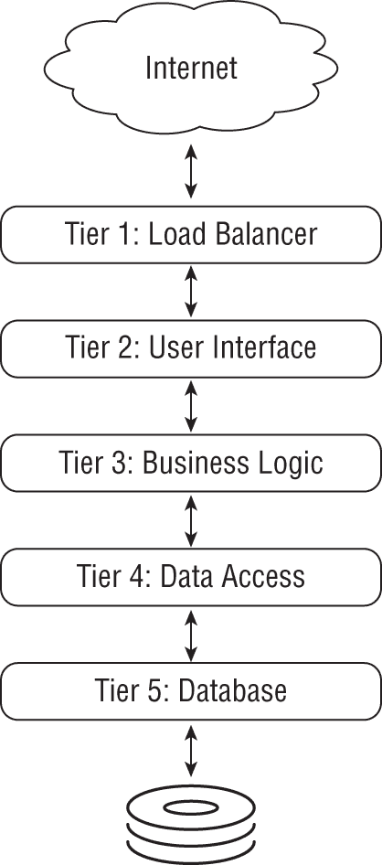

**FIGURE 3.1 `N-tier` architecture**

The purpose of layering is to do the following:

*   Create the ability to impose specific security policies at each layer
*   Simplify functionality so that the correctness of its operation is more easily validated

From a security perspective:

*   Higher levels always have the same or less privilege than a lower level.
*   If layering to provide security controls, it must not be possible for a higher level to bypass an intermediate level. For example, if a program is able to bypass the filesystem layer and issue direct block-level I/O requests to the underlying disk storage device, then the security policies enforced by the filesystem layer will be for naught.

Layering and domain separation are related techniques and work well together. A single domain might have multiple layers to assist in structuring functions and validating correctness. Alternatively, different layers might be implemented as different domains. Or a combination of these might apply.

An example where layering is used in the real world is a filesystem. The lowest layer, access to the raw disk, provides only basic protection to the disk sectors. The next layer might be the virtual or logical partitioning of the disk. Still higher layers would be the filesystems as users browse the data, employing advanced access control features.

### `Encapsulation`

`Encapsulation` is an architectural concept where objects are accessed only through functions that logically separate functions that are abstracted from their underlying object by inclusion or information hiding within higher level objects. For example, raw disk reads/writes are abstracted away from the user through several layers of encapsulation. The functions might be specific to accessing or changing attributes about that object. The encapsulation functions can define the security policy for that object and mediate all operations on that object. As a whole, those functions act as sort of an agent for the object.

Proper encapsulation requires that all access or manipulation of the encapsulated object must go through the encapsulation functions, and that it is not possible to tamper with the encapsulation of the object or the security attributes of the encapsulation functions.

Device drivers can be considered to use a form of encapsulation in which a simpler and consistent interface is provided that hides the details of a particular device, as well as the differences between similar devices. Forcing interactions to occur through the abstract object increases the assurance that information flows conform to the expected inputs and outputs.

An example where encapsulation is used in the real world is the use of the `setuid bit`. Typically, in `Linux` or any `Unix`-based operating system, a file has ownership based on the person who created it, and an application runs based on the person who launched it. A special mechanism, `setuid`, allows for a file or object to be set with different privileges. Setting the `setuid bit` on a file will cause it to open with the permission of whatever account you set it to be. The `setuid bit` controls access, above and beyond the typical operation. That is an example of encapsulation.


### 冗余

*冗余* 是通过复制组件并并行运行来设计系统，以便系统即使在出现错误或负载过高时仍能继续运行。从安全角度来看，冗余是解决可能影响可用性和完整性的妥协或问题的架构原则。

在复制数据存储的情况下，特别的挑战是确保一致性。对一个数据存储的状态更改必须可靠地复制到所有冗余数据存储中，否则冗余的目的就会被破坏，并且可能会产生潜在的安全漏洞。

要使冗余发挥作用，必须能够让整体系统检测到复制子系统之一中的错误。一旦检测到错误，该错误可能会被消除，或者错误会触发故障转移到冗余子系统。任何特定错误的处理方式取决于整体系统的能力。在某些情况下，仅仅拒绝操作并等待请求方重新发出请求就足够了（这次在仍在工作的冗余系统之一上）。在其他情况下，有必要撤销（回滚）中间状态更改，以便在正确功能的系统上重新尝试请求时，整体系统状态保持一致。

第一个例子是网站的负载均衡器。如果它失败并且无法处理网页请求，失败请求并等待用户重新加载页面就足够了。

在请求涉及例如从一家银行的账户向另一家银行转账资金的情况下，如果在故障发生前资金已从第一个账户扣除，则有必要在失败并重试请求之前确保撤销该扣除。

现实世界中使用冗余的例子包括以下内容：

* 高可用性解决方案，如集群，其中一个组件或系统在活动伙伴变得无法访问时接管
* 具有冗余磁盘阵列 (`RAID`) 配置的存储，其中数据被冗余并具有容错能力
* 云存储，其中数据在多个数据中心、区域或区域中复制

### 虚拟化

*虚拟化* 是一种仿真形式，其中一个真实或模拟设备的功能在另一个设备上仿真。（这将在本章后面“了解信息系统的安全功能”部分中更详细地讨论。）

更常见的是，虚拟化是提供一个环境，该环境像单个专用计算机环境一样运行，但支持在同一物理硬件上运行多个此类环境。仿真可以在硬件级别运行，在这种情况下我们称之为虚拟机 (`VMs`)，或在操作系统级别运行，在这种情况下我们称之为容器。在任何一种示例中，虚拟化都涉及将硬件或软件的底层组件从最终用户抽象出来。

虚拟化在现实世界中被广泛使用，以实现资源的最具成本效益利用，并根据业务需求进行扩展或缩减。云计算环境是当今虚拟化的最常见示例。

## ISO/IEC 19249 设计原则

以下设计原则旨在帮助在系统设计期间识别和减轻风险。其中一些五个基本思想可以直接与目标系统或项目的<|message|>


集中式通用安全服务原则是对之前讨论的集中式参数验证原则的概括：通过一次性实现常用的安全功能，更容易确保安全控制措施已得到适当的审查和测试。集中精力验证少数集中式服务的正确运行，比验证本质上是相同控制的无数种实现更具成本效益。

现实世界中使用集中式安全服务的示例包括以下内容：
* 集中式访问控制服务器
* 集中式加密处理
* 安全信息和事件管理（SIEM）
* 安全编排、自动化和响应（SOAR）

### 为错误和异常处理做准备

错误会发生。系统必须确保检测到错误并采取适当措施，无论是仅记录错误还是采取某些措施来减轻问题的影响。错误处理不应泄露信息，例如，通过在错误报告中显示堆栈跟踪或内部信息，从而可能披露机密信息或为攻击者提供有用信息。系统必须设计为安全失败（如后面所述），并且即使在发生错误时也始终保持安全状态。

错误也可能是入侵的指标。检测和报告此类错误可以实现快速响应，从而限制泄露范围。

错误和异常处理在现实世界中使用的示例是开发应用程序以正确处理错误并做出相应的响应。例如，自动取款机（ATM）可能会使用错误处理来验证取款请求是否未超过账户余额，并在尝试此类取款时做出信息性提示。

### 威胁建模

*威胁建模* 是一种流程，通过该流程可以识别潜在的安全威胁和漏洞，并对缓解措施进行优先级排序。威胁建模可用于帮助安全地开发应用程序或帮助降低已部署应用程序的风险。

威胁建模的方法有很多，但其中最常用的三种称为 STRIDE、DREAD 和 PASTA。

#### STRIDE

*STRIDE* 是一种在 90 年代后期由微软开发的模型，用于帮助识别和分类计算机安全威胁。名称本身是以下六类安全威胁的助记符：
* **欺骗：** *欺骗* 是一种攻击，在此期间个人或系统通过伪造信息冒充另一人或系统。强密码、多因素身份验证和数字签名是防止欺骗的常见控制措施。
* **篡改：** *数据篡改* 是通过恶意操纵数据对数据完整性发起的攻击。强大的访问控制以及彻底的日志记录和监控是防止和检测数据篡改的良好方法。
* **抵赖：** *抵赖* 是指一方否认其执行某项操作的能力。抵赖威胁发生在用户声称自己未执行某项操作，且没有证据证明其相反的情况时。数字签名和安全日志记录与审计是提供不可抵赖性的主要控制措施。
* **信息泄露：** *信息泄露* — 通常称为 *数据泄露* — 发生在信息被不当共享给未经授权的各方时。加密、数据丢失防护（DLP）和强大的访问控制是防止信息泄露的常见控制措施。
* **拒绝服务（DoS）：** *拒绝服务*（*DoS*）攻击涉及恶意行为者使系统或服务对合法用户不可用。系统冗余、网络过滤和资源限制是防止 DoS 攻击的常见保护措施。
* **权限提升：** *权限提升*（或 *特权升级*）发生在未特权应用程序用户能够将其权限升级为特权用户（如管理员）的权限时。强大的访问控制和输入验证是防止特权升级的常见保护措施。

STRIDE 模型可作为回答“可能出现什么问题？”的起点，在系统开发或分析过程中使用。这六种安全威胁涵盖了可能损害机密性、完整性和可用性以及真实性和授权的广泛潜在问题。

#### DREAD

DREAD 模型于 2002 年开发，是一种定量风险分析模型，通过为安全威胁的严重程度分配数值（通常为 1 到 10）来对其进行评级。DREAD 是一个助记符，描述了五个关键点以及针对任何给定威胁必须回答的相关问题：
* **损害：** 该威胁可能对您的业务造成的总损害程度是多少？
* **可重现性：** 对特定威胁的攻击可以多容易地被复制？
* **可利用性：** 攻击者利用该威胁需要多少努力？
* **受影响用户：** 有多少人，无论是在组织内部还是外部，会受到安全威胁的影响？
* **可发现性：** 漏洞可以多容易地被找到？

一旦对这些类别进行评级，就会计算总和。给定风险的所有评级之和可用于对不同风险进行优先级排序。

#### PASTA

*攻击模拟与威胁分析流程*（PASTA）是一种七步风险为基础的威胁模型，于 2012 年开发，支持动态威胁分析。与严格 intended 作为威胁识别框架的 STRIDE 不同，PASTA 方法论为识别和缓解威胁提供了一个健全的流程。PASTA 将业务目标与技术要求、系统风险和攻击建模集成。PASTA 模型旨在提供应用程序和基础设施的攻击者中心视角，并帮助安全团队基于威胁枚举和影响分析制定缓解策略。

以下是 PASTA 方法论的七个阶段：
1. **定义目标。**
   在此第一阶段，定义关键业务目标，并识别关键安全和合规要求。此外，还会进行初步业务影响分析（BIA）以识别潜在的业务影响考虑因素。
2. **定义技术范围。**
   在此阶段，定义技术环境边界以及需要进行威胁分析的所有技术资产的范围。除了应用程序边界之外，您还必须发现并记录所有基础设施、应用程序和软件依赖项。目标是捕获对所有服务器、主机、设备、应用程序、协议和需要保护的数据的高层次但全面的视图。
3. **应用程序分解。**
   在此阶段，需要对所有资产（即应用程序组件）进行评估，并识别这些资产之间的数据流。作为此过程的一部分，所有应用程序入口点和信任边界都应被识别和定义。此阶段旨在建立对所有数据源、对这些数据源进行访问的各方以及应用程序内数据访问的所有用例的清晰理解 — 换句话说，谁应该对应用程序的哪些组件执行什么操作。
4. **威胁分析。**


本阶段旨在识别和分析系统内部的威胁信息，例如 SIEM 馈送、Web 应用防火墙（WAF）日志等，以及与系统相关的外部可用的威胁情报。应识别并理解与特定应用程序、环境和数据相关的威胁攻击场景。本阶段的输出应包括针对给定应用程序或系统的最可能攻击向量列表。

### 5. 漏洞分析。
在此阶段，应识别应用程序代码中的所有漏洞，并将其与步骤 4 中识别的威胁攻击场景相关联。应进行操作系统、应用程序、网络和数据库扫描，并评估动态和静态代码分析结果以枚举和评分现有漏洞。本阶段的主要输出是所有威胁攻击向量与现有漏洞和受影响资产的相关映射。

### 6. 攻击建模。
在此阶段，对可能利用已识别漏洞（来自步骤 5）的攻击进行建模和模拟。这有助于确定每个已识别攻击向量的可能性和影响。完成此阶段后，您的组织应对应用程序的攻击面有深入的了解（即，在您的应用程序环境中，哪些坏事可能发生在哪些资产上）。

### 7. 风险和影响分析。
在此最终阶段，应根据前六步执行的所有分析来完善您的业务影响分析（来自步骤 1）。应为补救措施确定风险的优先级，并制定风险缓解策略以识别所有剩余风险的对策。

### 安全默认值
*安全默认值*（或*默认安全*）的概念本质上意味着系统应设计为在用户无需打开安全功能或以其他方式考虑安全配置的情况下即可实现最佳安全性。默认安全意味着系统的默认配置包含尽可能安全的设置，这可能并不总是功能最强的设置。例如，新的服务器默认情况下可能禁用端口 80 和 443。虽然这种加固配置当然是最安全的，但如果不打开用于安全 Web 流量的端口 443，它将不会成为一个很好的 Web 服务器。关键在于，系统和应用程序应设计为最终用户（或系统管理员）必须主动选择根据业务需求和风险承受能力覆盖安全配置。

### 安全失败
必须考虑系统在发生错误或异常时将如何表现。对于某些系统，*故障开放*设计，即在发生异常时系统继续允许访问，可能更可取，以确保在系统错误或异常期间仍可轻松访问重要信息。相反，*故障安全*（也称为*故障安全*或*故障关闭*）系统默认阻止访问，确保安全性优先于可用性。
对于具有敏感数据的系统，安全控制应设计为在没有明确配置设置相反的情况下，默认不允许该操作。访问应基于许可（例如，允许列表），而不是排除（例如，阻止列表）。这是“默认拒绝”防火墙规则背后的原理，也与最小权限的概念（在前面部分讨论过）相关。一般来说，最好设计系统，使其在检测到错误时以拒绝（或安全）的高安全状态失败，而不是以开放的、安全性较低的状态失败。

### 职责分离
*职责分离*（SoD）要求两个（或更多）操作、参与者或组件以协调方式运行以执行安全敏感操作。此控制源自财务会计实践，多年来一直是防止欺诈的基础保护。将流程分解为由不同个人执行的多个步骤，或要求两个个人共同执行单个操作（称为*双重控制*）迫使恶意内部人员与多个内部人员串通以破坏系统。
需要两个或更多个人积极参与的安全控制比不需要的控制更稳健，也不太容易失败。虽然并非每个控制都适合职责分离，也并非每个风险都要求此类安全措施，但职责分离带来的冗余使得安全性不太可能因单一错误（或 rogue 行为者）而被破坏。

### 保持简单
复杂性是安全的敌人。系统越简单、越小，设计、评估和测试就越容易。当整个系统无法足够简化时，请考虑将问题分区，以便将风险最显著的组件分离并尽可能简化。这是*安全内核*的概念——一个小型独立子系统，具有安全关键组件，其余系统可以依赖它。
信息安全和密码学专家 Bruce Schneier 提出了以下观点（`www.schneier.com/news/archives/2016/04/bruce_schneier_build.html`）：
> *复杂性是安全的最大敌人。你让系统越复杂，它的安全性就越差，因为你会有更多漏洞并在系统中的某个地方犯更多错误。……我们能让系统越简单，它们就越安全。*
通过将安全功能分离到小型、隔离的组件中，仔细审查和测试代码是否存在安全漏洞的任务可以显著减少。

### 信任，但需验证
美国总统罗纳德·里根在 20 世纪 80 年代末首次开始使用古老俄语谚语的英文翻译“信任，但需验证”。当时，里根总统用这句话来描述他在美国与苏联核裁军谈判中的谨慎态度。几十年后，“信任，但需验证”的格言被广泛用于描述需要额外验证和问责的情况。
在信息安全领域，“信任，但需验证”已用于描述使用边界防火墙和其他控制措施的做法，这些控制措施使用各方的身份、位置和其他特征来验证他们是来自受信任位置的受信任用户或系统——换句话说，“信任，但需验证”假设您公司防火墙后面的所有内容都是安全的，并验证通过该防火墙进入您网络的任何内容是否安全，基本上是“验证一次，永久信任”。近年来，这种安全模型已变得不那么受欢迎，取而代之的是零信任模型（将在下一节讨论）。
“信任，但需验证”一词在处理第三方或描述验证内部安全控制的操作和有效性的需要时也可能被口语化使用。如果在讨论“信任，但需验证”时有一个安全概念会浮现在脑海，那可能是审计的概念。与第三方（例如合作伙伴、云提供商或组织外部的任何其他人）合作时，需要一定程度的信任才能执行日常业务运营。“验证”的概念体现在您考虑定期审计这些关系以确保它们继续按协议和预期运行的需求时。这就是为什么云提供商例如会与希望定期验证 CSP 安全态势的客户共享合规报告和其他工件的原因。


向内审视时，“信任但需核实”在我们评估和监控安全架构以确保持续合规和安全功能方面也发挥着重要作用——安全控制绝不应采取“设置后就忘”的方式。“信任但需核实”也体现在我们使用威胁情报产品和信息来判断潜在威胁是否可行时。最终，“信任但需核实”这一概念再次提醒我们，维护安全是一项永无止境的任务。

### Zero Trust

零信任架构首次在 2010 年代初期被描述，此后已成为安全系统架构的主流方法，美国国家标准与技术研究院（NIST）在 2020 年通过 `NIST SP 800-207`《零信任架构》正式化了指导方针。`Zero trust` 是一种安全模型，其前提是组织不应自动信任其边界内*或*外的任何事物——相反，必须在允许访问之前验证所有试图连接其系统的事物。这种模型与之前提到的“信任但需核实”模型有着巨大区别，后者是在激烈防御边界的同时假设网络内部的一切都是安全的。

零信任模型提倡“永不信任，始终验证”的思维，要求每个访问请求在授予访问权限之前必须经过完全的身份验证、授权和加密。采用这种方法，成功突破边界的攻击者在其网络内部横向移动的能力会大大降低，因为每个设备都受到其他设备的保护，从而减少了成功入侵的爆炸半径（或总体影响）。

零信任模型基于以下核心原则：

*   **始终验证。** 基于用户身份、位置、系统健康状况（例如补丁级别）、数据分类、用户行为分析以及任何其他可用数据点，对每个访问请求进行身份验证和授权。
*   **使用最小权限访问。** 始终仅在即时 (`JIT`) 基础上分配特定访问请求所需的最低权限。
*   **假设已遭入侵。** 不要信任网络上的设备，假设最坏情况（即你已经被入侵）并将爆炸半径降到最低以防止进一步损害。

预防是零信任的最大目标，而“始终验证”是其中的重要部分。身份应始终得到验证，并在可能的情况下使用强大的多因素身份验证 `MFA` 进行保护。访问网络的设备应在授予访问权限之前进行检查，以验证身份并确保其健康状况符合组织的安全要求。

请记住，用户和设备不应仅因其位于内部网络就被信任。所有内部通信都应加密，访问应按策略限制为最小权限，并应采用微分段来遏制威胁。`Microsegmentation` 是一种网络安全技术，涉及将大型网络段划分为更小的区域，以将资源彼此隔离并最大限度地减少用户横向移动。如果发生入侵，微分段会将黑客限制在单个微分段内，使遏制和检测变得更容易。除了网络安全更改外，零信任架构还从基于边界的数据保护转向以数据为中心的数据保护，依赖于强大的数据分类和标记。最有效的零信任架构具有分类良好的数据，可为信任决策提供额外洞察。

尽管对预防措施有很大偏向，但侦测控制在成功的零信任架构中也发挥着重要作用。组织应部署实时监控以帮助检测和阻止攻击以及其他异常行为。实时分析还可以帮助为访问决策提供信息，通过为访问请求提供实时上下文并支持 `JIT` 权限（本章前面讨论过）。

### Privacy by Design

`Privacy by Design`（缩写为 `PbD`）是一种系统工程方法，最初由安大略省前信息与隐私专员 Ann Cavoukian 在 1990 年代开发，并在 2009 年后来正式化为框架；该框架侧重于扩展隐私增强技术的应用，并确立了七项基础原则（接下来讨论）。`Privacy-enhancing technologies`（`PETs`）是支持数据保护和 `PbD` 的技术，通过最大限度地减少个人数据使用并最大化数据安全。

`PbD` 涉及将隐私直接构建到系统或流程的设计、运营和管理中，而不是事后考虑隐私。七项 `PbD` 原则旨在确保个人数据的隐私，同时让用户对其个人信息拥有更多控制权。Cavoukian 提出的这七项原则总结如下：

1.  **主动而非被动；预防而非补救：**
    设计系统和流程以在隐私事件发生前主动采取行动，而不是事后行动。换句话说，在发生侵入性隐私事件之前就预见并防止它们，而不是依赖于在它们已经发生后才检测和响应。在设计和开发系统时，你应确定存在哪些隐私风险并为其做好计划，而不是以后再扑灭隐私火灾。
2.  **隐私作为默认设置：**
    确保所有个人数据在所有 IT 系统或业务流程中自动受到保护，无需任何个人采取额外行动。该原则将隐私责任放在系统上，而非个人身上。实际示例包括匿名化或屏蔽个人信息，将对个人信息的访问限制在绝对需要的人（即最小权限），以及在不再需要时删除此类信息。
3.  **将隐私嵌入设计：**
    隐私措施应完全集成到系统和相关流程中，而不是事后添加；隐私应被视为系统的核心功能。该原则的示例包括将加密和身份验证机制构建到系统中，而不是事后寻找添加这些功能的方法。
4.  **完整功能——正和而非零和：**
    `PbD` 鼓励对所有合法系统设计目标采取“双赢”方法，并阻止做出不必要的权衡。隐私和安全都很重要——两者都可以并且应该实现。例如，互联网 cookie 提供了必要的网络功能，并且可以以安全和私密的方式实现。
5.  **端到端安全——全生命周期保护：**
    确保个人数据从摇篮到坟墓的安全和隐私；数据应在安全的方式下创建、管理和销毁。加密和身份验证是每个阶段的标准，但你应密切关注数据生命周期中可能需要的各种安全和隐私机制。
6.  **可见性和透明性——保持开放：**
    这是一项“信任但需核实”原则（前面讨论过），旨在向所有利益相关者保证系统按预期安全运行并维护数据隐私。该原则最清晰的示例是建立一份完善记录的隐私政策并与所有受影响方共享。
7.  **尊重用户隐私——以用户为中心：**


当一切说完做完时，隐私关乎用户，而这一原则强化了这一观念。系统架构师、开发人员和运营人员必须通过提供强大的隐私默认设置、适当的通知以及用户友好的体验，将个人的利益作为他们最优先的考虑。保持隐私以用户为中心最实用的方法之一是要求用户采取行动（例如，通过点击按钮或勾选复选框）以给予同意。

随着用户个人数据在各种系统和平台中不断 proliferate，隐私设计（PbD）继续成为安全系统架构和开发中的基础概念。众多私营公司已承诺遵守 PbD 原则，而像德勤这样的公司则提供服务来评估甚至认证组织对 PbD 原则的合规性。

在美国，联邦贸易委员会（FTC）已将 PbD 认定为保护在线隐私的三大推荐做法之一，而迄今为止全球最大的隐私法规——欧盟通用数据保护条例（EU GDPR）则将“通过设计的数据保护”和“通过默认的数据保护”作为其要求的一部分。

### 共同责任

`shared responsibility model` 是云安全框架，描述了云服务提供商（CSP）及其客户在保持云系统和数据安全方面的义务。在传统的本地数据中心模式中，你的组织负责整个环境的安全——所有应用程序、服务器、物理资产等等。在云环境中，CSP 承担了大部分运营负担，包括大量安全责任——但并非全部。具体责任划分因云提供商和云服务类型而异。我们将在本章后面（在“基于云的系统”部分）详细讨论共同责任的概念。

###纵深防御

`Defense in depth`（或 `layered security`）是应用多种不同的安全技术和策略层来实现更大整体保护的概念。在信息安全领域，美国国家安全局（NSA）首次使用该短语来描述使用多种类型、位置和层级的防御，并结合检测和分析入侵的能力以便及时反应和缓解。

通过使用安全控制的组合，任何单一控制失效的影响可以被降低甚至消除。前面提到的许多安全原则都是纵深防御的类型。例如，职责分离确保敏感操作需要两个或更多个人的积极合作。对一个个人的妥协（通过 rogue 或恶意意图）不足以破坏系统。

分层是分离系统组件的另一种方法：安全控制放置在层之间，防止攻击者在攻破一层后访问其他层。

虽然冗余主要是一种通过复制系统或并行运行的组件来防止可用性损失的方法，但它也是通过串行复制安全控制来避免安全单点故障的一种方式。这意味着具有重叠的安全控制，使得一个控制的失效或被攻破本身不会导致暴露或被攻破。一个例子是即使服务器位于已配置为阻止相同端口的防火墙后面，仍使用 Linux `iptables` 阻止对某些端口的访问。如果对其中一个控制（防火墙或 `iptables`）的配置更改意外删除了 `deny` 规则（或添加了不适当的 `allow` 规则），`iptable` 或防火墙中的“冗余”控制仍将继续提供必要的保护。

纵深防御与 `assumption of breach` 概念相关，这意味着在假设一个或多个安全控制已被攻破的前提下管理安全。假设被入侵的心态将思维从仅仅专注于防御边界（或边界）转变为平衡的方法，建立多重防御，使一个控制被攻破不会立即导致成功入侵，并认为检测和缓解与预防同样重要。例如，考虑反恶意软件系统和电子邮件扫描应用程序已不再足够。端点安全应用程序，例如 Carbon Black，能够阻止任何未被先前识别为可信的执行——这一第二层安全展示了纵深防御的重要性。

## 理解安全模型的基本概念

`model` 是对系统的假设性抽象，简化以便在不分析整个系统的复杂性和细节的情况下分析系统的某些方面。`security model` 是处理安全策略的模型。

安全模型可以是正式的，旨在进行数学分析以协助验证系统是否符合特定策略，也可以是非正式的，用以说明和简化系统的评估，而无需证明的严谨性。安全模型可以在需求开发、信息资产分类和分类期间，以及在系统分析和测试期间成为有用的工具。

以结构化方式将安全需求编纂成安全模型可以帮助减少歧义和潜在的误解，即安全架构究竟试图实现什么。它将基本要求提炼为明确的规则，并在整个过程中分析设计，以确保这些规则得到遵守。确保安全架构符合设计良好的安全模型会大大增强其强度。

有趣的是，模型之间的侧重点差异可归因于每个模型的起源。为解决军事和政府的关注而开发的安全模型强调保密性为首要目标。与此同时，为商业实体或安全系统设计的模型可能侧重于数据的完整性，以防止欺诈或误导财务报告。尽管存在差异，本节其余部分讨论的每个安全模型都侧重于访问控制规则。

### 常见模型组件入门

在检查安全模型时，了解许多安全模型共有的一些概念会有所帮助，特别是有限状态机和格。

一个 `finite state machine`（或只是 `state machine`）是一个概念计算机，可以处于有限数量的状态之一。计算机实现一个状态转换函数，根据当前状态和下一个输入确定下一个状态，并且可以可选地产生输出。Figure 3.2 描绘了有限状态模型的通用示例。在此模型中，评估每个状态的保密性-完整性-可用性（CIA）属性可以确保系统以安全的方式运行。

一个 `lattice` 是一个具有偏序的有限集合。偏序是一种二元关系，具有自反性、反对称性和传递性。自反性意味着集合中的每个项目都可与自身比较。反对称性意味着没有两个不同的元素相互先行。传递性意味着如果 `a` 产生 `b`，并且 `b` 产生 `c`，那么 `a` 产生 `c`。

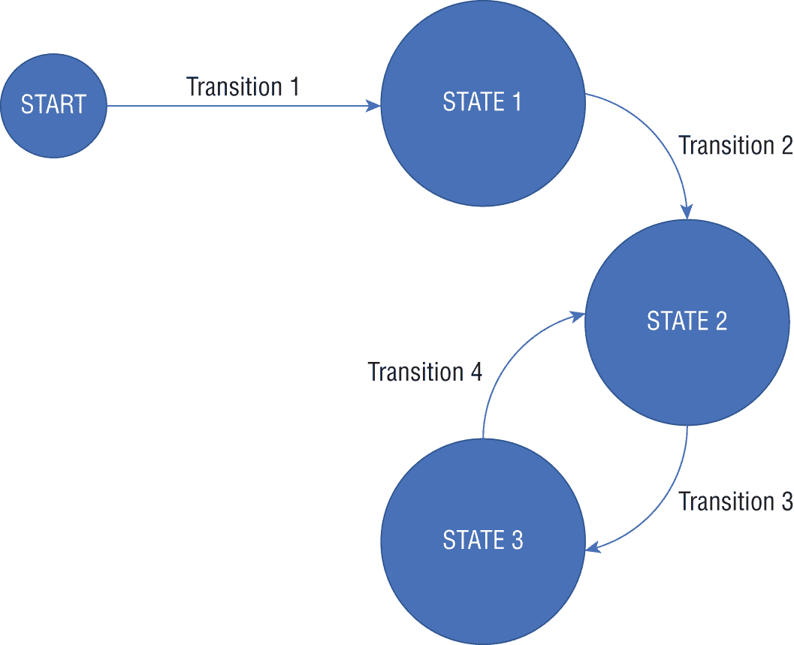

**FIGURE 3.2 Finite state model**

简而言之，格安全模型执行以下操作：

* 定义一组安全级别
* 定义该集合的偏序
* 为每个主体（例如，用户或进程）和对象（例如，数据）分配一个安全级别


* 定义了一组规则，规定主体基于主体和对象的<|message|> 安全级别之间的关系可以对对象执行的操作

### 信息流模型

*信息流模型* 是一种访问控制模型，定义了信息 — 从一个应用程序到另一个应用程序，甚至从一个系统到另一个系统 — 的流动方式。在这些模型中，对象被分配一个安全分类，并且这些对象的流动方向或类型由安全策略控制。`Bell–LaPadula` 和 `Biba` 完整性模型，各自在后续章节中讨论，是信息流模型的常见示例。

### 非干扰模型

*非干扰模型* 是信息流模型的发展，旨在确保系统上的对象和主体不会干扰同一系统上的其他对象和主体。在该模型下，任何在更高安全级别进行的活动都不得影响（或干扰）较低级别发生的活动。换句话说，主体 A（更高分类）的行为不应影响主体 B（较低分类），并且主体 B 也不应察觉到这些行为，从而可能让主体 B 得知主体 A 的行为。如果没有非干扰模型的保护，主体 B 可能能够推断出主体 A 的活动，这可能导致信息泄露（例如）。

### Bell–LaPadula 模型

最早的，也是最著名的格安全模型之一由 David Bell 和 Leonard LaPadula 发表，恰当地称为 `Bell–LaPadula`（BLP）模型。BLP 模型是一个保密性模型，规定了以下三条规则：

* **简单安全属性（ss 属性）：** 有时被称为 *向上不可读*，该规则阻止主体读取更高安全级别的对象。
* **星号属性（* 属性）：** 有时被称为 *向下不可写*，该规则阻止主体向较低安全级别的对象写入。
* **自主安全属性：** 如果访问矩阵（本节后面讨论）允许，主体可以对对象执行操作。

简单安全属性规则可防止未经授权的主体访问其无权读取的敏感信息。星号属性规则可防止授权主体通过向较低安全级别的对象写入敏感信息来破坏安全。

举一个现实世界的例子，想象一下军队中的一名情报官，他拥有“机密”访问权限，这是一个介于“机密”和“绝密”之间的中级分类。根据简单安全属性规则，该军官只能读取机密和机密材料。根据星号属性规则，该军官只能写入绝密和机密。第一条规则不会使未经授权的材料可供军官访问，而第二条规则可防止军官意外地向权限较低的人员泄露未经授权的材料。图 3.3 提供了这两个规则的图形视图。

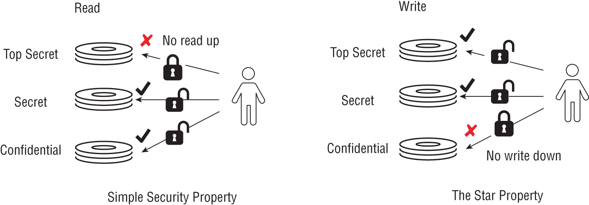

**FIGURE 3.3 Simple Security Property and Star Property rules**

自主安全属性规则在例如存在不同部门时很有用。假设我们的同一名军官可以在一个部门中读取机密和机密信息，但在其他部门中只能读取机密信息。同样，其他部门的情报官可能对其各自领域拥有更高的许可级别，但并非全部。在这种情况下，该模型允许使用访问矩阵，并且自主安全属性生效。

*访问矩阵* 为每个主体有一行，为每个对象有一列，并且主体行与对象列相交的单元格中的元素定义了允许执行的操作（即访问），如果有的话。表 3.1 提供了访问矩阵的示例。

**TABLE 3.1 An Example Access Matrix**

| SUBJECTS || OBJECT 1 || OBJECT 2 |
| --- | --- | --- |
| Subject A || `Read only` || `Read/Write` |
| --- | --- | --- |
| Subject B || `No access` || `Write only (append)` |

自主安全属性与另外两个强制访问控制一起运行。只有当三个属性都成立时，主体才能访问对象。

Bell–LaPadula 模型没有很好解决的另外两个问题是：

* 该模型侧重于保密性，正如人们所期望的那样，该模型是为了满足军事和政府组织的需要而开发的。它没有考虑信息完整性的风险。保护对象的完整性意味着防止对象被未经授权的、可能恶意的修改。在商业世界中，防止篡改财务记录以便促进欺诈比维护这些记录的保密性更重要。同样，在安全关键型应用中，例如自动驾驶汽车、机器人和某些医疗系统，完整性通常比保密性更重要。
* 该模型不处理隐蔽通道或以可能通过侧通道泄露机密信息的方式执行允许操作的可能性（例如，通过以可被其他、安全性较低的进程检测到的方式执行操作 — 例如消耗 CPU 突发或导致虚拟机分页异常）。

### Biba 完整性模型

为了解决完整性问题，Kenneth Biba 提出了后来被称为 Biba 完整性模型的模型，该模型以与 BLP 模型类似的方式提出以下内容：

* **简单完整性属性：** 有时被称为 *向下不可读*，该规则可防止从安全性较低的来源损害更安全信息的完整性。换句话说，如果更高完整性的进程读取并使用来自较低完整性来源的数据，则可能会产生不可信的结果。
* **星号完整性属性（* 完整性属性）：** 有时被称为 *向上不可写*，该规则可防止较不特权的主体破坏更安全的信息。

图 3.4 说明了这些概念。

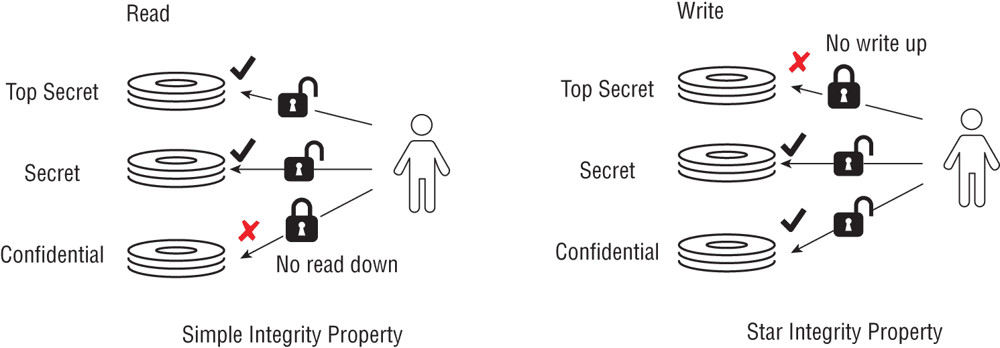

**FIGURE 3.4 Simple Integrity Property and Star Integrity Property rules**

### Clark–Wilson 模型

David Clark 和 David Wilson 认为，像 Biba 模型这样的格模型不足以保护数据的完整性。他们提出的方法是将安全模型基于商业世界在计算机出现之前就为防止欺诈而开发的两个概念：

* 良好形成的事务
* 职责分离

与 Bell LaPadula 和 Biba 模型不同，后者允许主体对其有写入权限的对象进行任何更改，Clark–Wilson 的良好形成事务概念是主体仅限于进行那些维护数据完整性的更改。

该模型原始论文中的示例是手工账簿，当簿记员用墨水书写时，错误是通过输入更正或反向分录来纠正的。账簿条目被擦除的迹象（鉴于使用不可擦除墨水，这很明显）将被检测为账簿完整性违规以及欺诈的可能迹象。

商业世界中职责分离的做法旨在确保交易的认证者与交易的发起者或实施者是不同的当事人。

以下概念是 Clark–Wilson 模型的重要组成部分，值得熟悉：


*   **受限数据项 (CDI)：** 这是 Clark–Wilson 模型中的关键数据类型，指必须保持完整性的数据。
*   **不受限数据项 (UDI)：** 这包括除 CDI 之外的所有数据，通常是系统输入。
*   **完整性验证程序 (IVPs)：** 这些程序检查并确保所有 CDI 都是有效的。
*   **转换程序 (TPs)：** 这些程序执行系统的完整性策略并维护 CDI 的完整性。

### Brewer–Nash 模型

Brewer–Nash 模型是为了实现道德壁垒安全策略而开发的。在商业世界中，存在旨在防止因内部知识而产生利益冲突的监管要求。这些规则要求组织建立屏障，防止掌握机密信息的人处于其知识可能不当影响其行动的地位。

例如，为银行工作的金融分析师在掌握与另一家竞争对手客户相关的内部知识时，不能为客户公司提供建议。同样，在允许律师事务所代表对立客户的国家，法规要求同一公司内部的两个法律团队之间存在道德壁垒。

回想一下，在 BLP 安全模型中，对数据的访问是基于主体和对象的属性来确定的。与 BLP 相比，Brewer–Nash 安全模型基于职责分离，如同建立道德壁垒。数据的访问必须受限于个人已获准访问的数据。

Brewer–Nash 模型定义了信息分层模型：
*   与单个公司或客户相关的单个信息片段称为 `objects`，与 BLP 的用法保持一致。
*   与同一公司（或客户）相关的所有对象都属于所谓的 `company data set`。
*   同一行业（即为竞争对手）的所有公司数据集都属于所谓的 `conflict of interest class`。

道德壁垒安全策略的目标是，人们只能访问不会因其已访问的信息而产生利益冲突的信息（`objects`）（例如，你不希望你的红队知道你的蓝队计划做什么，反之亦然）。因此，Brewer–Nash 是一种动态访问控制模型，其会发生变化，而不是依赖于静态状态表。

例如，假设有一名新金融分析师尚未访问其新雇主持有的任何信息，因此在 Brewer–Nash (BN) 下可以自由访问任何公司数据集。分析师已访问 ACME Finance 的信息，并且可以自由访问存在于不同利益冲突类别中的信息，例如 BETA Chemicals。但如果他尝试访问与 Ajax Finance 关联的对象，而 Ajax Finance 与 ACME 处于同一利益冲突类别，BN 安全模型将禁止该访问。参见 Figure 3.5。

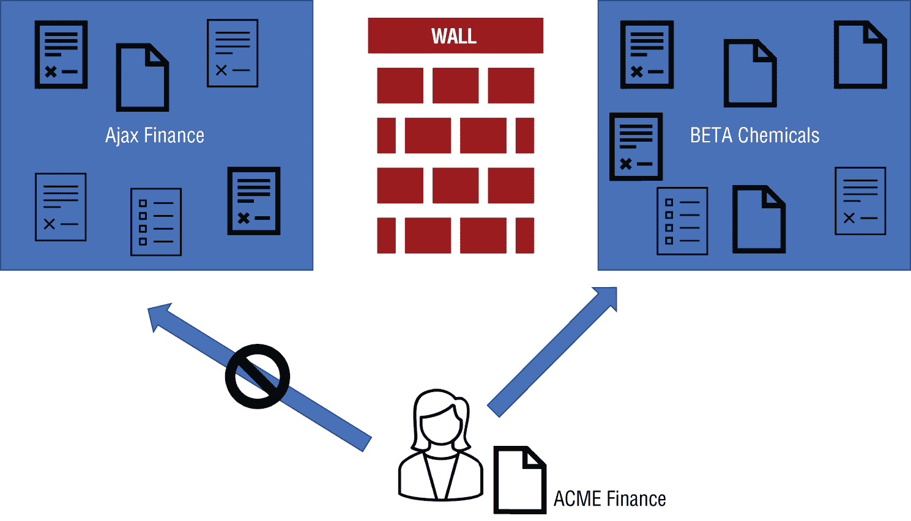

**FIGURE 3.5 Brewer–Nash security model**

### Take-Grant 模型

`Take-Grant model`（也称为 `Take-Grant protection model`）是一种安全模型，指定实体（主体或对象）从一个实体获取权利并将其给予另一个实体的权利。该模型中有四条规则或操作，前两条不会令人意外：
*   **Take：** 允许主体获取（或获取）另一个对象的权利
*   **Grant：** 允许主体给予（或授予）对象权利
*   **Create：** 允许主体生成（或创建）新对象
*   **Remove：** 允许主体撤销（或删除）其对对象的权利

## 基于系统安全要求的控制选择

为信息系统选择适当的安全控制始于对安全要求进行分析。安全要求由以下因素决定：
*   对系统施加的任何监管或合规要求的分析（例如，美国的《联邦信息安全管理法》(FISMA) 等监管框架；欧盟的 GDPR 或美国的《健康保险流通与责任法》(HIPAA) 等隐私立法；如支付卡行业数据安全标准 (PCI DSS) 等合同义务；或如 ISO 27001 认证或服务组织控制 (SOC) 1/2/3 审计等自愿合规计划）
*   对系统可能面临的威胁的分析（参见 Chapter 1 中“了解和应用威胁建模概念和方法”部分）
*   对系统的风险评估（参见 Chapter 1 中“了解和应用风险管理概念”部分）

在某些情况下，对威胁和任何适用监管合规要求的分析将明确规定必要的最低控制集。例如，处理主账号 (PAN) 并处理银行卡交易的组织了解其系统必须符合 PCI DSS。在其他情况下，如 GDPR 合规，需求更为模糊，安全架构师必须分析威胁、风险和受影响的利益相关者，以确定适当的一组控制措施来适当保护系统和数据。

如果组织尚未采用某个框架，从已建立的信息安全框架开始是有益的，例如 ISO 27001、NIST 特刊 800-37“风险管理框架”，或 NIST 网络安全框架 (CSF)、ISA624443 或 COBIT 5（仅举几例），这将有助于确保您已考虑控制措施的全部范围，并且您的流程是定义明确、可重复且一致的。

关于这些安全框架，有几点需要了解：
*   它们不是强制性的。
*   它们彼此并不互斥。
*   它们不是详尽的（即，它们不涵盖所有安全问题）。
*   它们与标准或控制清单不同。

现在让我们扩展每个要点。

框架不是强制性的。但随着组织采用或遵循框架，其后的一些文件或步骤可能涉及采取强制性行动。例如，一家寻求保护处理信用卡数据的系统的公司。当他们根据框架提示识别其系统及其风险时，组织将了解他们必须遵守 PCI DSS，这不是框架而是合规标准。从这里，组织可以深入了解一些所需的安全控制。

信息安全框架彼此并不互斥。许多组织如 Cloud Security Alliance、ISACA 和统一合规框架已在不同框架的控制之间开发了映射，使同时实现多个框架的合规性变得更容易。例如，当特定系统必须满足 PCI DSS 要求，但整个组织已选择例如 ISO 27001 作为其信息安全管理系统的框架时，这可能是必要的。NIST 网络安全框架 (CSF) 就是一个在多个不同框架之间进行有用映射的例子。了解安全框架如何相互补充对于避免重复工作和冗余安全控制至关重要。


当然，框架并不旨在完全详尽。框架可以在行业或范围上专门化，也可以广泛适用。然而，即使是那些广泛适用的框架，也并非旨在覆盖你 100% 的安全控制。例如，NIST CSF 被广泛认可为适用于几乎任何行业的通用安全框架。尽管其覆盖面广，CSF 仍遗漏了一个巨大的安全问题：物理安全。理解安全框架只是拼图的一部分，是选择你的安全控制时非常重要的一部分。

最后，请记住不要将框架与标准或控制清单混淆。框架、控制清单和标准是三个不同的概念。虽然框架是一种方法和策略，但标准是一组可量化的指导方向或规则。在大多数组织中，标准在逻辑上会遵循政策，就像强制性指示会遵循声明什么是强制性的法令一样。无论如何，在选择贵组织的安全控制时，请牢记这些差异。

所有框架的共同点是对保护系统任务采取一种包罗万象、总体性的[content]

当然，框架并不旨在完全详尽。框架可以在行业或范围上专门化，也可以广泛适用。然而，即使是那些广泛适用的框架，也并非旨在覆盖你 100% 的安全控制。例如，NIST CSF 被广泛认可为适用于几乎任何行业的通用安全框架。尽管其覆盖面广，CSF 仍遗漏了一个巨大的安全问题：物理安全。理解安全框架只是拼图的一部分，是选择你的安全控制时非常重要的一部分。

最后，请记住不要将框架与标准或控制清单混淆。框架、控制清单和标准是三个不同的概念。虽然框架是一种方法和策略，但标准是一组可量化的指导方向或规则。在大多数组织中，标准在逻辑上会遵循政策，就像强制性指示会遵循声明什么是强制性的法令一样。无论如何，在选择贵组织的安全控制时，请牢记这些差异。

所有框架的共同点是对保护系统任务采取一种包罗万象、总体性的做法。它们将该任务分解为可管理的阶段或步骤。例如，在最高层级，NIST SP 800-37《风险管理框架》将保护系统的任务分解如下：首先对系统进行分类（基于系统安全受影响时的影响），确定适当的安全控制，实施这些控制，评估其有效性，然后管理和监控系统。从这一分解来看，安全控制显然是保护系统的核心要素。这些控制是采用框架后实际执行的切实工作。

一旦你选择了框架，就需要审查所有控制，以确定哪些控制适合应对你已识别的风险。在某些情况下，框架本身会提供指导。例如，NIST SP 800-53 根据风险评估提供了三个级别的控制，称为 `initial control baselines`。威胁建模和风险评估也会提供有关哪些控制最为重要、需要优先于解决可能性和影响较低的漏洞的其他控制的信息。将所选框架中的所有控制都以相同的深度和成熟度水平实施是浪费时间、金钱和资源。一般目标是将所有风险降低到低于组织的风险阈值。这意味着某些控制必须彻底且完全实施，而其他控制可能根本不需要。

通常，框架会纳入一项安全标准，其中包含一组最低限度的安全控制，形成作为系统安全起点的推荐基线。基线中的范围指导确定了对控制的可接受偏差，从而形成符合组织风险承受能力的定制系统部署。

实施一种定义明确、可重复且业界认可的选择控制的方法，是贵组织能够证明在安全决策中尽到注意义务和勤勉义务的一种方式。

当然，选择控制只是开始。你需要执行以下操作：

*   考虑该控制以及如何实施和调整以适应你的具体情况（“计划”阶段）
*   实施控制（“执行”阶段）
*   评估控制的有效性（“检查”阶段）
*   补救差距和缺陷（“行动”阶段）

此计划-执行-检查-行动循环（也称为 PDCA 或戴明循环）当然是一个迭代过程。这在 ISO 27000:2009 中被明确指出，但在后来的版本中仅被暗示。其他框架，例如 NIST 风险管理框架，也利用持续过程改进模型来塑造控制环境的效率和有效性。参见 Figure 3.6。

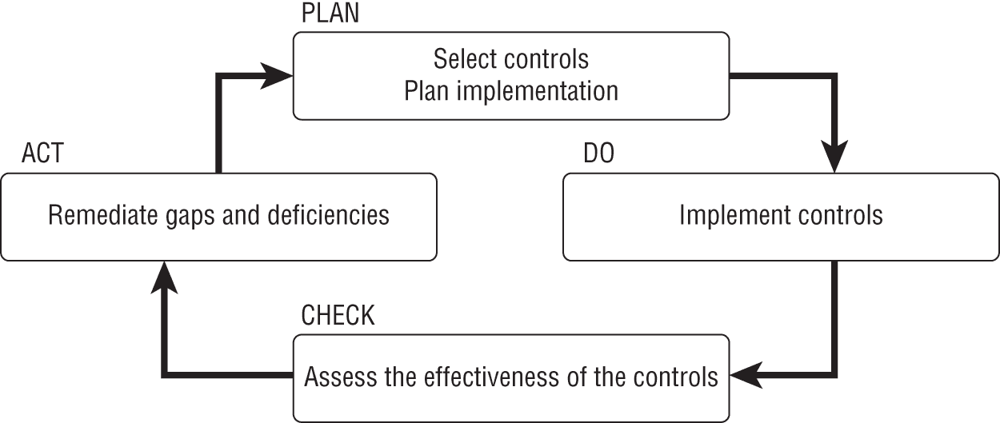

**FIGURE 3.6 Plan-Do-Check-Act cycle**

更频繁地，你需要（重新）评估控制的有效性，而在较不频繁但仍定期的基础上，你需要重新审视你对控制的选择。业务目标会发生变化。威胁态势会发生变化。你的风险也会发生变化。某一时点合适的控制集合（和级别）不太可能在一年或两年后仍然相同。正如与信息安全相关的所有事情一样，这绝不是设置后就无需关注的情况。

除了对控制选择的定期审查外，以下特定事件也值得对安全控制进行重新审视：

*   安全事件或泄露
*   组织结构发生重大变化或主要人员变动
*   新产品或服务推出或停用
*   新威胁或威胁行为者出现或发生重大变化
*   信息系统或基础设施发生重大变化
*   处理的信息类型发生重大变化
*   安全治理、风险管理框架或政策发生重大变化
*   广泛的社会、经济或政治变化（例如，COVID-19）

上述列表包括“经验教训”流程触发器的示例。强烈建议贵组织遵循定期和事件驱动的过程来评估控制的适用性和有效性。

安全框架也会定期更新，当它们更新时，需要考虑变化并相应调整。

## 了解信息系统的安全能力

存储和处理贵组织数据的一般信息系统通常包含一系列你应该熟悉的安全能力。了解这些能力对于正确评估它们并有效实施它们非常重要。其中一些最基础的信息系统安全（ISS）能力包括以下内容：

*   Memory protection
*   Trusted Platform Modules (TPMs)
*   Cryptographic modules
*   Hardware Security Modules (HSMs)

### Memory Protection

所有系统上允许多个程序同时运行的基本基础安全控制之一是 `memory protection`。此功能使操作系统能够同时将多个程序加载到主内存中，并防止一个程序引用未专门分配给它的内存。如果程序尝试引用其无权访问的内存地址，系统会阻止访问，挂起程序，并将控制权转移给操作系统。在大多数情况下，操作系统将终止违规程序。参见 Figure 3.7。

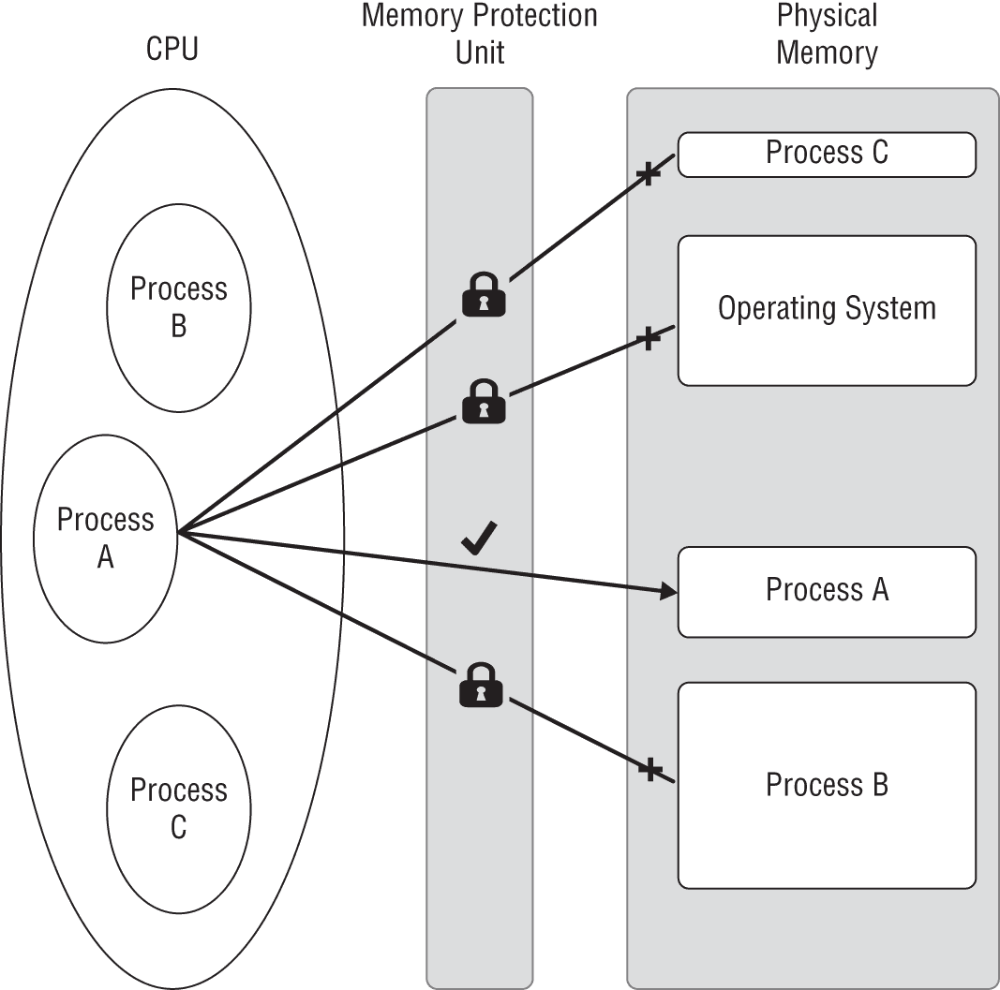

**FIGURE 3.7 Operating system memory protection**

支持内存保护所需的相关硬件功能是 `dual-mode operation`。这意味着处理器可以在至少两种模式之一下运行：特权（或内核）模式和非特权（或用户）模式。操作系统在特权模式下运行，这授予其设置和控制内存保护子系统的权限。特权模式还允许操作系统执行控制处理器环境的特殊特权指令。

一旦程序已加载到内存中，并且内存保护已配置为限制该程序仅访问操作系统分配给它的内存区域，操作系统就会将控制权转移给该程序，同时同时转换到非特权模式。


The program runs in unprivileged mode, which limits it to accessing only the specific memory area dictated by the operating system. Should it make an illegal memory reference, attempt to execute a privileged CPU instruction, or use up the time slice granted to it by the operating system, control is returned to the operating system (running in privileged mode).

The operating system determines if control has been returned to the operating system because of an illegal operation by the user program, and decides how to handle the transgression (i.e., returning control to the user program with an error indication or terminating the program).

Another security control, `address space layout randomization` (`ASLR`), seeks to mitigate the risks of predictable memory address location. The location in memory for a known instruction becomes a risk when there is a threat of exploiting that location for an attack. For example, a buffer overflow attack requires knowing two things: the exact amount by which to overflow the memory to facilitate executing malicious code, and where exactly to send the overflow. `ASLR` defeats the second item by randomizing the location.

Whatever the approach or specific technical control, the need to protect memory is both fundamental and critical to securing information systems.

### Potential Weaknesses

Proper memory protection relies upon both the correct operation of the hardware and the correct design of the operating system that uses the underlying memory protection hardware to prevent programs from accessing memory they have not been given permission to access. A defect in either can compromise the security provided by memory protection.

Note that this protection prevents the direct disclosure of memory contents that are blocked from an unauthorized program, but does not necessarily prevent side-channel exploits from revealing information about memory that is protected from access.

Attacks that leverage ineffective isolation and memory protection can have catastrophic effects. As the `Spectre` and `Meltdown` exploits in 2018 revealed, flaws in the design of Intel and some other CPU chips permitted clever programming techniques to deduce the contents of memory locations that those programs were not permitted to access directly.

### Secure Cryptoprocessor

The challenge with standard microprocessors is that code running with the highest privilege can access any device and any memory location, meaning that the security of the system depends entirely on the security of all the software operating at that privilege level. If that software is defective or can be compromised, then the fundamental security of everything done on that processor becomes suspect.

To address this problem, hardware modules called `secure cryptoprocessors` have been developed that are resistant to hardware tampering and that have a limited interface (i.e., attack surface), making it easier to verify the integrity and secure operation of the (limited) code running on the cryptoprocessor.

Cryptoprocessors are used to provide services such as the following:

* Hardware-based true random number generators (`TRNGs`)
* Secure generation of keys using the embedded `TRNG`
* Secure storage of keys that are not externally accessible
* Encryption and digital signing using internally secured keys
* High-speed encryption, offloading the main processor from the computational burden of cryptographic operations

The following are features of cryptoprocessors that enhance their security over standard microprocessors (that could do most of the above in software):

* Tamper detection with automatic destruction of storage in the event of tampering, and a design that makes it difficult to tamper with the device without leaving obvious traces of the physical compromise. These protections can range from tamper-evident stickers that clearly show attempts to access the device's internal components to secure enclosures that detect unauthorized attempts to open the device and automatically erase or destroy sensitive key material.
* Chip design features such as shield layers to prevent eavesdropping on internal signals using ion probes or other microscopic devices.
* A hardware-based cryptographic accelerator (i.e., specialized instructions or logic to increase the performance of standard cryptographic algorithms such as `AES`, `SHA`, `RSA`, `ECC`, `DSA`, and `ECDSA`, which are discussed in detail later in this chapter).
* A trusted boot process that validates the initial boot firmware and operating system load.

There are many types of secure cryptoprocessors such as:

* Proprietary, such as Apple's “`Secure Enclave`” found in iPhones
* Open standard, such as the `TPM` as specified by the `ISO/IEC 11889` standard and used in some laptops and servers
* Standalone (e.g., separate standalone device with external communications ports)
* Smartcards

Some of these are discussed further in the following sections.

### Trusted Platform Module

A `TPM` is a secure cryptoprocessor that provides secure storage and cryptographic services as specified by `ISO/IEC 11889` (see Figure 3.8).

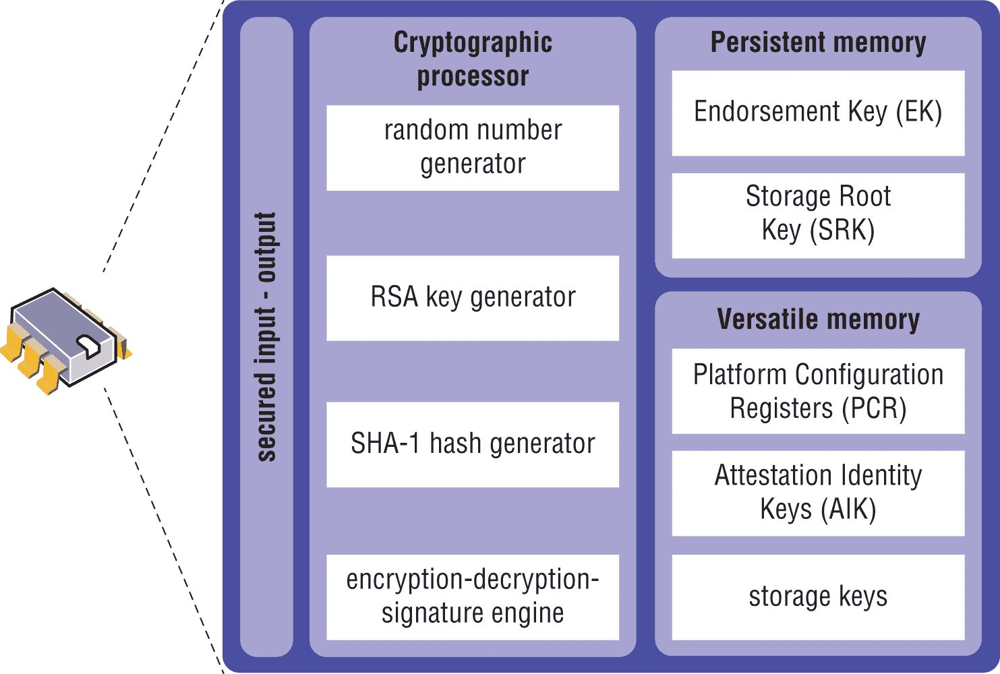

**FIGURE 3.8 Trusted Platform Module processes**

A `TPM` is essentially a security chip that is hardwired into a system (e.g., on a motherboard). At its core, a `TPM` is responsible for the following functions:

* **Attestation:** Creates a cryptographic hash of the system's known good hardware and software state, allowing third-party verification of the system's integrity
* **Binding:** Encrypts data using a cryptographic key that is uniquely associated with (or bound to) the system
* **Sealing:** Ensures that ciphertext can be decrypted only if the system is attested to be in a known good state

A `TPM` can be used by the operating system, processor `BIOS`, or application (if the OS provides access to the `TPM`) to provide a number of cryptographic and security services such as:

* Generate private/public key pairs such that the private key never leaves the `TPM` in plaintext, substantially increasing the security related to the private key.
  (Public/private keys are discussed in more detail later in this chapter.)
* Digitally sign data using a private key that is stored on the `TPM` and that never leaves the confines of the `TPM`, significantly decreasing the possibility that the key can become known by an attacker and used to forge identities and launch man-in-the-middle (`MITM`) attacks. (Digital signatures are discussed later in this chapter.)
* Encrypt data such that it can only be decrypted using the same `TPM`.
* Verify the state of the machine the `TPM` is installed on to detect certain forms of tampering (i.e., with the `BIOS`) and ensure platform integrity.

#### Potential Weaknesses

The `endorsement key` (`EK`) is a fundamental component of a `TPM`'s security. This key is generated by the `TPM` manufacturer and burned into the `TPM` hardware during the manufacturing process. Because of this, the user/system owner depends upon the security of the `TPM` manufacturer to ensure that the `PEK` remains confidential.


我们还依赖于 TPM 制造商流程的质量。2017 年底，有报道称英飞凌（Infineon）用于其智能卡和 TPM 产品线的软件库存在缺陷，该缺陷使得可以推导出内部存储的私钥。结果，数百万个加密密钥变得不可靠且易受攻击。攻击者仅通过访问公钥部分就能计算出账户持有者密钥的私钥部分。不幸的是，发生了什么事是黑客冒充合法用户，而他们拥有私钥所提供的保证和不可否认性。此漏洞和其他漏洞不断提醒我们供应链风险管理计划的重要性，该计划评估供应商和其他第三方的安全风险。请注意您的软件和硬件来自何处，并确保您采取适当的预防措施（即尽职调查）来保护您的数据安全。

### 加密模块

`cryptographic module` 通常是一种硬件设备，用于实现密钥生成和其他加密功能，并嵌入到更大的系统中。

使用加密模块而非从加密软件库获得等效功能的优点包括以下内容：

* 通过在专用于此目的的独立设备上执行关键的加密功能，使恶意软件或其他基于软件的攻击破坏加密操作安全变得困难得多。
* 通过将安全敏感功能隔离在接口和攻击面有限的隔离设备中，更容易提供关于设备安全操作的保证。它也使得通过将加密模块嵌入到更大的系统中，更容易为更大的系统提供安全功能。
* 通过将加密功能分离到单独的模块中，您可以获得非加密专用资源的可用性增加。
* 大多数安全加密模块包含物理安全保护，包括防篡改和篡改检测，即使设备已被物理入侵，也很难破坏设备的安全性。
* 一些加密模块可以强制执行职责分离，以便某些敏感操作，例如操作密钥存储，只能在两个不同个人的合作下完成，他们分别向加密模块进行身份验证。

一些政府组织已发布与加密模块安全相关的标准，并建立了评估和认证流程，以便制造商可以由独立第三方验证其设备的安全性，用户也可以对使用该模块为其更大系统提供的<|message|>


*   验证或清理从服务器接收到的数据
*   防止与服务器交换的数据被窃听
*   检测与服务器交换的数据是否被篡改
*   在执行或根据从服务器接收到的信息采取行动之前，验证从服务器接收到的命令或代码

为解决这些漏洞，可以考虑以下措施：

*   评估操作系统和应用程序是否存在未修补的软件或不安全的配置
*   使用公认的安全协议（例如，传输层安全（TLS））来验证服务器的身份，并防止与服务器通信的数据被窃听和篡改
*   使用适当编码技术以确保从服务器接收到的数据或命令有效且一致
*   使用数字签名在执行前验证从服务器接收到的可执行代码

在许多情况下，客户端可能会使用软件库、applet 或应用程序来处理从服务器接收到的数据。例如，客户端可能依赖图像显示组件来允许查看文件。这些组件（例如，Flash、Java Development Kit 等）通常由第三方提供，因此需要成为漏洞管理计划的一部分，以便在发现漏洞后能够及时修补。

如果客户端是浏览器，则浏览器应根据主要网络浏览器的加固指南进行配置。同样，需要采取适当的步骤来保护和修补运行客户端软件的底层系统。浏览器和客户端操作系统的此类指导的优秀来源包括互联网安全中心（CIS）和国防信息系统局的安全技术实施指南。

客户端系统还需要根据风险评估和威胁建模适当地防范其他威胁。这可能包括防火墙、物理安全控制、全磁盘加密等等。

如果软件是专门为此应用程序开发的，则必须采用第 8 章中所述的适当安全软件开发流程。

## Server-Based Systems

服务器漏洞与前面描述的许多漏洞类似，只是从服务器的角度来看。重要的是要记住，客户端和服务器系统通常是相似的；*client* 和 *server* 术语仅表示系统在整体系统操作中扮演的角色。

服务器需要验证客户端的身份和/或客户端用户的身份。这可以通过使用身份和访问管理（IAM）技术与安全通信协议（如 TLS）相结合，使用客户端证书来实现。TLS 还将保护服务器免受窃听和篡改，例如可能由 MITM 攻击造成的。服务器还必须验证所有输入，并且不能假设仅仅因为来自客户端的命令和数据来自（并且已被相应的客户端软件验证）客户端，它们就是有效且已被清理的。客户端必须被视为不可信，并且必须假设客户端端可以在加密并通过安全（例如 TLS）链路传输之前插入或修改命令或数据。根据环境的性质，使用速率限制、CAPTCHA 和其他方法等技术来保护服务器免受 DoS 攻击可能是合适的。

当然，需要漏洞管理计划以确保更新和补丁能够及时应用。这无论服务器端软件是在内部开发还是部分或完全基于从第三方获得的软件（例如商业现成软件，或 COTS）都适用。

如果软件是专门为此应用程序开发的，则必须采用适当的<|message|> 安全软件开发流程。这包括确保服务器应用程序仅以必要的最小权限运行，通常理解为“最小权限原则”。如果需要提升权限，则服务器以提升权限运行的时间段被最小化。最佳实践包括服务器使用文件系统所有权和权限以避免数据泄露，记录和监控适当的信息（例如成功和失败的登录尝试、特权访问等），并捕获取证信息以允许对可能的或实际的安全事件进行分析。

最后，还需要解决对服务器本身的威胁。这可能包括物理和环境威胁、通信基础设施的威胁，以及根据行业建议进行服务器加固，例如由 CIS 推广的建议（`www.cisecurity.org/cis-benchmarks`）或收集并编入索引到 NIST 的国家检查表计划存储库（`nvd.nist.gov/ncp/repository`）中的建议。

## Database Systems

保护数据库系统是前面章节中讨论的更一般服务器系统安全的一个特例。如果数据库可通过网络访问，则所有在那里讨论的安全控制以及下面概述的控制都适用。如果数据库不可通过网络访问，则风险较少，一些服务器安全控制可能不需要。数据库特定安全控制包括以下内容：

*   查阅所使用数据库系统的 CIS 加固指南。这些指南包括以下许多建议，以及其他建议。
*   仅安装或启用应用程序所需的数据库系统组件。
*   将数据存储和日志文件放在非系统分区上。
*   在数据库目录、数据存储、日志和证书文件上设置适当的文件系统权限。
*   使用专用无特权账户在专用服务器上运行数据库服务。
*   禁用命令历史记录。
*   不要使用环境变量、命令行或数据库配置文件来传递身份验证凭据。
*   不要在不同应用程序之间重复使用数据库账户名称。
*   禁用“匿名”账户（如果数据库支持）。
*   如果访问或复制流量通过不可信网络传输，则强制所有连接使用 TLS。
*   为每个数据库实例使用唯一的证书。
*   使用受限视图。
*   确保所有 DBMS 厂商提供的示例或测试数据库已被移除或无法从用户端点和客户端访问。
*   更改所有默认密码，确保所有账户都有安全密码，并考虑启用多因素或基于证书的身份验证（如果受支持）。
*   确保用户账户权限已根据最小权限原则分配，并与企业范围的访问控制策略和程序保持一致。数据库权限可能很复杂且以意想不到的方式交互——避免默认角色，并仅定义所需权限的角色。
*   禁用或删除不需要的账户，特别是具有管理权限的账户。
*   根据最佳实践管理所有账户（参见第 5 章）。
*   启用敏感操作的日志记录，并将日志路由到日志监控和警报系统。
*   在可能的情况下使用 `bind` 变量以最小化注入攻击面。


*   为每位管理员分配唯一的管理员账户（即不要在多个管理员之间共享管理员账户）。仔细考虑基于风险、基于角色的方法，以支持最小权限和职责分离模型，其中每个管理员仅拥有履行其特定职责所需的管理员权限。在可能的情况下，确保关键操作需要两位管理员的合作。

*   以足够详细的级别启用日志记录，以提供识别与安全事件相关事件原因所需的取证信息（但确保日志不包含密码），并通过数据库系统本身的权限或通过实时将日志数据传输到单独的安全日志系统来保护日志免受数据库管理员的篡改。

*   查阅供应商数据库文档以了解数据库特定的安全控制。例如，Oracle 支持一种称为 `data dictionary protection` 的控制，它提供额外的最小权限控制级别，将某些操作限制为具有数据库管理员权限的子集）。

*   对于仅通过应用程序软件访问的数据库（例如典型的 `n`-tier Web 服务器应用程序），仅在仅可供需要访问的业务逻辑服务器访问的私有网络上运行数据库。

数据库加密值得特别关注。静态数据的加密可以在以下任意（或全部）几个不同级别进行：

*   最低级别的全磁盘加密（FDE）可保护存储介质上的所有数据，防止驱动器本身的物理盗窃或丢失。它无法保护具有对系统逻辑访问的威胁行为者，因为操作系统或驱动器本身会在将数据传递给应用程序之前解密从存储介质读取的所有数据，而不会考虑请求者的身份（除访问文件的权限外）。这可以通过固件（自加密驱动器）或通过操作系统（例如 BitLocker）实现。

*   文件系统级加密允许加密在文件系统级别发生。这可以根据操作系统的功能在卷、目录或文件级别进行。

*   透明数据加密（TDE）可保护那些直接访问文件系统（即“root”用户）但无权访问数据库系统和特定数据库项的人员的数据。它无法防止恶意数据库管理员或能够绕过应用程序级控制并直接发出数据库访问命令的攻击，例如 SQL 注入。虽然 TDE 提供的保护超过了 FDE，但它无法缓解的重大漏洞仍然存在，因此不建议单独使用。另请注意，对于某些数据库系统，如果攻击者同时获取操作系统映像和 TDE 保护的数据库，则可以提取未加密的内容。单元格级加密（CLE）或应用程序级加密（接下来介绍）是必要的，以防止 TDE 未解决的威胁。

*   CLE 在单元格或列级别加密数据库信息。通过这种方法，数据在从数据库读取时仍保持加密状态，仅在请求时才解密。它还允许用户对加密密钥进行非常精细的控制。这种额外的安全性和灵活性并非没有缺点。密钥管理以及处理解密/加密请求可能会给应用程序增加相当大的复杂性，并且根据查询类型（以及是否包含 CLE 保护的数据），性能可能会受到影响，有时影响很大。

应用程序级加密是一种高级方法，即使数据库系统被入侵也能提供保护。在这种情况下，业务逻辑或应用程序层负责在数据传递到数据库之前加密要保护的数据，并在检索后对其进行解密。数据库本身只能看到二进制数据，并且无法访问加密密钥。这种方法是最复杂的，但如果正确实施和管理，则比其他方法提供更高的安全性。为了最大化这种方法的好处，应用程序应尽可能早地加密，尽可能晚地解密。换句话说，应尽可能靠近使用点处理加密/解密。例如，如果您的服务器端应用程序有多个层（请参阅 Figure 3.1），则加密组件应从 `business-logic layer` 调用，而不是存储管理层。请注意，如果完全在数据库外部执行解密，则某些数据库功能将不可用（例如某些类型的搜索）。选择使用哪种数据库加密方法的组合将受到以下等因素的影响：

*   性能，尤其是如果搜索引用使用 CLE 加密的数据。

*   备份，将使用 TDE 或 CLE 保护，但在使用 FDE 时不一定会受到保护（除非备份位于另一个 FDE 保护的驱动器上）。

*   压缩，因为加密数据无法压缩，所以使用加密可能会显著增加备份的大小。某些数据库支持在压缩前解密数据，然后重新加密，以便备份既压缩又加密。然而，这可能会在过程中引入其他漏洞。

### Cryptographic Systems

正如美国密码学家 Bruce Schneier 所说：“所有密码学最终都会被破解——唯一的问题是需要多少努力。”因此挑战在于权衡加密信息对攻击者的价值与破坏密码系统所需的努力程度。在做出这一决定时，潜在攻击者有多种途径可以破坏密码系统。这些包括以下内容：

*   算法和协议弱点

*   实现弱点

*   密钥管理漏洞

顺便说一下，有一些国家严格监管密码学的使用，而另一些国家虽然允许不受限制地 `use` 密码学，但却监管密码技术出口。对这些问题的详细讨论超出了本文的范围，但安全架构师在必须熟悉适用的立法限制时需要考虑这些问题。有关与信息安全相关的立法合规问题的更多信息，请参阅 Chapter 1。

以下各节将探讨密码系统的这些漏洞，本章后面的“Select and Determine Cryptographic Solutions”部分将进一步研究密码学。

#### Algorithm and Protocol Weaknesses


# 设计安全的密码算法和协议

设计安全的密码算法或协议是困难的，只有经过众多专家仔细审查并经受住时间考验的算法才应该被使用。一个具有很强安全潜力的良好密码算法库是那些在由 NIST 等组织主办的公开多年竞赛中被审查的算法。竞赛的获胜者会受到全球密码学家的仔细审查。此类算法会被 scrutinize 以识别任何弱点或后门。当然，需要如此严格审查的残酷现实是，最有能力和资金充足的威胁行为者往往将自己定位为安全算法的倡导者。例如，请参阅即将出现的侧边栏“双椭圆曲线确定性随机比特生成器（Dual EC DBRG）”。作为同行审查如何真正进行的例子，请考虑对称密码学取得的进展：当前推荐的算法（高级加密标准，即 AES）是由一群比利时密码学家开发的，并在被批准之前经历了多年的严格审查。

接下来要认识到，随着计算能力的提升和对算法和协议分析时间的增加，以前稳健的密码学方法中的弱点将被发现。密码学永远不会变得更强；它只会随着时间的推移而变弱，因此通过其生命周期管理密码产品至关重要。有很多例子。NIST 选择的第一个对称密码算法数据加密标准（DES）由 IBM 在 20 世纪 70 年代初开发，1977 年获批，1999 年被公开破解。安全散列算法（SHA-1）于 1996 年获批，首次于 2011 年被弃用。2020 年初，安全研究人员宣布他们已完全且实际地破解了 SHA-1 算法，通过识别碰撞攻击，认为其不适合任何实际用途。

未来，量子计算固有的性能提升将使某些目前对暴力攻击具有抵抗力的密码算法面临被攻破的风险。量子计算直到最近才完全是幻想，实际应用仍属新事物。然而，未来会很快到来，因为专家们声称广泛的商业用途可能在未来几年内即可实现。鉴于量子计算能够在几秒内解决某些问题，量子计算对加密的可持续性构成重大威胁。

研究人员正在努力开发抗量子算法。NIST 运行后量子密码学计划和竞赛，旨在到 2024 年建立后量子密码学标准。截至 2020 年 7 月，竞赛已进入第三轮，仍有七种加密和签名方案在评估中。也有欧洲组织（如 ETSI 和欧盟的 PQCrypto 项目）正在研究密码学的后量子方法。

密码协议的故事也类似。保护 HTTPS 网络流量的原始协议是安全套接层（SSL）。第一个版本被发现存在漏洞，因此甚至未公开发布。2.0 版修复了该问题，于 1995 年发布，并在次年被发现存在漏洞。其替代品 3.0 表现稍好，被认为安全，直到 2014 年 POODLE 漏洞被披露为止。由此可以得出以下结论：

* 密码学很难，即使是专家也会出错。
* 密码攻击面不仅包括算法，还包括实现密码保护的人员、流程和技术，所有这些都可能受到攻击。
* 由于计算进步、数学突破以及密码分析方法的其他改进，密码分析随着时间的推移变得更有效。

由于时间会侵蚀密码保护的安全性，安全架构师在选择密码方法时必须考虑加密数据的生命周期，尤其是在选择合适的算法和密钥长度时。对于生命周期仅一两年的数据来说合适的选择，如果数据需要保密数十年，则可能不是正确的选择。在这种情况下，针对必须长期归档数据的系统应用补偿控制措施可能是设计系统以允许根据信息风险评估的要求更改密码算法并重新加密数据。

## 实现弱点

设计安全的密码算法或协议不仅困难，安全地实现算法也并不容易。使用行业标准且经过测试的算法，并在已发布的库中实现。不要自己发明或实现算法。

*侧信道攻击*是对与算法实现相关的工件的分析，例如算法执行所需的时间、运行密码实现的设备消耗的电功率，或设备释放的电磁辐射。更多细节可在“了解密码分析攻击方法”部分找到。

由于检测不干扰密码系统操作的攻击是困难的，因此抵御侧信道攻击通常很困难。最好的防御方法是使用经过时间检验的、针对侧信道信息泄露进行了测试的标准密码库。

还有一些步骤可以采取以最大限度地减少通过侧信道泄露信息的可能性。例如（这只是等待不慎开发者的众多实现陷阱的部分列表）：

* 使用恒定时间比较例程比较秘密字符串（例如，密钥、明文、未哈希的密码）
* 避免分支或循环计数依赖于秘密数据
* 避免使用秘密数据索引查找表或数组
* 使用强（即“密码级”）随机数生成器

还需要意识到编译器优化可能会更改或删除代码，从而引入侧信道漏洞。系统安全需求需要识别这些可能的弱点，而测试和代码验证需要验证它们是否已得到充分解决。

即使是经过安全实现、可靠的密码算法，也可能因使用不当而引入漏洞。

对于使用 IV 的算法（请参阅“WEP：设计缺陷案例研究”侧边栏了解 IV 是什么），IV 必须正确选择以保护加密数据流。通常，这意味着它必须是加密随机且唯一的，并且长度足够（即不会在后续消息中重复使用）。

分组密码可以用多种不同的模式使用（本章后面会讨论），其中一些在使用某些类型数据时可能会泄露大量信息。选择正确的模式与选择分组密码本身一样重要。

## 密钥管理漏洞

通过对密码密钥的不当使用、存储和管理，可以引入许多漏洞。

密钥应以适合所用密码算法的方式生成。对称密钥的正确生成方法与公钥/私钥对不同。NIST SP 800-133《密码密钥生成建议》提供了具体指导。

密钥不应重复使用，应定期轮换（替换），以确保使用单个密钥加密的数据量有限，且使用给定密钥加密的数据的生命周期也同样有限。


对称密钥和私钥的有效性依赖于保密性。这意味着必须非常谨慎地处理密钥的存储方式，以降低其被未经授权的实体获知的可能性。安全的密钥存储有多种方法。以下是一些常见示例：

* 密钥管理软件
* 云服务提供商提供的密钥管理服务
* 专用硬件设备，将密钥在内部存储于防篡改的安全设备中

已达到生命周期终点的密钥（所有妥善管理的密钥都应具有明确的生命周期）必须被安全销毁，以防止其在未来被滥用。

另一个漏洞可能源于内部威胁。拥有密钥材料访问权限的 rogue 员工可以利用该访问权限破坏加密材料的安全性（或使他人也能做到）。可以采用双人控制或职责分离，以确保在执行任何可能损害密钥或系统安全的密钥管理操作之前，至少有两人必须积极参与。

CIA 三要素的最后一条腿也必须考虑：可用性。如果密钥管理系统无法在需要时向授权进程提供对密钥材料的访问，则即使加密数据可以轻松访问，也会拒绝访问加密材料。

密钥操作必须以确保问责制和可追溯性的方式进行记录，以便在怀疑发生入侵时，能够提供取证证据来分析可能的违规行为。

最后，在可能的情况下，密钥管理功能应实现自动化。手动流程更容易出错（无论是执行错误还是遗漏），从而导致依赖密钥进行安全的系统出现弱点。

显然，密钥管理系统在使用之前必须首先得到适当的设计。本章稍后的“密钥管理实践”部分进一步讨论了密钥管理生命周期，包括 HSM 以及密钥管理的其他各个方面。

### 工业控制系统

工业控制系统（ICSs）用于自动化工业流程，涵盖一系列控制系统和相关传感器。在此背景下，安全性主要集中在 CIA 三要素的完整性和可用性方面：控制系统用于做出控制决策的数据（例如传感器输入和控制设定点）的完整性，以及传感器数据和控制系统本身的可用性。除了完整性之外，安全性对于现代工业控制系统而言也是一个巨大的考虑因素，例如那些引导飞机、处理我们的饮用水以及为生物医学系统供电的系统。

其重要性范围从确保建筑物供暖、通风和空调（HVAC）系统的正常运行，到危险化学品的安全生产，再到向大面积甚至整个城市和国家可靠分配电力。

历史上，ICS 使用专有方法进行通信，并且未连接到局域网（LAN）或互联网，因此安全性不是设计考虑因素。如今，许多工业控制系统已连接到互联网协议（IP）网关，而对其访问所带来的威胁却考虑不足。

有许多组织提供与 ICS 安全相关的指导或法规：

* ISA/IEC-62443 是一系列标准、技术报告和相关信息，定义了实施电子安全的工业自动化和控制系统（IACS）的程序。
* 北美电力可靠性公司（NERC）提供一系列指南，称为关键基础设施保护（CIP）标准。NERC CIP 标准在美国和加拿大对参与电力生产/分配的实体是强制性的。
* 欧洲关键基础设施保护参考网络（ERNCIP）是欧盟的一个项目，其目标与 NERC CIP 类似。
* NIST 和英国国家基础设施保护中心（CPNI）。例如，参见 NIST 出版物 SP800-82。

关键公共基础设施（例如电力分配、水系统和其他公共事业）对安全的重要性已引起政府的关注，因为此类系统中的漏洞被认为是在与外国国家冲突时期经济战的主要目标。

ICS 安全与其他信息系统共享许多相同的威胁、漏洞和风险，并且对前面所述标准中概述的控制措施的审查显示出与其他信息安全框架的强烈相似性。

工业控制特有的挑战如下：

* 在设备投入现场生产后发现软件漏洞时，修补设备固件的难度
* 未更改出厂默认设置，尤其是与访问控制和密码相关的设置
* 工业系统的生产寿命与 IT 系统相比更长
* 依赖于物理隔离网络作为补偿控制措施，而不对网络连接进行适当监督

让我们逐一考虑这些问题。

正如前面所讨论的，修补软件（包括固件）以解决在软件初始发布后发现的安全缺陷，是安全的一个至关重要的方面。

对于 ICS 而言，修补可能困难或不可能：

* 对于不间断运行的工业系统，可能无法将 ICS 设备从运行中移除以更新其固件。
* 同样，由于持续生产很重要，更新可能破坏某些东西的风险（例如修补底层操作系统并干扰在该操作系统上运行的 ICS 应用）可能过大（并且大于运行过时软件的感知风险）。例如，考虑空中交通管制系统或石油和天然气管道。这些系统非常重要，依赖于近乎 100% 的正常运行时间。通常，组织必须权衡运行未修补系统的风险与修补中断服务的风险。
* 最后，ICS 设备在现场的位置可能使简单地物理到达设备以连接笔记本电脑安装固件更新成为一项重大工作。

显然，适当的 ICS 设计应兼顾组件更新的需求，但不幸的是，许多生产系统是在人们尚未了解 ICS 中固有安全漏洞之前安装的。这些系统不断得到升级和现代化，作为值班的 CISSP，您可以帮助您的组织在兼顾功能与安全的同时管理以 ICS 为中心的要素。

许多 IT 部门计划每三年到五年更换一次系统。大多数计算机厂商在设备首次发布后五到七年停止支持设备，不再提供修补安全问题的补丁。大多数工业过程设备设计用于运行 10 到 20 年甚至更长时间。此外，对商业现成操作系统的更大依赖增加了许多 ICS 实现的已知攻击面，尤其是一旦这些 COTS 操作系统达到生命周期终点而 ICS 仍在服役时。


如果工业控制系统（ICS）的物理安全是足够的，那么主要威胁来自互联网。在这种情况下，一个合理且常见的补偿性控制措施是对工业控制设备所使用的网络进行物理隔离。这如果得到严格执行可以提供足够的安全性，但保持隔离网络的安全需要谨慎的尽职调查和技术控制，以防止外来设备被连接。如果外部设备必须定期连接，例如出于维护目的，请考虑在维护笔记本电脑和 ICS 网络之间使用防火墙或代理，以提供额外的安全层。

破坏隔离 ICS 的经典例子是 Stuxnet，它被用来对伊朗的铀浓缩设施造成相当大的破坏。据报道，隔离网络是通过将感染病毒的 USB 闪存盘插入 ICS 网络上的计算机而被攻破的。

至少，用于维护和管理工业系统的计算机绝不能用于任何其他用途（或被带出设施）。它们必须定期更新，采用反恶意软件保护，并在使用前仔细扫描任何可移动介质（例如 USB 闪存盘）。请参阅前面列出的组织发布的指南以获取更多具体信息。

如果无法完全与企业局域网和互联网隔离，则必须通过使用精心配置的防火墙和网络代理来限制和筛选允许访问 ICS 网络的流量。应考虑进一步细分 ICS 网络本身，以限制入侵的横向传播。

对于必须能够远程访问的 ICS，应考虑采用安装 Web 代理或 VPN 等补偿性控制措施，在 ICS 本身实施的访问控制之上增加额外的安全层。

安全意识培训也尤为重要，并在所有技术人员和工厂操作员中倡导安全原则至关重要。如果那些承担遵守安全控制需要的人员理解与这些控制相关的重要性和理由，他们就更不可能将它们视为对其运行工厂工作的阻碍，而试图避免或规避。

### 基于云的系统

根据 NIST，“*云计算*是一种使能够实现无处不在、便捷、按需通过网络访问共享的、可配置的计算资源池（例如网络、服务器、存储、应用程序和服务）的模型，这些资源可以快速配置并在最少的管理工作或服务提供商交互的情况下释放。”简而言之，基于云的系统是远程位置、单独管理的系统，可通过互联网访问。

NIST SP 800-145 和 ISO/IEC 17788 定义了描述云计算的若干特征：

*   **广域网络访问：**资源（物理和虚拟）可通过网络访问和管理。
*   **可计量服务：**用户仅为所使用的服务付费。
*   **按需自助服务：**用户可以使用自动化工具在无需人工交互的情况下配置和管理服务。
*   **快速弹性与可扩展性：**服务可以快速自动地根据需求进行扩展或缩减。
*   **资源池化和多租户：**物理或虚拟资源被聚合以服务于多个用户，同时保持其数据隔离且无法被其他租户访问。

共有三种主要的 *云服务模型*，如 Table 3.2 所示。

**TABLE 3.2  Cloud Service Models**

| CLOUD SERVICE MODEL || SERVICE PROVIDED || SERVICE PROVIDER RESPONSIBILITIES || CUSTOMER RESPONSIBILITIES |
| --- | --- | --- | --- |
| Software as a service (SaaS) || Software application accessible to the customer over the internet (via a browser or API) || Provide and manage all infrastructure from server and network hardware to applications software || Provide the client device and manage user-specific configuration settings |
| --- | --- | --- | --- |
| Platform as a service (PaaS) || Web-based framework for developers to create customized applications || Provide and manage all infrastructure from server and network hardware to the libraries and runtime services necessary to run applications || Provide the application and manage the hosting environment |
| Infrastructure as a service (IaaS) || Infrastructure, including servers, network, storage, and operating systems, delivered through virtualization technology || Provide network and server infrastructure to support VMs and other virtualized resources || Provide and manage all components that run on the VM as well as limited aspects of network services |

对于每个服务模型，显然云服务提供商提供的组件与客户提供的组件之间存在不同的划分。这就产生了云共享责任模型，如 Figure 3.9 所示。云部署的安全性由客户和提供商共同承担。云服务提供商负责云的安全性，客户负责云中的安全性。这也意味着在评估云部署的风险时，必须考虑提供商的安全能力和承诺。

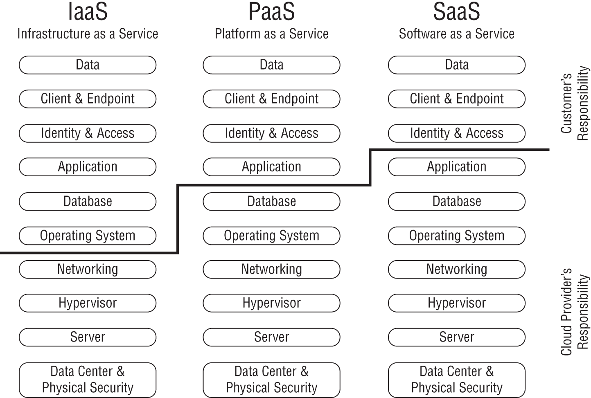

**FIGURE 3.9 The cloud shared responsibility model for IaaS, PaaS, and SaaS**

特别是，云服务提供商对以下内容负有排他责任：

*   物理安全
*   环境安全
*   硬件（即服务器和存储设备）
*   网络（即电缆、交换机、路由器、防火墙和互联网连接）

云服务提供商和客户对以下内容共同负责：

*   **漏洞和补丁管理：**以 Figure 3.9 为指导确定哪个组织负责哪些活动，云服务提供商负责修补责任分界线以下的软件，客户负责线以上的一切（即在 SaaS 的情况下，客户仅负责用于访问云的计算机和浏览器）。
*   **配置管理：**云服务提供商负责基础设施，客户负责其上的一切。网络配置和安全是一个特殊情况，因为 IaaS 提供商的客户通常可以通过 API 和基于 Web 的管理控制台对网络路由和防火墙的重大方面进行配置控制。由于这些网络控制是 IaaS 云部署安全性的关键组成部分，客户必须非常小心地确保其正确配置。
*   **培训：**云提供商和客户都对其各自人员所需的特定培训负责。

在 IaaS 情况下，客户对许多网络安全方面负有责任，提供边界和内部安全需要不同于传统数据中心安全的方法。在云中，客户很少有能力安装实际的网络或安全设备（例如防火墙、路由器、交换机等），而是被授予对有限数量的防火墙和路由器功能的 API 访问权限，可用于控制对其 VM 的访问。此外，根据云服务提供商的不同，网络流量的访问，如在数据中心使用网络 TAP 或 SPAN（镜像）端口所期望的那样，可能不可用，或者可能仅以 NetFlow 或 sFlow 等采样方式可用。


最后，云服务可以通过多种方式部署（称为 *部署模型*）：

*   **公共云：** 可供任何客户使用
*   **私有云：** 由单个客户独占使用（可能由内部部署或第三方运营，本地或外部）
*   **社区云：** 由具有相似兴趣或需求的一小群客户独占使用（可能由一个或多个客户或第三方管理，本地或外部）
*   **混合云：** 上述两种或多种部署模型的组合

部署模型将对云部署的风险评估性质产生重大影响。尽管如此，不要假设私有或本地云部署在本质上比公共云更安全。主要的云服务提供商已在安全方面投入大量资金，这一点从他们众多的安全审计和认证中可见一斑，而且他们通常能为客户提供比这些公司为自己提供的更好的安全性。

### 分布式系统

分布式系统是一组被设计成对用户表现为单一系统的系统。分布式系统旨在实现包括可靠性、性能和可扩展性在内的多个目标。

由于分布式系统按定义涉及多个子系统，可能在地理上分布，并以某种方式互连，其攻击面远大于单一系统。

对整体系统进行威胁建模并识别需要解决的相对风险非常重要。

请考虑以下几点：

*   子系统之间连接需要加密和身份验证，以确保攻击者无法拦截、窃听或伪造子系统之间的通信
*   需要防范针对通信链路或子系统本身的 DoS 攻击
*   来自子系统缺乏同质性的风险（例如，操作系统、中间件和应用软件的不同版本和补丁级别；在不同且分布的系统上保持一致配置的困难）以及缓解这些风险的机制
*   应在通信中断（延迟或中断）时保持一致性的需求，即在通常连接的子系统组之间（有时称为“脑裂”问题）
*   确保地理分布组件具有可比的安全控制的挑战（例如，物理、环境和人员）
*   隐私和数据主权法规的要求，可能限制个人数据在国际边界之间的传输

这些风险并非分布式系统所独有，但分布式系统的性质可能使其缓解措施比非分布式系统复杂得多。

### 物联网

术语 *物联网*（IoT）描述的是一张由嵌入技术的物理对象组成的网络（例如传感器和软件），使它们能够通过互联网与其他设备连接并交换数据。这些物理对象——或“事物”——包括企业、政府和商业用途中的各种设备。示例包括家用电器、医疗设备、智能家居设备等等。据估计，到 2020 年此类设备的数量在 200 亿到 500 亿之间，而 5G 网络的快速扩展预计将继续推动物联网增长。

物联网安全的重要性可以通过臭名昭著的 Mirai 分布式拒绝服务（DDoS）攻击来证明。

Mirai 攻击（Figure 3.10）涉及一种蠕虫，它搜索易受攻击的物联网设备（通常是消费级路由器和 IP 启用的闭路电视（CCTV）摄像机），用恶意软件副本感染它们，然后等待来自命令和控制（C&C）服务器的指令，以对哪个目标发动 DDoS 攻击。2016 年底，该僵尸网络使 Krebs on Security 博客下线，随后攻击了 Dyn DNS 服务，进而严重影响了其众多客户，包括 GitHub、Twitter、Reddit、Netflix 和 Airbnb。

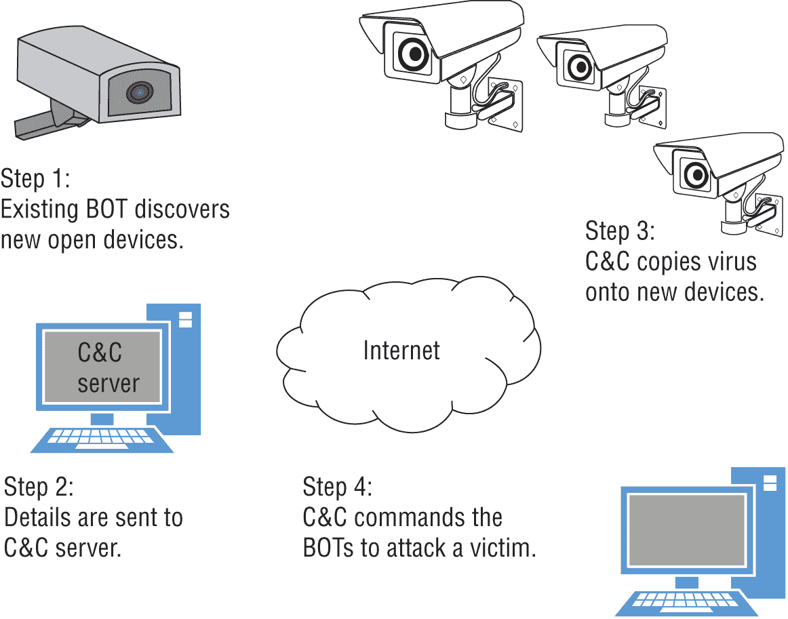

**FIGURE 3.10 Components of the Mirai DDoS BotNet attack**

#### 从设备制造商角度看物联网安全

在开发过程中，您需要进行威胁建模以确定可能存在的漏洞，并确保部署了适当的缓解措施。您必须审查其产品的<|message|> 安全架构，以确定本节前面概述的一般准则是否已在固件设计中得到遵守。

开发团队需要特别注意来自开放式 Web 应用安全项目（OWASP）和 SANS 等的安全软件开发指南。而质量保证（QA）团队需要执行主动的白盒和黑盒渗透测试。

过去被利用的许多物联网设备漏洞本可以通过基本的安全卫生措施来缓解，例如更改默认凭据并更新固件以修补已知漏洞。

作为物联网产品开发人员，除了努力设计和开发尽可能安全的物联网设备外，您还需要尽可能简化前两种安全控制的实施。您可以让您的设备成为地球上最安全的物联网设备，但一旦它到了客户手中，就不再受您控制。您需要尽可能让他们轻松地正确保护和维护设备。

这意味着您的设备应在用户更改默认管理员凭据之前拒绝连接到互联网。这意味着您的设备应自动更新自身（在用户同意的情况下），如果未启用自动更新，可能在发出足够通知后拒绝运行（如果存在针对在野外被积极利用的高严重性漏洞的补丁）。在某些情况下，物联网设备在初始化前可能拒绝在未先连接到互联网的情况下运行。在这些情况下，最好将可能不安全的物联网设备与网络上的关键系统或敏感区域隔离。

虽然易用性是物联网设备商业成功的关键因素，但必须划清界限，即易用性直接与易受攻击相关。

#### 从用户角度看物联网安全

作为物联网设备的用户，您可以采取措施来降低与设计或支持不佳的设备相关的风险，以便您不会成为用于攻击他人的僵尸网络的一部分，并且您的物联网设备不会被用作攻击您其他信息系统的桥头堡。

首先，您可以通过之前提到的同两个基本安全控制来保护自己（以及可能成为您受损设备攻击目标的其他人）：

*   尽快更改默认凭据，并在将设备连接到互联网之前更改。
*   保持您的设备更新到当前固件版本，要么通过启用自动更新（如果设备支持），要么定期检查制造商网站以获取固件更新。

此外，您可以通过额外的控制措施实现纵深防御：

*   不要将物联网设备放置在开放的互联网上，而应将其置于防火墙之后，使其在外部无法直接访问。
*   对网络进行分段，以便您的物联网设备无法访问内部网络上的其他敏感设备或服务器。


如果必须能够从外部访问你的物联网设备，那么至少应将设备置于执行反向 NAT 映射的路由器之后。请记住，反向 NAT 提供网络地址转换，但方向是从外部源到内部私有地址。因此，它是 NAT，但方向相反。最好将设备置于代理之后，该代理可在提供对物联网设备的访问之前先执行自己的用户身份验证。

当然请注意，路由器或代理本身也是潜在的漏洞，必须自身安全运行：必须正确配置（更改默认凭据）并维护（修补和更新）。

鉴于此类设备存在未修补漏洞的历史，依赖物联网设备的安全性是不明智的。通过将设备置于充当访问网关的另一设备之后，可以实现纵深防御和安全分层，在物联网设备被入侵之前需要攻破两个不同的设备。而且，如果你已正确分段网络，即使物联网设备被攻破，对信息系统的机密性和完整性的影响也将有限（这些系统在面对物联网 DDoS 攻击时的可用性是另一回事）。事实上，将网络分段推向极致就导向了 Google 的 BeyondCorp 模式：一种网络，其中对资源的访问并非基于网络位置授予，而是基于用户权限。

### 微服务

`Microservice architecture` 是一种模块化软件开发风格，涉及将单个应用程序作为一组松散耦合的较小应用程序或服务（`microservices`）集合来开发，每个服务运行自己的进程。微服务被构建为可独立部署，并通过轻量级通信协议协同工作。微服务可与更传统的 `monolithic architecture` 对比，后者涉及将应用程序作为单个不可分割的单元开发，通常具有缺乏模块化的大型代码库。Figure 3.11 描绘了单体与微服务之间的差异。

举例来说，考虑 Microsoft O365。这是一套单体应用程序。你不能仅调用“更改字体”功能或“排序表格”功能而不加载整个单体应用程序。另一方面，亚马逊网络服务最初采用单体架构，但已转向使用微服务的更具服务导向的架构。

微服务架构高度分布式且动态，在设计的第一阶段及整个开发生命周期中都必须考虑其独特的<|message|> 安全问题。保护微服务时要考虑的两个关键原则是：隔离和纵深防御。

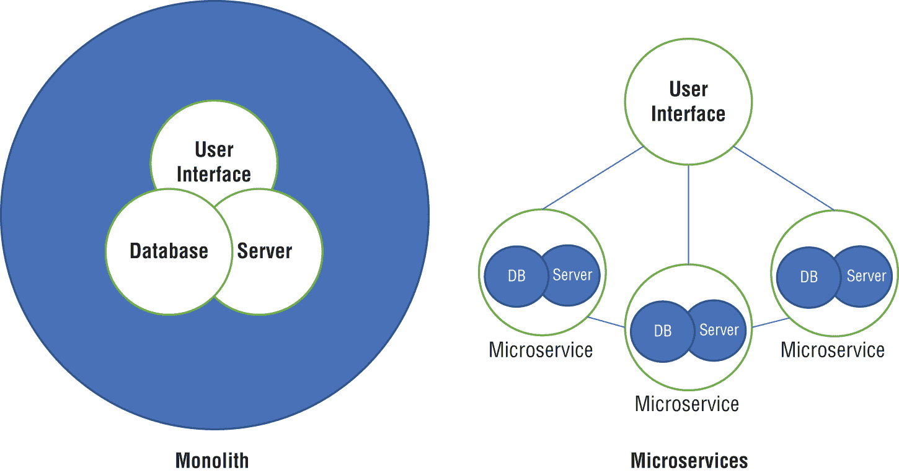

**FIGURE 3.11 Monoliths and microservices**

隔离是微服务的一个核心原则，每个微服务必须能够在不影响周围其他微服务的情况下部署、修改、维护和销毁。通过以隔离原则为指导设计微服务，你可以更好地确保一个微服务的弱点被遏制，无法对应用程序中的其他微服务产生负面影响。

纵深防御原则在任何架构中都很重要，但在处理微服务时尤其关键。纵深防御是一种安全策略，要求在整个应用程序或系统中实施多层安全控制。在微服务架构中，独立监控和保护每个微服务以及整体环境中各微服务之间的通信至关重要。

### 容器化

`container` 是软件单元，它将应用程序及其依赖项打包起来，以便应用程序能够与其环境解耦，并在多个环境中一致地开发、部署和运行（例如，公有云、私有云、本地系统等）。与其运行整个操作系统（如 VM 所做的那样），容器使用操作系统的内核以及运行给定应用程序所需的资源。因此，容器设计上轻量且灵活，允许比非容器化应用程序更快的应用程序开发。

容器因开源 Kubernetes 平台的开发而流行。Kubernetes 和其他容器平台在混合云环境中特别有用，因为它们允许开发人员和用户无缝地将应用程序从一个云迁移到另一个云，甚至在云与本地环境之间迁移。

#### 安全问题

容器化带来了其自身的一系列安全挑战，因为容器技术本质上灵活且开放。由于容器允许你快速扩展和缩减资源，资产管理和配置管理或许比传统系统更具安全挑战性。

容器安全风险通常分为两大类：

* 容器镜像或整个容器仓库被攻破
* 容器被滥用以攻击其他容器或主机操作系统

仔细管理你的容器镜像是容器安全的关键。你的基础容器镜像最为重要，因为它被用作派生镜像的起点。容器安全始于使用来自受信任来源的签名基础镜像。在向镜像添加应用程序或其他变量时，遵循谨慎的配置管理实践。此外，所有容器镜像都应遵守严格的漏洞扫描和修补要求。

除了管理安全镜像基线外，你还必须确保对所有容器镜像实施适当的访问控制。尽可能使用基于角色的访问控制来管理对容器镜像的访问。

保护运行容器的主机操作系统是保护容器的基础部分。主机操作系统应仅运行操作容器所需的最少服务，并排除诸如 Web 服务器、数据库等会增加攻击面的应用程序。适当的配置也很重要，主机操作系统必须纳入你的配置管理计划。此外，容器之间的通信应基于最小权限原则进行限制——仅允许容器与绝对必要用于操作的容器通信。容器编排和管理工具，如 Kubernetes，允许你在适当时实施网络控制以限制通信路径。

### 无服务器

`Serverless computing` 是一种云计算模型，涉及云提供商管理服务器，并根据需要动态分配机器资源。通过无服务器计算，基础设施管理任务如配置和修补由云提供商处理，使客户主要负责编写在这些服务器上执行的代码。AWS Lambda、Azure Functions 和 Google Cloud Functions 是公有云提供商提供的流行无服务器框架。


Serverless 计算具有一些显著的安全优势。首先，serverless 函数通常是短暂的（即生命周期短）。这些函数通常运行几秒钟，执行代码，然后终止。这种短暂的特性创造了一个不断变化的目标，为攻击者入侵增加了极高的难度。此外，serverless 函数的代码库通常比最小的容器还要小得多。鉴于此事实，你能够对每个函数应用更细粒度的访问控制规则，而不必依赖可能需要授予过度权限才能实现相同功能的容器级规则。最后，使用 serverless 架构，你作为云客户的安全责任被大幅降低，并很大程度上转移给了云服务提供商，后者负责所有操作系统加固、补丁和运行时安全。当然，这只有在云服务提供商可靠地执行这些任务时才是一种安全优势。

### 安全问题

尽管有其优势，serverless 计算并非没有安全挑战。2019 年，云安全联盟（CSA）以色列分会起草了一篇题为“Serverless 应用的 12 项最关键风险”的论文。所列风险包括身份验证破坏、函数权限和角色过度授权，以及与攻击面复杂性和 serverless 架构相关细微差别有关的其它问题。该出版物可通过访问 `cloudsecurityalliance.org/artifacts/the-12-most-critical-risks-for-serverless-applications` 找到。

有效的 serverless 安全建立在确保代码完整性、严格的访问权限和适当的监控之上。你应为 serverless 函数维护最小权限访问，就像对待其它服务一样——serverless 函数应仅被授予执行其任务所必需的访问权限和权限。代码应定期扫描漏洞和配置问题。此外，应使用运行时保护来检测可疑事件或错误，这些事件或错误可能导致意外行为或被入侵。大多数大型云服务提供商都提供实现这些目标的功能，并且有各种第三方厂商提供额外的 serverless 安全支持。

### 嵌入式系统

嵌入式系统是内置于更大机械或电气系统中的专用信息处理组件，旨在提供有限的一组功能。嵌入式系统可广泛应用于以下技术中：

* 家用电器（例如，洗碗机、洗衣机和烘干机、冰箱和电视）
* 办公设备（例如，打印机、扫描仪和传真机）
* 网络设备（例如，路由器、交换机和防火墙）
* 汽车和其他机动车辆
* 自动取款机
* 医疗设备（例如，心率监测仪、血糖仪和静脉输液泵）
* 城市轨道交通车辆、车站和系统
* 建筑自动化和控制系统
* 交通控制和监控系统

医疗行业已通过提供给医疗提供者和患者带来巨大益处的嵌入式系统实现了创新。一个例子是通过实时定位系统（RTLS）跟踪患者和医护人员，由主动射频识别（RFID）标签和接近传感器实现。另一个真正拥抱物联网功能嵌入式设备的例子就是现在所知的 *远程医疗* 或远程健康监测和护理。对难以轻易前往医院的患者最有帮助，物联网功能设备被带到患者家中并与医护人员远程通信。

评估嵌入式系统的漏洞应从列举可用的攻击面开始，然后逐一检查。如本章前面所述的更详细描述，这种检查可以通过多种方式进行，包括代码检查、威胁建模以及白盒或黑盒渗透测试。

通常，这些攻击面将落入以下类别：

* 用户界面（UI，即按钮或其他用户输入方法）
* 物理攻击
* 传感器攻击
* 输出攻击
* 处理器攻击

UI 攻击涉及以导致设备功能失常的方式操纵设备的控件。这可能涉及按错误顺序或设计者未预期或未预料的方式按按钮（多次、同时按多个按钮等）。

根据用户界面的性质，可能存在仅通过特殊方式才能访问的受限功能。这可能像特殊组合的按钮按下以“解锁”管理或特权功能那样简单，或用户登录流程（可能存在默认或选择不当的密码等所有标准用户身份验证问题）。请记住，这些受限功能通常会泄露到互联网上，这需要在保护此类设备和系统时采取特殊预防措施。

针对这些攻击的缓解措施包括仔细审查固件中安全关键部分以及对嵌入式系统 UI 进行渗透型测试。显然，对售货机的渗透测试与对 Web 应用的渗透测试方法略有不同，但概念非常相似。考虑所有可用于向设备发送数据或命令的方法，然后尝试无效或不寻常的数据或命令，或数据或命令序列（既有有意选择也有随机，如模糊测试），以试图使嵌入式系统功能失常。售货机的“工作破解”方法在网上广泛存在，形式为导致机器投放产品的奇特按钮按下序列。与渗透测试 Web 应用依赖于底层语言类似，售货机漏洞取决于底层编程，因此按钮序列因厂商而异。

物理攻击涉及对嵌入式系统包装的破坏，要么直接破坏设备（即打破售货机的玻璃前面板并拿走内容物），要么获得嵌入式系统部件的访问权限以暴露可能易受攻击的其他攻击面（本节后面讨论）。特别容易导致漏洞的是用于管理或维护该机器的端口或接口。一个现实的例子涉及投票机，其中概念验证演示可在网上找到，有人通过其管理端口利用投票机来击败屏幕上的访问控制。

物理攻击的防御措施可以从增加物理保护强度（例如更厚的钢制容器、坚固的锁、或通过环氧树脂包埋/焊接组件使访问困难）到添加篡改检测形式不等。根据篡改类型，检测可能仅意味着构建设备使其物理操纵尝试（例如添加信用卡读卡器）很容易被发现或导致设备采取防御措施（从触发警报到擦除敏感内存到自我毁灭）。

传感器攻击涉及操纵或拦截嵌入式系统用于检测与其操作相关的外部条件的传感器的数据。例如，在售货机中，硬币接收器是一个传感器，它告诉处理器已存入哪些硬币。对传感器的攻击（例如使用劣质硬币或插入电线或其他细长工具来触发硬币检测器）可以欺骗设备认为已付款且产品应被投放。


比起自动售货机黑客攻击，对无钥匙进入汽车的传感器攻击代价要高得多。一个众所周知的例子是来自外部安全摄像头的病毒式视频片段，视频显示两名男子走近车主车道上停放并锁定的特斯拉 Model S 汽车。一名男子手持笔记本电脑在房屋外墙附近扫描，希望能接近特斯拉的钥匙扣。另一名男子手持信号中继设备站在车门附近。通过触发钥匙扣，第一名窃贼可以将信号中继给他的同伙。中继攻击使他们能够解锁汽车并最终将其偷走。

信用卡读卡器和读卡片是传感器攻击的一种形式。读卡器是指攻击者窃听信用卡终端中磁条读卡器的数据。卡片的磁性数据可能被例如恶意服务员携带的便携设备读取。或者读取设备可能是固定式销售点终端，攻击者在其中安装了第二个传感器来读取相同数据并记录下来。

读卡片是另一种从银行卡窃取数据的设备，但与读卡器不同，读卡片拦截的是卡片内置的 `EMV`（Europay, MasterCard, Visa）芯片的数据。在带有 `EMV` 芯片的银行卡上，芯片被封装在卡内，但在表面上有熟悉的镀金触点，以便在银行卡插入销售点 (`POS`) 读卡器时提供导电触点。攻击者的读卡片是一个薄塑料套筒或板，完全塞入 `POS` 读卡器内部。读卡片作为塑料套筒，基本上只是一个用于放置电气触点和用于记录插入银行卡的小型集成电路 (`IC`) 芯片的表面。读卡片的触点被放置在被“夹在”银行卡和合法的 `POS` 读卡器之间的位置。

输出攻击涉及操纵由嵌入式系统控制的执行器，以绕过系统施加的控制。想象一下电控门锁，其布线暴露在外，攻击者只需剥去绝缘层并施加适当的电压即可使门解锁。

处理器攻击涉及直接破坏处理器，其手段范围从直接连接到处理器或存储芯片，到小心地去除集成电路的顶部并使用离子束探测芯片以获取或操纵处理器内的信息。处理器攻击通常先于物理攻击，以获得对处理器的访问权限。

支持固件更新的嵌入式系统可能容易接受恶意或未经授权的固件。攻击者加载自己的固件版本（要么从头编写，要么从设备中提取的代码或从制造商处下载的代码中逆向工程），从而使设备按攻击者希望的方式运行。

针对固件攻击的保护措施可以包括数字签名以防止未经授权的固件被接受和执行，以及密码学以防止固件更新被逆向工程。

与物联网设备一样，一个问题是很难，如果不是不可能的话，对许多嵌入式系统进行软件升级。这意味着在产品出厂后发现的漏洞可能难以或无法修补。其结果可能是需要补偿性控制措施来减轻未修补漏洞带来的风险，或需要完全更换该单元。

## 高性能计算系统

*高性能计算* (`HPC`) 指的是使用一台或多台超级计算机，通常用于高度复杂的计算科学和其他数学相关的应用。超级计算机自 1960 年代以来就已存在，但它们仍在不断发展，大多数现代 `HPC` 系统利用基于云的技术来提高其分布式计算能力。

总体而言，`HPC` 系统会遇到与传统系统和其他基于云的系统（如下文各节所述）相同的许多安全问题。它们通常运行基于 Linux 的操作系统，并受软件漏洞、配置问题和凭据被盗的影响。这里应考虑所有传统安全措施。然而，一个区别可能在于支持 `HPC` 环境的高度专业化、专用硬件和软件。任何定制的硬件和软件都带来了必须得到保护的额外威胁向量。在高性能计算的情况下，挑战在于确保安全运行而不对性能产生不利影响。

作为最佳实践，`HPC` 系统应移至自己的物理飞地或与传统系统分离的逻辑安全区域。这样可以将 `HPC` 系统与其他可能具有不同安全需求或法规的计算系统隔离开来。独立的飞地为 `HPC` 环境的进出监控提供了一个单一入口点。

`HPC` 系统中通过的海量数据流量需要对网络监控采取不同的方法。与其使用状态防火墙进行深度数据包检测，通常最好使用仅检查数据包头而不检查负载本身的防火墙。单独地，深度数据包检测可用于入侵检测，因为有状态的入侵检测系统不用于内联运行，因此不会引入吞吐量延迟。在这里，使用单独的工具可以实现传统的安全意图，同时适应 `HPC` 系统的独特性。

## 边缘计算系统

*边缘计算* 是一种分布式计算模型，将计算和存储资源更靠近所需的位置，从而提高响应时间并减少带宽。边缘计算的概念可以追溯到 1990 年代的内容分发网络 (`CDNs`)，现在已扩展到云计算领域。`CDNs` 在 第 4 章，“通信和网络安全”中进行了详细介绍。

今天，边缘计算有助于管理我们看到的物联网设备的巨大增长。边缘计算允许伪本地数据处理，以最大限度地减少通过互联网发送的数据。例如，想象一个工厂有 5,000 台联网视频摄像头将视频发送到远程位置。如此多的实时流通过公司网络发送既慢又昂贵。边缘计算通过在本地处理摄像头数据并仅在必要时通过互联网发送信息来解决这个问题。与所有 5,000 个连续实时流被传输不同，你的边缘设备可能会使用人工智能 (`AI`) 来识别工厂中的异常行为，并在需要调查时发送 30 秒的片段。

### 安全问题

从安全角度来看，边缘计算带来了一些挑战。

位于边缘的设备，而不是集中管理在数据中心或其他严格管理的设施中，可能不会像其同行那样得到同样的关注。你必须确保对边缘设备应用与集中管理设备相同的严格安全措施。这包括加固、修补以及为边缘计算系统提供适当级别的物理安全。`SOAR`（在 第 7 章 中介绍）可以帮助组织观察和加固其设备，包括位于边缘的设备。

数据在边缘设备和集中系统（或云）之间传输时必须加密，并且在管理远程系统时，对于敏感数据，使用 `VPN` 隧道也可能是明智的。


边缘设备也存在可用性问题。边缘计算系统的冗余和故障转移管理很重要，以确保在单个边缘节点发生故障时数据仍能继续处理和传输。此外，边缘设备必须进行监控，以便在出现故障时能够尽快修复错误和故障。

### 虚拟化系统

操作系统为程序提供一套服务，使其能够比直接在计算机上运行更高效地运行（并且更易于设计和运行）。例如，应用程序不是直接读写磁盘存储块，操作系统提供了一层抽象来管理文件和目录的细节。此外，大多数操作系统还允许多个程序并发运行，每个应用程序都能在同一系统上对其他应用程序的存在一无所知。

从某种意义上说，操作系统提供了一种虚拟计算机，一种在现实中不存在（即硬件）的计算机，它比物理硬件更容易供应用程序使用，并且通过在不同程序之间共享硬件，使硬件得到更高效的使用（参见 图 3.12）。

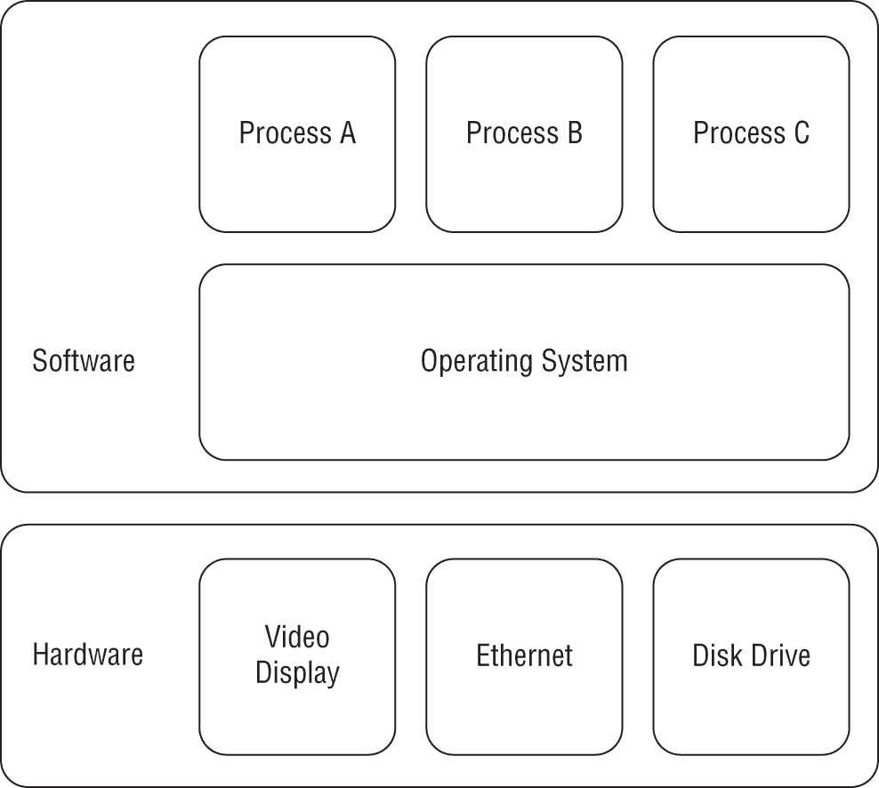

**图 3.12 操作系统在多个进程之间高效分配硬件资源。**

虚拟化将这一概念更进一步。*虚拟化* 是创建虚拟（即非真实）计算、存储和网络资源的行为——换句话说，虚拟化允许你创建硬件的软件版本。例如，VM 就是实际计算机的软件实例。同样，软件定义网络（SDN）是物理网络的软件实例。

操作系统不仅仅使同一硬件上运行多个应用程序程序成为可能，虚拟化使多个操作系统能够在同一台计算机上运行，每个操作系统都不知道其他操作系统的存在，并且在设计良好的系统中无法影响其他操作系统。虚拟化是云计算背后的主要技术（在本节前面已讨论过）。

虚拟化的最常见实现是 hypervisor。*hypervisor* 是一层计算层，允许多个操作系统同时在一块硬件上运行，每个操作系统都将机器的资源视为其专有资源。hypervisor 允许在单个物理主机上运行多个客户虚拟机。

通常称为 Type 1 和 Type 2 hypervisor 的 hypervisor 有两种类型。它们之间的主要区别在于是否使用底层操作系统作为硬件与 VM 之间的桥梁。Type 1 hypervisor 是唯一安装的安装，充当硬件组件与 VM 之间的桥梁。因此，Type 1 hypervisor 也称为 *裸金属* hypervisor。它们通常在需要灵活性和效率时出现。尤其是在虚拟化服务器运行相同或相似服务时，可以最有效地利用底层硬件。在生产环境中，你更有可能发现虚拟化机器位于 Type 1 hypervisor 上。Type 2 hypervisor 带来了一点额外的开销，依赖于安装在硬件上的 *主机* 操作系统。在主机操作系统内运行的虚拟化机器随后被称为 *客户* 机器。 图 3.13 描述了 Type 1 和 Type 2 hypervisor 之间的差异。

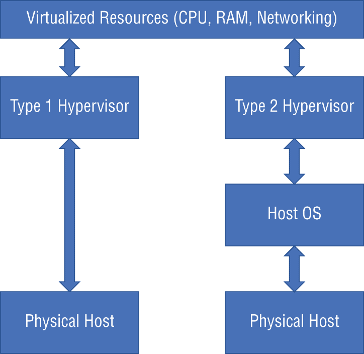

**图 3.13 Type 1 和 Type 2 hypervisor**

虚拟化是 AWS 或 Google Cloud Platform（GCP）等云提供商为不同客户提供 VM 的基础，这些客户可能最终在同一台物理计算机上运行，而彼此并不知晓。

虚拟化的优点包括以下内容：

* 更有效地利用底层硬件（正如操作系统允许单台计算机被多个程序和用户共享一样）
* 根据需求动态扩展基础设施
* 在不同操作系统上运行的程序和应用程序之间提供额外的分离和隔离（与在同一操作系统上运行相比）——支持前面概述的纵深防御和安全层的安全原则

#### 潜在弱点

与内存保护一样，虚拟化依赖于硬件和 hypervisor（可能包括硬件和/或软件）的正确运行。诸如 Meltdown 之类的硬件缺陷破坏了底层假设，即硬件将防止未经授权的程序（并且可能是一个完全无关的客户端）访问分配给另一个程序（和客户端）的内存。

同样，hypervisor 中的软件缺陷可能会错误地允许在同一台计算机上的一个 VM 上运行的软件访问不同 VM 上的数据。例如，*虚拟机逃逸* 漏洞就是当程序能够突破其 VM 并直接与底层主机操作系统交互时发生的；一旦能够访问主机操作系统，攻击者可能能够渗透到其他 VM 或导致主机系统租户的服务中断。当发现此类缺陷时，它们通常会披露给最大的云服务提供商，以便在漏洞被广泛知晓之前进行修补。

始终存在这些未修补的硬件或 hypervisor 缺陷可能为威胁行为者所知的可能性，然后能够破坏本应防止 VM 上无关客户端交互的保护。为了降低这种风险，一些 IaaS 云提供商提供专用主机，保证只有分配给你的账户的 VM 才会被允许在专用主机上运行。

## 选择和确定加密解决方案

密码学是对数据进行数学操作以保护其机密性和/或完整性。密码学可以说是安全架构师工具箱中最强大的工具之一，但也是一种很容易被误用的工具，导致产生虚假的安全感。

密码学可在你的环境中用于实现信息安全的多个目标，包括 CIA 三要素中的两个核心原则（机密性和完整性），以及其他目标（即隐私、真实性、不可否认性）：

* **机密性（和隐私）：** 密码学的主要用途之一是保护信息机密性，无论是静态还是传输中。当应用于个人身份信息（PII）和受保护健康信息（PHI）时，这提供了“隐私”的关键特性。
* **完整性：** 密码学的另一个常见应用是使用哈希算法和消息摘要来提供数据完整性（或准确性）的保证。这些加密应用有助于确保被访问的数据完整且符合预期。
* **真实性（和不可否认性）：** 密码学也可用于身份验证服务以及通过数字签名和数字证书实现不可否认性。

这些应用将在本节的其余部分中讨论。


很难想象我们使用计算机的某个方面不涉及密码学的某个方面。当你登录到一个系统时，你的密码会使用密码学进行保护（至少我们希望如此）。当你使用 `https:` URL 连接到网站时，你的流量会使用密码学进行保护。如果你将 PII 存储在负责任的服务提供商处，它应该使用密码学进行保护。总之，在整个过程中，密码学可以帮助保护敏感信息。

在以下各节中，我们将概述安全架构师需要熟悉的密码学的各个方面。前面在评估和缓解漏洞的部分中，我们讨论了密码学应用不当可能带来的潜在弱点。

## 密码学基础

在深入探讨一些复杂主题之前，让我们从基础开始。以下来自 (ISC)² 的定义是密码学主题的核心，你会经常看到（并可能使用）它们：

* `Plaintext`：消息的自然格式，未被转换为秘密。
* `Cleartext`：以可读、可用的形式呈现的消息，不打算通过密码学手段进行模糊处理。
* `Ciphertext`：明文消息的更改形式，以便除预期接收者之外的任何人都无法阅读（换句话说，被转换为秘密的东西）。
* `Encryption`：将消息从明文转换为密文的过程。
* `Decryption`：加密的逆过程——它是使用用于原始加密的密码算法和适当密钥，将密文消息转换回明文的过程。
* `Cryptographic algorithm`：用于加密和解密过程的数学函数。
* `Key`：控制密码算法操作的输入；它决定算法的行为并允许可靠地加密和解密消息。对称/私钥（本章后面讨论）必须保密，而公钥（本章后面也讨论）则共享以实现身份验证和其他用例。

如需更多有用的定义，请访问 (ISC)² CISSP 术语表：`www.isc2.org/Certifications/CISSP/CISSP-Student-Glossary#`。

## 密码学生命周期

密码学生命周期涉及算法选择、密钥管理以及对静态、传输中和在使用中的加密数据的管理。

算法选择涉及多个选择：

* 适用于目的的密码类型（例如，对称、公钥、哈希等）
* 具体算法（例如，`AES`、`RSA`、`SHA` 等）
* 密钥长度（例如，`AES-256`、`RSA-2048`、`SHA-512` 等）
* 工作模式（`ECB`、`CBC` 等）

对称加密最适合存储需要在使用前恢复（解密）的数据。对称加密也比公钥密码学高效得多，因此适合保护传输中的数据。问题在于，如本节后面详细解释的那样，要使对称密码学用于传输中的数据，通信链路的两端都必须知道密钥。有多种方法可以在不安全通道上安全地交换密钥，其中最广泛使用的方法是使用公钥密码学（后面也会讨论）。

有些数据类型需要保护，但不需要解密。事实上，出于安全考虑，最好某些数据永远无法被解密。例如，为了保护用户身份验证使用的密码的机密性，它们显然必须被加密。但没有必要能够解密它们。要验证输入的密码与之前存储的密码是否一致，只需加密输入的密码并比较两个密文即可。事实上，能够解密密码会显著削弱其安全性。因此，对于此目的，我们使用单向加密函数，也称为 `cryptographic hashing`。需要明确的是，密码学并不仅限于加密和解密。密码学使用一种算法，无论其复杂程度如何，都处理输入和输出。密码哈希将字符串作为输入以产生输出，通常假定输出长度固定，而与输入长度无关。

另一个例子是在计费系统中使用的信用卡号码。虽然提交交易到支付处理器的系统显然必须能够以明文访问账号，但有许多数据库和日志需要存储账号。对于其中大多数而言，存储账号的密码学哈希就足够了。此哈希可以存储和通信，即使被披露也不会有重大风险。只有少数系统需要使用可解密的对称密码存储账号。这样一来，攻击面就大大减少了。

保护 PAN 的另一种技术是使号码与账户持有人以及任何可以识别该账户持有人的信息脱钩。本身而言，PAN 就像一个令牌。只有当 PAN 可以与 PII 关联时，信用卡号码才会成为敏感信息。翻译库正被用来生成一个随机令牌，并与 PAN 安全关联。此过程（称为 `tokenization`）通过提供两者之间的加密关系，有助于将账号与 PII 分开。

在选择了密码类型后，必须选择适当的算法。在某些情况下，算法集受协议标准限制。例如，如果使用密码学来保护传输中的数据，则支持的算法列表是有限的，你的选择也受此列表以及希望尽可能与最广泛的浏览器保持兼容的愿望的限制。对于物联网和边缘设备，你通常希望算法轻量级，并且能够由通常资源受限的设备支持。这是性能和其他系统因素使密码学成为整体系统架构和设计的重要因素的一个例子。

对称密码学是使用一个密钥，由两个或多个方共享。对称算法大致分为分组密码和流密码。顾名思义，分组密码一次处理一小块数据（通常为 8、16 或 32 字节）。流密码一次处理一个位或一个字节。分组密码通常用于批量加密，例如数据静态时的加密，而流密码针对加密通信链路进行了优化。流密码通常具有在丢弃或损坏位的情况下快速重新同步的特性。在某些链式模式下，分组密码无法重新同步，数据流的丢失或损坏将使传输的其余部分无法解密。在付出一些（或相当大的）效率成本的情况下，可以将分组密码用作流密码，反之亦然。

在协议的较低层处理错误检测和重传的通信链路中，通常使用分组密码（例如在 `TLS` 和 `WiFi` 中）。

在其他情况下，例如加密要存储在数据库中的数据，可以选择任何对称分组算法。在这种情况下，应参考国家研究机构（例如美国的 `NIST`、英国的国家网络安全中心或国际标准化组织）提供的指导。这些机构根据对相对强度的分析，对适当算法做出建议。


其他考虑因素包括算法的效率。如果代码要在处理能力有限的系统上实现，或需要加密大量数据，那么算法效率上的微小差异对性能的影响很大。还需考虑某些处理器包含对特定算法的编码支持。在处理器指令集中对某些算法提供支持，可使其运行速度远快于没有处理器支持的情况。例如，大多数 Intel、AMD 和 ARM 处理器都包含用于加速 `AES` 算法操作的指令。一项研究发现，使用 CPU 加速的密码学可带来 800% 的加速。

密钥越长，密码越安全。但更长的密钥意味着更长的处理时间。你必须在长（强）密钥的安全性与对系统性能的影响之间取得平衡。一个重要的考虑因素是加密数据的生命周期。如果数据可以定期重新加密（例如，每一年或两年一次），那么选择一个能够抵御未来二十年暴力攻击进步的密钥就不是很重要。相反，如果数据可能长期存档，则可能需要更长的密钥。（有关密钥管理和密钥生命周期的细节将在本章后面更详细地讨论。）

对于对称分组加密，有多种使用算法的方式。Figure 3.14 显示了从最简单的电子密码本 (`ECB`) 模式到更复杂的密码分组链接 (`CBC`) 和密码反馈 (`CFB`) 模式的主要变体。这些将在下一节中进一步讨论。

最后一点说明：前面概述的选择仅在某一时间点上是最优的。密码算法中的弱点会被发现，更强大的处理器使暴力攻击更具可行性，而量子计算的发展可能使某些算法过时。过去曾有无数例子，之前认为安全的算法因密码分析的进步而被弃用，例如 `DES`、`RC4`、`SHA-1` 等。

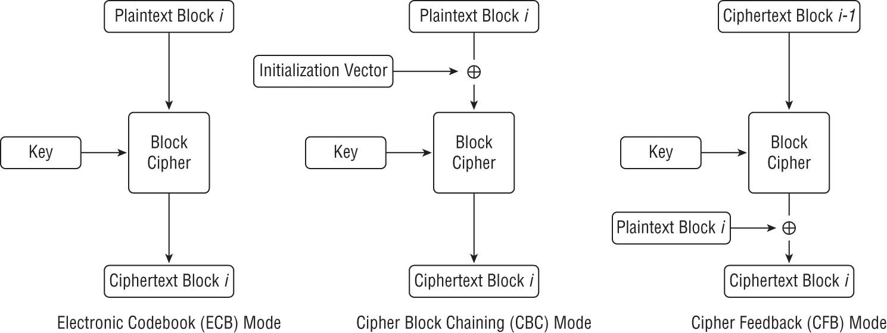

**FIGURE 3.14 ECB, CBC and CFB block encryption implementations**

### Cryptographic Methods

安全架构师可以使用多种密码工具来保护数据的机密性和完整性，其选择取决于所防御的威胁、通信的性质以及信息的敏感程度。参见 Table 3.3，了解可用于不同场景的密码方法。

**TABLE 3.3 Cryptographic Approaches**

| USE CASE || TYPE OF CRYPTOGRAPHY |
| --- | --- |
| Protect confidentiality of stored data || Symmetric |
| --- | --- |
| Protect confidentiality of data in transit || Symmetric (possibly aided by asymmetric) |
| Verify identity || Public key infrastructure |
| Protect integrity (detect tampering) || Hashing |
|  | (e.g., Message Authentication Code) |
| Protect passwords || Hashing (with salt and pepper) |
| Nonrepudiation || Digital signature |

考虑以下不同情况：

* 两人（Alice 和 Bob）希望通过不安全的信道通信机密信息，而未经授权的人无法窃听或篡改该信息。
* Alice 希望以一种方式向 Bob 发送消息，使 Bob 确信该消息确实源自 Alice（而非冒名者），并且 Alice 不能事后否认已发送该消息。
* Bob 希望存储密码，并确保即使有人能够访问存储密码的文件，甚至入侵者知道用于加密密码的方法，也无法获得原始密码。

以下各节将讨论各种密码算法类别以及它们如何解决前面列表中描述的情况。

#### Symmetric Encryption

*对称加密* 是最常见的方法，也是人们谈论密码学时最常想到的。对称加密接收一条消息（称为 *明文*）和一个加密密钥，并生成输出（称为 *密文*），该输出不会泄露原始明文中的任何信息。如果某人拥有用于执行原始加密的加密密钥，则可以将输出转换回原始明文。

目标是使不知道密钥的窃听者难以从密文中提取有关原始明文的任何信息。对称密码的安全性还要求攻击者即使获得了明文示例及其相关密文，也无法通过逆向工程、反向计算或任何其他分析技术推断或确定用于加密消息的密钥。如果攻击者能够做到这一点，则该密钥加密的所有其他消息都将面临风险。

要使对称加密发挥作用，发送方和接收方必须共享密钥。为了使消息保持机密，密钥必须保密。因此，对称密码学有时被称为 *秘密密钥* 或 *共享密钥加密*。

对称密码的基本类型包括流密码和分组密码。

*流密码* 是一种逐字符或逐位工作的加密算法（而不是按块）。它们通常用于加密串行通信链路和手机流量，并且专门设计为计算高效，以便可以在 CPU 能力有限的设备中，或在专用硬件或现场可编程门阵列 (`FPGAs`) 中使用。参见 Figure 3.15，其中明文作为流流经密码函数，输出为密文。Figure 3.15 顶部是密钥流生成器，一种以恒定流生成随机位的装置，这些随机位一次生成一个位。密钥流是流密码所必需的，依赖于这些随机位通过异或 (`XOR`) 函数将明文转换为密文。

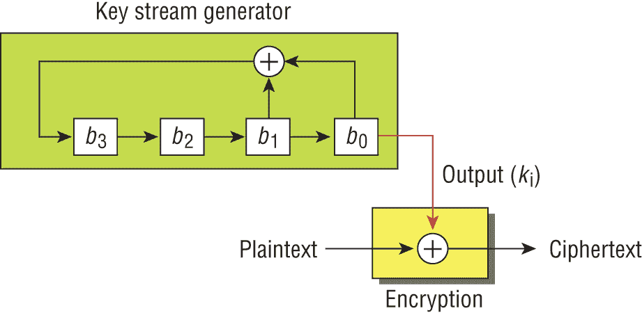

**FIGURE 3.15 Stream cipher encryption algorithm**

*分组密码* 使用确定性算法，接收固定大小的位块（明文）和一个密钥值，并生成与明文块大小相同的加密块（密文）。不同的密钥值会从相同的明文产生不同的密文。参见 Figure 3.16。

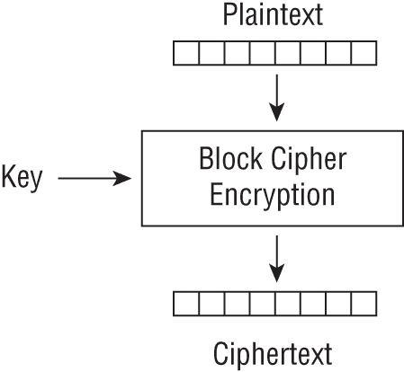

**FIGURE 3.16 Block cipher encryption algorithm**

尽管分组密码是划分密码的一种有用方式，但几乎所有分组密码都可以转换为流密码，反之亦然。

##### Stream Ciphers

流密码的一个简单且可证明不可破解的例子是，取长度为 *n* 的消息（明文）和相同长度的真正随机数字串（密钥），并按 Figure 3.15 所示组合它们以产生密文。


美国密码学家克劳德·香农在 1949 年证明，如果密钥是真正随机的、与明文长度相同，并且仅使用一次，则该系统是安全且不可破解的（假设密钥保持秘密）。这种类型的加密被称为 `one-time pad`，因为密钥仅用于一次加密和解密。这种方法的缺点是密钥必须与消息长度相同且不能重复使用，使得该方法除最短的消息或在成本上可以证明安全交付大量密钥材料是合理的的情况（通常是政府）外完全不切实际。然而，量子密码学的发展（参见“量子密码学”部分）将提供安全交付大量随机数据的方法，可用于一次性密码本加密。

实用密码使用固定长度的密钥来加密长度可变的多个消息。正如我们在密码分析部分将看到的那样，如果攻击者获得用同一密钥加密的足够多的密文，一些密码会被破解。定期更换密钥，使每个唯一密钥产生的密文量受限，可以提高密码的安全性。

流密码分为两种类型：同步和自同步。

同步密码要求发送方和接收方保持完美同步才能解密流。如果从流中添加或删除字符（位），解密将从该点开始失败。接收方需要能够检测到同步丢失，并尝试各种偏移以重新同步，或等待发送方插入的独特标记以使接收方能够重新同步。

自同步流密码顾名思义，具有在最多 `N` 个字符后（`N` 是特定自同步流密码的属性），接收方将自动从密文流中删除或添加的字符中恢复的特性。虽然在数据可能被添加到密文流或从中删除的情况下，它们可能是一个明显的优势，但自同步密码的问题在于，如果一个字符被损坏，错误会传播，影响多达下一个 `N` 个字符。对于同步密码，密文中的单个字符错误只会导致解密明文中的单个字符错误。

### Block Ciphers

分组密码一次处理 `n` 位的块，使用大小为 `k` 的密钥。处理块的输出然后成为密码函数的下一次迭代的输入。发生的迭代次数被称为 `rounds`。 Table 3.4 提供了分组密码的概述。

**TABLE 3.4 Overview of Block Ciphers**

| BLOCK CIPHER || BLOCK SIZE (`N`) || KEY SIZE (`K`) || ROUNDS |

| --- | --- | --- | --- |

| DES || 64 || 56 || 16 |

| --- | --- | --- | --- |

| AES-128 || 128 || 128 || 10 |

| AES-192 || 128 || 192 || 12 |

| AES-256 || 128 || 256 || 14 |

`DES` 密码由于其密钥长度短而不再被认为安全，但它开启了现代密码学的时代，因此在历史上很重要。因为 `DES` 不再安全，找到其替代品至关重要。 `AES` 在从十多个候选中评估和选择算法的五年过程中被选中。 三重 `DES` (`3DES`) 是 `DES` 的重要演进，并在本节后面讨论。

大多数分组密码，包括 `DES` 和 `AES`，都是由多轮数学函数构建的，如 Figure 3.17 所示。虽然轮数越多安全性越高，但也会减慢算法过程，因此选择是在安全性和速度之间权衡。

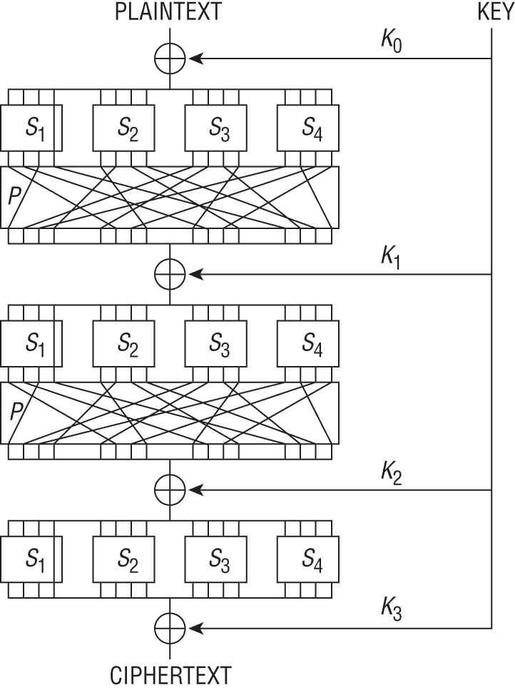

**FIGURE 3.17 Multiple rounds of mathematical functions in block ciphers**

不同分组密码之间的区别在于每个轮次执行的变换，以及加密密钥如何被拉伸然后分割以提供每个轮次的唯一密钥。

构造分组密码使用的一些标准构建块有：

* Substitution or S-boxes (Figure 3.18)
* Permutations or P-boxes (Figure 3.19)

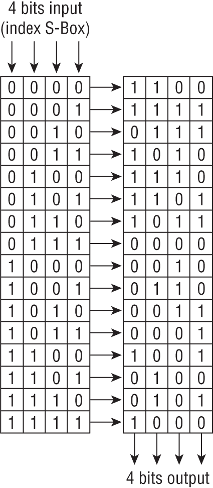

**FIGURE 3.18 Block cipher with substitution of S-boxes**

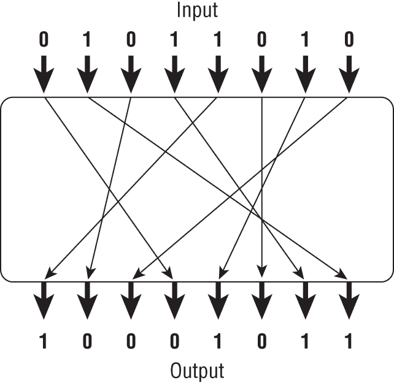

**FIGURE 3.19 Block cipher with permutation of P-boxes**

`AES` 使用多轮替换和置换，而 `DES` 使用 16 轮 Feistel 网络。

### Block Cipher Modes of Operation

像 `AES` 这样的分组密码接收八字节的明文并产生八字节的密文。但如果你的消息短于八字节，长于八字节，或不是八字节的倍数怎么办？

为了处理不是密码块长度倍数的消息，一个机制是在加密前添加填充，并在加密后移除填充。有很多方法可以做到这一点，但一种方法是向消息末尾添加字节，每个字节包含已添加字节数的计数（参见 Figure 3.20）。由于解密过程将检查最后一个块的最后一个字节以确定添加了多少填充字节（从而需要移除），如果明文是块大小的倍数，则必须添加一个仅包含填充的最终块。

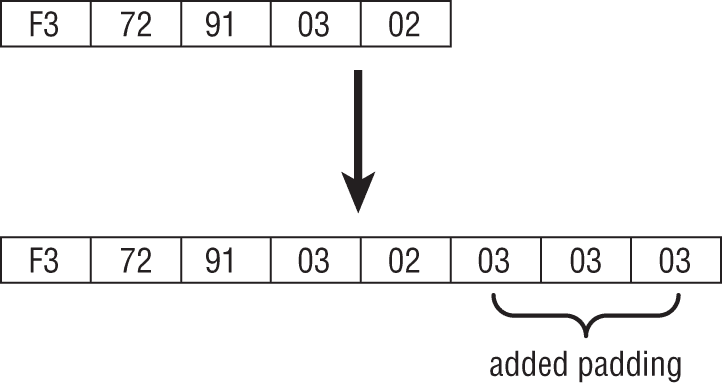

**FIGURE 3.20 Adding padding at the end of a message in a block cipher**

填充并非没有风险，例如稍后在“侧信道攻击”部分描述的填充 Oracle 攻击。

一旦消息被填充为密码块大小的精确倍数，它就可以被加密。最简单、最明显且最不安全的方法（对于较长消息）是 `ECB` 操作模式。在此模式下，明文的每个块由密码独立处理。虽然这对于不超过块大小的消息可能足够，但对于较长消息它有严重的弱点，因为相同的明文块会产生相同的密文块（Figure 3.21）。

即使在要加密的数据与块大小相同或更小的情况下（例如数据库中的数字字段），使用 `ECB` 也是不明智的，如果揭示表中不同行具有相同的值可能会损害保密性。作为一个简单的例子，如果使用 `ECB` 加密出生日期字段，那么就可以很容易地确定数据库中出生在同一天的所有人，如果你能确定其中一个人的出生日期，你就会知道所有人的出生日期（具有相同的加密出生日期）。

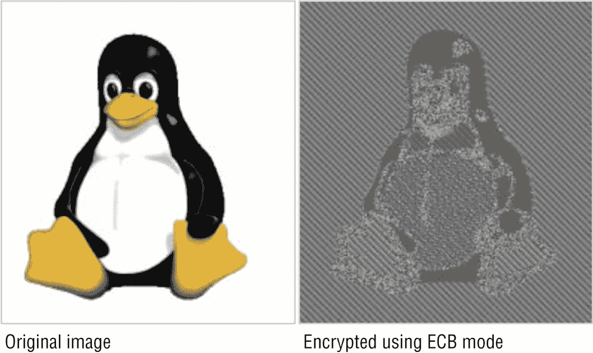

**FIGURE 3.21 ECB padding produces serious weaknesses for longer messages**

`ECB` 的优点，除了其简单性之外，是加密可以并行进行（即在多个处理器之间划分），解密也可以。因此，一个块中的错误不会影响后续块。

在 `CBC` 中，第一个数据块与称为 `IV` 的随机数据块进行 XOR。每个后续的明文块在加密前与前一个密文块进行 XOR。（参见 Figure 3.22。）


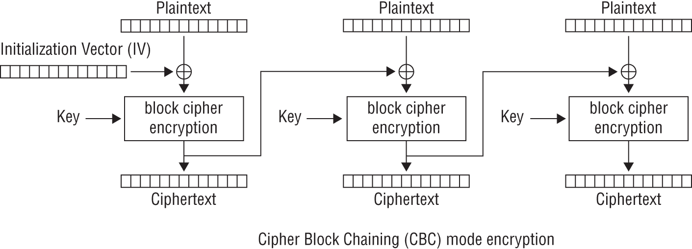

**FIGURE 3.22 CBC mode encryption**

使用 CFB 模式时，`IV` 会先被加密，然后与明文的第一块进行 XOR，产生密文的第一块。然后该块密文被加密，结果与下一块明文进行 XOR，产生下一块密文。（参见 Figure 3.23。）

由于在 CBC 和 CFB 中，块 `*Pn*[+1]` 的加密都依赖于块 `*Pn*` 的加密，因此这两种模式都不适合数据的并行加密。但这两种模式都可以并行解密。

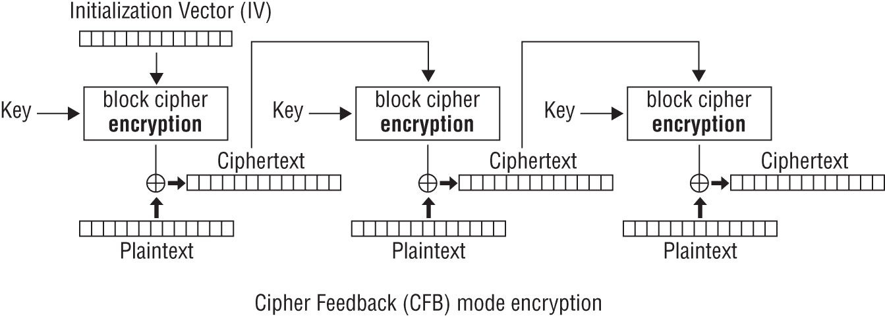

**FIGURE 3.23 CFB mode encryption**

CBC 与 CFB 的主要区别如下：

* 在 CBC 中，`IV` 的一位变化会导致解密后密文的第一块中同一位产生相同变化。根据应用的不同，这可能会允许能够篡改 `IV` 的攻击者对消息的第一块进行更改。这意味着在使用 CBC 时有必要确保 `IV` 的完整性。
* 在 CFB 中，`IV` 的一位变化会导致解密消息中出现随机错误；因此，这不是有效篡改消息的方法。
* 在 CBC 中，解密消息需要使用块密码的解密模式。在 CFB 中，块密码在加密和解密时都使用加密模式，这可能导致更简单的实现。

这两种模式的问题在于加密无法并行化，并且由于需要在解密期望的块 `Cn` 之前先解密块 `C[n-1]`，随机访问变得复杂。

### Counter Mode

计数器 `CTR` 模式通过不使用 CBC 或 CFB 的前一个块来产生密文，从而解决了这个问题。（参见 Figure 3.24。）通过使用 `IV` 结合计数器值，可以同时并行化加密过程并解密密文的单个块。你会注意到 Figure 3.24 包含一个 nonce 值。该唯一随机生成的值被插入到每次块密码加密轮中。类似于随机“salt”值用于确保不同的哈希值（以防止与彩虹表比较），nonce 是唯一的，旨在防止重放攻击。

除了 ECB 之外的所有模式都需要一个 `IV`，该值必须传达给接收方，或者消息必须以一个一次性数据块作为前缀（因为在不知道 `IV` 的情况下解密 CBC 或 CFB 数据流只会导致第一个块出现问题）。

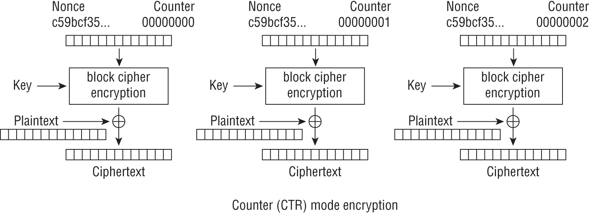

**FIGURE 3.24 CTR mode encryption**

`IV` 不必保密（它可以与密文一起以明文形式传输），但必须不可预测。如果攻击者能够预测下一个将被使用的 `IV` 并且能够发起选择明文攻击，那么这可能使对密文发起字典攻击成为可能。

回到对称加密的整体概念，块密码和流密码都做了大多数人在思考密码学时所设想的事情。它们将可理解的文本转换为不可理解的表示形式，反之亦然。这作为一个封闭的盒子运行，无需区分加密密钥和解密密钥，而这正是非对称算法的情况。

一些常见的对称密钥算法包括 `DES`、`3DES`、`AES`，以及 Rivest 的密码（`RC`）。

#### Data Encryption Standard

数据加密标准（`DES`）是一种在 1970 年代初期开发的对称密钥加密算法。该算法使用相当短的 56 位密钥长度，这最终导致它在 1990 年代被认为不安全，并后来被 `AES` 算法取代（稍后讨论）。尽管是一种不安全的算法，`DES` 具有重要的历史背景，因为它将加密引入了商业界和公众，使其成为你应该了解的算法。

#### Triple DES

顾名思义，`3DES` 算法对每个数据块应用 `DES` 算法三次。`3DES` 算法旨在通过将 56 位密钥长度增加到理论上的 168 位来延长 `DES` 算法的使用寿命。撇开理论不谈，该算法的一些实际限制将 `3DES` 算法的有效密钥大小降低到约 112 位。此外，`3DES` 被发现易受选择明文和已知明文攻击，进一步将有效密钥长度降低到 80 位。鉴于这些弱点，`3DES` 也被认为不安全，并在 2017 年被 NIST 弃用。

#### Advanced Encryption Standard

`AES`，最初称为 Rijndael 块密码，于 2001 年由 NIST 宣布并被美国政府采用，以取代 `DES` 作为敏感和机密数据的标准。

`AES` 算法使用三种不同的密钥长度：128、192 和 256 位。该算法旨在简单、快速，并且易于在硬件或软件中实现和操作。截至本书撰写时，`AES` 仍被认为是一种安全的算法。

#### Rivest Ciphers

罗恩·里维斯特博士（RSA 算法中提到的“R”）开发了多种对称密钥算法，统称为 Rivest 密码。这些算法标注为 `RCn`，你应该熟悉以下四种：

* `RC2` 是一种块密码，于 1987 年开发，使用 64 位块大小和可变长度密钥。`RC2` 易受选择明文攻击，不应使用。
* `RC4` 是一种流密码，常用于 TLS 和 SSH 等互联网协议。`RC4` 密钥长度可变，范围从 40 到 2048 位。`RC4` 不被认为安全，不应使用，尽管它在许多地方仍然存在。
* `RC5` 与 `RC2` 块密码类似，但具有可变块大小（32、64 或 128 位）和可变密钥大小（0 到 2040 位）。`RC5` 在足够轮次的加密下被认为安全。
* `RC6` 是 `RC5` 的衍生版本，使用 128 位块大小和可变长度密钥（128、192 或 256 位）。`RC4` 密码是 AES 竞赛的决赛入围者。`RC6` 是对 `RC5` 的改进，被认为是一种安全的算法。

### Asymmetric Encryption (Public Key Cryptography)

对称加密的问题在于通信双方（我们在示例中称之为 Alice 和 Bob）都必须知道用于加密数据的秘密密钥，并且如果加密数据要保持保密，则任何人都不得知道或猜到该秘密密钥。随着参与人数超过少数几人，管理和共享秘密密钥的困难可能使对称加密变得过于复杂。

如果有 `n` 个人需要使用对称密码学安全通信，则必须有 `n`（`n`-1）/ 2 个唯一密钥，并且每个人必须管理（并安排共享）`n` - 1 个密钥。这不可行。

解决方案是非对称或公钥密码学。公钥密码学的魔力在于，与其使用单个秘密密钥同时用于加密和解密信息，你拥有两个密钥：一个秘密私钥和一个非秘密公钥。使用公钥密码学算法用其中一个密钥加密的数据只能用另一个密钥解密。例如，如果 Alice 使用 Bob 的公钥加密给 Bob 的消息，只有 Bob 可以用他的私钥解密。反之，如果 Alice 使用她的秘密私钥加密消息，那么任何人都可以解密它，因为 Alice 的公钥是，嗯，公开的。


显然，仅用私钥加密消息并不能保护爱丽丝消息的保密性，但它有不同的目的：它证明了该消息源自爱丽丝（因为还有谁能产生它呢？）。当然，这假设爱丽丝的私钥一直保持私密。但如果不是呢？这就引出了下一节关于 PKI 以及公钥和私钥如何管理的主题。

有许多公钥加密算法，都基于数学函数，这些函数正向执行很容易，但在没有已知秘密的情况下反向执行则极其耗时。

这种被称为陷门函数的函数，其计算 `f(x)` 很简单，但计算逆函数（例如，仅知道 `f(x)` 的值时确定 `x`）则极其困难，除非知道第二个变量 `y` 的值。

最著名的基于陷门函数的加密算法是由 Ron Rivest、Adi Shamir 和 Leonard Adleman 最先发表的。它被称为 RSA，基于分解大整数的难度。

选择两个大素数 `p` 和 `q` 并计算以下内容：

`n` = `p q`

这三个数字随后用于生成公钥指数 `e` 和私钥指数 `d`。数字 `e` 和 `n` 公开；`e`、`p` 和 `q` 保持秘密。

消息使用 `e` 和 `n`（公钥）对消息进行整数模运算进行加密。消息使用 `d`（私钥）和 `n` 进行类似的数学运算解密。

该方法之所以有效，是因为从 `n` 和 `e` 推导出 `d` 等同于找到 `n` 的两个素数因子，如果 `n` 是一个非常大的半素数（即两个大小相似的素数的乘积），那么这在计算上是不可行的（至少对于非量子计算机而言）。迄今为止分解的最大半素数在 2009 年有 232 位十进制数字，花费了 1,500 处理器年。RSA 中使用的半素数有 600 多位数字。

一些更常见的非对称密钥算法包括 Diffie–Hellman–Merkle、RSA、ElGamal 和椭圆曲线密码学（ECC）。

### Diffie–Hellman–Merkle 密钥交换

Diffie–Hellman–Merkle 密钥交换是一种安全交换加密密钥的方法。该方法由 Whitfield Diffie 和 Martin Hellman 于 1976 年开发，是公钥密码学的首个已知实现。与其后的许多非对称密钥算法一样，Diffie–Hellman–Merkle 算法基于对数数学。与之前的加密算法不同，Diffie–Hellman–Merkle 算法不用于加密或解密，而是用于使双方能够安全地生成共享的秘密密钥，用于其（对称密钥）加密通信。

### RSA

RSA（Rivest-Shamir-Adleman）是一种用于加密和签名数据的非对称密钥算法。该算法的安全性基于分解两个大素数的难度。RSA 算法由 Ron Rivest 博士、Adi Shamir 和 Len Adleman 于 1978 年首次开发，至今仍是最常用的公钥加密算法之一。

### ElGamal

ElGamal 是一种用于传输数字签名和密钥交换的非对称密钥算法。ElGamal 算法源自 Diffie–Hellman–Merkle 算法（前面讨论过），再次基于离散对数问题求解。

### 椭圆曲线密码学

ECC 是一种公钥密码学方法，其基于比其他公钥算法方法更复杂的计算。早期公钥系统的安全性基于分解一组大素整数的难度，而 ECC 基于椭圆曲线的代数结构（参见 Figure 3.25），其可能变得相当复杂。

ECC 的一个关键优势是它允许使用更小的密钥获得等效的安全性。例如，256 位 ECC 密钥相当于 3,072 位 RSA 密钥。使用更小的密钥可带来更快的计算；因此，ECC 比其他公钥算法更高效，允许其用于更多应用——特别是资源受限的应用。

几种基于离散对数的算法已被改编为 ECC。虽然它经常与 RSA 一起讨论，但基于传统 Diffie–Hellman–Merkle 方案的椭圆曲线 Diffie–Hellman–Merkle（ECDH）方案、基于数字签名算法的椭圆曲线数字签名算法（ECDSA）以及其他几种方案都存在。

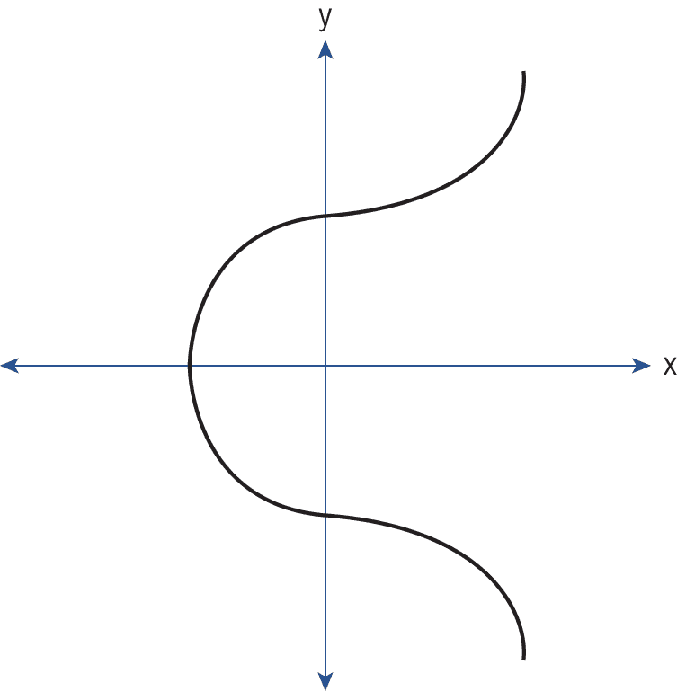

**FIGURE 3.25 Elliptic curve**

#### 量子密码学

量子力学的一个特性使其适用于密码学，即任何对量子系统进行观察或测量的尝试都会扰乱它。这提供了一种传输秘密加密密钥的基础，使得如果被窃听者截获，可以被检测到。因此，爱丽丝首先使用量子密钥分发（QKD）向鲍勃发送一个秘密密钥，鲍勃检查它是否已被截获。如果已被截获，他会要求另一个密钥。如果没有，他会通知爱丽丝开始使用对称密码或一次性密码本以及该密钥发送加密消息，确保只有爱丽丝和他可以访问该密钥，因此通信将保持秘密。QKD 基础设施在全球范围内持续变得越来越受欢迎。欧洲电信标准协会（ETSI）提供了了解更多关于 QKD 的绝佳资源：`www.etsi.org/technologies/quantum-key-distribution`。

由于这依赖于自然的基本属性，因此它不受计算能力进步或更复杂的密码分析技术的影响。

随着量子计算的出现及其在加密和解密中的应用，人们越来越担心今天的安全算法可能在任何时刻被破解。后量子或“量子安全”设备正在安全市场中变得普遍，以为后量子世界做好准备。量子安全设备声称基于当前密码学研究和量子计算研究的现状，能够抵抗窃听和破坏。ETSI 量子安全密码学（QSC）工作组旨在评估并为量子安全协议和实现提供建议。

### 公钥基础设施

在“非对称加密（公钥密码学）”部分，我们讨论了公钥的概念，即爱丽丝可以向鲍勃发送只有鲍勃可以解密的消息，而无需爱丽丝事先与鲍勃保密共享对称密码密钥。为此，爱丽丝需要信任她使用的公钥确实真正属于鲍勃。显然，她可以直接从鲍勃那里获得公钥，但爱丽丝不可能直接且安全地获得她想要安全通信的每个个人和组织的公钥。公钥解决了每个人必须与每个人共享唯一的秘密对称密钥的问题（前面描述的 `n(n-1)/2` 问题），但除非我们有一种可扩展的方法来建立信任，否则我们只是用建立 `n(n-1)/2` 信任关系的问题取代了共享 `n(n-1)/2` 对称密钥的问题。

引入受信任的第三方——一个被非对称交易双方信任的中介：爱丽丝，即声称拥有其公钥的人，以及鲍勃，他需要确保爱丽丝声称属于她的公钥确实属于她（而不是冒充爱丽丝的 Michelle）。


该过程始于 Alice 创建一个证书签名请求（`CSR`）。这是一个包含 Alice 身份详情（姓名、地点和电子邮件地址）及其公钥的文件。`CSR` 由 Alice 使用其私钥签名。要求对 `CSR` 进行签名可防止除公钥所有者之外的人为该密钥请求证书。

Alice 将她的公钥发送给证书颁发机构，并附上 `CA` 可能要求的对其身份的证明。`CA` 验证 Alice 的身份，然后对她的公钥进行数字签名并返回一个文件（证书），其中包含 Alice 的公钥以及 `CA` 的证明，证明该密钥确实属于 Alice。

公钥证书（也称为 *数字证书*）的标准是 `X.509`，由国际电信联盟（`ITU`）定义。`X.509` 证书包含以下内容：

*   版本号
*   序列号
*   签名算法 ID
*   签发者（`CA`）名称
*   有效期（开始时间，结束时间）
*   主体名称
*   主体公钥（算法，公钥）
*   密钥用途
*   可选扩展
*   证书签名（算法，签名）

在用于加密电子邮件、代码签名或数字签名的 `PKI` 证书中，证书的主体是个体或组织。对于用于保护 `TLS`（保护安全 `HTTPS` 浏览器连接的协议）的 `PKI` 证书，主体是服务器（例如网站的域名）。

对于网站证书，网站所有者生成一个公钥/私钥对，然后准备一个包含以下内容的密钥签名请求：

*   网站的域名（带或不带通配符）
*   网站所有者的身份
*   网站所有者的公钥
*   网站所有者的数字签名

证书是数字证明，证明签发证书颁发机构（`CA`）已证明（在证书类型所暗示的范围内）已验证了主体的身份。通过使用签发者的私钥对证书进行签名，签发者将主体的身份与其公钥绑定在一起，以一种无法篡改且只能由签发者生成的方式（但请参阅以下警告）。

谁是授予证书的这个证书颁发机构呢？任何人都可以。Alice 可以成为自己的 `CA` 并签署自己的证书。这些被称为 *自签名证书*，在信任可以直接建立的情况下很有用。例如，公司可能会为其内部企业内联网签署自己的网站证书，并配置员工计算机上的浏览器信任这些证书。

但如果 Alice 想与更广阔的世界通信，这就不够了。已建立了商业 `CA`，它们提供验证身份并签署个人密钥并生成数字证书的服务。

这些证书之所以有效，是因为生成它们的 `CA` 已被主要网络浏览器公司（例如 Apple、Google、Microsoft、Mozilla 等）审查过，这些公司已配置其浏览器信任由这些 `CA` 签名的证书。

为确保安全，网站所有者的私钥必须保持保密。如果攻击者能够获取（或猜测）该密钥，则与网站的通信可能会被破坏，要么是通过冒充网站，要么是通过 `MITM` 攻击。

同样，如果 `CA` 使用的私钥被泄露，则攻击者可以生成冒充网站所有者的私钥/公钥对并冒充或 `MITM` 该网站。

因此，`PKI` 的安全性完全取决于私钥的保密性——既包括参与者的密钥，也包括 `CA` 的密钥。

在加密会话中使用证书之前，存在多种方法来验证证书的有效性。所有依赖于 `PKI` 的协议都包括对证书的某种检查，以确定它是否已被报告为受损（因此不再受信任）。有几种证书验证方法。

最初的方法是浏览器从 `CA` 下载证书吊销列表（`CRL`）。在接受证书（即使它已正确签名）之前，会对照 `CRL` 检查它是否已被吊销，如果已吊销，则会警告用户通信链路不安全。

`CRL` 的问题，其中最主要的是其庞大的大小，导致了在线证书状态协议（`OCSP`）的发展，`OCSP` 定义于 `RFC 6960`，它提供证书的实时状态，由 `CA` 返回“Good”、“Revoked”或“Unknown”回复。

至少有一款浏览器（例如 Google Chrome）认为 `CRL` 和 `OCSP` 的问题需要不同的方法，并改为依赖由 Google 定期更新的内部吊销证书列表。

关于 `PKI` 还有一个最后的细节需要考虑。为了降低 `CA` 根私钥被泄露的可能性，它永远不会用于签署网站证书。它用于签署有限数量的子 ordinate 或中间证书，而这些证书用于签署网站证书。或者，在某些情况下，子 ordinate 证书可用于生成第三级子 ordinate 证书，依此类推，形成证书链（见 Figure 3.26）。验证网站需要从网站的证书开始，依次经过任意数量的子 ordinate 证书，直到到达 `CA` 的根证书。

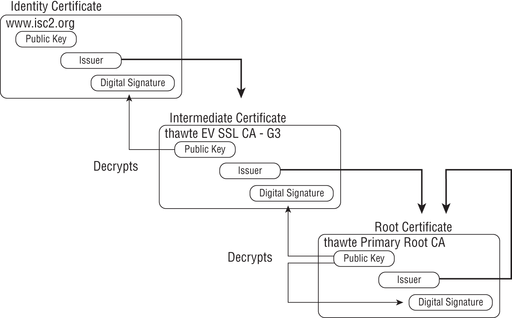

**FIGURE 3.26 A certificate chain protects a CA's root private key**

需要信任链和 `CA` 使公钥加密的使用变得相当复杂。有一种名为基于 DNS 的命名实体身份验证（`DANE`）的协议，可消除对 `CA` 的需求，但该协议未被浏览器广泛支持，因此未被网站采用。

## 密钥管理实践

安全使用密码学取决于保持对称密钥和私钥的机密性。能够获取或猜测密钥的攻击者可以破坏该密钥所保护的数据的保密性和完整性。

适当的密码学密钥管理包括以下内容：

*   安全的密钥生成
*   安全的密钥存储和使用
*   职责分离、双重控制和知识分割
*   及时的密钥轮换和密钥变更
*   密钥销毁

### 安全的密钥生成

使密码学密钥安全的有两个因素：长度和随机性。长且随机的密钥具有更高的“密钥强度”，如本节前面所述。

通常，密钥越长，攻击加密消息就越困难——但随着计算机能力的增强和密码分析技术的不断完善，构成安全密钥长度的标准会随时间而变化。1977 年，美国政府选择了一种对称分组密码，命名为 `DES`，被认为适用于非机密用途（例如银行、电子商务等）。1999 年，证明 `DES` 加密的消息可在 24 小时内被破解。

估计使用现代计算机，对 128 位密钥进行暴力攻击需要的时间超过宇宙的年龄（约 140 亿年）才能破解。当然，随着计算能力的持续提升，以及量子计算的日益成熟，这些估计终有一天会被打破，并会出现对更长密钥长度的需求。


对称密钥的强度还取决于其不可预测性（即不可猜测）。即使只能猜出其中的部分比特，也会显著降低密码的强度。使用能够生成高质量（即密码学安全）随机数的机制对于密钥生成至关重要。最佳方法是使用基于硬件的真随机数生成器，其依赖于已知真正随机的物理现象。此类设备嵌入在各种加密硬件设备中，例如 `TPMs` 和 `HSMs`，前面已讨论过，以及一些微处理器。

*基于软件的随机数生成器*（`RNGs`），最好称为 *伪随机数生成器*，很难做到正确。例如，从 2006 年到 2008 年，`OpenSSL` 软件包在 `Debian` 和 `Ubuntu` Linux 发行版中引入的一个缺陷导致所有生成的密钥都很弱，因为随机数生成器存在漏洞（`CVE-2008-0166`）。

## 安全的密钥存储和使用

一旦你生成了一个很长且随机的密钥，如何保持其保密？显然，第一步是用另一个密钥，即密钥加密密钥（`KEK`）来加密你的数据加密密钥（`DEK`）。这解决了问题，但又产生了一个新问题：如何保护你的 `KEK`？这取决于被加密的底层数据的敏感性以及为你设计的系统所适用的机制。

`HSM` 专为安全生成和存储 `KEKs` 而设计，是保护密钥的较为安全的方法之一。`HSMs` 还提供在冗余 `HSMs` 之间安全复制 `KEKs` 的方式，并强制执行控制措施，以确保没有个人可以单独使用 `KEK` 来解密数据加密密钥。银行、支付处理商和其他高度受监管组织的合规制度通常要求使用 `HSM`。作为 `CISSP`，你应了解组织的合规要求，并确定 `HSM` 对你的公司是否必需（或有益）。

对于部署在公有云中的系统，主要云服务提供商提供 `HSM` 技术的云实现。市场上还有许多 `HSM` 即服务（`HSMaaS`）供应商，通常作为与密钥托管和加密加速等其他加密功能一起提供的服务。

对于要求不高的应用，方法必须根据具体要求和风险进行定制。可以将主密钥存储在以下任何位置：

*   一个硬件加密的 USB 密钥
*   一个密码管理应用
*   一个密钥管理包

另一个需要考虑的因素是你的密钥如何（安全地）备份。丢失对密钥的访问可能会导致你丢失大量其他数据（以及该数据的备份）的访问权限。

## 职责分离、双重控制和分割知识

某些密钥和数据过于敏感，内部威胁（例如， rogue 或不满的员工）的风险太大，不能允许单个个人访问密钥加密密钥、数据加密密钥和加密数据，或单独访问 `HSM` 的管理功能。

以下三种类型的控制用于降低 rogue 员工的风险：

*   职责分离
*   双重控制
*   分割知识

这三个概念相关但不同。

*职责分离*（有时称为 *职责隔离*）意味着某些流程应至少需要两个不同的人从头到尾完成。在金融领域，这可能涉及确保有权开具支票的人不是对账银行对账单的人。在密码学领域，这可能规定有权访问加密密钥的人无权访问加密数据。职责分离的另一种形式是确保管理系统的员工无权干预日志系统或篡改日志。

双重控制意味着流程中的特定步骤需要两个或更多个人。在金融领域，这将是要求每张支票上都有两个签名。在密码学领域，这可能要求两个或更多个人出示其凭证才能使用密钥加密密钥解密数据加密密钥。

对于支持多因素身份验证的系统访问，双重控制可能涉及将密码委托给一个人，而将 MFA 设备委托给另一个人。

请注意，双重控制经常被错误地称为职责分离。请注意区别并检查控制措施，以确定它确实是职责分离还是双重控制。

分割知识是指将密钥（或密码）拆分为两个或多个部分，使得每个部分单独不可用，并且需要将两个（或更多）部分组合起来才能解密数据（或访问系统）。

例如，供应商可能会生成一个大密钥并将其拆分为（例如 `m`）多个部分。在此模型中，至少需要 `n` 个部分才能重建密钥加密密钥。数字 `n` 和 `m` 是可配置的，因此可以例如将密钥拆分为十二个部分，但只需要任意三个密钥持有者聚在一起即可解锁密钥。

## 及时的密钥轮换和密钥变更

密钥应具有有限的生命周期。如果有证据或甚至怀疑密钥已被泄露，应尽快轮换。即使密钥的保密性得以保持，也应定期更换。此外，最佳实践是在有权访问加密材料的关键人员离职时也执行密钥轮换。

尽管行业标准各不相同，但 `NIST` 和支付卡行业（`PCI`）的当前指导是至少每年轮换一次数据加密密钥。实际上，用于加密新数据的密钥每年都会更改，并且所有先前加密的数据都使用退役密钥解密，并在密钥轮换后的当年内使用新密钥重新加密。因此，在密钥轮换后一年的结束时，不再有使用退役密钥加密的数据，此时可以销毁该密钥。在必须维护超过一年的备份的情况下，必须建立安全归档退役密钥的流程，或者备份也必须使用新密钥重新加密。

为什么要轮换密钥？

*   以防攻击者发现密钥时限制损害
*   限制使用同一密钥加密的数据量（使用同一密钥加密的数据越多，破解加密就越容易）
*   限制攻击者破解密码的时间（如果你的数据在一年以上的时间内没有使用同一密钥加密，那么任何暴力攻击都必须能够在密钥生成后一年内完成）

## 密钥销毁

一旦密钥已退役，并且确定没有使用该密钥加密的数据需要解密，则必须安全地销毁该密钥。这涉及找到密钥的每个副本并以适合其存储介质的方式删除，以确保无法恢复。

根据介质以及其被未经授权的个人访问的风险，这可能需要覆盖存储、消磁介质，或物理销毁包含介质的介质或设备。

应保留记录，记录被销毁密钥的位置以及为确保安全销毁而采用的手段。

## 数字签名和数字证书


`Digital signatures` 使用密码技术来复制签名的意图：身份验证（使收件人确信消息来自特定实体）、不可否认性（证明发送者确实撰写了该消息的证据）以及完整性（确信消息在签名后未被篡改）。`Digital certificates` 是用于证明公钥所有权的电子文档；这一概念在本书本章前面的“Public Key Infrastructure”部分有讨论。

Figure 3.27 说明了基本流程。待签名的消息会通过一个密码学安全的哈希函数，该函数产生一个固定长度的输出（通常在 160 到 512 位之间），称为 `Message Digest`。该哈希值随后使用消息作者的私钥加密，以产生数字签名。数字签名作为附录与消息一起传输。

当收件人想要验证文档时，他们会计算所接收消息的 `Message Digest`。然后他们使用作者的公钥解密数字签名，以产生发送者的 `Message Digest`。如果两者相同，则收件人知道以下内容：

1. 消息未被篡改（即完整性得以保持）。
2. 消息来自公钥/私钥对的所有者（即身份验证和不可否认性）。

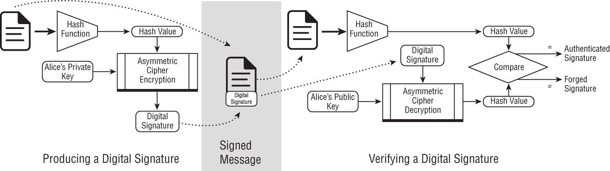

**FIGURE 3.27 Producing and verifying a digital signature**

断言 2 要求收件人有充分理由相信用于验证数字签名的公钥由发送者拥有。这可以通过直接密钥共享来实现（即在通信之前，发送者在防止篡改的安全方式下向收件人提供其公钥），也可以通过向 CA 注册公钥来实现（正如本章前面关于 PKI 的部分所述），CA 承担验证发送者身份的责任。

为了保护数字签名的安全性，强烈建议用于签名消息的私钥仅用于数字签名，而不用于任何其他目的（如一般消息加密）。

数字签名存在若干可能的安全漏洞：

* `Hash collision`
* Private key disclosure
* CA compromise

数字签名的安全性取决于消息正文的任何更改都会导致 `Message Digest` 发生变化。如果攻击者能够创建两个消息，在经过哈希算法时产生相同的 `Message Digest`（称为 `hash collision`），则数字签名将不再可靠。

为了使收件人确信消息确实源自作者，发送者的私钥必须保持安全，因为一旦获得该密钥，攻击者就可以签署任何消息（包括被篡改的消息），从而破坏数字签名的任何有效性。为缓解这种情况，所有 PKI 模型都包含密钥撤销列表的概念，该列表记录了所有已被（或怀疑已被）泄露或退役的密钥。

最后，检查消息是否与发送者的公钥匹配取决于知道该公钥确实是发送者的。通常，这是通过 CA 将所有者身份与公钥绑定来实现的，公钥的接收者依赖于他们对 CA 的信任来信任该公钥。但如果 CA 被入侵，攻击者可以伪造公钥的身份并“伪造”数字签名。

### Nonrepudiation

`Nonrepudiation` 是证明消息必须源自特定实体的能力。例如，对于合同或其他法律文件，以及银行指令或供应商订单，这可能至关重要。只有在能够证明所接收通信的不可否认性时，收件人才能确信地根据消息采取行动，并确信发送者对其内容负责。

不可否认性是通过发送者使用只有发送者知道的私钥对消息进行签名来实现的，并且发送者承诺保护该私钥。保护私钥意味着保持其机密性，如果密钥被泄露，则及时撤销对应的公钥。

对不可否认性属性的主要风险是发送者私钥的泄露。如前所述，如果私钥可以被获取（或猜出），攻击者就可以签署任何消息，并使其被接受为好像私钥所有者发送的消息一样（例如，“向银行账户 XXX 转账 100,000 美元”）。

为了确保即使用于签名的私钥被泄露，数字签名仍能保持不可否认性，可以使用可信时间戳来证明消息是在私钥被泄露的时间之前签名的。IETF 标准 RFC 3161 定义了与时间戳机构 TSA 一起使用的协议，以提供可信时间戳。TSA 与 CA 类似，是一个可信的第三方，提供保证。TSA 断言特定数据在某个时间点存在，以一种方式使时间戳的接收者确信（如果 TSA 可信），该断言是正确的，并且时间戳未被篡改，也无法被篡改。

次要风险来自 PKI 的弱点，导致消息的接收者被误导，以为某个公钥与某个实体相关联，而实际上攻击者生成了该公钥并设法伪造了与其关联的身份。例如，这就是 DigiNotar CA 被入侵时发生的情况，攻击者能够生成声称来自 Google 和其他公司的公钥。（参见本章前面“DigiNotar: When a Trusted CA Is Compromised”侧边栏。）

#### Blockchain and Nonrepudiation

实现不可否认性的另一种方法是使用区块链。区块链是一种去中心化和分布式账本，其中记录被记录并通过密码学哈希链接在一起，这意味着要更改区块链中的任何记录，就必须更改其后的每个区块。由于区块链是分布式的（即由多个系统存储），因此需要区块链参与者的大多数串通。对于足够广泛（且独立）运营的区块链来说，这是不可行的。例如，比特币目前（2021 年初）大约有 12,000 个节点分布在 100 个国家。

诸如不可否认性之类的好处推动了该技术在供应链管理等业务应用中的采用。福特汽车公司等组织已开始探索区块链技术用于其供应链管理，因为它能够实现更快、更具成本效益的产品交付并增强产品的可追溯性（即不可否认性）。

### Integrity

密码学方法不仅可以保护消息的保密性并帮助证明发送者的身份，还可以用于通过检测篡改来保护消息的完整性。完整性是一个核心安全概念，是众所周知的 CIA 三要素的一部分，并在 Chapter 1 中介绍。有关完整性及其如何实现和验证的更多信息，请参阅该章中标题为“Understand and Apply Security Concepts”的部分。

`hash function` 是一种算法，它接收数据块（即消息或文件）并计算一个派生值，使得对数据的任何更改都会导致哈希值发生变化。有效的哈希函数还需要其他属性，这将在本章中介绍。


该函数可用于通过比较原始数据的哈希值与稍后时间点的数据的哈希值来验证数据的完整性。

使用加密哈希来检测消息是否被篡改涉及以下三个步骤（如 Figure 3.28 所示）：
1. 通过将哈希函数应用于原始数据块或消息 (`M[1]`) 来生成哈希值 (`H[1]`)。
2. 通过将哈希函数应用于待验证的数据块或消息 (`M[2]`) 来生成哈希值 (`H[2]`)。
3. 如果 (`H[1]`) 与 (`H[2]`) 相同，则表明这两个消息很可能相同且未被篡改。然而，正如我们即将看到的，关键问题是“有多可能？” 如果两个消息的哈希值相同，我们对这两个消息相同的信心程度应有多高？

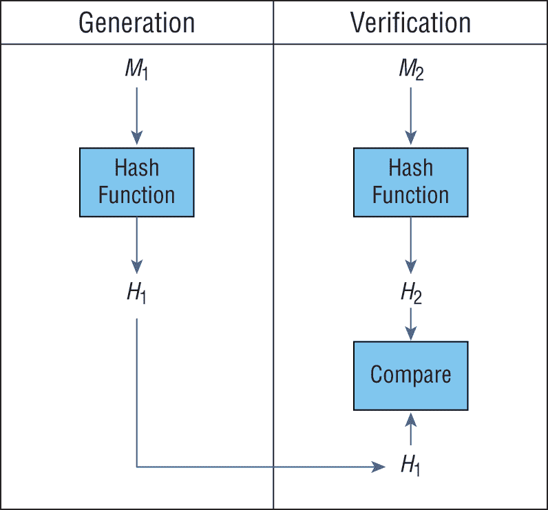

**FIGURE 3.28 Steps for using a cryptographic hash to detect tampering of a message** ¶ From NIST Special Publication SP800**\-**175B, “Guideline for Using Cryptographic Standards in the Federal Government: *Cryptographic Mechanisms”*

要理解哈希，让我们考虑一个简单的例子，即校验和。*校验和* 是一种数学函数，它接收一个数据块并计算一个数字（校验和），其方式是数据块的任何单次更改都会导致校验和数字发生变化。如名称所示，校验和通常是通过将消息中每个字节作为无符号整数求和并忽略任何溢出来计算的。

当主要威胁来自通信信道中的噪声或其他缺陷时，数据包会携带校验和，接收方可利用它来确定数据在传输过程中是否已损坏。接收方重新计算数据包的校验和，将其与发送方计算并附加到消息中的校验和进行比较，如果两者不匹配，接收方就会知道消息在接收时存在错误。

在消息更改是随机的而不是恶意的情况下，简单的校验和足以保护消息的完整性。但想象一下威胁行为者想要篡改消息的情况。原本是转账 $100 的订单，恶意代理希望将消息更改为转账 $100,000。显然，如果仅更改金额字段，则校验和不太可能匹配，他的篡改很可能会被发现。

然而，这对我们的攻击者来说不是问题，他了解用于计算校验和的算法，并且可以进一步篡改消息，要么通过对消息内容做出其他更改以使校验和保持不变，要么通过计算新的校验和并覆盖原始校验和。采用任何一种方法，校验和都会验证通过，欺诈性转账 $100,000 的消息将被接受为有效。

例如，考虑以下传输，其中 `[0x116c]` 是发送方附加到消息的校验和：

```
TRANSFER $100.00 TO JANE DOE FOR OFFICE AND MISC EXPENSES IN DECEMBER [0x116c]
```

我们的攻击者希望发送一条略有不同的消息（但复制了原始消息的校验和）：

```
TRANSFER $100,000.00 TO JANE DOE FOR OFFICE AND MISC EXPENSES IN DECEMBER [0x116c]
```

问题是新消息的实际校验和 (`0x1228`) 与声明的校验和 (`0x166c`) 不匹配，因此他的篡改会被检测到。

一种可能的攻击是对消息做出其他更改，以便校验和与原始消息相同：

```
TRANSFER $100,000.00 TO JANE DOE FOR OFFICE MISC EXPENSES IN DECEMBER7 [0x116c]
```

其校验和与原始消息相同，为 `0x116c`。或者，攻击者可以覆盖附加到消息的校验和，使其成为篡改后消息的校验和：

```
TRANSFER $100,000.00 TO JANE DOE FOR OFFICE AND MISC EXPENSES IN DECEMBER [0x1228]
```

很明显，使用简单的校验和并将其包含在消息中并不能检测恶意篡改，但它有助于避免传输或数据输入中的非恶意错误。校验和通常用于防止信用卡、政府身份证号码和其他类型验证流程中的偶然错误。最常用的算法之一是 Luhn 算法，该算法由 ISO/IEC 7812-1 规定。

当校验和不足时，我们需要一种验证消息完整性的方法，攻击者无法轻易规避。为了保护数据的完整性，我们需要一个哈希函数，其复杂性足以使其几乎不可能创建与另一条消息具有相同哈希值的消息。当两个不同的消息生成相同的哈希值时，称为 *碰撞*，因此我们需要一个哈希函数，使其几乎不可能创建有意的碰撞。

在我们之前的示例中，有两个因素使得创建碰撞变得微不足道：
* 算法的简单性使得很容易确定需要对修改后的消息做出哪些更改以使哈希（校验和）与原始消息的哈希相匹配。
* 即使算法复杂，哈希的短小（16 位）意味着只有 65,536 种可能的哈希值，反复对消息末尾进行随机更改，直到偶然发生碰撞所需的时间并不长。

因此，密码学安全的哈希算法必须足够复杂，以至于不可能确定需要对消息做出哪些更改才能创建特定的哈希结果，并且哈希值的长度（即位数）必须足够大，以使暴力攻击在计算上不可行。

负责研究和推荐合适的密码算法的组织之一是 NIST。他们的指南之一 FIPS 202 推荐了一类称为安全哈希算法-3 (`SHA-3`) 的算法。`SHA-3` 函数集包括产生哈希值长度从 224 到 512 位不等的哈希函数。

使用 `SHA-3`，我们可以计算出一个非常难以通过创建有意碰撞来攻击的哈希值——但我们如何防止攻击者简单地为更改后的消息计算新的哈希值并覆盖原始哈希？为此，我们需要使用一个结合了只有发送方和接收方知道的密钥的加密哈希。哈希值不仅取决于消息的内容，还取决于此密钥。

一种称为基于哈希的消息认证码 (`HMAC`) 的方法由 Bellare、Canetti 和 Krawczyk 开发，并在 RFC-2104 中正式确定。该算法将密钥（已与字符串进行 XOR 以填充到固定长度）与消息连接并对其进行哈希处理。然后它将该哈希值与密钥再次组合，并进行第二次哈希处理，生成 `HMAC` 值（参见 Figure 3.29）。如果攻击者在不知道密钥 `K` 的情况下更改消息，`HMAC` 值将不匹配。这使接收方能够验证消息的完整性和来源（即身份验证或不可否认性）。


除了其他用途外，`HMAC` 函数可在 `IPsec` 和 `TLS` 协议中发现。然而，这其中存在的问题与在对称加密上下文中讨论的问题类似。在发送方和接收方之间安全地共享密钥可能很困难且繁琐。那又怎样呢？正如对称加密中共享密钥问题的解决方案是使用公钥/私钥和非对称加密一样，对于密码哈希，我们可以使用发送方的私钥对哈希进行加密，任何人都可以利用发送方的公钥对其进行验证，但没有人可以在没有私钥的情况下伪造它。这就是数字签名（在本章前面“数字签名”部分讨论过）。

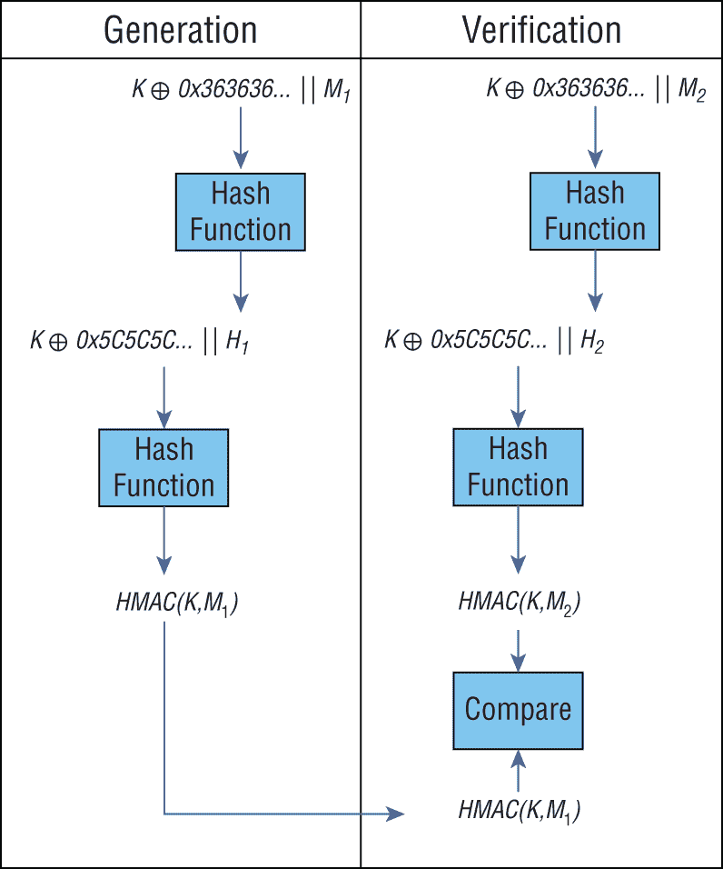

**FIGURE 3.29 HMAC process**

`HMAC` 是一种确保消息完整性和身份验证的较不复杂的方法，但需要共享对称密码密钥的开销。数字签名消除了共享秘密的需要，但需要 `PKI` 的开销。每种方法都有其应用。

## UNDERSTAND METHODS OF CRYPTANALYTIC ATTACKS

了解密码学如何被攻击很重要，这样你才能了解漏洞可能出现在哪里，以及密码学的错误应用如何导致漏洞。

作为一名安全架构师，你需要了解攻击者可以利用的架构弱点，以便确保你的设计避免或减轻这些风险。但作为一名安全架构师，你不必担心诸如对称密码的关联密钥攻击等细微差别。这是负责开发新密码算法或测试现有密码的密码学家的关注点。作为一名安全架构师，你的兴趣更多地在于关注欧洲网络安全局（`ENISA`）和 `NIST` 等机构的新闻，这些机构负责就应使用哪些算法（以及如何使用）做出审慎的建议，以便当密码分析人员发现新的攻击向量时，你可以在选择（或更新）所使用的密码时将他们的发现纳入考虑。

### Brute Force

在 *暴力攻击* 中，攻击者尝试所有可能的密钥值，直到找到可用的那个。在对称密码的情况下，这意味着攻击者尝试所有可能的密钥，直到他们将密文解密为与已知明文相匹配的内容。在许多情况下，并不需要完全了解明文。如果一个人知道消息的一般格式或消息的语言，他可以对照某些启发式方法检查解密的输出，以确定输出是否可能是原始明文（即阅读输出以查看其是否合理）。

如果加密算法使用 64 位密钥，攻击者将从 `00 00 00 00 00 00 00 00[16]` 开始，直到达到 `FF FF FF FF FF FF FF FF[16]`。这可能需要很长时间。如果你的系统可以在 1 微秒内解密一段密文并确定结果是否可能是期望的明文，那么遍历所有可能的密钥大约需要 5,800 个世纪。不幸的是，对于密码学来说，计算机每年都在变得更快。

显然，对抗对称密码暴力攻击的主要防御手段是密钥长度，这就是为什么 `AES` 的最小密钥长度为 128 位。

在密码学安全哈希（如用于保护密码的哈希）的情况下，攻击场景假设一个人拥有包含使用安全哈希加密的所有密码的系统密码文件转储。攻击者然后尝试将密码哈希与猜测进行比较，以查看可以确定哪些密码。

天真的方法是從 “a” 开始，尝试每种组合直到，例如 “`ZZZZZZZZZZ`”。更复杂的方法是拥有一个常用密码的字典，通常由语言词典中的条目组成，结合作为密码频繁使用的单词、字母和数字的组合（例如，`Password123`）。在尝试完密码破解词表（或字典）中的所有条目后，攻击者可以从每种可能的六个字符组合开始（假设系统的最小密码长度为六），然后是每种七个字符的密码，等等，直到失去耐心（或预算）。

这是用于分析 2016 年 LinkedIn 密码泄露中泄露的 1.77 亿个哈希的方法。大约 5 千万个唯一密码，代表文件中超过 85% 的密码，已被破解。

对此类攻击有两种防御措施，LinkedIn 当时均未使用：

*   哈希复杂度
*   加盐

LinkedIn 密码文件使用了 `SHA1`，这是一种快速高效的哈希算法。当谈到保护密码时，快速高效正是你*不*想要的。使用 2016 年技术的八 GPU 密码破解系统每秒可测试 69 亿个 `SHA1` 哈希！

当谈到密码哈希时，越慢越好……好得多。目前推荐的算法之一是基于密码的密钥派生函数 2（`PBKDF2`）——使用相同的八 GPU 引擎，每秒只能生成 10,000 个哈希（即大约慢 700 万倍）。

对抗慢哈希的反攻击是预计算的哈希数据库。攻击者取一个常用密码字典（数亿个来自过去泄露的密码可在网上免费获得）和每种可能的密码直到，例如八个字符，并提前将其通过哈希算法运行。在获得泄露的密码文件后，无需以每秒 10,000 个哈希的速度缓慢进行；如果密码哈希已经知道，只需查找每个哈希即可。

如果存储这些哈希所需的存储空间过大，为压缩哈希而以稍长的查找时间为代价，可以使用称为 *彩虹表* 的技术。

对抗存储的字典或彩虹表攻击的防御方法是將密碼與一個唯一的、大型随机数（称为 *盐*）组合，然后存储密码和盐的组合哈希。以这种方式，你必须预先计算 2^n 个彩虹表（如果盐有 *n* 位），因此攻击不可行。

因此，密码文件包含两个字段（除了用户的登录名和其他元数据）：

*   盐
*   `HASH (salt + password)` 的输出

为了安全，盐必须满足以下条件：

*   长（至少 16 字节，最好为 32 或 64 字节）
*   随机（即 *密码学安全* 伪随机数生成器的输出）
*   唯一（为每个用户的密码计算新的盐，并在每次更改密码时计算新的盐）

有些人更进一步，使用对称密码加密哈希，但这被认为是不必要的，并且几乎没有额外的安全性。按照密码密码学中使用的命名法，此步骤称为 *胡椒*。

遵循本章开头概述的纵深防御原则，不应依赖单一的安全机制来提供安全性。在密码的世界里，纵深防御通常意味着多因素身份验证，以便密码的泄露本身不会导致访问管理系统被泄露。

### Ciphertext Only


在这种情况下，攻击者只能访问加密流量（密文）。在许多情况下，可以猜测明文的一些信息（例如消息的语言，这可能导致了解字符概率分布，或消息的格式，这可以为明文的部分提供线索）。`WEP`，WiFi 的原始安全算法，容易受到多种仅密文攻击。通过捕获足够数量的数据包（通常在繁忙的网络上几分钟内即可收集），可以推导出 `RC4` 流密码中使用的密钥。

### 已知明文

在这种情况下，攻击者知道一个或多个消息的部分或全部明文（以及密文）。这经常发生在消息的部分往往是固定的情况下（例如协议头或其他相对不变的消息通信部分）。已知明文攻击的一个例子是著名的德国 `Enigma` 密码机，它在很大程度上是通过依赖已知明文被破解的。许多消息在相同位置包含相同的词，或包含相同的文本（例如，“Nothing to report”），使得破译消息成为可能。

### 选择明文攻击

在这种情况下，攻击者能够提交攻击者选择的任何明文并获得相应的密文。二战期间发生的选择明文攻击的经典例子是美国截获了消息，表明日本计划攻击代码中称为“`AF`”的地点。美国怀疑这可能是中途岛，为了证实他们的假设，他们安排从中途岛发送一条明文消息，称该岛的水净化厂已损坏。当日本截获该消息然后发送一条提及“`AF`”的编码消息时，美国获得了所需的确认。

### 频率分析

在密码分析中，`frequency analysis` 是对密文中字符（字母、数字或其组合）的频率进行研究。这种攻击最适合针对原始的密码学方法，例如将给定集合中的每个字符（例如字母表）映射到另一个字符的替换密码（例如 a = z，b = y，等等）。通过了解给定语言中字符的典型分布，频率分析可以帮助密码分析员推断常见密文字符的明文等价物。大多数现代密码算法不受频率分析的影响。

### 选择密文

在这种情况下，攻击者能够提交任何密文并获得相应的明文。这方面的一个例子是对 `SSL 3.0` 的攻击，由贝尔实验室的 Bleichenbacher 开发，该攻击在尝试 300,000 到 200 万个选择密文后，可以获得网站的 `RSA` 私钥。

### 实现攻击

`Implementation attack` 是一个广泛使用的术语，用来描述利用实现弱点的任何攻击，例如软件、硬件或加密算法本身。（有关更多详细信息，请参阅“Select and Determine Cryptographic Solutions”部分。）

### 侧信道攻击

`Side-channel attacks` 涉及测量密码过程的产物以推断信息，从而协助破坏加密信息。这些产物可以包括以下内容：

* Timing
* Cache access
* Power consumption
* Electromagnetic emanations
* Error information

加密或解密数据块所需的时间可能会根据密钥或明文而变化，对加密或解密数据所需时间的仔细分析可以揭示信息。执行密码操作的所需时间可能因多种原因而变化：

* 代码中的条件分支，这可能会根据所取分支改变执行时间，而分支又取决于密钥或明文的值
* 执行时间取决于操作数的 CPU 指令（例如乘法和除法）
* 内存访问，这可能因数据所在的位置（内存类型）或访问历史而变化（从而影响缓存并因此影响内存访问速度）

缓存攻击通常涉及在同一物理处理器上运行的不同虚拟机上的进程。随着执行加密的 VM 与运行攻击者进程的 VM 进行时间片轮转，攻击者可以探测处理器的缓存以推断有关明文和密钥的信息，从而破坏加密过程。

执行密码操作的设备消耗的功率可能会根据执行的指令而变化，而指令又取决于正在加密的密钥和数据。通过仔细监控设备消耗的功率，有时可以提取有关密钥或明文的信息。这种类型的攻击最成功地针对智能卡，因为相对容易监控设备的功耗，但攻击机制具有广泛的适用性。

所有电子系统都会发出电磁辐射，并且有可能在距离设备一定距离的情况下捕获这些辐射。这些无线电信号有时可以被分析以揭示设备正在处理的数据的信息。这种类型攻击的早期例子涉及分析加密设备的辐射，这些设备将解密的消息打印在电传打字机上以确定正在打印哪些字符。

存在对策，但在某些情况下，它们可能非常难以实现，或者会带来相当大的性能损失。在定时攻击的情况下，有必要修改算法，使其为等时，即无论处理的密钥和数据如何，都以恒定时间运行。

解密软件提供的（或泄露的）错误信息可以为攻击者提供有用的信息。在填充预言机攻击中，可以发送任意数量测试消息的系统，并且对于未正确填充的加密消息会生成独特的错误，可以用来在不知道密钥的情况下解密消息。防御方法是报告通用错误，并且不区分填充错误和其他错误。

### 故障注入

故障注入攻击是侧信道攻击的一种，涉及故意注入有故障或错误的输入并观察错误和输出。有关更多详细信息，请参阅“Side-Channel Attacks”部分。

### 定时攻击

`timing attack` 是一种侧信道攻击，涉及攻击者通过监控执行算法函数所需的时间来尝试破坏密码系统。有关更多详细信息，请参阅“Side-Channel Attacks”部分。

### 中间人

`MITM` 攻击要求攻击者能够拦截并在两个参与者之间中继消息。例如，Michelle 想要破坏 Alice 和 Bob 之间的通信。Alice 想要使用公钥密码学与 Bob 安全通信。Michelle 是我们的攻击者。考虑到这一点，以下情况发生：

1. Alice 向 Bob 发送消息请求 Bob 的公钥。
2. Michelle 将消息中继给 Bob。
3. Bob 用他的公钥回复，但 Michelle 拦截了该消息并用 Michelle 的公钥替换它。
4. Alice 认为她拥有 Bob 的公钥，使用 Michelle 的密钥加密消息（例如，“请从我的账户向 Acme Company 转账 10,000 美元”）。
5. Michelle 拦截消息，解密它（因为它是用她的密钥加密的），篡改它（例如，“请从我的账户向 Michelle 转账 10,000 美元”），使用 Bob 的密钥加密篡改后的消息，并将消息发送给 Bob。


为了防御此类攻击，Alice 需要确信包含 Bob 密钥的消息确实源自 Bob（而非中间人攻击者 Michelle）。在加密的 HTTPS 网络流量中，这是通过依赖由 CA（证书颁发机构）签名的公钥证书来实现的（如“公钥基础设施”部分所述）。但如果 CA 被入侵，攻击者就可以绕过 HTTPS 的身份认证保护。

2011 年，荷兰 CA DigiNotar 被入侵，导致针对约 300,000 名 Gmail 用户的中间人攻击取得成功。

### Pass the Hash

`Pass the hash` 是一种攻击，当攻击者获取到密码哈希并将其用于身份验证时就会发生。在这种攻击中，攻击者无需解密哈希或以其他方式获取明文密码。此类攻击针对的是身份验证协议，而非哈希或其他任何加密元素。

最小权限安全模型可以通过减少攻击者获得和使用提升权限的能力来帮助限制传递哈希攻击发生的可能性和影响。能够轮换密码（最好是自动轮换）的密码管理流程和工具也有助于对抗此类攻击。

### Kerberos Exploitation

`Kerberos` 是一种网络身份验证协议，使用对称密钥加密为客户端/服务器环境提供强身份验证。该协议基于票据运行，允许网络上的节点（系统）相互证明身份。

与任何广泛使用的协议一样，黑客一直在寻求并找到了破坏 Kerberos 的方法。大多数成功的 Kerberos 利用都利用了系统漏洞（如使用弱算法）、恶意软件或弱密码。一种常见的利用方式称为传递票据，即攻击者伪造一张票据并将其传递以对资源进行身份验证。

应使用多因素身份验证来抵御 Kerberos 实现中的钓鱼攻击和密码弱点。还应启用对 Active Directory 域的日志记录和监控，以检测未经适当身份验证的资源访问（例如，通过传递票据）。

### Ransomware

`Ransomware` 是一种恶意软件，会感染系统、加密受害者的文件并使其无法使用，直到支付赎金为止。在典型的勒索软件攻击中，受害者会收到支付费用以获取解密密钥恢复数据的说明。攻击者通常要求以比特币支付，因其匿名性。

防御勒索软件与防御任何类型恶意软件的最佳实践类似。保持操作系统和应用程序修补并及时更新，限制管理权限的使用（即最小权限），并使用受信任的反恶意软件软件并更新签名，同时遵循其他系统加固最佳实践。

除了保持整体良好的安全卫生习惯外，频繁备份数据是恢复勒索软件攻击的最好方法——无需支付费用！通过将例行备份安全存储，您将能够在遭受此类攻击时恢复到已知良好的状态。

## APPLY SECURITY PRINCIPLES TO SITE AND FACILITY DESIGN

前面为信息安全概述的一般安全原则也适用于场地和设施设计。CIA 三要素和支持的安全原则在此适用，并指导我们将安全原则应用于这一挑战：

* `Confidentiality and Integrity:` 机密性和完整性的主要物理威胁是未经授权的访问（例如，入侵者和盗窃）。
* `Availability:` 除了未经授权访问对可用性的威胁外，可用性还可能因一系列事件而被故意或意外破坏：
    * 环境事件，如火灾、洪水、风暴或地震
    * 基础设施事件，如停电、制冷（HVAC）故障、洪水（因水管破裂）

以下各节将概述可用于降低上述漏洞风险的控制措施，但与所有风险一样，安全架构师必须考虑处理风险的所有方法：规避、缓解、转移和接受。

可以通过选择不太可能受到某些风险影响的设施来规避物理威胁（例如，将数据中心设在地质稳定地区可有效消除地震风险，正如避开已知有龙卷风和飓风活动的地区可降低气象事件风险一样）。

可以通过实施以下各节中概述的安全控制（管理、技术和物理）来缓解威胁。

可以通过保险（火灾、盗窃、业务中断等）或合同方式（例如，与托管或数据中心托管服务提供商签订合同以提供安全场地和设施，从而使您的组织免除部分责任）来转移（或分担）许多物理风险。

一旦应用了所选的风险管理方法（规避、缓解、转移），然后评估剩余风险以确定其是否在组织的风险承受范围内，或是否可被风险所有者接受。如果不可接受，则必须采取额外步骤以进一步降低剩余风险。

## DESIGN SITE AND FACILITY SECURITY CONTROLS

如果威胁行为者只需走进您的数据中心并带走服务器，那么您为确保系统运行保护数据的机密性、完整性和可用性所做的所有思考和努力都将付诸东流。设计数据中心或聘请第三方数据中心服务需要仔细考虑风险并采取适当的控制措施来缓解这些风险。

同样，保护您工作场所的物理和环境控制对于确保信息安全至关重要。

在本节中，我们将研究一系列漏洞并概述应考虑的适当缓解措施。

请记住，正如本章开头指出的那样，安全架构的一个基本原则是纵深防御。这意味着您不能仅依赖物理安全来保护物理资产。我们必须采用其他控制措施，以便在合理可行的范围内，物理安全控制的失效本身不会导致机密性、完整性或可用性的失效。

### Wiring Closets/Intermediate Distribution Facilities

与数据中心和办公室相关的网络分发漏洞略有不同。在由单一公司（或云托管提供商）拥有和管理的 data center 中，通常网络分发会在与服务器相同的边界内，因此物理和环境安全控制将同时适用于两者。在托管设施中，不同客户可以访问设施的不同区域（以访问由他们拥有或分配给他们的专属设备）。在这种情况下，配线间由托管提供商管理，且不得让客户访问，否则即使是授权客户也可能访问或影响其他客户的服务。在办公室中，中间配线设施需要防范恶意外部人员和内部威胁，更不用说环境风险了。


并非所有内部威胁都是恶意的——怀着好意的员工试图排查网络问题，也可能在配线间造成混乱。网络交换机和其他中间配线设备经常被放置在任何方便的偏僻位置，与其他建筑基础设施共用空间（例如，电气、管道、供暖或通风）。在考虑此事时，应考虑环境影响带来的额外风险（洪水、过热，或来自电气设备的电磁干扰）。一个装满网络交换机且通风不良（或根本没有通风）的小配线间会过热，至少会缩短设备的使用寿命，在最坏的情况下会导致随机重启、错误，甚至完全故障。

配线间也可能面临诸如管道破裂或泄漏通过或靠近该空间，或楼上洗手间溢出等威胁的危险。同样，如果显而易见的解决方案（搬迁配线间位置）不可行，就必须考虑补偿性控制措施——在这种情况下，在设备上方设置防护罩以偏转任何落下的水，并在架子上放置设备（使所有设备和布线远离地面）以防止积水影响设备。

必须考虑的不仅是你为内部目的安装的网络基础设施，还包括可能穿越你无法控制的空间的其他服务的布线（电话、报警、电子门锁等）。如果为其供电的电缆位于你办公室外走廊的吊顶中，你的电子门锁还有什么用？如果报警信号通过电话线传输，而这些电话线可以在公共走廊的未上锁面板后面找到并很容易被篡改，你的报警系统又有什么用？

## 服务器机房/数据中心

与办公空间一样，你的数据中心的物理安全可以涵盖广泛的控制措施。你需要确定风险，以确保对数据中心进行安全保护，但不过度保护。

安全控制措施需要选择以应对以下问题：
* 物理访问风险（参见“将安全原则应用于场地和设施设计”部分）
* HVAC（参见“公用设施和供暖、通风与空调”部分）
* 环境风险（参见“环境问题”部分）
* 火灾风险（参见“火灾预防、探测和抑制”部分）

仅仅正确设计和建造服务器机房或数据中心是不够的，还必须制定适当的程序，以确保数据中心继续正常、安全地运行。这些控制措施至少应涵盖以下内容：
* 人员（例如，背景调查、培训或访问程序）
* 维护
* 日志记录、监控和报警
* 控制测试和审计

例如，仅拥有柴油发电机在停电时间超过不间断电源（UPS）承载负载的能力时接管是不够的。你还必须定期测试和维护发电机，并确保有足够的燃料供应（并注意燃料随时间推移的劣化）。

数据中心设计的艺术和科学已被充分理解。任何负责此类项目的人员（或选择供应商提供托管或托管服务）都应查阅以下组织提供的指导：
* 美国采暖、制冷与空调工程师学会（ASHRAE）
* ANSI / BICSI：ANSI/BICSI 002-2014，数据中心设计和实施最佳实践
* 电子工业协会和电信工业协会（EIA/TIA）：ANSI/TIA-942，数据中心电信基础设施标准
* 欧洲联盟（EU）：EN 50600 系列标准
* 国际标准化组织（ISO）：ISO/IEC 30134 系列，“信息技术 – 数据中心 – 关键绩效指标”
* Uptime Institute：分级标准

这些文件涵盖了需要考虑的整个问题范围。我们在此的论述将重点关注对你的系统和数据的安全以及客户隐私的威胁。

## 媒体存储设施

除了任何包含信息技术设备的设施所面临的机密性、完整性和可用性的通常威胁外，媒体存储设施还必须实施额外的环境控制，以确保存储的媒体不会随时间推移而退化（或至少尽可能缓慢地退化）。

具体控制措施将取决于所存储的媒体、制造商的建议以及预期的具体威胁，但通常将包括以下内容：
* 受控且稳定的温度和湿度
* 空气过滤和正压通风，以最大限度地减少空气中灰尘和微细颗粒物或污染物（例如柴油发电机或附近车辆产生的腐蚀性烟雾和发动机废气）的渗入
* 适当的地面覆盖，以最大限度地减少静电
* 仔细选址媒体存储设施，以避免来自电气设备（例如变压器或电机）的磁场

关于媒体存储的其他考虑因素包括以下内容：
* 如果媒体存储设施的环境（温度或湿度）与读取磁带的生产环境不同，则在处理之前必须留出时间让磁带适应不同的环境。
* 一些磁带媒体需要“重新张紧”（即解卷并重新卷绕），具体取决于磁带制造商的建议（例如每三年一次）。
* 对于更长期的归档存储，建议从存储的媒体中读取数据并重新记录到新媒体上。同样，应遵循磁带制造商的建议，确定适当的频率（例如每六年一次）。
* 对于放入和取出存储的媒体的跟踪，需要适当的程序。这可能包括条形码扫描和分离职责控制，要求两个人共同签收和签出媒体项目。
* 可能需要安装火灾探测和抑制系统。
* 需要适当的清洁管理，以降低火灾的可能性并减少火灾发生时可用的燃料。相关的是，媒体存储设施应仅用于存储媒体，不应与其他一般存储共用。
* 根据现场媒体存储的风险分析和相关成本，可能适合聘请异地媒体存储服务来处理与媒体安全长期存储相关的物理安全和环境问题。这可用于所有媒体或其中一部分，以便在主要媒体存储设施因火灾或其他灾难而受损时提供灾难恢复。
* 必须执行适当的媒体生命周期结束程序，在处置媒体之前对其进行清理（例如通过消磁磁性媒体）并安全销毁，以确保组织控制范围之外无法从媒体中提取敏感信息。

## 证据存储

除了适用于其他设施（包括媒体存储，如果你以磁性媒体形式存储证据）的适当安全控制外，证据存储还需要关注有助于保护证据保管链的物理控制，以证明在法庭上使用的证据未被篡改或污染。


这些控制措施至少包括一本不可更改的日志，记录放入或从证据存储中取出证据的每一项。以下额外的控制措施可以提高证据存储室的保管链日志的可信度：

* 严格的政策，规定谁被允许进入证据存储室、应记录到日志中的信息以及管理证据存储室门禁钥匙的程序
* 视频监控
* 证据存储室的门采用双重锁，或在上锁的证据存储室内放置上锁的存储柜，并对钥匙控制实行职责分离，以便需要两人才能进入证据存储

关于视频监控，应考虑采用具备运动检测功能或与门传感器相连的系统，以便仅在有人进入证据存储室时才进行录制。其原因是证据经常需要在等待审判期间长期存放，而持续的视频录制会消耗过多的存储空间，或者存储周期远短于证据存放的典型时间。

### 受限区域和工作区域安全

工作区域安全必须根据风险评估（包括威胁建模）进行设计，并遵循安全原则和适当的控制措施以降低风险。需要考虑的因素包括最小权限、需知原则、职责分离、双重控制、纵深防御以及合规义务。在实施设施安全控制的背景下，这一点尤为重要。没有其他方面的现场安全控制比这更直接地影响组织的人员。

#### 最小权限和需知原则

对受限和安全区域的访问必须仅授予个人履行其职责所必需的程度，并符合正式批准的政策和程序。访问还必须定期审查，以确保访问理由未发生变化。此外，必须保留详细的可审计记录以证明上述情况。

#### 职责分离和/或双重控制

根据风险评估，可能需要要求一个以上经过身份验证的工作人员在场才能获得对安全工作区域的访问权限。这可以是通过警卫记录或视频监控验证的管理控制，也可以是通过多重锁或电子访问控制强制执行。

#### 纵深防御

设施应设计为具有多层安全控制，支持从建筑物外部（可能包括公共入口区域）的公共区域，到诸如接待处等低安全区域，再到存放最敏感或高风险资产或工作的最高安全区域的安全等级层次结构。

从较低安全区域进入较高安全区域应对知情的内部人员显而易见，并且必须通过访问控制系统成功进行身份验证（无论是接待员/警卫、门锁、读卡器、生物识别扫描仪还是用于识别跨越安全边界个人的其他设备）。适当的严格程度和可容忍的误报率取决于所保护区域的安全等级。

此外，应考虑为更高安全区域采用不同类型的安全控制。例如，除了预防性控制（如门锁）外，还可以使用侦测性控制（如视频监控）和纠正性控制（如运动探测器和报警器）作为补偿控制，以防主要预防性控制（如门锁）失效或被破坏。

多因素身份验证技术对于物理访问与逻辑访问（如登录）一样有价值。要求用户同时持有访问卡并输入个人识别码（PIN）来解锁进入更高安全区域的门，可以防止访问卡丢失并被冒充者使用。要求使用卡（而非仅 PIN）可以防止威胁行为者通过肩窥观察员工输入 PIN。

#### 合规义务

处理政府或军事机密数据的组织必须建立满足其设施安全许可义务所需的安全控制。负责认证合规性的组织将提供详细的文件，说明为获得所需安全许可等级所需的控制措施，包括以下要求：

* 人员识别
* 警卫
* 电子访问控制
* 电子入侵检测
* 视频监控
* 内部访问控制

一种用于进行机密讨论的解决方案是敏感隔间信息设施（`SCIF`）。`SCIF`是美国和英国军事及政府机构中常见的术语，指为保持机密性而需要隔离空间的机构。通常至少是一个房间，如果不是一个加固的建筑，则为一个房间，`SCIF`可以是临时或永久的。如果你看过任何一部军事领导向总统通报重要敏感情况的电影，他们就在`SCIF`中。

GDPR、HIPAA、PCI DSS 以及其他法规或合同义务可能会施加影响物理工作区域安全控制设计的安全要求。

有关相关问题，请参阅第 5 章中“控制对资产的物理和逻辑访问”部分。

### 实用设施和供暖、通风与空调

实用设施（如电力）和 HVAC 对数据中心可靠运行同样重要。如果你的冷却系统失效，机房温度超过 105° F（40° C），那么即使你能为服务器机架维持供电也无关紧要。与数据中心设计的所有方面一样，你首先进行风险评估，然后考虑可用于将风险降低到可接受水平的控制措施。你还需要权衡建立一个特别具有弹性的单一数据中心与建立两个地理位置分离、弹性较低的数据中心之间的平衡。

仅拥有足够的（例如 N）UPS 单位来处理负载意味着在维护期间必须断开某些设备的连接。

拥有备用 UPS（N+1）和适当的切换设备意味着可以在不中断操作的情况下将设备从服务中移除进行维护。但如果在停电时有一台设备处于停机状态，则其他每台 UPS 都是单点故障。这也意味着切换设备是单点故障。

从独立的公用事业馈电到机架完全冗余的 UPS 系统被称为 2N，可消除任何单点故障。

单个数据中心内的冗余程度通常以等级级别来表征。不同标准对每个等级的确切要求略有不同，但通常提供的可用性和冗余度与 Table 3.5 中所示相似。

**TABLE 3.5 General Data Center Redundancy Tier Levels**

| TIER LEVEL | AVAILABILITY % | REDUNDANCY |
| --- | --- | --- |
| 1 | 99.671 | None. Multiple single points of failure. |
| --- | --- | --- |
| 2 | 99.741 | Some. Nonredundant (e.g., N) UPS. |
| 3 | 99.982 | N+1 UPS. Able to take equipment out of service for maintenance without affecting operation. |
| 4 | 99.995 | 2N UPS. No single point of failure, able to automatically compensate for any single failure. |


较小的机房或服务器室如果没有与电力公司配电网络的直接专用连接，就需要考虑它们的邻居（从电气角度来说）可能是谁。位于泵房、空调或制冷压缩机附近，或大型电动机工业设施附近的服务器室，可能需要特殊的电力调节设备，以消除由“嘈杂的邻居”引入到电力回路中的干扰和电压尖峰。

有许多类型的 UPS 系统，其设计和功能各不相同。电池 UPS 系统在以下几个重要方面可能存在差异：

*   **负载：** 设备提供指定连续功率水平的容量
*   **容量：** 设备能够维持负载的时间
*   **滤波：** 设备将设备与噪声、浪涌以及电网电力存在的其他问题隔离开来的能力
*   **可靠性：** 有些设计以可靠性换取低成本

存在不使用电池的 UPS 系统，它们使用大质量旋转飞轮连接以提供短期备用。这些系统适用于较大负载（> 200KW），并且可以提供比同类电池 UPS 系统更高的可靠性和更低的生命周期成本。

通常，UPS 仅用于在短暂停电期间承载负载，以及备用发电机启动并能够承担全部负载所需的时间。因此，大多数数据中心或服务器室都需要发电机来处理负载，以防停电时间超过 UPS 能够处理的时间。

发电机有多种容量可供选择，并使用不同的燃料（汽油、柴油、天然气和氢气）。天然气的优势在于无需储存燃料。风险在于某些自然灾害可能同时导致电力和燃气配电中断。

冷却系统必须设计为有多台单元且容量充足，以便数据中心即使在其中一台或多台单元发生故障（或维护）的情况下，也能保持在最大安全工作温度以下，并且即使在维护期间将一台单元停用时，温度变化的最大速率也能保持在允许范围内（例如，如果使用磁带，则小于 5°C/小时，否则为 20°C/小时）。

最后，湿度也需要管理。湿度过低会导致静电增加，而湿度过高会导致冷凝。两种情况都会导致设备可靠性降低。

对于电力（UPS 和发电机）和 HVAC 系统，都必须充分考虑以下事项：

*   定期安排的维护
*   在满载下定期测试（UPS 和发电机，以及如果未用于生产则为备用 HVAC 设备）
*   系统故障检测和报警（以及对这些子系统的定期测试）
*   定期检查和审计，以确保上述所有事项都得到适当且定期执行

如果没有上述项目，您昂贵的备用系统的风险缓解措施可能更多是想象中的而非真实的。

正如本章前面“工业控制系统”部分所述，监控和管理您的 HVAC 或 UPS 系统的系统本身可能就是一个漏洞。如果攻击者可以远程访问您的 HVAC 并破坏其运行，可能在数据中心无人值守的周末导致冷却被禁用并使服务器过热，这与由 10 万台僵尸网络发起的拒绝服务攻击一样有效。同样，未经授权的对 UPS 的远程管理员访问，轻则会导致 UPS 被禁用，下一次停电无法得到缓解；重则会导致直接停电，因为 UPS 被下线。

各种行业、国家和国际标准涵盖 HVAC、公用事业和环境系统。

*   Uptime Institute 的数据中心设计认证等级评估包括设施机械和电气系统以及环境和设计考虑等领域。等级规范可在

    `uptimeinstitute.com/resources/` 找到。
*   国际数据中心管理局（IDC）为数据中心、设施和基础设施提供开放标准，网址为 `www.idc-a.org/data-center-standards`。
*   ASHRAE 关于通风、制冷、建筑自动化和各种其他相关主题的标准可在 `www.ashrae.org/technical-resources/standards-and-guidelines` 找到。

其他标准包括 LEEDS 标准、BICSI-001，以及由三个欧洲标准化组织之一（CEN、CENELEC 或 ETSI）制定的标准，在公用事业和 HVAC 系统的设计中可能都有用，甚至是必需的。

### 环境问题

需要考虑的环境问题包括以下情况发生的可能性：

*   大型风暴（飓风、雷电、暴风雪、冰暴、台风、龙卷风、暴风雪等）
*   地震
*   洪水和海啸
*   森林火灾
*   建筑内部风险
*   害虫和野生动物
*   火山

一些漏洞可以通过为数据中心选择合适的位置来缓解，其他则可以通过建筑和场地设计来缓解。事实上，像日本、加州以及世界其他地区等具有特定常见威胁如地震、洪水、龙卷风或飓风的地区，通常都有建筑规范要求新建建筑物能够经受住这些环境威胁。

请考虑不要将任何关键基础设施组件放置在地下室，因为它们可能容易发生洪水（无论是来自外部来源如风暴或破裂的水管，还是内部原因如管道爆裂）。请记住，福岛第一核电站事故的主要原因之一就是安装在反应堆以下高度的电池、电气开关设备和冷却泵被淹没。

在面临重大威胁的情况下，必须做出决策，确定要将数据中心建设得多么 resilient，以及哪些事件被视为超出数据中心承受能力，而哪些事件将通过远程备份数据中心和灾难恢复计划来处理。

您还必须考虑，即使您投资建设一个能够应对最严重风暴或地震的数据中心，就像投资一个超强链路来连接两条链一样，数据中心的运行能力取决于外部供应商能否继续运营。

在某个时候，投资于灾难恢复计划比试图使数据中心能够抵御供应商和员工无法应对的环境威胁更有意义。

正如第 6 章，“安全评估和测试”中所讨论的，选择备用数据中心涉及考虑可能导致主数据中心瘫痪的威胁，以确定它们是否可能同样影响备用数据中心。如果两个数据中心距离太近，或可能处于同一飓风的路径上，它们可能无法提供灾难恢复计划所依赖的冗余。

建筑内部风险包括诸如爆裂管道导致的水泄漏；悬挂天花板中来自水、喷淋管道或 HVAC 设备的冷凝水；以及楼上洗手间或厨房设施的溢出。

缓解措施包括在建筑物内相对于设备适当布置管道，或如果搬入现有建筑，则相对于管道适当布置设备。在某些情况下，为部分设备安装遮雨棚可能是最佳选择。

害虫和野生动物会对通信电缆和配电造成惊人的破坏，无论是啃食绝缘层或电线本身，还是物理短路电力线。由松鼠引起的电气中断已足够常见，以至于在维基百科中都有专门条目！


另一种可能被视为环境风险的是流行病或大流行病，它会阻止你的员工或供应商的员工工作，或因疾病爆发引发的服务需求而给组织带来额外压力。COVID-19 大流行是全球每家公司的重大事件，迫使企业重新思考其运营方式。

分析必须考虑员工面临的风险水平（显然，医疗行业或经常与公众接触的人员暴露程度更高，而接触极少的人员受影响的可能性较低）。

缓解措施包括以下内容：

* 监测公共卫生部门的公告
* 制定不会激励员工带病上班的病假政策
* 制定在以下情况下运营的计划：人力减少；员工在家工作；或将工作转移到受影响较小的办公地点（适用于拥有多个办公地点的较大公司）

## 火灾预防、探测和抑制

有多种火灾抑制技术可部署以保护技术基础设施、设施和人员。流程与选择任何一组安全控制措施一样，是进行风险评估以确定适当的缓解策略。

一如既往，人身安全是首要的，任何消防系统必须首先设计用于保护在设施内工作的人员的生命和健康。使人员能够安全撤离建筑物并确保消防系统不太可能损害健康或安全，比保护系统和建筑物更重要。

接下来，需要权衡以下成本：

* 停机时间
* 恢复成本
* 火灾抑制系统成本（资本和持续维护）

通常，前两者与第三者之间存在权衡。换句话说，减少停机时间和恢复成本需要更昂贵的火灾抑制系统。选择更便宜的方法可能会增加火灾事件后使数据中心恢复运行所需的时间。

火灾开始需要三样东西：热量、燃料和氧气（更一般地说是氧化剂）。火灾预防和抑制涉及减少这三个要素中的一个或多个，使火灾无法开始或持续。一个更完整的模型增加了燃料与氧化剂之间的化学反应，形成火灾“四面体”。该模型有用之处在于某些火灾抑制系统会阻断化学反应本身，而非减少该反应所需的三个组成部分之一。

消防安全受众多法规约束，这些法规以数百年的经验为依据。这是受过训练的专业人员的领域，应在安装任何火灾抑制系统之前咨询他们。虽然本节为信息安全专业人员提供一般信息，但它不能替代针对特定情况的专家建议。

大多数司法管辖区对 IT 设备的消防保护系统都有标准和指南：

* 加拿大和美国：NFPA 75，“信息技术设备消防标准”，以及 NFPA 76，“电信设施消防保护”。
* 英国：BS 6266:2011，“电子设备安装的消防保护”。实务守则。
* 德国：VdS 系列消防保护和抑制指南。

火灾抑制系统通过向火灾区域施加灭火剂，去除维持火灾所需的四个组成部分之一。

最简单且最广泛使用的系统是湿式水喷淋系统。这些系统管道中始终充满水，每个喷淋头均由热敏玻璃泡或金属连杆控制阀门关闭，两者均设计为在特定温度下释放水。湿式系统的优点包括安装和维护成本低以及可靠性相对较高。这些系统也仅通过最接近火源的喷淋头释放水，从而限制水损。湿式水喷淋的风险来自于故障喷淋头或物理损坏（在设施内工作时用机架或梯子撞到喷淋头）导致的意外释放造成的损坏。

干式系统顾名思义，在喷淋头被火灾触发前，供水管道中没有水。这些系统用于暴露于冰冻温度的仓库和停车场，与数据中心或大多数办公楼无关。其优点是管道中不含水，不会结冰并损坏管道。缺点是腐蚀增加以及响应时间延迟，因为必须先将空气从喷淋头中排出，水才能到达火源。

另一种通常不部署在数据中心或办公楼的专用喷淋系统是雨淋喷淋系统。这是干式喷淋系统的变体，但喷淋头是开放的。一旦检测到火灾（使用烟雾、热量或手动报警），阀门打开以将水引入供水管道并通过所有喷淋头（而不考虑火灾的具体位置）。这些系统适用于需要大量水来防止火灾蔓延的某些工业情况。

预作用系统是前三种喷淋系统之一（湿式、干式或雨淋）与更复杂的触发机制的组合。单联锁预作用系统是一种管道内充有加压气体的干式系统，其中烟雾或热探测器的激活会导致水释放到供水管道中，本质上将干式系统转换为湿式系统。然而，水仅在喷淋头被触发时才释放。该系统大大降低了意外释放水的可能性，因为如果喷淋头意外触发，系统会检测到气压下降并发出故障报警，但不会释放任何水。双联锁预作用系统要求烟雾或热探测器激活且喷淋头激活后才会将水释放到供水管道中。这在冷藏空间中可能是一个优势，但在实际火灾事件中会延迟水的释放。

任何喷淋系统的适当设计都需要专业建议和持续的警惕，以确保后来的发展（例如增加悬挂式电缆桥架）不会削弱系统的有效性。喷淋器的一个局限是它们在 raised floor 或吊顶的狭小空间中效果不佳。这些空间需要水雾或洁净气体灭火系统。

标准喷淋头的替代方案是每分钟可排放大量水的喷淋头是水雾喷淋器，其释放的水量要小得多，呈微观水滴形式。这些既通过去除热量（与标准喷淋器相同）来扑灭火灾，也通过水雾转化为蒸汽时置换氧气来扑灭火灾。

在水损影响会很严重的情况下，可使用各种“洁净气体”灭火剂。其优点是对受保护设备造成的损坏极少或没有。缺点是其安装和持续维护成本要高得多。


原始的洁净灭火剂包括二氧化碳和哈龙。二氧化碳主要通过置换氧气起作用，同时还能带走热量。不幸的是，它在远低于灭火所需浓度的情况下就会导致窒息，因此需要在排放前发出警报，以确保即将被 CO² 充满的空间在排放前已疏散。哈龙气体通过干扰化学反应（“火灾四面体”的第四部分）起作用，其优点是在远高于所需浓度的情况下仍无毒。这导致其在数据中心和其他设施中被广泛使用数十年，因为在这些地方，喷淋系统可能造成的损害比受控火灾更大。然而，哈龙危害很大。在加拿大，《蒙特利尔议定书》于 1994 年逐步淘汰了其使用。

已经开发出新型、对臭氧友好的洁净灭火剂，每种都有其特定的优势。其中包括 HFC-227ea、氟化酮以及各种气体混合物（例如，氩气、氮气和二氧化碳）。这些新型洁净灭火剂比早期替代品更环保、毒性更低。

正如网络分段可以限制安全漏洞在一部分网络造成的损害一样，将关键通信设施与不太关键的数据处理设施物理分离，置于一个单独的房间并用两小时防火墙（字面意思）隔开，也可以通过防止火灾（以及灭火系统中的水）在一区域蔓延而影响另一区域的设备，从而限制损害。

同样，必须在现场存储的备份介质可以存放在单独的房间或防火存储库中。

气体灭火的使用因需要能够自动将受影响区域与正常的通风和冷却系统隔离而变得更加复杂，这样 HVAC 系统就不会稀释或移除灭火气体。

灭火器是强制性的，但员工需要接受其用途和正确使用的培训。虽然它们可能用于扑灭早期发现的很小火灾，但它们的主要作用是使服务器室内的员工在火灾阻挡其路径时能够到达出口。火灾按燃料类型分类：

*   `Class A`：普通固体可燃物（例如，纸张、木材和塑料）
*   `Class B`：易燃液体和气体（例如，汽油）
*   `Class C`：带电电气设备
*   `Class D`：可燃金属（例如，锂金属，但不包括锂离子电池，锂离子电池被视为 `Class B`，尽管水对锂离子电池火灾也很有效）
*   `Class F or K`：烹饪油和油脂

灭火器的等级基于其设计用于扑灭的火灾类别以及其所含灭火剂的量。额定为 `5BC` 的灭火器可用于 `Class B` 或 `Class C` 火灾。`10BC` 灭火器的容量是 `5BC` 灭火器的两倍。

使用错误的灭火器不仅会使火灾恶化（例如，用水扑灭汽油火灾会扩散燃料），而且对使用灭火器的人来说可能是一个严重的危险（例如，用水扑灭电气火灾会带来触电风险）。

培训并不止于了解如何以及何时使用灭火器。所有通常会在数据中心出现的工作人员都需要接受适当的培训并进行演练，以了解如何应对火灾警报或火灾事件。

确保他们了解以下信息：

*   所有出口的位置（以便他们知道最近的出口，以及被堵时备用的出口）
*   所有灭火器的位置以及如何以及何时使用它们（不同类型的灭火器适用于不同类型的火灾）
*   如何在怀疑发生误报时禁用（或延迟排放）灭火系统
*   如何在工作人员在火灾探测器触发前发现火灾早期迹象时手动触发灭火系统（在气体灭火和某些喷淋系统情况下）
*   火灾报警拉线或呼叫点的位置
*   如何手动切断数据中心的电源

最后，良好的卫生管理是灭火的重要组成部分。数据中心或服务器室不得用作存储。装有计算机零件的纸箱或 Cat 5 电缆的木盘必须存放在设施的另一部分。废纸回收箱应放置在设施外部，或者如果必须放在数据中心内部，则应小而经常清空。可燃物越少，发生火灾的可能性就越小，如果发生火灾，造成的损害也会越小。

## SUMMARY

在讨论安全架构和安全工程时，本章沿着 CISSP 通用知识体系的第三个领域展开。对安全设计原则和安全模型讨论的介绍既具有历史意义，也为理解安全架构奠定了基础。进一步的讨论集中在硬件上，从信息系统的安全功能到保护各种平台。

本章中间部分重点关注漏洞管理，即评估和缓解这些漏洞的过程。漏洞管理涵盖了多种系统和架构类型，包括基于客户端和服务器的系统、基于云的系统、工业控制系统等。

本章以密码学为结尾，从生命周期、方法到各种实践和应用用途。最后，讨论了场地和设施设计，即如何将安全原则应用于设施设计以及通过多种解决方案的应用。
